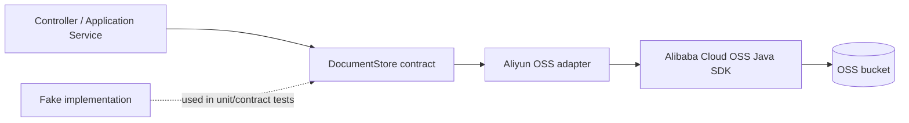

# Wrapping the Alibaba Cloud SDK in an Adapter and Contract Testing

Alibaba Cloud SDKs let Spring Boot call managed services such as Object Storage Service (OSS), ApsaraDB, Tair, or ApsaraMQ. However, if controllers and business services call SDK classes directly, application code becomes tightly coupled to the provider's class names, exceptions, request/response types, credential providers, and client lifecycles. When upgrading SDK versions or swapping services, changes can ripple across many modules.

A more maintainable structure is to introduce an **adapter** between the application and the SDK. The application defines a small contract in domain terms; the adapter translates that contract into Alibaba Cloud SDK calls and maps results/errors back into application types. Contract tests verify that all implementations obey the same behavior, while integration tests verify that the adapter interacts properly with the real managed service.

In this lesson, OSS serves as the example because document storage operations have crisp boundaries. The same principles apply to other SDKs: keep vendor types inside the adapter, manage clients as shared resources, authenticate credentials properly, control timeouts/retries, and verify behavior against the real service.

After completing this lesson, you will be able to:

- Design a port/interface around use cases rather than mirroring the SDK API.
- Create Spring beans for the OSS client and manage their lifecycle properly.
- Write an adapter to translate requests, responses, and exceptions between the domain and the SDK.
- Build a contract test suite that runs against both a fake implementation and the real adapter.
- Distinguish unit tests, adapter contract tests, integration tests, and failure-mode tests.
- Protect credentials, enforce least privilege, observe errors, and upgrade SDKs with minimal impact on business code.

## 1. Why Do We Need an Adapter?

Suppose a service stores user profiles in OSS. If the service calls the SDK directly:

```java
public class ProfileService {
    private final OSS ossClient;

    public void saveAvatar(String key, byte[] image) {
        ossClient.putObject("profile-bucket", key,
            new ByteArrayInputStream(image));
    }
}
```

Business code now knows about `OSS`, the bucket, the `putObject` API, and how the SDK accepts payloads. If you later move to a different SDK generation, change bucket strategies, add encryption, or switch providers, `ProfileService` must change too. Service unit tests often have to mock Alibaba SDK types directly, tying tests to implementation details.

An adapter establishes a clean boundary:



The application only knows `DocumentStore`. The adapter knows `OSS`, the bucket, the endpoint, the credential provider, and SDK exceptions. A fake implementation can be used in unit tests; the exact same contract test suite can run against both the fake and the real adapter.

### 1.1. An Adapter Is Not a One-to-One Wrapper Around the Entire SDK

An interface like `AliyunOssClientFacade` exposing every SDK method under renamed signatures rarely creates a useful boundary. The interface should describe what the application needs to do, such as:

- Store a document with a content type.
- Read document contents.
- Check metadata or existence.
- Delete a document.

Do not leak SDK-specific concepts such as `PutObjectRequest`, `OSSObject`, `OSSException`, `ClientConfiguration`, or `ObjectMetadata` outside the adapter. Use standard Java types or application-defined domain types. When vendor-specific capabilities are needed, extend the contract intentionally or expose a dedicated capability rather than letting every module invoke the SDK directly.

### 1.2. Assigning Boundaries by Responsibility

| Responsibility | Where It Belongs |
|---|---|
| Document naming rules, business authorization, who can read/delete | Application/domain service |
| Document storage/retrieval contract and neutral result types | Application port/interface |
| Endpoint, region, bucket, credential provider, HTTP timeouts | Adapter configuration and Spring beans |
| Translating SDK requests, responses, metadata, and exceptions | Alibaba Cloud adapter |
| Business retries, idempotency, and final error handling | Application service or explicitly designed policy |
| Real connectivity, RAM permissions, TLS, VPC, and bucket policies | Integration environment and infrastructure |

## 2. Designing the Application Contract

Minimal contract example for small documents:

```java
import java.util.Optional;

public interface DocumentStore {
    StoredDocumentMetadata put(
        String key,
        byte[] content,
        String contentType
    );

    byte[] get(String key);

    Optional<StoredDocumentMetadata> head(String key);

    void delete(String key);
}
```

Return types remain free of Alibaba SDK dependencies:

```java
public record StoredDocumentMetadata(
    String key,
    long contentLength,
    String contentType,
    String etag
) {}
```

The contract must define explicit semantics, not just list method signatures:

| Operation | Agreed Behavior |
|---|---|
| `put` | Creates or overwrites per chosen policy; returns metadata of the stored object; rejects blank keys or null content |
| `get` | Returns exact stored bytes; throws `DocumentNotFoundException` if object does not exist |
| `head` | Returns `Optional.empty()` when object does not exist; auth/network errors must be reported distinctly, never masked as empty |
| `delete` | Should be idempotent: deleting an existing or missing object succeeds if business logic chooses these semantics |
| Other errors | Translate into application exceptions, preserving the cause for logging/tracing; never leak SDK types |

Other decisions must also be spelled out in the contract: whether keys are case-sensitive, whether content type is mandatory, size limits, overwrite rules, which metadata fields are preserved, and which operations are retryable. Never leave each implementation to interpret these differently.

Neutral exception example:

```java
public class DocumentStoreException extends RuntimeException {
    public DocumentStoreException(String message, Throwable cause) {
        super(message, cause);
    }
}

public class DocumentNotFoundException extends DocumentStoreException {
    public DocumentNotFoundException(String key, Throwable cause) {
        super("Document not found: " + key, cause);
    }
}
```

In production code, avoid putting keys containing personal data into log messages; use masked identifiers or correlation IDs instead.

### 2.1. Payload Size and Streaming

A `byte[]` contract is simple for small documents, but holds the entire file on the heap. When storing videos, archives, or large files, design a streaming API (for example accepting an `InputStream` with content length and returning a closeable download handle) and support multipart upload/download. Do not read entire objects into memory just because an SDK offers a byte-array overload. The contract must clearly specify who owns and closes streams, what happens if a stream fails mid-transfer, and how incomplete multipart uploads are aborted.

## 3. SDK Configuration and Spring Bean Lifecycle

SDK clients typically hold HTTP connection pools, retry policies, and credential providers. Instantiating a new client per request is expensive and can exhaust sockets. Create a shared client aligned with the application lifecycle, configure timeouts and connection pools intentionally, and shut down the client when the Spring context closes.

OSS Java SDK V1 configuration example following the current SDK V1 builder API:

```java
import com.aliyun.oss.ClientBuilderConfiguration;
import com.aliyun.oss.OSS;
import com.aliyun.oss.OSSClientBuilder;
import com.aliyun.oss.common.auth.CredentialsProvider;
import com.aliyun.oss.common.auth.CredentialsProviderFactory;
import com.aliyun.oss.common.comm.SignVersion;
import org.springframework.context.annotation.Bean;
import org.springframework.context.annotation.Configuration;

@Configuration
public class OssClientConfiguration {

    @Bean(destroyMethod = "shutdown")
    OSS ossClient(OssProperties properties) {
        CredentialsProvider credentialsProvider =
            CredentialsProviderFactory.newEnvironmentVariableCredentialsProvider();

        ClientBuilderConfiguration clientConfig = new ClientBuilderConfiguration();
        clientConfig.setSignatureVersion(SignVersion.V4);
        clientConfig.setConnectionTimeout(5_000);
        clientConfig.setSocketTimeout(15_000);
        clientConfig.setMaxErrorRetry(2);

        return OSSClientBuilder.create()
            .endpoint(properties.endpoint())
            .region(properties.region())
            .credentialsProvider(credentialsProvider)
            .clientConfiguration(clientConfig)
            .build();
    }
}
```

This example uses OSS Java SDK V1. SDK V1 and OSS SDK for Java 2.0 have different packages, builders, credential providers, and APIs; never mix two generations in the same implementation. Pick one SDK generation and follow its matching documentation/API. For real environments, prefer RAM roles/workload identities or credential providers capable of fetching and refreshing temporary credentials. The environment-variable provider in this example fits environments where credentials are securely injected; never commit credential values to the repository.

`OssProperties` can be declared using `@ConfigurationProperties`:

```java
import jakarta.validation.constraints.NotBlank;
import org.springframework.boot.context.properties.ConfigurationProperties;
import org.springframework.validation.annotation.Validated;

@Validated
@ConfigurationProperties(prefix = "app.oss")
public record OssProperties(
    @NotBlank String endpoint,
    @NotBlank String region,
    @NotBlank String bucket
) {}
```

Register properties with `@ConfigurationPropertiesScan` or `@EnableConfigurationProperties(OssProperties.class)` according to your project structure. Configuration example:

```yaml
app:
  oss:
    endpoint: ${OSS_ENDPOINT}
    region: ${OSS_REGION}
    bucket: ${OSS_BUCKET}
```

Do not include AccessKeys in `OssProperties` when the credential provider is already responsible for resolving credentials. Separating endpoint/region/bucket from credentials keeps environment configuration clean and lowers the risk of accidentally logging secrets.

### 3.1. Managing Credentials

Prefer least-privilege workload identities. For example, workloads on ECS can use an instance RAM role; other environments use role/credential provider mechanisms supported by Alibaba Cloud. If STS is required, the credential provider must refresh tokens before expiration and surface errors clearly if fresh tokens cannot be obtained.

If long-lived AccessKeys are unavoidable:

- Create a dedicated RAM user for the workload and grant only necessary actions/resources.
- Store the secret in a secret manager or secure credential distribution system.
- Inject the secret at runtime; never store it in Git, Dockerfiles, image layers, logs, or exception messages.
- Establish a rotation workflow and verify that the application picks up rotated credentials.
- Never use the primary (root) account's AccessKey in an application.

### 3.2. Client Timeouts and Retries

Set connect timeouts, socket/read timeouts, and connection-pool wait timeouts according to SLAs. Built-in SDK retries may already be active; calculate total attempts when the application also retries at the service, HTTP, or job-scheduler layer. For example, two layers each retrying three times can generate far more requests than intended.

Retry only transient errors and operations with safe semantics. Uploading to the same object key can overwrite the previous object; if retrying when it is unclear whether the initial request succeeded, confirm whether overwriting is acceptable. For resource-creation or side-effecting operations, use idempotency keys or check current state before retrying. Never retry 403 errors, invalid credentials, missing buckets, or request validation failures as if they were transient network errors.

## 4. Implementing the OSS Adapter

Example implementation using `OSS` from SDK V1. All SDK types appear strictly inside the adapter package:

```java
import com.aliyun.oss.ClientException;
import com.aliyun.oss.OSS;
import com.aliyun.oss.OSSException;
import com.aliyun.oss.model.OSSObject;
import com.aliyun.oss.model.ObjectMetadata;
import com.aliyun.oss.model.PutObjectResult;
import java.io.ByteArrayInputStream;
import java.io.IOException;
import java.io.InputStream;
import java.util.Optional;

public class AliyunOssDocumentStore implements DocumentStore {
    private final OSS client;
    private final String bucket;

    public AliyunOssDocumentStore(OSS client, String bucket) {
        this.client = client;
        this.bucket = bucket;
    }

    @Override
    public StoredDocumentMetadata put(
        String key,
        byte[] content,
        String contentType
    ) {
        validateKey(key);
        if (content == null) {
            throw new IllegalArgumentException("content must not be null");
        }

        ObjectMetadata metadata = new ObjectMetadata();
        metadata.setContentLength(content.length);
        metadata.setContentType(contentType);

        try {
            PutObjectResult result = client.putObject(
                bucket,
                key,
                new ByteArrayInputStream(content),
                metadata
            );
            return new StoredDocumentMetadata(
                key,
                content.length,
                contentType,
                result.getETag()
            );
        } catch (OSSException | ClientException exception) {
            throw new DocumentStoreException("OSS put failed", exception);
        }
    }

    @Override
    public byte[] get(String key) {
        validateKey(key);
        try {
            OSSObject object = client.getObject(bucket, key);
            try (InputStream input = object.getObjectContent()) {
                return input.readAllBytes();
            }
        } catch (OSSException exception) {
            if ("NoSuchKey".equals(exception.getErrorCode())) {
                throw new DocumentNotFoundException(key, exception);
            }
            throw new DocumentStoreException("OSS get failed", exception);
        } catch (ClientException | IOException exception) {
            throw new DocumentStoreException("OSS get failed", exception);
        }
    }

    @Override
    public Optional<StoredDocumentMetadata> head(String key) {
        validateKey(key);
        try {
            ObjectMetadata metadata = client.getObjectMetadata(bucket, key);
            return Optional.of(new StoredDocumentMetadata(
                key,
                metadata.getContentLength(),
                metadata.getContentType(),
                metadata.getETag()
            ));
        } catch (OSSException exception) {
            if ("NoSuchKey".equals(exception.getErrorCode())) {
                return Optional.empty();
            }
            throw new DocumentStoreException("OSS head failed", exception);
        } catch (ClientException exception) {
            throw new DocumentStoreException("OSS head failed", exception);
        }
    }

    @Override
    public void delete(String key) {
        validateKey(key);
        try {
            client.deleteObject(bucket, key);
        } catch (OSSException | ClientException exception) {
            throw new DocumentStoreException("OSS delete failed", exception);
        }
    }

    private static void validateKey(String key) {
        if (key == null || key.isBlank()) {
            throw new IllegalArgumentException("key must not be blank");
        }
    }
}
```

The implementation above demonstrates the pattern using the OSS Java SDK V1 API. In a real project, verify method signatures and exceptions against your exact SDK version. You can add content-size limits, content-type validation, checksums, business metadata, and key prefixes. Never pass user-supplied URL/path keys directly to OSS; generate object keys from server-managed IDs to prevent overwrites or out-of-scope access.

### 4.1. Registering the Adapter with Spring

```java
import org.springframework.context.annotation.Bean;
import org.springframework.context.annotation.Configuration;

@Configuration
public class DocumentStoreConfiguration {

    @Bean
    DocumentStore documentStore(OSS ossClient, OssProperties properties) {
        return new AliyunOssDocumentStore(ossClient, properties.bucket());
    }
}
```

Application services only inject the contract:

```java
import org.springframework.stereotype.Service;

@Service
public class ProfileDocumentService {
    private final DocumentStore documents;

    public ProfileDocumentService(DocumentStore documents) {
        this.documents = documents;
    }

    public StoredDocumentMetadata saveAvatar(String userId, byte[] image) {
        String key = "avatars/" + userId + "/profile";
        return documents.put(key, image, "image/jpeg");
    }
}
```

The service knows nothing about the OSS endpoint, bucket, `OSSObject`, or `OSSException`. If the implementation is replaced later, the service remains unchanged as long as the contract and semantics are preserved.

## 5. Error Mapping and Retry Policy Definition

Do not let SDK exceptions propagate to controllers or the domain. The adapter translates errors into a meaningful set of application exceptions:

| Service/Client Error | Adapter Mapping | Application-Layer Handling |
|---|---|---|
| Object does not exist | `DocumentNotFoundException` or `Optional.empty()` per method | Return 404 or handle in business logic |
| Insufficient permissions / invalid credentials | `DocumentStoreException` with cause and safe classification code | Report config/permission error; do not retry continuously |
| Wrong bucket/endpoint/region | Classified configuration or service error | Halt rollout, fix configuration/infrastructure |
| Timeout or transient network error | Service access error with cause | Apply bounded retries if idempotent; otherwise verify state first |
| Quota/rate limit | Resource-limit error | Back off, lower concurrency, or request quota increase per policy |
| Invalid input/content | `IllegalArgumentException` or application validation exception | Return input error; do not retry |

Never catch all exceptions and return `Optional.empty()`. That turns permission failures, network drops, and server errors into "not found," causing the application to duplicate data or mask outages.

Do not base retry decisions solely on HTTP status codes. Inspect the error code, request ID, operation type, and whether the request may already have executed. Keep the original exception as the cause so operations can locate error codes/request IDs; scrub credentials and sensitive data before logging.

## 6. What Is Contract Testing?

A contract test is a test suite specifying **the behavior every implementation of an interface must satisfy**. For `DocumentStore`, the suite might require:

1. `put` followed by `get` returns the exact original bytes.
2. `head` returns the accurate content length and content type.
3. `head` for a nonexistent key returns `Optional.empty()`.
4. `get` for a nonexistent key throws `DocumentNotFoundException`.
5. `delete` removes the object and exhibits idempotent semantics per contract.
6. Authentication or network failures are not turned into "not found" results.

Contract tests differ from mock-based unit tests. Mock tests verify that a service calls `documents.put(...)`, but do not prove the OSS implementation stores exact bytes or maps `NoSuchKey` accurately. Contract tests running against the real implementation validate behavior at the adapter boundary. Integration tests additionally verify endpoints, credentials, bucket policies, TLS, regions, and real connectivity.

## 7. Writing a Shared Contract Test

Example using JUnit 5 and AssertJ. An abstract test class defines the behaviors every implementation must satisfy:

```java
import static org.assertj.core.api.Assertions.assertThat;
import static org.assertj.core.api.Assertions.assertThatThrownBy;

import java.nio.charset.StandardCharsets;
import java.util.UUID;
import org.junit.jupiter.api.AfterEach;
import org.junit.jupiter.api.BeforeEach;
import org.junit.jupiter.api.Test;

abstract class DocumentStoreContractTest {
    protected abstract DocumentStore store();

    private String key;

    @BeforeEach
    void createUniqueKey() {
        key = "contract-tests/" + UUID.randomUUID();
    }

    @AfterEach
    void cleanup() {
        store().delete(key);
    }

    @Test
    void storesAndReadsExactBytes() {
        byte[] expected = "hello-oss".getBytes(StandardCharsets.UTF_8);

        StoredDocumentMetadata saved = store().put(key, expected, "text/plain");

        assertThat(saved.key()).isEqualTo(key);
        assertThat(saved.contentLength()).isEqualTo(expected.length);
        assertThat(store().get(key)).containsExactly(expected);
    }

    @Test
    void exposesMetadata() {
        byte[] content = new byte[] {1, 2, 3, 4};
        store().put(key, content, "application/octet-stream");

        assertThat(store().head(key))
            .isPresent()
            .get()
            .extracting(StoredDocumentMetadata::contentLength)
            .isEqualTo(4L);
    }

    @Test
    void reportsMissingObjectConsistently() {
        assertThat(store().head(key)).isEmpty();
        assertThatThrownBy(() -> store().get(key))
            .isInstanceOf(DocumentNotFoundException.class);
    }

    @Test
    void deleteIsIdempotent() {
        store().put(key, new byte[] {9}, "application/octet-stream");

        store().delete(key);
        store().delete(key);

        assertThat(store().head(key)).isEmpty();
    }
}
```

In real projects, cleanup should run in `finally`/`@AfterEach` and delete only keys created by the test. If deletion can fail due to a service outage, report cleanup errors clearly without masking the primary test failure. If the adapter must verify overwrite semantics, add a dedicated test calling `put` twice on the same key.

### 7.1. Running the Same Contract Suite Against a Fake

A fake implementation stores data in a map and enables fast testing:

```java
import java.util.Map;
import java.util.Optional;
import java.util.concurrent.ConcurrentHashMap;

class InMemoryDocumentStore implements DocumentStore {
    private final Map<String, byte[]> objects = new ConcurrentHashMap<>();
    private final Map<String, String> contentTypes = new ConcurrentHashMap<>();

    @Override
    public StoredDocumentMetadata put(String key, byte[] content, String contentType) {
        objects.put(key, content.clone());
        contentTypes.put(key, contentType);
        return new StoredDocumentMetadata(key, content.length, contentType, "fake-etag");
    }

    @Override
    public byte[] get(String key) {
        byte[] content = objects.get(key);
        if (content == null) {
            throw new DocumentNotFoundException(key, null);
        }
        return content.clone();
    }

    @Override
    public Optional<StoredDocumentMetadata> head(String key) {
        byte[] content = objects.get(key);
        if (content == null) return Optional.empty();
        return Optional.of(new StoredDocumentMetadata(
            key, content.length, contentTypes.get(key), "fake-etag"
        ));
    }

    @Override
    public void delete(String key) {
        objects.remove(key);
        contentTypes.remove(key);
    }
}
```

Concrete test class:

```java
class InMemoryDocumentStoreTest extends DocumentStoreContractTest {
    private final DocumentStore store = new InMemoryDocumentStore();

    @Override
    protected DocumentStore store() {
        return store;
    }
}
```

A fake keeps the contract suite fast and catches interface changes that accidentally break behavior. However, a fake does not prove OSS shares identical semantics for ACLs, ETags, consistency, timeouts, multipart uploads, or error codes. Never stop testing at the fake.

### 7.2. Running the Contract Suite Against the Real OSS Adapter

An integration test can be toggled via a system property against a dedicated test bucket:

```java
import org.junit.jupiter.api.condition.EnabledIfSystemProperty;
import org.springframework.beans.factory.annotation.Autowired;
import org.springframework.boot.test.context.SpringBootTest;
import org.springframework.test.context.ActiveProfiles;

@SpringBootTest
@ActiveProfiles("oss-test")
@EnabledIfSystemProperty(named = "oss.integration", matches = "true")
class AliyunOssDocumentStoreContractTest extends DocumentStoreContractTest {
    @Autowired
    private DocumentStore documentStore;

    @Override
    protected DocumentStore store() {
        return documentStore;
    }
}
```

The test profile receives endpoint, region, bucket, and credentials from the environment/secret store. Run it deliberately, e.g., `mvn test -Doss.integration=true`, inside a pipeline granted access to the test bucket. Never use production buckets. The test prefix must be isolated, include cleanup, and optionally have a lifecycle rule to sweep objects if a pipeline is aborted mid-run.

When using `@SpringBootTest`, verify that the test configuration wires the real `DocumentStore` implementation rather than accidentally loading the fake. You can use `@ConditionalOnProperty` or profiles to select the adapter, but never allow production to boot with the fake due to a missing endpoint.

## 8. Adapter Contracts vs. Inter-Service Contracts

Two practices are both called contract testing, yet they test two different boundaries:

| Test Type | Boundary | Example |
|---|---|---|
| Adapter contract test | Internal port/interface and its implementations | Both the fake and `AliyunOssDocumentStore` obey put/get/head/delete |
| Provider integration test | Adapter and the real Alibaba Cloud service | Credentials, bucket policies, TLS, endpoints, regions, upload/download |
| Consumer-driven contract test | Consumer service and provider service over HTTP/events | Consumer expects a response or event schema; provider verifies compliance |
| SDK/client compatibility test | Adapter and a specific SDK/client version | Upgrading the SDK does not alter mapping, timeouts, retries, or serialization |

For OSS, adapter contract tests and provider integration tests generally matter more than consumer-driven HTTP contracts because the application is calling an object storage service. For RocketMQ or inter-microservice APIs, contract tests for message schemas/APIs are also necessary. Never use WireMock to stub all of OSS and claim IAM, request signing, or bucket policies are verified.

## 9. Testing Failures and Provider-Specific Characteristics

Beyond the happy path, the adapter must be tested for:

- Nonexistent keys: `head` returns empty, `get` reports not found.
- Nonexistent buckets or mismatched regions/endpoints.
- Expired credentials, invalid signatures, or RAM policies denying actions.
- Client timeouts, DNS errors, connection resets, and ambiguous responses.
- Large objects requiring multipart uploads; interrupted uploads and multipart cleanup.
- Concurrent writes to the same key; clearly understood overwrite/versioning semantics.
- Content types, user metadata, checksums, and byte integrity.
- Invalid TLS certificates or mismatched endpoint hostnames.
- Credential rotation while the application stays running.

Key points when writing assertions:

- Do not assume ETag is always the MD5 of the entire payload. Multipart uploads, encryption, and service-specific ETag generation can produce values different from a plain content checksum.
- Do not assume every `404` error shares the same error code across all APIs/SDKs. Classify by exact error code and operation, then verify via integration tests.
- Do not assume deleting a nonexistent object returns an error. If the contract specifies idempotent deletion, the adapter must enforce those semantics across all implementations.
- Do not assume a fake/local emulator fully reproduces OSS ACLs, signatures, lifecycle rules, versioning, or consistency.
- Do not compare presigned URLs as exact strings because signatures and expirations differ; verify the generated URL targets the right endpoint, method, expiration window, and permission scope.

## 10. Observability and Security in the Adapter

The adapter is the natural place to record technical metrics because it knows both the operation and the SDK call outcome. Useful metrics include:

- Request counts by operation (`put`, `get`, `head`, `delete`) and outcome.
- p50/p95/p99 latency, timeouts, and retry counts.
- Uploaded/downloaded byte counts and error rates by payload size.
- Categorized errors (not found, access denied, throttling, network, server error).
- In-flight/abandoned multipart uploads if the application tracks that state.

Logs should include operation, bucket alias, masked key or business ID, duration, provider request ID if exposed by the SDK, and correlation ID. Never log AccessKeys, SecurityTokens, full presigned URLs, file contents, or headers containing credentials. Never use arbitrary object keys as metric labels, as cardinality can grow unboundedly.

Regarding access control:

- Grant only `PutObject`, `GetObject`, `HeadObject`, or equivalent permissions needed by the use case; do not grant bucket administration permissions unnecessarily.
- Separate buckets/prefixes by environment and data sensitivity.
- Use private endpoints when appropriate for the VPC and workload placement.
- Enable HTTPS and verify certificates; never disable SSL verification.
- When issuing presigned URLs, restrict expiration, HTTP method, and exact object; never use long-lived URLs as a sharing mechanism.
- Evaluate bucket policies and RAM policies together; one permissive policy does not mean other control layers are bypassed.

## 11. Upgrading the SDK Without Spreading Changes

When upgrading OSS SDK V1, migrating to OSS SDK for Java 2.0, or switching to another service, make changes inside the adapter first:

1. Read the migration guide and identify changes to packages, builders, credential providers, exceptions, stream lifecycles, and retry behavior.
2. Update dependency versions via a BOM or controlled dependency management.
3. Update only the adapter implementation and client configuration; keep the contract stable if semantics do not change.
4. Run the contract suite against both the fake and the real adapter.
5. Run integration tests against a test bucket to verify auth, endpoints, metadata, upload/download, and failure mapping.
6. Compare metrics, latency, and error rates during canary rollout.
7. Remove the old implementation only after the rollout stabilizes and a rollback path is confirmed.

If a new SDK changes semantics (such as multipart behavior, streaming, retries, or checksums), do not try to hide differences behind method renaming. Update the contract and versioning intentionally, then update consumers and tests accordingly. An adapter isolates changes; it cannot automatically make two semantically different APIs equivalent.

## 12. Completion Checklist

- [ ] Contract specifies success behavior, missing objects, deletion, overwrites, sizes, and errors.
- [ ] No Alibaba SDK types or exceptions leak into the application/domain layer.
- [ ] SDK client is instantiated once per application lifecycle with timeouts and proper shutdown.
- [ ] Credential provider uses workload identity/STS/runtime secrets; no AccessKeys embedded in source.
- [ ] Adapter maps errors and preserves causes; never turns auth/network failures into not found.
- [ ] Unit tests cover application logic; the contract suite runs against the fake.
- [ ] The same contract suite runs against the real adapter using an isolated test bucket/prefix.
- [ ] Failure tests cover auth, timeouts, missing keys, regions, retries, and large uploads.
- [ ] Metrics/logs contain no secrets or sensitive data and include request/correlation IDs.
- [ ] Fake/emulator limitations and OSS-specific semantics have been verified.
- [ ] An SDK upgrade, canary, and rollback plan is in place.

## 13. Conclusion

An adapter establishes a clean boundary between Spring Boot business logic and the Alibaba Cloud SDK. A compact contract lets the application express exact use cases; the adapter handles API translation, credentials, metadata, and exceptions; contract tests keep behavior consistent between fakes and real implementations; and integration tests verify connectivity with the managed service. Combining these test layers with proper client lifecycle management, timeouts, retries, least privilege, and observability makes SDK upgrades and provider migrations far more controlled.

## References

- [Alibaba Cloud OSS Java SDK V1](https://www.alibabacloud.com/help/en/oss/developer-reference/oss-java-sdk/): SDK installation, client builder, credential providers, timeouts, retries, and shutdown.
- [Alibaba Cloud OSS SDK for Java 2.0](https://www.alibabacloud.com/help/en/oss/developer-reference/oss-sdk-for-java-2-0/): 2nd-generation API, credential providers, and `AutoCloseable` lifecycle.
- [Alibaba Cloud SDK for Java](https://www.alibabacloud.com/help/en/sdk/developer-reference/java): Java SDK guide and credentials for OpenAPI.
- [Spring Boot — Externalized Configuration](https://docs.spring.io/spring-boot/reference/features/external-config.html): environment-based configuration and `@ConfigurationProperties`.
- [Spring Boot — Testing](https://docs.spring.io/spring-boot/reference/testing/index.html): testing Spring contexts and integrations.
- [JUnit 5 User Guide](https://junit.org/junit5/docs/current/user-guide/): lifecycle, test inheritance, and conditional execution.
