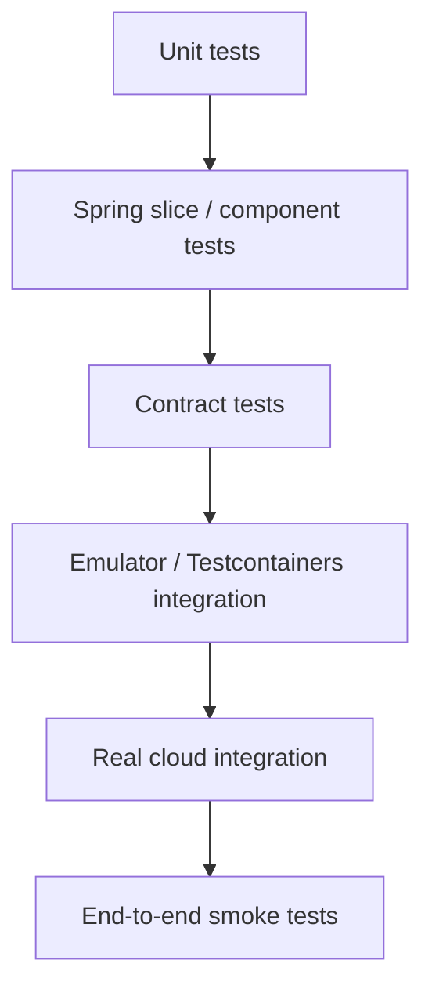
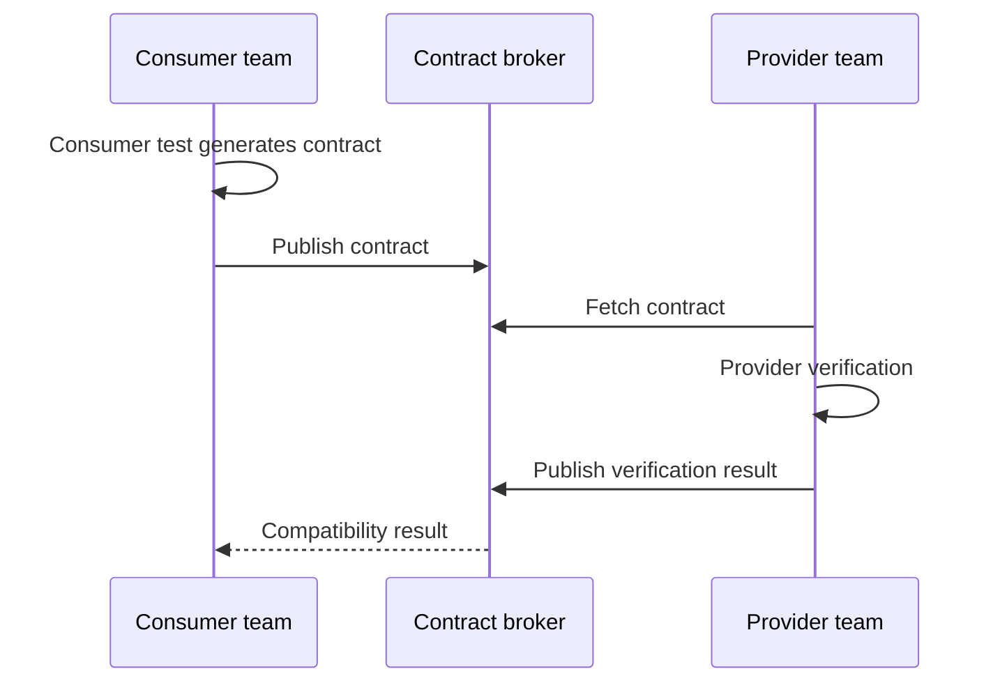
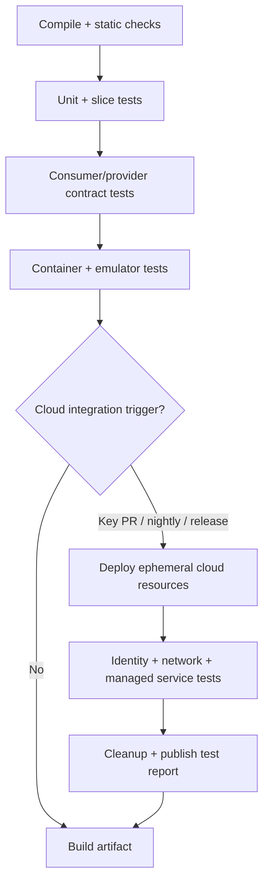

# Distinguishing Unit Tests, Contract Testing, and Testing on Real Services

> **Chapter:** Integration Testing  
> **Module:** SPRING_CLOUD_PROVIDER_INTEGRATION  
> **Objective:** Build a testing strategy for Spring Boot applications integrating AWS, Azure, and Google Cloud managed services; distinguish unit tests, component/integration tests, contract tests, emulator tests, and real cloud testing; select the right test level for each risk.

## 1. Why Does a Passing Test Not Prove Cloud Integration Works?

A Spring Boot service might receive a document creation request, save a file to object storage, write metadata to a database, publish an event to a message broker, and read a secret from a secret manager. Each step may work individually while the end-to-end flow still fails upon deployment:

- A unit test proves the service builds the right metadata, but does not prove the SDK calls the right object storage API.
- A test with a mock confirms the publisher was invoked, but does not prove the message was actually accepted by the broker.
- An emulator accepts the request, but the cloud environment rejects it due to missing IAM/RBAC permissions.
- A cloud integration test succeeds using a developer account with broad permissions, while the production workload identity lacks those permissions.
- A consumer handles a message properly in a single run, but processes duplicates when the broker redelivers.
- A local test works over a public endpoint, while production uses a private endpoint, DNS, or different network policies.

Therefore, cloud integration testing requires multiple levels. Each level answers a different question and has different cost, speed, and reliability characteristics.

**The goal is not to run every test at every level.** Place each assertion at the lowest level capable of validating the specific risk, then supplement with a focused set of tests on real services for behaviors that emulators cannot verify.

## 2. Map of Testing Levels

| Test Level | Scope | Primary Question | Speed/Cost |
| --- | --- | --- | --- |
| **Unit test** | A single class or domain service with dependencies replaced by fakes/mocks | Is the business logic correct? | Fast, cheap |
| **Slice test** | A Spring slice such as MVC, JSON, JPA | Is the framework layer/configuration correct? | Fast |
| **Component test** | A component with its related adapters, possibly using local dependencies | Do classes and configuration within the component coordinate properly? | Medium |
| **Contract test** | Agreement between consumer and provider, or event schema | Do both sides understand the same contract? | Fast to medium |
| **Emulator/container integration test** | Application connecting to a simulated service or real container running locally | Do the SDK, serialization, protocol, and flow work with this implementation? | Medium |
| **Real cloud integration test** | Real managed resources in a test account/project | Are identity, IAM/RBAC, network, quotas, and cloud behavior correct? | Slower, incurs cost |
| **End-to-end test** | A workflow spanning multiple services and cloud resources | Can the user complete a critical journey? | Slow, prone to flakiness |

A test annotated with `@SpringBootTest` is not automatically an integration test against real cloud services. If the test replaces Service Bus, S3, Pub/Sub, or Key Vault with mocks, it only verifies the Spring context and how components call those mocks. You must inspect the dependencies actually running to classify a test.



The diagram illustrates a progression of increasing scope. Contract tests can run independently in parallel with component tests; not all tests must depend sequentially on the pipeline order above.

## 3. Unit Tests: Testing Logic Without Cloud Dependencies

Unit tests focus on the business decisions of a class. They do not start a Spring ApplicationContext, open cloud connections, require Docker, or need credentials.

Example of a domain service deciding the object key, retention, and event to publish:

```java
public class DocumentService {

    private final DocumentRepository repository;
    private final ObjectStoragePort storage;
    private final EventPublisher publisher;

    public DocumentService(
            DocumentRepository repository,
            ObjectStoragePort storage,
            EventPublisher publisher) {
        this.repository = repository;
        this.storage = storage;
        this.publisher = publisher;
    }

    public Document create(CreateDocument command) {
        String key = "documents/" + command.documentId() + "/original";

        storage.put(key, command.content(), command.contentType());

        Document document = new Document(
                command.documentId(),
                key,
                command.ownerId(),
                DocumentStatus.UPLOADED);

        repository.save(document);

        publisher.publish(new DocumentUploaded(
                command.documentId(),
                key,
                command.ownerId()));

        return document;
    }
}
```

Unit tests can use fakes or Mockito to verify:

- The object key is generated according to domain rules.
- Empty files or disallowed content types are rejected.
- The repository receives the expected state.
- The event contains the correct document ID and storage key.
- Validation failures do not invoke storage or the publisher.
- Retry/idempotency rules at the business layer do not create duplicate side effects.

Example with JUnit 5 and Mockito:

```java
@ExtendWith(MockitoExtension.class)
class DocumentServiceTest {

    @Mock DocumentRepository repository;
    @Mock ObjectStoragePort storage;
    @Mock EventPublisher publisher;

    @InjectMocks DocumentService service;

    @Test
    void createsDocumentAndPublishesEvent() {
        CreateDocument command = new CreateDocument(
                "doc-123",
                "user-7",
                "application/pdf",
                new byte[] {1, 2, 3});

        Document result = service.create(command);

        assertEquals(DocumentStatus.UPLOADED, result.status());

        verify(storage).put(
                "documents/doc-123/original",
                command.content(),
                "application/pdf");

        verify(repository).save(any(Document.class));
        verify(publisher).publish(any(DocumentUploaded.class));
    }
}
```

This unit test verifies the orchestration logic of DocumentService. It does not verify that object storage received the file, that the database committed, or that the broker stored the event.

### 3.1. Designing Ports so Unit Tests Do Not Depend on SDKs

Place interfaces on the application side:

```java
public interface ObjectStoragePort {
    void put(String key, byte[] content, String contentType);
    byte[] get(String key);
    void delete(String key);
}

public interface EventPublisher {
    void publish(DocumentUploaded event);
}
```

Adapters implement these interfaces using the AWS SDK, Azure SDK, or Google Cloud client libraries. The domain service depends only on the ports. As a result:

- Unit tests can use simple fakes.
- Contract tests can verify payloads and port semantics.
- Integration tests can swap the adapter for a real implementation connecting to an emulator or cloud.
- Changing providers does not force domain logic to know about provider SDK classes.

Do not create an interface for every class just to mock it. Ports are useful when they represent external boundaries such as storage, messaging, secrets, or payment providers.

### 3.2. What Should Not Be Tested with Unit Tests

Do not use unit tests to conclude that:

- An IAM role or Azure RBAC assignment has been granted properly.
- A bucket/container/queue/topic exists.
- The SDK version is compatible with the service endpoint.
- TLS, DNS, private endpoints, or firewalls work.
- Messages are delivered by the broker to consumers.
- Eventual consistency behavior of a managed service is handled.

Those are risks that require testing at the component, emulator, or real cloud level.

## 4. Slice Tests and Component Tests in Spring Boot

### 4.1. Slice Tests Verify One Part of Spring

Spring Boot provides slice test annotations:

| Annotation | Typical Scope |
| --- | --- |
| `@WebMvcTest` | MVC controllers, validation, JSON mapping, and the web layer |
| `@JsonTest` | Jackson/JSON serialization and deserialization |
| `@DataJpaTest` | JPA repositories and persistence slice |
| `@RestClientTest` | HTTP clients, request/response mapping, and mock server support |
| `@SpringBootTest` | Creates the Spring Boot application's ApplicationContext |

Slice tests catch configuration and mapping errors quickly. For example, `@JsonTest` verifies that an event DTO serializes to JSON matching the schema contract; `@WebMvcTest` checks API validation and error responses.

Slice tests typically do not connect to the cloud. If a mock bean is provided for `ObjectStoragePort`, the test only verifies that the web layer invokes the port properly.

### 4.2. Component Tests Verify Adapters Together with Spring Wiring

Component tests can start a minimal or full Spring context while replacing only out-of-scope dependencies. For example, verifying adapter mapping:

- The storage adapter converts keys, content types, and metadata into the right SDK request.
- The messaging adapter sets the proper `MessageId`, `CorrelationId`, `SessionId`, and application properties.
- The secret adapter does not log secrets and handles secret rotation properly.
- A retry wrapper retries only transient errors, not permission or payload errors.

When testing an adapter, avoid mocking the very thing you are trying to test. If you mock `S3Client` and only verify method calls, the test does not check request serialization, endpoints, or actual service responses. Such a test is still useful as a component/unit test, but it is not a cloud integration test.

## 5. Contract Tests: Verifying Both Sides Share the Same Agreement

Contract tests verify how a consumer uses a provider and how the provider satisfies that request. A contract typically describes:

- HTTP method, path, query, headers, and response shape.
- Event name, schema version, payload fields, and metadata.
- Message key, correlation ID, ordering requirements, or delivery semantics agreed upon by both sides.
- Error responses and behavior when data is missing or invalid.

Contract tests are especially valuable when multiple teams develop and deploy independently. They detect breaking changes before needing to stand up the entire system together.

### 5.1. Consumer-Driven Contract Testing

In consumer-driven contract testing, the consumer describes the interactions it actually needs. The framework generates a contract from those tests; the provider runs verification to prove its implementation still satisfies the contract.

General workflow:

1. The consumer writes tests for an API client or message consumer against a mock provided by the contract tool.
2. The tests generate a contract artifact.
3. The contract is published to a Pact Broker or shared via an artifact repository.
4. The provider fetches the corresponding contract.
5. Provider verification replays each interaction against the running provider and compares the results.
6. The consumer/provider publishes verification results so pipelines know which version pairs are compatible.



Pact is a widely used consumer-driven contract testing tool. Contract tests do not require starting all microservices simultaneously; provider verification can run locally on the provider with external dependencies stubbed.

### 5.2. Contract Tests Are Not Ordinary Mock Tests

| Mock/unit test | Contract test |
| --- | --- |
| Tests a class against assumptions defined by the test itself | Tests interactions against a contract shared between consumer and provider |
| Mocks typically live within the same codebase | Contract artifacts can be shared across teams/repositories |
| No mandatory provider verification | Includes a provider contract verification step |
| Does not automatically detect provider API changes | Can detect when a provider no longer satisfies the consumer contract |

Mock tests can be the step that produces a consumer contract, but mocks in a unit test alone do not prove that the real provider satisfies the contract.

### 5.3. Contracts for REST APIs

For REST, contracts can be based on OpenAPI, JSON Schema, or Pact:

- OpenAPI describes the API surface and schemas.
- JSON Schema describes data structure.
- Pact describes concrete interactions required by the consumer.
- Provider verification checks the actual implementation.

OpenAPI linting or schema validation alone does not prove provider behavior is correct; key interactions must be verified.

### 5.4. Contracts for Asynchronous Messages

For a message broker, the contract should define:

| Component | Example |
| --- | --- |
| Event type | `DocumentUploaded` |
| Schema version | `1` |
| Payload | `documentId`, `objectKey`, `ownerId`, `occurredAt` |
| Metadata | `eventId`, `correlationId`, `contentType` |
| Compatibility rule | New consumers can still read older event versions |
| Delivery assumptions | At-least-once, redelivery is possible |
| Ordering requirement | By aggregate/session key if applicable |
| Error behavior | Poison message, retry, DLQ |

Contract tests verify that the producer emits the right event shape and the consumer can deserialize/interpret the event. They do not prove that the broker grants IAM permissions or enforces delivery guarantees beyond its actual configuration.

Illustrative JSON schema example:

```json
{
  "$id": "DocumentUploaded.v1",
  "type": "object",
  "required": [
    "eventId",
    "documentId",
    "objectKey",
    "occurredAt"
  ],
  "properties": {
    "eventId": { "type": "string" },
    "documentId": { "type": "string" },
    "objectKey": { "type": "string" },
    "ownerId": { "type": "string" },
    "occurredAt": { "type": "string", "format": "date-time" }
  },
  "additionalProperties": false
}
```

The `additionalProperties` rule must be decided explicitly. Setting `false` enforces strict validation but may cause older consumers to reject new fields. For event evolution, choose a compatibility policy: add optional fields, avoid changing the meaning of existing fields, version breaking changes, and test producer/consumer against the same policy.

### 5.5. Contract Tests Do Not Verify Cloud Provider APIs

A Pact contract between Order Service and Inventory Service does not prove that AWS S3, Azure Blob Storage, or Google Cloud Storage works properly. It verifies agreements between services controlled by your application.

For cloud provider APIs:

- Use official SDKs and their corresponding contracts/versions.
- Use emulators or real services to verify request/response behavior.
- Use cloud integration tests to verify IAM/RBAC, networking, quotas, and policies.
- Do not write custom assumed Pact contracts to replace the provider's official API specification.

## 6. Emulators and Testcontainers: Testing with Local Dependencies

An emulator simulates the API or behavior of a managed service. Testcontainers manages container lifecycles within tests. These two concepts are distinct:

- **Emulator:** an alternative implementation of a cloud service.
- **Testcontainers:** a mechanism to start and manage container dependencies.
- **Real service container:** for example, real PostgreSQL or Redis running in a container, not a cloud emulator.

Using an emulator exercises the adapter through a more realistic protocol/API than mocks. However, an emulator is only reliable within the scope of features it supports.

### 6.1. Spring Boot + Testcontainers for Databases

Example using a PostgreSQL container for a database integration test:

```java
import org.junit.jupiter.api.Test;
import org.springframework.beans.factory.annotation.Autowired;
import org.springframework.boot.test.context.SpringBootTest;
import org.springframework.boot.testcontainers.service.connection.ServiceConnection;
import org.springframework.test.context.ActiveProfiles;
import org.testcontainers.junit.jupiter.Container;
import org.testcontainers.junit.jupiter.Testcontainers;
import org.testcontainers.containers.PostgreSQLContainer;

import static org.assertj.core.api.Assertions.assertThat;

@Testcontainers
@SpringBootTest
@ActiveProfiles("integration")
class DocumentRepositoryIT {

    @Container
    @ServiceConnection
    static PostgreSQLContainer<?> postgres =
            new PostgreSQLContainer<>("postgres:16-alpine");

    @Autowired
    DocumentRepository repository;

    @Test
    void persistsAndLoadsDocument() {
        Document document = new Document(
                "doc-it-001",
                "documents/doc-it-001/original",
                "user-it",
                DocumentStatus.UPLOADED);

        repository.save(document);

        assertThat(repository.findById("doc-it-001"))
                .isPresent()
                .get()
                .extracting(Document::status)
                .isEqualTo(DocumentStatus.UPLOADED);
    }
}
```

`@ServiceConnection` lets Spring Boot automatically create connection details from supported containers. It requires the `spring-boot-testcontainers` dependency in test scope. For containers or emulators without a supported connection details factory, use `@DynamicPropertySource` to pass endpoints/ports into application configuration.

This test verifies JPA mapping and SQL against real PostgreSQL in a container. It does not verify IAM or cloud storage.

### 6.2. Using Testcontainers for Emulators

A test can start an emulator container before creating the Spring context, retrieve the mapped port, and configure the SDK endpoint. Conceptual pattern:

```java
@Testcontainers
@SpringBootTest
class ObjectStorageAdapterIT {

    @Container
    static GenericContainer<?> storageEmulator =
            new GenericContainer<>(
                    DockerImageName.parse("emulator-image:version"))
                    .withExposedPorts(8080);

    @DynamicPropertySource
    static void emulatorProperties(DynamicPropertyRegistry registry) {
        registry.add(
                "app.storage.endpoint",
                () -> "http://"
                        + storageEmulator.getHost()
                        + ":"
                        + storageEmulator.getMappedPort(8080));
    }

    @Autowired
    ObjectStoragePort storage;

    @Test
    void uploadsAndReadsObject() {
        storage.put("it/doc-1", new byte[] {1, 2, 3},
                "application/octet-stream");

        assertArrayEquals(
                new byte[] {1, 2, 3},
                storage.get("it/doc-1"));
    }
}
```

`emulator-image:version`, ports, credentials, and property keys are placeholders specific to a given emulator, not a shared image across AWS/Azure/GCP. Pin image versions; do not use the `latest` tag because emulator updates can unexpectedly alter test behavior.

### 6.3. AWS: LocalStack

LocalStack provides a simulated environment for many AWS APIs and has a Testcontainers module. It can be used to test adapters against supported services such as S3, SQS, SNS, or DynamoDB.

What to test:

- Creating buckets/queues/tables as test fixtures.
- Uploading/downloading objects and metadata.
- Publishing/consuming messages.
- Error code mapping and retry behavior.
- Resource cleanup and endpoint overrides.

Limitations:

- Feature coverage varies by service, API, and edition.
- Some advanced features require an appropriate plan/edition.
- IAM policies, account behavior, quotas, VPC endpoints, and control plane behaviors may differ from real AWS.
- Passing tests on LocalStack does not prove production roles have the right permissions.

Use an AWS test account to verify workload identity, IAM policies, KMS, private networking, resource policies, and critical features not covered by the emulator.

### 6.4. Azure: Per-Service Emulators

There is no single emulator that replaces all of Azure. Choose an emulator per service:

| Service | Common Local Tool | What Must Be Verified on Real Azure |
| --- | --- | --- |
| Blob Storage | Azurite | Microsoft Entra ID, RBAC, managed identity, private endpoints, lifecycle/policies |
| Service Bus | Azure Service Bus emulator | Entra ID, partitioning, JMS, AMQP WebSockets, cloud metrics/alerts, and differing features |
| Database | Corresponding database container or service emulator | Firewalls, identity, tiers, backup/HA, and cloud-specific behavior |
| Key Vault | Mock/test double or dedicated test service | Managed Identity, RBAC/access policies, networking, rotation, and auditing |

The Azure Service Bus emulator is useful for local testing over AMQP TCP, but has limitations: it does not support JMS, partitioned entities, AMQP WebSockets, or Microsoft Entra ID; data/entities do not persist across container restarts. Therefore, do not use the emulator to conclude that JMS, partitioning, RBAC, or private networking work properly in the cloud.

Azurite is suitable for supported Storage APIs during local development. It does not replace testing identity/RBAC and all production Azure Storage behaviors.

### 6.5. Google Cloud: Per-Service Emulators

Google Cloud provides emulators for certain services, such as the Pub/Sub emulator:

- Creating topics/subscriptions.
- Publishing messages.
- Pulling/pushing messages within emulator-supported features.
- Testing serialization, ack/nack, and application flow.
- Running tests without sending requests to a production project.

The Pub/Sub emulator can verify many messaging behaviors, but does not support IAM operations. Some behaviors such as retention, subscription expiration, or advanced features may differ from the real service. For push workloads, the emulator allows local HTTP; production endpoints require HTTPS. Always check current limitations before relying on an emulator.

For Cloud Storage, Firestore, Secret Manager, or BigQuery, pick an emulator/fake per service and verify feature coverage. If no adequate emulator exists, use fakes in unit tests and dedicate integration tests against a cloud test project.

## 7. Testing on Real Cloud Services: When Is It Needed?

Emulators cannot validate every cloud control layer. Real cloud integration tests are necessary when risks involve:

- Microsoft Entra ID, AWS IAM, or Google Cloud IAM.
- Managed/workload identity and token audience/scope.
- Resource policies, bucket policies, key policies, or role bindings.
- Private endpoints, VPC/VNet, DNS, firewalls, and TLS.
- Quotas, throttling, regional behavior, and service limits.
- Encryption via KMS/Key Vault/Cloud KMS.
- Service tiers, partitioning, sessions, ordering, or feature-specific behavior.
- Audit logs, monitoring, metrics, tracing, and alerts.
- Deployment configuration, IaC, and permission boundaries.

You do not need to run every business test on real cloud services. Select a small, focused smoke/integration suite targeting the features that emulators cannot prove.

### 7.1. Separating Cloud Test Accounts/Projects

Use a dedicated account/subscription/project for testing:

- Do not use production resources or production data.
- Create resources with prefixes containing the pipeline run ID or commit SHA.
- Attach tags/labels such as `environment=test`, `owner=integration-tests`, `expires-at`.
- Use separate buckets/containers/queues/topics per suite or test run.
- Create deterministic data fixtures and clean up after tests.
- Run a scheduled janitor to delete expired resources if a pipeline terminates before cleanup.
- Enforce quotas and budgets on the test project.

Resource names must be unique because multiple pipelines may run concurrently. Do not share a queue or bucket across parallel tests if tests can delete or consume each other's data.

### 7.2. Running with the Workload's Exact Identity

A test running with Owner/Administrator privileges can pass even if the production application lacks permissions. Test using an identity equivalent to the workload:

- AWS: IAM role assumed via CI OIDC or a test role; verify action/resource scopes.
- Azure: Managed Identity or test service principal with Azure RBAC Data Sender/Receiver/Storage roles.
- Google Cloud: service account or Workload Identity Federation with the required IAM roles.

Do not store access keys, SAS tokens, client secrets, or service account keys in the repository. Prefer CI OIDC/workload identity federation. Create least-privilege roles scoped to the test services and resources.

There can be two kinds of permission tests:

1. **Positive permission test:** operations the application needs to perform succeed.
2. **Negative permission test:** operations outside the allowed scope must be denied.

Negative tests should use a specifically designed identity; do not intentionally revoke permissions from a shared identity while other pipelines are running.

### 7.3. Testing Networks Similar to the Deployment Environment

If production uses private endpoints or private service access, the test runner must also execute from an appropriate network path. A test run from a laptop calling a public endpoint does not prove that a pod in a private subnet resolves DNS and connects properly.

Verify:

- Private DNS zones and hostname resolution.
- Egress/ingress firewalls.
- TLS certificate chains and hostname verification.
- Proxies/service meshes if present.
- VNet/VPC routes and endpoint policies.
- Connection timeouts, retries, and failovers.

### 7.4. Safely Creating and Cleaning Up Resources

Lifecycle pattern for a cloud integration test:

```java
class CloudResourceFixture implements AutoCloseable {

    private final String runId =
            UUID.randomUUID().toString().replace("-", "");

    private final String bucketName =
            "it-documents-" + runId;

    void create() {
        // Create a dedicated bucket/container or queue for the test run.
        // Attach tags/labels so the janitor can find and clean it up.
    }

    @Override
    public void close() {
        // Delete objects/messages first, then delete the resource.
        // Cleanup must be idempotent and log failures.
    }
}
```

In JUnit, manage fixtures using `@BeforeAll/@AfterAll` or `try-with-resources`. Ensure cleanup runs even when assertions fail. For resources with eventual deletion, do not assume deletion completes immediately; poll status until a finite timeout.

## 8. Sample Test Suite for Spring Boot Integrating Managed Services

Suppose Document Service uses PostgreSQL, object storage, and a message broker.

### 8.1. Unit Tests for the Domain Service

Verify:

- Document key generation.
- Owner, file size, and content type validation.
- Initial status selection.
- Emitting the event with the right schema.
- Not publishing an event when business validation fails.

Do not start a Spring context or open cloud connections.

### 8.2. Integration Tests for Persistence

Use PostgreSQL Testcontainers to verify:

- Entity mapping.
- Unique constraints and transaction rollbacks.
- Schema migrations.
- Required queries/indexes.
- Inbox/outbox persistence and concurrent claims.

Do not use H2 to conclude that PostgreSQL SQL or transaction semantics are equivalent. In-memory databases can be helpful for simple logic tests, but do not replace the production engine.

### 8.3. Adapter Tests with Emulators

Use LocalStack/Azurite/Service Bus emulator/Pub/Sub emulator as appropriate to verify:

- SDK client configuration and endpoint overrides.
- Request mapping, payload encoding, and metadata.
- Basic upload/read or send/receive operations.
- Error mapping and serialization.
- Resource cleanup and test isolation.

Tests must assert outcomes on the service side, not merely verify that an SDK method was called.

### 8.4. Contract Tests Between Services

Suppose Document Service publishes `DocumentUploaded.v1` and Preview Worker consumes that event:

- Producer tests generate the event according to the schema contract.
- Consumer tests read the contract payload and handle it compatibly.
- Provider verification checks that the emitting service satisfies the contract.
- Test compatibility when adding optional fields or incrementing schema versions.
- Verify that the consumer handles older events still sitting in the backlog.

If an event is published to a topic with multiple subscriptions, the contract must specify which fields each consumer actually depends on. Prevent consumers from relying on uncommitted internal fields.

### 8.5. Real Cloud Integration Tests

Run a focused test against a test account/project:

1. The test workload authenticates using the right identity.
2. Create or access test resources.
3. Upload an object and read it back.
4. Publish an event to the queue/topic.
5. The test consumer receives the message and persists the result.
6. Verify metadata, encryption, and critical policies.
7. Clean up resources and log any cleanup errors.

If your workload uses Service Bus sessions, KMS, Key Vault RBAC, or private endpoints, create dedicated tests for those features rather than relying solely on a generic happy path.
## 9. Testing Asynchronous Flows and Eventual Consistency

Cloud integrations are often asynchronous. After publishing an event, a consumer may not process it immediately. After creating a resource, metadata/indexes may not appear immediately in some services.

Do not use long fixed sleeps such as `Thread.sleep(10000)` to wait in every test. Use polling with a timeout:

```java
await()
        .atMost(Duration.ofSeconds(30))
        .pollInterval(Duration.ofMillis(250))
        .untilAsserted(() -> {
            DocumentStatus status =
                    documentRepository.findStatus("doc-it-001");

            assertThat(status).isEqualTo(DocumentStatus.PREVIEW_READY);
        });
```

Use Awaitility or an equivalent polling helper. The timeout should reflect the test environment's SLA; do not increase timeouts indefinitely to mask a hung consumer.

### 9.1. Testing Message Delivery Semantics

With an at-least-once broker, the same message may be delivered multiple times. Tests should simulate:

- Consumer commits the database, but complete/ack fails.
- Consumer crashes before committing.
- Message is redelivered after lock expiry.
- Producer times out after the broker already accepted the message.
- Retry/DLQ when payload is invalid.
- Event replay.

Assert that the business outcome is applied only once thanks to idempotency/inbox handling. Do not assert that the callback only executes once.

### 9.2. Testing Ordering and Concurrency

If the workload requires ordering:

- Send multiple events with the same aggregate/session ID.
- Send events for two different aggregates.
- Verify ordering within a single aggregate.
- Verify that independent aggregates can still be processed concurrently.
- Simulate retries or DLQ replay and verify the business sequence.

Do not rely on log timestamp ordering to verify sequence; persist the applied sequence/version in a database or audit record.

### 9.3. Testing Timeouts, Retries, and Throttling

Use fault injection or stub dependencies to simulate:

- Connect timeout.
- Read timeout.
- HTTP 429/503 or provider throttling.
- DNS failure.
- Expired credentials/permission denied.
- Connection reset during send/settlement.

Distinguish transient errors from permanent ones. Tests must prove that backoff is bounded, retries do not hold threads/locks too long, and permanent failures do not trigger infinite retry loops.

## 10. Testing Identity, Secrets, and Security

An application may access storage successfully with developer credentials yet fail when running with Managed Identity. This is why identity must be tested in a cloud environment.

| Risk | Recommended Test |
| --- | --- |
| Missing IAM/RBAC permissions | Positive tests for allowed actions and negative tests for ungranted actions |
| Credential chain picking the wrong identity | Safely log identity metadata; verify principal/object ID in cloud tests |
| Secret rotation | Update secret version, verify client refreshes according to policy |
| Token expiration | Verify refresh/re-authentication and retry |
| KMS/Key Vault/Cloud KMS | Encrypt/decrypt using the intended identity and key policy |
| Private endpoint | Run tests from the workload's network path |
| TLS | Verify certificate chain and hostname |
| Secret leakage in logs | Capture logs and assert no secret/token/connection string appears |

Never put real secrets in test fixtures. Use synthetic secrets and a dedicated test vault/project. When verifying rotation, create a new test version and check that the application picks up the version according to its cache/refresh policy.

## 11. Testing Infrastructure and Cloud Configuration

Application code may be correct while IaC creates the wrong bucket, queue, or role. Infrastructure testing must be separated from business logic testing:

- Format/lint IaC.
- Validate modules and variables.
- Static security/policy checks.
- Plan/diff review.
- Emulator tests for supported resource APIs.
- Deploy an ephemeral environment and inspect actual resources.
- Verify policies, encryption, networking, and lifecycles.
- Tear down the environment.

A Terraform plan test does not prove runtime access permissions. An application test calling storage successfully does not prove the bucket policy only grants the intended scope. You must test both resource configuration and runtime behavior.

### 11.1. Verifying Resource Policies and Least Privilege

For example, tests can verify:

- The app role can only read/write the required test bucket prefix.
- The app role cannot delete the bucket or modify policies.
- The Service Bus consumer has receive permission but cannot manage entities.
- The Key Vault identity can only read designated secrets.
- A GCP service account does not have project-wide Editor if it only needs permissions on a single resource.

Negative permission tests must distinguish access denied errors from network or resource-not-found errors. Assert on the appropriate error code/exception rather than merely asserting that "an exception was thrown."

## 12. Test Data Design and Isolation

Integration tests become flaky easily when tests share resources or data.

### 12.1. Independent Data

- Each test has its own ID.
- Buckets/containers use dedicated prefixes.
- Separate queues/topics/subscriptions or database schemas when needed.
- No dependency on test execution order.
- Do not rely on data created by another test.
- Reset state before and after tests.

### 12.2. Parallel Execution

When running in parallel:

- Do not share a single queue if test A's consumer could receive test B's messages.
- Include correlation IDs and test run IDs in metadata.
- Create separate subscriptions or entities when needed.
- Use unique constraints/leases to prevent two tests from claiming the same row.
- Ensure cleanup deletes only resources from the current test run.

### 12.3. Cleanup and Resource Leaks

A pipeline may be cancelled before `@AfterAll` runs. Cloud resources do not vanish simply because the JVM stops. Use:

- Tags/labels with owner and expiry.
- TTL or lifecycle policies if the service supports them.
- Scheduled cleanup jobs.
- Resource filters by project/account and test prefix.
- Dashboards tracking leftover test resources.

Cleanup must be idempotent: deleting a resource that no longer exists must not fail the pipeline in a way that masks the root error. However, log cleanup failures so operators know about leaked resources.

## 13. Organizing Test Suites in Maven/Gradle

You can group tests by tag or source set:

| Group | Naming Example | Where It Runs |
| --- | --- | --- |
| Unit | `*Test` | Every commit |
| Slice | `*SliceTest` | Pull requests |
| Contract | `*ContractTest` | Pull requests and provider builds |
| Container/emulator | `*IntegrationTest` | Pull requests or CI runners with Docker |
| Real cloud | `*CloudIT` | Dedicated pipeline, nightly, or pre-release |
| E2E | `*E2ETest` | Staging/pre-release |

Example JUnit tags:

```java
@Tag("unit")
class DocumentPolicyTest {
}

@Tag("contract")
class DocumentEventContractTest {
}

@Tag("cloud")
class AzureStorageCloudIT {
}
```

Maven Surefire/Failsafe or Gradle test tasks can select the corresponding tags/groups. Exact task names and plugin configs depend on the current build; keep a consistent convention and ensure CI actually executes the required groups.

### 13.1. Suggested Pipeline



Fast groups should run on every pull request. The real cloud suite can run on a schedule, before release, or on changes affecting IAM/networking/provider adapters. Do not skip the cloud suite indefinitely due to cost; define clear triggers and report the latest test status.

### 13.2. Distinguishing Flaky Tests from Real Bugs

When a cloud test fails:

1. Record the correlation ID, request ID, region, resource ID, and timestamp.
2. Classify the failure as auth, network, throttling, quota, eventual consistency, or assertion.
3. Check whether retries masked the original error.
4. Re-run the test a bounded number of times to determine reproducibility.
5. Do not add long sleeps or infinite retries just to turn the pipeline green.
6. If a test is flaky due to shared resources, fix isolation rather than merely rerunning.

Test reports should indicate whether tests ran against an emulator or real cloud, region/tier, SDK version, and identity type. Never include credentials or sensitive payloads in reports.

## 14. Testing Matrix by Provider and Service

| Provider | Service | Unit/Contract | Emulator/Container | Real Cloud Verification |
| --- | --- | --- | --- | --- |
| AWS | S3 | Object key, metadata, error mapping | LocalStack if required APIs are supported | IAM, bucket policy, KMS, VPC endpoint, lifecycle |
| AWS | SQS/SNS | Event schema, routing contract | LocalStack | IAM, DLQ/redrive, visibility, FIFO/dedup, KMS |
| AWS | DynamoDB | Repository mapping, conditional writes | LocalStack or DynamoDB Local | IAM, TTL/streams, capacity/throttling, global tables |
| Azure | Blob Storage | Blob key, metadata, content type | Azurite | Entra ID, RBAC, private endpoint, encryption/lifecycle |
| Azure | Service Bus | Message schema, settlement contract | Service Bus emulator | Entra ID, partitioning, sessions, JMS, network, metrics |
| Azure | Key Vault | Secret adapter behavior | Fake/test double or dedicated test service | Managed Identity, RBAC, network, rotation/audit |
| Google Cloud | Cloud Storage | Object metadata/contract | Emulator/fake if suitable | IAM, CMEK, retention, VPC Service Controls |
| Google Cloud | Pub/Sub | Event schema, ack/idempotency | Pub/Sub emulator | IAM, HTTPS push, dead-letter/retry policy, ordering |
| Google Cloud | Firestore | Repository mapping | Firestore emulator | IAM, indexes, consistency, backup, and quotas |
| Google Cloud | Secret Manager | Secret adapter behavior | Fake/test double | IAM, version rotation, audit, network |

This table is a starting point, not a guarantee that an emulator supports every API. Always check the emulator and SDK feature matrix/version before choosing tests.

## 15. Example Test Plan for a Complete Flow

**Flow:** a user uploads a PDF; Spring Boot saves the file to object storage, writes metadata to PostgreSQL, and publishes `DocumentUploaded`; Preview Worker receives the event, generates a preview, and updates the status.

| Test | Level | Assertion |
| --- | --- | --- |
| Validate file type/size | Unit | Invalid files are rejected |
| Generate object key | Unit | Key is deterministic and contains no path traversal |
| Serialize DocumentUploaded | Contract | Schema/version/required fields are correct |
| Save document metadata | Testcontainers DB | Rows and transactions are accurate |
| Upload/download object | Emulator | Content and metadata match |
| Publish/consume event | Emulator | Message is received with matching correlation ID |
| Consumer redelivery | Emulator or cloud | Inbox prevents duplicate side effects |
| Identity storage/broker | Real cloud | Workload identity holds the right roles |
| Encryption/private endpoint | Real cloud | KMS/Key Vault and network policies work |
| End-to-end preview | Cloud staging | Document reaches PREVIEW_READY within timeout |
| Cleanup | Cloud test fixture | Objects, messages, and test resources are cleaned up |

You do not need a single E2E test to catch every failure. Splitting assertions into smaller tests identifies root causes faster and reduces expensive cloud runs.

## 16. Common Mistakes

### 16.1. Mocking the SDK and Calling It an Integration Test

Mocking S3Client/BlobClient/PubSub clients only tests how the adapter invokes the SDK. Name tests accurately; use emulators or real services to verify communication.

### 16.2. Using Emulators as Proof of IAM

Emulators usually do not fully replicate identity, IAM/RBAC, policies, and networking. Test authentication using the actual identity on a cloud test account/project.

### 16.3. Testing Only with Admin Privileges

Broad permissions mask authorization bugs. Use a workload identity and least-privilege roles matching production.

### 16.4. Running Tests on Shared Resources

Tests can consume/delete another test's messages, overwrite objects, or tear down another pipeline's resources. Use distinct namespaces/prefixes/test run IDs.

### 16.5. Asserting Exactly-Once Message Handler Invocation

At-least-once delivery permits redelivery. Assert that the business effect happens only once via idempotency, rather than asserting the callback runs only once.

### 16.6. Neglecting Cleanup Verification

Leftover cloud resources incur costs and pollute subsequent runs. Use expiry tags, janitors, and idempotent cleanup.

### 16.7. Using Fixed Sleeps for Async Tests

Sleeps slow down tests and remain flaky. Use polling with timeouts, inspect final state, and preserve sufficient logs/traces for diagnosis.

### 16.8. Including Cloud Integration Tests on Every Commit Without Categorization

A long cloud suite slows feedback loops and consumes quotas. Keep unit/contract/emulator tests fast on PRs; run cloud suites on risk triggers, nightly, and before releases.

## 17. Practice Lab: Testing Document Service Across Three Levels

**Context:** Document Service uses PostgreSQL, object storage, and a message broker. Design tests to separate application logic, inter-service contracts, and managed cloud behavior.

### Part A — Unit Tests

- Create the `ObjectStoragePort` and `EventPublisher` ports.
- Write tests for validation, object keys, and event payloads.
- Use fakes/mocks to verify business rules.
- Add error and idempotency tests.

### Part B — Contract Tests

- Define `DocumentUploaded.v1`.
- Write a consumer contract for Preview Worker.
- Write producer tests verifying the event schema.
- Verify backward compatibility when adding optional fields.
- Document delivery semantics and required metadata.

### Part C — Testcontainers and Emulators

- Start PostgreSQL using Testcontainers.
- Run the Spring Boot application with the `integration` profile.
- Use appropriate emulators for storage and messaging.
- Upload/read objects and publish/consume events.
- Simulate redelivery and verify the inbox.

### Part D — Cloud Integration Tests

- Create a test account/project/subscription.
- Provision an identity with least-privilege permissions.
- Create resources scoped by test run ID.
- Verify upload, encryption, event delivery, and policies.
- Test private endpoints if production uses a private network.
- Clean up and verify no resources remain.

### Part E — Pipeline

- Run unit/slice/contract tests on pull requests.
- Run Testcontainers/emulators on CI.
- Run cloud integration nightly or pre-release.
- Save test reports with provider, region, SDK version, and resource IDs.
- Add a janitor to clean up expired resources.

**Completion criteria:** the learner accurately distinguishes the five main test groups; explains what mocks, contracts, emulators, and real cloud prove; writes Spring Boot tests with Testcontainers; designs identity-aware cloud tests; and establishes a pipeline with clear isolation, cleanup, cost control, and reporting.

---

## 18. Pre-Merge and Pre-Release Checklist

| Group | Question |
| --- | --- |
| Unit | Are business rules tested independently of cloud SDKs? |
| Spring slice | Are MVC/JSON/JPA mappings tested at the right scope? |
| Contract | Have consumer and provider verified the same contract version? |
| Event schema | Are backward compatibility and metadata checked? |
| Emulator | Are emulator-tested features within the supported feature set? |
| Testcontainers | Are container versions pinned and cleanup lifecycles correct? |
| Real cloud | Are risks that emulators cannot prove tested on real cloud? |
| Identity | Do tests run under a least-privilege workload identity? |
| Network | Does the test runner operate on the required network path? |
| Data isolation | Are resources/data unique per test run? |
| Async | Is polling with timeouts used instead of fixed sleeps? |
| Reliability | Are redelivery, retries, duplicates, and DLQs tested? |
| Security | Are secrets and sensitive payloads stripped from reports/logs? |
| Cost | Are budgets, expiry tags, and cleanup jobs in place? |
| CI | Do fast tests and cloud tests have clear triggers/gating? |
| Observability | Are correlation IDs, request IDs, and SDK/provider versions captured for diagnosis? |

## Key Takeaways

- **Unit tests** verify business logic; mocks do not prove a cloud service received a request.
- **Slice/component tests** verify Spring wiring and adapters within the started scope.
- **Contract tests** verify that consumer and provider share the same agreement; Pact does not replace testing IAM or cloud APIs.
- **Emulators/Testcontainers** test protocols/APIs within supported features; do not assume emulators match real cloud behavior.
- **Real cloud integration tests** are required for identity, IAM/RBAC, networking, quotas, encryption, and provider-specific behavior.
- **End-to-end tests** validate critical workflows, not replace smaller tests.
- Use test accounts/projects, workload identities, unique resources, expiry tags, and cleanup to control safety and cost.
- For async messaging, test redelivery and idempotency; never assume callbacks run only once.
- Pipelines should run fast tests frequently and run cloud tests by risk trigger, nightly, or pre-release.

When integrating Spring Boot with AWS, Azure, and Google Cloud managed services, choose the test level based on the question you need to answer. Use unit tests for domain logic, contract tests for inter-service agreements, emulators for supported API behaviors, and real cloud for identity/networking/policies and critical features. Combining these levels provides fast feedback while validating real deployment risks.

### Official Documentation

- [Spring Boot — Testing Spring Boot Applications](https://docs.spring.io/spring-boot/reference/testing/spring-boot-applications.html)
- [Spring Boot — Testcontainers and Service Connections](https://docs.spring.io/spring-boot/reference/testing/testcontainers.html)
- [Testcontainers — Getting Started](https://testcontainers.com/getting-started/)
- [Testcontainers — LocalStack module](https://testcontainers.com/modules/localstack/)
- [Pact — Introduction and Consumer-Driven Contracts](https://docs.pact.io/)
- [Pact — How Pact Works](https://docs.pact.io/getting_started/how_pact_works)
- [Pact — Provider Verification](https://docs.pact.io/getting_started/verifying_pacts)
- [AWS — Testing Serverless Applications](https://docs.aws.amazon.com/lambda/latest/dg/testing-guide.html)
- [AWS Prescriptive Guidance — Test AWS infrastructure with LocalStack](https://docs.aws.amazon.com/prescriptive-guidance/latest/patterns/test-aws-infra-localstack-terraform.html)
- [Microsoft Learn — Azure Service Bus Emulator Overview](https://learn.microsoft.com/en-us/azure/service-bus-messaging/overview-emulator)
- [Microsoft Learn — Test locally with the Azure Service Bus emulator](https://learn.microsoft.com/en-us/azure/service-bus-messaging/test-locally-with-service-bus-emulator)
- [Google Cloud — Test locally with the Pub/Sub emulator](https://docs.cloud.google.com/pubsub/docs/emulator)

Check Spring Boot, Testcontainers, emulator image, and cloud SDK versions and feature coverage before implementing tests. Emulators are development/testing tools with specific scopes; only cloud tests in an appropriate identity/network environment can verify managed service deployment conditions.
