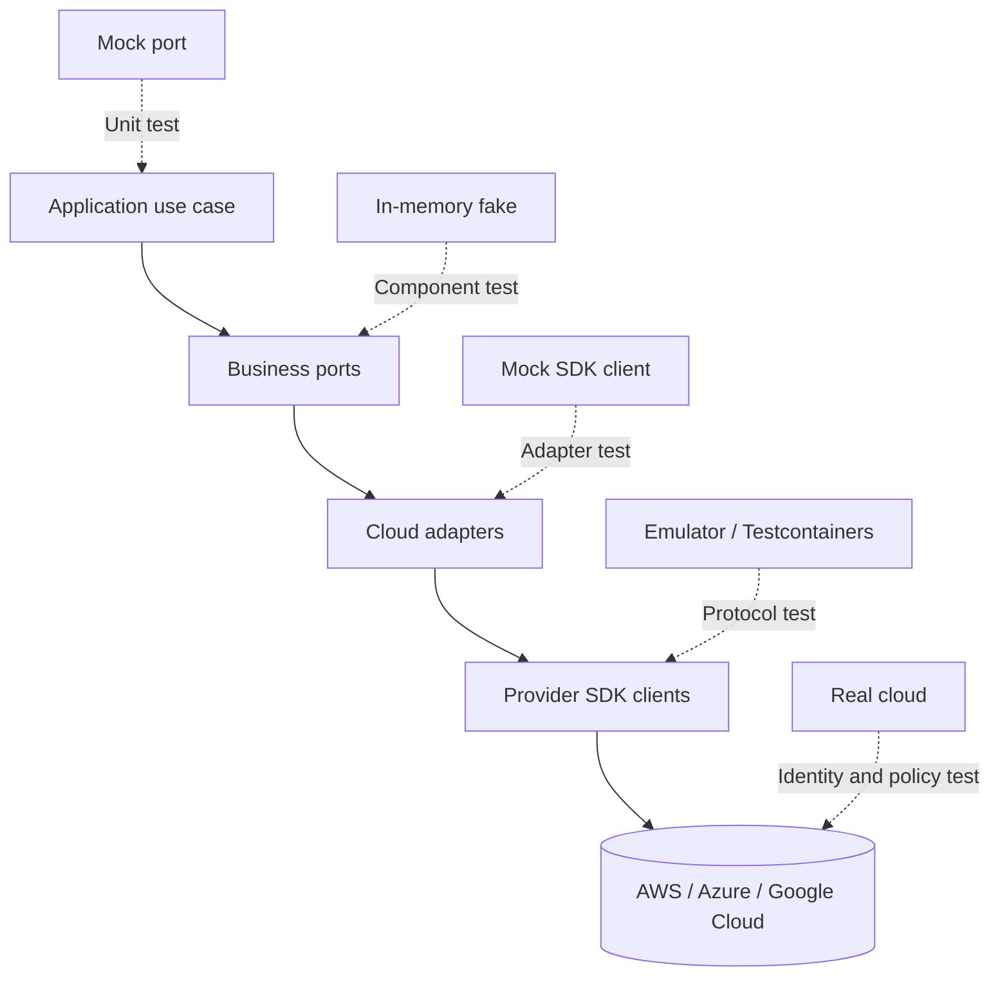

# Mocking Business Interfaces and Simulating Clients at the Right Boundary

> **Chapter:** Integration Testing  
> **Module:** SPRING_CLOUD_PROVIDER_INTEGRATION  
> **Objective:** Learn how to place test doubles at the right boundaries in cloud-integrated Spring Boot applications; use mocks for business ports, fakes for stateful components, mock SDK clients to verify adapter mapping, and recognize when an emulator or real cloud service is required.

## 1. Mocking at the Right Boundary Keeps Tests Fast Yet Meaningful

A Spring Boot application might use S3, Azure Blob Storage, or Google Cloud Storage to store files; SQS, Service Bus, or Pub/Sub to publish events; and read sensitive configuration from Secrets Manager, Key Vault, or Secret Manager.

If unit tests call cloud services directly, they become dependent on credentials, networking, quotas, and resource state. If you mock every class in the application, tests can pass even when components fail to coordinate properly. The right approach is to place test doubles at **boundaries the application owns and controls**:

- At the use case/domain layer, replace external dependencies with business interfaces (ports).
- At the adapter layer, replace SDK clients with mocks to verify requests are mapped accurately.
- In component tests, use stateful fakes so multiple classes coordinate without needing a network.
- When protocol/API verification is required, use an emulator or container.
- When IAM/RBAC, identity, networking, and provider-specific behavior need verification, run tests on real cloud services.



No single type of test double fits every layer. Choose based on the question you need to answer. Mocking a business port tests the use case; mocking an SDK client tests that the adapter builds the right request; stateful fakes test multi-component coordination; only emulators or real clouds verify actual communication with the service.

## 2. Distinguishing Dummy, Stub, Fake, Mock, and Spy

These terms describe how tests replace or observe a dependency:

| Type | How It Works | When to Use |
| --- | --- | --- |
| **Dummy** | Object passed solely to satisfy parameter signatures, never used | Constructor or method requires a parameter the test does not care about |
| **Stub** | Returns predefined data | Need to control a return value to test a specific business branch |
| **Fake** | Simplified working implementation with state and behavior | Need multiple components reading/writing the same data model in tests |
| **Mock** | Records calls and enables interaction verification | Need to verify a port is called with expected data or errors are handled properly |
| **Spy** | Wraps a real object, records calls while running real methods by default | Need to observe a real collaborator in a narrow scenario |

A single object can serve multiple roles depending on how it is used. For instance, a Mockito mock can be stubbed to return a value and later verified as a mock.

### 2.1. Quick Selection Rules

- Use a **stub** when all you care about is the returned result.
- Use a **mock** when the interaction is part of the business contract—for example, a publisher must emit an event after a use case succeeds.
- Use a **fake** when a test needs a dependency with consistent state, such as an in-memory object store or an event recorder.
- Use a **spy** sparingly. Real methods still execute and can open files, make network calls, write to databases, or publish messages.
- Use a **dummy** for unused parameters; do not turn a dummy into a fake pretending to work.

Mocks are not inherently better than fakes or vice versa. A good test double preserves the exact semantics the test requires without attempting to simulate an entire cloud provider.

## 3. Placing Ports at Business Boundaries

Use cases should depend on interfaces describing capabilities the application needs, not provider SDK classes.

Example of a document management service that stores objects and publishes events:

```java
public interface ObjectStoragePort {
    StoredObject put(
            String key,
            byte[] content,
            String contentType);

    Optional<StoredObject> get(String key);

    void delete(String key);
}

public interface DocumentRepository {
    Document save(Document document);
    Optional<Document> findById(String documentId);
}

public interface DocumentEventPort {
    void publish(DocumentUploaded event);
}

public record StoredObject(
        String key,
        byte[] content,
        String contentType,
        String etag) {
}

public record DocumentUploaded(
        String eventId,
        String documentId,
        String objectKey,
        String ownerId) {
}
```

A port is the application's contract. Adapters can implement ObjectStoragePort using the AWS SDK, Azure SDK, or Google Cloud client libraries. The use case does not need to know bucket names, containers, S3Client, BlobClient, or Storage.

Abbreviated use case example:

```java
import org.springframework.stereotype.Service;

@Service
public class UploadDocumentUseCase {

    private final ObjectStoragePort storage;
    private final DocumentRepository documents;
    private final DocumentEventPort events;

    public UploadDocumentUseCase(
            ObjectStoragePort storage,
            DocumentRepository documents,
            DocumentEventPort events) {
        this.storage = storage;
        this.documents = documents;
        this.events = events;
    }

    public Document upload(UploadDocumentCommand command) {
        validate(command);

        String key = "documents/"
                + command.documentId()
                + "/original";

        storage.put(
                key,
                command.content(),
                command.contentType());

        Document document = documents.save(
                Document.uploaded(
                        command.documentId(),
                        command.ownerId(),
                        key));

        events.publish(new DocumentUploaded(
                command.eventId(),
                command.documentId(),
                key,
                command.ownerId()));

        return document;
    }

    private void validate(UploadDocumentCommand command) {
        if (command.content().length == 0) {
            throw new InvalidDocumentException("File cannot be empty");
        }
        if (!"application/pdf".equals(command.contentType())) {
            throw new InvalidDocumentException("Only PDF is accepted");
        }
    }
}
```

This example focuses on how to test ports. In a system requiring durable event delivery, DocumentEventPort is typically implemented using a transactional outbox so business state and the event record commit together in the database; do not infer that this mock test verifies atomicity between the DB and the broker.

### 3.1. Do Not Put SDK Types in Business Ports

Avoid interfaces like:

```java
public interface StoragePort {
    PutObjectResponse putObject(
            PutObjectRequest request,
            RequestBody body);
}
```

This interface merely renames the SDK, leaving the use case coupled to AWS. Instead, accept key, content, and content type at the business level; let the adapter construct PutObjectRequest.

Similarly, do not return BlobItem, BlobClient, StorageObject, or PubsubMessage directly from a use case if the domain does not need them. Convert them into application DTOs/value objects.

## 4. Unit Tests: Mocking Business Ports

Unit tests should focus on outcomes and side effects meaningful to the use case. There is no need to boot Spring or instantiate cloud clients.

Example using JUnit 5 and Mockito:

```java
@ExtendWith(MockitoExtension.class)
class UploadDocumentUseCaseTest {

    @Mock
    ObjectStoragePort storage;

    @Mock
    DocumentRepository documents;

    @Mock
    DocumentEventPort events;

    private UploadDocumentUseCase useCase;

    @BeforeEach
    void setUp() {
        useCase = new UploadDocumentUseCase(
                storage,
                documents,
                events);
    }

    @Test
    void storesDocumentAndPublishesEvent() {
        UploadDocumentCommand command =
                new UploadDocumentCommand(
                        "event-101",
                        "doc-101",
                        "user-7",
                        "application/pdf",
                        new byte[] {1, 2, 3});

        when(documents.save(any(Document.class)))
                .thenAnswer(invocation -> invocation.getArgument(0));

        Document result = useCase.upload(command);

        assertEquals("doc-101", result.id());
        assertEquals(DocumentStatus.UPLOADED, result.status());

        verify(storage).put(
                "documents/doc-101/original",
                command.content(),
                "application/pdf");

        ArgumentCaptor<DocumentUploaded> eventCaptor =
                ArgumentCaptor.forClass(DocumentUploaded.class);

        verify(events).publish(eventCaptor.capture());

        assertEquals("event-101", eventCaptor.getValue().eventId());
        assertEquals("doc-101", eventCaptor.getValue().documentId());
        assertEquals(
                "documents/doc-101/original",
                eventCaptor.getValue().objectKey());
    }
}
```

This test verifies that the use case generates the key, persists state, and publishes an event with the corresponding IDs. ArgumentCaptor is useful when inspecting payloads sent out through a port. You do not need to verify internal calls such as String.concat, constructors, or helper methods.

### 4.1. Testing Errors at the Right Boundary

Ports should express errors in terms the application understands. For example, an adapter can map provider exceptions into StorageAccessDeniedException or StorageUnavailableException.

```java
@Test
void doesNotSaveOrPublishWhenStorageRejectsWrite() {
    UploadDocumentCommand command =
            new UploadDocumentCommand(
                    "event-102",
                    "doc-102",
                    "user-7",
                    "application/pdf",
                    new byte[] {1, 2, 3});

    when(storage.put(
            anyString(),
            any(byte[].class),
            anyString()))
            .thenThrow(new StorageAccessDeniedException("write denied"));

    assertThrows(
            StorageAccessDeniedException.class,
            () -> useCase.upload(command));

    verifyNoInteractions(documents, events);
}
```

This test verifies that the use case does not save metadata or publish an event when the storage operation fails. It does not test AWS/Azure/GCP IAM; actual permissions must be tested using an identity in a cloud test environment.

### 4.2. Using Stubs for Business Branches

When you only need to control a result, a stub is sufficient:

```java
when(storage.get("documents/doc-101/original"))
        .thenReturn(Optional.of(
                new StoredObject(
                        "documents/doc-101/original",
                        new byte[] {1, 2, 3},
                        "application/pdf",
                        "etag-1")));
```

You do not need verify(storage).get(...) if output assertions already prove the use case used that data and the interaction is not a contract requiring verification. Only verify meaningful interactions, such as not sending an event when validation fails.

## 5. Stateful Fakes for Component Tests

Mocks work well when testing a single class. When multiple components read and write to the same storage or event stream, a fake is often clearer.

Example of in-memory object storage:

```java
public final class InMemoryObjectStorage
        implements ObjectStoragePort {

    private final Map<String, StoredObject> objects =
            new ConcurrentHashMap<>();

    @Override
    public StoredObject put(
            String key,
            byte[] content,
            String contentType) {

        byte[] copy = Arrays.copyOf(content, content.length);

        StoredObject stored = new StoredObject(
                key,
                copy,
                contentType,
                "fake-etag");

        objects.put(key, stored);
        return copyOf(stored);
    }

    @Override
    public Optional<StoredObject> get(String key) {
        return Optional.ofNullable(objects.get(key))
                .map(InMemoryObjectStorage::copyOf);
    }

    @Override
    public void delete(String key) {
        objects.remove(key);
    }

    private static StoredObject copyOf(StoredObject value) {
        return new StoredObject(
                value.key(),
                Arrays.copyOf(value.content(), value.content().length),
                value.contentType(),
                value.etag());
    }
}
```

The fake copies byte arrays so tests cannot accidentally mutate internal state by modifying arrays passed in or returned. ConcurrentHashMap provides safe access when tests run concurrently against the same instance; if a fake does not support concurrency, document that limitation clearly and do not use it to test multithreaded behavior.

A simple event recorder:

```java
public final class RecordingDocumentEventPort
        implements DocumentEventPort {

    private final List<DocumentUploaded> events =
            new CopyOnWriteArrayList<>();

    @Override
    public void publish(DocumentUploaded event) {
        events.add(event);
    }

    public List<DocumentUploaded> publishedEvents() {
        return List.copyOf(events);
    }
}
```

A fake repository can use a map to store documents by ID:

```java
public final class InMemoryDocumentRepository
        implements DocumentRepository {

    private final Map<String, Document> documents =
            new ConcurrentHashMap<>();

    @Override
    public Document save(Document document) {
        documents.put(document.id(), document);
        return document;
    }

    @Override
    public Optional<Document> findById(String documentId) {
        return Optional.ofNullable(documents.get(documentId));
    }
}
```

Fakes allow component tests to run through the use case and fake adapters without needing Mockito for every dependency:

```java
@Test
void uploadedDocumentCanBeReadBackFromFakeStorage() {
    InMemoryObjectStorage storage =
            new InMemoryObjectStorage();

    RecordingDocumentEventPort events =
            new RecordingDocumentEventPort();

    InMemoryDocumentRepository documents =
            new InMemoryDocumentRepository();

    UploadDocumentUseCase useCase =
            new UploadDocumentUseCase(
                    storage,
                    documents,
                    events);

    UploadDocumentCommand command =
            new UploadDocumentCommand(
                    "event-201",
                    "doc-201",
                    "user-8",
                    "application/pdf",
                    new byte[] {4, 5, 6});

    useCase.upload(command);

    StoredObject stored = storage
            .get("documents/doc-201/original")
            .orElseThrow();

    assertArrayEquals(
            new byte[] {4, 5, 6},
            stored.content());

    assertTrue(documents.findById("doc-201").isPresent());
    assertEquals(1, events.publishedEvents().size());
}
```

Stateful fakes help test flows across multiple classes. However, they do not simulate bucket policies, IAM, SDK retries, eventual consistency, multipart uploads, or service limits. Do not use fakes to conclude those behaviors are correct in the cloud.

### 5.1. Fakes Must Preserve the Required Contract

A fake should simulate only the semantics the application truly depends on:

- put followed by get returns the same content and content type.
- delete makes the object no longer readable.
- Duplicate keys follow the overwrite or conflict behavior defined by the contract.
- Getting a nonexistent object returns the same result type promised by the port.
- An event recorder retains event IDs and correlation metadata if consumers need them.

Do not build a fake mimicking S3 or Service Bus with dozens of features. Incomplete simulation can create a false sense of security. When tests depend on locks, visibility timeouts, sessions, DLQs, or redelivery, use an appropriate emulator or provider test.

## 6. Running the Same Contract Suite Against Fakes and Adapters

One way to reduce drift between fakes and cloud adapters is to write a port contract test suite. The suite defines behavior that every implementation must satisfy.

Example object storage contract:

```java
abstract class ObjectStoragePortContractTest {

    protected abstract ObjectStoragePort createStorage();

    @Test
    void putAndGetPreservesContentAndContentType() {
        ObjectStoragePort storage = createStorage();

        byte[] content = new byte[] {7, 8, 9};

        storage.put(
                "contract/doc-1",
                content,
                "application/pdf");

        StoredObject loaded = storage
                .get("contract/doc-1")
                .orElseThrow();

        assertArrayEquals(content, loaded.content());
        assertEquals("application/pdf", loaded.contentType());
    }

    @Test
    void deleteMakesObjectUnavailable() {
        ObjectStoragePort storage = createStorage();

        storage.put(
                "contract/doc-2",
                new byte[] {1},
                "application/octet-stream");

        storage.delete("contract/doc-2");

        assertTrue(storage.get("contract/doc-2").isEmpty());
    }
}
```

Run the contract suite against the fake:

```java
class InMemoryObjectStorageContractTest
        extends ObjectStoragePortContractTest {

    @Override
    protected ObjectStoragePort createStorage() {
        return new InMemoryObjectStorage();
    }
}
```

You can create similar subclasses for AWS/Azure/GCP adapters and supply dedicated test buckets/containers. When running on an emulator or real cloud, the test fixture must provision resources, configure endpoints/identity, and clean up. The contract suite does not need to check IAM; that belongs in a separate test suite.

A contract suite can expose where a fake permits behavior that a real adapter does not support. For example, if the port promises overwrite always succeeds while a provider adapter uses conditional writes, adjust the contract or adapter instead of modifying the fake to hide the difference.

## 7. Mocking SDK Clients in Adapter Tests

An adapter is where business contracts are translated into provider requests. Adapter unit tests can mock the SDK client to verify:

- Correct bucket/container/topic/queue.
- Correct object key or destination.
- Correct content type, metadata, and message properties.
- Correct timeout/retry options if configured by the adapter itself.
- Provider exceptions mapped to application errors.

This is the proper layer to mock the SDK client because the adapter is the layer that knows about the SDK. Use cases should never mock PutObjectRequest, BlobClient, or PubsubMessage.

### 7.1. S3 Adapter Example with AWS SDK for Java 2.x

To focus on the object write command, the example below uses a narrow writer-only port. If the application uses a full ObjectStoragePort, the production adapter must also implement get and delete according to that contract.

Abbreviated implementation:

```java
import software.amazon.awssdk.core.sync.RequestBody;
import software.amazon.awssdk.services.s3.S3Client;
import software.amazon.awssdk.services.s3.model.PutObjectRequest;
import software.amazon.awssdk.services.s3.model.PutObjectResponse;

public interface ObjectWriterPort {
    StoredObject put(String key, byte[] content, String contentType);
}

public final class S3ObjectStorageAdapter
        implements ObjectWriterPort {

    private final S3Client s3;
    private final String bucket;

    public S3ObjectStorageAdapter(
            S3Client s3,
            String bucket) {
        this.s3 = s3;
        this.bucket = bucket;
    }

    @Override
    public StoredObject put(
            String key,
            byte[] content,
            String contentType) {

        PutObjectRequest request = PutObjectRequest.builder()
                .bucket(bucket)
                .key(key)
                .contentType(contentType)
                .build();

        PutObjectResponse response = s3.putObject(
                request,
                RequestBody.fromBytes(content));

        return new StoredObject(
                key,
                Arrays.copyOf(content, content.length),
                contentType,
                response.eTag());
    }

}
```

Testing the adapter with Mockito:

```java
import software.amazon.awssdk.core.sync.RequestBody;
import software.amazon.awssdk.services.s3.S3Client;
import software.amazon.awssdk.services.s3.model.PutObjectRequest;
import software.amazon.awssdk.services.s3.model.PutObjectResponse;
import org.junit.jupiter.api.BeforeEach;
import org.junit.jupiter.api.Test;
import org.junit.jupiter.api.extension.ExtendWith;
import org.mockito.ArgumentCaptor;
import org.mockito.Mock;
import org.mockito.junit.jupiter.MockitoExtension;

import static org.mockito.ArgumentMatchers.any;
import static org.mockito.Mockito.verify;
import static org.mockito.Mockito.when;
import static org.junit.jupiter.api.Assertions.assertEquals;

@ExtendWith(MockitoExtension.class)
class S3ObjectStorageAdapterTest {

    @Mock
    S3Client s3;

    private S3ObjectStorageAdapter adapter;

    @BeforeEach
    void setUp() {
        adapter = new S3ObjectStorageAdapter(
                s3,
                "integration-test-bucket");
    }

    @Test
    void mapsBusinessRequestToS3PutObjectRequest() {
        when(s3.putObject(
                any(PutObjectRequest.class),
                any(RequestBody.class)))
                .thenReturn(PutObjectResponse.builder()
                        .eTag("etag-123")
                        .build());

        adapter.put(
                "documents/doc-7/original.pdf",
                new byte[] {1, 2, 3},
                "application/pdf");

        ArgumentCaptor<PutObjectRequest> requestCaptor =
                ArgumentCaptor.forClass(PutObjectRequest.class);

        verify(s3).putObject(
                requestCaptor.capture(),
                any(RequestBody.class));

        PutObjectRequest request = requestCaptor.getValue();

        assertEquals("integration-test-bucket", request.bucket());
        assertEquals(
                "documents/doc-7/original.pdf",
                request.key());
        assertEquals("application/pdf", request.contentType());
    }
}
```

This test verifies that the adapter maps bucket, key, and content type accurately onto PutObjectRequest. It does not send an HTTP request, verify AWS signatures, check the credential chain, test IAM, or verify that the object is actually stored. AWS SDK v2 uses S3Client.putObject(PutObjectRequest, RequestBody); refer to official SDK examples to verify request shapes.

### 7.2. Applying the Same Principle to Azure and Google Cloud

| Adapter | Mockable SDK Client | Assertions in Adapter Tests |
| --- | --- | --- |
| Azure Blob Storage | BlobClient or narrow interface wrapping the client | Container/blob name, upload options, content type, metadata |
| Azure Service Bus | ServiceBusSenderClient or publisher wrapper | Destination, body, message ID, correlation ID, session ID |
| Google Cloud Storage | Storage | Bucket, object name, content, content type, metadata |
| Google Pub/Sub | Publisher or publisher wrapper | Topic, data bytes, attributes, ordering key |
| AWS SQS/SNS | SqsClient, SnsClient | Queue URL/topic ARN, body, message attributes, group/dedup ID |
| AWS Secrets Manager | SecretsManagerClient | Secret ID, version stage, and response handling |

SDK clients may be interfaces, final classes, or have complex APIs depending on provider and version. If mocking the SDK directly is awkward, the adapter can depend on a narrow interface owned by the adapter module. However, that interface must clarify required behavior rather than mirroring the entire SDK as an uninformative wrapper.

### 7.3. Testing Error Mapping

Adapters should translate provider exceptions into stable errors understood by the application:

| Provider Error | Port Error to Return | Application Decision |
| --- | --- | --- |
| Access denied / permission denied | StorageAccessDeniedException | Do not auto-retry; fix permissions |
| Throttling / rate limit | StorageThrottledException | Retry with bounded backoff |
| Timeout / connection reset | StorageUnavailableException | May retry according to policy |
| Object not found | ObjectNotFoundException or Optional.empty() | Handle per business logic |
| Invalid request / unsupported feature | StorageRequestException | Do not retry blindly |

Adapter unit tests can configure the mocked SDK to throw provider exceptions and verify that the adapter maps them accurately. Never let business use cases catch S3Exception, BlobStorageException, or Google SDK-specific exceptions.

## 8. Replacing Beans in a Spring Test Context

When you need to test Spring wiring, you can replace a bean in the ApplicationContext with a Mockito mock. With Spring Framework 6.2+, use @MockitoBean and @MockitoSpyBean.

Example verifying Spring injects the right ports into a use case:

```java
import org.junit.jupiter.api.Test;
import org.springframework.beans.factory.annotation.Autowired;
import org.springframework.boot.test.context.SpringBootTest;
import org.springframework.test.context.bean.override.mockito.MockitoBean;

import static org.junit.jupiter.api.Assertions.assertEquals;
import static org.mockito.ArgumentMatchers.any;
import static org.mockito.ArgumentMatchers.anyString;
import static org.mockito.Mockito.verify;
import static org.mockito.Mockito.when;

@SpringBootTest
class UploadDocumentSpringTest {

    @Autowired
    UploadDocumentUseCase useCase;

    @MockitoBean(enforceOverride = true)
    DocumentRepository documents;

    @MockitoBean(enforceOverride = true)
    ObjectStoragePort storage;

    @MockitoBean(enforceOverride = true)
    DocumentEventPort events;

    @Test
    void springInjectsMockedPortsIntoUseCase() {
        when(storage.put(
                anyString(),
                any(byte[].class),
                anyString()))
                .thenReturn(new StoredObject(
                        "documents/doc-9/original",
                        new byte[] {1},
                        "application/pdf",
                        "etag-test"));

        when(documents.save(any(Document.class)))
                .thenAnswer(invocation -> invocation.getArgument(0));

        UploadDocumentCommand command =
                validCommand("doc-9");

        Document result = useCase.upload(command);

        assertEquals("doc-9", result.id());

        verify(storage).put(
                "documents/doc-9/original",
                command.content(),
                "application/pdf");
        verify(events).publish(any(DocumentUploaded.class));
    }
}
```

This example illustrates overriding all three ports in the context with mocks; the test opens no database or cloud connections. If you want to test the real repository, omit the DocumentRepository override and configure an appropriate test database. Do not unintentionally mix mocks and real beans. enforceOverride = true requires that the target bean already exist in the context, helping catch missing wiring instead of silently creating a new mock bean.

If multiple beans implement the same port, use @Qualifier or specify the bean name. Field names can also serve as fallback qualifiers; keeping field names consistent across test classes helps Spring reuse test contexts.

### 8.1. @MockitoBean and @MockBean by Version

- Spring Framework 6.2 and later provide @MockitoBean and @MockitoSpyBean.
- Spring Boot 3.4 deprecated @MockBean/@SpyBean in favor of Spring Framework's annotations.
- Spring Boot 4.0 removed support for @MockBean/@SpyBean; use @MockitoBean/@MockitoSpyBean.
- For Spring Boot projects older than 3.4, check the Spring Framework version before using @MockitoBean; you may need to use Boot's older annotations.

Do not swap annotations mechanically when upgrading versions. Check the dependency tree and the actual Spring Framework version.

### 8.2. When to Use @TestConfiguration with Fakes

If multiple tests need the same stateful fake, you can provide fakes via a test configuration:

```java
@TestConfiguration(proxyBeanMethods = false)
class FakeStorageTestConfiguration {

    @Bean
    @Primary
    ObjectStoragePort fakeObjectStoragePort() {
        return new InMemoryObjectStorage();
    }

    @Bean
    @Primary
    DocumentEventPort recordingDocumentEventPort() {
        return new RecordingDocumentEventPort();
    }
}
```

Import the configuration in your test:

```java
@SpringBootTest
@ActiveProfiles("test")
@Import(FakeStorageTestConfiguration.class)
class DocumentComponentTest {
    // Inject the use case and inspect the fake's state.
}
```

@Primary instructs Spring to select the fake when multiple beans share the same type. However, real cloud beans might still be initialized if production configuration remains active. Isolate provider adapter configuration using appropriate profiles/conditionals or use @MockitoBean to replace the exact beans needed. Do not rely on @Primary alone to assume all cloud clients are disabled.

### 8.3. Be Careful with Spies and Spring AOP

@MockitoSpyBean wraps a real instance. Real methods execute when a test calls the spy unless stubbed. This can trigger network calls, transactions, caching, or retries.

With a spy, when(spy.method()) can execute the real method during stubbing itself. When avoiding side effects, use doReturn(...).when(spy).method(...) or doThrow(...). Do not spy on cloud SDK clients to simulate requests; mocking ports or SDK clients in adapter tests is cleaner.

A bean replaced by @MockitoBean is a mock object; it no longer automatically runs Spring AOP proxies such as @Transactional, @Cacheable, or @Retryable from the original bean. Therefore, do not use a test with that bean mocked to conclude that transaction/cache/retry advice works properly.

## 9. Which Boundary Should Use Mocks, Fakes, Emulators, or Real Cloud?

| Component Under Test | Appropriate Test Double | What the Test Proves | What the Test Does Not Prove |
| --- | --- | --- | --- |
| Use case/domain service | Mock business ports | Business decisions, data passed across ports, error branches | SDK requests, IAM, networking |
| Multiple collaborating components | In-memory fake | Read/write flow and state within the application | Cloud protocols or consistency |
| Cloud adapter mapping | Mock SDK client | Requests, metadata, exception mapping | HTTP, auth, service behavior |
| SDK and protocol | Emulator or container | Request/response within emulator-supported features | IAM/RBAC and all cloud-specific behavior |
| Workload identity and resource policies | Cloud test account/project | Principals, permissions, networking, encryption, and real policies | Does not replace full E2E |
| Cross-service workflows | Selected E2E tests on staging | Critical business journeys | Every error branch or every adapter combination |

Examples:

- UploadDocumentUseCase unit tests mock ObjectStoragePort.
- S3ObjectStorageAdapter adapter tests mock S3Client.
- Component tests use InMemoryObjectStorage and RecordingDocumentEventPort.
- Integration tests use LocalStack/Azurite/Service Bus emulator/Pub/Sub emulator depending on the feature being verified.
- Cloud tests use IAM roles, Managed Identity, or Workload Identity Federation in a test account/project.

Do not place mocks too deep. If a use case mocks S3Client, it has already coupled itself to AWS details. Do not place fakes too high if a test needs to verify HTTP/AMQP protocols. Placing test doubles at the right boundary makes tests more meaningful and reduces mock maintenance.

## 10. Things You Should Not Mock

### 10.1. Do Not Mock Value Objects and Simple DTOs

Do not mock DocumentId, Money, DocumentUploaded, UploadDocumentCommand, or StoredObject. Instantiating real objects lets tests verify real data and avoids unrealistic behavior.

### 10.2. Do Not Mock the Class Under Test

If the test target is S3ObjectStorageAdapter, do not mock the adapter itself. Mock S3Client and verify the adapter builds the right request. If the test target is a use case, mock the ports the use case consumes.

### 10.3. Do Not Mock Every Method and Verify Everything

Using verifyNoMoreInteractions or InOrder on every dependency tightly couples tests to implementation order. Only verify ordering when ordering is a business contract—for example, not publishing an event when storage write fails.

### 10.4. Do Not Mock Static SDK Builders When You Can Inject Clients

Avoid mocking static builders or global singletons to swap endpoints/credentials. Construct SDK clients in configuration, inject them into adapters, and pass mocked clients directly in adapter tests. This keeps tests independent of global state.

### 10.5. Do Not Simulate IAM with a Boolean

A fake like if authorized return object else throw AccessDenied only tests the application's error-handling branch. It does not prove actual IAM policies, role assignments, token audiences, or resource policies are configured correctly.

### 10.6. Do Not Over-Simulate a Message Broker

A fake event publisher can record events. It should not simulate every broker capability such as visibility timeouts, lock renewal, duplicate detection, ordering, sessions, DLQs, or redelivery. If the application depends on those semantics, test with the corresponding emulator or cloud service.

## 11. Common Mistakes When Using Mockito and Fakes

| Symptom | Cause | Fix |
| --- | --- | --- |
| Use case test needs many unrelated mocks | Class does too much or test crosses boundaries | Split use cases or group ports by business capability |
| Tests pass but adapter sends wrong keys | Only mocked ports in unit tests | Add adapter tests and inspect SDK requests |
| Component tests do not reflect cloud behavior | Fake is too simple or has wrong semantics | Write a shared port contract suite and run against adapters |
| Spring context unintentionally creates real clients | Added `@Primary` fake without excluding production config | Use profiles/conditionals or override beans precisely |
| `@MockitoBean` fails to match the right bean | Multiple candidates, missing qualifier, or wrong field name | Use `@Qualifier`/bean name |
| Spy causes test to make network calls | Real method runs during stubbing/invocation | Use port mocks, or `doReturn` when a spy is truly needed |
| Tests break on method call reordering | Verifying too many internal details | Verify only contract-level interactions |
| Tests do not verify actual request body | Only verified an SDK method was called | Use emulator/real service for serialization and protocol |
| Fakes pass but cloud fails | Fakes do not model permissions, quotas, retries, or consistency | Add cloud integration tests for those risks |

## 12. Practice Lab: Testing Document Service with Mocks and Fakes

**Context:** Document Service uses object storage and an event publisher. Write tests at three boundaries: use case, stateful fake components, and provider adapters.

### Part A — Mocking Business Ports

- Implement UploadDocumentUseCase.
- Mock ObjectStoragePort, DocumentRepository, and DocumentEventPort.
- Use stubs to return storage results.
- Use ArgumentCaptor to verify event ID, document ID, and object key.
- Have storage throw StorageAccessDeniedException.
- Verify repository and event port are not called when storage fails.

### Part B — Stateful Fake Components

- Implement InMemoryObjectStorage.
- Implement InMemoryDocumentRepository.
- Implement RecordingDocumentEventPort.
- Run the use case using the fakes.
- Verify the object can be read back, metadata is saved, and the event is recorded.
- Mutate the content array after put; verify the fake is unaffected if the contract requires defensive copying.

### Part C — Mocking Provider SDK Clients

- Implement S3ObjectStorageAdapter.
- Inject S3Client via constructor.
- Mock S3Client.
- Capture PutObjectRequest.
- Verify bucket, key, and content type.
- Simulate a provider exception and verify the adapter translates it into a port error.

### Part D — Spring Test Context

- Use @SpringBootTest to instantiate the use case.
- Use @MockitoBean(enforceOverride = true) to replace ObjectStoragePort.
- Verify beans are injected properly.
- Write a separate test with @TestConfiguration providing stateful fakes.
- Ensure production cloud adapters do not initialize under the test profile unless needed.

### Part E — Shared Contract Suite

- Write ObjectStoragePortContractTest.
- Run the suite against InMemoryObjectStorage.
- Run the same suite against AWS/Azure/GCP adapters on an emulator or cloud test resource.
- Add separate IAM/RBAC tests using a workload identity.
- Document which assertions test only the port contract and which test provider behavior.

**Completion criteria:** the learner accurately chooses between mock/stub/fake/spy; designs SDK-independent ports; writes unit tests verifying use case behavior; uses stateful fakes for component tests; mocks SDK clients to test adapter mapping; and clearly distinguishes what requires an emulator or real cloud.

---

## 13. Test Double Selection Checklist

| Question | If the Answer Is "Yes" |
| --- | --- |
| Am I testing business decisions? | Mock business ports or use stubs for results |
| Do multiple components need to share read/write state? | Use a stateful fake |
| Am I testing mapping from port to SDK request? | Mock the SDK client and capture requests |
| Do I need to verify Spring bean wiring? | Use `@MockitoBean` or test configuration |
| Do I need to keep real object behavior while observing calls? | Consider a spy, controlling side effects |
| Do I need to test HTTP/AMQP protocols? | Use an emulator or real service |
| Do I need to test IAM/RBAC or workload identity? | Use a cloud test account/project with the corresponding identity |
| Does the fake match the port contract? | Run a shared contract suite |
| Does the test verify too many internal calls? | Reduce verification to meaningful interactions |
| Does mocking a bean disable required AOP behavior? | Move transaction/cache/retry tests to tests without mocking that bean |

## Key Takeaways

- Mock **business ports** in unit tests to verify use cases without SDK coupling.
- Use **stubs** to control results, **fakes** to hold state, **mocks** to verify interactions, and **spies** only when truly observing real objects.
- Mock **SDK clients** in adapter tests to verify request mapping, metadata, and exception translation.
- Use @MockitoBean/@MockitoSpyBean for Spring test contexts on Spring Framework 6.2+; note that @MockBean/@SpyBean were deprecated in Spring Boot 3.4 and removed in Boot 4.0.
- Fakes should reflect the port contract accurately rather than pretending to be a full cloud provider.
- Run the same contract suite against fakes and adapters to catch semantic mismatches.
- Mocks/fakes do not validate IAM/RBAC, credentials, networking, protocols, or managed-service behavior.
- Use emulators/real cloud at the right time and for the specific features under test.

When testing Spring Boot integrations with AWS, Azure, and Google Cloud, start from your application's boundaries. Mock ports to isolate use cases, use fakes to test stateful components, and mock SDK clients to verify adapter mapping. When the question shifts to protocols, identity, or cloud policies, switch to an emulator or real service instead of stretching mocks into incomplete simulations.

### Official Documentation

- [Spring Framework — @MockitoBean and @MockitoSpyBean](https://docs.spring.io/spring-framework/reference/testing/annotations/integration-spring/annotation-mockitobean.html)
- [Spring Boot — Testing Spring Boot Applications](https://docs.spring.io/spring-boot/reference/testing/index.html)
- [Spring Boot 4.0 Migration Guide — @MockBean and @SpyBean removal](https://github.com/spring-projects/spring-boot/wiki/Spring-Boot-4.0-Migration-Guide)
- [Mockito — API and stubbing/verification reference](https://javadoc.io/doc/org.mockito/mockito-core/latest/org/mockito/Mockito.html)
- [AWS SDK for Java 2.x — Amazon S3 examples](https://docs.aws.amazon.com/sdk-for-java/latest/developer-guide/java_s3_code_examples.html)
- [AWS SDK for Java 2.x — S3 client migration and putObject](https://docs.aws.amazon.com/sdk-for-java/latest/developer-guide/migration-s3-client.html)

Check your project's Spring Boot/Spring Framework versions and SDK versions before applying the annotations or APIs in these examples. The code snippets illustrate boundaries and test organization; supplement them with models, repositories, bean configurations, and test fixtures suited to your actual application.
