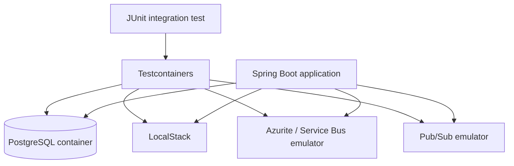
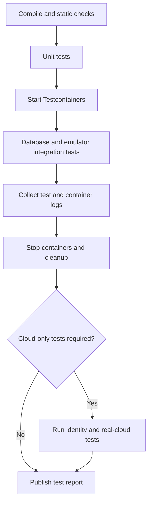

# Using Testcontainers to Manage Services or Simulated Environments

> **Chapter:** Integration Testing  
> **Module:** SPRING_CLOUD_PROVIDER_INTEGRATION  
> **Objective:** Use Testcontainers for Java to start, configure, connect, test, and clean up containerized dependencies; integrate containers with Spring Boot; manage emulators for AWS, Azure, and Google Cloud; establish stable lifecycles on developer machines and CI.

## 1. What Problem Does Testcontainers Solve?

An integration test often needs a database, message broker, object storage, or simulated service. If tests assume those services are pre-installed on a developer's machine, the tests depend on local machine state and are prone to port, version, or data conflicts. If tests only use mocks, they do not verify requests/responses over real protocols.

Testcontainers allows Java tests to start dependencies in containers before running assertions, retrieve actual endpoints/ports, and then stop and remove the containers upon completion. Tests can run PostgreSQL, SQL Server, LocalStack, Azurite, or other emulators with configuration declared directly in the test source.

For the Spring Cloud Provider Integration module, Testcontainers is useful in three categories:

- **Service containers:** running real databases or brokers such as PostgreSQL, SQL Server, Kafka, or RabbitMQ.
- **Cloud emulators:** running implementations simulating cloud APIs such as LocalStack, Azurite, Azure Service Bus emulator, or Google Pub/Sub emulator.
- **Multi-container test environments:** combining multiple required dependencies—for example, Azure Service Bus emulator requires SQL Server and a shared Docker network.



Testcontainers manages container lifecycles and connections to containers. It does not turn an emulator into a complete replica of the cloud, does not grant production IAM/RBAC, and does not automatically test the deployment environment's private networking. Those areas still require appropriate cloud integration tests.

## 2. Key Concepts to Know

| Concept | Meaning |
| --- | --- |
| Container image | Image used to start a service, e.g., postgres:16-alpine |
| Container instance | A running service managed by Testcontainers |
| Module | Prebuilt utility class for a specific service, e.g., PostgreSQL, LocalStack, Azure, or GCloud |
| GenericContainer | General-purpose API to start images without a dedicated module |
| Exposed port | Container port mapped to a random host port |
| Wait strategy | Condition determining that a service is ready to accept requests |
| Startup strategy | Condition determining that a container has reached running state or exited as intended |
| Docker network | Isolated network enabling multiple containers to communicate by alias |
| @Container | Declares a container managed by the JUnit Testcontainers extension |
| @Testcontainers | Activates the extension for JUnit Jupiter |
| @ServiceConnection | Enables Spring Boot to create ConnectionDetails from containers with a supported factory |
| @DynamicPropertySource | Injects dynamic hosts, ports, or endpoints into the Spring Environment |

Distinguish between **container running** and **service ready**. A container can be in the running state while its database is undergoing recovery or the emulator has not finished loading its configuration. Tests should only start once the service satisfies the required readiness condition.

## 3. Preparing Dependencies and Runtime Environment

Testcontainers requires a Docker API-compatible container runtime. Typically this is Docker Engine or Docker Desktop. Other runtimes may work, but require separate configuration and compatibility checks. CI runners must also have access to a Docker daemon or a suitable Testcontainers Cloud environment.

### 3.1. Maven Dependencies

You can manage modules under a shared version using the Testcontainers BOM. The example below uses version 2.0.5 per current Testcontainers documentation; your project should pin a version verified with your JDK, Spring Boot, and SDKs.

```xml
<dependencyManagement>
    <dependencies>
        <dependency>
            <groupId>org.testcontainers</groupId>
            <artifactId>testcontainers-bom</artifactId>
            <version>2.0.5</version>
            <type>pom</type>
            <scope>import</scope>
        </dependency>
    </dependencies>
</dependencyManagement>

<dependencies>
    <dependency>
        <groupId>org.testcontainers</groupId>
        <artifactId>testcontainers</artifactId>
        <scope>test</scope>
    </dependency>

    <dependency>
        <groupId>org.testcontainers</groupId>
        <artifactId>testcontainers-junit-jupiter</artifactId>
        <scope>test</scope>
    </dependency>

    <dependency>
        <groupId>org.testcontainers</groupId>
        <artifactId>testcontainers-postgresql</artifactId>
        <scope>test</scope>
    </dependency>

    <dependency>
        <groupId>org.springframework.boot</groupId>
        <artifactId>spring-boot-testcontainers</artifactId>
        <scope>test</scope>
    </dependency>
</dependencies>
```

The PostgreSQL driver, such as org.postgresql:postgresql, must still be on the test runtime classpath. The Testcontainers module provides the container class, not the JDBC driver required by the application.

### 3.2. Gradle Dependencies

```groovy
dependencies {
    testImplementation platform("org.testcontainers:testcontainers-bom:2.0.5")

    testImplementation "org.testcontainers:testcontainers"
    testImplementation "org.testcontainers:testcontainers-junit-jupiter"
    testImplementation "org.testcontainers:testcontainers-postgresql"

    testImplementation "org.springframework.boot:spring-boot-testcontainers"
    testRuntimeOnly "org.postgresql:postgresql"
}
```

When using emulators in Gradle, add the required modules from the same BOM:

```groovy
dependencies {
    testImplementation "org.testcontainers:testcontainers-localstack"
    testImplementation "org.testcontainers:testcontainers-azure"
    testImplementation "org.testcontainers:testcontainers-gcloud"
    testImplementation "org.testcontainers:testcontainers-mssqlserver"
}
```

When cloud emulator modules are needed, add the corresponding modules:

```xml
<dependency>
    <groupId>org.testcontainers</groupId>
    <artifactId>testcontainers-localstack</artifactId>
    <scope>test</scope>
</dependency>

<dependency>
    <groupId>org.testcontainers</groupId>
    <artifactId>testcontainers-azure</artifactId>
    <scope>test</scope>
</dependency>

<dependency>
    <groupId>org.testcontainers</groupId>
    <artifactId>testcontainers-gcloud</artifactId>
    <scope>test</scope>
</dependency>

<dependency>
    <groupId>org.testcontainers</groupId>
    <artifactId>testcontainers-mssqlserver</artifactId>
    <scope>test</scope>
</dependency>
```

Testcontainers 2.x changed module artifact IDs to use the testcontainers- prefix and moved some container classes into per-module packages, such as org.testcontainers.postgresql.PostgreSQLContainer, org.testcontainers.localstack.LocalStackContainer, and org.testcontainers.mssqlserver.MSSQLServerContainer. The Azure/GCloud modules may be marked incubating and their APIs can change. Check the documentation for your exact version before using them; do not blindly copy classes/packages from older major versions.

### 3.3. Pinning Image Versions

Pin container image versions in tests:

```java
new PostgreSQLContainer<>(
        DockerImageName.parse("postgres:16.4-alpine"));
```

Do not use the latest tag in CI tests. A new image can change behavior, entrypoints, or APIs without any change to test source code. When upgrading an image, update intentionally and re-run related suites.

## 4. Managing Lifecycles with JUnit 5

Testcontainers provides a JUnit Jupiter extension. @Testcontainers enables the extension; @Container marks container fields to be managed.

### 4.1. Static Container Shared Within a Test Class

A static field starts once before the class's test methods and stops after the last test method:

```java
import org.junit.jupiter.api.Test;
import org.testcontainers.containers.GenericContainer;
import org.testcontainers.junit.jupiter.Container;
import org.testcontainers.junit.jupiter.Testcontainers;
import org.testcontainers.utility.DockerImageName;

import static org.assertj.core.api.Assertions.assertThat;

@Testcontainers
class RedisContainerIT {

    @Container
    static final GenericContainer<?> redis =
            new GenericContainer<>(
                    DockerImageName.parse("redis:7.4-alpine"))
                    .withExposedPorts(6379);

    @Test
    void redisContainerIsRunning() {
        assertThat(redis.isRunning()).isTrue();
    }
}
```

This is a good fit when multiple test methods in the same class can share one service. Test data must still be isolated via distinct keys or namespaces.

### 4.2. Instance Container Dedicated to Each Test Method

A non-static field starts before each method and stops after that method:

```java
@Testcontainers
class IsolatedRedisIT {

    @Container
    final GenericContainer<?> redis =
            new GenericContainer<>(
                    DockerImageName.parse("redis:7.4-alpine"))
                    .withExposedPorts(6379);

    @Test
    void firstTestGetsFreshContainer() {
        assertThat(redis.isRunning()).isTrue();
    }

    @Test
    void secondTestAlsoGetsFreshContainer() {
        assertThat(redis.isRunning()).isTrue();
    }
}
```

This increases isolation at the expense of container startup/teardown time. Use it when tests require completely clean state or alter configuration between tests.

### 4.3. Lifecycle Comparison

| Declaration | Start Time | Stop Time | Best Suited For |
| --- | --- | --- | --- |
| static @Container | Before the first method in the class | After the last method in the class | Multiple tests sharing a service |
| Instance @Container | Before each method | After each method | Tests requiring a fresh container |
| Spring-managed container bean | When Spring creates the context | When Spring destroys the context | Cached and reused Spring contexts |
| Manual start()/stop() | Controlled by test code | Controlled by test code | Complex dependencies or explicit startup order |

The JUnit Jupiter extension is documented by Testcontainers as supporting static and instance containers; the extension has been tested with sequential execution. Parallel test execution requires careful evaluation because multiple tests may share containers, resources, or state. Do not enable parallel execution solely because containers can start independently.

### 4.4. Avoiding Conflicts with the Spring TestContext Cache

Spring may keep an ApplicationContext cached after a test class finishes. Meanwhile, the JUnit extension may have stopped that class's static container. A subsequent test class reusing the cached context may encounter beans holding endpoints pointing to a stopped container.

When a container is a dependency of Spring beans and the context needs to be reused, prefer managing the container as a Spring bean or importing container declarations per Spring Boot guidance. That keeps the container alive alongside the context lifecycle and stops it after dependent beans.

## 5. Waiting for Service Readiness Before Testing

Testcontainers has a default wait strategy based on exposed ports starting to listen. By default it typically waits up to 60 seconds for the first exposed port. This only proves a process is listening, not necessarily that the service is ready to handle business traffic.

### 5.1. Waiting on an HTTP Health Endpoint

```java
import java.time.Duration;
import org.testcontainers.containers.GenericContainer;
import org.testcontainers.containers.wait.strategy.Wait;
import org.testcontainers.utility.DockerImageName;

GenericContainer<?> emulator =
        new GenericContainer<>(
                DockerImageName.parse("example/emulator:1.4.0"))
                .withExposedPorts(8080)
                .waitingFor(
                        Wait.forHttp("/health")
                                .forStatusCode(200))
                .withStartupTimeout(Duration.ofMinutes(2));
```

Only use HTTP wait when the image actually exposes a health endpoint. If the endpoint requires authentication or returns another status code, configure the corresponding condition.

### 5.2. Waiting on a Readiness Log Message

```java
GenericContainer<?> broker =
        new GenericContainer<>(
                DockerImageName.parse("example/broker:1.4.0"))
                .withExposedPorts(9092)
                .waitingFor(
                        Wait.forLogMessage(".*started and ready.*\\n", 1))
                .withStartupTimeout(Duration.ofMinutes(2));
```

The log regex must match a stable message from the pinned image. If the log message changes, the test will time out; inspect container logs before increasing timeouts.

### 5.3. Startup Strategy vs. Wait Strategy

- Startup strategy verifies whether the container reaches the expected running state or one-shot completion.
- Wait strategy verifies whether the service inside the container is ready for client connections.

A container starting successfully does not guarantee its endpoint is operational. Conversely, a one-shot migration container may complete and exit; in that case, use a startup strategy tailored for job containers rather than waiting on a port.

## 6. Connecting to Containers: Host, Mapped Ports, and Docker Networks

### 6.1. Do Not Hard-Code localhost or Ports

Testcontainers typically maps container ports to random host ports to avoid collisions:

```java
import io.lettuce.core.RedisClient;
import io.lettuce.core.RedisURI;

String host = redis.getHost();
Integer port = redis.getMappedPort(6379);

RedisClient client = RedisClient.create(
        RedisURI.create(host, port));
```

Do not assume host port 6379 is always available. Nor should you assume the host is always localhost; CI environments, Docker Desktop, or remote runtimes may return a different host.

### 6.2. Container-to-Container Communication via Docker Network

If the application also runs inside a container, do not use host mapped ports for inter-container connections. Create a shared network and use network aliases with internal ports:

```java
import org.testcontainers.containers.Network;
import org.testcontainers.containers.GenericContainer;
import org.testcontainers.postgresql.PostgreSQLContainer;
import org.testcontainers.utility.DockerImageName;

Network network = Network.newNetwork();

PostgreSQLContainer<?> database =
        new PostgreSQLContainer<>("postgres:16-alpine")
                .withNetwork(network)
                .withNetworkAliases("test-db");

GenericContainer<?> worker =
        new GenericContainer<>(
                DockerImageName.parse("example/worker:1.0.0"))
                .withNetwork(network)
                .withEnv("DB_HOST", "test-db")
                .withEnv("DB_PORT", "5432");

database.start();
worker.start();
// After the test finishes, stop worker then database and close the network.
```

Containers on the same network reach each other via alias test-db:5432. The test JVM on the host still uses getHost() and getMappedPort() to connect.

### 6.3. Dependencies Across Multiple Containers

Some emulators require companion services. Create a shared network, declare dependencies explicitly, and start them in the required order. For example, Azure Service Bus emulator requires SQL Server; Event Hubs emulator may require Azurite. Do not simply expose ports to the host and expect containers to discover each other via localhost.

## 7. Integrating Testcontainers with Spring Boot

Spring Boot offers two common mechanisms to pass container connection details into the application context: @ServiceConnection and @DynamicPropertySource.

Service connections were introduced in Spring Boot 3.1. The project needs the spring-boot-testcontainers dependency in test scope; verify your Boot version before copying examples.

### 7.1. @ServiceConnection for Supported Containers

@ServiceConnection requires the spring-boot-testcontainers dependency. Spring Boot uses ContainerConnectionDetailsFactory to create appropriate ConnectionDetails for supported container types.

PostgreSQL example:

```java
import org.junit.jupiter.api.Test;
import org.springframework.beans.factory.annotation.Autowired;
import org.springframework.boot.test.context.SpringBootTest;
import org.springframework.boot.testcontainers.service.connection.ServiceConnection;
import org.testcontainers.postgresql.PostgreSQLContainer;
import org.testcontainers.junit.jupiter.Container;
import org.testcontainers.junit.jupiter.Testcontainers;

import static org.assertj.core.api.Assertions.assertThat;

@SpringBootTest
@Testcontainers
class DocumentRepositoryIT {

    @Container
    @ServiceConnection
    static final PostgreSQLContainer<?> postgres =
            new PostgreSQLContainer<>(
                    "postgres:16-alpine")
                    .withDatabaseName("documents")
                    .withUsername("test")
                    .withPassword("test-only-password");

    @Autowired
    DocumentRepository repository;

    @Test
    void savesDocumentUsingContainerDatabase() {
        Document document = Document.uploaded(
                "doc-it-1",
                "user-it",
                "documents/doc-it-1/original");

        repository.save(document);

        assertThat(repository.findById("doc-it-1"))
                .isPresent();
    }
}
```

Spring Boot automatically creates connection details for supported PostgreSQL containers. You do not need to manually specify spring.datasource.url if auto-configuration picks up the service connection.

### 7.2. When to Use @DynamicPropertySource

Use @DynamicPropertySource when:

- The container has no matching ConnectionDetailsFactory.
- The application uses custom properties.
- An emulator provides a custom endpoint or connection string.
- Dynamic endpoints must be configured for AWS/Azure/Google Cloud SDK clients.

Example with an emulator exposing a dynamic endpoint:

```java
import org.springframework.test.context.DynamicPropertyRegistry;
import org.springframework.test.context.DynamicPropertySource;
import org.springframework.boot.test.context.SpringBootTest;
import org.testcontainers.containers.GenericContainer;
import org.testcontainers.junit.jupiter.Container;
import org.testcontainers.junit.jupiter.Testcontainers;
import org.testcontainers.utility.DockerImageName;

@SpringBootTest
@Testcontainers
class CloudAdapterIT {

    @Container
    static final GenericContainer<?> emulator =
            new GenericContainer<>(
                    DockerImageName.parse("example/emulator:1.0.0"))
                    .withExposedPorts(8080);

    @DynamicPropertySource
    static void emulatorProperties(
            DynamicPropertyRegistry registry) {

        registry.add(
                "app.cloud.endpoint",
                () -> "http://" + emulator.getHost()
                        + ":" + emulator.getMappedPort(8080));
    }
}
```

app.cloud.endpoint is a property defined by the application itself. Adapter configuration must read this property and build an SDK client pointing to the emulator.

### 7.3. @ServiceConnection Does Not Automatically Understand Every Cloud Emulator

Spring Boot only generates connection details automatically for containers/services with a matching factory. With GenericContainer or custom cloud emulators, you may need to specify @ServiceConnection(name = "...") if Spring Boot provides a factory for that service. If no factory exists, use @DynamicPropertySource or a test configuration to configure the client.

Do not add @ServiceConnection and assume every AWS/Azure/GCP SDK automatically redirects to the emulator.

## 8. Managing a PostgreSQL Container as a Foundational Dependency

Databases are usually the best starting point for Testcontainers because the PostgreSQL module is mature and Spring Boot supports service connections out of the box.

```java
import org.junit.jupiter.api.Test;
import org.springframework.beans.factory.annotation.Autowired;
import org.springframework.boot.test.context.SpringBootTest;
import org.springframework.boot.testcontainers.service.connection.ServiceConnection;
import org.springframework.jdbc.core.JdbcTemplate;
import org.testcontainers.junit.jupiter.Container;
import org.testcontainers.junit.jupiter.Testcontainers;
import org.testcontainers.postgresql.PostgreSQLContainer;

import static org.assertj.core.api.Assertions.assertThat;

@Testcontainers
@SpringBootTest
class DocumentPersistenceIT {

    @Container
    @ServiceConnection
    static final PostgreSQLContainer<?> postgres =
            new PostgreSQLContainer<>("postgres:16-alpine")
                    .withDatabaseName("provider_it")
                    .withUsername("test")
                    .withPassword("test-only-password");

    @Autowired
    JdbcTemplate jdbcTemplate;

    @Test
    void migrationCreatesExpectedTable() {
        Integer count = jdbcTemplate.queryForObject(
                """
                select count(*)
                from information_schema.tables
                where table_name = 'documents'
                """,
                Integer.class);

        assertThat(count).isEqualTo(1);
    }
}
```

This test uses real PostgreSQL running in a container. It is well-suited for verifying SQL, migrations, constraints, transactions, and query behavior. It requires no cloud account access.

## 9. AWS: Using the LocalStack Module

Testcontainers includes a LocalStack module to run certain AWS APIs locally. Commonly tested services in integration tests include S3, SQS, SNS, and DynamoDB, depending on LocalStack features and version.

### 9.1. Dependency and Container

Maven dependency:

```xml
<dependency>
    <groupId>org.testcontainers</groupId>
    <artifactId>testcontainers-localstack</artifactId>
    <scope>test</scope>
</dependency>
```

Example starting LocalStack:

```java
import org.testcontainers.localstack.LocalStackContainer;
import org.testcontainers.utility.DockerImageName;
import org.testcontainers.junit.jupiter.Container;
import org.testcontainers.junit.jupiter.Testcontainers;

@Testcontainers
class S3LocalStackIT {

    @Container
    static final LocalStackContainer localstack =
            new LocalStackContainer(
                    DockerImageName.parse(
                            "localstack/localstack:<pinned-version>"))
                    .withServices("s3", "sqs")
                    .withEnv(
                            "LOCALSTACK_AUTH_TOKEN",
                            System.getenv("LOCALSTACK_AUTH_TOKEN"));
}
```

As of 2026-03-23, the localstack/localstack image requires the LOCALSTACK_AUTH_TOKEN environment variable; without it, the container will not start. Retrieve the token from the developer/CI secret store—never commit tokens into source or test reports. Pin an organization-approved image version in place of the `<pinned-version>` placeholder.

### 9.2. Creating an AWS SDK Client Pointing to LocalStack

```java
import org.testcontainers.localstack.LocalStackContainer;
import software.amazon.awssdk.auth.credentials.AwsBasicCredentials;
import software.amazon.awssdk.auth.credentials.StaticCredentialsProvider;
import software.amazon.awssdk.regions.Region;
import software.amazon.awssdk.services.s3.S3Client;

static S3Client createS3Client(LocalStackContainer localstack) {
    AwsBasicCredentials credentials =
            AwsBasicCredentials.create(
                    localstack.getAccessKey(),
                    localstack.getSecretKey());

    return S3Client.builder()
            .endpointOverride(localstack.getEndpoint())
            .credentialsProvider(
                    StaticCredentialsProvider.create(credentials))
            .region(Region.of(localstack.getRegion()))
            .build();
}
```

A test can create a bucket, upload an object, and read it back:

```java
import org.junit.jupiter.api.Test;
import org.testcontainers.localstack.LocalStackContainer;
import software.amazon.awssdk.core.sync.RequestBody;
import software.amazon.awssdk.services.s3.S3Client;
import software.amazon.awssdk.services.s3.model.CreateBucketRequest;
import software.amazon.awssdk.services.s3.model.GetObjectRequest;
import software.amazon.awssdk.services.s3.model.PutObjectRequest;

import static org.assertj.core.api.Assertions.assertThat;

@Test
void uploadsObjectToLocalStack() {
    try (S3Client s3 = createS3Client(localstack)) {
        String bucket = "it-documents";

        s3.createBucket(
                CreateBucketRequest.builder()
                        .bucket(bucket)
                        .build());

        s3.putObject(
                PutObjectRequest.builder()
                        .bucket(bucket)
                        .key("documents/doc-1.pdf")
                        .contentType("application/pdf")
                        .build(),
                RequestBody.fromBytes(
                        new byte[] {1, 2, 3}));

        byte[] loaded = s3.getObjectAsBytes(
                GetObjectRequest.builder()
                        .bucket(bucket)
                        .key("documents/doc-1.pdf")
                        .build())
                .asByteArray();

        assertThat(loaded).containsExactly(1, 2, 3);
    }
}
```

This example focuses on the S3 API. With Spring Boot, you can define an S3Client bean in a test configuration or pass the endpoint, access key, secret key, and region via @DynamicPropertySource so the production adapter uses that configuration.

### 9.3. Limitations to Remember

LocalStack helps verify request mapping and many supported service APIs, but does not replace real AWS for every feature. Use a test IAM role/account to verify permissions, resource policies, KMS, VPC endpoints, quotas, regional behavior, and features not fully supported by LocalStack.

## 10. Azure: Azurite and Service Bus Emulator

Testcontainers has an Azure module containing container classes for Azurite, Event Hubs emulator, Service Bus emulator, and Cosmos DB emulator. At the time of reference, the Azure module is marked **incubating**; check release notes because APIs may change.

### 10.1. Azurite for Blob Storage

Dependency:

```xml
<dependency>
    <groupId>org.testcontainers</groupId>
    <artifactId>testcontainers-azure</artifactId>
    <scope>test</scope>
</dependency>
```

Example:

```java
import com.azure.storage.blob.BlobContainerClient;
import com.azure.storage.blob.BlobClient;
import com.azure.storage.blob.BlobServiceClient;
import com.azure.storage.blob.BlobServiceClientBuilder;
import java.io.ByteArrayInputStream;
import java.io.ByteArrayOutputStream;
import org.junit.jupiter.api.Test;
import org.testcontainers.azure.AzuriteContainer;
import org.testcontainers.junit.jupiter.Container;
import org.testcontainers.junit.jupiter.Testcontainers;

import static org.assertj.core.api.Assertions.assertThat;

@Testcontainers
class BlobAzuriteIT {

    @Container
    static final AzuriteContainer azurite =
            new AzuriteContainer(
                    "mcr.microsoft.com/azure-storage/azurite:3.33.0");

    @Test
    void uploadsBlobToAzurite() {
        BlobServiceClient service =
                new BlobServiceClientBuilder()
                        .connectionString(
                                azurite.getConnectionString())
                        .buildClient();

        BlobContainerClient container =
                service.createBlobContainerIfNotExists("it-documents");

        BlobClient blob = container.getBlobClient("doc-1.pdf");
        blob.upload(
                new ByteArrayInputStream(new byte[] {1, 2, 3}),
                3,
                true);

        ByteArrayOutputStream output = new ByteArrayOutputStream();
        blob.download(output);

        assertThat(output.toByteArray())
                .containsExactly(1, 2, 3);
    }
}
```

Azurite provides a connection string via getConnectionString(). If the Azure SDK sends an API version not yet supported by the Azurite image in use, the module provides withCommandOptions(...) to add flags such as --skipApiVersionCheck. Only use that option once you have confirmed the compatibility cause; never use it to mask an invalid API request.

### 10.2. Service Bus Emulator Requires SQL Server

The Azure Service Bus emulator requires a SQL Server container as a dependency along with entity configuration. Both containers must share a Docker network so the emulator connects to SQL Server by internal hostname.

Add the SQL Server module for Testcontainers 2.x:

```xml
<dependency>
    <groupId>org.testcontainers</groupId>
    <artifactId>testcontainers-mssqlserver</artifactId>
    <scope>test</scope>
</dependency>
```

Abbreviated lifecycle example:

```java
import com.github.dockerjava.api.model.Capability;
import org.testcontainers.azure.ServiceBusEmulatorContainer;
import org.testcontainers.containers.Network;
import org.testcontainers.mssqlserver.MSSQLServerContainer;
import org.testcontainers.utility.MountableFile;

Network network = Network.newNetwork();

MSSQLServerContainer<?> sql =
        new MSSQLServerContainer<>(
                "mcr.microsoft.com/mssql/server:2022-CU14-ubuntu-22.04")
                .acceptLicense()
                .withPassword("TestOnly!Password123")
                .withCreateContainerCmdModifier(cmd ->
                        cmd.getHostConfig().withCapAdd(Capability.SYS_PTRACE))
                .withNetwork(network);

sql.start();

ServiceBusEmulatorContainer serviceBus =
        new ServiceBusEmulatorContainer(
                "mcr.microsoft.com/azure-messaging/servicebus-emulator:1.1.2")
                .acceptLicense()
                .withConfig(
                        MountableFile.forClasspathResource(
                                "/service-bus-config.json"))
                .withNetwork(network)
                .withMsSqlServerContainer(sql);

serviceBus.start();
// After the test finishes: serviceBus.stop(); sql.stop(); network.close().
```

Place entity configuration in src/test/resources/service-bus-config.json. Abbreviated example:

```json
{
  "UserConfig": {
    "Namespaces": [
      {
        "Name": "sbemulatorns",
        "Queues": [
          {
            "Name": "documents",
            "Properties": {
              "DefaultMessageTimeToLive": "PT1H",
              "LockDuration": "PT1M",
              "MaxDeliveryCount": 3,
              "RequiresSession": false
            }
          }
        ],
        "Topics": []
      }
    ],
    "Logging": {
      "Type": "File"
    }
  }
}
```

In a test class, place startup in @BeforeAll and shutdown in @AfterAll, or use the module's lifecycle helpers for your version. When managing manually, stop the emulator before SQL Server and close the network in a finally block so containers are not left behind when assertions fail.

After startup, build a client using the emulator's connection string:

```java
import com.azure.messaging.servicebus.ServiceBusClientBuilder;
import com.azure.messaging.servicebus.ServiceBusMessage;
import com.azure.messaging.servicebus.ServiceBusSenderClient;

ServiceBusSenderClient sender =
        new ServiceBusClientBuilder()
                .connectionString(serviceBus.getConnectionString())
                .sender()
                .queueName("documents")
                .buildClient();

sender.sendMessage(
        new ServiceBusMessage("document-created"));
```

This example verifies connectivity and basic sending. The emulator has feature limitations and does not prove Entra ID, JMS, partitioning, AMQP WebSockets, or production private endpoints. Use a real Azure test namespace for those behaviors.

### 10.3. When to Use the Azure Module

- Use Azurite to test Blob/Queue/Table Storage APIs within supported features.
- Use the Service Bus emulator to test basic AMQP send/receive and queue/topic configuration.
- Use the Event Hubs emulator for appropriate producer/consumer flows.
- Use the Cosmos DB emulator when local client/API verification is needed.
- Run separate cloud integration tests for Entra ID, RBAC, Managed Identity, private networking, tiers, and features unsupported by the emulator.

## 11. Google Cloud: Pub/Sub Emulator

Testcontainers provides a GCloud module for several emulators, including Pub/Sub, Firestore, Bigtable, Datastore, Spanner, and BigQuery. The GCloud module is also marked incubating; verify APIs against your version.

### 11.1. Starting the Pub/Sub Emulator

Dependency:

```xml
<dependency>
    <groupId>org.testcontainers</groupId>
    <artifactId>testcontainers-gcloud</artifactId>
    <scope>test</scope>
</dependency>
```

Container:

```java
import org.testcontainers.gcloud.PubSubEmulatorContainer;
import org.testcontainers.junit.jupiter.Container;
import org.testcontainers.junit.jupiter.Testcontainers;
import org.testcontainers.utility.DockerImageName;

@Testcontainers
class PubSubEmulatorIT {

    @Container
    static final PubSubEmulatorContainer pubsub =
            new PubSubEmulatorContainer(
                    DockerImageName.parse(
                            "gcr.io/google.com/cloudsdktool/google-cloud-cli:583.0.0-emulators"));
}
```

Retrieve the endpoint via getEmulatorEndpoint(). The application must point the Google Cloud Pub/Sub client to this endpoint and use a simulated project ID dedicated to testing. With the Java client library, configure the channel provider to target the emulator endpoint and use NoCredentialsProvider; do not use production credentials when calling the emulator.

Example passing the endpoint to adapter configuration:

```java
import org.springframework.test.context.DynamicPropertyRegistry;
import org.springframework.test.context.DynamicPropertySource;

@DynamicPropertySource
static void pubsubProperties(DynamicPropertyRegistry registry) {
    registry.add(
            "app.google.pubsub.emulator-host",
            pubsub::getEmulatorEndpoint);
    registry.add(
            "app.google.pubsub.project-id",
            () -> "provider-integration-test");
}
```

The app.google.pubsub.* properties are illustrative application configuration. The adapter must read them to configure the endpoint, project ID, and no-credentials mode. Do not assume Spring Boot automatically configures Google Cloud clients from @ServiceConnection.

### 11.2. Limitations of the Pub/Sub Emulator

The Pub/Sub emulator is useful for testing topic/subscription creation, publishing, pulling, local push, ordering, and certain retry/DLQ flows. However:

- IAM operations are not supported.
- Message retention and subscription expiration do not match the full cloud service.
- Push tests can use local HTTP; production push endpoints require HTTPS.
- Emulator data lives for the emulator session and is lost when the container is deleted/recreated.
- Certain advanced features or RPCs are not supported.

Therefore, the emulator fits protocol and basic message flow integration tests; use a real test project to verify IAM, service accounts, HTTPS push, quotas, retention, and other critical features.

## 12. Configuring Multi-Dependency Containers and Test Fixtures

A test environment may include a database, broker, emulator, and application. Group shared container configuration into fixtures or test configurations with clear boundaries.

### 12.1. Using @TestConfiguration When Multiple Spring Tests Share a Container

Example with a Spring-managed PostgreSQL container:

```java
import org.springframework.boot.test.context.TestConfiguration;
import org.springframework.boot.testcontainers.service.connection.ServiceConnection;
import org.springframework.context.annotation.Bean;
import org.testcontainers.postgresql.PostgreSQLContainer;

@TestConfiguration(proxyBeanMethods = false)
class DatabaseContainerConfiguration {

    @Bean
    @ServiceConnection
    PostgreSQLContainer<?> postgresContainer() {
        return new PostgreSQLContainer<>("postgres:16-alpine")
                .withDatabaseName("provider_it")
                .withUsername("test")
                .withPassword("test-only-password");
    }
}
```

Import into tests:

```java
import org.springframework.boot.test.context.SpringBootTest;
import org.springframework.context.annotation.Import;

@SpringBootTest
@Import(DatabaseContainerConfiguration.class)
class DocumentServiceIT {
    // Spring starts the container before dependent beans and stops it after the context closes.
}
```

Container beans are created once per Spring context lifecycle. If multiple test classes share the same context configuration, they may share the same container instance. Therefore, ensure test data isolation; do not assume every test method starts with an empty database.

### 12.2. Separating Configuration by Profile

A typical layout:

```text
src/
  main/
    java/
      .../storage/
      .../messaging/
  test/
    java/
      .../unit/
      .../integration/
      .../cloud/
    resources/
      application-test.yml
      service-bus-config.json
```

The test profile can swap in local endpoints and credentials. Never allow application-test.yml to accidentally contain production endpoints or real secrets. For cloud tests, obtain identity configuration from workload identity/CI secret providers rather than committing it to source.

## 13. Data Management, Isolation, and Cleanup

Removing a container discards state inside the container unless volumes are mounted. However, Testcontainers does not automatically clean up resources created in the real cloud, nor does it prevent tests inside the same container from overwriting each other's data.

### 13.1. Isolating Data

- Use separate buckets/containers/queues/topics/databases/schemas or prefixes containing the test run ID.
- Use random IDs for objects and messages.
- Do not make tests depend on execution order.
- Do not share a consumer group/queue across parallel tests if they might consume each other's messages.
- Delete test data after assertions or reset fixtures before each test.
- Record correlation IDs to filter logs and messages for the current test.

### 13.2. Cleaning Up Containers and Internal Resources

Testcontainers normally stops/removes containers after their lifecycle ends. For resources created inside an emulator, you can use a fresh container per class/test to reset state, or delete resources via the SDK during teardown.

For real cloud tests, delete created buckets/objects/queues/topics and database resources. Attach tags/labels with owner and expiry so cleanup jobs can locate leftover resources if CI is cancelled abruptly.

### 13.3. Reusable Containers

Testcontainers offers a reusable container feature for developer machines. This is an experimental feature: containers do not stop automatically after tests, and documentation recommends against using it in CI. It can allow stale state to affect subsequent runs.

Do not enable reuse by default for test suites. If developers opt in locally to save time, establish a data reset procedure and remember that containers remain running after tests finish.

## 14. Logs, Diagnostics, and Troubleshooting

When a container fails to start or a test times out, capture container logs before increasing timeouts:

```java
String logs = container.getLogs();
System.err.println(logs);
```

You can use withLogConsumer(...) to forward logs to a test logger. For CI failures, store container logs alongside test reports while stripping sensitive secrets or connection strings.

| Symptom | Common Cause | Resolution |
| --- | --- | --- |
| Could not find Docker environment | Docker daemon not running or CI runner lacks socket/remote runtime | Check container runtime and Testcontainers diagnostics |
| Image pull failure | Registry rate limit, missing permissions, or wrong image tag | Authenticate to registry, pin valid image, use approved mirror |
| Container running but test times out | Service not ready yet or wrong wait strategy | Use appropriate HTTP/log/health wait strategy for the service |
| Connection refused | Wrong host/port or app started before emulator | Use getHost(), getMappedPort(), and readiness wait |
| Container-to-container fails to connect | Not on same Docker network or using localhost | Use network alias and internal port |
| Spring context uses stale endpoint | Container stopped while context remained cached | Manage container with Spring context or fix lifecycle |
| Test passes alone but fails in full suite | Shared state, ports, resources, or parallel race | Isolate data and control parallel execution |
| Azure Service Bus emulator fails to start | Missing SQL Server, network, config, or license acceptance | Check dependency container, config file, and logs |
| LocalStack fails to start | Missing LOCALSTACK_AUTH_TOKEN or incompatible image/version | Supply token from secret store and pin image |
| Pub/Sub client reports auth/protocol error | Client not pointed at emulator endpoint or still using production credential chain | Configure emulator endpoint and no-credentials mode |
| Cleanup leaves cloud resources behind | Pipeline cancelled or teardown error | Use expiry labels and a janitor job |

## 15. Organizing Testcontainers in CI

CI needs an available container runtime, permissions to pull images, and networking for containers to communicate. For private images, configure registry authentication in the CI secret store. Never print Docker credentials or LocalStack tokens to logs.

A sensible pipeline:



Recommendations:

- Run unit tests without Docker on every pull request.
- Run containerized integration tests on runners with a Docker API.
- Cache image layers or use a registry mirror per CI policy; never cache test data state.
- Pin image versions and Testcontainers dependencies.
- Bound parallelism based on CPU, RAM, and Docker host quotas.
- Always collect logs when container startup or tests fail.
- Ensure cleanup runs even on test failure; the container runtime should also have a cleanup mechanism.
- Separate cloud integration tests requiring IAM/RBAC or private networks into jobs with the proper identity and network.

Testcontainers does not require the application itself to run inside Docker. JVM tests can run on the host and connect to containers via mapped ports. If packaging the test runner inside a container, pay attention to Docker socket mounting, host discovery, and network paths.

## 16. Practice Lab: Building a Test Environment for Document Service

**Context:** Document Service uses PostgreSQL for metadata, Azure Blob or S3 for files, and a message broker to publish DocumentUploaded. Build a repeatable test environment for developer machines and CI.

### Part A — PostgreSQL

- Add the Testcontainers BOM and JUnit Jupiter module.
- Create a PostgreSQLContainer with a dedicated test database/user.
- Use @ServiceConnection if supported by Spring Boot auto-configuration.
- Run migrations and verify repositories, transactions, and unique constraints.

### Part B — Object Storage

- Choose LocalStack for S3 or Azurite for Azure Blob.
- Pin the image version.
- Start the container and obtain the dynamic endpoint/connection string.
- Configure the SDK client via test configuration or @DynamicPropertySource.
- Upload an object and read back its content and metadata.
- Verify cleanup and test data isolation.

### Part C — Messaging Emulator

- Choose LocalStack SQS, Azure Service Bus emulator, or Google Pub/Sub emulator depending on the provider.
- If using the Service Bus emulator, start SQL Server on the same network and mount the entity configuration.
- Create the queue/topic/subscription in fixtures.
- Publish a message and verify the consumer receives the right payload and correlation ID.
- Simulate retry/redelivery within emulator-supported capabilities.

### Part D — Spring Context Lifecycle

- Use @Testcontainers and @Container for standalone test classes.
- If multiple test classes share a Spring context, convert containers to Spring-managed beans or import a container configuration.
- Use @DynamicPropertySource for dynamic emulator endpoints.
- Verify subsequent test classes do not target endpoints of stopped containers.

### Part E — CI and Cleanup

- Run tests on a CI runner with a Docker-compatible runtime.
- Retain container logs on failure.
- Include the test run ID in resource names.
- Clean up buckets/objects/messages and containers.
- Build a janitor for leftover cloud resources.
- Separate real IAM/RBAC tests from emulator tests.

**Completion criteria:** the learner can add Testcontainers to Maven/Gradle, choose appropriate lifecycles, wait for service readiness, connect via mapped endpoints, configure Spring Boot, run at least one database container and one cloud emulator, and isolate data and clean up after tests.

---

## 17. Pre-Merge Checklist

| Group | Question |
| --- | --- |
| Dependency | Are Testcontainers core, JUnit module, and service modules aligned on the same version/BOM? |
| Runtime | Do developers/CI have a Docker API-compatible runtime? |
| Image | Are image tags pinned and pullable in CI? |
| Lifecycle | Does static vs. instance container fit the test scope? |
| Spring context | Do containers live at least as long as cached contexts? |
| Readiness | Does the wait strategy check service readiness rather than just container running? |
| Endpoint | Are `getHost()` and mapped ports used instead of hard-coded localhost/ports? |
| Network | Do dependent containers share a network and use proper aliases? |
| Configuration | Is emulator configuration mounted and loaded successfully? |
| Credentials | Are emulator/test credentials separated from production secrets? |
| Isolation | Are resources and messages unique per test run? |
| Cleanup | Do both containers and cloud resources have cleanup paths? |
| Parallelism | Are there shared queues/databases or race conditions under parallel runs? |
| Diagnostics | Are container logs and request IDs captured on test failures? |
| Emulator limits | Do tests distinguish emulator behavior from real cloud behavior? |
| CI | Does the pipeline have separate triggers for cloud identity/network tests? |

## Key Takeaways

- Testcontainers manages service/container lifecycles so integration tests have deterministic, repeatable dependencies.
- Use dedicated modules when available; use GenericContainer for images without a specialized module.
- static @Container shares a container across a class; instance fields create a separate container per test method.
- Wait strategies must verify service readiness; a running container alone is not enough.
- Use getHost() and getMappedPort() when JVM tests connect from the host; use network aliases for container-to-container traffic.
- @ServiceConnection works automatically only for container types with a matching factory; use @DynamicPropertySource for custom emulator endpoints.
- The Spring context cache can outlive JUnit container lifecycles; manage containers alongside the Spring context when needed.
- LocalStack, Azurite, Service Bus emulator, and Pub/Sub emulator all have limitations; do not use them to conclude IAM/RBAC or all managed cloud behaviors are correct.
- Pin dependencies/images, isolate test data, collect logs, and clean up containers/resources after tests.
- Reusable containers are experimental and unsuitable as a CI default.

Testcontainers lets you test Spring Boot applications against realistic service dependencies while controlling lifecycle and cost. Use containers to validate APIs/protocols within emulator limits; use real cloud tests for identity, policies, networking, and provider-specific features. When endpoints, readiness, lifecycles, and cleanup are declared clearly in tests, integration suites stay reliable on both developer machines and CI.

### Official Documentation

- [Testcontainers for Java — JUnit 5 Quickstart](https://java.testcontainers.org/quickstart/junit_5_quickstart/)
- [Testcontainers for Java — JUnit Jupiter lifecycle](https://java.testcontainers.org/test_framework_integration/junit_5/)
- [Testcontainers for Java — Startup and wait strategies](https://java.testcontainers.org/features/startup_and_waits/)
- [Testcontainers for Java — Networking](https://java.testcontainers.org/features/networking/)
- [Testcontainers for Java — General container runtime requirements](https://java.testcontainers.org/supported_docker_environment/)
- [Testcontainers for Java — PostgreSQL module](https://java.testcontainers.org/modules/databases/postgres/)
- [Testcontainers for Java — LocalStack module](https://java.testcontainers.org/modules/localstack/)
- [Testcontainers for Java — Azure module](https://java.testcontainers.org/modules/azure/)
- [Testcontainers for Java — GCloud module](https://java.testcontainers.org/modules/gcloud/)
- [Testcontainers for Java — Releases and 2.x migration notes](https://github.com/testcontainers/testcontainers-java/releases)
- [Spring Boot — Testcontainers and service connections](https://docs.spring.io/spring-boot/reference/testing/testcontainers.html)
- [Google Cloud — Testing apps locally with the Pub/Sub emulator](https://docs.cloud.google.com/pubsub/docs/emulator)

Verify Testcontainers versions, module status, emulator images, and SDK compatibility before upgrading. Azure/GCloud modules may change APIs while incubating; cross-check the examples above against your project's actual versions before adopting them in your build.
