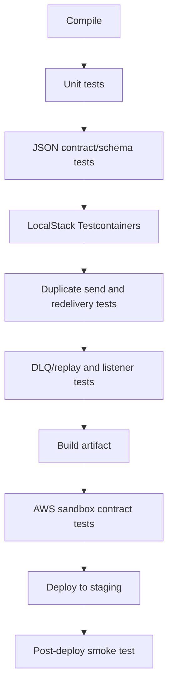

# Testing Duplicate Sends, Redelivery, and Message Schema Compatibility

A Spring Boot system using Amazon Simple Queue Service (Amazon SQS) must tolerate producer retries after timeouts, consumer redeliveries after visibility timeouts, error messages replayed from a dead-letter queue (DLQ), and payloads evolving across multiple application versions. These scenarios rarely surface in simple unit tests because they depend on queue behavior, serialization, acknowledgments, and database state.

Integration tests must prove three things: **duplicate sends do not create duplicate side effects**, **messages can be safely reprocessed**, and **producers/consumers on different versions still understand the published data contract**. With Spring Cloud AWS 3.4.1, you can use `SqsTemplate`, `@SqsListener`, Testcontainers, and LocalStack to test most flows in CI; certain service behaviors such as IAM, KMS, FIFO deduplication, and DLQ redrive still require verification in an AWS test account.

## 1. Learning Objectives

After this lesson, you will be able to:

- Distinguish duplicate sends, redeliveries, and duplicate side effects in tests.
- Set up SQS integration tests with Testcontainers LocalStack and Spring Cloud AWS 3.4.1.
- Test FIFO deduplication using `MessageDeduplicationId` and content-based deduplication.
- Test redelivery when a message is unacknowledged or acknowledgment is lost.
- Verify idempotent consumers with `eventId`, an inbox table, and unique constraints.
- Test failed messages routing to a DLQ, managed redrive, and manual replay.
- Build contract tests for JSON schemas, event types, and message attributes.
- Test compatibility between older and newer producer/consumer versions.
- Separate LocalStack tests, AWS sandbox tests, and production smoke tests.
- Prevent flaky tests using isolated queues, Awaitility, deterministic data, and controlled cleanup.

## 2. Three Types of Duplication to Test Separately

| Type | Cause | What to Verify |
|---|---|---|
| **Duplicate send** | Producer resends the same event due to a timeout or missing response | FIFO deduplication drops duplicates within the 5-minute window; Standard queues may hold multiple copies |
| **Redelivery** | Consumer fails to delete the message, exceeds visibility timeout, or `DeleteMessage` fails | The message can be received again; the new receipt handle differs from the prior one |
| **Duplicate side effect** | Consumer runs the same business operation multiple times | Database/API applies the side effect only once thanks to idempotency |

A test that merely sends the same message twice does not prove the consumer is idempotent. A test that merely invokes a service twice does not prove SQS redelivers properly. Write independent tests for each boundary, then add at least one integration test connecting them into an end-to-end flow.

## 3. Layered Testing Strategy

You do not need to run every scenario against real AWS. Divide tests by the scope being verified:

| Layer | Tools | Appropriate Scope |
|---|---|---|
| Unit test | JUnit, Mockito, AssertJ | Idempotency logic, event routing, mapping, and validation |
| Contract/schema test | Jackson, JSON fixtures, JSON Schema validator if used | Payload compatibility between producer and consumer |
| Local integration test | Testcontainers + LocalStack | `SqsTemplate`, `SqsAsyncClient`, queues, FIFO, listeners, visibility, and basic DLQ flows |
| AWS contract test | Dedicated AWS test account | IAM, KMS, queue policies, FIFO deduplication, DLQ redrive, quotas, and real service behavior |
| Post-deploy smoke test | AWS staging/pre-production | Verify credentials, endpoints, queue policies, and a synthetic message |

LocalStack keeps tests repeatable without calling real AWS. However, the emulator is not the final contract for AWS; behaviors depending on managed services, policies, quotas, or KMS must still be verified in an isolated AWS environment.

## 4. Dependencies for Spring Cloud AWS 3.4.1

Use the Spring Cloud AWS BOM to align modules. With Spring Boot 3.x and Spring Cloud AWS 3.4.1, choose a Testcontainers version compatible with your Spring Boot/Testcontainers APIs; the example below uses the Testcontainers 1.20.x line.

```xml
<properties>
    <testcontainers.version>1.20.4</testcontainers.version>
</properties>

<dependencyManagement>
    <dependencies>
        <dependency>
            <groupId>io.awspring.cloud</groupId>
            <artifactId>spring-cloud-aws-dependencies</artifactId>
            <version>3.4.1</version>
            <type>pom</type>
            <scope>import</scope>
        </dependency>
        <dependency>
            <groupId>org.testcontainers</groupId>
            <artifactId>testcontainers-bom</artifactId>
            <version>${testcontainers.version}</version>
            <type>pom</type>
            <scope>import</scope>
        </dependency>
    </dependencies>
</dependencyManagement>

<dependencies>
    <dependency>
        <groupId>io.awspring.cloud</groupId>
        <artifactId>spring-cloud-aws-starter-sqs</artifactId>
    </dependency>

    <dependency>
        <groupId>org.springframework.boot</groupId>
        <artifactId>spring-boot-starter-test</artifactId>
        <scope>test</scope>
    </dependency>
    <dependency>
        <groupId>org.springframework.boot</groupId>
        <artifactId>spring-boot-testcontainers</artifactId>
        <scope>test</scope>
    </dependency>
    <dependency>
        <groupId>io.awspring.cloud</groupId>
        <artifactId>spring-cloud-aws-testcontainers</artifactId>
        <scope>test</scope>
    </dependency>
    <dependency>
        <groupId>org.testcontainers</groupId>
        <artifactId>junit-jupiter</artifactId>
        <scope>test</scope>
    </dependency>
    <dependency>
        <groupId>org.testcontainers</groupId>
        <artifactId>localstack</artifactId>
        <scope>test</scope>
    </dependency>
    <dependency>
        <groupId>org.awaitility</groupId>
        <artifactId>awaitility</artifactId>
        <scope>test</scope>
    </dependency>
</dependencies>
```

`spring-cloud-aws-testcontainers` adds `@ServiceConnection` integration for LocalStack. The `localstack` dependency in this example uses Testcontainers 1.x, matching the `org.testcontainers.containers.localstack.LocalStackContainer` class commonly used in Spring Boot 3.x apps. Testcontainers 2.x changes artifacts/packages; do not mix both API generations in the same test suite.

## 5. Starting LocalStack with Testcontainers

LocalStack provides a local SQS endpoint. Testcontainers spawns an isolated container per test run with dynamic endpoints and ports, preventing CI builds from colliding on fixed ports.

With Spring Boot 3.x and Spring Cloud AWS 3.4.1, you can use `@ServiceConnection`:

```java
import org.springframework.boot.test.context.TestConfiguration;
import org.springframework.boot.testcontainers.service.connection.ServiceConnection;
import org.springframework.context.annotation.Bean;
import org.testcontainers.containers.localstack.LocalStackContainer;
import org.testcontainers.utility.DockerImageName;

@TestConfiguration(proxyBeanMethods = false)
class LocalStackSqsTestConfiguration {

    @Bean
    @ServiceConnection
    LocalStackContainer localStackContainer() {
        LocalStackContainer container = new LocalStackContainer(
            DockerImageName.parse("localstack/localstack:<approved-version>")
        ).withServices(LocalStackContainer.Service.SQS);

        String authToken = System.getenv("LOCALSTACK_AUTH_TOKEN");
        if (authToken != null && !authToken.isBlank()) {
            container.withEnv("LOCALSTACK_AUTH_TOKEN", authToken);
        }
        return container;
    }
}
```

Import the configuration into your test:

```java
import org.springframework.boot.test.context.SpringBootTest;
import org.springframework.context.annotation.Import;

@SpringBootTest
@Import(LocalStackSqsTestConfiguration.class)
class SqsIntegrationTest {
    // Inject SqsTemplate and SqsAsyncClient from the Spring context.
}
```

`@ServiceConnection` automatically configures Spring Cloud AWS region and credentials to target LocalStack. Choose and pin an organization-approved image tag; avoid `latest` so CI outcomes do not shift unexpectedly. As of 23/03/2026, the `localstack/localstack` image requires `LOCALSTACK_AUTH_TOKEN`; if your chosen image requires a token, pass it via a CI secret/environment variable and never commit tokens into source code.

If not using service connections, use `@DynamicPropertySource` to supply endpoint, region, and credentials from the container. Never configure LocalStack endpoints in production profiles.

## 6. Isolating Queues and Data Between Tests

Each test or test class should use its own queue name, such as `orders-it-<uuid>` and `orders-it-<uuid>.fifo`. This prevents leftover messages from earlier tests from corrupting subsequent tests.

```java
import java.util.UUID;
import java.util.Map;
import software.amazon.awssdk.services.sqs.SqsAsyncClient;
import software.amazon.awssdk.services.sqs.model.CreateQueueRequest;
import software.amazon.awssdk.services.sqs.model.QueueAttributeName;

String queueName = "orders-it-" + UUID.randomUUID() + ".fifo";

String queueUrl = sqsAsyncClient.createQueue(CreateQueueRequest.builder()
    .queueName(queueName)
    .attributes(Map.of(
        QueueAttributeName.FIFO_QUEUE, "true",
        QueueAttributeName.CONTENT_BASED_DEDUPLICATION, "false"
    ))
    .build()).join().queueUrl();
```

After the test, delete the created queue:

```java
sqsAsyncClient.deleteQueue(request -> request.queueUrl(queueUrl)).join();
```

When using `@SqsListener`, ensure the queue exists before the listener container starts polling, or configure explicit queue auto-creation. Never let a test depend on a shared queue created by another test.

For parallel tests, use a unique queue name per test invocation and avoid sharing message group or deduplication IDs across tests. Cleanup must delete queues and related resources even when assertions fail.

## 7. Testing FIFO Duplicate Sends

FIFO deduplication drops duplicate sends sharing the same `MessageDeduplicationId` within a 5-minute window. Tests should send the same event ID twice, then verify only one message is delivered.

Producer example:

```java
import io.awspring.cloud.sqs.operations.SqsTemplate;

// OrderEvent.java
record OrderEvent(
    String eventId,
    String orderId,
    long version,
    String eventType
) {}

// OrderPublisher.java
public class OrderPublisher {
    private final SqsTemplate sqsTemplate;

    public OrderPublisher(SqsTemplate sqsTemplate) {
        this.sqsTemplate = sqsTemplate;
    }

    public void publish(String queueUrl, OrderEvent event) {
        sqsTemplate.send(to -> to
            .queue(queueUrl)
            .payload(event)
            .messageGroupId("order-" + event.orderId())
            .messageDeduplicationId(event.eventId())
        );
    }
}
```

Test sending the same event twice:

```java
import static org.assertj.core.api.Assertions.assertThat;

import org.junit.jupiter.api.Test;
import org.springframework.beans.factory.annotation.Autowired;
import software.amazon.awssdk.services.sqs.SqsAsyncClient;
import software.amazon.awssdk.services.sqs.model.ReceiveMessageResponse;

class FifoDuplicateSendTest extends SqsIntegrationTestBase {

    @Autowired OrderPublisher publisher;
    @Autowired SqsAsyncClient sqsAsyncClient;

    @Test
    void sameDeduplicationIdProducesOneDeliverableMessage() {
        OrderEvent event = new OrderEvent(
            "evt-" + UUID.randomUUID(), "order-42", 7, "ORDER_PAID"
        );

        publisher.publish(queueUrl, event);
        publisher.publish(queueUrl, event); // Same eventId, groupId, and payload.

        ReceiveMessageResponse first = sqsAsyncClient.receiveMessage(request -> request
            .queueUrl(queueUrl)
            .maxNumberOfMessages(10)
            .waitTimeSeconds(1)
        ).join();

        assertThat(first.messages()).hasSize(1);
        var received = first.messages().get(0);
        assertThat(received.body()).contains(event.eventId());

        sqsAsyncClient.deleteMessage(request -> request
            .queueUrl(queueUrl)
            .receiptHandle(received.receiptHandle())
        ).join();

        ReceiveMessageResponse second = sqsAsyncClient.receiveMessage(request -> request
            .queueUrl(queueUrl)
            .maxNumberOfMessages(10)
            .waitTimeSeconds(1)
        ).join();

        assertThat(second.messages()).isEmpty();
    }
}
```

`SqsIntegrationTestBase` represents a test base that creates an isolated FIFO queue and deletes it afterward. The example uses the AWS SDK to inspect and delete messages by receipt handle; publishing still goes through `SqsTemplate` just like the real application. FIFO retains deduplication ID state for the 5-minute window even after the message is received or deleted.

Do not wait a full 5 minutes in every CI test. Fast tests verify two sends inside the same window. A separate AWS contract test can verify behavior outside the window, provided execution duration and cleanup are designed accordingly. Never fake a client clock to draw conclusions about server-side deduplication windows.

## 8. Testing Content-Based Deduplication

Content-based deduplication computes the ID as the SHA-256 hash of the **message body**, excluding message attributes. Tests should demonstrate that two identical bodies may be treated as the same message even when attributes differ.

Test matrix:

| Body | Attributes | Expected Result with Content-Based Dedup Enabled |
|---|---|---|
| Identical | Identical | Second send is deduplicated within 5 minutes |
| Identical | Different | Still deduplicated because attributes are excluded from the hash |
| Different | Identical | Different hashes, producing two messages |
| Different serialization | Equivalent business data | Hashes may differ due to different body bytes |

For business events, an explicit `MessageDeduplicationId = eventId` is usually easier to reason about than content-based dedup. Tests must verify the producer preserves the same event ID on retry; if it generates a fresh UUID on every `publish()` call, SQS treats them as distinct sends.

## 9. Testing Redelivery When Unacknowledged

To verify redelivery, receive a message and intentionally omit calling `DeleteMessage`. After the visibility timeout expires, receive the message again and compare `MessageId` and `ReceiptHandle`.

```java
@Test
void messageIsDeliveredAgainWhenItIsNotDeleted() {
    String body = "{\"eventId\":\"evt-redelivery-1\"}";
    sqsAsyncClient.sendMessage(request -> request
        .queueUrl(standardQueueUrl)
        .messageBody(body)
    ).join();

    var firstResponse = sqsAsyncClient.receiveMessage(request -> request
        .queueUrl(standardQueueUrl)
        .maxNumberOfMessages(1)
        .visibilityTimeout(1)
        .waitTimeSeconds(1)
    ).join();
    assertThat(firstResponse.messages()).hasSize(1);
    var first = firstResponse.messages().get(0);

    AtomicReference<software.amazon.awssdk.services.sqs.model.Message> redelivered =
        new AtomicReference<>();

    await().atMost(Duration.ofSeconds(8))
        .pollInterval(Duration.ofMillis(200))
        .untilAsserted(() -> {
            var response = sqsAsyncClient.receiveMessage(request -> request
                .queueUrl(standardQueueUrl)
                .maxNumberOfMessages(1)
                .waitTimeSeconds(1)
            ).join();
            assertThat(response.messages()).hasSize(1);
            redelivered.set(response.messages().get(0));
        });

    assertThat(redelivered.get().messageId()).isEqualTo(first.messageId());
    assertThat(redelivered.get().receiptHandle()).isNotEqualTo(first.receiptHandle());

    // Use the latest receipt handle to delete the message after the test.
    sqsAsyncClient.deleteMessage(request -> request
        .queueUrl(standardQueueUrl)
        .receiptHandle(redelivered.get().receiptHandle())
    ).join();
}
```

This example intentionally skips deleting on the first receive and sets a 1-second visibility timeout for that first receive. `Awaitility` waits for the message to reappear instead of using a fixed `Thread.sleep()`. In real tests, handle the case where the initial receive returns empty and index elements only after asserting the list is non-empty.

Standard queues provide at-least-once delivery; a message can be delivered twice even under rare normal conditions. Producer-side FIFO deduplication also does not prevent redelivery when a consumer fails to delete a message.

## 10. Testing Idempotent Consumers

Redelivery is safe only if consumers do not repeat side effects. A common pattern stores `eventId` in an inbox/processed-event table with a unique constraint and updates business state in the same transaction.

```sql
CREATE TABLE processed_event (
    event_id      varchar(128) PRIMARY KEY,
    processed_at  timestamptz NOT NULL DEFAULT now()
);
```

The service uses an atomic claim operation:

```java
@Transactional
public void handle(OrderEvent event) {
    boolean firstDelivery = inboxRepository.insertIfAbsent(event.eventId());
    if (!firstDelivery) {
        return;
    }

    orderService.apply(event);
}
```

`insertIfAbsent` must rely on a unique constraint and return `false` when the event is already recorded. If `orderService.apply()` fails, the transaction must roll back the inbox row too so the next delivery can reprocess it. Never commit the inbox row first and execute side effects in a separate transaction unless a dedicated recovery process handles partial failures.

Test calling the service twice with the same event ID:

```java
@Test
void duplicateEventDoesNotApplyBusinessEffectTwice() {
    OrderEvent event = new OrderEvent("evt-100", "order-42", 7, "ORDER_PAID");

    orderEventHandler.handle(event);
    orderEventHandler.handle(event);

    assertThat(inboxRepository.countByEventId(event.eventId())).isEqualTo(1);
    assertThat(orderRepository.findById("order-42").orElseThrow().paidEventCount())
        .isEqualTo(1);
}
```

This is a service/database integration test; run it against the production-matching database engine when SQL, locking, or unique constraints matter. H2 can be useful for fast checks, but does not fully substitute for PostgreSQL/MySQL when production depends on engine-specific syntax or concurrency semantics.

## 11. Testing Asynchronous Listeners

`@SqsListener` runs asynchronously relative to the test method. Never publish and assert immediately. Use Awaitility to wait for the expected durable state, such as a database row or a processed event marker.

```java
@SpringBootTest
@Import(LocalStackSqsTestConfiguration.class)
class OrderListenerIntegrationTest {

    @Autowired SqsTemplate sqsTemplate;
    @Autowired OrderRepository orderRepository;

    @Test
    void listenerPersistsPublishedEvent() {
        OrderEvent event = new OrderEvent(
            "evt-" + UUID.randomUUID(), "order-77", 1, "ORDER_CREATED"
        );

        sqsTemplate.send(to -> to
            .queue("orders-listener-it")
            .payload(event)
        );

        await().atMost(Duration.ofSeconds(10)).untilAsserted(() ->
            assertThat(orderRepository.existsByExternalEventId(event.eventId())).isTrue()
        );
    }
}
```

The `orders-listener-it` queue must exist before the listener container starts polling, or the test must explicitly configure an auto-create strategy. For parallel tests, use dynamic queue names and inject the queue name via properties. Do not rely on `@Transactional` on the test method as the sole cleanup mechanism if the listener executes on a different thread/transaction; clean up via fixtures or repositories after assertions finish.

## 12. Testing DLQs and Replay

A replay test should verify all three phases: the message enters the DLQ, the root cause is resolved, and the message returns to processing without duplicating side effects.

### 12.1. Verifying a Message Enters the DLQ

Create a source queue with a `RedrivePolicy` pointing to a DLQ and a small `maxReceiveCount` for tests. Make the listener fail without acknowledging until the message exceeds the receive threshold. Then receive from the DLQ and verify `eventId`, payload, and metadata remain intact.

Do not test this by calling `receiveMessage` arbitrarily many times, because each receive can increment the receive count and push the message to the DLQ sooner than expected. Use a test consumer with deterministic failure behavior, log receive counts, and enforce clear timeouts.

### 12.2. Managed Redrive via the SQS API

`StartMessageMoveTask` moves messages from a DLQ back to the source queue or a destination queue of the same type. This is an asynchronous operation; use `ListMessageMoveTasks` to wait for completion. SQS does not support filtering or transforming messages during a managed redrive.

```java
var started = sqsAsyncClient.startMessageMoveTask(request -> request
    .sourceArn(dlqArn)
    .destinationArn(sourceQueueArn)
    .maxNumberOfMessagesPerSecond(10)
).join();

String taskHandle = started.taskHandle();
```

In AWS contract tests, use the task handle to poll status via `ListMessageMoveTasks` and declare success only once the task completes. Keep the redrive rate low in tests to avoid overwhelming the source queue or downstream dependencies. Never run test redrives against a production DLQ.

### 12.3. Manual Replay When Schema Transformation Is Needed

Managed redrive preserves payloads verbatim. If you need to migrate a message from schema v1 to v2, use a dedicated replay service:

1. Read the message from the DLQ and persist an audit record.
2. Deserialize using an older-schema-compatible reader.
3. Transform to the target schema using an explicitly versioned mapper.
4. Send to the destination queue.
5. Delete the original message only after the destination confirms receipt.
6. Preserve the `eventId` of the same business event; add `replayAttempt`/`replayedAt` for replay observability.

If the send outcome is ambiguous due to a timeout, retry using the same event ID to preserve idempotency. If sending a new message representing a distinct business event, generate a new event ID and link it to the original via `causationId`/`correlationId`.

A key test simulates destination send failure and verifies the original message remains in the DLQ. A companion test verifies successful send followed by deletion of the original message. This ensures replay never drops the only remaining copy.

## 13. Schema Compatibility Across Versions

Messages can sit in a queue longer than a single deployment. Newer producers and older consumers can run concurrently during rolling deployments. Message contracts must accommodate those version combinations.

| Schema Change | Impact | Handling Strategy |
|---|---|---|
| Add optional field | Older consumer may encounter an unknown field | Intentionally ignore unknown fields or bump event version |
| Add required field | Newer consumer cannot read older messages lacking the field | Valid default, governed nullability, or new event version |
| Rename field | Older/newer consumer may fail to map it | Use `@JsonAlias` during transition |
| Change field type | Deserialization or semantics may break | Add a new field or introduce a new event version |
| Remove field | Older consumer may still rely on it | Deprecate first, monitor usage, then remove |
| Rename Java package | FQCN type headers may fail to resolve | Use a stable `eventType` instead of Java class names |
| Change field semantics | Deserialization succeeds yet business meaning breaks | Introduce a new schema/event version; do not rely on data types alone |

### 13.1. Backward and Forward Compatibility

- **Backward compatibility:** a newer consumer can read messages emitted by an older producer.
- **Forward compatibility:** an older consumer can read messages emitted by a newer producer, typically by keeping new fields optional and ignoring unknown fields.
- **Full compatibility:** supports both directions under the chosen schema rules.

Never assume a JSON change is compatible merely because Jackson deserializes it without error. Tests must verify business semantics as well: whether defaults are valid, whether missing fields alter outcomes, and whether older consumers ignore a critical field.

## 14. Contract Testing with JSON Fixtures and ObjectMapper

Store representative payloads in `src/test/resources/contracts/`, for example:

```text
contracts/
  orders/
    order-created-v1.json
    order-created-v2.json
    order-paid-v1.json
    order-paid-v2.json
    invalid-missing-event-id.json
```

Fixtures represent published contracts; do not regenerate fixtures from the class under test inside the same test, as that can cause producer and consumer to share the same bug while tests still pass.

Example of a newer DTO supporting legacy field names and defaults:

```java
import com.fasterxml.jackson.annotation.JsonAlias;
import com.fasterxml.jackson.annotation.JsonIgnoreProperties;

@JsonIgnoreProperties(ignoreUnknown = true)
public record OrderCreatedV2(
    String eventId,
    String orderId,
    @JsonAlias("customerRef") String customerId,
    String currency
) {
    public OrderCreatedV2 {
        if (currency == null || currency.isBlank()) {
            currency = "USD";
        }
    }
}
```

Test reading an older fixture:

```java
@Test
void newConsumerReadsV1Fixture() throws Exception {
    String json = resource("contracts/orders/order-created-v1.json");

    OrderCreatedV2 event = objectMapper.readValue(json, OrderCreatedV2.class);

    assertThat(event.eventId()).isEqualTo("evt-v1-100");
    assertThat(event.customerId()).isEqualTo("customer-42");
    assertThat(event.currency()).isEqualTo("USD");
}
```

Test an older consumer reading a newer fixture:

```java
@JsonIgnoreProperties(ignoreUnknown = true)
public record OrderCreatedV1(
    String eventId,
    String orderId,
    String customerId
) {}

@Test
void oldConsumerIgnoresNewOptionalFields() throws Exception {
    String json = resource("contracts/orders/order-created-v2.json");

    OrderCreatedV1 event = objectMapper.readValue(json, OrderCreatedV1.class);

    assertThat(event.eventId()).isEqualTo("evt-v2-100");
    assertThat(event.customerId()).isEqualTo("customer-42");
}
```

`@JsonIgnoreProperties(ignoreUnknown = true)` is an intentional contract decision. If an unknown field could alter business meaning, reject unsupported schema versions instead of silently ignoring them. `@JsonAlias` helps read older names; newer producers should still emit a single canonical field name.

### 14.1. Testing `schemaVersion` and `eventType`

If a queue carries multiple event types, bodies should include stable `eventType` and `schemaVersion` fields:

```json
{
  "eventId": "evt-200",
  "eventType": "order.created",
  "schemaVersion": 2,
  "data": {
    "orderId": "order-77",
    "customerId": "customer-42"
  }
}
```

Tests should verify:

- Supported versions map to the expected DTO/handler.
- Older versions are upgraded by defined mappers.
- Unsupported future versions fail cleanly and route to the DLQ path.
- Missing required `eventId` or `eventType` is rejected before producing side effects.
- The `eventType` message attribute and body `eventType` field do not conflict if the application uses both.

Never deserialize arbitrary classes from an FQCN sent by a producer. Use an allowlist of `eventType`/`schemaVersion` pairs to pick application-supported DTOs.

## 15. Testing Message Attributes and Metadata

The body and message attributes are two independent parts. A contract test should verify both:

| Component | Example | Assertion |
|---|---|---|
| Body | `eventId`, `orderId`, `schemaVersion` | JSON deserialization and validation succeed |
| `eventType` attribute | `order.created.v2` | Listener reads header `Sqs_MA_eventType` |
| `correlationId` | `req-123` | Trace propagates across producer/consumer |
| `tenantId` | `tenant-42` | Routes to the right tenant without cross-tenant mixing |
| Message system attribute | `ApproximateReceiveCount` | Retry test observes increasing receive count |

When using content-based deduplication, remember SQS hashes the body, not message attributes. Tests should send the same body with different attributes to verify the producer does not rely on attributes as part of dedup identity.

## 16. Producer/Consumer Version Compatibility Matrix

| Producer | Consumer | Scenario | Expected Result |
|---|---|---|---|
| v1 | v1 | Same schema | Pass |
| v1 | v2 | Newer consumer reads older payload | Pass with designed defaults/aliases |
| v2 | v1 | Older consumer reads newer payload | Pass if only optional fields added and unknown fields ignored; controlled failure if breaking change |
| v2 | v2 | Same new schema | Pass |
| v3 | v2 | Unsupported future version | Reject cleanly, no side effect, route to DLQ/quarantine |
| Non-Java producer | Spring consumer | Contract JSON without Java type headers | Deserialize using configured `eventType`/listener type |
| Spring producer | Non-Java consumer | Standard JSON body and attributes | Consumer needs no knowledge of Java packages/classes |

Run this matrix before releasing a new producer or consumer. During rolling deployments, explicitly test the case where older consumers are still running while newer producers start emitting events.

## 17. Testing Managed Redrive in an AWS Sandbox

LocalStack covers basic DLQ flows, but redrive tasks, IAM, KMS, and policies can vary across emulator versions. Use an isolated AWS sandbox to test:

1. Create a source queue and DLQ of the same type in the same account/Region.
2. Configure `RedrivePolicy` with a low `maxReceiveCount` in the test environment.
3. Send a synthetic event and cause the consumer to fail until the message lands in the DLQ.
4. Fix the consumer or test configuration so processing succeeds.
5. Invoke `StartMessageMoveTask` from the DLQ back to the source queue or a same-type destination.
6. Poll completion with `ListMessageMoveTasks`; cancel only if a test needs to verify stopping an active task.
7. Verify the message returns to the queue and the consumer applies exactly one side effect.
8. Delete queues, policies, and test data upon completion.

Redrive tasks are asynchronous. Never assert the message appeared immediately after `StartMessageMoveTask`. Use bounded polling assertions and inspect task status. Never run tests against a DLQ containing real data.

## 18. Avoiding Flaky Tests and False Positives

| Cause | Fix |
|---|---|
| Tests reading from a shared queue | Create per-test/per-run queues and clean up afterward |
| Asserting immediately after publishing | Use Awaitility to wait on side effects or message state |
| Fixed `Thread.sleep()` waits | Use `await().atMost(...).untilAsserted(...)` |
| Dedup test generates random IDs on retry | Build the event once and keep `eventId`/dedup ID unchanged |
| Testing 5-minute window with a fake client clock | Remember deduplication clocks run on SQS servers; use AWS contract tests for real windows |
| Checking only message count on first receive | Inspect receipt handles, delete, and receive again to verify redelivery |
| Replay test deletes DLQ message before target send succeeds | Delete only after the destination accepts the message |
| JSON fixtures generated from DTO under test | Store fixtures independently as published contracts |
| Parallel tests sharing FIFO message group | Use distinct group IDs and queue names per test |
| Treating LocalStack as proof of IAM/KMS | Run AWS sandbox contract tests for policies and encryption |
| Listener test skips creating queue before container start | Provision queues before lifecycle start or configure auto-creation explicitly |
| Unexpected LocalStack image changes | Pin image tags and pass auth tokens via CI secrets if required |

Never slap `@DirtiesContext` on every test just to clear queues; context restarts slow the test suite. Prefer dynamic queue names, explicit resource cleanup, and sharing the Spring context when safe.

## 19. Suggested CI Pipeline



LocalStack tests can run on pull requests when CI provides Docker and image pull access. AWS sandbox tests should use dedicated roles, unique queue prefixes, and automated cleanup; never grant production permissions to test pipelines. Post-deploy smoke tests send only synthetic events and verify a basic path.

## 20. Troubleshooting

| Symptom | Possible Cause | Investigation Direction |
|---|---|---|
| FIFO duplicate test receives two messages | Different dedup IDs, queue is not FIFO, or sends fell outside 5-minute window | Check queue attributes, event ID, and timestamps |
| FIFO test receives one message yet side effect repeats | Redelivery or consumer reprocessed after commit | Check visibility, delete failures, and inbox unique keys |
| Redelivery test does not receive message again | Message was deleted, visibility has not expired, or wrong queue URL | Check ack mode, receipt handle, and visibility timeout |
| Listener test times out | Queue does not exist, listener failed to start, wrong endpoint, or payload conversion error | Check container startup, queue URL, logs, and LocalStack endpoint |
| Message enters DLQ too early | Test polled message too many times or `maxReceiveCount` too low | Log receive counts and reduce polling in tests |
| Redrive task `AccessDenied` | Missing permissions on DLQ/destination/KMS | Check IAM actions and resource ARNs |
| Schema test passes despite missing critical field | DTO nullability/defaults too permissive or unrepresentative fixture | Add validation and negative fixtures |
| Older consumer fails on new field | Unknown properties rejected or breaking schema change | Intentional ignore-unknown policy or introduce a new event version |
| LocalStack container fails to start | Image requires auth token or invalid Docker/image tag | Check pinned image, Docker, and `LOCALSTACK_AUTH_TOKEN` |

## 21. Practice Exercises

**Exercise 1 — FIFO duplicate send:** Use `SqsTemplate` to send the same event ID twice to a FIFO queue. Verify only one message is delivered within the deduplication window.

**Exercise 2 — Standard redelivery:** Receive a message without deleting it, configure a short visibility timeout, and verify the message is redelivered with a new receipt handle.

**Exercise 3 — Idempotent consumer:** Create an inbox table with a unique constraint. Deliver the same event twice and verify the database applies only one side effect.

**Exercise 4 — Async listener:** Publish an event, wait on repository updates using Awaitility, and verify the listener acknowledged the message after successful processing.

**Exercise 5 — DLQ:** Create a source queue/DLQ pair, make the listener fail past `maxReceiveCount`, and verify the message lands in the DLQ.

**Exercise 6 — Managed redrive:** In an AWS sandbox, invoke `StartMessageMoveTask`, poll status, and verify the message is reprocessed.

**Exercise 7 — Manual replay:** Simulate a destination send failure and verify the original message is not deleted. Then send successfully and delete the original message.

**Exercise 8 — Schema backward compatibility:** Read a v1 fixture using a v2 DTO, verifying aliases and defaults.

**Exercise 9 — Schema forward compatibility:** Read a v2 fixture using a v1 DTO with an explicit unknown-field policy; verify the consumer does not silently drop business-critical fields.

**Exercise 10 — Version routing:** Send both supported and unsupported schema versions; verify valid events route properly and unsupported events route to the error/DLQ path.

## 22. Self-Check Questions

1. How does duplicate send differ from redelivery? **Duplicate send is caused by a producer resending; redelivery occurs when a message is not deleted and SQS delivers it again.**
2. Why does FIFO deduplication not replace an inbox/idempotency table? **Deduplication only covers duplicate sends within the 5-minute window; consumers can still receive redeliveries or reprocess after acknowledgment failures.**
3. Why should asynchronous tests use Awaitility? **To wait for terminal state with a bounded timeout instead of relying on fixed sleeps.**
4. Why should queue names be unique per test? **So leftover messages or parallel tests do not interfere with results.**
5. Are `MessageId` and `ReceiptHandle` the same? **No; a receipt handle identifies a specific receipt and changes on redelivery.**
6. Can managed redrive modify payloads? **No; SQS moves messages verbatim, so manual replay is needed when schema transformation is required.**
7. What is backward compatibility? **A newer consumer can read messages emitted by an older producer.**
8. What is forward compatibility? **An older consumer can read newer messages within designed compatible changes.**
9. Why should JSON fixtures be stored independently of DTOs? **So tests validate published contracts rather than generating test data from the implementation under test.**
10. Do LocalStack tests prove production IAM/KMS works? **No; permissions, policies, and encryption require AWS sandbox contract tests.**

## 23. References

- [Spring Cloud AWS 3.4.1 — Testing](https://docs.awspring.io/spring-cloud-aws/docs/3.4.1/reference/html/index.html): `spring-cloud-aws-testcontainers`, `@ServiceConnection`, and `LocalstackAwsClientFactory`.
- [Spring Cloud AWS 3.4.1 — SQS Integration](https://docs.awspring.io/spring-cloud-aws/docs/3.4.1/reference/html/index.html): `SqsTemplate`, listener containers, acknowledgments, and message conversion.
- [Testcontainers — Testing AWS service integrations using LocalStack](https://testcontainers.com/guides/testing-aws-service-integrations-using-localstack/): setting up Spring Boot, LocalStack, and Awaitility for integration tests.
- [Testcontainers — LocalStack Module](https://java.testcontainers.org/modules/localstack/): container API, AWS SDK clients, and module dependencies.
- [AWS — Exactly-once processing in FIFO queues](https://docs.aws.amazon.com/AWSSimpleQueueService/latest/SQSDeveloperGuide/FIFO-queues-exactly-once-processing.html): 5-minute deduplication window and content-based deduplication.
- [AWS — SendMessage API](https://docs.aws.amazon.com/AWSSimpleQueueService/latest/APIReference/API_SendMessage.html): `MessageDeduplicationId`, `MessageGroupId`, and content-based deduplication.
- [AWS — Configure a dead-letter queue redrive](https://docs.aws.amazon.com/AWSSimpleQueueService/latest/SQSDeveloperGuide/sqs-configure-dead-letter-queue-redrive.html): managed redrive, move velocity, and message transformation limits.
- [AWS — StartMessageMoveTask API](https://docs.aws.amazon.com/AWSSimpleQueueService/latest/APIReference/API_StartMessageMoveTask.html): starting an asynchronous redrive task.

**Key takeaway:** Test duplicate sends, redelivery, replay, and schema compatibility as separate contracts. LocalStack provides fast integration testing in CI; an AWS sandbox verifies managed service behaviors. Use stable event IDs, inbox/idempotency tables, independent JSON fixtures, and Awaitility to prove your system reprocesses messages safely across versions.
