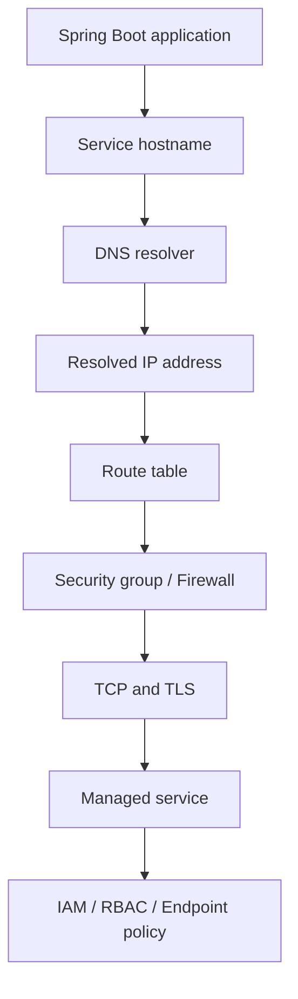

# Configuring Networking, DNS, Egress, and Private Endpoints at Deployment

When deploying a Spring Boot application that uses managed services on AWS, Azure, or Google Cloud, successful connectivity depends on both application configuration and network infrastructure. An application may start normally yet still fail to send messages, read objects, query data, or fetch secrets if the subnet lacks a valid route, DNS resolves incorrectly, or a firewall blocks the connection.

In the `SPRING_CLOUD_PROVIDER_INTEGRATION` module, this lesson focuses on preparing the network path from a Spring Boot workload to managed services. We will distinguish public from private connectivity, control egress traffic, configure DNS for private endpoints, and test the network path directly from the application's runtime environment.

## Objectives

After this lesson, you will be able to:

- Describe the request path from an application in a private subnet to a managed service.
- Design DNS and routes so service hostnames resolve to the intended addresses.
- Choose NAT, firewalls, service endpoints, or private endpoints based on connectivity requirements.
- Recognize the corresponding components across AWS, Azure, and Google Cloud.
- Inspect DNS, TCP, TLS, and access permissions layer by layer when deployment fails.

## 1. Looking at the Path of a Request

A request from Spring Boot to a managed service typically passes through these steps:

1. The application reads the service hostname from configuration or the cloud provider SDK.
2. The resolver in the application's runtime environment queries DNS for an IP address.
3. The route table selects the path toward the destination address.
4. Security groups, network security groups, firewalls, or network policies decide whether to allow the connection.
5. A TCP connection is established, followed by TLS verifying the service certificate.
6. The service checks identity, IAM/RBAC, and endpoint-specific policies before processing the request.

Therefore, an `AccessDenied` error usually belongs to the identity or policy layer, whereas a timeout may stem from DNS, routing, or a firewall. Never try to fix every connectivity error by changing the endpoint URL or granting broader permissions.



Applications should normally use the standard hostname published by the SDK or service provider. Private DNS can resolve that hostname to a private IP inside the internal network. This preserves the hostname used for TLS and prevents the application from having to store endpoint IP addresses.

## 2. Designing Networking for the Workload

Before configuring Spring Boot, determine where the workload runs and which destinations it needs to reach. For example, a service running on Kubernetes may sit in a private subnet, call Amazon SQS, Azure Service Bus, or Google Cloud Pub/Sub, while also fetching secrets and sending telemetry to a monitoring system.

### 2.1. Placing Workloads in the Right Subnets

Workloads processing internal data are typically placed in private subnets or equivalent networks. VMs or Pods do not need public IP addresses solely to call managed service APIs. Outbound paths can be provided via NAT gateways, firewalls, or private endpoints.

When designing subnets, verify:

- Whether the subnet has enough IP addresses for the expected number of instances, Pods, and network interfaces.
- Whether the route table contains routes to required endpoints, NAT, firewalls, peering, VPN, or transit gateways.
- Whether network policies allow the right protocol and port, typically HTTPS over TCP 443.
- Whether subnets across multiple Availability Zones or zones have corresponding endpoint and route configurations.
- Whether the return path is valid. A one-way route does not establish a complete TCP connection.

Not every managed service uses TCP 443 in every scenario. Always verify the actual protocol and port of the service, especially for databases, caches, or streaming protocols.

### 2.2. Distinguishing Ingress and Egress

`Ingress` is traffic entering the workload; `egress` is traffic leaving the workload. An application may accept no direct connections from the Internet yet still require egress to call cloud APIs, authentication systems, third-party services, or internal endpoints.

Inventory egress destinations by function, for example:

| Destination | Reason | Typical Connectivity |
|---|---|---|
| Managed service API | Send messages, read objects, or query data | Private endpoint or controlled HTTPS path |
| Token/identity service | Obtain or refresh credentials as required by deployment model | Provider-designated identity endpoint |
| Secret manager | Read sensitive configuration at startup or when needed | Private endpoint or controlled HTTPS egress |
| Partner API | Call webhooks or external services | NAT combined with firewall/proxy and allowlist |
| Telemetry system | Send logs, metrics, and traces | Private endpoint or policy-controlled HTTPS egress |

NAT allows workloads with private IP addresses to open outbound connections through a translated source address. NAT by itself is not an application-level hostname filter and does not make connections to cloud services private. If you need to restrict destinations, combine firewalls, proxies, routes, and appropriate egress policies.

### 2.3. Least-Privilege Network Control

Open only the destinations, ports, and protocols the application requires. For example, if the application only calls the HTTPS API of a managed service over a private endpoint, network rules should restrict the source to the workload and the destination to the appropriate network interface or endpoint address range.

Account for DNS traffic to resolvers, return connection flows, and identity endpoints required by the runtime. An overly restrictive egress policy can prevent the application from obtaining credentials even when the data endpoint is reachable. Platform-internal metadata or identity endpoints must also be handled according to runtime environment guidance.

## 3. DNS and Private Endpoints

DNS maps hostnames to IP addresses. With private endpoints, DNS is often the decisive component that directs the application to the service's private IP.

### 3.1. Public DNS and Private DNS

With public connectivity, the service hostname typically resolves to an address reachable over the Internet or the provider's public backbone. Workloads need appropriate egress routes and firewall rules allowing the connection.

With private connectivity, the provider creates an endpoint with an IP address inside the customer's network or a privately connected network. A private DNS zone or equivalent DNS mechanism maps the service hostname to that endpoint IP. The application still calls the hostname, while the internal resolver returns the private address.

This is the split-horizon DNS pattern: the same hostname can return different answers depending on where the query originates. Inside the VPC/VNet, the hostname can return a private IP; outside that network, the hostname may return a public address.

### 3.2. Points to Verify

- Is the private DNS zone linked to the exact VPC, VNet, or network that needs it?
- Can the workload's resolver query that zone?
- If using custom DNS, does conditional forwarding route queries for the private zone to the right resolver?
- If multiple VPCs/VNets connect over peering, VPN, or a transit network, is DNS shared or forwarded accordingly? Network reachability does not automatically guarantee private DNS visibility across every network.
- Do DNS records point to an existing endpoint in the right region?
- Do TTLs and DNS caches in the OS, container, or JVM delay picking up new configurations?

Never hardcode private endpoint IPs in `application.yml`. IPs can change when endpoints are recreated, scaled, or re-architected. Using a stable hostname lets DNS manage the mapping and preserves the server name used for TLS verification.

### 3.3. TLS Still Validates Hostnames

Even when DNS resolves a hostname to a private IP, the application should still connect using the service hostname. TLS uses the hostname for certificate validation and SNI. Connecting directly by IP or disabling certificate checks can cause validation errors and weaken security.

If the application routes through an HTTPS proxy, service mesh, or TLS inspection, verify the certificate chain and policies of the intermediary component. Never fix certificate errors by disabling hostname verification.

## 4. Egress and Endpoint Options

| Option | Characteristics | When Suitable |
|---|---|---|
| Public endpoint via NAT | Workload uses private IP and connects to public hostname via NAT | Service lacks private endpoint support or public access is acceptable |
| Egress firewall/proxy | Controls outbound destinations, ports, logs, and policies | Allowlists, auditing, or centralized Internet access control needed |
| Private endpoint | Creates a private connection point from workload network to service | Traffic must traverse private IPs; public access on the service can be disabled if supported |
| Service endpoint or private API access | Provides a provider-optimized or network-restricted access path | Service supports a platform-specific mechanism with requirements differing from private IP endpoints |

Private endpoints and NAT solve two different needs. A private endpoint provides a path to a specific service. NAT provides general-purpose outbound egress. A workload may need both: private endpoints for managed services and NAT/firewall for partner APIs or other public endpoints.

## 5. Implementation Across Cloud Providers

Resource names and configuration steps vary by provider. Choose mechanisms based on the specific service type and target region; not all managed services support the same endpoint types.

### 5.1. AWS: VPC Endpoints, Route 53, and NAT Gateway

AWS provides two common VPC endpoint families:

- **Interface endpoints** are powered by AWS PrivateLink. An endpoint creates network interfaces with private IPs in selected subnets. Security groups attached to the endpoint control inbound traffic to the network interface. When private DNS is properly enabled, standard service hostnames resolve to private IPs inside the VPC.
- **Gateway endpoints** are used for specific services such as Amazon S3 and DynamoDB. A gateway endpoint attaches to route tables and uses the service's prefix list. This mechanism differs from interface endpoints and does not create separate network interfaces inside subnets.

Typical configuration steps:

1. Identify the service name and region of the VPC endpoint to create.
2. For interface endpoints, select subnets across supported Availability Zones, attach security groups allowing workload traffic on the service port, and enable private DNS if your DNS architecture meets requirements.
3. For gateway endpoints, associate the endpoint with route tables of subnets needing service access; review endpoint policies to restrict accessible resources.
4. Verify workload security groups allow egress to the endpoint. Check network ACLs if stateless rules are used.
5. If Internet or other public API access is required, configure a NAT Gateway and matching route tables; use AWS Network Firewall or a proxy when fine-grained egress filtering is needed.

Route 53 Resolver handles DNS inside the VPC. If using on-premises DNS or centralized DNS, Route 53 Resolver inbound/outbound endpoints and forwarding rules may be needed across environments. VPC peering or Transit Gateway provides network routing but does not automatically replace DNS sharing configuration.

For example, a workload calling Amazon SQS over an interface endpoint can continue using the regional hostname such as `sqs.ap-southeast-1.amazonaws.com`. When private DNS is properly configured in the VPC, the internal resolver returns the endpoint's private IP. The application does not need to replace the hostname with a network interface IP.

### 5.2. Azure: Private Endpoint, Private DNS Zone, and NAT Gateway

Azure Private Endpoint creates a network interface in a VNet subnet and provides a private IP to access a supported service resource. A resource may have multiple subresources; for instance, Azure Storage has separate endpoints for Blob, File, Queue, Table, or Data Lake Storage. Create the exact subresource your application uses.

A Private DNS Zone maps the service hostname to the private endpoint IP. Common examples:

| Service | Common Private DNS Zone |
|---|---|
| Azure Blob Storage | `privatelink.blob.core.windows.net` |
| Azure Key Vault | `privatelink.vaultcore.azure.net` |
| Azure Service Bus | `privatelink.servicebus.windows.net` |

Zone names and resolution details can vary by cloud type, region, or service. Always check documentation for the specific resource. When creating a private endpoint, configure a DNS zone group or equivalent DNS mechanism to maintain records. Link the zone to VNets containing workloads that need access.

Typical configuration steps:

1. Create a Private Endpoint for the exact resource and subresource.
2. Approve the connection if the resource workflow requires owner approval.
3. Configure the Private DNS Zone, zone group, and VNet links.
4. Verify NSGs, route tables/UDRs, and Azure Firewall so the workload can reach the private endpoint IP.
5. If the workload needs to call other public APIs, configure a NAT Gateway or egress path through Azure Firewall per organizational policy.

If a VNet uses custom DNS, that DNS server must be able to resolve the private zone, typically via conditional forwarding to Azure DNS Private Resolver or a designed forwarder. Simply linking a private DNS zone to the VNet is insufficient if workloads query a DNS server unaware of that zone.

### 5.3. Google Cloud: Private Service Connect, Cloud DNS, and Cloud NAT

Google Cloud offers several private connectivity options, among which Private Service Connect (PSC) lets consumers create private endpoints to reach supported published services. PSC works for provider- or producer-published services as well as accessing Google APIs under the appropriate configuration.

For Google APIs, distinguish PSC from **Private Google Access**. Private Google Access enables resources in subnets without external IPs to reach certain Google APIs over Google-provided network paths under supported conditions and configurations. PSC creates a consumer endpoint with an internal IP address and usually requires DNS configuration so service hostnames point to that endpoint.

Typical configuration steps:

1. Determine whether the API or service supports PSC or Private Google Access and choose the right model.
2. With PSC, create the endpoint/forwarding rule per service guidance and choose an appropriate internal IP address.
3. Use Cloud DNS to create a private zone or DNS records mapping target hostnames to the endpoint. If DNS resides in another network, configure DNS peering or forwarding accordingly.
4. Check VPC firewall rules and routes so the workload can reach the endpoint.
5. If general Internet egress is needed from workloads without external IPs, configure Cloud NAT; use firewall policies or a proxy if destination control is required.

Cloud NAT supports outbound traffic and does not create per-service private endpoints. Like NAT on other clouds, Cloud NAT does not replace PSC or firewall policies.

### 5.4. Quick Comparison

| Need | AWS | Azure | Google Cloud |
|---|---|---|---|
| Private endpoint to a service | Interface VPC endpoint / PrivateLink | Private Endpoint | Private Service Connect |
| Private path to certain platform APIs/services | Service-specific VPC endpoint | Service Endpoint or Private Endpoint depending on service | Private Google Access or PSC depending on API |
| Private DNS | Route 53 private hosted zone / Resolver | Azure Private DNS Zone / DNS Private Resolver | Cloud DNS private zone / forwarding / peering |
| NAT egress | NAT Gateway | NAT Gateway | Cloud NAT |
| Network controls | Security groups, NACLs, Network Firewall | NSGs, UDRs, Azure Firewall | VPC firewall rules, firewall policies |

You cannot directly swap an endpoint type with one of a similar name on another cloud. Compare service scope, DNS behavior, endpoint policies, routing, cost, and regional limits before choosing.

## 6. Configuring Spring Boot to Use Stable Hostnames

Typically, networking and private DNS live in infrastructure. The application only needs the proper service hostname or an internal hostname published by the organization. Avoid embedding private endpoint IPs in source code.

Example Spring Boot application calling an internal API over HTTPS:

```yaml
# application.yml
app:
  partner:
    base-url: ${PARTNER_BASE_URL:https://partner.internal.example}

management:
  endpoint:
    health:
      probes:
        enabled: true
```

You can bind configuration with `@ConfigurationProperties`:

```java
import java.net.URI;
import org.springframework.boot.context.properties.ConfigurationProperties;

@ConfigurationProperties(prefix = "app.partner")
public record PartnerProperties(URI baseUrl) {
}
```

And create an HTTP client using that hostname:

```java
import org.springframework.context.annotation.Bean;
import org.springframework.context.annotation.Configuration;
import org.springframework.web.client.RestClient;

@Configuration
class PartnerClientConfiguration {

    @Bean
    RestClient partnerRestClient(PartnerProperties properties) {
        return RestClient.builder()
                .baseUrl(properties.baseUrl().toString())
                .build();
    }
}
```

Register `PartnerProperties` via `@ConfigurationPropertiesScan` or `@EnableConfigurationProperties(PartnerProperties.class)` in the application. The `PARTNER_BASE_URL` value is supplied through deployment environment configuration. DNS inside the runtime network is responsible for mapping the hostname to the right endpoint address.

With AWS, Azure, or Google Cloud SDKs, prefer configuring region, project, identity, and resource names as guided by the corresponding Spring Cloud/provider library. Once private DNS is configured for the standard service hostname, the SDK can usually continue using its default regional endpoint. Configure an endpoint override only when the service or architecture strictly requires it; an endpoint override with the wrong region or hostname can break TLS, request signing, or routing.

Never store credentials in URLs or committed config files. Use workload identity/managed identity/service accounts and a secret manager according to the deployment model. Also ensure network paths to identity endpoints and the secret manager work properly.

## 7. Testing from the Actual Runtime Environment

Testing from a laptop does not prove a Pod or VM in a private subnet gets the same result. Run diagnostic commands from the actual container, Pod, or VM running the application, sharing the same DNS and routes.

### 7.1. Testing DNS

```bash
getent hosts sqs.ap-southeast-1.amazonaws.com
```

Or:

```bash
nslookup sqs.ap-southeast-1.amazonaws.com
```

When using private endpoints, verify the result matches the design and resolves to a private address in the intended network. If it still returns a public IP, check the private DNS zone, VPC/VNet links, DNS resolver, and conditional forwarding.

### 7.2. Testing TCP and TLS

```bash
nc -vz sqs.ap-southeast-1.amazonaws.com 443
```

```bash
curl -v --connect-timeout 5 \
  https://sqs.ap-southeast-1.amazonaws.com/
```

For some APIs, an unsigned GET request returns an HTTP or authentication error. That can still prove DNS, TCP, and TLS are working. Do not treat every non-2xx HTTP code as a network failure.

You can inspect TLS details with:

```bash
openssl s_client \
  -connect sqs.ap-southeast-1.amazonaws.com:443 \
  -servername sqs.ap-southeast-1.amazonaws.com
```

Keep the hostname in `-servername` to verify SNI and the certificate against the service name.

### 7.3. Testing from the Application

Once DNS, TCP, and TLS work, test a request using the application's actual SDK or HTTP client. Verify region, project, subscription/queue/bucket, endpoint URL, runtime identity, and IAM/RBAC permissions. A request reaching the right service can still be rejected by an endpoint policy, resource policy, service-level firewall, or identity permissions.

## 8. Layer-by-Layer Troubleshooting Workflow

| Symptom | Layer to Check First | Remediation |
|---|---|---|
| `UnknownHostException` or DNS timeout | DNS | Check resolver, private zone, records, and conditional forwarding |
| DNS returns unexpected public IP | DNS | Check zone links, private DNS settings, and DNS cache |
| `Connection timed out` | Route/firewall | Check route tables, NAT/endpoints, NSGs/security groups, and firewall rules |
| `Connection refused` | Destination/port | Verify IP, port, listener, and endpoint service health |
| TLS handshake or hostname verification fails | TLS/proxy | Check SNI, certificates, trust store, and target hostname |
| HTTP 401/403 or `AccessDenied` | Identity/policy | Check workload identity, IAM/RBAC, endpoint policy, and resource policy |
| Only some Pods or zones fail | Network distribution | Compare subnets, routes, DNS caches, endpoint ENIs/IPs, and policies across zones |

An effective diagnostic approach works from the outside in: verify the hostname resolves properly, then verify TCP, TLS, and finally authentication and authorization. Record the timestamp, region, subnet/zone, hostname, and resolved IP to compare working instances against failing ones. Never include tokens, secrets, or sensitive payloads in diagnostic logs.

## 9. Design Example: Spring Boot Calling a Managed Service from a Private Subnet

Suppose `order-service` runs on Kubernetes in a private subnet and needs to send messages to a cloud provider's queue service. The application uses the regional SDK and workload identity to obtain credentials.

The design can include:

1. Place nodes/Pods in private subnets without assigning public IPs to the workload.
2. Create a queue-service-supported private endpoint in the same network or a routed network.
3. Configure private DNS so the standard queue hostname resolves to the private endpoint.
4. Allow the workload to connect to the endpoint on the service port; restrict sources via security groups or firewall policies.
5. Permit identity endpoints required by the SDK/runtime. If other public APIs are needed, route egress through NAT and a firewall allowlist.
6. Grant message-send permissions to the workload identity scoped to the target resource.
7. Verify DNS, TCP, and TLS from a Pod, then send a test message using the SDK.

When moving from staging to production, hostnames and application configuration can remain unchanged if the same service naming conventions are used. The production network needs matching endpoints, DNS zones, routes, and policies. If both environments share a DNS zone or resolver, ensure records never point staging to production endpoints or vice versa.

## 10. Pre-Deployment Checklist

- [ ] Identified the exact VPC, VNet, VPC network, subnets, and zones where the workload runs.
- [ ] Inventoried all hostnames, protocols, and ports the application needs to reach.
- [ ] Selected public endpoints, service endpoints, private endpoints, or NAT per destination.
- [ ] Route tables and firewalls allow required outbound and return paths.
- [ ] Private DNS zones are linked to the proper networks; custom DNS has proper forwarding.
- [ ] Hostnames used in the application match TLS certificates; no endpoint IPs are hardcoded.
- [ ] Workload identity and token/secret endpoints operate within egress policies.
- [ ] Endpoint policies, IAM/RBAC, and resource policies restrict permissions to actual needs.
- [ ] Verified DNS, TCP, TLS, and SDK requests from the actual runtime environment.
- [ ] Verified configuration across different subnets/zones and deployment environments.

## Conclusion

Connectivity to managed services must be designed simultaneously across networking, DNS, TLS, and identity layers. NAT provides general-purpose egress; private endpoints establish private paths to specific services; DNS determines which IP address a hostname resolves to; firewalls and routes govern traffic paths; IAM/RBAC decides what a workload may do once connected. When deploying Spring Boot on AWS, Azure, or Google Cloud, verify each layer directly from the runtime environment to pinpoint root causes and keep endpoint configuration stable and secure.
