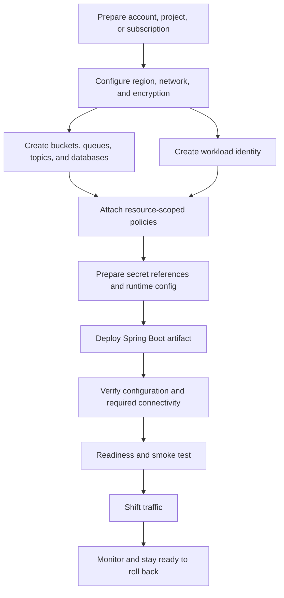

# Resource Provisioning Order, Permission Assignment, and Bringing the Application into Service

When deploying a Spring Boot application that uses managed services on AWS, Azure, or Google Cloud, pushing the image to a host is only part of the workflow. The application also needs target resources such as buckets, queues, topics, databases, and secret stores; it needs a runtime identity; it needs scoped access permissions; and it needs endpoint configuration, deployment region, and secret references. If these steps happen out of order, the application can start before a queue exists, receive `AccessDenied` even though the resource exists, or serve traffic before dependencies are ready.

In the `SPRING_CLOUD_PROVIDER_INTEGRATION` module, the deployment workflow must be treated as a dependency chain between Spring Boot and managed services across cloud providers. This lesson aims to establish the provisioning order, distinguish resource management permissions from data usage permissions, configure the runtime identity, and verify the application before shifting real traffic.

## Expected Outcomes

After this lesson, you will be able to:

- Order deployment steps based on dependencies among networking, managed resources, identities, policies, and the application.
- Separate infrastructure creation from the Spring Boot startup lifecycle.
- Grant least-privilege permissions to workload identities across AWS, Azure, and Google Cloud.
- Supply configuration and secrets to the application using runtime-appropriate mechanisms.
- Set up readiness checks, smoke tests, controlled traffic shifting, and rollbacks.
- Diagnose common errors caused by unready resources, unpropagated permissions, or misconfiguration.

## 1. Treating Deployment as a Dependency Graph

An application typically uses multiple resources simultaneously. For example, an order processing service might require:

- A bucket to store invoices or attachments.
- A queue to receive background processing tasks.
- A topic to publish order events.
- A database to persist business state.
- A secret store to hold sensitive values or references to encryption keys.
- A runtime identity to access the services above.

These components cannot be created in an arbitrary order. A policy attached to a resource must know both the resource and the target principal. The application needs endpoints and resource names before starting. Therefore, the deployment workflow should follow dependency relationships rather than a disconnected list of commands.



The diagram shows the primary dependencies. Creating the workload identity and creating resources can run in parallel after cloud scope preparation; role assignment completes only once both the principal and target resources exist. Some platforms allow creating role bindings before or alongside resource creation in IaC, yet the logical dependencies must remain explicit in deployment definitions.

### Deployment Phases

| Phase | Work | Exit Condition |
|---|---|---|
| 1. Prepare foundation | Select account/project/subscription, region, network, subnets, DNS, firewalls, and encryption keys | Environment and paths to target services are established |
| 2. Create resources | Provision buckets, queues, topics, databases, and secret stores | Resources have the right names, regions, endpoints, and protection settings |
| 3. Create identity | Create workload role, managed identity, or service account | Compute platform can attach the identity to the workload |
| 4. Grant permissions | Attach roles or policies to exact resources and operations | Principal holds required data-plane permissions |
| 5. Prepare configuration | Provide resource names, endpoints, region, and secret references | Configuration is validated and contains no static credentials in source code |
| 6. Deploy application | Deliver artifact to runtime and attach identity | Instances or Pods run with the right configuration and identity |
| 7. Verify and serve | Run readiness checks, smoke tests, then shift traffic | Mandatory dependencies work and the app handles sample requests |

Not every environment needs every resource type. Provision only components the application actually uses. Resource names should follow a convention including application, environment, and region, such as `orders-prod-invoices-ap-southeast-1`, to prevent mix-ups between development, staging, and production.

## 2. Creating Infrastructure Before Deploying the Application

Cloud resource creation should be managed via Infrastructure as Code (IaC) or a repeatable provisioning process. You can use AWS CloudFormation or CDK, Azure Bicep or ARM, Terraform, or any infrastructure deployment tool aligned with your organization. What matters is that desired state is declared explicitly, reviewable, safely re-runnable, and traceable.

### Preparing Scope and Connectivity

Before creating managed services, determine:

1. The account, project, or subscription owning the resources.
2. Allowed regions and the region of each service.
3. Network paths from runtime to services: public endpoints, private endpoints, VPC/VNet, subnets, routes, DNS, and firewalls.
4. Encryption, retention, backup, versioning, and logging policies.
5. Quotas, connection limits, and expected throughput limits.

A bucket may exist yet remain unreachable if the workload resides in a private subnet with misconfigured DNS or routes to the private endpoint. Likewise, a queue with the right name in a different region can cause the SDK to call the wrong endpoint. Checking networking and region is therefore part of preflight, not an afterthought once the application is already running.

### Provisioning Resources by Usage Dependencies

Create foundational resources before components that depend on them. For example, if a queue uses a customer-managed encryption key, the key and its key policy must be ready before creating or configuring the queue. If a database requires a subnet group or private DNS, those network components must exist first.

A solid IaC workflow exhibits these traits:

- **Idempotent:** re-running does not create duplicate resources or cause unintended changes.
- **Explicit dependencies:** models relationships among networking, keys, resources, identities, and policies.
- **Environment isolation:** development, staging, and production never accidentally share buckets or queues.
- **Data protection:** enables encryption, backups, versioning, or retention matching data classification.
- **Clear outputs:** exports resource names, ARNs/resource IDs, endpoints, and regions for application deployment.

Do not let each Spring Boot instance create buckets, queues, or databases on its own at startup. That forces the application to hold infrastructure admin permissions, creates race conditions when multiple instances start concurrently, and risks impacting shared resources during an application rollback. Spring Boot should consume already-provisioned resources and hold only the data-plane permissions needed for business logic.

## 3. Creating the Workload Identity and Granting Least-Privilege Permissions

The application must be recognized by the cloud provider as a principal. This principal can be an IAM role, managed identity, or service account. When the runtime supports workload identity, the SDK can obtain short-lived credentials from the execution environment, avoiding long-lived access keys or service account keys in images, config files, or environment variables.

Two questions must be answered separately:

- **Under which identity does the application run?** This is the workload identity attached to the VM, container task, Pod, or serverless service.
- **What is that identity allowed to do?** This is the role/policy attached at the account, project, subscription, or specific resource level.

Creating an identity does not automatically grant data access. Conversely, a seemingly correct policy has no effect if the workload is running under a different principal.

### Distinguishing Control Plane and Data Plane Permissions

Control plane permissions allow creating, modifying, or deleting resources. Data plane permissions allow reading or writing data inside resources. For example, permission to create a bucket does not imply permission to read objects inside it; permission to manage a Service Bus resource does not imply permission to receive messages; project admin roles should never be the default for request-handling applications.

| Application Need | Permission Type Required | Example Operations |
|---|---|---|
| Read invoices in object storage | Data plane, read-only | Get object or read blob |
| Write new invoices | Data plane, write object | Put object or create blob |
| Receive messages from a queue | Data plane, receive/consume | Receive or consume messages |
| Send messages | Data plane, send | Send or publish messages |
| Read secrets at runtime | Secret read permission | Get secret value or access secret version |
| Create or delete buckets/queues | Control plane | Create/delete resource; typically reserved for infrastructure pipelines |

An identity may require multiple permissions if the application genuinely performs multiple operations. Grant permissions per resource and required operation rather than applying broad administrative roles just to make `403` errors go away.

### AWS

On AWS, workloads can use IAM roles attached to an EC2 instance profile, an ECS task role, or EKS workload identity mechanisms such as IRSA or EKS Pod Identity. The AWS SDK uses its credential provider chain to retrieve credentials from the runtime environment. Applications should rely on this mechanism instead of declaring static access keys and secret keys in `application.yml`.

Policies should constrain resource ARNs and actions. For example, a service that only downloads invoices from one bucket needs only object read permissions on that bucket; if it must write objects, add the corresponding write permission. Access to SQS, SNS, S3, Secrets Manager, or Parameter Store must match the exact services and operations used. For resources encrypted with a customer-managed KMS key, the principal may also need key-usage permissions via both key policy and IAM policy.

Illustrative minimal data-plane policy for a workload that only reads objects from one bucket (replace the ARN with your environment's resource):

```json
{
  "Version": "2012-10-17",
  "Statement": [
    {
      "Effect": "Allow",
      "Action": ["s3:GetObject"],
      "Resource": "arn:aws:s3:::orders-prod-invoices/*"
    }
  ]
}
```

This policy does not grant permission to list the bucket, write objects, delete objects, or administer the bucket. If the application requires those operations, add the corresponding actions and resources after confirming business requirements.

### Azure

On Azure, applications can use system-assigned or user-assigned managed identities. Runtimes such as Azure App Service, Azure Container Apps, virtual machines, or Kubernetes environments supply the appropriate identity. The Azure SDK typically integrates with `DefaultAzureCredential` to resolve credentials from the runtime environment.

Azure separates resource management roles from data access roles. For instance, `Contributor` at the resource group scope does not automatically substitute for a data-plane role to read blobs. An application writing blobs needs a data role such as `Storage Blob Data Contributor` on the storage account or container; an application reading secrets from Key Vault needs the matching data-plane role, such as `Key Vault Secrets User`, on the exact vault or permitted scope. Applications sending/receiving Service Bus messages also require data-plane roles matching send or receive operations.

Role assignments can take time to propagate. On initial deployment, pipelines should wait and verify permissions with a bounded verification step rather than restarting repeatedly or widening the role to administrative privileges.

### Google Cloud

On Google Cloud, workloads typically run under a service account attached to Compute Engine, Cloud Run, or GKE. With GKE, Workload Identity Federation for GKE lets Kubernetes workloads use a Google Cloud service account's permissions without distributing key files. Java applications can use Application Default Credentials (ADC) to acquire credentials from the runtime environment.

Assign IAM roles at the narrowest possible scope. For example, an object-reading workload needs an object viewer role on the bucket; a Pub/Sub publisher needs publish permission on the topic; a message receiver needs subscribe permission on the subscription; a secret reader needs secret version access permission. Avoid assigning `Owner` or `Editor` to application service accounts.

### Verifying the Active Principal

After attaching identities and roles, verify that the application receives the expected principal. You can inspect identity details via provider CLI commands in the pipeline or run a non-destructive resource access check. Never log access tokens, secret values, or credentials. If multiple identity layers exist (node, pod, task, service), verify the identity at the exact layer used by the Java process.

## 4. Preparing Secrets and Runtime Configuration

Once resources and permissions are ready, the pipeline can supply the configuration values needed by the application. Classify clearly:

- **Non-sensitive configuration:** bucket, queue, and topic names, regions, endpoints, timeouts, and feature flags.
- **Sensitive information:** database passwords, external tokens, signing keys, or other secret values.
- **Cloud authentication details:** obtained via workload identity and the provider's credential chain, never packaged in the artifact.

Sensitive values should live in the provider's secret manager or an organization-approved secret management system. The application receives a secret reference or fetches the secret via SDK when needed, under a dedicated read permission. Never commit secrets into Git, Docker images, `application.yml`, pipeline logs, or deployment command outputs.

Example Spring Boot configuration keeping resource names as environment variables:

```yaml
spring:
  application:
    name: orders-service

app:
  storage:
    invoice-bucket: ${APP_INVOICE_BUCKET}
  messaging:
    orders-queue: ${APP_ORDERS_QUEUE}
    events-topic: ${APP_EVENTS_TOPIC}

management:
  endpoint:
    health:
      probes:
        enabled: true
  endpoints:
    web:
      exposure:
        include: health,info
```

These environment variables are supplied per environment by the pipeline or runtime. This configuration contains no cloud credentials. The corresponding Spring Cloud starters use the provider's SDK and credential mechanism to access services. Exact property names and endpoint configuration depend on the Spring Cloud AWS, Spring Cloud Azure, or Spring Cloud GCP version in use; follow your project's BOM and documentation rather than mixing configuration across library generations.

When secrets rotate, determine whether the application reads the value once at startup or reloads it at runtime. If the application caches secrets, design cache TTLs, refresh mechanisms, and handling when an old secret is revoked. Never assume updating a value in a secret manager automatically updates a running bean or connection pool.

## 5. Deploying the Artifact and Checking Readiness

Deploy the artifact only after infrastructure outputs and required permissions are verified. Artifacts should remain immutable across environments; environment configuration and identity are attached at deployment time. Thus, the exact same image can be tested in staging and promoted to production without rebuilding with embedded secrets or endpoints.

### Application Startup Sequence

When the Spring Boot process starts:

1. Spring reads configuration and validates required fields such as region, bucket name, and queue name.
2. The cloud provider SDK acquires credentials from the workload identity or credential chain.
3. Clients connect to endpoints and perform minimal required initialization.
4. The application initializes consumers, producers, or connection pools per configuration.
5. Readiness transitions to ready once mandatory dependencies can serve business traffic.

Avoid using `@PostConstruct` to create infrastructure resources or perform lengthy chains of network calls. Client construction may occur during bean creation, yet dependency checks need timeouts, bounded retries, and clear error messages. If an external service is temporarily unavailable, the application should follow a restart or unready policy suited to the deployment platform.

### Liveness and Readiness

Liveness answers whether the process is still alive. Readiness answers whether the instance can accept business requests. The two states serve distinct purposes:

- Liveness should generally not depend on databases, queues, or object storage. If a cloud service suffers a brief disruption, continuous liveness failures can cause the platform to restart instances en masse and worsen the incident.
- Readiness can include mandatory dependencies so an instance does not receive traffic when it cannot handle business requests properly.
- Optional dependencies should be surfaced through degraded status or metrics rather than blocking the entire application when non-essential features fail.

Spring Boot Actuator supports health endpoints and readiness/liveness probes. You can enable probes with configuration like the example above and configure the deployment platform to poll the right endpoints. If adding a custom `HealthIndicator` for a dependency, use short timeouts, avoid expensive calls on every probe, and never return secrets or sensitive internal details in responses.

### Smoke Testing Before Opening Traffic

Green readiness is necessary, but insufficient on its own to prove end-to-end business flows work. Before shifting traffic, run controlled smoke tests, such as:

- Send a test request to an application endpoint.
- Read a test object or write an object to a dedicated smoke-test prefix.
- Send a test message to a queue/topic and confirm the consumer or subscriber processes it.
- Execute a simple query against the database using the runtime account.
- Read a test secret if the application requires one.

Smoke tests must use isolated test data, timeouts, and proper cleanup. Never delete or overwrite real production data to test permissions. If the application can start consuming messages before HTTP traffic opens, ensure consumers begin processing only once configuration and permissions are ready.

## 6. Traffic Shifting and Rollback Management

After smoke tests pass, shift traffic using a platform-appropriate strategy: rolling update, canary, or blue-green. With canary, start with a small percentage, monitor errors and latency, and only then ramp up. Monitor at minimum:

- HTTP 5xx rates, timeouts, and business errors.
- Response latency p50/p95/p99.
- Retry counts, queue backlog depth, dead-letter queues, and oldest message age.
- Cloud access errors such as `AccessDenied`, `Forbidden`, `PERMISSION_DENIED`, or authentication failures.
- Connection pools, quotas, throttling, and managed service request limits.
- Unexpected cost or resource usage spikes following release.

If metrics cross thresholds, halt the rollout or shift traffic back to the previous version. Rolling back the application does not mean rolling back all infrastructure. Buckets, queues, and databases may contain data still used by the older version; never delete them as a default part of rollback. Database schema changes should expand first—compatible with both old and new versions—and drop old structures only in a subsequent release.

A rollback plan should establish upfront:

1. The latest stable artifact version.
2. How to shift traffic back to that version.
3. Compatibility of schemas, message formats, and object formats.
4. How to handle messages already emitted by the new version.
5. Which IAM or secret changes can remain safely and which must be reverted.

Never revoke roles or delete resources immediately during a rollback if the previous version still relies on them. Cleanup should be a separate infrastructure step with dependency checks and data retention verification.

## 7. Example Deployment Workflow for an Order Processing Service

Suppose `orders-service` runs on a container platform and uses object storage to store invoices, a queue for background tasks, and a secret manager to read database connection details. The production release workflow can be structured as follows:

| Step | Pipeline Action | Output Verification |
|---:|---|---|
| 1 | Select production account/project/subscription and region | Correct environment, region, and network |
| 2 | Provision bucket, queue, and secret store via IaC | Resource IDs, endpoints, and names emitted |
| 3 | Create container workload identity | Runtime attaches identity to task, Pod, or service |
| 4 | Grant object read/write, message receive, and secret read permissions | Policies scoped to exact resources and actions |
| 5 | Verify networking, DNS, private endpoints, and access permissions | Verification operations succeed from the actual runtime context |
| 6 | Deploy tested image | Image digest and release configuration recorded |
| 7 | Check startup, readiness, and smoke tests | Minimal business flows succeed |
| 8 | Shift traffic in stages | Error rate and latency remain within thresholds |
| 9 | Monitor post-release and close release | No new errors; version and resources traceable |

Example deployment configuration passing only non-sensitive values:

```yaml
env:
  - name: APP_INVOICE_BUCKET
    value: orders-prod-invoices
  - name: APP_ORDERS_QUEUE
    value: orders-prod-processing
  - name: APP_EVENTS_TOPIC
    value: orders-prod-events
  - name: CLOUD_REGION
    value: ap-southeast-1
```

This is a container configuration snippet, not a complete manifest for a specific platform. Identity is configured at the workload or deployment service in the provider's way. Database secrets are fetched from the secret manager using the identity's permissions or mounted by the runtime via a governed mechanism; never add secret values to this YAML block.

The key takeaway in this example is that the pipeline verifies permissions from the exact runtime environment where the application runs. A CLI command succeeding under a deployer's personal account does not prove the container has the same permissions. Verify using the workload identity or a test job attached with the exact same identity and network policy.

## 8. Troubleshooting Errors by Phase

| Symptom | Common Causes | Checks and Remediation |
|---|---|---|
| `AccessDenied`, `Forbidden`, or `PERMISSION_DENIED` | Wrong principal, missing data-plane role, wrong resource scope in policy, or role not yet propagated | Verify runtime principal; inspect actions, resources, and role scope; wait with bounded propagation retry and retest |
| Hostname resolution failure or connection timeout | Wrong DNS, route, firewall, private endpoint, or region | Test from workload's network namespace; verify endpoints and DNS for the right environment |
| Bucket, queue, or topic not found | Wrong name, account/project, region, or incomplete IaC | Compare provisioning outputs with runtime config; verify resource exists in exact scope |
| App starts but readiness stays failing | Mandatory dependency unready, invalid credentials, or overly strict health check | Inspect sanitized logs; test each dependency with short timeouts; distinguish mandatory vs. optional dependencies |
| Works locally, fails on deploy | Local uses personal profile/credentials; runtime uses a different identity | Verify actual Pod/task/service identity; check role bindings and credential chain |
| Some instances fail permissions while others work | Uneven rollout, differing identities/configs, or incomplete propagation | Compare revision, identity, region, and config of failing vs. healthy instances |
| Database connections still use old password after secret rotation | Application or connection pool caches secrets | Check refresh mechanism, cache TTL, and connection lifecycle; implement controlled refresh |
| Queue backlog grows after release | Consumer not started, missing receive permission, deserialization errors, or reduced throughput | Check consumer startup, receive/subscribe permissions, dead-letter queues, and processing metrics |

When investigating errors, check in order: environment configuration, actual principal, policies and resource scope, network/endpoints, and only then application integration logic. This order separates platform errors from code errors and avoids changing multiple components blindly at once.

## 9. Pre-Service Checklist

Before each release, verify the following items:

- [ ] Correct account/project/subscription, environment, and region.
- [ ] Managed resources exist with proper encryption, backup, retention, and networking.
- [ ] Workload identity is attached to the right task, Pod, VM, or service.
- [ ] Policies grant only the data-plane operations the application needs on the exact resources.
- [ ] Secrets are stored in a secret manager; logs and artifacts contain no secret values.
- [ ] Runtime configuration includes all resource names, endpoints, and region.
- [ ] Application obtains credentials from the appropriate identity or credential chain.
- [ ] Startup has sensible timeouts and retries; readiness reflects mandatory dependencies.
- [ ] Smoke tests verify required storage, messaging, and data flows.
- [ ] Rollout strategy, stop thresholds, and rollback version are defined.
- [ ] Dashboards and logs link releases to instances, identities, and related resources.

## Conclusion

The right deployment order starts with foundation and resources, continues with workload identity and access permissions, and only then proceeds to application configuration and release. By separating provisioning from the Spring Boot lifecycle, enforcing least privilege, and verifying from the actual runtime identity, applications achieve much more predictable startup behavior across AWS, Azure, and Google Cloud. Readiness checks, smoke tests, and controlled rollouts complete that chain before the application admits production traffic.
