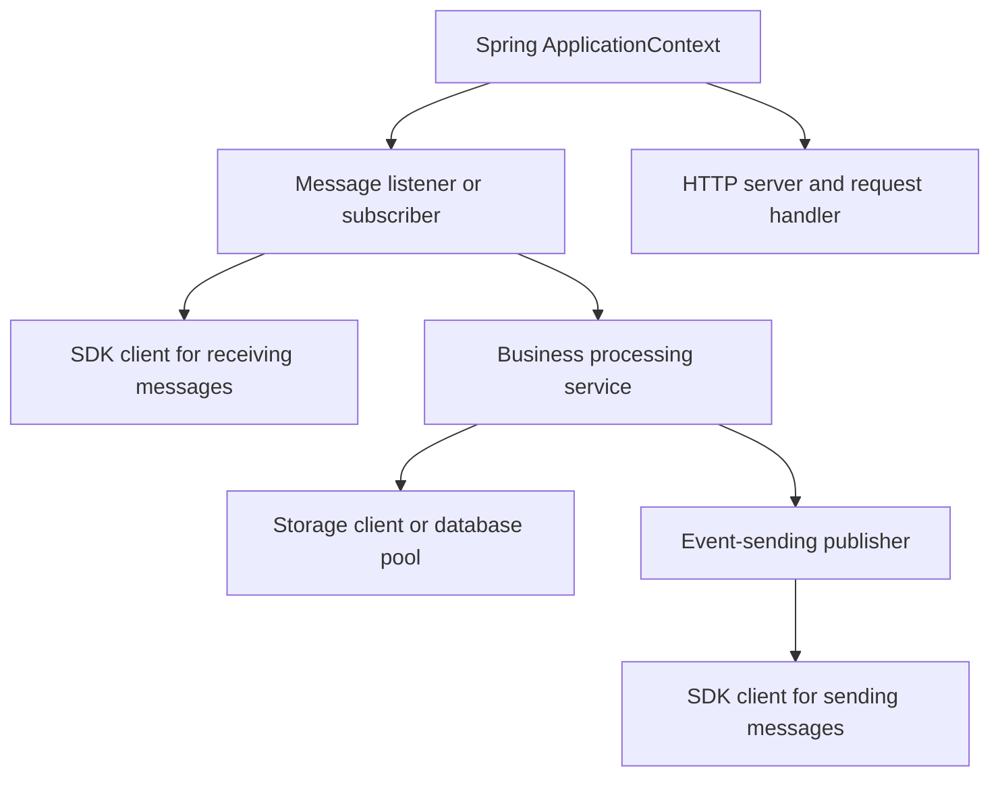

# Closing Listeners and Clients in Proper Lifecycle Order at Shutdown

A Spring Boot application integrated with AWS, Azure, or Google Cloud typically maintains many components that outlive a single request: message listeners, subscribers, publishers, SDK clients, connection pools, and executors. When the process stops, these components must close in the proper order. If an SDK client closes before its listener, in-flight callbacks can fail when writing data or acknowledging messages. If the listener stops too late, the application may keep accepting new work while the JVM has already started shutting down the context. If a publisher closes while messages are still in flight, events may fail to reach the target service.

In the `SPRING_CLOUD_PROVIDER_INTEGRATION` module, listener and client lifecycle is part of managed service integration. This lesson focuses on a controlled shutdown workflow: stop accepting new work, finish in-flight work, acknowledge messages at the right moment, and only then close clients and shared resources. The workflow must behave consistently across AWS, Azure, and Google Cloud, even though specific SDK APIs differ.

## Expected Outcomes

After this lesson, you will be able to:

- Distinguish stopping listeners, draining in-flight work, and closing SDK clients.
- Use Spring bean lifecycles to manage long-lived resources.
- Configure graceful shutdown for the web server and Spring components.
- Determine the closing order for listeners, publishers, clients, connection pools, and executors.
- Handle in-flight messages safely when the process is asked to stop.
- Set shutdown timeouts aligned with container runtimes and cloud platform deadlines.
- Verify shutdown behavior via logs, metrics, and deployment tests.

## 1. Why Closing Order Matters

A Spring Boot process may initialize components with the following relationships:



The listener depends on the receiving SDK client. Handlers may depend on storage, databases, and publishers. Therefore, when shutting down the application, the order must reverse the usage graph: stop accepting new work first, let handlers finish while dependencies remain open, and only then close clients.

Distinguish three operations:

1. **Stop listener:** stop polling, pulling, or receiving new callbacks. This does not necessarily close the shared client.
2. **Drain:** wait for active requests or message handlers to complete within the allowed budget. During this phase, handlers may still need databases, storage, or publishers.
3. **Close client:** release network connections, threads, channels, connection pools, and SDK resources. After this step, no component may continue using that client.

`stop()` and `close()` are not always synonymous. Some SDKs offer a stop operation to halt incoming work while keeping the client usable for restart; close releases resources completely. Some clients expose only close or shutdown. Always read the lifecycle contract of the API in use and designate a single owner responsible for closing each resource.

### Recommended Shutdown Order

| Order | Action | Purpose |
|---:|---|---|
| 1 | Mark instance as stopping and remove from traffic routing | Prevent new requests from arriving at the instance |
| 2 | Stop receiving new messages from listeners/subscribers | Bound the amount of in-flight work |
| 3 | Wait for running requests and message handlers to finish | Allow business logic to commit data and complete required publishes |
| 4 | Acknowledge, abandon, or let messages be redelivered based on outcome | Avoid losing messages or acknowledging prematurely |
| 5 | Stop listeners/subscribers completely | Release consumers and associated callbacks |
| 6 | Complete pending publish calls and flush buffers | Ensure events are sent or failures are recorded |
| 7 | Close publishers, storage clients, database pools, and SDK clients | Release connections and background threads |
| 8 | Stop executors, schedulers, and finish Spring context shutdown | Allow the JVM to exit cleanly |

In practice, Spring coordinates parts of this sequence through `SmartLifecycle`, `LifecycleProcessor`, and bean destruction. You do not need to reimplement the entire chain if the framework or starter already manages those components. What you must ensure is that dependency relationships and stop ordering remain intact.

## 2. Bean Lifecycle in Spring

Spring manages singleton bean lifecycles from creation until the `ApplicationContext` closes. For long-lived resources, register them as beans so the container knows how to initialize and release them. Avoid instantiating SDK clients with `new` inside every request or holding a client in a static field with no clear lifecycle owner.

### `@Bean` and Destroy Methods

For an SDK client exposing a `close()` method, declare a bean and specify its destroy method:

```java
@Configuration
class CloudClientConfiguration {

    @Bean(destroyMethod = "close")
    S3Client invoiceS3Client() {
        return S3Client.builder().build();
    }
}
```

When Spring closes the context, the bean is released under container lifecycle management. This example illustrates AWS SDK for Java v2; region, endpoint, and credential provider configuration must be supplied for your environment. If a starter already creates and manages the client, use the starter-provided bean or configure its lifecycle per starter documentation. Never create a duplicate client just to close it manually.

Spring also supports `DisposableBean`, `@PreDestroy`, and `@Bean` destroy methods. Pick one primary mechanism per resource. If the same client is closed from `@PreDestroy`, `DisposableBean`, and another callback, shutdown can invoke close multiple times or run while a listener is still using the client.

`@PreDestroy` fits short, synchronous, local cleanup, such as releasing a resource owned exclusively by that bean. For listeners that must stop fetching messages, await callbacks, and complete asynchronously, use the lifecycle API provided by that component rather than cramming the entire sequence into an ad-hoc `@PreDestroy`.

### `Lifecycle` and `SmartLifecycle`

Spring provides `Lifecycle` and `SmartLifecycle` for components that need to start and stop with the `ApplicationContext`. `SmartLifecycle` adds a completion callback, auto-startup support, and phases to coordinate ordering.

- On context startup, components with lower phase values typically start first.
- On context shutdown, components with higher phase values typically stop first.
- `stop(Runnable callback)` must invoke the callback once the component finishes stopping; otherwise Spring may wait until the phase timeout expires.
- `isRunning()` must reflect actual state so Spring coordinates accurately.

If both listener and client are managed by the application via `SmartLifecycle`, the listener must stop before the client it uses. You can assign the listener a higher phase than the client. The example below illustrates an internal wrapper; `ManagedListener` is an application abstraction that would connect to the provider's actual listener API:

```java
final class OrdersListenerLifecycle implements SmartLifecycle {

    private final ManagedListener listener;
    private volatile boolean running;

    OrdersListenerLifecycle(ManagedListener listener) {
        this.listener = listener;
    }

    @Override
    public void start() {
        listener.start();
        running = true;
    }

    @Override
    public void stop(Runnable callback) {
        try {
            listener.stopAndDrain();
            running = false;
        } finally {
            callback.run();
        }
    }

    @Override
    public void stop() {
        listener.stopAndDrain();
        running = false;
    }

    @Override
    public boolean isRunning() {
        return running;
    }

    @Override
    public int getPhase() {
        return 100;
    }
}
```

In this example, `ManagedListener` is an illustrative interface rather than a built-in Spring class. `stopAndDrain()` must enforce a timeout and guarantee the listener stops accepting new work before awaiting active handlers. Never invoke the callback immediately after an asynchronous stop request while the listener is still active; invoke the callback only once stopping completes or reaches the defined timeout.

Phase is only one coordination tool. When the framework already manages listeners or bean dependencies are explicit, prefer the built-in lifecycle mechanisms. Spring generally destroys dependent beans before their dependencies; thus, when a listener bean receives a client via constructor or factory method parameter, that dependency graph also helps Spring close the listener before the client. However, verify how your starter wires beans and never assume a dependency is tracked if the client is looked up manually through a static holder.

## 3. Spring Boot Graceful Shutdown

For the HTTP server, graceful shutdown lets the server stop accepting new connections or requests and wait for in-flight requests within a configured limit. Enable it via configuration:

```yaml
server:
  shutdown: graceful

spring:
  lifecycle:
    timeout-per-shutdown-phase: 30s
```

`server.shutdown: graceful` instructs the web server to perform a controlled shutdown. `spring.lifecycle.timeout-per-shutdown-phase` sets the maximum wait per lifecycle processor phase; it is not a single fixed total budget across all cleanup steps in the process. Choose values based on real processing times, orchestrator timeouts, and platform stop limits. Exact property names and behavior must be verified against your application's Spring Boot version.

Web server graceful shutdown does not automatically guarantee that custom message listeners, publishers, or clients drain properly. Those components must be managed by lifecycle beans or the starter's corresponding shutdown mechanism. Never rely on JVM exit to terminate background threads cleanly.

### Stopping Traffic vs. Stopping Message Delivery

HTTP traffic and message traffic may be governed by separate mechanisms. When an instance starts shutting down:

- Readiness must transition to unready so load balancers or orchestrators stop routing new requests.
- The web server begins graceful shutdown to drain active requests.
- Message listeners must be instructed to stop polling/pulling or accepting new callbacks.
- Handlers already processing messages must retain access to business clients until processing finishes or times out.

If an application shares one readiness endpoint for both web server and listeners, define the semantics clearly. An instance might stop accepting HTTP traffic yet still need to finish already-received messages. Conversely, a worker without an HTTP server still needs a mechanism to signal stopping message consumption.

## 4. Handling In-Flight Messages During Shutdown

This is the area most prone to data corruption. When a listener receives a message, the broker typically marks the message as in-progress for a duration or lease. If the application exits mid-flight, the broker can redeliver the message once the lease or visibility timeout expires. That is normal messaging system behavior, and applications must be designed to tolerate redelivery.

### Acknowledge Only After Business Logic Commits

For messages requiring database writes and event publishing, the typical sequence should be:

1. Read and validate the message.
2. Execute business logic and commit durable state.
3. Publish required events, or record events in a transactional outbox for asynchronous publishing.
4. Acknowledge the message only after completion conditions are met.

If you acknowledge before committing, the message can be lost from the queue even though business state was never saved. If you commit before shutdown interrupts acknowledgment, the message may be redelivered. Therefore, handlers must be idempotent: processing the same message again must not create duplicate orders, charge twice, or trigger uncontrolled side effects.

A `messageId`, idempotency key, or stable business key can detect duplicate processing. Recording the processed marker should happen in the same transaction as business state changes where supported. For side effects outside the transaction, design deduplication, an outbox, or appropriate compensating mechanisms.

### Leases, Visibility Timeouts, and Acknowledgement Deadlines

Names and renewal mechanisms vary by broker:

| Platform | Mechanism to Track | Behavior When Handler Has Not Finished |
|---|---|---|
| Amazon SQS | Visibility timeout | Message becomes visible again after timeout; visibility can be extended during processing |
| Azure Service Bus | Peek-lock and lock duration | Message is redelivered when lock expires; lock can be renewed for long processing |
| Google Cloud Pub/Sub | Ack deadline | Message can be redelivered if unacked; subscriber can extend ack deadline |

Drain time must be planned alongside lease/lock/ack deadline limits. If a handler can run longer than the lock duration, configure appropriate lock renewal while the system is running. Once shutdown begins, decide explicitly whether to continue renewing locks for draining work or stop renewing so the broker redelivers after the deadline. Never hold locks indefinitely when the process can no longer finish the work.

If a handler cannot finish within the shutdown budget, allow the broker to redeliver the message or explicitly abandon/nack per provider semantics. Never ack a message just to shut down faster. Processing failures must be classified for retry, dead-lettering, or recovery according to queue/subscription policy.

### Bounding Drain Time

Not every handler can stop immediately. Bound the wait time and define expiration actions:

- Handler can finish within remaining budget: let it proceed, then ack safely.
- Handler can abort safely before commit: cancel and let the message be redelivered.
- Handler already committed but has not acked: accept redelivery and rely on idempotency.
- Handler is calling an external system that does not support cancellation: enforce call timeouts and define reconciliation for ambiguous outcomes.

Never rely on `Thread.interrupt()` as the sole mechanism to cancel every handler. Many SDK calls or I/O operations do not respond cleanly to interrupts. Enforce timeouts at the HTTP client, database, broker, and business layers, and ensure transactions roll back or finish cleanly.

## 5. Closing Listeners and Clients by Cloud Provider

Providers differ in APIs and terminology, yet the principle stays constant: stop the intake source first, await active callbacks, then close clients. A shared client can serve multiple listeners or publishers; close it only after every dependent component has stopped.

### AWS: SQS, SNS, and AWS SDK

With Spring Cloud AWS SQS, the listener container manages polling and dispatching messages to handlers. Let Spring manage the container's lifecycle when properly registered. When the `ApplicationContext` closes, the container must stop polling and finish or cleanly terminate in-flight messages before `SqsAsyncClient` or related clients close.

Points to check:

- The listener container is registered as a bean and receives `SqsAsyncClient` via dependency injection.
- Container shutdown settings allow stopping polling and awaiting in-flight messages within bounds appropriate for your Spring Cloud AWS version.
- Visibility timeout covers normal processing time; long-running processing extends visibility.
- Messages are deleted/acked only after successful processing under the chosen acknowledgement mode.
- `SqsAsyncClient`, `SnsAsyncClient`, or storage clients close after listeners and pending sends complete.

Example client bean configuration:

```java
@Configuration
class AwsClientConfiguration {

    @Bean(destroyMethod = "close")
    SqsAsyncClient sqsAsyncClient() {
        return SqsAsyncClient.builder().build();
    }
}
```

The listener container should receive this `SqsAsyncClient` bean via container configuration. Spring Cloud AWS builder APIs and shutdown options change across versions; follow the configuration for the version managed by your project's BOM. Never call `sqsAsyncClient.close()` from a handler or individual listener if the client is shared.

For async publishers, retain futures for critical send operations. At shutdown, stop accepting new publish commands, await futures within a timeout, log unsent failures, and only then close SNS/SQS async clients. If events must be atomic with database transactions, consider a transactional outbox instead of trying to flush synchronously inside `@PreDestroy`.

### Azure: Service Bus and Azure SDK

With Azure Service Bus, `ServiceBusProcessorClient` receives and dispatches messages to callbacks. Before closing shared clients, stop the processor to halt new message intake and await active callbacks per SDK semantics. Only then close the processor and application-owned sender/receiver clients.

Points to check:

- The processor is scoped to the application lifecycle, not created per request.
- `stop()` is called on shutdown to stop receiving messages; `close()` releases the processor and related resources per the SDK contract.
- Messages are completed after business logic finishes; errors may be abandoned or dead-lettered by category.
- When using Peek-Lock, processing time and lock renewal align with the drain budget.
- Sender clients close only after pending sends complete or time out and are logged.

Illustrative API ordering example for the Azure SDK for Java:

```java
void stopProcessor(ServiceBusProcessorClient processor) {
    processor.stop();
    processor.close();
}
```

This snippet illustrates only the API call order; in a Spring application, place the processor inside a managed bean lifecycle and never invoke this code from multiple places. Verify the exact behavior of your `azure-messaging-servicebus` version, especially if callbacks are still running or multiple processors share configuration.

For Azure Blob Storage or Key Vault, clients are often used by handlers during drain. Close application-owned clients only after listeners and request handlers have stopped. If the SDK/client is managed by a starter or factory, follow the factory's lifecycle instead of manually closing the same object.

### Google Cloud: Pub/Sub and Java Clients

With Google Cloud Pub/Sub, `Subscriber` receives messages asynchronously. On shutdown, call stop so the subscriber stops accepting new work and await termination within a time limit. Only after the subscriber stops should other clients used by callbacks be closed.

`Publisher` maintains buffers and futures for publish calls. Before closing the publisher, stop issuing new publishes, wait for critical futures to finish or flush per the active API, then call `shutdown()` and `awaitTermination()`. On timeout, record unconfirmed messages so an outbox or retry mechanism can reprocess them.

Example with Google Cloud Pub/Sub Java clients:

```java
void stopSubscriber(Subscriber subscriber) throws Exception {
    subscriber.stopAsync();
    subscriber.awaitTerminated(30, TimeUnit.SECONDS);
}

void closePublisher(Publisher publisher) throws Exception {
    publisher.shutdown();
    publisher.awaitTermination(30, TimeUnit.SECONDS);
}
```

This example targets the Pub/Sub Java library's `Subscriber` and `Publisher` classes. When using Spring Cloud GCP or Spring Integration, adapters or channels may manage subscribers on the application's behalf. Stop Spring-managed adapters or endpoints first, and only then close the templates/clients they use. Never create a parallel subscriber outside Spring just to invoke shutdown when a starter already owns the subscriber.

### Comparing Shutdown Order by Provider

| Component | Stop Intake | Drain / Complete | Close Last |
|---|---|---|---|
| AWS SQS | Stop listener container polling | Await handlers; delete message after successful processing | SQS client and shared business clients |
| Azure Service Bus | Stop processor | Await callbacks; complete/abandon/dead-letter based on outcome | Processor, sender/receiver, and shared clients |
| Google Pub/Sub | Stop subscriber or adapter | Await callbacks; ack after successful processing | Subscriber and shared publisher/clients |
| Object storage | No intake listener; stop new requests | Await in-flight uploads/downloads | S3, Blob Storage, or Cloud Storage client |
| Database | Stop accepting new handlers | Await active transactions and connections | DataSource/connection pool |

Exact API names and drain capabilities depend on SDK version, Spring Cloud starter, and listener configuration. This table describes order of responsibility, not a guarantee that every client shares identical `stop()` or `close()` methods.

## 6. Closing Publishers, Connection Pools, and Executors

Listeners are not the only resources that can keep the JVM alive. An application typically also holds:

- Async publishers with buffered items or incomplete futures.
- Database connection pools with connections held by active transactions.
- HTTP clients with outbound requests awaiting responses.
- Executors backing callbacks, schedulers, or retry tasks.
- Cache refresh, credential refresh, and telemetry exporter background threads.

Close components according to usage relationships. For example, do not close an executor before listener callbacks finish if callbacks run on that executor. Do not close a `DataSource` before running transactions complete. Do not close an HTTP client before critical outbound requests drain or time out.

For publishers, include a step that stops accepting new send commands. If the application continues accepting requests while a publisher is shutting down, requests can hit `RejectedExecutionException` or closed-client errors. For connection pools, let the framework manage bean lifecycle and set transaction/query timeouts so shutdown never hangs indefinitely.

Avoid calling `System.exit()` to force process termination as soon as a timeout expires. Let the orchestrator enforce its termination deadline. If in-flight work must be terminated, record state for retry or reconciliation upon restart.

## 7. Shutdown Budget in Containers and Cloud Runtimes

Graceful shutdown only works if the application has enough time. Orchestrators typically send a stop signal and wait for a grace period before forcibly killing the container. This budget must exceed the sum of required phases while remaining bounded so rollouts do not stall.

Example Kubernetes configuration:

```yaml
spec:
  terminationGracePeriodSeconds: 60
  containers:
    - name: orders-service
      image: example/orders-service:1.4.0
```

When a Pod is terminated, Kubernetes runs lifecycle hooks if configured, sends the stop signal to the container, and waits for the grace period. Java applications typically receive `SIGTERM`, triggering Spring to close the `ApplicationContext` and run lifecycle callbacks. If the grace period expires, the container may be killed before cleanup completes.

Budget based on real measurements. For example, within a 60-second grace period, allow up to 10 seconds to stop intake, 30 seconds to drain handlers and requests, 10 seconds to flush publishers and close clients, leaving the remainder as a buffer. These numbers are purely planning examples; measure real system timings and avoid stacking sequential phase waits whose total exceeds the grace period.

If using `preStop`, the hook should perform a meaningful action such as calling an internal endpoint to mark the instance as draining or completing load balancer deregistration. Hook execution time also consumes the grace period. Avoid adding an arbitrary fixed `sleep` unrelated to actual routing convergence times.

Platforms such as ECS, App Service, Container Apps, Cloud Run, and GKE differ in termination orchestration and time limits. Verify your runtime's exact deadline, signaling mechanism, and how the load balancer stops sending requests. Never assume all platforms grant the same grace period or invoke the same lifecycle hooks.

## 8. Coordinating Timeouts and Stop Order

Shutdown timeouts must be coordinated across layers:

| Layer | Timeout Needed | Question to Answer |
|---|---|---|
| Request/handler | Max business execution time | How long may one unit of work hold resources? |
| SDK call | Connect/read/API timeout | Will pending calls terminate before the deadline? |
| Message lease/lock | Visibility, lock duration, or ack deadline | When will the broker redeliver the message? |
| Listener drain | Wait time for in-flight handlers | Does the listener have enough time to stop safely? |
| Spring lifecycle | Timeout per phase | How long does Spring wait per bean group? |
| Runtime termination | Container/service grace period | When is the process forcibly terminated? |

Do not set timeouts independently without summing them. For instance, if a handler has a 45-second timeout while the runtime only grants 30 seconds for shutdown, the application cannot wait for that handler as configured. Similarly, if listener drain consumes 30 seconds and publisher flush waits another 30 seconds inside a 45-second grace period, the runtime may kill the process before the publisher finishes.

Timeouts must be finite and logged when exceeded. Upon timeout, components must transition to deterministic behavior: abort safely, allow message redelivery, log unconfirmed publishes, or let the orchestrator terminate at the deadline. Never wait unboundedly inside shutdown callbacks.

## 9. Testing Shutdown and Operational Observability

You cannot verify graceful shutdown merely by seeing `Started ...` or `ApplicationContext closed` in logs. Test real scenarios in staging:

1. Stream a steady batch of messages and trigger an instance stop. Verify the listener stops accepting new messages.
2. Create a handler with a long processing time within timeout bounds. Verify the handler completes, commits, and acks in proper order.
3. Stop an instance mid-handler. Verify the message is redelivered or resumed per policy without data loss.
4. Simulate a publisher with pending futures. Verify shutdown waits within bounds and logs failures on timeout.
5. Send in-flight HTTP requests and terminate the instance. Verify requests drain or clients receive retryable errors as designed.
6. Restart the application and verify no orphaned listeners, background threads, or duplicate consumers remain active.

Observe these metrics:

- In-flight message count at shutdown start.
- Time from `SIGTERM` until listener stops.
- Drain duration p50/p95/p99 and count of handlers exceeding the deadline.
- Messages acked, abandoned, nacked, or redelivered during the shutdown window.
- Pending publish futures, publish failures, and flush duration.
- Remaining open connections, live background threads, and client close timeouts.
- Rate of rejected requests while the instance transitions to draining.

Shutdown logs should include correlation ID or release ID, listener name, client type, and duration per phase. Never log sensitive message payloads, access tokens, or secrets. Logs should distinguish `shutdown requested`, `listener stopped`, `inflight drained`, `publisher flushed`, and `client closed` to pinpoint where shutdown stalls.

## 10. Common Issues

| Symptom | Cause | Remediation |
|---|---|---|
| `Client is closed` inside message handler | SDK client closed before handler finished | Fix lifecycle ordering; drain listener before closing client |
| Message reappears after instance stops | Handler did not ack or lock/visibility expired | Confirm expected redelivery; ensure handler idempotency and ack only after commit |
| Message lost despite incomplete business work | Ack/delete ran before commit or durable side effect | Move acknowledgement after commit; consider transactional outbox |
| Shutdown exceeds grace period | Handler, SDK call, or lifecycle phase waited too long | Enforce layered timeouts, measure drain, and tune runtime budget |
| Publisher drops final events | Client closed before futures completed or buffers flushed | Stop new commands, wait for pending publishes, and log timeouts |
| JVM fails to exit | Executor, scheduler, subscriber, or SDK threads still alive | Identify owning thread; stop components and close clients via lifecycle |
| Shutdown callback never completes | `SmartLifecycle.stop(Runnable)` skipped callback or waited forever | Always invoke callback; add finite timeouts and explicit error handling |
| Shutdown invokes close multiple times | Multiple beans/callbacks own the same client | Assign one owner; inject shared client and close in one bean |
| Instance still receives requests while stopping | Readiness or load balancer not updated yet | Mark draining early and check routing propagation |

When investigating, start from the stop-signal log and identify the last completed phase. Then check whether listeners are still polling, how many handlers remain active, which dependencies are still being called, and which clients have already closed. This pinpoints the component keeping the process alive or failing during drain.

## 11. Pre-Release Checklist

- [ ] Every long-lived listener, subscriber, publisher, and SDK client has a clear lifecycle owner.
- [ ] Listeners stop before the clients used by listeners or handlers.
- [ ] Application stops accepting new requests/messages when shutdown starts.
- [ ] In-flight handlers have explicit timeouts and drain policies.
- [ ] Messages are acked/completed only after business state reaches durability.
- [ ] Handlers are idempotent to tolerate redelivery after shutdown.
- [ ] Publishers wait for critical sends to complete or log timeouts.
- [ ] Database pools, storage clients, and executors close only after dependent components stop.
- [ ] Spring Boot graceful shutdown and lifecycle timeouts match the active version.
- [ ] Total shutdown duration fits within the runtime's grace period.
- [ ] Logs and metrics capture per-phase progress, timeouts, and in-flight counts.
- [ ] Tested terminating an instance while requests, messages, and publishes are active.

## Conclusion

Closing listeners and clients safely must follow the reverse order of resource usage. First stop accepting new work, drain in-flight requests and messages, finalize acknowledgements or publishes according to business state, and only then close listeners, SDK clients, connection pools, and executors. Spring lifecycles coordinate these steps when beans are registered properly; timeouts in Spring and the runtime keep shutdown bounded. Combined with idempotency, structured logging, and termination testing under active load, Spring Boot applications can stop reliably on AWS, Azure, and Google Cloud while preserving message and data integrity.
