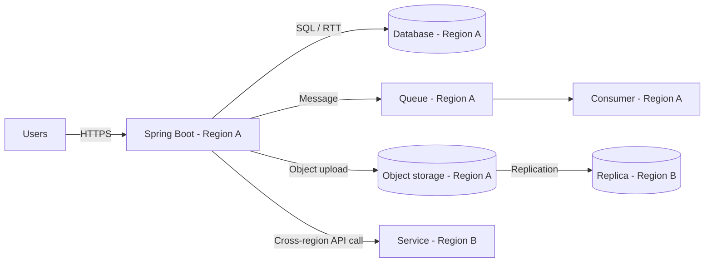

# Region Selection and Evaluating Latency and Cross-Region Traffic

When deploying Spring Boot alongside managed services on AWS, Azure, or Google Cloud, where the application runs and where data resides directly affect response times, reliability, and infrastructure bills. Choosing a region close to users is a helpful starting point, but not enough: applications frequently call databases, object storage, queues, and internal APIs. An application placed near users that calls a distant database can still suffer high latency.

This lesson presents how to select regions based on data constraints, user location, and application dependencies; how to measure latency by percentiles; how to identify and estimate cross-region traffic; and how to validate decisions with repeatable experiments. Examples use Spring Boot to illustrate application-layer configuration and observability. Region names and service capabilities must be verified for your actual account, service, and deployment date.

## Objectives

After this lesson, you will be able to:

- Distinguish between region, zone, data storage location, and managed service endpoints.
- Select regions based on end-to-end latency, data requirements, resilience, service availability, and cost.
- Measure p50, p95, p99, throughput, error rates, and inter-component latency from a production-like environment.
- Map data flows to uncover cross-region traffic and associated network charges.
- Explain differences in how AWS, Azure, and Google Cloud attach locations to resources.
- Make evidence-based decisions for single-region, multi-region standby, or multi-region active deployments.

## 1. Understanding regions and resource locations

A **region** is a geographic area used by a cloud provider to group infrastructure. Within a region there are usually multiple **availability zones (AZs)** or zones with partially isolated infrastructure. Zones spread risk within the same area; regions spread broader geographic risk. Naming, zone counts, and degree of isolation vary across providers.

Not all resources share the same location scope:

| Scope | Design implications |
|---|---|
| Zonal | Resource is bound to a specific zone; consider failover/redundancy to other zones. |
| Regional | Resource is managed within one region; the service may distribute across zones automatically or require zone selection. |
| Multi-region / dual-region | Data or services span multiple regions per service policy; replica placement and consistency depend on configuration. |
| Global | Global endpoint or control plane; this does not mean all data is stored everywhere or every request has low latency. |
| Edge / CDN | Content or ingress points placed close to users; usually fits cacheable content and does not replace co-locating transactional databases with the application. |

Therefore, distinguish three concepts: where the application runs, where data is stored, and where the called endpoint resides. A global endpoint may route to a resource in one specific region. A multi-region bucket may serve from multiple locations, yet routing, consistency, and data-transfer pricing remain governed by the service.

### 1.1. The three providers attach locations differently

| Provider | Location concepts | What to verify |
|---|---|---|
| AWS | Region and Availability Zone. Many services are regional; some services or endpoints are global. | An S3 bucket is created in a specific region; replication or multi-region endpoints require separate configuration. Verify the region is enabled in your account and the service is available there. |
| Microsoft Azure | Region and Availability Zone. Some services offer region pairs or geo-redundancy options. | A region pair does not mean your app is automatically deployed redundantly. Verify SKUs, zone redundancy, primary/secondary locations, and per-service failover capabilities. |
| Google Cloud | Region and zone. Some services support regional, dual-region, multi-region, or global locations. | Bucket, dataset, cluster, and subnet locations can be declared independently. VPCs are global while subnets are regional; do not infer workload location from VPC scope. |

Do not map region names across providers as if they were the exact same physical location. Similarly named regions can differ in data center placement, network paths, service availability, and data policies.

## 2. Region selection criteria

Select regions in order from hard constraints to operational optimization. If data must stay within a given country or territory, that is a disqualifying gate: a low-latency region that violates data residency requirements is not a valid option.

### 2.1. Data and compliance requirements

Determine which data may be stored where, what may replicate across borders, retention durations, and deletion requirements. Account for backups, snapshots, logs, data exports, read replicas, and data sent to analytics pipelines. Choose a region only after confirming the actual placement of replicas created by managed services.

Do not assume the application's region dictates data placement. For instance, an app running in Singapore might connect to a database in another region; data is still processed and stored according to the database's location and replication policy.

### 2.2. Latency to users and to dependencies

List primary user groups and the services a critical request must call. For an order-creation flow, dependencies might include an auth API, database, inventory service, message broker, and object storage. Measure both the path from users to the app and from the app to each dependency.

Placing the app near users reduces request/response transit time. Co-locating the app with its database and broker typically cuts critical network hops. When those two goals conflict, measure end-to-end latency of the business flow instead of optimizing a single link in isolation.

### 2.3. Availability and resilience

Check managed service availability, instance types, zone redundancy features, quota limits, and replication options in candidate regions. For disaster recovery, define RTO (Recovery Time Objective) and RPO (Recovery Point Objective). Asynchronous replication usually incurs replication lag; failing over does not guarantee both regions are completely in sync.

### 2.4. Total cost

Compare the total architectural cost, including compute, databases, storage, replicas, service requests, data transfer, NAT gateways, peering or private connectivity, and operations. A region with cheaper compute can end up more expensive if data flows continuously to a distant database or service.

### 2.5. Operability

Assess the team's familiarity with the region, monitoring tools, support workflows, quotas, automated deployment readiness, and recovery runbooks. A multi-region architecture multiplies environments, data flows, secrets, dashboards, and failover drills. Add another region only when latency or resilience gains outweigh that operational cost.

## 3. Measuring latency properly

Request latency is not just network transit time. It also includes DNS resolution, connection and TLS establishment, pool wait time, server processing, data queries, queues, retries, and serialization. A low ping time does not prove an API has low latency.

You can break it down conceptually:

```text
End-to-end latency
  = DNS + connect/TLS
  + network transit time
  + queueing and processing time at each service
  + retry / backoff (if any)
  + data transformation and application processing
```

Components can overlap when work runs in parallel, so this is an analytical model rather than an exact additive formula for every request.

### 3.1. Use percentiles instead of averages alone

| Metric | How to read it | When it is useful |
|---|---|---|
| p50 | 50% of requests finish at or below this time. | Typical user experience. |
| p95 | 95% of requests finish at or below this time. | Detecting tail slowdowns affecting slower requests. |
| p99 | 99% of requests finish at or below this time. | Tracking rare but high-impact slow outliers. |
| Throughput | Requests or bytes processed per unit time. | Evaluating capacity under rising load. |
| Error rate | Fraction of requests failing or timing out. | Detecting unstable regions or network paths. |

Averages can hide a cluster of very slow requests. When comparing two regions, run the same workload and compare p50, p95, p99, throughput, and error rates. Record sample counts and measurement windows; a p99 from a few dozen requests is unreliable.

### 3.2. Measure from where the application actually runs

Take measurements from the same network type, subnet, runtime, and connection configuration intended for production. Measuring from an engineer's laptop only provides a rough sanity check because Internet routing, VPNs, DNS, and machine location differ from production.

For each dependency, record at least:

- Workload region and zone, plus target resource location.
- DNS lookup, connect time, TLS handshake, and connection wait time if supported by tooling.
- Service call duration, response codes, timeouts, retries, and attempt counts.
- Request/response sizes and bytes transferred.
- p50, p95, p99, throughput, and error rates per measurement window.

Measure at low load to establish baseline latency, then ramp up to expected peak load. Pool exhaustion, connection caps, throttling, or growing queues can degrade p95/p99 even when baseline network latency stays flat.

### 3.3. Observability in Spring Boot

With Spring Boot, you can use Micrometer and OpenTelemetry to record request and dependency call durations. Create dedicated metrics per dependency group or operation, such as `inventory.lookup`, `orders.database.write`, and `storage.object.read`; avoid putting user IDs, object keys, or high-cardinality values into tag names/values.

The example below illustrates timing an operation with Micrometer. In real applications, prefer built-in instrumentation for HTTP clients, JDBC, messaging, and SDKs; add manual timers only for uninstrumented paths.

```java
import io.micrometer.core.instrument.MeterRegistry;
import io.micrometer.core.instrument.Timer;
import org.springframework.stereotype.Component;

@Component
public class InventoryGatewayMetrics {
    private final MeterRegistry registry;
    private final InventoryClient client;

    public InventoryGatewayMetrics(MeterRegistry registry, InventoryClient client) {
        this.registry = registry;
        this.client = client;
    }

    public InventoryItem find(String sku) {
        return Timer.builder("dependency.call")
                .description("Dependency call duration")
                .tag("dependency", "inventory")
                .tag("operation", "lookup")
                .register(registry)
                .record(() -> client.find(sku));
    }
}
```

This metric records call duration at the application layer. To separate network time from server-side processing time, add distributed tracing or server-side metrics. Histogram/percentile configuration and metric export depend on your observability backend; avoid turning on client-side percentiles indiscriminately for every metric, as it raises memory and telemetry cost.

### 3.4. Designing a region comparison test

1. Pick a representative business flow and identify mandatory dependencies.
2. Provision the same app version, runtime config, dataset size, and service tiers in the candidate regions.
3. Warm up the app and connection pools; separate cold-start results from steady-state results.
4. Run low, average, and expected peak load while keeping request distributions and payload sizes identical.
5. Collect p50/p95/p99, throughput, error rate, timeouts, retries, CPU, connection pool metrics, and bytes transferred.
6. Repeat at multiple times of day to spot network path variance and background load.
7. Document test boundaries: account type, quotas, service tiers, security config, and load-generator location.

Never draw conclusions from a single run or an ICMP ping test. If differences are smaller than run-to-run variance, treat the options as indistinguishable and weigh cost, availability, and operability instead.

## 4. Identifying cross-region traffic

Cross-region traffic occurs whenever data moves from a resource in one region to a resource in another. It can arise in synchronous request paths, database reads/writes, object replication, message delivery, backups, logs, analytics queries, and cache synchronization.

### 4.1. Map data flows before estimating

For each flow, document source, destination, regions, direction, frequency, average size, and retry behavior. Separate application-initiated transfers from replicas created automatically by managed services.

Example:



In this diagram, placing the database, queue, and storage in Region A keeps frequent operations local. Storage replication and calls to the service in Region B still generate cross-region traffic. If the consumer moves to Region B, message delivery and processing can add bidirectional traffic.

### 4.2. Commonly overlooked traffic sources

- **Databases:** app in Region A queries a database in Region B; every round trip adds latency and may incur data transfer charges.
- **Message brokers:** producer and consumer in different regions; messages may replicate or traverse cross-region links.
- **Object storage:** downloading files from a bucket in another region, replication, inventory, backups, and restores.
- **Logging and monitoring:** agents shipping logs, traces, or metrics to a workspace in another region; large telemetry payloads can incur substantial charges.
- **NAT, peering, and private links:** traffic crossing NAT gateways, VPC/VNet peering, transit gateways, VPNs, or private links may carry separate processing or data-transfer fees.
- **Retries and polling:** timeout-driven retries, aggressive polling, or re-sending large payloads inflate actual byte volume.
- **Cross-zone:** traffic between zones within the same region can have its own pricing rules. Do not lump it together with cross-region traffic during analysis.

### 4.3. Estimating bytes and cost

Estimate first using actual application-layer bytes or network flow logs, then verify against the provider's pricing calculator and billing reports. A simple model for one flow:

```text
Bytes transferred per month
  = calls per day
  × days in month
  × average bytes per call
  × retry / replication factor
```

Illustrative example: a service sends 2,000,000 messages per day, averaging 12 KiB each, replicated once to another region. Before protocol overhead, payload data transferred is approximately:

```text
2,000,000 × 12 KiB × 30 ≈ 686 GiB per month
```

This figure covers payload only. You must add headers, metadata, retries, secondary replicas, responses, and other flows, while checking whether the billing system uses GiB or GB.

Network charges cannot be estimated with a single flat rate across services. Depending on provider and path, bills may include data transfer out, inter-region fees, inter-zone fees, NAT gateway fees, network appliance charges, request fees, or replication fees. Use current pricing tables and calculators for the exact service, source region, destination region, connectivity type, and volume tier. Never assume intra-cloud traffic is always free.

You can structure an inventory table like this:

| Flow | Source → Destination | Monthly data | Frequency | Purpose | Costs to verify |
|---|---|---:|---|---|---|
| Sync API | App A → Database B | Read/write bytes | Per request | Transactions | Transfer, connections, retries |
| Messaging | Producer A → Consumer B | Message count × size | Event-driven | Background processing | Broker, replication, network |
| Object replication | Bucket A → Bucket B | Changed object bytes | Scheduled/event | DR | Replication, requests, transfer |
| Telemetry | Workload A → Workspace B | Log/trace/metric bytes | Continuous | Observability | Ingestion and transfer |

## 5. Differences when deploying on AWS, Azure, and Google Cloud

Measurement principles are identical, but location binding and billing depend on the specific service.

### 5.1. AWS

- Choose regions for EC2, ECS/EKS, RDS, SQS, SNS, and other regional services according to workload and data placement. Verify service, instance family, and feature availability in the target region.
- With AWS SDK for Java v2, the client's region determines the default regional service endpoint. When using Spring Cloud AWS auto-configuration, you can set a static region via `spring.cloud.aws.region.static` or let the SDK use the region provider chain suited to your deployment environment.
- S3 buckets have a fixed region upon creation. Cross-region replication requires separate replication rules and permissions; multi-region endpoints or global access features do not eliminate data transfer fees or consistency considerations.
- Check data transfer charges across AZs, across regions, to the Internet, through NAT Gateways, and across networking components like Transit Gateway or peering along the real traffic path.

Example static region configuration for Spring Cloud AWS:

```yaml
spring:
  cloud:
    aws:
      region:
        static: ${AWS_REGION:ap-southeast-1}
```

Use static configuration only when the environment intentionally pins a region. For workloads running on AWS infrastructure, consider environment-based region and credential providers to avoid drift across accounts or deployments.

### 5.2. Microsoft Azure

- Choose Azure regions for App Service, AKS, Azure SQL, Storage Accounts, Service Bus, and related services. Verify SKUs, zone redundancy, and geo-redundancy options, as not every option exists in every region.
- Region pairs are part of Azure's recovery strategy and can support certain platform updates or recoveries. Pairing does not automatically deploy your application, database, or failover logic to the paired region.
- For Azure Storage, endpoints are typically tied to a Storage Account. The application configures the endpoint and identity; account location and redundancy settings govern where data and replicas live.
- With Spring Cloud Azure, configure accounts, endpoints, and credentials per service. Do not invent a generic `region` property assuming it applies to every client; location is usually determined when provisioning the Azure resource.
- Check bandwidth, peering, NAT Gateway, Private Link, and networking charges along the actual traffic path.

Example Blob Storage endpoint provided via environment configuration:

```yaml
app:
  storage:
    blob-endpoint: ${AZURE_STORAGE_BLOB_ENDPOINT}
```

The endpoint must point to a Storage Account provisioned in the desired location. Use Managed Identity or an environment-appropriate credential mechanism for authentication; never embed account keys or client secrets directly in config files.

### 5.3. Google Cloud

- Choose regions and zones for Compute Engine, GKE, Cloud SQL, Memorystore, and other regional services. Some services have multi-region or global locations with distinct semantics.
- A VPC network has global scope, while subnets have regional scope. A global VPC does not place VMs, GKE nodes, or subnets in every region automatically.
- Cloud Storage buckets get a location at creation time—regional, dual-region, or multi-region as needed. Location choice impacts storage placement, availability, and pricing rules.
- BigQuery datasets also have a location; jobs and queried data must satisfy location compatibility rules. Do not assume a dataset in one location can be queried like local data from anywhere without constraints.
- Check network egress, inter-region transfer, Cloud NAT, VPC Network Peering, and destination service fees.

With Google Cloud Storage, location is bound to the bucket at creation; Java clients typically use the default endpoint and address buckets by name. Example creating a regional bucket via CLI:

```bash
gcloud storage buckets create gs://my-app-assets --location=asia-southeast1
```

You cannot change a bucket's location merely by changing client configuration. If data must move, plan a copy to a new bucket, verify permissions, retention, and lifecycle rules, and update the application.

### 5.4. Design comparison table

| Question | AWS | Azure | Google Cloud |
|---|---|---|---|
| Workload location | Compute and service Region/AZ. | Compute and service Region/zone. | Compute and service Region/zone. |
| Object storage location | S3 bucket region; replication is configured separately. | Storage Account region; redundancy determines replicas. | Bucket location: regional, dual-region, or multi-region. |
| Network model | VPC scoped to one region; subnets and cross-region links are designed separately. | VNet scoped to one region; peering and network services have separate scopes. | Global VPC; regional subnets. |
| What to verify | Region enablement, endpoints, transfer, and replication. | SKUs, region pairs, redundancy, bandwidth, and failover. | Resource locations, location compatibility, egress, and replication. |

Entries in this table serve as verification prompts. Consult current documentation and pricing for your specific services before locking in an architecture.

## 6. Architectural patterns and trade-offs

### 6.1. Single region, multiple zones

Place the application and primary data dependencies in one region, spreading workloads across multiple zones where supported. This is usually the easiest option to operate for new systems: short call paths, minimal long-haul data movement, and simpler deployments. However, this architecture remains exposed to regional outages and requires suitable backup/DR plans.

### 6.2. Primary region, standby region

The primary region serves normal traffic; a standby region holds minimal infrastructure or is provisioned on demand. Data replicates according to the chosen policy. You must clearly define:

- Failure detection mechanisms and failover trigger conditions.
- How DNS, load balancers, or client endpoints shift over.
- RPO from replication lag and RTO from startup, restore, and verification times.
- How to prevent split-brain if both regions accept writes.
- Failback and data reconciliation procedures once the primary region recovers.

This pattern avoids paying to run the full workload twice simultaneously, though recovery time can be longer. Drill regularly; a backup that has never been test-restored is not proof of working DR.

### 6.3. Multi-region active-active

Multiple regions serve users concurrently. This can cut latency for geographically dispersed users and improve fault tolerance, but complicates routing, caching, sessions, writes, and synchronization. If two regions write to the same entity, you need data partitioning, conflict resolution, or a single write coordinator. Synchronous replication adds RTT latency; asynchronous replication introduces staleness and failover conflicts.

Do not deploy active-active simply because spinning up two deployments is easy. First determine which requests can execute regionally, which data must be partitioned, and whether users truly require local writes.

### 6.4. Placing a CDN or cache near users

CDNs fit static or safely cacheable content. Application caches can cut calls to distant services, provided you manage TTLs, invalidation, sensitive data, and consistency. A CDN cannot eliminate latency for transactions requiring database reads/writes on every request.

## 7. Design example: Spring Boot app serving multiple markets

Suppose an ordering system serves users primarily in Southeast Asia. The Spring Boot app runs in a region close to the main user base; the transactional database, queue, and hot object storage sit in the same region. A second region holds data replicas and a recovery environment.

Proposed flow:

1. Order requests enter the endpoint nearest the primary user base.
2. Spring Boot authenticates the request and writes the transaction to the co-located database.
3. The app publishes an event to the co-located queue; consumers handle background work there.
4. Co-located object storage holds frequently read/written files.
5. Backups or replication transfer required data to the standby region on a defined schedule and policy.
6. Metrics and traces are collected to spot any requests crossing into another region.

Before scaling out, benchmark two setups: the entire workload and primary data in one region vs. the app in Region A and the database or broker in Region B. Compare ordering p95/p99, timeouts, retries, cross-region bytes, and projected cost. If putting the database in Region B forces each transaction through multiple round trips, cheaper compute may not offset latency and network fees.

Example provider-neutral configuration in Spring Boot:

```yaml
app:
  cloud:
    deployment-region: ${APP_REGION:ap-southeast-1}
    primary-data-region: ${PRIMARY_DATA_REGION:ap-southeast-1}
    dr-region: ${DR_REGION:ap-southeast-2}
```

This is application-managed metadata for logging, config checks, and observability tagging; it does not move cloud resources on its own. Default values are illustrative only. In real deployments, supply values per environment and verify the actual region of each resource.

You can validate configuration at startup to catch mismatches:

```java
import org.springframework.boot.context.properties.ConfigurationProperties;

@ConfigurationProperties(prefix = "app.cloud")
public record CloudLocationProperties(
        String deploymentRegion,
        String primaryDataRegion,
        String drRegion) {

    public boolean primaryDataIsCoLocated() {
        return deploymentRegion != null
                && deploymentRegion.equals(primaryDataRegion);
    }
}
```

Register the properties class according to your Spring Boot project setup. You can emit a warning if `primaryDataIsCoLocated()` is false, or fail startup in production if policy mandates that app and database share a region. This check only validates configuration values; deployment pipelines or cloud policies must still verify actual resource locations.

## 8. Repeatable decision workflow

Apply this workflow for every workload or region change:

1. **Lock constraints:** document residency, compliance, allowed regions, RTO/RPO, and mandatory services.
2. **Map dependencies:** list compute, databases, queues, storage, caches, external APIs, logs, and backup targets; record each resource's location.
3. **Shortlist candidates:** eliminate regions violating hard constraints; across the rest, compare service availability, zones, quotas, and network distance to users.
4. **Benchmark workload:** run the identical test suite from a production-like environment; capture p50/p95/p99, throughput, error rates, and transferred bytes.
5. **Estimate cost:** classify bytes by route, direction, and service; check pricing calculators and trial billing.
6. **Evaluate recovery:** test backups, replication lag, failover, failback, and actual restore procedures.
7. **Document the decision:** record region rationale, assumptions, measurements, projected costs, and triggers for re-evaluation.
8. **Monitor post-launch:** use telemetry and billing to compare reality against assumptions; re-evaluate as traffic, data, or services evolve.

You can use a scoring table to compare candidates once mandatory gates pass. The sample weights below are a template for team alignment, not a universal standard:

| Criterion | Sample weight | Evidence |
|---|---:|---|
| Business flow p95/p99 latency | 35% | Load test results from a realistic runtime environment. |
| Projected total cost | 25% | Compute, storage, requests, transfers, and network fees. |
| Resilience | 20% | RTO/RPO, replication lag, drill results. |
| Operability and service availability | 20% | Quotas, features, tooling, support, and complexity. |

Data and compliance requirements act as a pass/fail gate before scoring; never turn them into a weighted criterion that can be offset by points elsewhere.

## 9. Common mistakes

| Mistake | Consequence | Fix |
|---|---|---|
| Choosing regions by geographic distance alone | Routing, peering, and dependency placement can still yield high latency. | Measure from the app's runtime environment and inspect the full path. |
| Placing the app near users while the database is far away | Every transactional request suffers multiple RTTs. | Co-locate critical databases and workloads or use an appropriate read model/replica. |
| Looking only at average latency | p95/p99 and timeouts are masked. | Track percentiles, error rates, and sample counts. |
| Treating a global endpoint as global data | Can violate residency or incur transfer charges. | Verify resource locations and service semantics. |
| Ignoring telemetry, backups, and replication | Bills and cross-region traffic are underestimated. | Include every data flow in the map and cost estimate. |
| Treating a region pair as complete DR | Apps or databases may not fail over automatically. | Design and drill the full recovery workflow. |
| Optimizing compute in isolation | Saves compute while inflating network fees and latency. | Compare total cost across the business flow. |
| Raising retries to mask timeouts | Traffic and transferred bytes surge, risking retry storms. | Configure timeouts, backoff, jitter, retry caps, and investigate root causes. |

## 10. Pre-decision region checklist

- [ ] Identified where primary data, replicas, backups, logs, and telemetry are stored.
- [ ] Candidate region satisfies residency, compliance, quota, and service requirements.
- [ ] Mapped locations of app, database, broker, storage, and dependent APIs.
- [ ] Measured p50/p95/p99, throughput, and error rates from a production-like environment.
- [ ] Load-tested at both normal and expected peak traffic.
- [ ] Mapped cross-region, cross-zone, Internet, and NAT/peering/private-link bytes.
- [ ] Applied current pricing for the exact regions, services, transfer directions, and volume tiers.
- [ ] Defined RTO/RPO, replication lag, failover, and failback procedures.
- [ ] Recorded assumptions and thresholds for re-evaluation as traffic or data grows.

## Conclusion

Region selection is an architectural decision that simultaneously shapes latency, data residency, resilience, and network cost. Start with hard data constraints, co-locate frequent dependencies when appropriate, measure percentiles from realistic runtime environments, and map every byte crossing regional boundaries. Across AWS, Azure, and Google Cloud, verify per-service location semantics because client region settings do not relocate underlying resources. A sound decision rests on measurements, explicit assumptions, and post-deployment verification.
