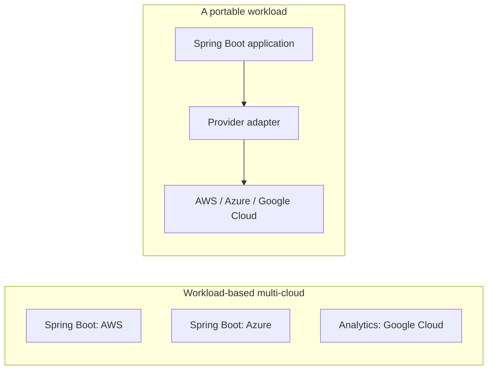
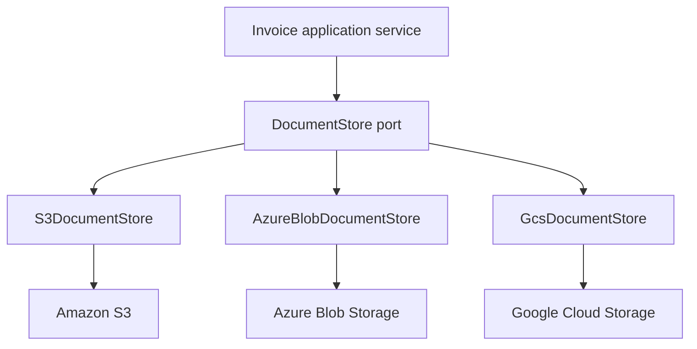

# Distinguishing Multi-Cloud Usage and Provider Portability

> **Chapter:** Multi-Cloud  
> **Module:** SPRING_CLOUD_PROVIDER_INTEGRATION — hands-on integration of Spring Boot with managed services from AWS, Azure, and Google Cloud through the corresponding Spring Cloud libraries. This lesson helps you choose a multi-cloud strategy and determine the level of portability needed for an application.

An enterprise can run systems on AWS and Azure simultaneously, but that does not mean an application can migrate from AWS to Azure in a few hours. A system can be containerized and deployed on Kubernetes across three clouds, yet still depend deeply on each provider's IAM, database, object storage, messaging, and secret manager.

**Multi-cloud** is about using multiple cloud providers in an operational strategy. **Portability** is about the ability to move applications, data, and operational processes across environments with an acceptable level of change. The two goals can support each other, but they are not synonymous.

In Spring Boot, Spring Cloud, and the SDKs for AWS, Azure, and Google Cloud, we can build adapters to swap out certain services. However, each service has its own semantics, security model, limits, and pricing model. A good abstraction needs to protect business logic from unnecessary details, while not hiding differences that affect correctness, security, or cost.

## 1. Learning Objectives

After this lesson, you will be able to:

1. Distinguish between multi-cloud, hybrid cloud, portability, interoperability, and vendor lock-in.
2. Explain why deploying the same container across multiple clouds does not automatically create end-to-end portability.
3. Choose a multi-cloud strategy based on business, compliance, availability, and operational capability requirements.
4. Evaluate AWS, Azure, and Google Cloud services by semantics rather than simply comparing product names.
5. Identify appropriate abstraction boundaries in a Spring Boot application.
6. Design replaceable business ports/interfaces and provider adapters.
7. Understand the roles and limitations of Spring Cloud Stream, Spring Cloud Function, and cloud integration libraries.
8. Build contract tests, integration tests, and a provider migration process.
9. Estimate costs, risks, and additional work when operating across multiple clouds.

## 2. Concepts Not to Conflate

### 2.1. Multi-cloud

Multi-cloud is the strategy of using services from at least two independent cloud providers, such as AWS and Azure. An organization can:

- Run different workloads on different providers.
- Run the same workload across multiple providers to increase resilience.
- Use one provider for compute and another provider for analytics or AI.
- Partition workloads by country, legal requirements, or data residency.
- Use a second provider as a DR (disaster recovery) environment.

Multi-cloud describes **workload and service distribution**. Applications can be designed entirely around the native services of each cloud.

### 2.2. Portability

Portability is the ability to move an application or application component to another environment without rewriting everything. The level of portability depends on scope:

- **Build portability:** source code and artifacts can be built with a common toolchain.
- **Runtime portability:** the application runs on an equivalent runtime/container/Kubernetes platform.
- **Configuration portability:** configuration can be switched without modifying business logic.
- **Identity portability:** the workload can obtain identity and credentials in the target environment in a controlled manner.
- **Service portability:** storage, messaging, database, cache, and secrets have replaceable adapters.
- **Data portability:** data, schema, metadata, and history can be exported/imported at a reasonable cost.
- **Operational portability:** monitoring, logging, backup, incident response, and deployment have equivalent processes.

An application can be portable at the runtime layer yet not portable at the data or identity layer.

### 2.3. Interoperability

Interoperability is the ability of different systems to exchange data and coordinate operations. For example:

- An AWS-hosted service sends events to an Azure-hosted service over HTTPS or a broker with a shared protocol.
- A Spring Boot service on GKE calls an API of a workload running on ECS.
- Systems use OIDC/OAuth2 to federate identity across environments.

Interoperability does not require the ability to move the entire application to another provider. A system can be interoperable while still relying heavily on native services.

### 2.4. Hybrid cloud

Hybrid cloud combines public cloud with private/on-premises infrastructure or a private cloud. Multi-cloud focuses on multiple providers; hybrid cloud focuses on combining cloud environments with private infrastructure. An organization can adopt both strategies at the same time.

### 2.5. Vendor lock-in

Vendor lock-in occurs when cost, time, risk, or complexity makes leaving a provider difficult. Lock-in takes several forms:

- **Technical:** code directly calls SDKs/APIs, or relies on specific database or event semantics.
- **Data:** large data volumes, proprietary formats, and costly replication/egress.
- **Operational:** teams, dashboards, runbooks, and processes tied to one provider.
- **Commercial:** contracts, discounts, committed spend, or data exit fees.
- **Organizational:** skills, ownership, and internal processes anchored to one provider.

Not all lock-in is bad. Using native services can reduce operational overhead and leverage critical capabilities. The goal is to understand the level of dependency clearly and ensure the organization has options aligned with business risk.

## 3. Multi-cloud does not automatically create portability

Consider two illustrative architectures:



In the architecture on the left, workloads can be distributed according to provider strengths. They do not necessarily need to be interchangeable with one another. In the architecture on the right, a single application has adapters to select the corresponding services. This approach increases replaceability, but requires designing, testing, and operating multiple adapters.

Some examples:

| Scenario | Multi-cloud? | Portable? |
|---|---|---|
| API runs on AWS, data warehouse runs on Google Cloud | Yes | Not necessarily |
| Application runs on EKS and AKS but uses DynamoDB | Yes | Runtime may be portable; data is not portable |
| Worker runs on Azure, DR workload on AWS, but backups are only in Azure | Yes | DR is incomplete |
| One Spring Boot artifact runs on three clouds, using a storage interface with three adapters | Possible | Yes within the scope of the defined storage contract |
| Two providers only exchange events over HTTPS | Possible | Interoperable; not necessarily capable of workload migration |

To achieve portability, you must inspect all dependencies and operational processes, not just where the container is started.

## 4. Why do enterprises choose multi-cloud?

You should not choose multi-cloud just to "avoid lock-in". Each business goal produces a different architecture.

### 4.1. Legal requirements and data residency

Some workloads must store or process data in specific regions. An enterprise may choose a provider with regions, certifications, contracts, or services that satisfy requirements in that jurisdiction.

You must verify where primary data, replicas, backups, logs, telemetry, key material, and metadata are stored. Selecting a database region alone is not enough to conclude that all data stays in the right jurisdiction.

### 4.2. Leveraging provider-specific capabilities

One provider may be a better fit for a workload because of:

- AI/analytics services with required capabilities.
- Managed databases with suitable operability or throughput.
- Identity services integrated with the enterprise ecosystem.
- Suitable network, edge, IoT, or GPU capacity.
- Regions, SLAs, or support models that meet requirements.

When choosing a specialized service, document clearly which capability justifies accepting lock-in.

### 4.3. Resilience and disaster recovery

A second provider can serve as a recovery site if the primary provider experiences a widespread outage. However, multi-cloud DR requires:

- Usable data replicas at the target provider.
- Identity, network, DNS, certificates, secrets, and keys available.
- Artifacts and deployment pipelines capable of deploying into the DR environment.
- Runbooks, emergency access, and designated owners.
- Regular failover/failback testing.

A standby cluster without fresh data, secrets, or network routes is not ready DR.

### 4.4. M&A and organizational separation

After mergers and acquisitions, business units may be using different providers. During the transition period, multi-cloud allows gradual system integration without forcing everything to migrate immediately.

### 4.5. Negotiation and commercial optionality

Having a viable alternative can help an organization negotiate. However, the real operational cost of two clouds may exceed pricing gains. You must calculate total cost of ownership (TCO), including compute, storage, egress, networking, support, security, staffing, and testing.

## 5. When should you invest in portability?

Portability is worth investing in when one or more of these conditions hold:

- There is a contractual or legal requirement to be able to move workloads or data.
- Concentration risk on a single provider exceeds acceptable thresholds.
- The workload is likely to be migrated during the product lifecycle.
- The current provider no longer meets cost, region, SLA, or feature needs.
- The organization has a DR target requiring execution on another provider.
- A service layer can be replaced with low abstraction overhead and clear benefits.

Portability has lower value when:

- The workload is short-lived or depends on deep native features.
- Data is too large or specialized to move within committed RTO/RPO.
- A second provider cannot meet SLA, compliance, or throughput requirements.
- The cost of maintaining abstractions, adapters, and tests exceeds the lock-in risk.

### Assessing by risk of change

Do not ask generically "is the application portable?". Ask specifically:

1. If we replace object storage, which packages must be modified?
2. If we switch brokers, will event ordering, retry, and dead-letter behavior still be correct?
3. If the target database does not support a current feature, which business flows are affected?
4. If the identity provider differs, how does the workload obtain tokens/credentials?
5. If a region or provider goes down, where is the latest data?
6. How long does it take to deploy, synchronize data, verify, and roll back?

## 6. Comparing services by semantics, not by name

Providers all offer object storage, queues, databases, and secret managers. Similar product names do not guarantee identical behavior.

| Capability | AWS | Microsoft Azure | Google Cloud | Differences to evaluate |
|---|---|---|---|---|
| Object storage | Amazon S3 | Azure Blob Storage | Cloud Storage | Versioning, generation/ETag, lifecycle, consistency, retention, event notification |
| Messaging/event | SQS, SNS, EventBridge, Kinesis, MSK | Service Bus, Event Grid, Event Hubs | Pub/Sub | Ordering, delivery, ack, retry, DLQ, partition, replay, transaction |
| Relational database | RDS/Aurora | Azure SQL, Azure Database for PostgreSQL | Cloud SQL, AlloyDB | Engine/version, extensions, HA, backup, replica, SQL dialect |
| NoSQL | DynamoDB | Cosmos DB | Firestore/Bigtable | Data model, query, partition key, consistency, transaction, index |
| Secret/key | Secrets Manager, SSM Parameter Store, KMS | Key Vault | Secret Manager, Cloud KMS | Version, rotation, key custody, IAM, audit, network access |
| Workload identity | IAM role, IRSA, task role | Managed Identity, Workload Identity | Service Account, Workload Identity Federation | Trust binding, token exchange, audience, scope, lifecycle |

For example, one provider's FIFO queue cannot be replaced by an arbitrary pub/sub topic while preserving the same ordering and semantics. An S3 object version ID is also not fully equivalent to a Cloud Storage generation or an Azure Blob version ID.

### Defining comparison criteria

For each capability, document:

- API and data model.
- Delivery/consistency guarantees.
- Size, throughput, and quota limits.
- Timeout, retry, idempotency, and ordering.
- Transaction boundary.
- Encryption, key management, and access control.
- Backup, restore, retention, and deletion.
- Observability, audit, and support.
- Pricing by request, throughput, storage, egress, and operation.

Only after establishing these criteria should you decide whether to use a shared abstraction or provider-specific features.

## 7. Portability in the Spring Boot and Spring Cloud ecosystem

Spring provides many mechanisms for cloud integration, but it does not have a single universal API that automatically makes every managed service of AWS, Azure, and Google Cloud equivalent.

### 7.1. Provider starters and SDKs

Libraries such as Spring Cloud AWS, Spring Cloud Azure, and Spring Cloud GCP help Spring Boot integrate with provider services:

- Auto-configure clients based on conventions and dependencies.
- Connect to the environment's credential chain/identity.
- Bind properties to beans.
- Integrate lifecycle, health indicators, or Spring abstractions depending on the module.
- Provide templates, clients, or adapters for the corresponding service.

They work with the provider's APIs and models. Using Spring Boot does not turn `S3Template`, the Azure Blob client, and the Google Cloud Storage client into the same contract.

For example: an application can inject a storage service bean provided by Spring Cloud AWS, but moving to Azure requires the corresponding dependencies, credential configuration, and adapter.

### 7.2. Spring Cloud Stream

Spring Cloud Stream provides a programming model based on functions and bindings for messaging. An application can write functions that receive/send messages and configure a binder for a supported broker.

```java
package com.example.orders.messaging;

import java.util.function.Consumer;
import org.springframework.context.annotation.Bean;
import org.springframework.context.annotation.Configuration;

@Configuration
public class OrderEventFunctions {

    @Bean
    Consumer<OrderCreated> orderCreated() {
        return event -> {
            // Invoke the application service to process business logic.
        };
    }

    public record OrderCreated(
            String eventId,
            String orderId,
            String tenantId) {
    }
}
```

Bindings can be configured via properties:

```yaml
spring:
  cloud:
    function:
      definition: orderCreated
    stream:
      bindings:
        orderCreated-in-0:
          destination: orders.created
          group: invoice-projection
```

The snippet above is the shared programming model. You still need the binder dependency and provider/broker-specific configuration for the chosen broker/provider. Simply changing the binder name does not mean you can move every queue/topic across clouds without adjusting semantics.

Differences that still need testing:

- Consumer groups and subscription models.
- Partition keys, ordering, and concurrency.
- Acknowledgement, retry, backoff, and dead-letter handling.
- Message retention, replay, and seek.
- Transactions and exactly-once claims.
- Header mapping, schema registry, and payload size.
- Authentication, network endpoints, and quotas.

Spring Cloud Stream reduces coupling to basic message send/receive APIs. It does not eliminate operational differences or guarantee identical semantics across every binder.

### 7.3. Spring Cloud Function

Spring Cloud Function separates business functions from deployment/transport details. Functions can run inside Spring Boot or be packaged for compatible function/serverless environments. However, deployment packaging, event source mappings, timeouts, concurrency, cold starts, retries, and identity still depend on the runtime/provider.

Do not assume "portable functions" means the entire serverless application is portable.

### 7.4. Containers and Kubernetes

Container images and Kubernetes manifests standardize runtime, deployment, and part of networking. They do not automatically standardize:

- Cloud IAM/workload identity.
- Load balancers, ingress, DNS, and private networking.
- Persistent volumes and storage classes.
- Managed databases, brokers, and secret managers.
- Autoscaling metrics, quotas, node pools, and regions.
- Backup/restore and service-level guarantees.

An application running on EKS, AKS, and GKE can still call the native services of each respective provider.

## 8. Designing abstractions at the right boundary

A good abstraction originates from **business use cases**. It expresses the actions the application needs, rather than trying to create a generic clone of the entire cloud SDK.

### 8.1. Start with a business port

For example, an invoice service needs to store and retrieve documents:

```java
package com.example.invoice.document;

import java.io.InputStream;
import java.time.Instant;

public interface DocumentStore {

    StoredDocument put(
            String tenantId,
            String documentId,
            InputStream content,
            String contentType,
            long contentLength);

    DocumentContent get(String tenantId, String documentId);

    void delete(String tenantId, String documentId);

    record StoredDocument(
            String documentId,
            String version,
            String checksum,
            Instant storedAt) {
    }

    record DocumentContent(
            InputStream content,
            String contentType,
            long contentLength,
            String version,
            String checksum) {
    }
}
```

The port contains only the required business concepts. It does not leak `S3Object`, `BlobClient`, `BlobId`, or SDK classes into the domain model.

### 8.2. Provider adapters

Each adapter translates the port into provider API calls:



Example package structure:

```text
com.example.invoice
  document
    DocumentStore.java
    DocumentService.java
  infrastructure
    aws
      S3DocumentStore.java
      AwsStorageConfiguration.java
    azure
      AzureBlobDocumentStore.java
      AzureStorageConfiguration.java
    gcp
      GcsDocumentStore.java
      GcpStorageConfiguration.java
```

The application service depends only on `DocumentStore`. Adapters depend on the corresponding SDKs and Spring Cloud modules.

### 8.3. Selecting the adapter at startup

For a single-provider deployment, select the adapter via configuration:

```yaml
app:
  storage:
    provider: aws
```

Spring configuration:

```java
@Configuration
public class DocumentStoreConfiguration {

    @Bean
    @ConditionalOnProperty(
            name = "app.storage.provider",
            havingValue = "aws")
    DocumentStore awsDocumentStore(S3Client s3Client) {
        return new S3DocumentStore(s3Client);
    }

    @Bean
    @ConditionalOnProperty(
            name = "app.storage.provider",
            havingValue = "azure")
    DocumentStore azureDocumentStore(BlobServiceClient blobServiceClient) {
        return new AzureBlobDocumentStore(blobServiceClient);
    }

    @Bean
    @ConditionalOnProperty(
            name = "app.storage.provider",
            havingValue = "gcp")
    DocumentStore gcpDocumentStore(Storage storage) {
        return new GcsDocumentStore(storage);
    }
}
```

This is an illustrative skeleton. You still need the corresponding dependencies, credential/client beans, constructors, and provider implementations. Within a deployment, ensure exactly one `DocumentStore` bean is created; missing or invalid provider configuration should make the application fail fast on startup.

Do not let arbitrary requests pass `provider=aws` or `provider=azure` to select a backend. The provider is a controlled operational configuration, unless the product genuinely requires multi-provider routing per tenant with explicit policies.

### 8.4. Define the contract before writing adapters

The contract must clearly specify:

- Object naming and tenant namespace.
- Behavior when an object already exists.
- How versions and checksums are represented.
- Delete behavior: soft delete, version delete, or permanent delete.
- Size limits and streaming.
- Metadata/content type.
- Retry/idempotency and transient errors.
- Access permissions and retention.

If a provider cannot satisfy the contract, decide whether to:

1. Revise the contract to keep only truly required guarantees.
2. Implement a conditional capability interface.
3. Choose a different provider.
4. Accept provider-specific behavior at an explicit boundary.

Never silently simulate a guarantee that the backend does not provide.

## 9. Do not force every provider into the "lowest common denominator"

Overly broad abstractions can strip away critical capabilities. For example:

- S3 supports versioning, lifecycle rules, object lock, and event notifications with specific configurations.
- Azure Blob offers access tiers, leases, and immutability policies.
- Cloud Storage provides object generations, retention, and preconditions.

If an abstraction only has `put/get/delete`, it may fit simple document storage use cases. If the business requires immutable retention for compliance, the contract must model retention/legal hold or expose a dedicated capability.

A solid design can include:

- **Common port:** operations required across all providers.
- **Capability interface:** advanced features supported by only some adapters.
- **Provider extension:** a controlled escape hatch to native features when a business case requires it.

For example:

```java
public interface RetentionCapableDocumentStore {

    void retainUntil(
            String tenantId,
            String documentId,
            Instant retainUntil);
}
```

The application service can check for the capability when a use case requires retention. If the deployed provider does not support it, the application must report a clear configuration error or use another approved workflow. Do not bypass compliance requirements just to keep an interface looking portable.

## 10. Layers to examine when switching providers

### 10.1. Compute and runtime

Evaluate:

- CPU/architecture and base images.
- Java runtime and native libraries.
- Container registries and image signing.
- Kubernetes versions, ingress, service mesh, and autoscaling.
- Startup/readiness/liveness behavior.
- Schedulers, background jobs, and serverless triggers.

A portable JAR is not enough if the target runtime lacks native libraries, network routes, or resource configurations.

### 10.2. Identity and access control

Clouds have different workload identity models:

| Provider | Example workload identity |
|---|---|
| AWS | IAM role attached to compute; IRSA/EKS Pod Identity for workloads on EKS |
| Azure | Managed Identity; Workload Identity for Kubernetes |
| Google Cloud | Service Account; Workload Identity Federation/Workload Identity for GKE |

Do not carry long-lived access keys, service account keys, or client secrets from one cloud to another to fake portability. Workloads need short-lived credentials issued via the environment's trust relationship.

Create a boundary in the application for obtaining clients/credentials, while letting provider SDKs use their native credential chains. For example, Spring Cloud AWS can use the AWS credential provider chain; Spring Cloud Azure uses Azure Identity; Spring Cloud GCP uses Google credentials. Each provider's configuration and permissions must still be governed separately.

### 10.3. Secret and key management

A secret manager is more than a place to read a string. Evaluate:

- Versioning and rotation.
- Access policies, RBAC/IAM, and private endpoints.
- Key encryption/decryption and key custody.
- Audit logs and alerts.
- Secret injection, refresh, and caching.
- Resilience when the secret manager is unavailable.

Do not hardcode secrets in `application.yml`. Configuration should reference the secret store or controlled environment injection. Do not synchronize secrets across clouds in plaintext or through a shared bucket lacking encryption/ACLs.

### 10.4. Storage and data

For object storage, standardize required business operations and metadata; verify versioning, retention, encryption, consistency, and lifecycle behavior.

For relational databases, portability is generally higher when using compatible engines such as PostgreSQL or MySQL, but you must still review:

- Extensions and stored procedures.
- SQL dialect, collation, and timezone.
- Isolation/locking and transaction behavior.
- Indexes, partitioning, and query plans.
- Backup/restore and replication.
- Connection pooling, TLS, and IAM database authentication.

NoSQL typically entails stronger lock-in because data models, indexing, partition keys, and transaction semantics differ. Moving from DynamoDB to Cosmos DB or Firestore may require redesigning queries and consistency models, not just swapping drivers.

### 10.5. Messaging and events

A shared event contract does not make broker semantics identical. Standardize:

- Event schema, event ID, aggregate ID, and tenant ID.
- Idempotency and deduplication.
- Ordering keys/partitioning strategy.
- Retry policies, poison messages, and dead-letter workflows.
- Replay, retention, and schema evolution.
- Delivery guarantees and transaction boundaries.

Consumers should be idempotent. If a broker can deliver messages more than once, business logic must handle duplicates safely. Do not promise end-to-end exactly-once delivery simply because one broker advertises a particular delivery mode.

### 10.6. Observability and operations

Maintain shared conventions:

- Structured logging and correlation/trace IDs.
- Metrics by service, operation, and tenant at appropriate cardinality.
- Distributed tracing with OpenTelemetry.
- Health/readiness and dependency health checks.
- Alerts based on SLOs and error budgets.
- Audit events for sensitive actions.

Provider-specific dashboards, metrics, and alerts still require adapters/runbooks. A generic dashboard cannot replace specialized metrics for throttling, queue age, replication lag, or quotas.

## 11. Common multi-cloud deployment patterns

| Pattern | Description | Strengths | Costs/risks |
|---|---|---|---|
| Workload placement | Each workload runs on the best-fit provider | Leverages strengths, easier domain optimization | Cross-cloud integration and operational skills |
| Active-passive DR | Secondary provider holds replicas and is ready to recover | Improves resilience | Data synchronization, failover testing, standby costs |
| Active-active | Same workload serves traffic across multiple providers | Can increase availability and geographic distribution | Consistency, routing, split-brain, and operational complexity |
| Migration bridge | Run in parallel during provider migration | Reduces cutover risk | Dual-environment costs and synchronization |
| Best-of-breed | Pick best services from multiple providers | Optimizes features | Per-service lock-in and network/data egress |

### Active-active requires data design first

Two regions or providers writing to the same business entity require a conflict resolution strategy. Simply placing a load balancer across two clouds does not solve:

- Two requests updating the same record.
- Duplicate events.
- Cross-partition ordering.
- Network partitions and split-brain.
- Consistent authorization and auditing.

Without a clear active-active requirement, active-passive or workload placement can be simpler and more reliable.

## 12. Assessing TCO and operational complexity

Multi-cloud TCO must account for both direct and hidden costs:

| Cost category | Examples to include |
|---|---|
| Compute | VMs/containers/serverless, autoscaling, idle capacity |
| Storage | Capacity, requests, retrieval, backup, replication |
| Network | Egress, cross-region, interconnect, NAT, private link |
| Managed services | Databases, brokers, caches, key management |
| Reliability | DR standby, replicas, failover tests |
| Security | IAM reviews, SIEM, key rotation, vulnerability management |
| Engineering | Adapters, CI/CD, contract tests, migration tooling |
| Operations | On-call, runbooks, training, incident coordination |
| Commercial | Support plans, committed spend, licenses, data exit fees |

### Qualitative comparison example

Suppose an application needs object storage, a message broker, and PostgreSQL:

- With a single provider, the team can leverage unified IAM, networking, and monitoring.
- With two providers for the same workload, you need additional adapters, pipelines, policies, tests, and incident procedures.
- Using a second provider solely for DR may cost less than active-active, but still incurs replication, storage, and testing expenses.

Do not conclude that multi-cloud is cheaper or safer without a concrete cost model and threat model.

## 13. Abstraction decision process

For each dependency, follow this process:

1. **State the use case:** what business action does the application need?
2. **Document semantics:** consistency, ordering, retention, security, performance.
3. **Assess replaceability:** can a second provider satisfy the same contract?
4. **Estimate abstraction cost:** adapters, tests, operations, and forgone features.
5. **Choose the boundary:** common port, capability interface, or native SDK.
6. **Define failure modes:** provider unavailable, timeouts, quotas, permission denied.
7. **Plan data migration:** export/import, dual-write, replication, validation.
8. **Measure portability:** migration time, number of components to change, RTO/RPO, and cost.

### Quick decision table

| Condition | Design direction |
|---|---|
| Business only needs simple object CRUD | Small storage port, per-provider adapters |
| Needs specialized object lock/retention | Separate capability or provider-native API |
| Only needs basic event publish/consume | Consider Spring Cloud Stream and contract tests |
| Needs broker-specific ordering/transactions | Define clear semantics, custom adapter, or choose compatible brokers |
| Database uses standard PostgreSQL | Potentially portable at schema/query level; test extensions and operations |
| NoSQL database has proprietary query model | Accept a provider-specific data adapter or design a dedicated migration |
| Workload runs on managed Kubernetes | Partially portable at runtime; identity/network/storage still need configuration |
| Only needs DR on another provider | Prioritize verifying restore/failover and data replication before abstracting the whole system |

## 14. Testing portability and multi-cloud

Portability cannot be proven with unit tests of an interface alone. Multiple testing layers are required.

### 14.1. Business unit tests

Test application services with a fake `DocumentStore` or fake event publisher. The goal is to verify that business logic does not depend on cloud SDKs.

### 14.2. Port contract tests

Write a shared test suite for all adapters. Example contract for storage:

- Put followed by get returns exact bytes and content type.
- Put with the same document ID has contract-compliant overwrite/version behavior.
- Get on a nonexistent object returns a consistent domain error.
- Repeated delete has defined behavior.
- Tenant A cannot read Tenant B's objects.
- Checksum/version returned match the abstraction semantics.

Run the same contract suite against AWS, Azure, and GCP adapters.

### 14.3. Integration tests

Test against real services or suitable emulators:

- LocalStack supports many AWS services, but does not replicate every behavior of AWS managed services.
- Azurite supports certain Azure Storage APIs, but does not emulate all features or identity.
- Fake GCS server supports part of the Cloud Storage API, but does not fully represent IAM, lifecycle, or production consistency.
- Broker/database emulators may lack real quotas, failure modes, and latency.

Always include tests against a real provider sandbox/project/subscription for critical behaviors.

### 14.4. Chaos and failover tests

Simulate:

- DNS/network failures.
- Provider returning 429/throttling.
- Expired or revoked credentials.
- Broker rejecting messages.
- Database failover.
- Unreachable secret manager.
- Replication lag exceeding RPO.

Verify that the application fails fast, performs bounded retries, preserves idempotency, and recovers properly.

## 15. Planning a workload migration to another provider

A safe migration needs clear phases:

### Phase 1 — Inventory

List compute, runtime, IAM, networking, databases, storage, messaging, secrets, monitoring, backups, DNS, certificates, quotas, and external integrations.

### Phase 2 — Classify dependencies

Assign each dependency to a category:

- Portable out of the box.
- Has an adapter, but semantics need verification.
- Provider-specific, but replaceable.
- Accepted lock-in for features/cost.
- Blocker requiring redesign.

### Phase 3 — Finalize target architecture

Choose target services, regions, networking, identity, encryption, data residency, and operational ownership. Compare behaviors and quotas before writing adapters.

### Phase 4 — Build adapters and pipelines

Implement target adapters, configure credentials, secrets, networking, CI/CD, observability, and contract tests. Keep artifacts reproducible from source.

### Phase 5 — Migrate data

Choose an appropriate method:

- Offline export/import when downtime is acceptable.
- Snapshot/restore.
- Continuous replication followed by cutover.
- Controlled dual-write with reconciliation.

Do not arbitrarily dual-write two databases without handling partial failures, ordering, and duplicates.

### Phase 6 — Validate and cutover

Compare record counts, checksums, schemas, metadata, access policies, and runtime behavior. Run canary deployments or shift traffic gradually; monitor error rates, latency, queue lag, and business metrics.

### Phase 7 — Rollback and decommission

Define rollback triggers, data reconciliation, DNS/traffic reversal, and the retention period for the old system. Decommission only after verifying backups, audits, retention, and recovery capability.

### Migration checklist

- [ ] RTO/RPO and downtime window approved.
- [ ] Data inventory and data owners confirmed.
- [ ] IAM/workload identity operational at target provider.
- [ ] Network, DNS, TLS, and private connectivity ready.
- [ ] Schemas, data, and metadata verified.
- [ ] Contract/integration tests passing.
- [ ] Backup/restore and failover rehearsed.
- [ ] Dashboards, alerts, and runbooks updated.
- [ ] Cutover and rollback owners assigned.
- [ ] Egress and parallel-run costs accounted for.

## 16. Design example: a document service across three clouds

Suppose Invoice Service stores PDFs, publishes an `InvoiceIssued` event, and writes metadata to PostgreSQL.

### Business requirements

- Each document belongs to a tenant.
- Documents can be read/downloaded based on permissions.
- Checksum and content type must be stored.
- Invoice-issued events must be idempotent.
- Data must be backed up and retained according to policy.

### Responsibility boundaries

| Component | Port/interface | Provider adapter |
|---|---|---|
| Document storage | `DocumentStore` | S3, Azure Blob, GCS |
| Event publishing | `InvoiceEventPublisher` | Binder/message adapter or provider SDK |
| Metadata | Repository | Managed PostgreSQL service |
| Workload identity | Credential configuration boundary | IAM role, Managed Identity, Service Account |
| Secrets | Secret access boundary | Secrets Manager, Key Vault, Secret Manager |

There is no need to abstract all of PostgreSQL if all three environments use the same engine and the application relies only on standard SQL. However, you still need to check connection auth, backups, extensions, failover, and performance.

### Event contract

```java
public record InvoiceIssued(
        String eventId,
        String tenantId,
        String invoiceId,
        String documentId,
        String checksum,
        Instant occurredAt,
        int schemaVersion) {
}
```

The event carries business identifiers and schema version, not provider-specific bucket names or cloud resource ARNs. If a consumer needs to download the document, it calls a business API or receives an API-controlled reference; it should not depend directly on one provider's bucket name.

### Per-deployment provider configuration

Example:

```yaml
app:
  cloud:
    provider: ${CLOUD_PROVIDER:aws}
  storage:
    bucket: ${DOCUMENT_BUCKET}
```

AWS, Azure, and GCP deployments can set different `CLOUD_PROVIDER` and `DOCUMENT_BUCKET` values. Configuration must be validated at startup; never allow a default to accidentally point to a production bucket.

### Measuring portability

| Area | Expected portability | Conditions |
|---|---|---|
| Business service | High | Depends only on ports |
| Storage | Medium/high | Adapters pass contract tests; compatible retention/version semantics |
| Messaging | Medium | Shared event schema; standardized retry/ordering |
| PostgreSQL | Medium/high | Same engine/version and controlled extensions |
| Identity | Low at SDK layer, high at business layer | Native credentials; no cloud principals leaked into domain |
| Operations | Medium | Dashboards, alerts, runbooks, and backups implemented per provider |

Ratings are illustrative, not a guarantee that switching providers requires zero changes.

## 17. Anti-patterns to avoid

| Anti-pattern | Why it causes problems | How to address it |
|---|---|---|
| Running two clouds just to claim multi-cloud | No business driver, increased cost | Tie the decision to resilience, compliance, or specific capabilities |
| Assuming containers equal portability | Identity, data, and networking still differ | Evaluate every dependency |
| Creating a generic interface for every service | Loses semantics, bloats interfaces | Design ports around use cases |
| Forcing every provider to the lowest common denominator | Misses critical capabilities | Use intentional capability interfaces/extensions |
| Leaking SDK types into the domain | Business code becomes provider-coupled | Convert at the adapter boundary |
| Testing only with emulators | Misses IAM, quotas, and failure behavior | Run integration tests on real providers |
| Dual-writing data without reconciliation | Partial failures and divergence | Design idempotency, outbox, and reconciliation |
| Using long-lived secrets to migrate workloads | Credential leaks and hard rotation | Use workload identity/certificates/federation |
| Ignoring egress costs | Migration/replication inflates bills | Estimate data transfer upfront |
| Skipping failover drills | DR exists only on paper | Run game days and measure real RTO/RPO |

## 18. Hands-on exercise

**Context:** Your team is developing Invoice Service running on AWS. Management asks for an option to deploy on Azure or Google Cloud in the future. The system uses S3, SQS, RDS PostgreSQL, IAM roles, and Secrets Manager.

### Part A — Goal analysis

1. Determine whether the requirement is active-active multi-cloud, active-passive DR, or portability for future optionality.
2. Write three business drivers that could justify a second provider.
3. Define RTO, RPO, data residency, SLA, and downtime limits.
4. Distinguish components that need portability from those where provider-specific choices are acceptable.

### Part B — Adapter design

1. Create a `DocumentStore` port for document operations.
2. Create `S3DocumentStore` and describe the corresponding adapters for Azure Blob/GCS.
3. Define the event contract for `InvoiceIssued`.
4. Choose how to use Spring Cloud Stream or a provider messaging adapter; specify ordering, retry, DLQ, and replay.
5. Define workload identity and secret access for each provider.
6. List native features that cannot be replaced directly.

### Part C — Testing and migration

1. Write shared contract tests for storage adapters.
2. Test tenant isolation, checksum, version, and delete semantics.
3. Run integration tests on the target provider's sandbox.
4. Plan data export/import or replication.
5. Write a cutover, rollback, and reconciliation plan.
6. Estimate compute, storage, egress, support, and staffing costs.

**Sample architecture decision:**

| Dependency | Strategy | Rationale | Required tests |
|---|---|---|---|
| Object storage | Port + adapter | Need to switch providers | Contract, retention, version, checksum |
| Messaging | Event contract + binder/adapter | Need to reduce coupling | Ordering, retry, DLQ, replay |
| PostgreSQL | Keep standard engine | Minimize data model changes | Schema, extensions, backup/restore |
| Identity | Native workload identity | Avoid sharing long-lived credentials | Token, role, rotation, revocation |
| Secrets | Provider secret manager | Protect credentials per cloud | Access policy, rotation, audit |

**Success criteria:** Clearly explain how multi-cloud differs from portability; identify which parts of the application are replaceable; ensure abstractions do not hide critical semantics; include contract/integration tests and a viable data, operations, and rollback plan.

## Official References

1. [Spring Cloud — Projects](https://spring.io/projects/spring-cloud): Spring Cloud ecosystem and integration projects.
2. [Spring Cloud Stream](https://spring.io/projects/spring-cloud-stream): programming model and binder abstraction for event-driven systems.
3. [Spring Cloud Function](https://spring.io/projects/spring-cloud-function): function programming model and deployment adapters.
4. [Spring Cloud AWS](https://awspring.io/): Spring integration with AWS services.
5. [Spring Cloud Azure](https://spring.io/projects/spring-cloud-azure): Spring Boot integration with Azure services.
6. [Spring Cloud GCP](https://spring.io/projects/spring-cloud-gcp): Spring Boot integration with Google Cloud services.
7. [AWS Well-Architected Framework](https://docs.aws.amazon.com/wellarchitected/latest/framework/welcome.html): reliability, security, cost optimization, and operational excellence.
8. [Azure Well-Architected Framework](https://learn.microsoft.com/azure/well-architected/): guidance for designing workloads on Azure.
9. [Google Cloud Architecture Framework](https://cloud.google.com/architecture/framework): system design, operations, security, reliability, and cost.
10. [OpenTelemetry](https://opentelemetry.io/docs/): standard instrumentation for traces, metrics, and logs.

> **Key takeaway:** Multi-cloud is a decision to use multiple providers; portability is the ability to move workloads with acceptable changes and cost. Spring Cloud helps standardize certain programming models and integrations, but it does not make identity, storage, messaging, databases, or operations identical. Start from business drivers, define contracts around use cases, keep provider differences at the adapter boundary, and test semantics before claiming portability.
