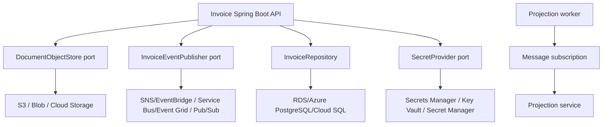

# Comparing Object Storage, Messaging, Secrets, and Data Models

> **Chapter:** Multi-Cloud  
> **Module:** SPRING_CLOUD_PROVIDER_INTEGRATION — hands-on integration of Spring Boot with managed services from AWS, Azure, and Google Cloud through the corresponding Spring Cloud libraries. This lesson compares the core service categories and how to choose appropriate abstractions when an application may run across multiple clouds.

AWS, Azure, and Google Cloud all provide managed object storage, messaging, secret management, and databases. Their names may sound similar, but their APIs, data models, consistency, delivery guarantees, IAM, limits, and pricing models are not completely equivalent.

For example, Amazon S3, Azure Blob Storage, and Google Cloud Storage all store objects, yet versioning, retention, lifecycle, and upload behavior differ. SQS, Service Bus, and Pub/Sub all transfer messages, yet queue semantics, ordering, acknowledgement, dead-lettering, and replay are not identical. Secrets Manager, Key Vault, and Secret Manager all hold secrets, yet rotation, key management, and identity integration follow their own models.

When integrating with Spring Boot, start from the use case and the guarantees the application requires. Only then choose the service, library, and adapter boundary. A shared interface is only useful when providers genuinely satisfy the same contract; it cannot turn different semantics into identical behavior.

## 1. Learning Objectives

After this lesson, you will be able to:

1. Compare AWS, Azure, and Google Cloud object storage by data model, versioning, retention, consistency, and upload behavior.
2. Distinguish between queues, pub/sub, event routing, and event streaming.
3. Compare SQS/SNS/EventBridge, Azure Service Bus/Event Grid/Event Hubs, and Google Pub/Sub.
4. Understand the storage, rotation, encryption, and access control models of secret managers.
5. Compare managed relational and NoSQL database services by data model, queries, consistency, transactions, and partitioning.
6. Choose the appropriate Spring Cloud/provider SDK or Spring abstraction for each use case.
7. Design ports/adapters and contract tests without losing business guarantees.
8. Build a checklist covering identity, networking, backup, migration, observability, and cost.

## 2. Capability-level service equivalence map

| Capability | AWS | Microsoft Azure | Google Cloud |
|---|---|---|---|
| Object storage | Amazon S3 | Azure Blob Storage | Cloud Storage |
| Point-to-point queue | Amazon SQS | Service Bus Queue | Pub/Sub with queue-style subscription |
| Pub/sub fan-out | SNS, EventBridge | Service Bus Topic, Event Grid | Pub/Sub Topic |
| Event routing | EventBridge | Event Grid | Eventarc, Pub/Sub |
| Event streaming | Kinesis Data Streams, MSK | Event Hubs | Pub/Sub combined with Dataflow |
| Secret storage | Secrets Manager, SSM Parameter Store | Key Vault Secrets | Secret Manager |
| Key management | AWS KMS | Key Vault Keys, Managed HSM | Cloud KMS |
| Relational database | RDS, Aurora | Azure SQL, Azure Database for PostgreSQL | Cloud SQL, AlloyDB |
| NoSQL | DynamoDB | Cosmos DB | Firestore/Bigtable |

This table only maps services by **capability group**; it does not claim they are drop-in replacements. For example, EventBridge is an event bus with routing rules; SQS is a queue. Likewise, Bigtable is a wide-column database, not a clone of Firestore.

Before choosing a service, identify what the application actually needs:

- Store and download objects by key?
- Send a command to a single consumer?
- Broadcast events to multiple subscribers?
- Route events based on content?
- Store partitioned streams with replay within a retention window?
- Store secrets, encryption keys, or certificates?
- Run relational, document, or partition-keyed key-value queries?

## 3. Comparing object storage

Object storage fits files, images, videos, backups, log archives, documents, and unstructured data. Applications typically operate by bucket/container and object key rather than mounting a traditional filesystem.

### 3.1. Data model

| Property | Amazon S3 | Azure Blob Storage | Google Cloud Storage |
|---|---|---|---|
| Namespace | Bucket + object key | Storage account + container + blob name | Bucket + object name |
| Object identity | Bucket/key; version ID if versioning enabled | Container/blob; version ID or snapshot depending on feature | Bucket/name; generation and metageneration |
| Metadata | User/system metadata, tags | System/user metadata, blob index tags | Metadata and custom metadata |
| Large uploads | Multipart upload | Block blob upload by block | Resumable/multipart upload depending on client/API |
| Versioning | Bucket versioning | Blob versioning/snapshot | Object versioning/generation |
| Lifecycle | Lifecycle configuration | Lifecycle management policy | Object Lifecycle Management |
| Retention | Object Lock, legal hold, retention mode | Immutable storage, time-based retention, legal hold | Retention policy, bucket lock, object holds |
| Storage tiers | Standard, Intelligent-Tiering, Standard-IA, Glacier classes | Hot, Cool, Cold, Archive depending on account/region type | Standard, Nearline, Coldline, Archive |

Feature names are similar, but details differ. For example:

- S3 versioning assigns version IDs to object versions; Azure has blob versioning and snapshots; GCS uses generation numbers to identify object versions.
- An ETag is not always an MD5 checksum. With multipart uploads, encryption, or certain APIs, you should not infer checksums solely from the ETag.
- Retention/immutability differs in modes, duration, bypass permissions, and delete behavior. You must verify exact compliance requirements.
- Storage classes/tiers differ in minimum storage duration, retrieval fees, or restore times.

### 3.2. Consistency and concurrency

Modern object storage services provide strong consistency for common object operations, but precondition APIs, versioning, and concurrency controls differ.

| Topic | What to verify |
|---|---|
| Read-after-write | After upload succeeds, when do GET/LIST reflect the object? |
| Conditional write | Can you write only if the object does not exist or its ETag/generation has not changed? |
| Concurrent update | How are conflicts handled when two writers update the same key? |
| Delete | Does delete create a delete marker, delete a version, or permanently remove the object? |
| Listing | What pagination, continuation tokens, and page size limits apply? |
| Checksum | Which checksum is used, who computes it, and at which step does the SDK verify it? |
| Multipart/resumable | How do you resume, abort uploads, and clean up incomplete uploads? |

Do not rely on upload completion behavior in one SDK to infer semantics for another provider. Write contracts around real requirements, such as "do not overwrite if the object already exists" or "only update if the version is still X".

### 3.3. Integrating object storage in Spring Boot

There are three common approaches:

1. Use the SDK/provider starter directly when full native features are needed.
2. Place a small business port in front of the SDK so application services do not depend on provider classes.
3. Use a higher-level abstraction if it satisfies the exact required semantics.

Example port:

```java
package com.example.invoice.document;

import java.io.InputStream;

public interface DocumentObjectStore {

    StoredObject put(
            String tenantId,
            String documentId,
            InputStream input,
            long contentLength,
            String contentType);

    DownloadedObject get(String tenantId, String documentId);

    void delete(String tenantId, String documentId);

    record StoredObject(
            String objectKey,
            String version,
            String checksum) {
    }

    record DownloadedObject(
            InputStream input,
            long contentLength,
            String contentType,
            String version,
            String checksum) {
    }
}
```

The port models the document storage need. AWS, Azure, and GCP adapters are responsible for:

- Constructing tenant-namespaced keys.
- Calling the corresponding SDK.
- Mapping version/ETag/generation into contract metadata.
- Translating provider errors into meaningful application errors.
- Closing streams properly and managing multipart/resumable uploads.
- Enforcing configured encryption, retention, and access policies.

Do not leak `S3Object`, `BlobClient`, `BlobId`, or SDK exceptions into domain/application services.

### 3.4. Configuration and identity

| Provider | Commonly used SDK/client | Workload identity |
|---|---|---|
| AWS | AWS SDK for Java v2, Spring Cloud AWS | IAM role, task role, EKS Pod Identity/IRSA |
| Azure | Azure Storage Blob SDK, Spring Cloud Azure | Managed Identity, Workload Identity |
| Google Cloud | Cloud Storage Java client, Spring Cloud GCP | Service Account, Workload Identity Federation |

Production should use short-lived credentials from workload identity. Avoid creating long-lived access keys/service account keys and storing them in source or images just to share a single configuration.

### 3.5. When to choose which object storage?

- Choose S3 when the workload needs the S3 ecosystem, AWS integrations, or specific S3 features.
- Choose Azure Blob when the workload integrates with Azure, needs access tiers/immutability, or Data Lake Storage Gen2 within that architecture.
- Choose Cloud Storage when the workload runs on Google Cloud or needs GCS/BigQuery/Dataflow integration.
- If portability is required, define a small object contract and test versioning, retention, checksums, conditional writes, deletes, and tenant isolation on every adapter.

## 4. Comparing messaging and event services

Messaging is easy to confuse because all services use concepts like topics, queues, and subscriptions. Distinguish four patterns:

- **Queue:** one message is processed by one consumer in a competing-consumer group; suited for commands/work items.
- **Pub/sub:** a publisher sends to a topic; multiple subscriptions can receive copies for independent processing.
- **Event routing:** a broker filters and routes events to targets based on rules.
- **Event streaming:** stores a partitioned sequence of events, letting consumers read by offset/sequence and replay within a retention window.

A system can combine multiple patterns: EventBridge routes events to SQS; Event Grid pushes events to Service Bus; Pub/Sub delivers events to multiple subscriptions.

### 4.1. AWS messaging

| Service | Pattern | Key notes |
|---|---|---|
| SQS Standard | Queue | At-least-once delivery; duplicates possible and strict ordering not guaranteed |
| SQS FIFO | FIFO queue | Ordering per message group; configurable deduplication within FIFO scope |
| SNS | Pub/sub | Fan-out to multiple subscribers such as SQS, Lambda, HTTPS |
| EventBridge | Event bus/routing | Rule-based filtering and target routing; configurable archive/replay |
| Kinesis Data Streams | Stream | Shards/partitions, sequence numbers, retention, and consumer checkpoints |
| Amazon MSK | Managed Kafka | Kafka protocol/ecosystem and managed cluster operations |

SQS consumers typically use a visibility timeout to hide a message while processing. If the consumer does not delete it before the timeout expires, the message can be redelivered. Dead-letter queues and redrive policies help isolate failing messages, but idempotency is still required to handle duplicates.

### 4.2. Azure messaging

| Service | Pattern | Key notes |
|---|---|---|
| Service Bus Queue | Queue | Peek-lock/complete/abandon, DLQ, sessions, and transactions depending on tier |
| Service Bus Topic | Pub/sub | Topics and subscriptions; filter rules, DLQ |
| Event Grid | Event routing | Push events to handlers/endpoints, configurable retries and dead-lettering |
| Event Hubs | Event streaming | Partitions, consumer groups, retention, checkpoints, and Capture |

Service Bus fits enterprise messaging requiring queues/topics, locks, sessions, and transactions per tier capabilities. Event Grid focuses on event routing. Event Hubs handles high-volume ingestion/streaming; do not substitute them for each other simply because all receive events.

### 4.3. Google Cloud messaging

| Service | Pattern | Key notes |
|---|---|---|
| Pub/Sub Topic | Pub/sub | Publishers send messages to a topic |
| Pub/Sub Subscription | Consumer endpoint | Push or pull, ack deadline, retry, dead-letter, and retention |
| Pub/Sub ordering | Ordering key | Ordering can be enabled by key and corresponding region/configuration |
| Pub/Sub replay | Seek/retention | Replay is possible while messages remain retained and subscription is configured |
| Eventarc | Event routing | Routes events from supported sources to Cloud Run, GKE, or corresponding targets |

Pub/Sub offers delivery and ordering options; do not infer end-to-end exactly-once semantics for an entire business workflow. Exactly-once delivery, when enabled, carries subscription/API conditions and does not eliminate the need for business-layer idempotency.

### 4.4. Semantics comparison table

| Criterion | AWS | Azure | Google Cloud |
|---|---|---|---|
| Basic queue | SQS Standard | Service Bus Queue | Pub/Sub subscription used as a queue |
| FIFO/ordering | SQS FIFO by message group | Service Bus Sessions | Pub/Sub ordering key |
| Pub/sub | SNS, EventBridge | Service Bus Topic, Event Grid | Pub/Sub Topic |
| Content-based routing | EventBridge rules | Event Grid filters, Service Bus rules | Eventarc filters, Pub/Sub attributes |
| Streaming | Kinesis, MSK | Event Hubs | Pub/Sub, Dataflow |
| Ack/complete | Delete after processing; visibility timeout | Complete/abandon/renew lock | Ack/nack and ack deadline |
| Dead-letter | SQS DLQ/redrive | Service Bus DLQ, Event Grid dead-letter | Pub/Sub dead-letter topic |
| Replay | EventBridge archive, Kinesis retention/sequence, Kafka offset | Event Hubs retention/offset | Pub/Sub seek within retention |

### 4.5. How can Spring Cloud Stream help?

Spring Cloud Stream provides a functional programming model and bindings for applications to receive/send messages. Example:

```java
package com.example.invoice.messaging;

import java.util.function.Consumer;
import org.springframework.context.annotation.Bean;
import org.springframework.context.annotation.Configuration;

@Configuration
public class InvoiceEventHandler {

    @Bean
    Consumer<InvoiceIssued> invoiceIssued(
            InvoiceProjectionService projectionService) {
        return event -> projectionService.apply(event);
    }

    public record InvoiceIssued(
            String eventId,
            String tenantId,
            String invoiceId,
            int schemaVersion) {
    }
}
```

Bindings can be configured by function name:

```yaml
spring:
  cloud:
    function:
      definition: invoiceIssued
    stream:
      bindings:
        invoiceIssued-in-0:
          destination: invoices.issued
          group: invoice-projection
```

This snippet shows the application programming model. You still need the specific binder dependency, broker configuration, credentials, and consumer behavior for real environments. Not every managed service has a binder with the same support level, release train, or semantics. Before choosing one, verify that the binder is actively maintained, compatible with your Spring Boot/Spring Cloud versions, and supports the required broker features.

If you need sessions, transactions, partition ordering, dead-letter management, or broker-specific features, you can use the provider SDK directly inside an adapter. Spring Cloud Stream does not automatically standardize those guarantees.

### 4.6. Event contracts and idempotency

A portable event contract should include:

- `eventId`: unique identifier for deduplication.
- `eventType` and `schemaVersion`: manage schema evolution.
- `occurredAt`: business timestamp.
- `aggregateId`: identifier of the entity producing the event.
- `tenantId`: tenant owning the event.
- Business payload, without ARNs, queue URLs, topic resource IDs, or specific project names.

Consumers should record processed `eventId` values inside an appropriate transaction or use an idempotency key. If DB processing succeeds and broker ack fails, the message may be redelivered. If ack occurs first and DB commit fails, the message may be lost from the queue while business processing remains incomplete.

The outbox pattern helps synchronize database changes and event publication. The inbox/deduplication pattern helps consumers handle redeliveries safely. Both patterns are useful across all three clouds, though broker transactions still have their own limits.

## 5. Comparing secret management and key management

Secrets and keys are often placed side by side, but they are not the same:

- **Secret:** passwords, API keys, connection strings, tokens, or credentials.
- **Cryptographic key:** keys used for encrypt/decrypt/sign/verify; typically require dedicated HSM, policies, and audits.
- **Certificate:** identity material consisting of a public certificate and private key.
- **Configuration parameter:** non-secret settings that can be stored in a parameter/configuration service.

Do not store every kind of data in a secret store merely for convenience.

### 5.1. AWS

| Service | Purpose |
|---|---|
| AWS Secrets Manager | Store and manage secrets; supports versioning and built-in rotation workflows for certain credential types |
| Systems Manager Parameter Store | Store configuration/parameters; SecureString encrypted with KMS |
| AWS KMS | Manage keys and cryptographic operations; integrates with many AWS services |

Secrets Manager fits credentials requiring controlled retrieval and rotation. Parameter Store fits configuration parameters and simpler secrets depending on needs. KMS manages encryption keys, not database secrets.

### 5.2. Azure

| Service | Purpose |
|---|---|
| Key Vault Secrets | Store secrets and versions |
| Key Vault Keys | Manage keys for encrypt/decrypt/sign/verify |
| Key Vault Certificates | Manage certificate lifecycle and private key policy per configuration |
| Managed HSM | Dedicated managed HSM for corresponding key custody needs |

Applications typically access Key Vault via Managed Identity with RBAC or access policies depending on the vault model in use. Soft delete and purge protection are important settings to guard against accidental or malicious deletion.

### 5.3. Google Cloud

| Service | Purpose |
|---|---|
| Secret Manager | Store versioned secrets with IAM access and replication policies |
| Cloud KMS | Manage cryptographic keys and key rings |
| Certificate Authority Service | CA service for certificate lifecycles/applicable use cases |

Secret Manager offers automatic or user-managed replication policies depending on configuration. It can integrate with CMEK as needed. Rotation requires coordinating with the systems consuming the secret; creating a new secret version does not automatically update passwords on a database or external system.

### 5.4. Comparing lifecycle and protection

| Criterion | AWS Secrets Manager | Azure Key Vault | Google Secret Manager |
|---|---|---|---|
| Secret versioning | Versions/staging labels | Versions | Versions |
| Rotation | Built-in rotation workflows for select services; custom Lambda workflows | Automation/events and workload-driven rotation | Event/automation integration; application builds rotation workflow |
| Access | IAM policies, resource policies, VPC endpoint policies | Azure RBAC/access policies per configuration | IAM roles and policies |
| Encryption key | KMS key | Key Vault/Managed HSM key | Cloud KMS/CMEK per configuration |
| Audit | CloudTrail and service logging | Azure Monitor/diagnostic logs | Cloud Audit Logs |
| Recovery | Configurable recovery window/restore | Soft delete, purge protection | Version disable/destroy and retention/recovery per feature |

Features and limits can depend on region, tier, SKU, and configuration. Verify provider documentation before putting retention, purge protection, or rotation into compliance requirements.

### 5.5. Principles for using secrets in Spring Boot

- Never commit secrets to Git or bake them into container images.
- Use workload identity to read secrets.
- Grant permissions scoped to specific secrets or required paths/resources.
- Prefer short-lived credentials and rotation.
- Never log secrets, tokens, connection strings, or private keys.
- Implement timeouts, sensible caching, and defined behavior when the secret manager is unavailable.
- Avoid unbounded secret refreshes or cache stampedes when multiple instances expire caches simultaneously.
- Separate secrets by environment and workload; never reuse one credential across all clouds.

An application boundary might look like this:

```java
public interface SecretProvider {

    SecretValue get(String secretName);

    record SecretValue(String value, String version) {
        @Override
        public String toString() {
            return "SecretValue[version=" + version + ", value=REDACTED]";
        }
    }
}
```

The corresponding adapter uses the AWS Secrets Manager client, Azure Key Vault client, or Google Secret Manager client. A record's default `toString()` could expose all fields; the example above overrides it to redact the value. In real applications, pass `value()` only to components that genuinely need the credential and never log this object.

Do not turn `SecretProvider` into an overly complex homegrown caching/rotation system if the provider SDK or Spring integration already covers it. Define cache TTL, refresh, version pinning, and fallback behavior clearly.

## 6. Comparing relational databases and NoSQL

Choose databases based on data model, query patterns, consistency, transactions, and operational requirements. Never choose solely because service names are treated as equivalents.

### 6.1. Managed relational databases

| Provider | Service | Engine/model |
|---|---|---|
| AWS | RDS | PostgreSQL, MySQL, MariaDB, SQL Server, Oracle, and supported engines by version |
| AWS | Aurora | PostgreSQL/MySQL-compatible engine with custom storage/replication architecture |
| Azure | Azure SQL Database | Managed SQL Server platform |
| Azure | Azure Database for PostgreSQL | Managed PostgreSQL service |
| Google Cloud | Cloud SQL | MySQL, PostgreSQL, SQL Server per current support |
| Google Cloud | AlloyDB | PostgreSQL-compatible managed database |

If an application uses standard PostgreSQL, moving between managed PostgreSQL services typically involves fewer data model changes than switching between different engines. Even so, you must verify:

- PostgreSQL major version and extensions.
- Parameter groups/server flags.
- Collation, timezone, encoding, and locale.
- IAM database authentication vs. password/TLS.
- Connection limits, pool sizes, and connection proxies.
- Replication, failover, and read replica behavior.
- Backup retention, point-in-time recovery, and restore time.
- Query plans, indexes, and performance under realistic load.

Aurora PostgreSQL is PostgreSQL-compatible at the protocol/engine level, yet still differs in storage, failover, extensions, and operations. Similarly, Azure SQL Database is not PostgreSQL; SQL dialects and features differ.

### 6.2. NoSQL and data models

| Service | Data model | Query/access pattern |
|---|---|---|
| DynamoDB | Key-value/document | Partition key, sort key, secondary indexes; designed around access patterns |
| Cosmos DB for NoSQL | JSON document | Partition key, SQL-like queries, RU/s, and consistency levels |
| Other Cosmos DB APIs | Chosen compatibility API | MongoDB/Cassandra/Gremlin/Table APIs have distinct features/compatibility |
| Firestore | Document database | Collections/documents, indexed queries, transactions, and realtime listeners |
| Bigtable | Wide-column | Row key, column family, timestamp; suited for high throughput and key-based access patterns |

Do not treat Cosmos DB as a single database with identical semantics across all APIs. The chosen API determines the data model, driver, and compatibility. Firestore and Bigtable also serve different patterns.

### NoSQL consistency and transactions

| Service | Consistency notes | Transactions/concurrency |
|---|---|---|
| DynamoDB | Eventually consistent reads are default on many read paths; strong reads supported within specific scope, not uniformly across all indexes | Conditional writes and transaction APIs; partition keys/access patterns must be designed upfront |
| Cosmos DB for NoSQL | Selectable consistency levels: Strong, Bounded Staleness, Session, Consistent Prefix, or Eventual | ACID transactions scoped to a logical partition; partition keys affect transaction design |
| Firestore | Strong consistency for supported reads/queries | Document-level transactions/batch writes; must handle transaction retries and contention |
| Bigtable | Single-cluster routing for strong consistency; multi-cluster routing may exhibit eventual consistency due to replication | Single-row atomicity; no multi-row relational-style transactions |

This is a critical architectural difference. If business logic requires updating multiple entities atomically, you cannot assume every NoSQL provider shares the same transaction scope. If the application needs read-your-writes, verify consistency modes, routing profiles, and SDK retry behavior.

### 6.3. Criteria to compare

| Criterion | Design question |
|---|---|
| Data model | Relational, document, key-value, or wide-column? |
| Partition/shard | Which partition key balances load and avoids hot partitions? |
| Query | What ad-hoc queries, secondary indexes, joins, or transactions are required? |
| Consistency | Strong, eventual, session, or configurable consistency? |
| Transaction | Is transaction scope one row, one partition, one document, or multiple entities? |
| Availability | What are multi-zone, multi-region, and failover behaviors? |
| Throughput | Provisioned capacity, autoscaling, request units, or connection limits? |
| Backup/restore | PITR, snapshots, exports, and restore times? |
| Replication | Active-passive, multi-region read/write, and conflict resolution? |
| Cost | Storage, IOPS, request units, throughput, backups, and egress? |

### 6.4. Data portability

Relational data usually has export/import paths via SQL dumps, logical replication, or managed migration services. NoSQL migration is harder when schemas, partition keys, indexes, and query models differ.

A migration plan must cover:

1. Export schema and data.
2. Map types, timestamps, decimals, binaries, nulls, and collations.
3. Map indexes, partition keys, TTLs, and constraints.
4. Handle CDC/replication if downtime must be minimized.
5. Reconcile record counts, checksums, and business invariants.
6. Test query latency and transaction behavior.
7. Verify backup/restore before cutover.

Do not conclude data is portable just because it can be exported as JSON/CSV. You must prove the imported data preserves business semantics.

## 7. Comparison by use case

| Use case | AWS | Azure | Google Cloud | Decision questions |
|---|---|---|---|---|
| Store document files | S3 | Blob Storage | Cloud Storage | Versioning, retention, checksums, lifecycle, access |
| Order processing queue | SQS | Service Bus Queue | Pub/Sub subscription | Ordering, lock/ack, duplicates, DLQ |
| Event fan-out | SNS/EventBridge | Service Bus Topic/Event Grid | Pub/Sub | Filtering, routing, subscriber isolation |
| High-volume telemetry ingest | Kinesis/MSK | Event Hubs | Pub/Sub/Dataflow | Partitions, throughput, retention, replay |
| Store relational data | RDS/Aurora | Azure SQL/PostgreSQL | Cloud SQL/AlloyDB | Engine, extensions, failover, backup |
| Store documents | DynamoDB | Cosmos DB | Firestore | Partitions, queries, consistency, transactions |
| Store wide-column data | DynamoDB per access pattern | Cosmos Cassandra API | Bigtable | Model, throughput, row key, queries |
| Store API credentials | Secrets Manager | Key Vault Secrets | Secret Manager | Rotation, IAM, versions, audit |
| Envelope encryption | KMS | Key Vault Keys | Cloud KMS | Key custody, HSM, policies, audit |

Select by mandatory requirements first, then compare cost and Spring integration depth. For example:

- If you need a queue with session ordering and transactions in Azure, Service Bus may fit better than Event Grid.
- If you need rule-based event routing to multiple targets in AWS, EventBridge may fit better than plain SQS.
- If you need streaming with consumer groups and retention, compare Kinesis, Event Hubs, and Pub/Sub by partition/ack/replay behavior.
- If you need a document database, compare query/index/partition behavior across DynamoDB, Cosmos DB, and Firestore using real workloads.

## 8. Structuring integrations in Spring Boot

Do not create a single giant `CloudService` interface with dozens of methods spanning storage, queues, databases, and secrets. Each capability has distinct semantics and needs its own contract.

A possible package structure:

```text
com.example.invoice
  application
    InvoiceService.java
    IssueInvoiceUseCase.java
  ports
    DocumentObjectStore.java
    InvoiceEventPublisher.java
    SecretProvider.java
  infrastructure
    aws
      S3DocumentObjectStore.java
      SqsInvoiceEventPublisher.java
      AwsSecretProvider.java
    azure
      BlobDocumentObjectStore.java
      ServiceBusInvoiceEventPublisher.java
      KeyVaultSecretProvider.java
    gcp
      GcsDocumentObjectStore.java
      PubSubInvoiceEventPublisher.java
      GcpSecretProvider.java
```

Application services depend only on ports. Adapters map SDK errors, metadata, and behavior onto the contract. If a feature cannot be modeled generically, keep it in a separate capability interface or provider-specific service.

### 8.1. Selecting adapters via configuration

Example selecting the storage provider at startup:

```yaml
app:
  cloud:
    provider: aws
```

```java
@Configuration
public class StorageAdapterConfiguration {

    @Bean
    @ConditionalOnProperty(
            name = "app.cloud.provider",
            havingValue = "aws")
    DocumentObjectStore s3Store(S3Client client) {
        return new S3DocumentObjectStore(client);
    }

    @Bean
    @ConditionalOnProperty(
            name = "app.cloud.provider",
            havingValue = "azure")
    DocumentObjectStore blobStore(BlobServiceClient client) {
        return new AzureBlobDocumentObjectStore(client);
    }

    @Bean
    @ConditionalOnProperty(
            name = "app.cloud.provider",
            havingValue = "gcp")
    DocumentObjectStore gcsStore(Storage storage) {
        return new GcsDocumentObjectStore(storage);
    }
}
```

This is an architectural skeleton; it requires the corresponding dependencies and client beans. With an invalid provider setting or missing adapter, the application should fail fast rather than silently falling back to a default provider.

Do not allow external requests to select the provider via a query parameter. If per-tenant routing is a product requirement, map tenants to providers through a controlled registry and verify authorization before access.

### 8.2. Configuring Spring Cloud Stream

Spring Cloud Stream can keep function code stable across binder changes, while bindings and binder configuration remain provider-specific:

```yaml
spring:
  cloud:
    function:
      definition: invoiceIssued
    stream:
      bindings:
        invoiceIssued-in-0:
          destination: invoices.issued
          group: invoice-projection
      # Binder-specific settings are configured per provider
```

Do not copy the exact same broker YAML configuration across three environments and expect it to work. Endpoints, identity, subscriptions, acks, retries, DLQs, partitions, and retention must be configured and tested per binder.

### 8.3. Managing database connections

Spring Data/JDBC/JPA standardizes relational database access at the repository level, but does not erase engine differences:

- Use a migration tool like Flyway/Liquibase and test SQL against each engine.
- Do not let engine-specific native queries or extensions leak into the domain undocumented.
- Configure TLS and credentials per provider.
- Use bounded connection pools and monitor pool saturation.
- Test transaction isolation, lock timeouts, and failover.
- Keep schema migration versions synchronized with application releases.

For NoSQL, use the appropriate Spring Data module or native SDK; a repository interface does not guarantee queries can move cleanly between DynamoDB, Cosmos DB, and Firestore.

## 9. Contract tests: verifying adapters share behavior

A shared interface does not prove adapters have identical semantics. Create shared contract tests for each port.

### 9.1. Object storage contract

- Upload then download returns exact bytes.
- Content type and metadata are preserved per contract.
- Conditional create does not overwrite an existing object.
- Version/checksum mappings follow defined semantics.
- Repeated delete behaves consistently.
- Tenant A cannot read or delete Tenant B's objects.
- Large streams do not force loading the entire file onto the heap.
- Retention/immutability is tested separately if required.

### 9.2. Messaging contract

- Messages contain an event ID and schema version.
- Consumers receive validated payloads.
- Duplicate events do not produce duplicate business effects.
- Retries do not cause infinite loops.
- Poison messages are routed to DLQ according to policy.
- Ordering is tested by aggregate key if required by business logic.
- Replay does not corrupt already-processed state.
- Tenant context is preserved across the broker.

### 9.3. Secret provider contract

- Only authorized workload identities can read secrets.
- The intended secret version is selected accurately.
- Cache TTL and refresh behavior are verified.
- Rotation does not leave the application stuck on old credentials indefinitely.
- Secret manager timeouts/unavailability have clear failure behavior.
- Logs/exceptions never contain secret values.

### 9.4. Database contract

- Unique constraints and transaction invariants hold.
- Queries return equivalent business results.
- Pagination/ordering remain stable per contract.
- Concurrent updates are handled properly.
- Tenant filters are enforced across every repository method.
- Backup/restore and migrations are tested in production-like environments.

### 9.5. Real services vs. emulators

Emulators are useful for fast test runs, but they cannot fully replace real providers:

- LocalStack emulates a subset of AWS APIs; it does not guarantee every managed service behavior or permission check.
- Azurite emulates parts of Azure Storage; it does not replace Key Vault, Managed Identity, or all Blob features.
- Fake GCS server emulates parts of the Cloud Storage API; it does not prove IAM, KMS, lifecycle, or production quotas.
- Broker emulators may omit real network failures, throttling, and delivery behavior.

Maintain integration tests against real provider sandboxes/projects/subscriptions for IAM, encryption, retention, quotas, failover, and critical guarantees.

## 10. Security and tenant isolation

### Identity

- AWS: IAM roles, task roles, EKS Pod Identity/IRSA.
- Azure: Managed Identity and Workload Identity.
- Google Cloud: Service Accounts and Workload Identity Federation.

Each workload receives only the permissions it needs. Do not share credentials across dev/staging/production or across multiple tenants without controlled justification.

### Network

- Use private endpoints/private service access when required by architecture.
- Restrict egress and allowed destinations.
- Enforce TLS for service-to-service communication.
- Never expose buckets, queues, databases, or secret managers publicly just for testing convenience.
- Verify DNS, routes, firewalls, and endpoint policies when changing regions or providers.

### Tenant isolation

- Prefix object keys with a controlled tenant namespace.
- Do not rely solely on object keys for authorization; enforce tenant and ACL checks at the application/service boundary.
- Attach tenant ID to events and validate it in consumers.
- Apply an appropriate database row-level or partitioning strategy.
- Separate secrets per workload/tenant when required by the threat model.
- Avoid cache keys missing a tenant ID.
- Audit sensitive read, delete, and download operations.

### Encryption

Verify encryption at rest, encryption in transit, key ownership, rotation, and auditing. Customer-managed encryption keys (CMEK) increase control but also increase availability and key lifecycle responsibilities. If a key is disabled or misconfigured, data may become unreadable even when storage remains healthy.

## 11. Backup, restore, and data lifecycle

Object storage, messaging, secrets, and databases have different retention and backup semantics:

| Data | What to protect | Recovery test |
|---|---|---|
| Objects | Files, versions, metadata, retention, encryption keys | Restore object/version and verify checksum |
| Messages | Pending messages, DLQ, event retention, offsets/checkpoints | Replay messages and verify idempotency |
| Secrets | Secret versions, key/certificate dependencies, audits | Restore/redeploy credentials and verify workload access |
| Relational DB | Snapshots, PITR, transaction logs, schemas | Restore to a new instance, run migrations, and verify invariants |
| NoSQL | Snapshots/exports, indexes, partitions, TTL, and consistency | Import/restore and run query contract |

A backup is not valid without encryption keys, IAM policies, schemas, network routes, and recovery runbooks. Set business-driven RTO/RPO targets and test them in practice.

## 12. Costs and limits to compare

Do not compare only price per GB or per message. Total cost can include:

| Category | Object storage | Messaging | Secrets/keys | Databases |
|---|---|---|---|---|
| Capacity | GB-month, storage tier | Retention/backlog | Secret/version/key usage | Storage/backups |
| Operations | PUT/GET/LIST, retrieval | Publish/deliver/ack/egress | API calls, crypto operations | IOPS/queries/request units |
| Network | Egress, cross-region | Cross-region delivery | Private endpoints/egress | Replication, connections |
| Reliability | Replication/versioning | DLQ, retention, replay | HSM, rotation, availability | HA, replicas, PITR |
| Engineering | Adapters, lifecycle policies | Consumers, retries, schemas | Rotation workflows | Migrations, tuning |

Check quotas and limits such as object sizes, request rates, message sizes, throughput, partitions, subscriptions, connection counts, secret versions, key operations, and database IOPS. Quotas vary by region/tier and may require quota increases prior to production.

## 13. Process for selecting a service for a use case

For each capability, proceed in order:

1. **Describe the use case:** document storage, command processing, event fan-out, credential storage, or data queries.
2. **Document mandatory guarantees:** ordering, consistency, retention, transactions, RTO/RPO, and security.
3. **Eliminate mismatched services:** do not pick pub/sub instead of a queue if you need exclusive work processing without appropriate competing-consumer subscriptions.
4. **Compare providers:** features, quotas, regions, IAM, networking, and costs.
5. **Check Spring integration:** starter/SDK, version compatibility, maintenance status, and binder support.
6. **Design the contract:** abstract only the semantics that genuinely must be shared.
7. **Write contract/integration tests:** run against adapters and provider environments.
8. **Plan backup/migration:** export, replication, restore, cutover, and rollback.

### Quick decision matrix

| Need | Evaluation priority |
|---|---|
| Store files, versions, and lifecycle | S3, Blob Storage, Cloud Storage by retention, checksum, and access |
| Command queue with retry/DLQ | SQS, Service Bus Queue, Pub/Sub subscription by lock/ack/order |
| Event fan-out | SNS, Service Bus Topic, Pub/Sub |
| Rule-based event routing | EventBridge, Event Grid, Eventarc |
| Telemetry streaming | Kinesis, Event Hubs, Pub/Sub/Dataflow |
| Rotating secrets | Secrets Manager, Key Vault, Secret Manager by rotation workflow |
| Key custody/HSM | KMS, Key Vault/Managed HSM, Cloud KMS by compliance |
| SQL transactions | Choose the same database engine if portability is a goal |
| Key/document NoSQL | Choose by partitions/queries/consistency, not product name |

## 14. End-to-end example: Invoice Service

Invoice Service has these requirements:

- Store invoice PDFs and allow tenant-scoped downloads.
- Publish `InvoiceIssued` events to multiple consumers.
- Workers read credentials for a downstream API.
- Store invoice metadata and processing status.

### Logical architecture



### Service selection

| Capability | AWS deployment | Azure deployment | Google Cloud deployment |
|---|---|---|---|
| Document store | S3 | Blob Storage | Cloud Storage |
| Event fan-out | SNS or EventBridge | Service Bus Topic or Event Grid | Pub/Sub |
| Worker queue/subscription | SQS | Service Bus Queue/Subscription | Pub/Sub Subscription |
| Secrets | Secrets Manager | Key Vault Secrets | Secret Manager |
| Metadata DB | RDS/Aurora PostgreSQL | Azure Database for PostgreSQL | Cloud SQL/AlloyDB |
| Workload identity | IAM role | Managed Identity | Service Account |

These are deployment options per provider, not a single topology running simultaneously. If active-active is desired, you also need routing, data replication, conflict resolution, and DR design.

### Decisions to capture in an ADR

1. Does the event require fan-out or a single consumer?
2. Do consumers require ordering per invoice ID?
3. How long are events retained and is replay needed?
4. Do documents require immutable retention?
5. How does secret rotation update credentials on the downstream API?
6. Does the database use custom extensions or engine-specific SQL?
7. How is tenant isolation enforced across storage, broker, and database?
8. If a provider loses connectivity, do requests fail, queue in a backlog, or fail over to another provider?

Do not automatically fail over writes to a second provider if data is unsynchronized and semantics are incompatible. That can cause duplicates, split-brain, or lost updates.

## 15. Hands-on exercise

**Context:** The Invoice Service team is evaluating all three clouds. The system stores PDFs, emits events for billing/reporting, uses secrets to call partner APIs, and stores invoice metadata.

### Part A — Compare object storage

1. Compare S3, Azure Blob, and Cloud Storage by namespace, versioning, checksums, lifecycle, and retention.
2. Define how tenant-namespaced keys are structured.
3. Define the upload/download/delete contract.
4. Specify how concurrent updates and missing objects are handled.
5. Choose storage tiers based on access frequency and retrieval costs.

### Part B — Compare messaging

1. Distinguish command queues, pub/sub fan-out, event routing, and streams.
2. Choose corresponding services for AWS, Azure, and GCP.
3. Define event ID, schema version, tenant ID, and aggregate ID.
4. Design retry, DLQ, ordering, and replay.
5. Prove consumer idempotency when receiving duplicate deliveries.

### Part C — Secrets and databases

1. Choose secret managers and workload identities for each cloud.
2. Define credential rotation workflows and version handling.
3. Choose a common relational database engine if portability is required.
4. If using NoSQL, describe partition keys, query patterns, and transaction boundaries.
5. Create backup/restore and migration tests.

### Part D — Testing

1. Run the storage contract suite across all three adapters.
2. Test duplicate messages, retries, and dead-letter handling.
3. Test denied secret access and credential rotation.
4. Test tenant isolation across object keys, consumers, and repositories.
5. Practice restoring an object, replaying events, and restoring a database in a sandbox.
6. Compare quotas, latency, throughput, and TCO.

**Sample output:**

| Capability | Required guarantee | AWS | Azure | Google Cloud | Differences/risks |
|---|---|---|---|---|---|
| Object storage | Versioning + retention | S3 | Blob | Cloud Storage | Version/delete semantics |
| Messaging | Fan-out + retries | SNS/SQS | Service Bus | Pub/Sub | Ordering/ack/DLQ |
| Secrets | Versioning + rotation | Secrets Manager | Key Vault | Secret Manager | Rotation workflow |
| Database | SQL transactions | Managed PostgreSQL | Managed PostgreSQL | Managed PostgreSQL | Extensions/failover |

**Success criteria:** Accurately compare data models and semantics; distinguish queues, pub/sub, event routing, and streaming; choose services by guarantees; design Spring adapters and tests demonstrating behavior; establish viable identity, secret rotation, backup, and migration plans.

## Official References

1. [Amazon S3 User Guide](https://docs.aws.amazon.com/AmazonS3/latest/userguide/Welcome.html): object storage, versioning, lifecycle, and access.
2. [Azure Blob Storage documentation](https://learn.microsoft.com/azure/storage/blobs/): blob model, lifecycle, versioning, and immutability.
3. [Cloud Storage documentation](https://cloud.google.com/storage/docs): object generations, retention, lifecycle, and consistency.
4. [Amazon SQS documentation](https://docs.aws.amazon.com/AWSSimpleQueueService/latest/SQSDeveloperGuide/welcome.html): queues, visibility timeout, FIFO, and DLQ.
5. [Azure Service Bus documentation](https://learn.microsoft.com/azure/service-bus-messaging/): queues, topics, sessions, locks, and dead-lettering.
6. [Google Cloud Pub/Sub documentation](https://cloud.google.com/pubsub/docs): topics, subscriptions, acks, ordering, and replay.
7. [AWS Secrets Manager documentation](https://docs.aws.amazon.com/secretsmanager/latest/userguide/intro.html): secret versions and rotation.
8. [Azure Key Vault documentation](https://learn.microsoft.com/azure/key-vault/general/overview): secrets, keys, certificates, and access.
9. [Google Secret Manager documentation](https://cloud.google.com/secret-manager/docs): secret versions, IAM, and replication.
10. [Spring Cloud Stream](https://spring.io/projects/spring-cloud-stream): functional programming model and binder abstraction.
11. [Spring Cloud AWS](https://awspring.io/): Spring integration for AWS.
12. [Spring Cloud Azure](https://spring.io/projects/spring-cloud-azure): Spring integration for Azure.
13. [Spring Cloud GCP](https://spring.io/projects/spring-cloud-gcp): Spring integration for Google Cloud.

> **Key takeaway:** S3, Blob Storage, and Cloud Storage are all object storage yet differ in versioning, retention, and APIs. SQS, Service Bus, Event Grid, EventBridge, and Pub/Sub do not share a single messaging model. Secrets Manager, Key Vault, and Secret Manager have distinct lifecycles and IAM models. Databases must be chosen by data model, queries, and consistency. In Spring Boot, use ports/adapters for stable business needs, keep provider-specific capabilities at the boundary, and prove portability with contract and integration tests.
