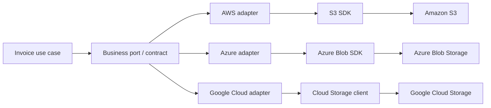

# Defining Contracts by Business Needs Rather Than SDK Names

> **Chapter:** Multi-Cloud  
> **Module:** SPRING_CLOUD_PROVIDER_INTEGRATION — hands-on integration of Spring Boot with managed services from AWS, Azure, and Google Cloud through the corresponding Spring Cloud libraries. This lesson focuses on designing contracts so business logic can use cloud services without directly depending on SDK class names or APIs.

A document storage service can be implemented using Amazon S3, Azure Blob Storage, or Google Cloud Storage. If the application's interface is `S3StorageService`, switching to Azure forces the business layer to change as well. If the interface is merely a generic `StorageClient` with `put`, `get`, and `delete` methods, it can still hide critical differences such as versioning, retention, idempotency, and access control.

A good contract starts from what the system must guarantee for users and business workflows. It describes actions, data, preconditions/postconditions, errors, security, performance, and semantics. An SDK is simply how one adapter fulfills that contract on one provider.

In this lesson, we will design contracts for two common capabilities in an invoicing system: document archiving and business event publishing. Next, we will map those contracts to cloud adapters, configure Spring Boot, test the same contract across multiple providers, and manage evolution over time.

## 1. Learning Objectives

After this lesson, you will be able to:

1. Distinguish between a business contract, application port, provider adapter, and SDK API.
2. Translate business requirements into operations, inputs/outputs, invariants, and failure contracts.
3. Clearly define idempotency, consistency, ordering, retention, and tenant boundaries.
4. Design Java interfaces without leaking SDK data types into the domain/application layer.
5. Map the same contract to AWS, Azure, and Google Cloud.
6. Use Spring Boot configuration to select an adapter per deployment.
7. Standardize provider errors while preserving sufficient diagnostic details.
8. Write shared contract tests across multiple adapters and supplement them with real-cloud integration tests.
9. Version and evolve contracts without breaking existing consumers.
10. Recognize when dedicated capabilities or provider-specific extensions are needed instead of forcing every service into an overly generic interface.

## 2. What a contract is and is not

### 2.1. Business contract

A business contract is the agreement between a caller and the provided capability. It answers:

- What does the caller want to accomplish?
- What data must be supplied and returned?
- Which preconditions must hold before calling?
- When the operation succeeds, what does the system guarantee?
- On failure, what can the caller do next?
- Which permissions are required and which tenant owns the data?
- What are the limits on size, duration, throughput, and retention?

For example: "Archive an invoice document" may require that content is stored durably, checksums are verified, retried requests do not create duplicate logical records, other tenants cannot read the document, and subsequent reads after archiving return the exact saved revision.

### 2.2. Application port

A port is an interface at the application/domain boundary expressing the capability a use case needs. The port does not describe which SDK will perform the work.

For example:

- `InvoiceDocumentArchive`: store and retrieve invoice documents.
- `InvoiceEventPublisher`: publish invoice-issued events.
- `CustomerDirectory`: look up customer details according to business rules.

Port names should reflect domain or use-case language. Avoid naming them after providers such as `S3Service`, `AzureQueueHelper`, or `GcpSecretManager`.

### 2.3. Provider adapter

An adapter lives in the infrastructure layer. It translates port calls into provider API calls:

- `S3InvoiceDocumentArchive` uses the AWS SDK.
- `AzureBlobInvoiceDocumentArchive` uses the Azure Storage SDK.
- `GcsInvoiceDocumentArchive` uses the Google Cloud Storage client.

The adapter is responsible for credentials, endpoints, metadata mapping, appropriate retries, error translation, and semantic differences.

### 2.4. SDK API

An SDK API is the technical surface of a library. Types like `S3Client`, `BlobServiceClient`, `Storage`, `SendMessageRequest`, or `BlobId` are useful inside an adapter, but should never become types that application services have to know about.

### Boundary diagram



The application layer depends on the contract. Adapters depend on SDKs. This dependency direction allows swapping implementations without forcing use cases to change.

## 3. Start from business needs

Do not start by asking "which methods look similar across the three cloud SDKs?". Start from user scenarios and workflows.

### 3.1. Describe the use case

Suppose Invoice Service has these requirements:

1. Staff submit an invoice PDF to archive in records.
2. The system must verify size and checksum.
3. The document belongs to one tenant and one invoice.
4. Retries caused by timeouts must not create multiple logical documents.
5. After saving succeeds, users can download the exact submitted content.
6. Documents are retained according to the organization's retention policy.
7. Deletion must obey legal hold and audit policies.

From this, we see the use case does not actually need "a generic object storage client". It needs a controlled document archiving capability.

### 3.2. Separate requirements from implementation

| Business requirement | Contract question to answer | Implementation detail for adapters |
|---|---|---|
| Store document | When is the operation considered successful? | Upload API, multipart upload, SDK retries |
| Request retries | Does the same idempotency key create a second record? | Conditional writes, metadata/indexes, deduplication |
| Verify content | Which checksum is verified and returned? | Checksum APIs, metadata, streaming hashes |
| Download document | Is reading the newly saved revision guaranteed? | Version/generation IDs and read APIs |
| Retention | Can premature deletion be prevented? | Object lock, immutability policies, retention settings |
| Tenant isolation | Which tenant can read the object? | IAM, RBAC, bucket/container namespaces |
| Audit | Can we trace who stored/read/deleted it? | Cloud audit logs and application audit events |

One requirement can lead to multiple SDK calls. Conversely, one SDK method does not necessarily correspond to a single business operation.

### 3.3. Write acceptance criteria before the interface

Example acceptance criteria for `archive`:

- Tenant and invoice IDs must be valid.
- Content type is on the business allowlist.
- Size does not exceed the published limit.
- Checksum computed from content matches the caller-supplied checksum.
- Same tenant, invoice, document, and idempotency key with identical content must return the same logical result.
- Same idempotency key with different content must return a conflict.
- Once a success receipt is returned, content is durably stored and can be reopened by revision.
- Callers cannot access documents belonging to another tenant.

These criteria are the contract. Whether to call `PutObject`, `upload`, or `createFrom` belongs to the adapter.

## 4. Elements a contract must contain

A Java interface only describes method names and parameter types. A complete contract must state semantics explicitly.

| Element | Questions to settle |
|---|---|
| Purpose | Which use case does the capability serve? |
| Caller | Which components/roles are allowed to invoke it? |
| Operation | What actions are supported? |
| Input | Required fields, formats, limits, validation? |
| Output | What business-meaningful results are returned? |
| Preconditions | What must be true before calling? |
| Postconditions | What holds true after success? |
| Idempotency | Do retries produce duplicate side effects? |
| Consistency | When can newly written data be read? |
| Concurrency | How are two concurrent requests handled? |
| Failure model | Which errors are retryable vs. require fixing the request? |
| Security | Tenant, principal, permissions, and auditing? |
| Non-functional | Latency, throughput, payload size, availability? |
| Lifecycle | Versioning, retention, deletion, migration? |
| Observability | Correlation IDs, metrics, traces, and audit events? |

Not every contract needs a long document. However, semantics affecting correctness, security, or provider replaceability must be stated explicitly.

## 5. Designing a document archiving contract

### 5.1. Name by capability

The name `InvoiceDocumentArchive` states clearly that this stores invoice documents. It does not commit the backend to object storage, a filesystem, or a specific managed service.

```java
package com.example.invoice.document;

import java.io.InputStream;

public interface InvoiceDocumentArchive {

    ArchiveReceipt archive(ArchiveCommand command);

    DocumentDownload open(
            String tenantId,
            String invoiceId,
            String documentId,
            String revision);
}
```

This interface deliberately does not return `S3Object`, `BlobClient`, `BlobId`, or `StorageObject`. Those types belong in adapters.

### 5.2. Define the command and receipt

```java
package com.example.invoice.document;

import java.io.InputStream;

public record ArchiveCommand(
        String tenantId,
        String invoiceId,
        String documentId,
        String idempotencyKey,
        String contentType,
        long contentLength,
        String sha256,
        InputStream content) {
}
```

```java
package com.example.invoice.document;

import java.time.Instant;

public record ArchiveReceipt(
        String documentId,
        String revision,
        String sha256,
        long contentLength,
        Instant archivedAt,
        boolean replayedRequest) {
}
```

`revision` is an opaque identifier defined by the contract. Adapters can map it to an S3 version ID, Azure Blob version ID, or Cloud Storage generation. Callers may only store and pass back the revision; they must not parse it as a provider ID.

`replayedRequest` indicates whether the result came from a repeated call with the same idempotency key. If the application does not need this flag, omit it from the public result; keep it only when the use case genuinely needs replay visibility.

### 5.3. Define the download resource

```java
package com.example.invoice.document;

import java.io.IOException;
import java.io.InputStream;

public record DocumentDownload(
        InputStream content,
        String contentType,
        long contentLength,
        String sha256,
        String revision) implements AutoCloseable {

    @Override
    public void close() throws IOException {
        content.close();
    }
}
```

Callers must close the stream after use with try-with-resources. The contract must specify clearly whether the adapter consumes/closes the input stream from `ArchiveCommand`. A clean convention is: the adapter reads the stream to EOF during `archive`, while the caller owns and closes the input stream; for the stream returned by `open`, the caller closes `DocumentDownload`.

### 5.4. Contract specification for archive

| Property | Example specification |
|---|---|
| Operation | `archive(ArchiveCommand)` |
| Tenant | `tenantId` required and authenticated at the application boundary |
| Document identity | Logical key tuple of tenant, invoice, and document ID |
| Input size | Example max 100 MiB; actual limit derived from product requirements |
| Content type | Only MIME types on the allowlist are accepted |
| Checksum | SHA-256 computed from the byte stream must match `sha256` |
| Idempotency | Same key and fingerprint return the same receipt; same key with different fingerprint returns conflict |
| Durability | Return success only after the backend confirms durable storage |
| Read-after-write | Returned revision must be openable immediately after archive succeeds |
| Isolation | No cross-tenant access |
| Revision | Opaque, stable for the object's retention period |
| Audit | Application emits an audit event for document archiving |

Limits such as 100 MiB are illustrative examples. Production contracts must derive limits from SLAs, costs, document types, and the capabilities of all supported providers.

### 5.5. Idempotency and fingerprints

An idempotency key prevents timeout retries from creating multiple logical results. The key needs a clear scope and retention window:

- Scope: tenant + operation + key.
- Fingerprint: document ID, invoice ID, checksum, content length, and content-affecting metadata.
- Same key, same fingerprint: return the previously created receipt.
- Same key, different fingerprint: throw `IdempotencyConflict`.
- Expired key: behavior must be documented; never silently assume deduplication lasts forever.

Do not use object name alone as the idempotency key if the business allows multiple revisions. Never rely on filename to distinguish requests.

### 5.6. Consistency and revisions

If the contract promises that once `archive` succeeds, `open` can immediately read that revision, every adapter must uphold this guarantee. If a target provider or configuration cannot meet it, never silently downgrade the guarantee.

For large payloads or asynchronous processing, design separate operations:

1. `beginArchive` creates an upload session and returns `operationId`.
2. Caller uploads content via the session.
3. `completeArchive` verifies the checksum and transitions state to archived.
4. `getArchiveStatus` returns processing/completed/failed status.

Do not force an asynchronous upload into a synchronous `archive` method if completion time cannot be guaranteed.

## 6. Standardizing errors by caller action

Do not let SDK exceptions propagate into application services. However, do not collapse every failure into `StorageException` or `RuntimeException`; callers need to know how to react.

### 6.1. Error taxonomy

| Contract error | Meaning | What the caller should do |
|---|---|---|
| `InvalidArchiveCommand` | Invalid input | Fix the request; do not retry |
| `DocumentNotFound` | Requested revision/document does not exist | Check ID or state |
| `DocumentAccessDenied` | Caller lacks permission | Stop and handle authorization |
| `IdempotencyConflict` | Same key with different payload | Generate a new key after business verification |
| `ArchiveConflict` | Revision/precondition no longer valid | Read latest state and resolve conflict |
| `ArchiveTemporarilyUnavailable` | Transient/quota/network error | Retry with backoff if request is safe |
| `ArchiveCapacityExceeded` | Exceeded published quota/limit | Reduce payload or handle quota |

Adapters may receive HTTP 429, timeouts, access denied, or SDK errors. They translate these into appropriate contract errors while retaining provider error codes and correlation IDs in sanitized internal logs.

### 6.2. Do not lose information when translating errors

A timeout after sending an upload can produce an uncertain outcome: the backend stored the object, but the response was lost. The adapter should not automatically assume failure and create another object. The caller must retry with the same idempotency key; the adapter checks state to return the prior result or continue safely.

Do not automatically retry on:

- Permission denied.
- Invalid input.
- Idempotency conflict.
- Legal hold/retention conflict.
- Precondition failed because the revision changed.

Retries help only on transient errors and must include bounds, backoff, jitter, overall timeout, and idempotency.

## 7. Designing a business event publishing contract

An event publisher should not force application services to know about `SendMessageRequest`, `ServiceBusMessage`, or `PubsubMessage`. It needs a capability to publish events according to a business contract.

### 7.1. Define the event

```java
package com.example.invoice.events;

import java.time.Instant;

public record InvoiceIssued(
        String eventId,
        String tenantId,
        String invoiceId,
        int schemaVersion,
        Instant occurredAt) {
}
```

Events carry a stable ID for consumer deduplication. Tenant ID is verified business context, not an arbitrary client header.

### 7.2. Define the publisher port

```java
package com.example.invoice.events;

public interface InvoiceEventPublisher {

    PublishReceipt publish(InvoiceIssued event);
}
```

```java
package com.example.invoice.events;

import java.time.Instant;

public record PublishReceipt(
        String eventId,
        Instant acceptedAt,
        String deliveryReference) {
}
```

`deliveryReference` is an optional opaque string for tracing publication. Do not return an SDK-formatted message ID if the application does not need it.

### 7.3. Specify delivery semantics

The contract must specify:

- `publish` returns success once the broker acknowledges receipt of the message.
- Delivery may occur more than once; consumers must be idempotent by `eventId`.
- Ordering is guaranteed only within the chosen key scope, such as per invoice, when the provider/binder is configured to support it.
- Never promise end-to-end exactly-once merely because a broker offers a specific delivery mode.
- If publish outcome is unknown due to timeout, retry with the same event ID.
- Dead-lettering, retention, replay, and poison messages have assigned owners/runbooks.

If events must be published atomically with invoice persistence, use the Transactional Outbox pattern or an equivalent mechanism. Calling the broker directly inside a database transaction does not create an atomic transaction across two systems.

### 7.4. Contracts must not hide ordering

If business logic requires `InvoiceCreated` before `InvoiceIssued` for the same invoice, the contract must specify that the ordering key is `invoiceId` and define how consumers handle out-of-order or duplicate messages. Do not simply state "messages are processed in order" without defining scope.

## 8. Mapping contracts to AWS, Azure, and Google Cloud

The same contract does not mean the same implementation. Adapters must translate business guarantees into real service capabilities.

### 8.1. Storage mapping

| Contract concept | AWS S3 | Azure Blob Storage | Google Cloud Storage |
|---|---|---|---|
| Object identity | Bucket + key | Account/container + blob name | Bucket + object name |
| Revision | Version ID | Blob version ID/snapshot per configuration | Generation |
| Conditional write | Request preconditions/conditional headers | Access conditions/ETag | Generation precondition |
| Retention | Object Lock/retention configuration | Immutable storage policy/legal hold | Retention policy/Bucket Lock |
| Identity | IAM role/policy | Managed Identity/RBAC | Service Account/IAM |
| Native SDK types | SDK models/clients | Blob clients/models | Blob/Storage clients |

Adapters map revisions onto the contract's opaque string. If versioning is disabled on the provider, the adapter cannot invent historical revision guarantees simply by renaming objects.

### 8.2. Messaging mapping

| Contract concept | AWS | Azure | Google Cloud |
|---|---|---|---|
| Queue/work queue | SQS | Service Bus Queue | Pub/Sub subscription |
| Topic/fan-out | SNS/EventBridge depending on use case | Service Bus Topic/Event Grid | Pub/Sub Topic |
| Ordering | FIFO/group or partition depending on service | Session/ordering configuration | Ordering key per configuration |
| Dead-letter | DLQ/redrive policy | Dead-letter subqueue | Dead-letter topic policy |
| Replay | Depends on service/event archive | Depends on service/retention | Retention/seek or storage mechanism |

Do not map queues, topics, and event routers solely by name. Select services based on the topology, delivery guarantees, ordering, filtering, and replay required by the contract.

### 8.3. Differences to expose intentionally

If one provider offers a feature that others do not, there are three options:

1. Exclude that feature from the shared contract if the use case does not require it.
2. Define a separate capability interface and check adapter support before calling it.
3. Allow provider-specific extensions at the infrastructure boundary.

Do not pretend every provider offers the same guarantees. If a feature is mandatory for business correctness, only select adapters that can satisfy the contract.

## 9. Package structure and dependency direction in Spring Boot

A straightforward organization:

```text
com.example.invoice
  application
    issue
      ArchiveInvoiceService.java
  domain
    document
      InvoiceDocumentArchive.java
      ArchiveCommand.java
      ArchiveReceipt.java
      DocumentDownload.java
    events
      InvoiceEventPublisher.java
      InvoiceIssued.java
  infrastructure
    aws
      S3InvoiceDocumentArchive.java
      SqsInvoiceEventPublisher.java
    azure
      AzureBlobInvoiceDocumentArchive.java
      ServiceBusInvoiceEventPublisher.java
    gcp
      GcsInvoiceDocumentArchive.java
      PubSubInvoiceEventPublisher.java
    configuration
      CloudAdapterConfiguration.java
```

Application services depend only on ports:

```java
package com.example.invoice.application.issue;

import com.example.invoice.domain.document.ArchiveCommand;
import com.example.invoice.domain.document.ArchiveReceipt;
import com.example.invoice.domain.document.InvoiceDocumentArchive;
import org.springframework.stereotype.Service;

@Service
public class ArchiveInvoiceService {

    private final InvoiceDocumentArchive documentArchive;

    public ArchiveInvoiceService(InvoiceDocumentArchive documentArchive) {
        this.documentArchive = documentArchive;
    }

    public ArchiveReceipt archive(ArchiveCommand command) {
        // Authorization and business validation are performed
        // before calling the port according to the use case.
        return documentArchive.archive(command);
    }
}
```

Never inject `S3Client`, `BlobServiceClient`, `Storage`, `SqsTemplate`, or `PubSubTemplate` into an application service's constructor. Those dependencies belong in adapters/configuration.

## 10. Selecting adapters with Spring configuration

In a deployment, the provider is typically selected at startup. That configuration is managed by platform/operations, not decided by end-user requests.

### 10.1. Configuration

```yaml
app:
  cloud:
    provider: aws
```

Values can be `aws`, `azure`, or `gcp`. Each environment supplies corresponding credentials and resource identifiers via workload identity/secret configuration.

### 10.2. Conditional beans

```java
package com.example.invoice.infrastructure.configuration;

import com.example.invoice.domain.document.InvoiceDocumentArchive;
import com.example.invoice.infrastructure.aws.S3InvoiceDocumentArchive;
import com.example.invoice.infrastructure.azure.AzureBlobInvoiceDocumentArchive;
import com.example.invoice.infrastructure.gcp.GcsInvoiceDocumentArchive;
import org.springframework.boot.autoconfigure.condition.ConditionalOnProperty;
import org.springframework.context.annotation.Bean;
import org.springframework.context.annotation.Configuration;

@Configuration
public class CloudAdapterConfiguration {

    @Bean
    @ConditionalOnProperty(
            prefix = "app.cloud", name = "provider", havingValue = "aws")
    InvoiceDocumentArchive awsArchive(S3InvoiceDocumentArchive adapter) {
        return adapter;
    }

    @Bean
    @ConditionalOnProperty(
            prefix = "app.cloud", name = "provider", havingValue = "azure")
    InvoiceDocumentArchive azureArchive(
            AzureBlobInvoiceDocumentArchive adapter) {
        return adapter;
    }

    @Bean
    @ConditionalOnProperty(
            prefix = "app.cloud", name = "provider", havingValue = "gcp")
    InvoiceDocumentArchive gcpArchive(GcsInvoiceDocumentArchive adapter) {
        return adapter;
    }
}
```

This is illustrative configuration; adapters must be declared as beans with corresponding implementations. Validate `app.cloud.provider` at startup so missing or invalid values fail fast. If multiple beans implement the same port, use mutually exclusive conditions or appropriate `@Primary`/qualifiers.

Never let requests pass `provider=aws` to switch backends arbitrarily. Per-tenant routing is only appropriate when the product explicitly requires multi-provider support, backed by a trusted registry, data policies, and dedicated testing.

## 11. Contracts for identity and secrets: placing boundaries right

Identity and secrets generally should not be turned into a generic interface like `CloudSdkFactory`.

### 11.1. Workload identity

Applications should request clients already configured with credentials for the target resources. Adapters/configuration let SDKs use native mechanisms:

- AWS: IAM roles, task roles, or workload identity on EKS.
- Azure: Managed Identity or Workload Identity.
- Google Cloud: service accounts bound to workloads or Workload Identity Federation.

Never transfer long-lived access keys/service account keys between providers to simulate portability. Credentials must be short-lived and issued by the runtime's trust relationship.

If an application genuinely needs end-user identity, define an explicit identity use case (e.g., verifying the caller or acquiring a token for a downstream API). Never mix user-delegated tokens with workload credentials.

### 11.2. Secret access

Do not have the domain request "read secret named `arn:aws:...`". Request capabilities by purpose:

- `PaymentCredentialResolver` retrieves merchant credentials authorized by the tenant.
- `SigningKeyProvider` supplies a key handle for signing operations.
- `DatabaseCredentialProvider` supplies credentials/connection configuration for infrastructure.

Logical secret names, versions, rotation, and access policies belong in configuration/secret adapters. Contracts must specify callers, purpose, permissions, cache TTL, and handling when a secret is rotated/revoked.

Never emit private keys or secret values to logs/metrics; prefer key handles or remote cryptographic operations when business logic only needs signing or decryption.

## 12. Contract versioning and evolution

Contracts generally outlive a single SDK version. Never let dependency versions dictate business contract versions.

### 12.1. Change rules

| Change | Typical compatibility | How to handle |
|---|---|---|
| Add optional field | Can be backward-compatible | Provide clear default/behavior |
| Add new operation | Usually compatible with existing callers | Implement across adapters and test |
| Rename field or change meaning | Breaking | New version or migration |
| Change idempotency semantics | Behaviorally breaking | Publish version and migration |
| Strengthen consistency guarantee | May impact cost/latency | Review SLAs and adapters |
| Weakening guarantee or retention | Breaking | Never change silently |
| Change opaque revision format | Potentially breaking if callers persist long-term | Preserve ability to read old revisions or version the contract |

### 12.2. Event schemas

Events should include `schemaVersion`. When adding fields:

- Older consumers must ignore unknown fields or parsers must remain compatible.
- Producers must not change the meaning of previously published fields.
- Consumers may still receive older messages during retention/replay windows.
- Schema migrations require an expand/contract phase.

### 12.3. Expand/contract

1. Expand consumers to understand both old and new schemas.
2. Deploy producers emitting the new schema once consumers are ready.
3. Monitor old vs. new event ratios.
4. Stop emitting the old schema after a compatibility window.
5. Remove legacy code only after committed replay/retention windows expire.

Never change a schema in a broker without checking messages still sitting in queues or event archives.

## 13. Testing contracts across multiple adapters

The goal of contract tests is to prove all adapters uphold the same semantics, not merely compile against the same interface.

### 13.1. Shared test suite

Create an abstract test for `InvoiceDocumentArchive`. Each provider supplies a fixture creating the adapter and test environment:

```java
package com.example.invoice.contract;

import static org.assertj.core.api.Assertions.assertThat;

import java.io.ByteArrayInputStream;
import java.nio.charset.StandardCharsets;
import org.junit.jupiter.api.AfterEach;
import org.junit.jupiter.api.Test;

import com.example.invoice.domain.document.ArchiveCommand;
import com.example.invoice.domain.document.ArchiveReceipt;
import com.example.invoice.domain.document.DocumentDownload;
import com.example.invoice.domain.document.InvoiceDocumentArchive;

abstract class InvoiceDocumentArchiveContractTest {

    protected abstract InvoiceDocumentArchive archive();

    protected abstract void cleanUp();

    @AfterEach
    void tearDown() {
        cleanUp();
    }

    @Test
    void archivedContentCanBeReadBack() throws Exception {
        byte[] bytes = "invoice-content".getBytes(StandardCharsets.UTF_8);
        String checksum = sha256Hex(bytes);

        ArchiveCommand command = new ArchiveCommand(
                "tenant-test",
                "invoice-42",
                "document-42",
                "archive-request-42",
                "application/pdf",
                bytes.length,
                checksum,
                new ByteArrayInputStream(bytes));

        ArchiveReceipt receipt = archive().archive(command);

        try (DocumentDownload download = archive().open(
                "tenant-test",
                "invoice-42",
                "document-42",
                receipt.revision())) {
            assertThat(download.contentLength()).isEqualTo(bytes.length);
            assertThat(download.sha256()).isEqualTo(checksum);
            assertThat(download.content().readAllBytes()).containsExactly(bytes);
        }
    }

    private static String sha256Hex(byte[] content) {
        try {
            byte[] digest = java.security.MessageDigest
                    .getInstance("SHA-256").digest(content);
            return java.util.HexFormat.of().formatHex(digest);
        } catch (java.security.NoSuchAlgorithmException exception) {
            throw new IllegalStateException(exception);
        }
    }
}
```

This is an illustrative contract test based on the types defined earlier. In a real project, add fixtures isolating buckets/containers, safe cleanup, dedicated tenant namespaces, and tests for idempotency, checksum mismatches, not-found errors, revisions, retention, and access denied.

### 13.2. Mandatory semantic tests

| Category | Test |
|---|---|
| Data integrity | Checksum and content length after upload/download |
| Idempotency | Same key/same payload returns same receipt |
| Conflict | Same key/different payload is rejected |
| Revisions | Reopening an older revision returns the exact content |
| Tenant isolation | Tenant A cannot read Tenant B's documents |
| Retention | Cannot delete prematurely when policy forbids it |
| Failures | Timeouts/throttling map to appropriate contract errors |
| Resource lifecycle | Streams are closed according to the ownership contract |
| Concurrency | Two concurrent requests on the same document obey conflict policy |

### 13.3. Running the contract suite per provider

| Adapter | Test environment | Limitations to remember |
|---|---|---|
| AWS | LocalStack and AWS sandbox | Emulators do not fully prove IAM, quotas, Object Lock, and production behavior |
| Azure | Azurite and Azure test storage account | Does not replace all features, Managed Identity, or real policies |
| Google Cloud | Fake GCS server and GCP test project | Does not fully represent IAM, retention, lifecycle, or production quotas |

Shared contract tests catch behavioral discrepancies. Real-cloud integration tests confirm identity, networking, IAM/RBAC, quotas, and managed service configurations.

## 14. Choosing just enough abstraction

Abstractions that are too narrow leak SDKs; abstractions that are too broad force every provider down to the lowest common denominator. Choose the right scope.

### Signs of a good abstraction

- Named after a capability/use case.
- Uses business language for inputs/outputs.
- Explicitly documents idempotency, consistency, ordering, retention, and failure semantics.
- Keeps SDK classes out of domain/application layers.
- Can be tested independently of the cloud.
- Every adapter can prove compliance via the same contract test suite.
- Provider-specific features are exposed via separate capability interfaces or extensions.

### Signs of a bad abstraction

- Interfaces mirror SDK methods almost verbatim.
- A `send(Map<String,Object>)` method that must interpret different provider-specific formats.
- Returning `Object`, `Map`, or SDK responses for callers to interpret themselves.
- Ignoring differing error and guarantee models.
- Multiple boolean flags such as `isAws`, `useAzureMode`, `enableGcpVersion`.
- Business services selecting buckets, queues, regions, or cloud SDKs themselves.
- Interfaces promising features that one adapter cannot implement.

### When is no abstraction needed?

If a workload is certain to run on a single provider, leveraging native features is a sound decision when benefits outweigh lock-in costs. Do not build three hypothetical adapters for a use case with no migration requirement.

Create a port when it protects a valuable boundary: business logic needs stability, multiple implementations exist, independent testing is required, or concrete migration/DR requirements exist.

## 15. End-to-end contract design process

1. **Describe the use case:** write in user/business language, avoiding SDK names.
2. **Identify owners and callers:** who owns the capability, and who may call it?
3. **List invariants:** what data must always remain true?
4. **Define operations:** what commands/queries and meaningful outcomes exist?
5. **Lock down semantics:** idempotency, consistency, ordering, retention, transactions.
6. **Lock down security:** principals, tenants, permissions, encryption, auditing.
7. **Lock down failure model:** which errors retry, which fail fast, which have uncertain outcomes?
8. **Lock down non-functional requirements:** size, latency, throughput, quotas, availability, cost.
9. **Compare providers:** which adapters can fulfill the contract, and which native features are needed?
10. **Write contract tests:** test behavior before building out full adapters.
11. **Implement adapters:** map APIs, credentials, errors, and telemetry.
12. **Measure and version:** monitor contract behavior, migrations, and compatibility.

### Short contract template for reviews

| Field | Content |
|---|---|
| Contract name/version | Capability name and version |
| Business purpose | Supported use case |
| Owner/callers | Owning team and authorized callers |
| Operations | Commands/queries |
| Input/output | Schemas, required/optional fields, limits |
| Invariants | Preconditions/postconditions |
| Idempotency | Key, scope, retention, conflicts |
| Consistency | Read-after-write, ordering, visibility |
| Failures | Error taxonomy, retryability, unknown outcomes |
| Security | Tenant, identity, permissions, encryption, audit |
| SLO/limits | Latency, throughput, sizes, availability |
| Provider mapping | Services/adapters satisfying the contract |
| Tests | Contract, integration, chaos/failover |
| Evolution | Compatibility and deprecation policy |

## 16. Hands-on exercise

**Context:** Invoice Service currently uses AWS S3 and SQS. The product may deploy on Azure or Google Cloud in the future. The team wants to reduce SDK coupling while preserving business guarantees for documents and events.

### Part A — Write the business contract

1. Describe the use case for storing, reading, and retaining invoice documents.
2. Define the `InvoiceDocumentArchive` port with command, receipt, and download resource.
3. Specify tenant boundaries, checksums, revisions, idempotency, and read-after-write guarantees.
4. Define an error taxonomy so callers know when to retry.
5. Describe retention/legal hold policies if required by the business.

### Part B — Event contract

1. Define the `InvoiceIssued` event with event ID and schema version.
2. Write the `InvoiceEventPublisher` port.
3. Lock down delivery, duplicates, ordering, DLQ, replay, and consumer idempotency.
4. Explain when the Transactional Outbox pattern is needed.

### Part C — Provider mapping and Spring Boot

1. Build a table mapping the contract to S3, Azure Blob, and Cloud Storage.
2. Create adapter packages separated from application/domain layers.
3. Use `@ConditionalOnProperty` to select one adapter per deployment.
4. Configure native workload identity for each provider.
5. Identify which features require separate capability interfaces.

### Part D — Testing and review

1. Write shared contract tests for archive/open.
2. Add tests for idempotency, checksum mismatch, and tenant isolation.
3. Run tests against emulators and then confirm critical behaviors on a real cloud sandbox.
4. Write a review note explaining why the interface contains no SDK types.
5. Propose a versioning policy when adding retention or changing revision semantics.

**Sample review output:**

| Question | Team decision |
|---|---|
| What is the capability? | Archiving and retrieving invoice documents |
| What is the port named? | `InvoiceDocumentArchive` |
| What guarantees do callers need? | Durability, valid checksums, readable revisions, tenant isolation |
| How are retries made safe? | Idempotency key + fingerprint |
| Which provider adapters? | S3, Azure Blob, GCS |
| Which differences must surface? | Retention, versioning, conditional writes if non-equivalent |
| Which shared tests apply? | Data integrity, idempotency, revisions, isolation, failures |

**Success criteria:** Contracts are written from use cases and invariants; no SDK types leak; semantics are clear enough to implement multiple adapters; errors and retries follow rules; tests prove identical behavior on every adapter.

## Official References

1. [Spring Framework — Core Technologies and Dependency Injection](https://docs.spring.io/spring-framework/reference/core/beans.html): bean configuration and dependency injection.
2. [Spring Boot — Auto-configuration](https://docs.spring.io/spring-boot/reference/using/auto-configuration.html): conditional bean creation and environment-specific configuration.
3. [Spring Cloud Stream](https://docs.spring.io/spring-cloud-stream/reference/index.html): programming model, bindings, and binder abstraction.
4. [AWS SDK for Java 2.x — S3](https://docs.aws.amazon.com/sdk-for-java/latest/developer-guide/examples-s3.html): AWS object storage APIs.
5. [Azure Blob Storage — Java](https://learn.microsoft.com/azure/storage/blobs/storage-quickstart-blobs-java): Blob Storage APIs and semantics.
6. [Google Cloud Storage — Java](https://cloud.google.com/storage/docs/reference/libraries#client-libraries-install-java): client library and object operations.
7. [AWS SQS Developer Guide](https://docs.aws.amazon.com/AWSSimpleQueueService/latest/SQSDeveloperGuide/welcome.html): queues, delivery, and dead-lettering.
8. [Azure Service Bus documentation](https://learn.microsoft.com/azure/service-bus-messaging/): queues, topics, subscriptions, and delivery behavior.
9. [Google Cloud Pub/Sub documentation](https://cloud.google.com/pubsub/docs/overview): topics, subscriptions, acknowledgements, and delivery.
10. [CloudEvents specification](https://cloudevents.io/): event envelope format usable when interoperable event metadata is needed.

> **Key takeaway:** Contracts describe what the business needs guaranteed; ports express contracts in application code; adapters map contracts onto SDKs/providers. Define semantics such as idempotency, consistency, security, errors, and retention before writing interfaces. An abstraction is only valuable when every adapter can prove the same behavior through contract tests.
