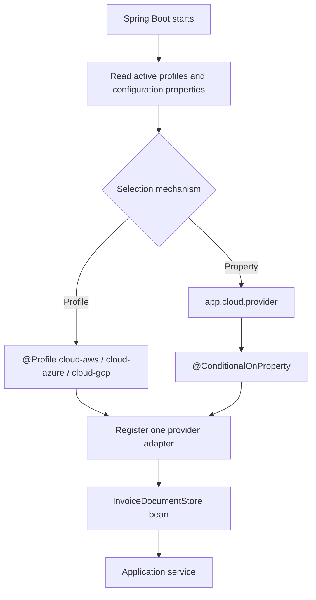

# Selecting Configuration and Adapters via Profiles or Bean Conditions

> **Chapter:** Multi-Cloud  
> **Module:** SPRING_CLOUD_PROVIDER_INTEGRATION — hands-on integration of Spring Boot with managed services from AWS, Azure, and Google Cloud through the corresponding Spring Cloud libraries. This lesson focuses on selecting configuration and provider adapters using Spring Profiles or bean creation conditions.

An Invoice Service application may run on AWS in production, Azure in a DR environment, and Google Cloud in an evaluation sandbox. The business layer still calls the same document storage port, yet each environment requires different SDK clients, credentials, endpoints, and resource identifiers. Creating all clients and selecting manually inside every service leaks too many cloud details into business code. Mixing up profile configuration can cause the application to register two adapters at once or none at all.

Spring Boot provides two commonly used mechanisms for selecting implementations:

- **Spring Profiles and @Profile:** activate a group of configurations/beans for a given environment or deployment purpose.
- **Condition annotations such as @ConditionalOnProperty:** create beans when a property has a matching value.

Both mechanisms can support the same application, but they should be given clear responsibilities. Profiles work well for grouping environment settings; property conditions work well when selecting a provider is an explicit configuration value. Both must fail fast if the selection is missing, invalid, or registers multiple implementations.

## 1. Learning Objectives

After this lesson, you will be able to:

1. Distinguish between environment-specific profiles and cloud provider selection properties.
2. Understand how Spring Boot loads `application.yml` and profile-specific configuration files.
3. Use `@Profile` to register adapters for AWS, Azure, or Google Cloud.
4. Use `@ConditionalOnProperty` to select exactly one implementation based on a property.
5. Bind configuration with `@ConfigurationProperties` and validate input values.
6. Organize SDK dependencies and client configuration per provider.
7. Prevent registering multiple beans implementing the same port or starting the application without an adapter.
8. Test bean selection with a Spring test context.
9. Manage environment-specific configuration without placing secrets in source code.
10. Choose the right mechanism for single-provider, multi-provider, or test deployments.

## 2. Problem to solve

Suppose Invoice Service has a business port:

- Store invoice documents.
- Retrieve documents by tenant and document ID.
- Delete documents according to policy.

Possible implementations are:

| Provider | Adapter | SDK/client |
|---|---|---|
| AWS | S3InvoiceDocumentStore | AWS SDK S3Client |
| Azure | AzureBlobInvoiceDocumentStore | Azure Storage BlobServiceClient |
| Google Cloud | GcsInvoiceDocumentStore | Google Cloud Storage |

The application layer should depend only on the business interface, such as `InvoiceDocumentStore`. When deployed on AWS, Spring creates the S3 adapter. When running on Azure, Spring creates the Blob adapter. Each adapter uses that environment's client and credentials.

### Adapter selection diagram



Selection happens when Spring builds the `ApplicationContext`. A typical HTTP request should never decide which cloud SDK the application uses.

## 3. Distinguishing profiles and provider properties

### 3.1. Profiles describe active configuration groups

A Spring Profile names a group of configurations. Profiles typically describe an environment or deployment role:

- `local`: running on a developer machine.
- `test`: running in a test context.
- `staging`: staging environment.
- `prod`: production.
- `cloud-aws`: AWS adapters/configuration.
- `cloud-azure`: Azure adapters/configuration.
- `cloud-gcp`: Google Cloud adapters/configuration.

An application can activate multiple profiles simultaneously, such as `prod,cloud-aws`. The `prod` profile can enable production logging, timeouts, and observability; the `cloud-aws` profile selects AWS adapters and resources.

Crucially, a profile does not always represent a single exclusive environment. Spring allows multiple profiles to be active simultaneously. Therefore, if you use profiles to select a provider, you must ensure only one provider profile is active.

### 3.2. Properties describe an explicit selection

A property like `app.cloud.provider` expresses the backend choice:

```yaml
app:
  cloud:
    provider: aws
```

Valid values can be `aws`, `azure`, or `gcp`. This value can be supplied via config files, environment variables, command-line arguments, or a config service.

Properties fit well when:

- One deployment selects one provider.
- You want provider selection decoupled from environment profiles.
- You need strict input validation.
- You want to test selection values in a test context.

### 3.3. Comparison table

| Criterion | @Profile | @ConditionalOnProperty |
|---|---|---|
| Condition | Profile is active | Property matches expected value |
| How activated | `spring.profiles.active` or profile groups | `app.cloud.provider` |
| Best suited for | Grouping beans/configs by environment or role | Selecting an implementation by value |
| Multiple active simultaneously | Possible, since multiple profiles can be active | Usually only one property value |
| Per-environment files | Strong with `application-{profile}.yml` | Strong with externalized properties |
| Validation | Must check profile combinations | Property can be validated via `@ConfigurationProperties` |
| Use when | You want to bundle settings into a named profile | You want backend selection via one explicit setting |

Neither mechanism is automatically better in every scenario. Pick one mechanism as the primary source of truth for provider selection in each deployment.

## 4. Structuring Spring Boot configuration

### 4.1. Shared configuration file

`application.yml` holds defaults not tied to any single provider:

```yaml
spring:
  application:
    name: invoice-service

server:
  port: 8080

app:
  document:
    max-size-bytes: 104857600
    allowed-content-types:
      - application/pdf
      - image/png
      - image/jpeg

management:
  endpoints:
    web:
      exposure:
        include: health,info,metrics
```

Never place secrets directly in this file. Shared configuration should hold business rules, application limits, and non-sensitive values.

### 4.2. Profile-specific configuration files

Spring Boot can load `application-{profile}.yml` when the corresponding profile is active. For example:

```text
src/main/resources/
  application.yml
  application-local.yml
  application-prod.yml
  application-cloud-aws.yml
  application-cloud-azure.yml
  application-cloud-gcp.yml
```

When `prod,cloud-aws` is active, Spring loads the shared configuration and the corresponding profile files; values from higher-precedence configuration sources override file values.

Example `application-cloud-aws.yml`:

```yaml
app:
  cloud:
    provider: aws
  storage:
    bucket: ${AWS_DOCUMENT_BUCKET}
    region: ${AWS_REGION:ap-southeast-1}
```

Example `application-cloud-azure.yml`:

```yaml
app:
  cloud:
    provider: azure
  storage:
    account-url: ${AZURE_STORAGE_ACCOUNT_URL}
    container: ${AZURE_DOCUMENT_CONTAINER}
```

Example `application-cloud-gcp.yml`:

```yaml
app:
  cloud:
    provider: gcp
  storage:
    project-id: ${GOOGLE_CLOUD_PROJECT}
    bucket: ${GCP_DOCUMENT_BUCKET}
```

The environment variables above are resource identifiers or non-sensitive settings. Credentials should come from the platform's workload identity or secret manager.

### 4.3. Activating profiles externally

Example running production on AWS:

```bash
SPRING_PROFILES_ACTIVE=prod,cloud-aws
```

On Windows PowerShell:

```powershell
$env:SPRING_PROFILES_ACTIVE = "prod,cloud-aws"
```

Do not set `spring.profiles.active` inside an `application-{profile}.yml` file that is itself activated by a profile. Select active profiles via environment variables, command-line arguments, or external configuration sources.

### 4.4. Profile groups

Profile groups let you define a single name that activates multiple profiles:

```yaml
spring:
  profiles:
    group:
      production-aws:
        - prod
        - cloud-aws
      production-azure:
        - prod
        - cloud-azure
      production-gcp:
        - prod
        - cloud-gcp
```

When running `SPRING_PROFILES_ACTIVE=production-aws`, Spring activates `prod` and `cloud-aws`. Profile groups should be declared in a profile-independent configuration document such as `application.yml`.

Profile groups help deployment pipelines select a predefined profile bundle. They do not replace validation of resource identifiers, regions, or credentials.

## 5. Selecting adapters with @Profile

### 5.1. Define the business port

Minimal contract example for document storage:

```java
package com.example.invoice.document;

public interface InvoiceDocumentStore {

    DocumentReceipt store(StoreDocument command);

    DocumentContent load(String tenantId, String documentId);

    void delete(String tenantId, String documentId);

    record StoreDocument(
            String tenantId,
            String documentId,
            String contentType,
            byte[] content) {
    }

    record DocumentReceipt(
            String documentId,
            String revision,
            String checksum) {
    }

    record DocumentContent(
            String contentType,
            byte[] content,
            String revision) {
    }
}
```

The interface contains only business data. In applications handling large files, prefer streaming instead of `byte[]`; this example keeps types simple to focus on wiring.

### 5.2. AWS adapter

The AWS adapter receives an `S3Client` configured in the infrastructure layer:

```java
package com.example.invoice.infrastructure.aws;

import com.example.invoice.document.InvoiceDocumentStore;
import software.amazon.awssdk.services.s3.S3Client;

public final class S3InvoiceDocumentStore
        implements InvoiceDocumentStore {

    private final S3Client s3Client;
    private final String bucket;

    public S3InvoiceDocumentStore(S3Client s3Client, String bucket) {
        this.s3Client = s3Client;
        this.bucket = bucket;
    }

    @Override
    public DocumentReceipt store(StoreDocument command) {
        throw new UnsupportedOperationException(
                "Map this operation to the S3 PutObject API");
    }

    @Override
    public DocumentContent load(String tenantId, String documentId) {
        throw new UnsupportedOperationException(
                "Map this operation to the S3 GetObject API");
    }

    @Override
    public void delete(String tenantId, String documentId) {
        throw new UnsupportedOperationException(
                "Map this operation to the S3 DeleteObject API");
    }
}
```

### 5.3. Azure adapter

```java
package com.example.invoice.infrastructure.azure;

import com.azure.storage.blob.BlobServiceClient;
import com.example.invoice.document.InvoiceDocumentStore;

public final class AzureBlobInvoiceDocumentStore
        implements InvoiceDocumentStore {

    private final BlobServiceClient blobServiceClient;
    private final String container;

    public AzureBlobInvoiceDocumentStore(
            BlobServiceClient blobServiceClient,
            String container) {
        this.blobServiceClient = blobServiceClient;
        this.container = container;
    }

    @Override
    public DocumentReceipt store(StoreDocument command) {
        throw new UnsupportedOperationException(
                "Map this operation to the Azure Blob upload API");
    }

    @Override
    public DocumentContent load(String tenantId, String documentId) {
        throw new UnsupportedOperationException(
                "Map this operation to the Azure Blob download API");
    }

    @Override
    public void delete(String tenantId, String documentId) {
        throw new UnsupportedOperationException(
                "Map this operation to the Azure Blob delete API");
    }
}
```

### 5.4. Google Cloud adapter

```java
package com.example.invoice.infrastructure.gcp;

import com.example.invoice.document.InvoiceDocumentStore;
import com.google.cloud.storage.Storage;

public final class GcsInvoiceDocumentStore
        implements InvoiceDocumentStore {

    private final Storage storage;
    private final String bucket;

    public GcsInvoiceDocumentStore(Storage storage, String bucket) {
        this.storage = storage;
        this.bucket = bucket;
    }

    @Override
    public DocumentReceipt store(StoreDocument command) {
        throw new UnsupportedOperationException(
                "Map this operation to the Cloud Storage create API");
    }

    @Override
    public DocumentContent load(String tenantId, String documentId) {
        throw new UnsupportedOperationException(
                "Map this operation to the Cloud Storage read API");
    }

    @Override
    public void delete(String tenantId, String documentId) {
        throw new UnsupportedOperationException(
                "Map this operation to the Cloud Storage delete API");
    }
}
```

These classes are compilable skeletons illustrating adapter boundaries; methods throwing `UnsupportedOperationException` must be replaced with real SDK calls before deployment. Implementations must handle checksums, tenant namespaces, revisions, retries, and errors according to the application's contract.

### 5.5. Registering beans by profile

Create a dedicated configuration per provider:

```java
package com.example.invoice.infrastructure.aws;

import com.example.invoice.document.InvoiceDocumentStore;
import org.springframework.beans.factory.annotation.Value;
import org.springframework.context.annotation.Bean;
import org.springframework.context.annotation.Configuration;
import org.springframework.context.annotation.Profile;
import software.amazon.awssdk.services.s3.S3Client;

@Configuration(proxyBeanMethods = false)
@Profile("cloud-aws")
public class AwsProfileDocumentStoreConfiguration {

    @Bean
    InvoiceDocumentStore invoiceDocumentStore(
            S3Client s3Client,
            @Value("${app.storage.bucket}") String bucket) {
        return new S3InvoiceDocumentStore(s3Client, bucket);
    }
}
```

Azure configuration:

```java
package com.example.invoice.infrastructure.azure;

import com.azure.storage.blob.BlobServiceClient;
import com.example.invoice.document.InvoiceDocumentStore;
import org.springframework.beans.factory.annotation.Value;
import org.springframework.context.annotation.Bean;
import org.springframework.context.annotation.Configuration;
import org.springframework.context.annotation.Profile;

@Configuration(proxyBeanMethods = false)
@Profile("cloud-azure")
public class AzureProfileDocumentStoreConfiguration {

    @Bean
    InvoiceDocumentStore invoiceDocumentStore(
            BlobServiceClient blobServiceClient,
            @Value("${app.storage.container}") String container) {
        return new AzureBlobInvoiceDocumentStore(
                blobServiceClient, container);
    }
}
```

Google Cloud configuration:

```java
package com.example.invoice.infrastructure.gcp;

import com.example.invoice.document.InvoiceDocumentStore;
import com.google.cloud.storage.Storage;
import org.springframework.beans.factory.annotation.Value;
import org.springframework.context.annotation.Bean;
import org.springframework.context.annotation.Configuration;
import org.springframework.context.annotation.Profile;

@Configuration(proxyBeanMethods = false)
@Profile("cloud-gcp")
public class GcpProfileDocumentStoreConfiguration {

    @Bean
    InvoiceDocumentStore invoiceDocumentStore(
            Storage storage,
            @Value("${app.storage.bucket}") String bucket) {
        return new GcsInvoiceDocumentStore(storage, bucket);
    }
}
```

Spring loads only the configuration class matching the active profile. If `cloud-aws` is active, the `InvoiceDocumentStore` bean is created with `S3Client`; if `cloud-azure` is active, it is created with `BlobServiceClient`.

### 5.6. Profile combinations must be controlled

If both `cloud-aws` and `cloud-azure` are accidentally activated, both configurations can register a bean of the same type. When an application service injects `InvoiceDocumentStore`, Spring typically fails with `NoUniqueBeanDefinitionException`.

If no provider profile is active, Spring has no bean to inject and context startup fails. That signal is much better than silently using an unintended default backend, though error messages may need clarifying via configuration validation.

Do not "fix" the issue by slapping `@Primary` onto one adapter. Doing so can hide the fact that two provider profiles are active simultaneously.

## 6. Selecting adapters with @ConditionalOnProperty

When provider selection is a single configuration choice, `@ConditionalOnProperty` often expresses intent more directly.

### 6.1. Provider selection configuration

In `application.yml` or profile-specific config:

```yaml
app:
  cloud:
    provider: aws
```

This can be overridden via an environment variable:

```bash
APP_CLOUD_PROVIDER=azure
```

Spring Boot relaxed binding maps `APP_CLOUD_PROVIDER` to `app.cloud.provider`.

### 6.2. Bind and validate the property

Use `@ConfigurationProperties` to group selection settings:

```java
package com.example.invoice.infrastructure.configuration;

import java.util.Set;

import org.springframework.boot.context.properties.ConfigurationProperties;

@ConfigurationProperties(prefix = "app.cloud")
public record CloudSelectionProperties(String provider) {

    private static final Set<String> SUPPORTED =
            Set.of("aws", "azure", "gcp");

    public CloudSelectionProperties {
        if (provider == null) {
            throw new IllegalArgumentException(
                    "app.cloud.provider is required");
        }

        if (!SUPPORTED.contains(provider)) {
            throw new IllegalArgumentException(
                    "app.cloud.provider must be lowercase: aws, azure or gcp");
        }
    }
}
```

Register the properties:

```java
package com.example.invoice.infrastructure.configuration;

import org.springframework.boot.context.properties.EnableConfigurationProperties;
import org.springframework.context.annotation.Configuration;

@Configuration(proxyBeanMethods = false)
@EnableConfigurationProperties(CloudSelectionProperties.class)
public class CloudSelectionConfiguration {
}
```

The record validates the property as soon as Spring binds configuration. A missing or unsupported provider fails context startup with a clear error message.

If using `@ConfigurationPropertiesScan`, you can scan the package containing the record instead of `@EnableConfigurationProperties`. Pick one consistent registration mechanism to avoid duplicate configuration.

### 6.3. Create beans with property conditions

AWS:

```java
@Configuration(proxyBeanMethods = false)
@ConditionalOnProperty(
        prefix = "app.cloud",
        name = "provider",
        havingValue = "aws")
class AwsConditionalDocumentStoreConfiguration {

    @Bean
    InvoiceDocumentStore invoiceDocumentStore(
            S3Client s3Client,
            StorageProperties storageProperties) {
        return new S3InvoiceDocumentStore(
                s3Client, storageProperties.bucket());
    }
}
```

Azure:

```java
@Configuration(proxyBeanMethods = false)
@ConditionalOnProperty(
        prefix = "app.cloud",
        name = "provider",
        havingValue = "azure")
class AzureConditionalDocumentStoreConfiguration {

    @Bean
    InvoiceDocumentStore invoiceDocumentStore(
            BlobServiceClient blobServiceClient,
            StorageProperties storageProperties) {
        return new AzureBlobInvoiceDocumentStore(
                blobServiceClient, storageProperties.container());
    }
}
```

Google Cloud:

```java
@Configuration(proxyBeanMethods = false)
@ConditionalOnProperty(
        prefix = "app.cloud",
        name = "provider",
        havingValue = "gcp")
class GcpConditionalDocumentStoreConfiguration {

    @Bean
    InvoiceDocumentStore invoiceDocumentStore(
            Storage storage,
            StorageProperties storageProperties) {
        return new GcsInvoiceDocumentStore(
                storage, storageProperties.bucket());
    }
}
```

Each configuration class should live in its provider's infrastructure package/module. Only the configuration whose `havingValue` matches the property registers a bean.

`matchIfMissing` defaults to `false`. Thus, if the property is missing, none of these configurations activate. Combined with `CloudSelectionProperties`, the application fails fast instead of silently picking a fallback backend.

### 6.4. Why separate configuration by provider?

If one configuration class directly references `S3Client`, `BlobServiceClient`, and `Storage`, all three SDK classes may have to exist on that artifact's classpath. When you want to package each provider as an optional dependency or separate module, referencing all SDKs in a single class creates unnecessary build coupling.

Separating files/classes by provider helps:

- Keep SDK dependencies inside their respective modules.
- Enable/disable adapters easily at build time or runtime.
- Scope credential and client configurations cleanly.
- Simplify per-provider testing.

If a single artifact supports all three providers, include all dependencies on the classpath and use conditions. If you want lean per-cloud artifacts, split adapters into separate Maven/Gradle modules or internal starters.

## 7. Configuring SDK clients and credentials per provider

Selecting an adapter only resolves the business bean. The adapter still needs an SDK client configured with the appropriate endpoint, region/project, credentials, and timeouts.

### 7.1. AWS SDK

AWS SDK for Java 2.x can use the default credential provider chain to obtain credentials from roles/environment/profiles in the SDK's supported order:

```java
S3Client s3Client = S3Client.builder()
        .region(Region.of(region))
        .credentialsProvider(DefaultCredentialsProvider.create())
        .build();
```

In AWS environments, prefer an IAM role attached to compute/tasks/pods over long-lived access keys. Never put access keys in `application-cloud-aws.yml`.

### 7.2. Azure SDK

Azure Identity can use `DefaultAzureCredential` to select the environment's authentication mechanism:

```java
BlobServiceClient blobServiceClient =
        new BlobServiceClientBuilder()
                .endpoint(accountUrl)
                .credential(new DefaultAzureCredentialBuilder().build())
                .buildClient();
```

Production should use Managed Identity or Workload Identity where supported by the platform. Local development can use developer credentials per policy. Grant Azure RBAC roles scoped to the specific storage account/container.

### 7.3. Google Cloud client

Google Cloud Java clients can use Application Default Credentials:

```java
Storage storage = StorageOptions.newBuilder()
        .setProjectId(projectId)
        .build()
        .getService();
```

On Google Cloud workloads, attach the appropriate service account to the runtime or use Workload Identity Federation. Avoid baking service account key JSON files into container images.

### 7.4. Never mix provider credentials

| Adapter | Appropriate credential | Avoid |
|---|---|---|
| AWS | IAM role/credential chain | Copying access keys into Azure/GCP |
| Azure | Managed Identity/Workload Identity | Storing client secrets in profile files |
| GCP | Attached service account/Workload Identity | Baking service account JSON into images |

Credentials are the responsibility of adapter configuration and platform identity. Application services simply invoke business ports.

## 8. Type-safe configuration binding with @ConfigurationProperties

Do not scatter `@Value` annotations across dozens of properties for one service. Group configuration into a strongly typed record or class.

Example storage configuration:

```yaml
app:
  storage:
    bucket: ${DOCUMENT_BUCKET:}
    container: ${DOCUMENT_CONTAINER:}
    region: ${AWS_REGION:ap-southeast-1}
    account-url: ${AZURE_STORAGE_ACCOUNT_URL:}
    project-id: ${GOOGLE_CLOUD_PROJECT:}
```

Properties:

```java
package com.example.invoice.infrastructure.configuration;

import org.springframework.boot.context.properties.ConfigurationProperties;

@ConfigurationProperties(prefix = "app.storage")
public record StorageProperties(
        String bucket,
        String container,
        String region,
        String accountUrl,
        String projectId) {
}
```

Register together with other properties:

```java
@Configuration(proxyBeanMethods = false)
@EnableConfigurationProperties({
        CloudSelectionProperties.class,
        StorageProperties.class
})
public class InfrastructurePropertiesConfiguration {
}
```

A production application should validate required fields for the selected provider. For instance, AWS needs `bucket` and `region`; Azure needs `container` and `accountUrl`; GCP needs `bucket` and `projectId`. Do not require every property of every provider simultaneously if deploying only one provider.

You can write a custom validator or use `@Validated` with Bean Validation. If using `@NotBlank`, `@Pattern`, and validation annotations, add the `spring-boot-starter-validation` dependency.

### 8.1. Fail fast per provider

Example validation when creating the AWS adapter:

```java
@Bean
InvoiceDocumentStore awsDocumentStore(
        S3Client s3Client,
        StorageProperties properties) {

    if (properties.bucket() == null
            || properties.bucket().isBlank()) {
        throw new IllegalStateException(
                "app.storage.bucket is required for AWS");
    }

    return new S3InvoiceDocumentStore(
            s3Client, properties.bucket());
}
```

In production code, you can move checks into a `@ConfigurationProperties` validator or a startup validation component so configuration errors are reported centrally. Do not wait until the first incoming request to discover that a bucket/container is missing.

## 9. Combining environment profiles with provider conditions

A common pattern is using profiles for environments and property conditions for providers:

- The `prod` profile activates production settings.
- The `app.cloud.provider=aws` property selects the AWS adapter.

Once a property selects the adapter, you do not need an extra provider profile just to pick the same bean. A provider profile may still be helpful for loading separate config files, as long as there is one consistent decision source.

### Example using profiles for environment, properties for adapters

`application-prod.yml`:

```yaml
app:
  document:
    max-size-bytes: 104857600

logging:
  level:
    root: INFO
```

`application-prod-aws.yml` can hold AWS resource identifiers:

```yaml
app:
  cloud:
    provider: aws
  storage:
    bucket: ${AWS_DOCUMENT_BUCKET}
    region: ${AWS_REGION:ap-southeast-1}
```

Pipeline activation:

```bash
SPRING_PROFILES_ACTIVE=prod,prod-aws
```

In this setup, configuration classes still select the adapter via `@ConditionalOnProperty`; the profile merely supplies deployment-specific property values.

### Avoid two conflicting sources of selection

Dangerous example:

- Active profile `cloud-aws`.
- Property `app.cloud.provider=azure`.
- `@Profile` creates the AWS adapter.
- `@ConditionalOnProperty` creates the Azure adapter.

The result can be two beans of the same type. Use a single adapter selection mechanism, or write a validation component verifying that profile and property always agree if your organization mandates keeping both.

## 10. Choosing @Profile vs. @ConditionalOnProperty in practice

### Use @Profile when

- Provider configuration is part of a deployment profile managed by pipelines.
- Each profile bundles multiple related beans such as storage, messaging, secrets, and observability.
- Profile names clearly express deployment variants.
- Profile combinations are tightly controlled and tested.

### Use @ConditionalOnProperty when

- Provider selection is a simple, explicit setting.
- You want to switch providers with one config value without adding extra profiles.
- You need strict validation of valid provider values.
- You want to reuse the same environment profile across different providers.

### Combine with additional conditions when

- `@ConditionalOnClass`: the adapter should register only when SDK classes exist on the classpath.
- `@ConditionalOnBean`: the adapter requires an already-existing client bean.
- `@ConditionalOnMissingBean`: provide a default bean that applications can intentionally override.

Never use `@ConditionalOnExpression` in place of a simple property check. Complex expressions are hard to read, hard to test, and often mask misconfiguration.

## 11. Testing adapter selection

Do not test only adapter methods. Verify that Spring creates the right bean for each profile/property combination.

### 11.1. Testing conditions with ApplicationContextRunner

`ApplicationContextRunner` builds a lightweight context to test auto-configuration and conditional configuration:

```java
package com.example.invoice.infrastructure.configuration;

import static org.assertj.core.api.Assertions.assertThat;
import static org.mockito.Mockito.mock;

import com.example.invoice.document.InvoiceDocumentStore;
import org.junit.jupiter.api.Test;
import org.springframework.boot.test.context.runner.ApplicationContextRunner;
import software.amazon.awssdk.services.s3.S3Client;

class AwsDocumentStoreConfigurationTest {

    private final ApplicationContextRunner contextRunner =
            new ApplicationContextRunner()
                    .withUserConfiguration(
                            CloudSelectionConfiguration.class,
                            AwsConditionalDocumentStoreConfiguration.class)
                    .withBean(S3Client.class, () -> mock(S3Client.class))
                    .withBean(StorageProperties.class,
                            () -> new StorageProperties(
                                    "test-bucket", "", "ap-southeast-1",
                                    "", ""));

    @Test
    void createsAwsAdapterWhenAwsIsSelected() {
        contextRunner
                .withPropertyValues("app.cloud.provider=aws")
                .run(context -> {
                    assertThat(context).hasSingleBean(
                            InvoiceDocumentStore.class);
                    assertThat(context).hasBean("invoiceDocumentStore");
                });
    }

    @Test
    void doesNotCreateAwsAdapterForAzure() {
        contextRunner
                .withPropertyValues("app.cloud.provider=azure")
                .run(context -> {
                    assertThat(context).doesNotHaveBean(
                            InvoiceDocumentStore.class);
                });
    }
}
```

This test focuses on conditional registration of the AWS bean. Azure and GCP tests can follow the same pattern with their respective mocked SDK clients and configuration classes.

### 11.2. Testing missing or invalid properties

For `CloudSelectionProperties`, test:

| Property | Expected outcome |
|---|---|
| `aws` | Binds successfully |
| `azure` | Binds successfully |
| `gcp` | Binds successfully |
| `AWS` | Context fails fast because value must be lowercase |
| Omitted | Context fails fast |
| `oracle` | Context fails fast |
| Empty string | Context fails fast |

Never test a missing property by letting the application default to AWS unless that is an explicitly approved architectural decision.

### 11.3. Testing profiles

For `@Profile` configurations, create dedicated contexts per profile:

- Only `cloud-aws`: exactly one AWS `InvoiceDocumentStore`.
- Only `cloud-azure`: one Azure adapter.
- Only `cloud-gcp`: one GCP adapter.
- No provider profile: context has no adapter and startup must fail when application services require the port.
- Two provider profiles active simultaneously: tests must catch bean ambiguity.

Profile tests prevent pipeline mistakes that accidentally activate two providers at once.

## 12. Managing dependencies by module

If an application deploys to only one cloud, it does not necessarily need to package all three SDKs.

### 12.1. One artifact supporting multiple providers

Appropriate when:

- The exact same artifact must deploy across multiple clouds.
- Pipelines select the provider via properties/profiles.
- Including all SDK dependencies in the artifact is acceptable.
- The team maintains contract/integration tests for every adapter.

The upside is one artifact and one pipeline. The trade-off is a larger artifact and managing version compatibility across SDKs.

### 12.2. Splitting adapters into modules

Example Maven multi-module layout:

```text
invoice-service/
  invoice-domain/
  invoice-application/
  invoice-adapter-aws/
  invoice-adapter-azure/
  invoice-adapter-gcp/
  invoice-boot/
```

The `invoice-application` module depends only on contracts. Adapter modules depend on their own SDKs. The boot module brings the chosen adapter into runtime or bundles adapters per deployment.

Benefits:

- Unneeded SDKs stay off the classpath.
- Adapters build and test independently.
- Reduced risk of dependency conflicts.

The trade-off is stricter management of modules, versions, and artifact assembly.

### 12.3. Avoid unintended component-scan adapter registration

If every adapter carries `@Component` inside a scanned package, all of them may be registered regardless of the chosen provider. When adapters must be conditional, you can:

- Omit `@Component` and instantiate beans inside conditional configuration classes.
- Place `@Profile` directly on the adapter component.
- Use `@ConditionalOnProperty` on the configuration or bean.

Never register an adapter via both component scanning and a `@Bean` method unintentionally; that can create duplicate beans.

## 13. Safe configuration per environment

### 13.1. Never put secrets in profile files

Files like `application-prod.yml` or `application-cloud-aws.yml` can live in Git as long as they contain only non-sensitive settings. Never commit:

- AWS access keys/secret access keys.
- Azure client secrets or private keys.
- Google service account private keys.
- Database passwords.
- API keys or signing keys.

Instead, use workload identity, a secret manager, or controlled secret injection.

### 13.2. Distinguish resource identifiers from secrets

| Value | Example | How to manage |
|---|---|---|
| Region | `ap-southeast-1` | Configuration |
| Bucket/container | `invoice-documents` | Configuration, restricted permissions |
| Azure account URL | Storage endpoint | Configuration |
| GCP project ID | Project identifier | Configuration |
| Access key/secret | Credential | Workload identity/secret manager |
| Private key | Signing material | Key management/secret manager |

Resource identifiers are not necessarily secrets, yet still require change control and proper access restrictions.

### 13.3. Configuration precedence

Spring Boot supports multiple configuration sources. When the same key appears in multiple sources, the higher-precedence source wins. Common sources include:

- Configuration files.
- Profile-specific configuration files.
- Environment variables.
- Java system properties.
- Command-line arguments.
- External configuration sources.

Pipelines should surface the selected profile/provider safely in startup logs or health/info metadata. Never dump the entire environment or secrets for debugging.

### 13.4. Avoid accidental production defaults

A default like `provider: aws` can cause a new deployment to hit a production AWS account by mistake. If the provider must be selected explicitly, omit defaults. If local development needs a default, place it in `application-local.yml` and guarantee production never activates the `local` profile.

## 14. Multiple providers in the same process

Earlier sections assumed one deployment uses one provider. Some systems genuinely require calling multiple providers in the same process, such as:

- Reading data from an old provider and writing to a new provider during migration.
- Replicating objects to a DR provider.
- Moving tenants to another provider on a migration schedule.

In those cases, do not use `@Primary` or switch profiles per request. Register adapters with explicit qualifiers or use a policy-backed registry.

Example:

```java
@Configuration(proxyBeanMethods = false)
class MultiProviderStorageConfiguration {

    @Bean("sourceDocumentStore")
    InvoiceDocumentStore sourceDocumentStore(
            S3Client s3Client,
            StorageProperties properties) {
        return new S3InvoiceDocumentStore(
                s3Client, properties.bucket());
    }

    @Bean("targetDocumentStore")
    InvoiceDocumentStore targetDocumentStore(
            BlobServiceClient blobServiceClient,
            StorageProperties properties) {
        return new AzureBlobInvoiceDocumentStore(
                blobServiceClient, properties.container());
    }
}
```

The caller specifies its dependencies explicitly:

```java
@Service
public class DocumentMigrationService {

    private final InvoiceDocumentStore source;
    private final InvoiceDocumentStore target;

    public DocumentMigrationService(
            @Qualifier("sourceDocumentStore")
            InvoiceDocumentStore source,
            @Qualifier("targetDocumentStore")
            InvoiceDocumentStore target) {
        this.source = source;
        this.target = target;
    }
}
```

This is an intentional migration use case. If routing by tenant, you need a registry mapping tenants to providers, authorization, data residency controls, auditing, and rollback. Never allow clients to supply a provider name to access arbitrary backends.

## 15. Common errors and troubleshooting

| Symptom | Root cause | Resolution |
|---|---|---|
| `NoSuchBeanDefinitionException` for port | Provider profile not active or property mismatched | Check active profiles and provider property |
| `NoUniqueBeanDefinitionException` | Multiple provider configs registered beans | Select only one provider or use qualifiers for multi-provider use cases |
| Missing SDK client | Missing starter/bean or dependency | Check dependencies and client configuration |
| Empty bucket/container | Property not loaded or env var missing | Validate configuration at startup |
| Works locally, fails in production on credentials | Using local credentials instead of workload identity | Attach proper role/identity to runtime |
| Production profile accidentally uses local | Pipeline activated wrong profile or profile group | Inspect `SPRING_PROFILES_ACTIVE` |
| Azure property set, yet AWS adapter created | Profile and provider property conflict | Use one selection source and test combinations |
| Test context creates unwanted beans | Component scan picked up all adapters | Split configurations or add conditions on components |
| Environment change activates a different adapter | Higher-precedence property source overrode value | Inspect property sources and startup diagnostics |

### Debugging checklist

1. What are the actual active profiles?
2. What is the resolved value of `app.cloud.provider`?
3. Which configuration classes matched?
4. Was the SDK client bean created?
5. Do resource identifiers match the right account/project/region?
6. Is workload identity attached to the runtime?
7. Was the adapter registered exactly once?
8. Do startup logs accidentally expose secrets?

Log only profile names, provider, region, and non-sensitive resource identifiers. Never log access tokens, secrets, private keys, or the full environment.

## 16. Hands-on exercise

**Context:** Invoice Service can run on AWS, Azure, or Google Cloud. The application needs a single `InvoiceDocumentStore` in normal deployments. The team wants to use Spring Profiles or `@ConditionalOnProperty` to select the adapter.

### Part A — Using profiles

1. Create `AwsDocumentStoreConfiguration`, `AzureDocumentStoreConfiguration`, and `GcpDocumentStoreConfiguration`.
2. Annotate each configuration with the corresponding `@Profile`.
3. Create `application-cloud-aws.yml`, `application-cloud-azure.yml`, and `application-cloud-gcp.yml`.
4. Activate profiles via `SPRING_PROFILES_ACTIVE`.
5. Test having zero provider profiles active and having two provider profiles active simultaneously.

### Part B — Using conditional beans

1. Define the `app.cloud.provider` property.
2. Bind the property using `@ConfigurationProperties`.
3. Validate that only `aws`, `azure`, or `gcp` are accepted.
4. Create three configuration classes using `@ConditionalOnProperty`.
5. Verify that exactly one `InvoiceDocumentStore` is registered.
6. Test missing, empty, and invalid property values.

### Part C — Configuring clients and credentials

1. Configure the S3 client using the AWS credential provider chain.
2. Configure the Blob client using Azure Identity.
3. Configure the GCS client using Application Default Credentials.
4. Place bucket/container/project/region in external configuration.
5. Verify no credentials exist in Git or container images.

### Part D — Testing

1. Write `ApplicationContextRunner` tests for each provider condition.
2. Write a test detecting two beans implementing the same port.
3. Test the `production-aws` profile group.
4. Test fail-fast behavior when a required resource identifier is missing.
5. Run integration tests against the selected provider's sandbox.

**Sample report:**

| Deployment | Selection config | Expected adapter | Client |
|---|---|---|---|
| AWS production | `prod,cloud-aws` or `provider=aws` | `S3InvoiceDocumentStore` | `S3Client` |
| Azure production | `prod,cloud-azure` or `provider=azure` | `AzureBlobInvoiceDocumentStore` | `BlobServiceClient` |
| GCP production | `prod,cloud-gcp` or `provider=gcp` | `GcsInvoiceDocumentStore` | `Storage` |

**Success criteria:** Every deployment creates exactly one adapter; missing/invalid config fails clearly; credentials come from appropriate runtime identities; application services depend only on ports; tests prove profile/property conditions work.

## Official References

1. [Spring Boot — Profiles](https://docs.spring.io/spring-boot/reference/features/profiles.html): active profiles, profile-specific configuration, and profile groups.
2. [Spring Boot — Externalized Configuration](https://docs.spring.io/spring-boot/reference/features/external-config.html): precedence order and configuration binding.
3. [Spring Boot — Configuration Properties](https://docs.spring.io/spring-boot/reference/features/external-config.html#features.external-config.typesafe-configuration-properties): `@ConfigurationProperties`.
4. [Spring Framework — @Profile](https://docs.spring.io/spring-framework/reference/core/beans/environment.html#beans-definition-profiles): profile-based bean registration conditions.
5. [Spring Boot — Conditional Annotations](https://docs.spring.io/spring-boot/reference/features/developing-auto-configuration.html): auto-configuration and bean conditions.
6. [Spring Boot — Testing Auto-configuration](https://docs.spring.io/spring-boot/reference/testing/test-scope.html): context and auto-configuration testing tools.
7. [AWS SDK for Java 2.x — Credentials](https://docs.aws.amazon.com/sdk-for-java/latest/developer-guide/credentials.html): credential provider chain.
8. [Azure Identity — Java](https://learn.microsoft.com/java/api/overview/azure/identity-readme): `DefaultAzureCredential` and workload identity.
9. [Google Cloud — Application Default Credentials](https://cloud.google.com/docs/authentication/application-default-credentials): application credential discovery.

> **Key takeaway:** Profiles group configurations by environment or deployment variant; `@Profile` enables beans when a profile is active. `@ConditionalOnProperty` selects beans by an explicit configuration value. Choose a single source of truth for provider selection, validate values at startup, create only the needed adapter, and let SDKs use the respective cloud's native workload identity.
