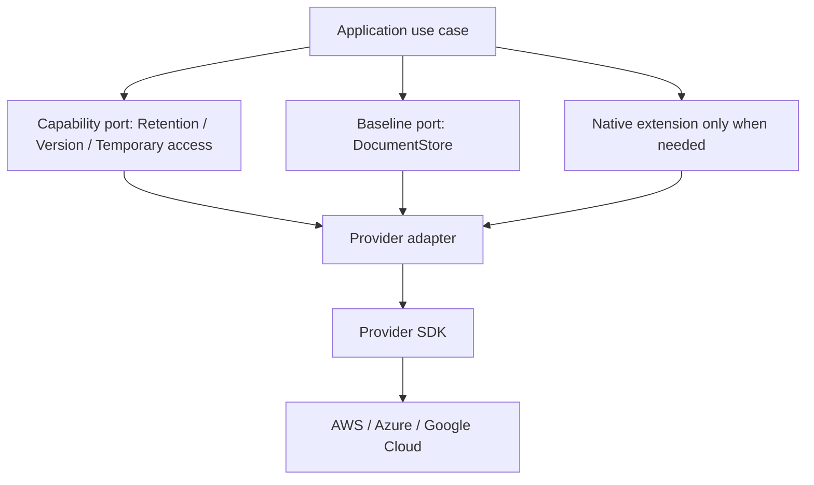

# Preserving Provider-Specific Features When a Shared Abstraction Is Not Enough

> **Chapter:** Multi-Cloud  
> **Module:** SPRING_CLOUD_PROVIDER_INTEGRATION — hands-on integration of Spring Boot with managed services from AWS, Azure, and Google Cloud through the corresponding Spring Cloud libraries. This lesson teaches how to retain provider-specific features while still protecting business boundaries and replaceability in genuinely equivalent areas.

A document storage application can use the same `DocumentStore` interface to upload, download, and delete on Amazon S3, Azure Blob Storage, or Google Cloud Storage. Yet when business requirements call for regulatory document locking, keeping multiple revisions, generating temporary download links, or using customer-managed encryption keys, the three services are no longer completely equivalent.

Forcing all differences into an overly simplistic shared interface causes the application to lose essential capabilities. Pulling all SDK types into the business layer couples the code directly to one provider. The right design is to keep a shared contract for baseline capabilities, split extended capabilities into dedicated contracts, and use provider-native extensions at the infrastructure boundary only when the business truly needs them.

The goal is not to hide every difference. The goal is to clarify which differences can be standardized, which must be modeled as capabilities, and which must become intentional architectural decisions.

## 1. Learning Objectives

After this lesson, you will be able to:

1. Recognize when a shared abstraction fails to express enough semantics of a cloud service.
2. Distinguish between a baseline contract, an optional capability contract, and a provider-native extension.
3. Design focused interfaces following the Interface Segregation Principle.
4. Express retention, legal hold, versioning, and signed URL requirements in business language.
5. Understand key differences among S3 Object Lock, Azure immutable storage, and Cloud Storage retention/holds.
6. Choose how to proceed when one provider cannot satisfy a mandatory guarantee.
7. Validate adapter capabilities and resource configurations before allowing a use case to run.
8. Keep SDK types in the infrastructure layer without leaking native identifiers into the domain model.
9. Write dedicated contract tests per capability and integration tests against real services.
10. Evaluate the impact of provider-specific features on portability, migration, and operations.

## 2. Why is a shared abstraction sometimes not enough?

Suppose an application has a port:

```java
public interface DocumentStore {
    void put(String key, byte[] content);
    byte[] get(String key);
    void delete(String key);
}
```

This port works well if the business only needs to save, read, and delete content. However, the following requirements cannot be expressed accurately with those three methods:

- Documents must be impossible to delete before a specific date.
- A legal hold must prevent deletion until the hold is lifted.
- Users must download the exact approved revision.
- Download links must be valid only for a limited window and a single action.
- Objects must be encrypted using a customer-managed key.
- Replicas must be maintained in another region or provider.

Adding every feature as optional methods on `DocumentStore` bloats the interface, forces implementations to throw `UnsupportedOperationException`, and leaves callers guessing whether a provider supports them.

### Three contract layers



| Layer | Purpose | Examples |
|---|---|---|
| Baseline contract | Common behavior expected across every backend | Store and read documents |
| Capability contract | Extended features with explicit semantics | Retention, legal hold, version-pinned read |
| Provider-native extension | Features meaningful or available only on one provider | S3 Object Lock governance bypass, Azure lease operations |

One adapter may implement multiple capability ports. Another adapter may implement only the baseline. Any use case requiring a capability must verify that both the active adapter and the underlying resource satisfy that capability.

## 3. Start from business guarantees, not feature names

Feature names vary across clouds, and identical names do not guarantee identical semantics. Before designing interfaces, articulate what the business wants guaranteed.

| Business question | Guarantee to define |
|---|---|
| Until when must documents be retained? | Timestamp, timezone, and expiration calculation rules |
| Who can request early deletion? | Are exceptions allowed, who approves, what audit is needed |
| Can a legal hold be lifted? | Which role may lift it, what reason/approval is required |
| Which revision do users need to read? | Current revision or approved revision |
| How long are download links shared? | Expiry, allowed actions, revocation capability |
| Who controls the encryption key? | Provider-managed key or customer-managed key |
| Where must data reside? | Region, replication scope, and jurisdiction |

For example, "enable Object Lock" is a technical request. "No one may delete a document before 2032-12-31, including storage account administrators" is a concrete business and security requirement. These two statements are not equivalent across all lock modes.

### Categorizing requirements

- **Mandatory:** if the capability is missing, the use case must not run.
- **Optional:** can run on a provider without support, but must surface status/limitations clearly.
- **Enhanced:** a provider offers stronger protection; the application may leverage it without advertising that guarantee across all environments.
- **Native-only:** the use case relies on a provider-specific feature and accepts vendor lock-in.

This classification should be recorded in an architecture decision record (ADR) or contract specification.

## 4. Keep the baseline port small

The baseline port should describe operations that are genuinely equivalent across implementations.

```java
package com.example.invoice.document;

public interface DocumentStore {

    StoredDocument put(StoreDocument command);

    DocumentContent get(
            String tenantId,
            String documentId,
            String revision);

    void delete(
            String tenantId,
            String documentId);

    record StoreDocument(
            String tenantId,
            String documentId,
            String contentType,
            byte[] content) {
    }

    record StoredDocument(
            String documentId,
            String revision,
            String checksum) {
    }

    record DocumentContent(
            String contentType,
            byte[] content,
            String revision) {
    }
}
```

Types `StoreDocument`, `StoredDocument`, and `DocumentContent` belong in the application/domain contract. The `revision` field is an opaque token managed by the application; callers must not parse it as an S3 version ID, Azure version ID, or GCS generation.

The baseline port must not contain methods like:

- `enableS3ObjectLock(...)`
- `setAzureLegalHold(...)`
- `setGcsEventBasedHold(...)`
- `createSasToken(...)`

Such methods inject provider names into the shared contract and make other adapters hard to implement properly.

## 5. Split capabilities into dedicated interfaces

If one group of use cases needs retention, create a retention contract. If only one group needs temporary download URLs, create a temporary access contract. Do not force every adapter to implement every feature.

### 5.1. Contract for retention and legal hold

Example:

```java
package com.example.invoice.document.protection;

import java.time.Instant;

public interface DocumentRetention {

    RetentionReceipt retain(RetentionRequest request);

    RetentionReceipt placeLegalHold(LegalHoldRequest request);

    RetentionReceipt releaseLegalHold(ReleaseLegalHoldRequest request);

    RetentionState getProtectionState(
            String tenantId,
            String documentId,
            String revision);

    record RetentionRequest(
            String tenantId,
            String documentId,
            String revision,
            Instant retainUntil,
            String businessReason) {
    }

    record LegalHoldRequest(
            String tenantId,
            String documentId,
            String revision,
            String caseReference,
            String requestedBy) {
    }

    record ReleaseLegalHoldRequest(
            String tenantId,
            String documentId,
            String revision,
            String caseReference,
            String approvedBy,
            String approvalReference) {
    }

    record RetentionReceipt(
            String documentId,
            String revision,
            Instant effectiveRetainUntil,
            boolean legalHoldActive,
            String policyReference) {
    }

    record RetentionState(
            String revision,
            Instant effectiveRetainUntil,
            boolean legalHoldActive,
            boolean deletionBlocked,
            String policyReference) {
    }
}
```

This contract uses business terminology. It does not bring `ObjectLockMode`, `BlobImmutabilityPolicy`, or `BlobTargetConditions` into the application layer.

However, the interface is only part of the contract. You must also define:

- Whether `retainUntil` is UTC and whether shortening is forbidden.
- Whether retention/legal hold applies to a single revision or the entire logical document.
- Whether extending retention is allowed.
- Which roles may release a legal hold.
- Whether releasing a hold requires two-person approval.
- Whether `deletionBlocked` reflects storage policy or also application policy.
- Whether providers return a receipt only after policy enforcement succeeds or merely upon request acceptance.

Fields like `requestedBy`, `approvedBy`, and `approvalReference` must come from an authenticated principal and a trusted approval workflow. Never accept these fields straight from an HTTP request body as proof of approval.

### 5.2. Contract for temporary downloads

When the business needs short-lived document sharing:

```java
package com.example.invoice.document.access;

import java.time.Instant;
import java.util.Set;

public interface TemporaryDocumentAccess {

    TemporaryAccessGrant createGrant(AccessGrantRequest request);

    record AccessGrantRequest(
            String tenantId,
            String documentId,
            String revision,
            Set<AccessAction> actions,
            Instant expiresAt) {
    }

    record TemporaryAccessGrant(
            String uri,
            Instant expiresAt,
            Set<AccessAction> actions) {
    }

    enum AccessAction {
        READ
    }
}
```

The returned URI is a bearer credential: anyone holding the URL can use it within its granted permissions and lifetime. Never log the full URL, never send it over insecure channels, and never grant lifetimes longer than necessary.

The contract must state whether access can be revoked before `expiresAt`. Presigned URLs, SAS tokens, and signed URLs differ in revocation capabilities; if the business requires instant revocation, do not assume every provider supports it in the same way.

### 5.3. Why not add methods to the baseline?

Separating interfaces ensures:

- Basic adapters do not have to pretend to support unavailable features.
- Use cases depend only on the capabilities they actually need.
- Tests can focus on the semantics of each individual capability.
- Providers can be selected by requirement without bloating the baseline contract.
- Native extensions have crisp boundaries and never leak into the domain model.

## 6. Comparing retention and immutability across providers

All three clouds offer object protection features, but scope and configuration differ. Do not treat them as an identical API just because all can prevent data deletion.

### 6.1. Amazon S3 Object Lock

S3 Object Lock provides WORM (write once, read many) protection for object versions. Key points:

- Object Lock works alongside bucket versioning.
- **Governance mode:** users with special permissions can bypass retention under authorized conditions.
- **Compliance mode:** an object version cannot be overwritten or deleted before retention expires; even the account root cannot bypass it under this mode's semantics.
- Buckets can configure default retention; individual objects can also receive specific retention dates.
- Legal hold is an independent state that can retain an object version indefinitely until lifted by an authorized principal.

Because governance and compliance modes offer different protection guarantees, a contract with only a boolean `locked=true` is insufficient if the business requires protection even against administrators.

### 6.2. Azure Blob immutable storage

Azure Blob Storage supports immutable storage through mechanisms such as:

- Time-based retention policies: data is retained for the configured interval.
- Legal holds: attach one or more hold tags preventing modification/deletion until cleared.
- Policies can be unlocked or locked; locked policies impose strict constraints on modifications or shortening retention.
- Policy scope and container/blob-version applicability depend on service configuration and the account type/features in use.

Do not map Azure legal hold to S3 governance mode or vice versa simply because both mention "hold". Compare who can remove holds, auditing, object/version scope, and policy mutability.

### 6.3. Google Cloud Storage retention and holds

Cloud Storage provides:

- Bucket retention policies defining the minimum duration objects must be retained.
- Bucket Lock to lock a retention policy; once locked, the policy cannot be shortened or removed through normal operations.
- Temporary holds and event-based holds as distinct object-level hold mechanisms.
- Object versioning/generations and lifecycle policies that influence how objects are managed.

Bucket retention policies and object holds operate at different scopes. Do not collapse them into a single status if the application needs to know why and by which mechanism protection is active.

One critical detail to verify: a bucket retention policy sets a minimum retention duration for objects in the bucket; it does not automatically assign arbitrary per-document expiration dates. If the business requires a different `retainUntil` per document, the adapter must demonstrate how combining retention policies, object holds, and hold-release workflows meets that exact guarantee. An application-level scheduled job that simply avoids calling delete is not storage-layer regulatory immutability.

### 6.4. High-level comparison table

| Requirement | AWS S3 | Azure Blob | Google Cloud Storage |
|---|---|---|---|
| Retain object for a duration | Object Lock retention | Time-based immutability policy | Bucket retention policy |
| Strong/non-bypassable mode | Compliance mode | Locked immutability policy | Locked bucket retention policy |
| Legal case hold | Legal hold on object version | Legal hold tag | Temporary/event-based hold depending on use case |
| Revision | Version ID | Blob version/snapshot | Generation |
| Policy scope | Bucket/object version | Container/blob or version depending on feature | Bucket/object hold |

This is a conceptual map for designing contracts, not a substitute for official configuration documentation. Before deploying, verify features, regions, account types, versioning, permissions, and actual lock status on the target resource.

## 7. Expressing guarantees without pretending providers are identical

A contract can express shared requirements, but each adapter must prove it satisfies those requirements.

### 7.1. Distinguish requirements from native modes

Example requirement:

```text
REGULATORY_IMMUTABILITY:
  - Objects cannot be deleted before retainUntil.
  - Administrators cannot bypass retention.
  - Policy changes have an audit trail.
  - Legal holds can be applied independently.
```

An AWS adapter can map this to S3 Object Lock Compliance mode if the bucket is appropriately configured. An Azure adapter requires a locked immutability policy and corresponding checks. A GCP adapter requires a locked bucket retention policy plus any additional configurations matching the requirement.

If an adapter can only meet a weaker guarantee, it must not declare support for `REGULATORY_IMMUTABILITY`.

### 7.2. Declaring semantic capabilities

You can describe the capabilities supported by the current deployment:

```java
package com.example.invoice.infrastructure.capability;

public enum DocumentCapability {
    VERSION_PINNED_READ,
    RETENTION_UNTIL_DATE,
    REGULATORY_IMMUTABILITY,
    LEGAL_HOLD,
    TEMPORARY_READ_GRANT
}
```

```java
package com.example.invoice.infrastructure.capability;

import java.util.Set;

public interface DocumentCapabilityDescriptor {

    Set<DocumentCapability> supportedCapabilities();
}
```

The descriptor reports capabilities of the adapter given the current resource configuration. It must not simply return the theoretical capabilities of the cloud provider. For instance, the fact that S3 supports Object Lock does not mean a specific bucket has Object Lock enabled or that the workload's role has permission to use it.

### 7.3. Validating required capabilities at startup

The application can declare deployment requirements:

```yaml
app:
  document:
    required-capabilities:
      - VERSION_PINNED_READ
      - REGULATORY_IMMUTABILITY
      - LEGAL_HOLD
```

A validator compares requirements against the descriptor:

```java
package com.example.invoice.infrastructure.capability;

import java.util.Set;

import org.springframework.boot.ApplicationRunner;
import org.springframework.context.annotation.Bean;
import org.springframework.context.annotation.Configuration;

@Configuration(proxyBeanMethods = false)
class DocumentCapabilityValidationConfiguration {

    @Bean
    ApplicationRunner validateDocumentCapabilities(
            DocumentCapabilityDescriptor descriptor,
            RequiredDocumentCapabilities required) {

        return args -> {
            Set<DocumentCapability> missing =
                    new java.util.HashSet<>(required.requiredCapabilities());
            missing.removeAll(descriptor.supportedCapabilities());

            if (!missing.isEmpty()) {
                throw new IllegalStateException(
                        "Selected document adapter does not satisfy: "
                                + missing);
            }
        };
    }
}
```

A properties class can bind the required capabilities list as follows:

```java
package com.example.invoice.infrastructure.capability;

import java.util.Set;

import org.springframework.boot.context.properties.ConfigurationProperties;

@ConfigurationProperties(prefix = "app.document")
public record RequiredDocumentCapabilities(
        Set<DocumentCapability> requiredCapabilities) {

    public RequiredDocumentCapabilities {
        requiredCapabilities = requiredCapabilities == null
                ? Set.of()
                : Set.copyOf(requiredCapabilities);
    }
}
```

Register this class via `@EnableConfigurationProperties` or `@ConfigurationPropertiesScan`. Inside the validator, call `required.requiredCapabilities()` to retrieve the set. The snippet above illustrates startup validation; production systems can also use Bean Validation and an additional health/readiness check.

Capability validation should combine:

1. Does the adapter implementation support the semantics?
2. Has the target resource enabled the corresponding feature?
3. Does the workload identity hold the necessary permissions?
4. Do the region, account, and service tier support the feature?
5. Have integration tests or deployment preflights verified the live policy?

Do not use a static descriptor to replace configuration drift checks on storage. Policies can be altered after the application starts.

## 8. When to use a capability port vs. a native extension

### 8.1. Use a capability port when the business understands shared behavior

Examples:

- Setting a minimum retention date.
- Placing or releasing a legal hold via an approval workflow.
- Reading a specific revision.
- Issuing a temporary read grant.

When multiple providers can uphold the same guarantee, a capability port keeps application services independent of SDKs.

### 8.2. Use a native extension when a feature is tightly bound to a provider

Examples:

- S3 governance bypass with explicit IAM permissions.
- Azure Blob lease IDs and lease renewals.
- GCS event-based holds or native generation-match preconditions.
- Replication, inventory, tiering, or event-routing features with provider-unique semantics.

Native extensions belong in the corresponding infrastructure package/module:

```java
package com.example.invoice.infrastructure.aws;

public interface S3ObjectLockOperations {

    void bypassGovernanceRetention(
            String bucket,
            String objectKey,
            String versionId,
            String approvalReference);
}
```

The application/domain layer does not depend on this interface. A dedicated administrative workflow at the infrastructure/application boundary can call the extension after verifying authorization, approvals, and auditing.

### 8.3. Avoid overly broad generic escape hatches

Avoid interfaces like:

```java
public interface CloudStorageAdmin {
    Object invoke(String operation, Map<String, Object> parameters);
}
```

This style turns the adapter into an untyped SDK proxy, destroys type safety, and forces callers to know provider operation names. When a native extension is needed, create a small, clearly named, strongly typed interface exposed only to authorized use cases.

### 8.4. Keep native identifiers out of the domain

Do not store raw S3 version IDs, Azure version IDs, or GCS generations as if they were interchangeable. You can use an opaque `DocumentRevision`:

```java
public record DocumentRevision(
        String documentId,
        String revisionToken) {
}
```

The adapter or metadata repository maintains the mapping from the application's revision token to the native identifier. During a provider migration, the system can create new mappings without altering business records.

## 9. Use case example: applying document retention

Suppose issued invoices must be retained for at least seven years. A legal hold can extend retention until legal counsel releases the hold.

### 9.1. Application service

```java
package com.example.invoice.application.protection;

import com.example.invoice.document.protection.DocumentRetention;
import com.example.invoice.document.protection.DocumentRetention.RetentionReceipt;
import com.example.invoice.document.protection.DocumentRetention.RetentionRequest;
import org.springframework.stereotype.Service;

@Service
public class RetainInvoiceDocumentService {

    private final DocumentRetention retention;

    public RetainInvoiceDocumentService(DocumentRetention retention) {
        this.retention = retention;
    }

    public RetentionReceipt retain(
            String tenantId,
            String documentId,
            String revision,
            java.time.Instant retainUntil) {

        RetentionRequest request = new RetentionRequest(
                tenantId,
                documentId,
                revision,
                retainUntil,
                "Invoice statutory retention");

        return retention.retain(request);
    }
}
```

The service knows business rules and the capability port. It has no knowledge of S3, Azure Blob, or Cloud Storage.

### 9.2. AWS adapter

The AWS adapter uses the S3 SDK to apply retention to an object version. It must verify that the bucket has Object Lock enabled, the version ID is valid, the mode matches policy, and the role has required permissions.

Pseudo-flow:

1. Resolve the object key from tenant/document mapping.
2. Resolve the native version ID from revision mapping.
3. Verify the bucket's Object Lock configuration.
4. Select governance/compliance mode according to approved policy.
5. Call the API to set object version retention.
6. Read back state and construct the receipt.
7. Emit an audit event containing no secrets.

Never default to governance mode when requirements demand that administrators cannot bypass retention.

### 9.3. Azure adapter

The Azure adapter uses the corresponding Blob immutability policy and legal hold APIs. It must know at which scope policies are configured, whether they are locked, and the state of the blob/version.

If a policy is locked and cannot be shortened, the adapter must translate the policy conflict into an appropriate domain error. Never retry an operation infinitely when a policy rejects it.

### 9.4. Google Cloud adapter

The GCP adapter uses bucket retention policies and object holds matching the requirement. Locking a bucket is a long-lived operation; it requires dedicated provisioning and approval workflows rather than letting arbitrary business requests lock buckets.

If the use case requires per-case holds, the adapter must distinguish temporary holds from event-based holds rather than returning a single boolean `locked`.

## 10. Temporary access and signed URLs

S3 presigned URLs, Azure SAS, and Cloud Storage signed URLs all grant temporary access, yet signing mechanisms, scopes, expiry, credentials, and revocation differ.

| Criterion | S3 presigned URL | Azure SAS | Cloud Storage signed URL |
|---|---|---|---|
| Permissions | Signed method/operation | Service/resource/permissions granted in SAS | Signed HTTP method and resource |
| Lifetime | Bound to URL expiry and signing credential | Start/expiry; SAS type and policy affect revocation | Bound to signing expiry and credential |
| Revocation | Typically requires rotating credentials/permissions or changing the resource; no universal per-URL revoke | Stored access policies can support revocation for applicable SAS types; user delegation SAS has distinct semantics | Typically relies on credentials/keys or resource permissions; do not assume per-URL revoke |
| Risk | URL is a bearer credential | SAS is a bearer token | URL is a bearer credential |

The `TemporaryDocumentAccess` contract should state clearly which guarantees can be upheld. If the product requires instant revocation per grant, verify whether the provider supports it; otherwise, use an application-controlled download proxy/gateway instead of issuing direct URLs.

Never write full URLs into logs, analytics, exceptions, or audit records. You may log grant ID, document ID, tenant ID, expiry, and action; return the URI only to the authorized caller.

## 11. Versioning and native revisions

Providers identify revisions differently:

- S3 uses version IDs for object versions when bucket versioning is enabled.
- Azure Blob has version IDs and snapshots depending on features/configuration.
- Cloud Storage uses generation and metageneration to represent object and metadata generations.

Do not compare these IDs as universal version numbers. They have distinct formats, lifecycles, and preconditions.

### Revision contract

A contract can specify:

- Revision tokens are opaque.
- A revision is produced after a successful upload.
- `get(documentId, revision)` returns the exact content of that revision.
- Revisions are never reused for different content.
- Revision lifetime obeys retention/versioning policies.
- When a revision no longer exists, throw `DocumentRevisionNotFound`.

Adapters store the mapping:

| Provider | Application revision token | Native reference |
|---|---|---|
| AWS | `docrev_...` | Bucket/key/version ID |
| Azure | `docrev_...` | Account/container/blob/version ID |
| GCP | `docrev_...` | Bucket/object/generation |

Application revision tokens should be generated randomly or via an internal ID scheme that reveals no resource names. Mappings are stored in a backed-up, tenant-isolated metadata database.

## 12. Encryption and customer-managed keys

A requirement that "data must be encrypted" may be satisfied by default encryption at rest. However, "customers must control encryption key lifecycles and audit key usage" is a different requirement.

Providers have distinct models:

- AWS: SSE-S3 or SSE-KMS, with key policies and KMS grants.
- Azure: storage encryption, customer-managed keys, and encryption scopes depending on configuration.
- Google Cloud: Google-managed encryption or customer-managed encryption keys (CMEK).

If the application only needs encryption at rest, keep the contract at the policy level and verify resource configuration. If use cases need signing/encryption operations with keys, create purpose-built ports such as `DocumentSigningKey` or `EnvelopeEncryption`, rather than a generic `CloudKmsClient` returning SDK objects.

Do not assume a key ARN, Key Vault URI, and CryptoKey resource name are interchangeable. Store logical key references in the domain; mapping to native key IDs belongs in adapters/configuration.

## 13. Validating capabilities per deployment

Capabilities depend on both the provider and resource configuration. Even on the same provider, two buckets, containers, or projects can have different features enabled.

### 13.1. Requirement matrix

Example production deployment requirements:

| Capability | AWS deployment | Azure deployment | GCP deployment |
|---|---|---|---|
| Version-pinned read | Mandatory | Mandatory | Mandatory |
| Retention until specific date | Mandatory | Mandatory | Mandatory |
| Regulatory immutability | Compliance mode | Locked immutable policy | Locked bucket retention |
| Legal hold | Mandatory | Mandatory | Must verify matching hold semantics |
| Temporary read grant | Optional | Optional | Optional |

This matrix represents application requirements. Every adapter must prove its mapping with documentation, integration tests, and resource configuration. If a GCP deployment does not satisfy the legal hold semantics required by compliance, do not enable that use case merely because the provider has a feature named "hold".

### 13.2. Startup validation and readiness

When a mandatory capability is missing, the application should fail fast before accepting traffic. If capabilities can change after startup, readiness or periodic verification can detect drift:

- Object Lock/immutability policies were modified or are no longer compliant.
- IAM/RBAC permissions were revoked.
- Keys were disabled or rotation failed.
- Versioning was turned off.
- Bucket retention or legal hold state diverges from desired policy.

Do not turn every periodic check failure into a restart loop. Distinguish critical misconfiguration, transient errors, and states that should trigger alerts or disable a specific use case.

## 14. Testing dedicated capabilities

Shared baseline contract tests are not enough to prove retention or signed URL behavior. Each capability needs its own test suite.

### 14.1. Retention tests

- Apply retention until a target date.
- Read back protection state and confirm effective date.
- Attempt early deletion with a normal identity and verify rejection.
- For regulatory guarantees, attempt deletion with an administrative principal in a test environment to confirm the chosen mode prevents bypass.
- Place a legal hold and verify state.
- Release the hold with valid approval; verify unauthorized release attempts are denied.
- Check audit logs for actor, reason, timestamp, and reference.

Never run destructive tests on production buckets/containers or irreversible locked policies. Use isolated test resources with defined lifecycles and approvals.

### 14.2. Version tests

- Write two distinct revisions for the same document.
- Read both the old and new revisions, confirming distinct contents.
- Test preconditions to prevent accidental overwrites.
- Verify deleting the current object does not inadvertently wipe retained history.
- Verify application token mappings survive restarts and metadata database restores.

### 14.3. Temporary access tests

- Grant allows `READ` only.
- Expired grants no longer work.
- Other documents cannot be accessed by altering the URL/path.
- Grants cannot be used to write or delete.
- Verify revocation behavior matches published guarantees.
- Logs do not contain full URIs or signatures.

### 14.4. Native extension tests

Native extensions require tests inside their dedicated adapter module. Tests verify permissions, request parameters, provider error mapping, and auditing. Do not let native extension tests become the only business tests; baseline and capability contracts must still run independently.

## 15. Decision workflow when a shared abstraction is insufficient

1. **State the business requirement:** write guarantees in business language.
2. **Define scope:** does it apply to all objects, specific tenants, or a specific workflow?
3. **Classify:** baseline, optional capability, required capability, or native-only.
4. **Compare semantics:** check scope, permissions, retention, revocation, and failure behavior on each provider.
5. **Choose the contract:** extend an existing port only if semantics are genuinely shared; otherwise create a separate capability port.
6. **Choose native extensions:** only when the use case needs features that cannot reasonably be modeled in a shared contract.
7. **Validate deployment:** verify provider, resource, identity, region, and policy.
8. **Write tests:** shared contract tests, capability tests, and integration tests.
9. **Record an ADR:** document provider-specific dependencies, rationale, and alternatives.
10. **Assess migration:** whether data, metadata, revision mappings, and guarantees can migrate.

### Design direction table

| Situation | Appropriate direction |
|---|---|
| All providers uphold the same guarantee | Extend the shared business contract |
| Only some providers support an optional capability | Split into a separate capability interface |
| Feature is mandatory and only one provider meets it | Select that provider and document lock-in |
| Feature only makes sense in native operations | Provider extension at the infrastructure boundary |
| Features share names but differ in semantics | Do not collapse into one boolean/method; model concrete guarantees |
| Provider fails compliance requirements | Do not enable the workflow; pick another service/architecture |

## 16. Anti-patterns to avoid

| Anti-pattern | Consequence | How to address it |
|---|---|---|
| Adding every method onto `DocumentStore` | Bloated interface, adapters faking support | Split capability ports |
| Using a boolean `locked` for all retention modes | Loses distinction between governance/compliance/legal hold | Model concrete guarantees and states |
| Throwing `UnsupportedOperationException` in production for mandatory capabilities | Failures surface only at runtime | Validate capabilities at startup/deployment |
| Putting provider names in the domain model | Increases coupling and complicates migration | Store logical capabilities/revisions |
| Returning native SDK objects to the application | Leaks provider dependencies and semantics | Map to application DTOs |
| Using a generic `Map<String,Object>` escape hatch | Loses type safety, hard to test | Create strongly typed native extension interfaces |
| Declaring features based on theoretical provider capabilities | Actual resource may lack configuration | Check resource config and permissions |
| Treating signed URLs like long-lived credentials | Leaked links allow unauthorized access | Short TTLs, narrow scope, avoid logging |
| Assuming all revision IDs are equivalent | Reads wrong object during migration | Opaque application revision mappings |
| Ignoring differences during provider migration | Loss of compliance/data guarantees | Capability tests and migration plans |

## 17. Hands-on exercise

**Context:** Invoice Service stores invoice documents on AWS S3. An enterprise customer requires seven-year retention, legal hold support, reading approved revisions, and 10-minute read-only download links. The architecture team wants to evaluate deploying on Azure Blob or Google Cloud Storage.

### Part A — Requirement analysis

1. Split requirements into baseline storage, retention, legal hold, versioned reads, and temporary access.
2. Mark which capabilities are mandatory, optional, or native-only.
3. Define who can apply/release legal holds and the approval workflow.
4. Define the required guarantee when an administrator attempts to delete an object.

### Part B — Contract design

1. Keep `DocumentStore` for basic upload/download/delete.
2. Create `DocumentRetention` for retention and legal holds.
3. Create `TemporaryDocumentAccess` for temporary download links.
4. Define opaque revision tokens.
5. Define an error taxonomy for policy conflicts, permission denied, and unavailable capabilities.

### Part C — Provider mapping

1. Map S3 Object Lock, Azure immutable storage, and Cloud Storage retention/holds.
2. Identify mandatory resource configuration on each provider.
3. Highlight where semantics are not equivalent.
4. Choose providers or restrict workflows if a provider cannot satisfy regulatory guarantees.
5. Document required native extensions and their rationale.

### Part D — Testing

1. Write baseline contract tests for storing/reading documents.
2. Write retention tests for effective dates and delete behavior.
3. Write legal hold tests with authorized and unauthorized roles.
4. Write revision tests and temporary access tests.
5. Run integration tests in each provider's sandbox resources.
6. Record an ADR covering lock-in and migration implications.

**Sample capability matrix:**

| Capability | Business guarantee | AWS | Azure | GCP | Decision |
|---|---|---|---|---|---|
| Retention | Cannot delete before expiration | Object Lock | Immutable policy | Bucket retention | Mandatory |
| Regulatory immutability | Admin cannot bypass | Compliance mode | Locked policy | Locked Bucket Lock | Enable only after verification |
| Legal hold | Retain until approved release | Object legal hold | Legal hold tag | Semantically matching hold | Needs dedicated tests |
| Versioned read | Read exact revision | Version ID | Blob version | Generation | Use opaque token |
| Temporary read | `READ` for 10 minutes | Presigned URL | SAS | Signed URL | Accept bearer-link risk |

**Success criteria:** Do not merge every feature into one vague abstraction; contracts reflect business guarantees; mandatory capabilities are checked before execution; native extensions sit at the infrastructure boundary; tests prove semantics on each provider.

## Official References

1. [Amazon S3 Object Lock](https://docs.aws.amazon.com/AmazonS3/latest/userguide/object-lock.html): retention modes, legal holds, and versioning requirements.
2. [Amazon S3 — Presigned URLs](https://docs.aws.amazon.com/AmazonS3/latest/userguide/ShareObjectPreSignedURL.html): granting temporary access.
3. [Azure Blob immutable storage](https://learn.microsoft.com/azure/storage/blobs/immutable-storage-overview): time-based retention and legal holds.
4. [Azure Blob versioning](https://learn.microsoft.com/azure/storage/blobs/versioning-overview): managing blob versions.
5. [Azure Blob SAS](https://learn.microsoft.com/azure/storage/common/storage-sas-overview): Shared Access Signature scope, permissions, and lifetime.
6. [Cloud Storage Bucket Lock](https://cloud.google.com/storage/docs/bucket-lock): retention policies and bucket locking.
7. [Cloud Storage Object Holds](https://cloud.google.com/storage/docs/object-holds): temporary holds and event-based holds.
8. [Cloud Storage Object Versioning](https://cloud.google.com/storage/docs/object-versioning): generations and noncurrent object versions.
9. [Cloud Storage Signed URLs](https://cloud.google.com/storage/docs/access-control/signed-urls): granting temporary access with signed URLs.
10. [Spring Framework — Dependency Injection](https://docs.spring.io/spring-framework/reference/core/beans/dependencies/factory-collaborators.html): structuring dependencies between application services and adapters.

> **Key takeaway:** Keep baseline contracts small for common behavior. Separate retention, legal holds, versioned reads, and temporary access into dedicated capability contracts when the business needs them. Keep provider-native extensions at the infrastructure boundary. Capabilities must be verified against live resource configurations and permissions; never infer them solely because providers share similar feature names.
