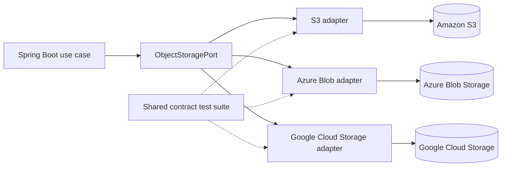
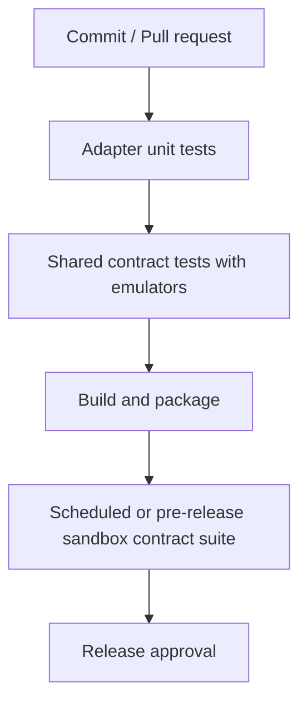

# Testing the Same Contract Across Multiple Adapters

When a Spring Boot application must run on AWS, Microsoft Azure, or Google Cloud, teams often build multiple adapters to connect to the corresponding managed services. For example, the same document storage use case may use Amazon S3, Azure Blob Storage, or Google Cloud Storage. Each SDK has its own data types, exceptions, pagination mechanisms, and configuration. If each adapter is tested only with separate test suites, one adapter can inadvertently behave differently from the others even though the application expects identical behavior.

Contract testing solves this problem by describing the behavior the application requires from a service port, then running the same test suite against each adapter. The suite verifies that adapters adhere to the same contract at the application boundary. Provider-specific differences are still verified separately through specialized tests.

This lesson builds a contract suite for object storage in Spring Boot, extends the approach to messaging and databases, and shows how to run tests against both emulators and cloud sandboxes. The goal is to enable switching or adding cloud providers without unexpected changes to business behavior.

## Objectives

After this lesson, you will be able to:

- Distinguish between business contracts, SDK APIs, and provider-specific behavior.
- Design ports with clear semantics for multiple adapters to implement.
- Write a shared contract test suite runnable against AWS, Azure, and Google Cloud adapters.
- Verify results, errors, metadata, pagination, idempotency, and consistency as required.
- Combine unit tests, emulator tests, and integration tests in cloud sandboxes.
- Separate non-uniform capabilities from the shared contract.
- Integrate the contract suite into CI pipelines to catch regressions when upgrading SDKs or swapping adapters.

## 1. Where does the contract sit?

In a ports-and-adapters architecture, business logic calls an interface owned by the application. Adapters translate those calls into provider-specific APIs.



The contract should describe what the use case needs, such as:

- When storing an object, content and content type must be preserved accurately.
- When reading a nonexistent key, the port returns a "not found" result by convention.
- When listing by prefix, only matching keys are returned, with multi-page continuation support.
- Deleting an already-deleted key still succeeds if the business contract requires idempotent delete.
- Access-permission failures and service failures must never be disguised as "object not found".

The contract must not copy SDK method names or exceptions verbatim. If the interface throws `S3Exception`, `BlobStorageException`, or a Google Cloud-specific exception, use cases become coupled to a provider and adapter swapping is no longer transparent.

### 1.1. Distinguishing three testing layers

| Layer | What it verifies | Example |
|---|---|---|
| Adapter unit tests | Translation of parameters, metadata, responses, and exceptions between port and SDK | HTTP 403 from SDK maps to `StorageAccessDeniedException` |
| Shared contract tests | Every adapter upholds the same behaviors promised to the application | Put followed by find returns exact bytes and content type |
| Provider-specific integration tests | Service-unique capabilities or limits are configured properly | S3 lifecycle, Azure lease, or GCS generation precondition |

The contract suite does not replace unit tests or provider-specific tests. It serves as the shared verification gate at the boundary every adapter must satisfy.

## 2. Designing a port with a clear contract

The example below uses object storage because the same business capability can be implemented across all three providers. The interface exposes only the operations the application needs.

```java
import java.util.List;
import java.util.Optional;

public interface ObjectStoragePort {
    void put(String key, byte[] content, String contentType);

    Optional<StoredObject> find(String key);

    ListPage list(
            String prefix,
            Optional<String> continuationToken,
            int pageSize);

    void delete(String key);
}

public record StoredObject(byte[] content, String contentType) {
}

public record ListPage(
        List<String> keys,
        Optional<String> nextToken) {
    public ListPage {
        keys = List.copyOf(keys);
        nextToken = nextToken == null ? Optional.empty() : nextToken;
    }
}
```

This is a sample contract, not a mandatory universal API for every application. One system might use streams instead of `byte[]` for large files; in that case the contract must specify who closes the stream, how mid-stream errors are handled, and memory bounds. Another system might not need `list` if it accesses objects strictly by known keys.

### 2.1. Define semantics explicitly before writing tests

| Behavior | Convention in example | What to verify |
|---|---|---|
| Key | Non-empty UTF-8 string adhering to application character rules | Key is saved and retrieved accurately |
| Overwriting a key | Subsequent writes replace prior content per port semantics | Writing twice then reading returns the second payload |
| Content type | Application-supplied metadata is stored and returned | Returned value matches written value |
| Not found | `find` returns `Optional.empty()` | Never throw "service unavailable" on 404/Not Found |
| Insufficient permissions | Throws standardized business exception | Never returns `Optional.empty()` or false success |
| Listing | Prefix filters results; pagination token is opaque | No missed keys, duplicates, or out-of-prefix keys across full traversal |
| Delete | Idempotent if required by the port | Deleting twice does not fail the use case |

Conventions must reflect actual product requirements. For example, do not promise that overwriting a key always replaces content if the use case requires versioning or compare-and-set. Put the needed semantics into the interface and test accordingly.

### 2.2. Define application-level exceptions

Adapters should map SDK errors into a stable set of exceptions. For instance:

```java
public class StorageAccessDeniedException extends RuntimeException {
    public StorageAccessDeniedException(String message, Throwable cause) {
        super(message, cause);
    }
}

public class StorageUnavailableException extends RuntimeException {
    public StorageUnavailableException(String message, Throwable cause) {
        super(message, cause);
    }
}

public class StorageOperationException extends RuntimeException {
    public StorageOperationException(String message, Throwable cause) {
        super(message, cause);
    }
}
```

Adapters can catch 404/Not Found and return `Optional.empty()`, map 403/AccessDenied to `StorageAccessDeniedException`, and map timeouts or transient service errors to `StorageUnavailableException`. Specific error codes and exception classes depend on the SDK; never catch every exception and return empty because doing so hides permission or network outages.

## 3. Building the shared contract test suite

JUnit 5 lets you place shared tests inside an abstract base class. Each concrete test class merely configures a Spring context supplying the corresponding adapter. Test methods are inherited and executed for each provider.

### 3.1. Base class for contract tests

```java
import static org.assertj.core.api.Assertions.assertThat;

import java.util.ArrayList;
import java.util.List;
import java.util.Optional;
import java.util.UUID;

import org.junit.jupiter.api.AfterEach;
import org.junit.jupiter.api.BeforeEach;
import org.junit.jupiter.api.Test;
import org.springframework.beans.factory.annotation.Autowired;

abstract class ObjectStorageContractTest {
    @Autowired
    protected ObjectStoragePort storage;

    private String root;
    private String prefix;

    @BeforeEach
    void createTestPrefix() {
        root = "contract-tests/" + UUID.randomUUID() + "/";
        prefix = root + "matching/";
    }

    @AfterEach
    void removeTestObjects() {
        List<String> keysToDelete = new ArrayList<>();
        Optional<String> token = Optional.empty();

        do {
            ListPage page = storage.list(root, token, 100);
            keysToDelete.addAll(page.keys());
            token = page.nextToken();
        } while (token.isPresent());

        keysToDelete.forEach(storage::delete);
    }

    @Test
    void storesAndReadsExactContentAndMetadata() {
        String key = prefix + "invoice.txt";
        byte[] expected = "invoice-2026".getBytes(java.nio.charset.StandardCharsets.UTF_8);

        storage.put(key, expected, "text/plain");

        StoredObject actual = storage.find(key).orElseThrow();
        assertThat(actual.content()).containsExactly(expected);
        assertThat(actual.contentType()).isEqualTo("text/plain");
    }

    @Test
    void returnsEmptyWhenObjectDoesNotExist() {
        assertThat(storage.find(prefix + "missing.txt")).isEmpty();
    }

    @Test
    void laterWriteReplacesEarlierContent() {
        String key = prefix + "replace.txt";
        storage.put(key, new byte[] {1, 2}, "application/octet-stream");
        storage.put(key, new byte[] {7, 8, 9}, "application/octet-stream");

        assertThat(storage.find(key).orElseThrow().content())
                .containsExactly(7, 8, 9);
    }

    @Test
    void deleteIsIdempotent() {
        String key = prefix + "delete.txt";
        storage.put(key, new byte[] {1}, "application/octet-stream");

        storage.delete(key);
        storage.delete(key);

        assertThat(storage.find(key)).isEmpty();
    }

    @Test
    void listsOnlyMatchingKeysAcrossPages() {
        String first = prefix + "a.txt";
        String second = prefix + "b.txt";
        String third = prefix + "c.txt";
        storage.put(first, new byte[] {1}, "application/octet-stream");
        storage.put(second, new byte[] {2}, "application/octet-stream");
        storage.put(third, new byte[] {3}, "application/octet-stream");
        storage.put(root + "outside/other.txt", new byte[] {4},
                "application/octet-stream");

        List<String> actual = new ArrayList<>();
        Optional<String> token = Optional.empty();

        for (int pageNumber = 0; pageNumber < 10; pageNumber++) {
            ListPage page = storage.list(prefix, token, 2);
            assertThat(page.keys()).hasSizeLessThanOrEqualTo(2);
            actual.addAll(page.keys());
            token = page.nextToken();
            if (token.isEmpty()) {
                break;
            }
        }

        assertThat(token).isEmpty();
        assertThat(actual).containsExactlyInAnyOrder(first, second, third);
        assertThat(actual).doesNotHaveDuplicates();
    }
}
```

This test suite verifies key invariants: byte round-trip, metadata, missing objects, overwrites, delete idempotency, and pagination. The UUID prefix isolates each run's data. Cleanup collects keys first before deleting to avoid mutating the result set mid-pagination.

In a real system, add test timeouts, cap cleanup page loops, and configure an age-based cleanup mechanism for leftover test data if a pipeline is aborted mid-run. Never run contract tests against production buckets/containers.

### 3.2. Running the same suite per adapter

Each provider test class selects only the configuration and adapter under test:

```java
import org.springframework.boot.test.context.SpringBootTest;
import org.springframework.test.context.ActiveProfiles;

@SpringBootTest(properties = "app.storage.provider=s3")
@ActiveProfiles("contract-aws")
class S3ObjectStorageContractTest extends ObjectStorageContractTest {
}

@SpringBootTest(properties = "app.storage.provider=azure-blob")
@ActiveProfiles("contract-azure")
class AzureBlobStorageContractTest extends ObjectStorageContractTest {
}

@SpringBootTest(properties = "app.storage.provider=gcs")
@ActiveProfiles("contract-gcp")
class GcsObjectStorageContractTest extends ObjectStorageContractTest {
}
```

Profiles supply endpoints, buckets/containers, credentials, and dedicated test settings. Test subclasses do not rewrite assertions. If an adapter cannot be constructed due to missing credentials or endpoints, tests must fail loudly rather than skipping silently.

### 3.3. Selecting adapters via Spring configuration

The application can register adapters by property. Simplified example for S3:

```java
import org.springframework.boot.autoconfigure.condition.ConditionalOnProperty;
import org.springframework.context.annotation.Bean;
import org.springframework.context.annotation.Configuration;

@Configuration(proxyBeanMethods = false)
class ObjectStorageAdapterConfiguration {
    @Bean
    @ConditionalOnProperty(
            prefix = "app.storage",
            name = "provider",
            havingValue = "s3")
    ObjectStoragePort s3StoragePort(S3Client client, StorageProperties properties) {
        return new S3ObjectStorageAdapter(client, properties.bucket());
    }

    // Register AzureBlobStorageAdapter and GcsStorageAdapter following the same pattern.
}
```

In production code, use separate configuration classes per provider, split dependencies by module, and verify that exactly one `ObjectStoragePort` bean is registered. Never leave multiple adapters implementing the interface and rely on component-scan order for Spring to pick one.

## 4. Running contract tests with emulators and cloud sandboxes

The contract suite should run against real adapter implementations. Emulators enable fast runs without cloud accounts during daily development; sandboxes validate real managed service behavior.

### 4.1. Local testing with emulators

| Provider | Example services | Common local tool | Caveats |
|---|---|---|---|
| AWS | S3, SQS, SNS, and select APIs | LocalStack or SDK-compatible mock server | API coverage varies by version and config; real IAM, networking, and quotas differ |
| Azure | Blob Storage, Queue Storage | Azurite | Not all Azure Storage features or control-plane behaviors are emulated |
| Google Cloud | Cloud Storage, Pub/Sub | Official emulator where provided or compatible emulators like fake-gcs-server | Feature scope, IAM, and semantics may differ from production |

Emulators test adapters and baseline flows. They do not prove real cloud IAM/Entra ID permissions, billing, throttling, network latency, replication, or all service edge cases. Pin emulator and SDK versions in pipelines so results stay reproducible.

### 4.2. Integration testing in real sandboxes

Run the shared contract suite on a schedule or prior to releasing an adapter against dedicated test cloud accounts. Each provider needs:

- Dedicated test buckets/containers, with a unique prefix per run.
- Short-lived credentials or workload identity with least privilege to create, read, list, and delete test objects.
- Explicitly configured region and endpoint.
- Timeouts, retries, and object-count caps to avoid unexpected load or bills.
- Lifecycle rules or cleanup jobs to purge orphaned test data.
- Logs/traces tagged with run IDs to correlate tests with created resources.

Never place access keys, client secrets, or service account keys in source code or committed config files. CI should fetch credentials from secret stores or the pipeline platform's identity federation.

### 4.3. Configuring endpoints for tests

Use dedicated properties for endpoints and resource names:

```yaml
app:
  storage:
    provider: ${STORAGE_PROVIDER:s3}
    bucket: ${STORAGE_BUCKET:contract-test-bucket}
    endpoint: ${STORAGE_ENDPOINT:}
    path-style-access: ${STORAGE_PATH_STYLE:false}
```

Properties `endpoint` and `path-style-access` apply only to adapters/SDKs supporting those options. Never copy an S3 configuration wholesale to Azure or GCS. Each provider needs its own configuration for endpoints, projects/accounts, containers/buckets, credentials, and TLS. For emulators, enable endpoint overrides strictly in test profiles so production traffic can never be routed to a local service by mistake.

## 5. Testing differing capabilities across providers

Not every service shares identical features or semantics. Putting every provider-specific feature into the shared interface bloats the port and forces adapters to fake unsupported behavior.

### 5.1. Separating core contracts from extended capabilities

For example, the core contract might cover only put/find/list/delete. Features like retention locks, object versioning, leases, generation preconditions, customer-managed encryption keys, or event notifications can be modeled as dedicated capabilities.

```java
import java.util.Set;

public enum StorageCapability {
    VERSIONING,
    CONDITIONAL_WRITE,
    RETENTION_POLICY,
    CUSTOMER_MANAGED_KEY,
    OBJECT_EVENTS
}

public interface StorageCapabilities {
    Set<StorageCapability> supportedCapabilities();
}
```

Use cases needing a feature must check capabilities before selecting an adapter or during application startup. You can define dedicated extension interfaces, such as `VersionedObjectStoragePort`, so capability APIs carry strong types and concrete semantics. Never return `true` for a capability simply because the SDK exposes a method; verify that the live service, tier, and account configuration actually support it.

### 5.2. Capability matrix

| Behavior | Shared contract? | How to test |
|---|---|---|
| Write and read objects | Yes, if required by the application | Shared contract suite across all adapters |
| Prefix listing and pagination | Yes, if needed by use cases | Verify opaque tokens, no duplicates, no omissions |
| Idempotent delete | Can be promised by the port | Shared contract tests and provider error tests |
| Versioning | Depends on needs and service | Capability tests and provider-specific tests |
| Conditional write / compare-and-set | Depends on semantics | Test preconditions, race conditions, and conflict codes |
| Retention lock / immutability | Depends on service and policy | Test data protection in isolated sandboxes per configured policy |
| Customer-managed keys | Depends on config and permissions | Test encryption/decryption, key access, and revoked-key failures |
| Event notifications | Depends on service | Test event setup, delivery, retries, and duplicates |

The shared contract suite covers only behaviors mandatory across every adapter. Dedicated capability tests are enabled according to the configuration matrix and run only on supporting providers.

### 5.3. Avoid forcing different semantics into a fake result

For example, object consistency windows, listing order, key-naming rules, object limits, error codes, and pagination mechanics can vary across services. Contracts should specify only the guarantees the application genuinely needs:

- If listing order does not matter, assertions should compare sets of keys rather than exact order.
- If read-after-write is required, state when the application must be able to read and verify against real services.
- If message ordering is required, guarantee it only within the scope the port can uphold, such as a partition or session key.
- If an exactly-once business effect is needed, implement idempotency and deduplication in the application; never infer that guarantee from single-delivery claims alone.
- If multi-resource transactions are needed, never assume a database transaction spans object storage or message brokers.

Contract tests detect adapters violating the chosen contract. They cannot turn an eventually consistent service into a strongly consistent one or invent features a provider lacks.

## 6. Extending contract testing to messaging

For messaging, ports can express publish and receive/ack semantics required by the application. A shared contract suite can verify:

- Published messages reach consumers with required payloads and business headers.
- Correlation IDs or idempotency keys remain intact.
- Successful ack prevents redelivery according to broker semantics.
- Unacknowledged messages can be redelivered after visibility timeout or lock expiry when the port promises at-least-once.
- Processing failures route to dead-letter queues per configured policy.

Never assert that a message is delivered strictly once if the system uses at-least-once delivery. Write idempotent consumers and test the business outcome when the same message is redelivered. Visibility timeouts, lock durations, ordering, dead-lettering, and batch sizes vary among SQS, Azure Service Bus, and Pub/Sub; configure and test those in capability or provider-specific suites.

For example, a consumer contract can verify that when a message is processed the first time, the handler records one business event; when the same message is redelivered, the idempotency key prevents creating a duplicate record. Assertions focus on business outcomes rather than SDK acknowledgement API names.

## 7. Extending contract testing to databases

For databases, contracts should describe the business operations and data constraints that use cases depend on. For example:

- Create and read back entities by key.
- Unique constraints or duplicate-prevention rules.
- Version-based conditional updates if using optimistic locking.
- Pagination without skipping records when data is static during reads.
- Rules for timestamps, timezones, decimal precision, nulls, and case sensitivity.
- Transaction atomicity within the scope supported by the database.

Never use a single generic SQL test suite to assume every NoSQL provider shares the same transaction or query semantics. Keep contracts small per business need and define capabilities for transactions, conditional writes, change feeds, or consistency levels where needed. When an adapter fails mandatory requirements, reject that configuration or redesign accordingly.

## 8. Testing failures and resilience

Basic contract tests typically verify happy paths. A production-ready suite must also test how adapters react to failures.

| Scenario | Port expectation | How to induce the failure |
|---|---|---|
| Object not found | Empty result per contract | Query a nonexistent key |
| Insufficient permissions | Standardized access-denied exception | Under-privileged sandbox credentials or mocked SDK response |
| Timeout | Specified transient service or timeout exception | Transport mock or fault injection |
| Throttling | Identifiable error/metadata for retry policies | Mock throttling responses; test on sandbox only if safe |
| Invalid payload | Stable validation error | Pass keys or content types outside contract bounds |
| Error during stream upload | Resources closed and error state reported | Mock `InputStream` throwing `IOException` mid-stream |
| Conditional write conflict | Conflict result per contract | Concurrent operations or mismatched precondition |

Fault-injection tests fit well inside adapter unit tests because errors are easy to reproduce deterministically. Sandbox integration tests should inject only controlled faults without generating heavy load or corrupting shared data.

### 8.1. Standardize retries at the right layer

Do not configure independent retries across multiple layers where attempts multiply. For example, if the SDK retries three times, a service wrapper retries three times, and a job queue redelivers multiple times, one business operation can generate far more requests than intended.

Specify retry policies per layer, overall timeouts, retryable error classes, backoff, jitter, and idempotency. The contract suite verifies outcomes and port exceptions; unit tests verify attempt counts and backoff; integration tests verify live SDK/config does not unexpectedly override policies.

## 9. Integrating into CI/CD

A practical pipeline can be layered to balance speed and confidence:



Suggested structure:

1. Run adapter unit tests on every pull request.
2. Run the shared contract suite against each provider's emulator in CI.
3. Run provider-specific tests for enabled capabilities.
4. Run the sandbox contract suite on a schedule, before releasing a new adapter, or after major SDK upgrades.
5. Archive test reports tagged by provider, adapter version, SDK version, region, and emulator version.
6. Block releases if an adapter fails a mandatory contract or sandbox tests reveal unapproved drift.

You can split modules by provider so only needed dependencies load. However, place shared contract test sources in a shared test module or test fixture artifact to avoid duplicating test code and letting test suites drift apart.

### 9.1. Managing test data and resources

- Include run IDs or UUIDs in resource names so parallel jobs do not overwrite each other's data.
- Scope permissions strictly to dedicated test buckets/containers or prefixes.
- Track created resources and clean them up in `finally` blocks or lifecycle hooks.
- Configure TTL/lifecycle rules to purge leftovers if a runner is killed.
- Cap payload sizes, object counts, message counts, and test durations.
- Set budgets and alerts on sandbox accounts.
- Never run bulk-delete tests against shared resources.

### 9.2. When a contract test fails

When one provider fails, investigate in order:

1. Verify adapter, SDK, emulator, and endpoint configuration versions.
2. Inspect inputs, outputs, and standardized exceptions at the port.
3. Compare raw requests/responses or secret-scrubbed SDK diagnostic logs.
4. Determine whether the root cause is adapter mapping, service config, permissions, capability support, or a provider behavior change.
5. If new behavior is intentional, update the contract following an architectural decision and update tests for all adapters.
6. Document affected provider/versions and corresponding deployment conditions.

Never skip a failing test merely because one provider behaves differently. First determine whether it is a legitimate difference to model as a capability or an adapter violating a business requirement.

## 10. Common mistakes

| Mistake | Consequence | Fix |
|---|---|---|
| Writing separate tests per adapter | Assertions drift apart and stop checking the same contract | Use one shared contract suite |
| Leaking SDK types into the port | Business logic couples to a provider and swapping adapters gets hard | Use domain types and application-owned exceptions |
| Testing only the happy path | Permission, timeout, and throttling errors map poorly | Add failure unit tests and fault injection |
| Assuming emulators equal real cloud | Misses IAM, networking, quotas, and billing | Run sandbox integration tests regularly or pre-release |
| Forcing every provider to support every capability | Adapters fake behavior or report false success | Split capabilities and validate before use |
| Asserting unspecified list ordering | Flaky tests or failures with no business meaning | Compare key sets when ordering is not part of the contract |
| Sharing test resources | Parallel runs overwrite/delete each other's data | Unique prefixes and isolated permission scopes |
| Retrying at multiple layers | Request volume explodes exponentially on failures | Pick one retry policy with an explicit overall timeout |
| Skipping test data cleanup | Storage costs and test clutter grow over time | Cleanup hooks, TTLs, and sandbox budgets |

## 11. Checklist before adding or swapping an adapter

- [ ] Port clearly specifies business behavior, data types, and semantics.
- [ ] SDK exceptions map to application-owned error types.
- [ ] Shared contract suite runs against existing adapters.
- [ ] New adapter runs the same suite and passes all mandatory assertions.
- [ ] Dedicated capabilities are documented and tested separately.
- [ ] Pagination, metadata, idempotency, and permission errors verified.
- [ ] Emulator and sandbox tests use isolated configurations.
- [ ] CI credentials use appropriate identities and least privilege.
- [ ] Test resources have unique prefixes, cleanup, and TTLs.
- [ ] Pipeline archives reports by provider, SDK, and region.
- [ ] Contract changes reviewed with all affected use cases.

## Conclusion

Testing the same contract across multiple adapters ensures cloud adapters consistently deliver the behavior a Spring Boot application needs. Anchor contracts at application-owned ports, write a shared contract suite, and run it against AWS, Azure, and Google Cloud adapters. Use emulators for fast feedback, real sandboxes to confirm integration, and provider-specific tests for unique capabilities. When contracts, capabilities, errors, and test data are managed cleanly, teams can change cloud providers while keeping system behavior and risks under control.
