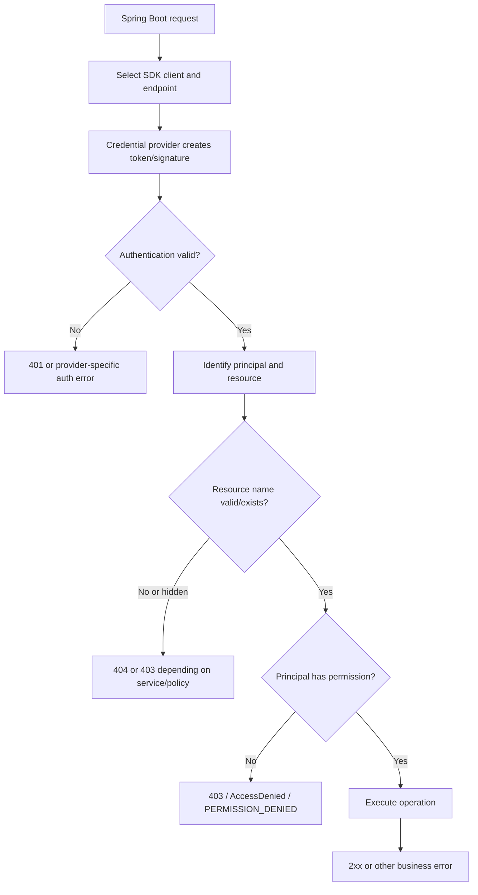

# Distinguishing authentication errors, insufficient permissions, and resource not found

When Spring Boot calls AWS, Azure, or Google Cloud, the three most easily confused failures are **authentication failure**, **authorization denial**, and **resource not found**. All three cause a request to fail, yet their causes and fixes differ:

- **Authentication:** the service does not accept the request's identity or proof of identity. For example, an expired token, invalid signature, invalid credentials, or missing `Authorization` header.
- **Authorization:** the service recognizes the caller, but the principal lacks the required permission, or a policy/network rule denies the operation.
- **Resource not found:** the request reached the right service, but the name, path, namespace, bucket, topic, container, or object does not exist in the queried scope.

You cannot classify these accurately by HTTP status alone. AWS S3 can return 403 instead of 404 if the caller lacks permission to list the bucket; Azure Blob has an `AuthenticationFailed` code under HTTP 403; Google Cloud Storage can return 403 for a nonexistent project or when the caller is not permitted to list buckets. You must examine the error code, message, resource identifier, request ID, and actual identity.

This article explains how to classify errors per provider, check IAM/RBAC at the proper scope, handle cases where a service intentionally hides resource existence, and design exception handling in Spring Boot so you neither grant overly broad permissions nor retry pointlessly.

## 1. The three error categories and how to recognize them

| Error category | Core question | Common symptoms | Remediation direction |
| --- | --- | --- | --- |
| Authentication | Did the request prove a valid identity? | Missing/expired token, wrong signature, invalid key, credential chain found no identity | Check credential source, token audience/expiry, signature, clock, and endpoint |
| Authorization | Does the authenticated principal have permission to perform the action on the resource? | `AccessDenied`, `Forbidden`, `PERMISSION_DENIED`, `AuthorizationPermissionMismatch` | Verify principal, permissions, policies, and resource scope |
| Resource not found | Does the resource exist at the right endpoint under that full name? | `NoSuchBucket`, `NoSuchKey`, `BlobNotFound`, `ContainerNotFound`, `MessagingEntityNotFound`, `NOT_FOUND` | Check resource ID, account/project/region/namespace, and resource state |

HTTP status is an initial signal, not a final conclusion:

| HTTP/gRPC status | Common meaning | Notes |
| --- | --- | --- |
| HTTP 401 / gRPC UNAUTHENTICATED | Request is missing credentials or has invalid credentials | Some cloud services use code 403 for signature/token errors |
| HTTP 403 / gRPC PERMISSION_DENIED | Caller is not allowed to perform the operation | Could be IAM, resource policy, deny policy, SAS scope, firewall, or inaccessible project |
| HTTP 404 / gRPC NOT_FOUND | Endpoint, method, or resource does not exist | Some services hide resource existence to avoid leaking data |
| HTTP 400 | Malformed request, header, signature, or resource name | Do not assume this is a business logic error |
| HTTP 409 | Resource state conflict or resource already exists | Read the detailed error code |
| HTTP 429 | Quota/rate limit | Can be retried with backoff and retry-after |
| HTTP 5xx | Service-side or gateway error | Bounded retries if the operation is safe |

### 1.1. A request passes through multiple validation layers

An object upload operation may pass through the following layers:



For example, a service account may authenticate successfully but lack `storage.objects.create` on the bucket. That is an authorization error. If the bucket name is wrong, the request may return not found or permission denied depending on the API and the caller's existing permissions.

### 1.2. Distinguishing control plane and data plane

Some clouds have two API planes with distinct permissions:

- **Control plane:** creating, modifying, deleting, or configuring resources such as a storage account, namespace, bucket, subscription resource, or database instance.
- **Data plane:** reading/writing actual content such as blobs, messages, objects, rows, or secret values.

Having permission to manage a resource does not automatically grant permission to read/write its data. For example, Azure subscription Contributor can manage a Storage Account's configuration but does not automatically grant Blob Data Reader; Google Cloud project Editor should not be used to fix missing object permissions; AWS IAM permissions on a bucket may also require a separate KMS key policy.

When a management operation succeeds but upload/download fails, determine whether the called API belongs to the control plane or the data plane before modifying roles.

## 2. Gathering evidence before changing IAM policies

When a request fails, record the following information on the server side:

1. Provider and service: S3, SQS, Azure Blob, Service Bus, Cloud Storage, Pub/Sub...
2. Operation: `GetObject`, `PutObject`, `GetBlob`, `SendMessage`, `storage.objects.get`...
3. HTTP status or gRPC status.
4. Specific error code in the response body/headers.
5. Full resource identifier: account, region, bucket, object, subscription, namespace, project, topic, or secret.
6. Principal that signed the request, if safely verifiable.
7. Request/correlation ID returned by the cloud provider.
8. Request timestamp and running deployment/revision.
9. Endpoint, region, and tenant/project context.
10. Policies or role assignments related to the operation.

Do not log access tokens, secret keys, full SAS tokens, connection strings, or private keys. If you need to investigate credentials, log the credential source or verified principal, not secret contents.

A generic message like `Forbidden` is rarely enough to fix an error. AWS S3 returns `Code`, `Message`, and `RequestId`; Azure Storage returns an error code along with `x-ms-request-id`; Google Cloud returns `status`, `message`, `details`, and possibly `ErrorInfo`. Retain these fields in internal logs to correlate with the provider's audit logs.

## 3. AWS: distinguishing authentication, AccessDenied, and NoSuchResource

### 3.1. Authentication failure in AWS

The AWS SDK signs requests using credentials and a signing process. Common errors include:

| Error code/message | Possible cause | What to check |
| --- | --- | --- |
| `InvalidAccessKeyId` | Access key ID does not exist, wrong account, or disabled | Check which credential source the SDK is selecting |
| `SignatureDoesNotMatch` | Wrong secret key, canonical request mismatch, wrong region/service signing scope, or request was altered | Check system time, region, endpoint, proxy, and key source |
| `ExpiredToken` | Session token has expired | Use a provider that supports refresh or re-issue session credentials |
| `InvalidToken` | Invalid session/web identity token | Check token file, trust relationship, and expiration |
| `UnrecognizedClientException` | Credentials/signature rejected by the service | Check account, key, signing region, and SDK configuration |
| `AuthorizationHeaderMalformed` | Malformed Authorization header or credential scope | Check region/endpoint and signing configuration |
| No credentials found | SDK provider chain could not obtain an identity | Check system properties, environment variables, profile, web identity, ECS/EC2 role |

AWS commonly returns 403 for `AccessDenied`; do not expect every auth-related error to always be HTTP 401. Rely on the error code and details inside the SDK exception.

Verify the principal with STS:

```bash
aws sts get-caller-identity
```

This command reveals the account, ARN, and user ID of the caller in the AWS CLI session. To be certain the Java client uses the same credentials, create an STS client using the exact `AwsCredentialsProvider` injected into the S3/SQS client and call `GetCallerIdentity`.

### 3.2. Authorization failure: AccessDenied

AWS S3 returns `AccessDenied` with HTTP 403 when the principal is not permitted to perform the operation. Check in order:

- Identity policy on the IAM user/role.
- Bucket policy or access point policy.
- Explicit `Deny` in any policy.
- Service Control Policy (SCP) in AWS Organizations.
- Permissions boundary and session policy.
- VPC endpoint policy if requests traverse a VPC endpoint.
- Object Ownership/ACL if the bucket still uses ACLs.
- KMS key policy and `kms:Decrypt`/`kms:GenerateDataKey` when objects use SSE-KMS.
- Conditions on prefix, tag, encryption header, source VPC/IP, or TLS.

Examples of common actions:

| Operation | Typical permission |
| --- | --- |
| Read object | `s3:GetObject` |
| Write object | `s3:PutObject` |
| Delete object | `s3:DeleteObject` |
| List objects in bucket | `s3:ListBucket` |
| Read object metadata via `HeadObject` | `s3:GetObject` |
| Read checksum of SSE-KMS object in some cases | May additionally require KMS permissions like `kms:GenerateDataKey` and `kms:Decrypt` |

Do not grant `s3:*` or `AdministratorAccess` just to make a request work. Grant the exact actions on the right bucket/prefix and inspect the KMS key policy separately if applicable.

### 3.3. NoSuchBucket, NoSuchKey, and 403 masquerading as 404

S3 commonly uses these codes:

- `NoSuchBucket`: bucket does not exist, or name/endpoint/account is incorrect.
- `NoSuchKey`: object key does not exist in the bucket.
- `NoSuchUpload`: multipart upload ID is no longer valid.
- `NoSuchVersion`: version ID does not exist or does not belong to that object.

A critical nuance: for `HeadObject`, if the object does not exist:

- Caller has `s3:ListBucket` on the bucket: S3 returns `404 Not Found`.
- Caller lacks `s3:ListBucket`: S3 returns `403 Forbidden`.

Therefore, a 403 from `HeadObject` neither proves the object exists nor proves credentials are wrong. It can be S3 refusing to disclose whether an object exists to a caller not allowed to list the bucket.

For `HeadBucket`, S3 may return 400, 403, or 404 without a detailed response body if the bucket does not exist or the caller lacks permission. You cannot deduce the exact cause from status alone.

### 3.4. S3 diagnostic steps

Check the principal:

```bash
aws sts get-caller-identity
```

Check the bucket:

```bash
aws s3api head-bucket --bucket orders-archive
```

Check object metadata:

```bash
aws s3api head-object --bucket orders-archive --key invoices/2026/INV-001.pdf
```

List objects only if the caller has `s3:ListBucket`:

```bash
aws s3api list-objects-v2 --bucket orders-archive --prefix invoices/2026/
```

Commands must be executed using the exact profile/role and region the application uses. If AWS CLI succeeds while the Java SDK fails, check the Java process's provider chain and region.

When you need to distinguish `NoSuchKey` from `AccessDenied`, do not grant `s3:ListBucket` broadly to every caller. If the application needs to expose existence status, design a backend/service with scoped lookup privileges that returns results according to your security policy.

### 3.5. Reading the request ID from AWS SDK for Java 2.x

AWS SDK exceptions can provide the status code, error code, and request ID:

```java
try {
    s3Client.headObject(request -> request
            .bucket("orders-archive")
            .key("invoices/2026/INV-001.pdf"));
} catch (S3Exception ex) {
    String errorCode = ex.awsErrorDetails() == null
            ? "Unknown"
            : ex.awsErrorDetails().errorCode();

    log.warn("S3 request failed: status={}, code={}, requestId={}",
            ex.statusCode(), errorCode, ex.requestId());
    throw ex;
}
```

Do not classify errors by string-matching the English message when the SDK already provides an error code. Messages can change or contain sensitive resource details.

## 4. Azure: AuthenticationFailed, AuthorizationPermissionMismatch, and ResourceNotFound

### 4.1. Azure Storage can return 403 for authentication errors

Azure Blob Storage does not always use 401 for authentication errors. Common cases:

| Error code | Typical HTTP status | Meaning |
| --- | --- | --- |
| `NoAuthenticationInformation` | 401 | Request is missing authentication information |
| `InvalidAuthenticationInfo` | 401 or 400 depending on request form | Authorization header or authentication information is malformed |
| `AuthenticationFailed` | 403 | Signature, account key, SAS, or authentication information was not accepted |
| `KeyBasedAuthenticationNotPermitted` | 403 | Storage Account blocks shared key authentication |
| `AuthorizationPermissionMismatch` | 403 | SAS or principal lacks the permission required for the operation |
| `AuthorizationFailure` | 403 | May be caused by network/firewall/public access restrictions or policy |
| `ResourceNotFound` | 404 | Resource does not exist |
| `BlobNotFound` | 404 | Blob does not exist |
| `ContainerNotFound` | 404 | Container does not exist |

If Azure returns 403 `AuthenticationFailed`, do not rush to grant another RBAC role. First check the token/SAS/account key, signature, start/expiry time, clock skew, and authentication mode.

### 4.2. Authorization in Azure: role and scope

With Microsoft Entra ID, a principal may obtain a valid token yet lack a data-plane role.

Blob Storage examples:

- Read blobs: `Storage Blob Data Reader` or a narrower role with corresponding permissions.
- Write/delete blobs: `Storage Blob Data Contributor` or an appropriate role.
- Manage data ownership: `Storage Blob Data Owner` when genuinely needed.

Azure Service Bus examples:

- Send messages: `Azure Service Bus Data Sender`.
- Receive messages: `Azure Service Bus Data Receiver`.
- Broader data-plane management: `Azure Service Bus Data Owner`.

Role assignments can be granted at the management group, subscription, resource group, namespace/storage account, or narrower scope if supported by the service. Check the principal object ID, tenant, role, and scope. Do not confuse Azure subscription `Contributor` with a data-plane role.

Azure Storage can also deny requests due to:

- Storage Account firewall or network rules.
- Public network access being disabled.
- Misconfigured private endpoint/DNS.
- Client IP not in the allowlist.
- SAS missing permissions, wrong service/resource type, wrong protocol, or wrong IP range.
- Shared Key authentication disabled on the Storage Account.
- Disallowed encryption scope, customer-managed key, or Key Vault policy.

In particular, `AuthorizationFailure` is not necessarily missing RBAC; check network and account policies before modifying roles.

### 4.3. BlobNotFound and ContainerNotFound

If receiving 404, check:

1. Whether the storage account endpoint matches the right subscription/tenant/cloud.
2. Whether the container name is lowercase and obeys naming rules.
3. Whether the blob name has the right `/` slashes, URL encoding, and prefix.
4. Whether the application is targeting a different account due to endpoint or credential source.
5. Whether the resource was deleted, renamed, or moved/deleted by a lifecycle policy.
6. Whether you are calling the Blob service vs. the DFS endpoint for Data Lake Gen2.

A blob name is a key string; a differing `/` or URL encoding refers to a different object. Verify the exact resource name before concluding data was lost.

### 4.4. Checking Azure CLI and role assignments

View the current tenant/subscription:

```bash
az account show --query "{tenantId:tenantId, subscriptionId:id, name:name}" --output json
```

List role assignments at a specific scope:

```bash
az role assignment list \
  --assignee PRINCIPAL_OBJECT_ID \
  --scope "/subscriptions/SUBSCRIPTION_ID/resourceGroups/rg-orders/providers/Microsoft.Storage/storageAccounts/ordersarchive" \
  --include-inherited \
  --all \
  --output table
```

This command checks role assignments granted at the scope and parent scopes. Match the exact principal object ID, not just the display name.

Test reading blob metadata via Microsoft Entra login if Azure CLI and data-plane permissions are configured:

```bash
az storage blob show \
  --account-name ordersarchive \
  --container-name invoices \
  --name "2026/INV-001.pdf" \
  --auth-mode login
```

If the CLI returns a similar error, the issue is likely with identity, RBAC, SAS/network, or the resource. If the CLI succeeds while the Java SDK fails, check `TokenCredential`, tenant/client ID, endpoint, and the Java process's credential chain.

### 4.5. Reading error code and request ID in the Java SDK

The Azure Blob SDK provides `BlobStorageException` with status and error code:

```java
try {
    blobClient.getProperties();
} catch (BlobStorageException ex) {
    String errorCode = ex.getErrorCode();
    int status = ex.getStatusCode();

    String requestId = ex.getResponse() == null
            ? null
            : ex.getResponse().getHeaders().getValue("x-ms-request-id");

    log.warn("Azure Blob request failed: status={}, code={}, requestId={}",
            status, errorCode, requestId);
    throw ex;
}
```

The request ID can be used to look up details in Azure resource logs or when working with Azure Support. Never log SAS query strings, account keys, or `Authorization` headers.

### 4.6. Azure Service Bus: Unauthorized and MessagingEntityNotFound

Service Bus has its own error categories:

- `Unauthorized` or authorization-related `ServiceBusException`: check token, namespace, managed identity, and Sender/Receiver roles.
- `MessagingEntityNotFound`: queue/topic/subscription does not exist, wrong name, or pointing to the wrong namespace.
- `MessagingEntityDisabled`: the entity exists but is disabled.
- `ServiceTimeout` or communication exception: check network, DNS, private endpoint, firewall, and AMQP ports.
- `ServiceBusy`: service is throttling/busy; the SDK retries according to its policy.

An `Unauthorized` error in a Managed Identity flow does not necessarily mean the queue is missing. Check role assignments on the namespace or entity before changing the resource name.

## 5. Google Cloud: UNAUTHENTICATED, PERMISSION_DENIED, and NOT_FOUND

### 5.1. UNAUTHENTICATED

Google Cloud APIs typically return gRPC canonical status `UNAUTHENTICATED` or HTTP 401 when a request lacks valid credentials.

Common causes:

- Missing `Authorization: Bearer` token.
- Expired OAuth access token or failure to refresh.
- ADC picking up the wrong credentials file or identity source.
- External account/WIF configuration having the wrong issuer, audience, subject token, or STS exchange.
- Token having an audience/scope unsuitable for the API.
- Disabled service account key or rejected token.

Inspect the ADC source without printing access tokens. Locally, distinguish `gcloud auth list` from `gcloud auth application-default login`; Java Cloud Client Libraries use ADC. In production, verify the service account attached to Cloud Run/GCE/GKE or the external account credential configuration.

### 5.2. PERMISSION_DENIED

`PERMISSION_DENIED` (HTTP 403) means the principal is not permitted to perform the operation under current policies. However, the cause can be:

- Missing IAM permission on the bucket, object, topic, subscription, secret, or database.
- An IAM Deny Policy blocking the permission.
- An IAM Condition not satisfied by the resource, time, IP, or request attributes.
- An Organization Policy or VPC Service Controls restricting access.
- The API is not enabled or the quota project is not permitted.
- The request targets a different project from the one where the caller holds permissions.
- The resource does not exist, but the API hides that status from a caller lacking permissions.

A `PERMISSION_DENIED` error must be analyzed by principal, permission, resource, and policy. Do not grant `roles/owner` or `roles/editor` to test.

Cloud Storage examples:

| Operation | Typical required permission |
| --- | --- |
| Read object | `storage.objects.get` |
| Create object | `storage.objects.create` |
| Overwrite object | May require both `storage.objects.create` and `storage.objects.delete` depending on operation |
| Delete object | `storage.objects.delete` |
| List objects | `storage.objects.list` |
| List buckets in project | `storage.buckets.list` |

### 5.3. NOT_FOUND and nonexistent projects

Google Cloud normally returns `NOT_FOUND`/404 when a method or resource does not exist. However, the Cloud Storage JSON API has notable behavior:

- 401 when a request requires authentication and lacks an authorization header.
- 403 when the caller lacks permission; for instance, listing buckets in a nonexistent project or a project the caller is not permitted to list.
- 404 when the queried object does not exist.

Consequently, if a bucket/project/object is not found, do not check only spelling. Verify the project ID, project number, bucket name, full resource name, API endpoint, and principal. A 403 can hide a nonexistent project or a caller lacking query permissions.

### 5.4. Checking permissions and Audit Logs

When encountering `PERMISSION_DENIED`, inspect error details if the API returns `google.rpc.ErrorInfo`, such as:

- `reason`: error category.
- `domain`: service generating the error.
- `metadata.permission`: missing permission.
- `metadata.resource`: related resource, if provided.

Cloud Audit Logs show the principal executing the request, method, resource, and denial status. The principal field may be `principalEmail` or `principalSubject`. Use IAM Policy Troubleshooter to check whether a principal holds a permission on a specific resource.

Commands to verify project context:

```bash
gcloud config get-value project
gcloud projects describe PROJECT_ID
```

Check CLI identity:

```bash
gcloud auth list
```

Remember that Java ADC can differ from the `gcloud` CLI identity. If Java requests fail while the CLI succeeds, inspect ADC/runtime identity directly in the application's environment.

### 5.5. Example handling StorageException in Java

```java
try {
    Blob blob = storage.get("orders-archive", "invoices/2026/INV-001.pdf");

    if (blob == null) {
        throw new OrderDocumentNotFoundException();
    }
} catch (StorageException ex) {
    int status = ex.getCode();

    log.warn("Cloud Storage request failed: status={}, reason={}",
            status, ex.getReason());

    throw ex;
}
```

With the Google Cloud Storage Java Client, `Storage.get(bucket, object)` can return `null` when the object does not exist and the API can determine it is not found. If the request is denied, the SDK throws `StorageException`. Do not convert every `StorageException` into a not-found error; inspect the status/reason and permission context.

## 6. Error comparison matrix across AWS, Azure, and Google Cloud

| Scenario | AWS | Azure | Google Cloud |
| --- | --- | --- | --- |
| Missing/invalid credentials | `InvalidAccessKeyId`, `SignatureDoesNotMatch`, `ExpiredToken`; status varies by API | `NoAuthenticationInformation`, `InvalidAuthenticationInfo`, `AuthenticationFailed` | `UNAUTHENTICATED` / 401 |
| Authenticated but lacks permission | `AccessDenied` / 403 | `AuthorizationPermissionMismatch`, `AuthorizationFailure`, `Unauthorized` / 403 | `PERMISSION_DENIED` / 403 |
| Resource does not exist | `NoSuchBucket`, `NoSuchKey`; may be masked as 403 | `BlobNotFound`, `ContainerNotFound`, `MessagingEntityNotFound` | `NOT_FOUND` / 404 |
| Resource does not exist, caller not allowed to know | S3 `HeadObject` may return 403 if missing `s3:ListBucket` | Policy/authorization may return 403; read the specific error code | Cloud Storage may return 403 if caller lacks permission, even if resource does not exist |
| Wrong region/endpoint | `AuthorizationHeaderMalformed`, redirect, or endpoint mismatch | DNS/endpoint/cloud mismatch | Wrong endpoint, API path, project/resource mismatch |
| Network/firewall | VPC endpoint policy, endpoint/DNS/TLS | `AuthorizationFailure`, firewall, private endpoint, DNS | VPC Service Controls, firewall, Private Google Access, DNS/TLS |

Do not map errors via a rigid HTTP status table. For example, 403 in Azure Blob can be an authentication failure, authorization failure, or network restriction. 403 in AWS S3 can be `AccessDenied` or the service hiding a nonexistent object. Use provider-specific error codes as the primary basis for classification.

## 7. Proper error handling in Spring Boot

### 7.1. Preserve provider details in the integration layer

The adapter/repository layer should translate SDK exceptions into meaningful domain exceptions while preserving causes and metadata for logging:

- `CloudAuthenticationException`
- `CloudPermissionDeniedException`
- `CloudResourceNotFoundException`
- `CloudRequestRejectedException`
- `CloudTransientException`

Do not let controllers know about `S3Exception`, `BlobStorageException`, or `StorageException`. Also do not strip away request IDs and provider error codes during exception translation.

### 7.2. Classify by error code, not free-form message

AWS example:

```java
GetObjectRequest request = GetObjectRequest.builder()
        .bucket(bucketName)
        .key(objectName)
        .build();

try {
    try (ResponseInputStream<GetObjectResponse> response =
            s3Client.getObject(request)) {
        // Read or forward the object content.
    }
} catch (S3Exception ex) {
    String code = ex.awsErrorDetails() == null
            ? "Unknown"
            : ex.awsErrorDetails().errorCode();

    if ("NoSuchKey".equals(code) || "NoSuchBucket".equals(code)) {
        throw new CloudResourceNotFoundException("S3 resource not found", ex);
    }

    if ("AccessDenied".equals(code)) {
        throw new CloudPermissionDeniedException("S3 access denied", ex);
    }

    throw ex;
}
```

Note: `AccessDenied` on a `HeadObject` operation does not prove the object exists; it may be because the caller lacks `s3:ListBucket`. Only translate it into a permission error after understanding the operation semantics and resource enumeration policy.

Azure Blob example:

```java
import com.azure.storage.blob.models.BlobErrorCode;

try {
    blobClient.getProperties();
} catch (BlobStorageException ex) {
    BlobErrorCode code = ex.getErrorCode();

    if (BlobErrorCode.BLOB_NOT_FOUND.equals(code)
            || BlobErrorCode.CONTAINER_NOT_FOUND.equals(code)) {
        throw new CloudResourceNotFoundException("Azure resource not found", ex);
    }

    if (BlobErrorCode.AUTHORIZATION_PERMISSION_MISMATCH.equals(code)) {
        throw new CloudPermissionDeniedException("Azure permission denied", ex);
    }

    if (BlobErrorCode.AUTHENTICATION_FAILED.equals(code)) {
        throw new CloudAuthenticationException("Azure authentication failed", ex);
    }

    throw ex;
}
```

`AuthorizationFailure` can be related to firewall/network rules. Do not automatically turn it into `CloudPermissionDeniedException` without checking response details and resource logs.

Google Cloud Storage example:

```java
try {
    Blob blob = storage.get(bucketName, objectName);
    if (blob == null) {
        throw new CloudResourceNotFoundException("Object not found");
    }
} catch (StorageException ex) {
    if (ex.getCode() == 401) {
        throw new CloudAuthenticationException("Google Cloud authentication failed", ex);
    }
    if (ex.getCode() == 403) {
        throw new CloudPermissionDeniedException("Google Cloud permission denied", ex);
    }
    throw ex;
}
```

In Google Cloud Storage, 403 can hide a nonexistent resource if the caller lacks permissions. If the application needs to determine resource existence accurately, use a principal with appropriate query privileges while adhering to security policies; do not use 403 as proof that a resource exists.

### 7.3. Mapping exceptions to HTTP responses

An internal API might map domain exceptions as follows:

| Domain exception | Internal HTTP API | Behavior |
| --- | --- | --- |
| `CloudAuthenticationException` | Internal 502/503 or 500 depending on system role | Backend failed to obtain valid identity; do not ask end-users to log in again if credentials are a workload identity |
| `CloudPermissionDeniedException` | 403 or internal 500 depending on principal | Do not retry; log principal/resource/permission |
| `CloudResourceNotFoundException` | 404 | Return resource not found per API contract |
| `CloudTransientException` | 503 | Bounded retries or return retryable response |
| Invalid input request | 400 | Caller must fix the request |

Not every 401 from a cloud provider should become a 401 for your API client. If a backend service account is expired or misconfigured, that is a server-side operational issue; an end-user cannot fix it by signing in again.

### 7.4. ControllerAdvice example

```java
@RestControllerAdvice
public class CloudExceptionHandler {

    @ExceptionHandler(CloudResourceNotFoundException.class)
    ResponseEntity<ApiError> notFound(CloudResourceNotFoundException ex) {
        return ResponseEntity.status(HttpStatus.NOT_FOUND)
                .body(new ApiError("RESOURCE_NOT_FOUND"));
    }

    @ExceptionHandler(CloudPermissionDeniedException.class)
    ResponseEntity<ApiError> forbidden(CloudPermissionDeniedException ex) {
        return ResponseEntity.status(HttpStatus.FORBIDDEN)
                .body(new ApiError("OPERATION_NOT_ALLOWED"));
    }

    @ExceptionHandler(CloudAuthenticationException.class)
    ResponseEntity<ApiError> authenticationFailure(
            CloudAuthenticationException ex) {
        return ResponseEntity.status(HttpStatus.SERVICE_UNAVAILABLE)
                .body(new ApiError("CLOUD_IDENTITY_UNAVAILABLE"));
    }
}
```

`ApiError` is an application DTO; do not expose raw SDK messages, sensitive bucket names, IAM principals, or provider request bodies in a public API.

In multi-tenant systems, you may intentionally return 404 for both nonexistent resources and resources the caller is not allowed to know about. That is an anti-enumeration decision; apply it consistently in the application's authorization layer rather than arbitrarily converting every provider 403 into a 404.

## 8. Retries, token refresh, and idempotency

Not every error should be retried:

| Error | Retry? | Action |
| --- | --- | --- |
| Expired token, credential refresh failure | Attempt refresh/credential acquisition per SDK; only retry the request with valid new credentials | Check ADC/managed identity/role session |
| Wrong signature or invalid key | Do not blindly retry | Fix key source, region, clock, or signing config |
| 403 permission denied | Do not retry | Fix IAM/RBAC/policy or network rule |
| 404 resource not found | Do not blindly retry | Check resource name and context |
| 409 conflict | Depends on operation and error code | Inspect resource state before retrying |
| 429 throttling | Yes, honoring retry-after/backoff | Reduce concurrency, use exponential backoff and jitter |
| 5xx/timeout | Bounded retries if operation is idempotent or uses an idempotency key | Exponential backoff, jitter, total duration cap |

Do not continuously retry 401/403/404; doing so only adds load and masks misconfigurations. For expired tokens, many SDKs automatically refresh credentials; if requests still fail, inspect the provider chain rather than repeating the same token.

For message writes or resource creation, account for idempotency and duplicate handling. A timeout can occur after the server processed the request but before the client received the response. Retrying without an idempotency key can create duplicate data.

## 9. Security when checking resource existence

An `exists` endpoint seems harmless but can leak information:

- Attackers can enumerate bucket, object, blob, queue, or secret names.
- Differences between 403 and 404 can reveal whether a resource exists.
- `ListBucket`, `ListBlobs`, or `ListObjects` might grant broader permissions than necessary just to distinguish errors.
- Detailed logs might leak tenant, project, account, bucket, or object paths.

Secure design:

1. Enforce authorization in the application layer before looking up the resource if resources are tenant-owned.
2. Only allow querying resources within the resolved tenant/project/account.
3. Use the narrowest required operation; do not grant list permissions just to power one UI screen.
4. Return consistent responses when resource enumeration must be prevented.
5. Keep provider request IDs and error codes in controlled internal logs.
6. Never log tokens, SAS, secrets, or `Authorization` headers.
7. Audit operations that can alter permissions or resource state.

If the backend must check resources on behalf of users, use a service identity scoped to the right namespace/bucket/prefix and enforce tenant authorization yourself. Never let users pass arbitrary unvalidated project IDs, subscription IDs, account IDs, or bucket names to the backend.

## 10. Lab: classifying errors when downloading invoices from three clouds

Goal: Orders API downloads invoices from S3, Azure Blob Storage, or Google Cloud Storage. For each failure, operations must classify whether it is authentication, authorization, or not found.

### Step 1 — Record request context

For each request, log non-sensitive fields:

- Provider and client bean name.
- Operation: download/get properties.
- Internal tenant/order ID.
- Backend-validated resource path.
- Provider request ID.
- HTTP/gRPC status and provider error code.

Never log URLs containing SAS, full signed URLs, or access tokens.

### Step 2 — Simulate authentication failure

- AWS: run with an invalid credential source in a sandbox environment or use an expired session token.
- Azure: use an expired SAS or an intentionally misconfigured test credential in an isolated environment.
- Google Cloud: run a test with ADC lacking valid credentials.

Expected result: the error is classified as authentication; the system neither grants roles automatically nor turns it into not found.

### Step 3 — Simulate authorization denial

- AWS: use a role missing `s3:GetObject` on the test prefix.
- Azure: use a principal with a valid token that lacks `Storage Blob Data Reader` on the container.
- Google Cloud: use a service account lacking `storage.objects.get` on the bucket.

Expected result: identity is authenticated, but the operation is denied. Logs record principal/resource/request ID; no continuous retries occur.

### Step 4 — Simulate resource not found

- AWS: query a nonexistent object key using a role with permissions needed to detect not found.
- Azure: query a nonexistent blob name inside a test container.
- Google Cloud: query a nonexistent object using a principal with appropriate query permissions.

Expected result: domain error `CloudResourceNotFoundException` is thrown when the API actually confirms not found. Do not infer an object does not exist from an ambiguous 403.

### Step 5 — Test 403 masking 404

- AWS: call `HeadObject` with a role lacking `s3:ListBucket` and test a nonexistent object key.
- Google Cloud: query a nonexistent object with a principal missing required permissions.
- Azure: compare `AuthenticationFailed`, `AuthorizationPermissionMismatch`, and `AuthorizationFailure` error codes in a controlled test environment.

Expected result: the team does not classify status codes mechanically. Every conclusion is grounded in operation semantics, error codes, and principal permissions.

### Step 6 — Verify API mapping

Call the Orders API endpoint and confirm:

- Nonexistent resources return 404 per application contract.
- Unauthorized callers receive 403 or 404 according to the defined anti-enumeration policy.
- Backend identity failures return an appropriate server error without prompting end-users to log in again.
- Transient errors have bounded retries.
- No response contains provider secrets or credentials.

## 11. Production incident investigation checklist

When receiving a "cloud returned 403/404" ticket, follow this checklist:

- [ ] Identify the specific provider, service, and operation.
- [ ] Collect status, provider error code, safe message, and request ID.
- [ ] Verify the actual principal of the running process.
- [ ] Verify account/tenant/project/subscription/region/namespace.
- [ ] Verify full resource name, encoding, and endpoint.
- [ ] Distinguish authentication from authorization.
- [ ] Inspect IAM/RBAC/resource policy/deny policy at the proper scope.
- [ ] Inspect data-plane roles separately from control-plane roles.
- [ ] Check KMS/Key Vault/encryption permissions if the resource is encrypted.
- [ ] Check firewall, VPC endpoint, private endpoint, DNS, and VPC Service Controls.
- [ ] Inspect Audit Logs/resource logs using the request ID and timestamp.
- [ ] Grant only least-privilege permissions after identifying the missing action/resource.
- [ ] Do not infinitely retry 401/403/404.
- [ ] Never log tokens, keys, SAS, or connection strings.
- [ ] Verify whether response mapping leaks resource existence.

## 12. Key takeaways

- Authentication verifies the caller; authorization checks whether the caller has permission; not found indicates the endpoint/resource does not exist per API semantics.
- HTTP 401/403/404 do not share identical absolute meanings across all providers. Read provider-specific error codes and response details.
- AWS S3 `AccessDenied` is typically 403. For `HeadObject`, a nonexistent object can return 403 if the caller lacks `s3:ListBucket`; `HeadBucket` can return a generic 400/403/404.
- Azure Blob `AuthenticationFailed` can be 403; `AuthorizationPermissionMismatch` is missing permission/SAS scope; `AuthorizationFailure` can be due to firewall/network; `BlobNotFound` is 404.
- Azure Service Bus `MessagingEntityNotFound` means the entity does not exist; `Unauthorized`/authorization exceptions require checking the token and Sender/Receiver roles.
- Google Cloud uses `UNAUTHENTICATED`/401, `PERMISSION_DENIED`/403, and `NOT_FOUND`/404. Cloud Storage may return 403 when the project/resource does not exist or the caller lacks permission.
- Control-plane roles do not automatically grant data-plane permissions. Check action, principal, resource scope, and policies.
- Retain provider request IDs and error codes in internal logs; never log credentials.
- Never blindly retry 401/403/404. Retry 429/5xx/timeouts with backoff, jitter, and idempotency.
- Translate provider errors to domain exceptions in the adapter; controllers should return only stable error codes without leaking sensitive details.
- You may return 404 instead of 403 to prevent enumeration, but that must be a consistent application-level policy.

## Official reference documentation

1. [Amazon S3 — HeadObject permissions and error behavior](https://docs.aws.amazon.com/AmazonS3/latest/API/API_HeadObject.html)
2. [Amazon S3 — Error responses and request identifiers](https://docs.aws.amazon.com/AmazonS3/latest/developerguide/ErrorResponses.html)
3. [Amazon S3 — API Error codes](https://docs.aws.amazon.com/AmazonS3/latest/API/API_Error.html)
4. [Azure Storage — Troubleshoot 403 errors in Blob Storage](https://learn.microsoft.com/en-us/troubleshoot/azure/azure-storage/blobs/authentication/storage-troubleshoot-403-errors)
5. [Azure Storage — Common REST API error codes](https://learn.microsoft.com/en-us/rest/api/storageservices/common-rest-api-error-codes)
6. [Azure Blob Storage — Blob service error codes](https://learn.microsoft.com/en-us/rest/api/storageservices/blob-service-error-codes)
7. [Azure Blob Storage Java — BlobErrorCode API](https://learn.microsoft.com/en-us/java/api/com.azure.storage.blob.models.bloberrorcode?view=azure-java-stable)
8. [Azure Service Bus — Troubleshooting guide](https://learn.microsoft.com/en-us/azure/service-bus-messaging/service-bus-troubleshooting-guide)
9. [Google Cloud Storage — HTTP status and error codes for JSON API](https://docs.cloud.google.com/storage/docs/json_api/v1/status-codes)
10. [Google Cloud Storage — StorageException API](https://docs.cloud.google.com/java/docs/reference/google-cloud-storage/latest/com.google.cloud.storage.StorageException)
11. [Google Cloud Storage — Troubleshooting](https://docs.cloud.google.com/storage/docs/troubleshooting)
12. [Google Cloud IAM — Permission error messages](https://docs.cloud.google.com/iam/docs/permission-error-messages)
13. [AWS SDK for Java 2.x — Handling exceptions](https://docs.aws.amazon.com/sdk-for-java/latest/developer-guide/handling-exceptions.html)

Specific error codes, exception classes, and permissions can vary by API, SDK version, and resource type. When investigating a real integration, cross-reference error codes against the API documentation for the exact service and running SDK version.
