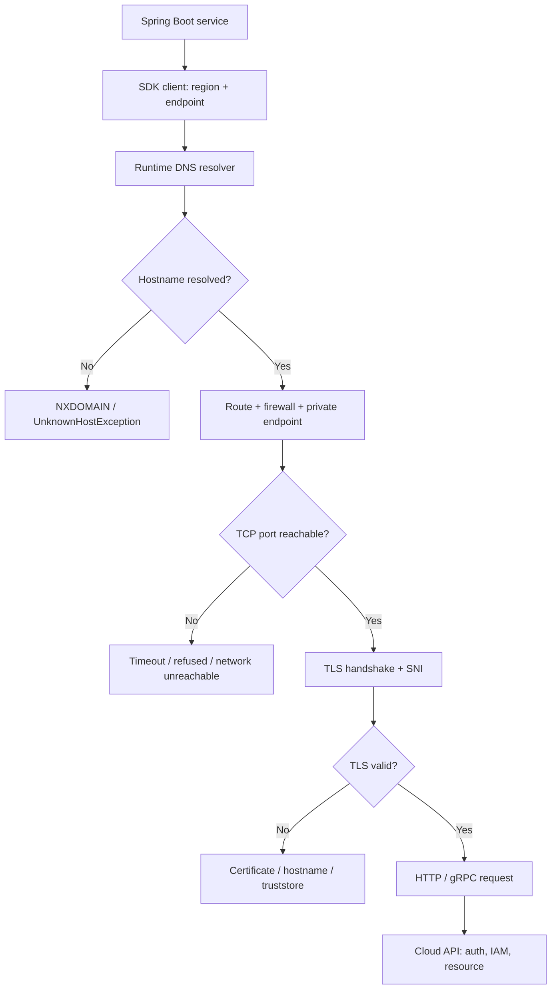

# Wrong region, endpoint, DNS, or private network connectivity

A Spring Boot application may successfully construct an AWS, Azure, or Google Cloud client, yet requests still time out, resolve to the wrong address, connect to the wrong public endpoint, or get rejected when the service only permits private network access. These errors are often mistaken for credential or IAM problems because they surface during API calls.

Separate four configuration layers:

- **Region/location:** where the service or resource resides; the SDK uses this to choose the default endpoint, sign requests, or route traffic.
- **Endpoint:** the hostname and protocol the client actually calls, such as an S3 regional endpoint, Azure Blob FQDN, or Google API endpoint.
- **DNS:** which IP address the hostname resolves to inside the actual network where the application runs.
- **Network path:** whether routes, firewalls, security groups, subnets, private endpoints, proxies, and TLS allow connecting to that destination.

Selecting the right region does not guarantee DNS is right. DNS returning a private IP does not prove routes and firewalls permit traffic to that IP. Conversely, TCP/TLS may connect to a public endpoint while the service still denies the request because the workload is required to go through a private endpoint.

This article walks through diagnosing step by step from client configuration to DNS, TCP, TLS, and provider networking. Examples focus on AWS SDK for Java 2.x, Spring Cloud AWS, Azure SDK for Java, Spring Cloud Azure, Google Cloud Java Client Libraries, and Spring Framework on Google Cloud.

## 1. Distinguishing region, endpoint, DNS, and network

| Component | Question to answer | Misconfiguration example | Symptom |
| --- | --- | --- | --- |
| Region/location | Which region is the client selecting? | S3 client in `us-east-1` while bucket belongs to `ap-southeast-1` | Redirect, signing error, resource not found, or abnormal latency |
| Endpoint | Which hostname is the client calling? | Overriding production endpoint with LocalStack or a test hostname | Connected to wrong service, 404, TLS hostname mismatch |
| DNS | Which IP does the hostname resolve to from runtime? | Private endpoint FQDN returns a public IP | Firewall 403, timeout, or wrong network path |
| Route | Does the subnet have a route to the target IP? | Missing route to VPC endpoint, peering, VPN, or NAT | Timeout |
| Firewall/security group | Is the TCP port permitted? | Egress 443 blocked or endpoint SG rejects traffic | Timeout or connection refused |
| TLS | Does the client complete TLS handshake with the right hostname? | Using raw IP directly, untrusted certificate, wrong SNI | `SSLHandshakeException`, certificate verify failed |
| Proxy | Does the request traverse an unexpected proxy? | JVM proxy or HTTP proxy routes traffic to public network | Unexpected DNS/route, 407, TLS interception |

Do not conclude the cause solely from HTTP status:

- `UnknownHostException` or `NXDOMAIN`: prioritize checking hostname, DNS resolver, private DNS zone, and forwarding.
- `ConnectException: Connection refused`: hostname resolved and the target actively refused TCP, typically due to port/service/listener or firewall reject.
- `SocketTimeoutException` or gRPC `UNAVAILABLE`: could be route, firewall drop, proxy, unreachable endpoint, or overloaded service.
- `SSLHandshakeException`: inspect certificate chain, SNI/hostname, TLS inspection, truststore, and system clock.
- HTTP 401/403/404: generally proves the request reached an HTTP endpoint and received a response; verify the endpoint is the intended one, then classify auth/resource.
- AWS `AuthorizationHeaderMalformed`: typically requires checking signing region and endpoint.
- Azure Storage `AuthorizationFailure`: may relate to network/firewall or policy rather than missing RBAC by default.

## 2. Request flow and diagnostic order

A request to a managed service traverses multiple layers. Identify the first failing layer to isolate the root cause.



Recommended workflow:

1. Extract hostname, port, region, and endpoint from the client's actual configuration.
2. Run DNS lookup directly inside the container, pod, VM, or host running the Java process.
3. Compare the returned IP against the expected public/private IP per architecture.
4. Check routes, security groups/NSGs, network ACLs, firewalls, and proxies.
5. Check TCP port connectivity.
6. Check TLS using the exact hostname and SNI.
7. Send a simple HTTP/gRPC request to confirm the endpoint.
8. Read the cloud service's error code and check IAM/RBAC once the network path is confirmed.

**Always test from the application's runtime environment.** DNS on a laptop can differ from DNS in Kubernetes, Docker, EC2, Azure VNet, or Google Cloud VPC. A command run from an admin workstation does not prove a pod has the same route or access.

## 3. Identifying the actual endpoint used by the Java client

Before testing DNS, know the exact hostname. Do not guess endpoints from resource names.

### 3.1. AWS

AWS SDK for Java 2.x selects endpoints based on service and Region. Examples:

| Service | Example regional endpoint |
| --- | --- |
| Amazon S3 | `s3.ap-southeast-1.amazonaws.com` |
| Amazon SQS | `sqs.ap-southeast-1.amazonaws.com` |
| Amazon SNS | `sns.ap-southeast-1.amazonaws.com` |
| Amazon DynamoDB | `dynamodb.ap-southeast-1.amazonaws.com` |
| AWS STS regional endpoint | `sts.ap-southeast-1.amazonaws.com` |

Do not manually assemble hostnames if the SDK supports default endpoints. S3 also has virtual-hosted-style, access point, dual-stack, accelerate, and custom endpoints; the actual hostname depends on the request and service client configuration.

The AWS SDK for Java 2.x region provider chain evaluates:

1. Region explicitly set via builder `.region(...)`.
2. JVM system property `aws.region`.
3. Environment variable `AWS_REGION`.
4. Region in the active profile of AWS shared config.
5. EC2 instance metadata when running on EC2.
6. If still not found, client creation fails.

A client's region is fixed after building. If an application calls the same service across multiple regions, create a separate client per region.

### 3.2. Azure

Azure SDKs generally take the resource's FQDN endpoint:

| Service | Standard endpoint |
| --- | --- |
| Blob Storage | `https://ACCOUNT.blob.core.windows.net` |
| Data Lake Storage Gen2 | `https://ACCOUNT.dfs.core.windows.net` |
| Azure Queue Storage | `https://ACCOUNT.queue.core.windows.net` |
| Azure Service Bus | `NAMESPACE.servicebus.windows.net` |
| Azure Key Vault | `https://VAULT.vault.azure.net` |

The standard endpoint must match the resource, cloud partition, and service. When using a Private Endpoint, the application still uses the standard FQDN. DNS steers that hostname to a private IP; do not change code to use a `privatelink` hostname simply because you see that name in a DNS CNAME.

For Azure Service Bus, `fullyQualifiedNamespace` is typically `namespace.servicebus.windows.net`. The Java SDK can use AMQP over TLS on TCP 5671/5672 or AMQP over WebSockets on TCP 443 depending on transport configuration.

### 3.3. Google Cloud

Google Cloud APIs typically use standard hostnames:

| Service | Common default endpoint |
| --- | --- |
| Cloud Storage JSON/XML API | `storage.googleapis.com` |
| Pub/Sub | `pubsub.googleapis.com:443` |
| Secret Manager | `secretmanager.googleapis.com:443` |
| Spanner | `spanner.googleapis.com:443` |
| Cloud KMS | `cloudkms.googleapis.com:443` |

Some APIs have dedicated regional or multi-regional endpoints. When using Private Service Connect (PSC) for Google APIs, the hostname may be a custom DNS name for the endpoint, such as a name in the `p.googleapis.com` domain. Use the exact endpoint and DNS mapping provided by your PSC configuration.

For managed databases with private IPs, the hostname/IP and network path can differ from Google API endpoints. For instance, Cloud SQL private IP requires workloads to have a path to the VPC containing the private address; enabling Private Google Access does not automatically create routes to every private database.

## 4. Diagnosing DNS in the right runtime

### 4.1. Linux container, VM, or Kubernetes pod

Use the hostname taken from client configuration:

```bash
getent hosts s3.ap-southeast-1.amazonaws.com
nslookup s3.ap-southeast-1.amazonaws.com
dig +short s3.ap-southeast-1.amazonaws.com
```

Check which DNS resolver the runtime uses:

```bash
cat /etc/resolv.conf
```

If the image lacks `dig`, `nslookup`, or `getent`, run an ephemeral debug container/pod in the same network namespace or use tools already present in the image. Do not arbitrarily install packages into a production image just for one-off diagnostics.

### 4.2. Windows host or Windows container

```powershell
Resolve-DnsName s3.ap-southeast-1.amazonaws.com
nslookup s3.ap-southeast-1.amazonaws.com
Get-DnsClientServerAddress
```

### 4.3. Interpreting DNS results

| Result | Possible meaning | Action to take |
| --- | --- | --- |
| `NXDOMAIN` / name does not exist | Wrong hostname, private zone missing record, or broken forwarding | Check FQDN, private DNS zone, A/CNAME records, and conditional forwarders |
| Returns public IP when private endpoint is required | Private DNS is not applied in the client's network | Check DNS zone link, VPC/VNet association, resolver, and split-horizon DNS |
| Returns correct private IP, but times out | DNS is correct; route/firewall/endpoint approval may be wrong | Check routes, SG/NSG, NACL, firewall, VPN/peering |
| Returns multiple IPs | Service may use multiple AZs/replicas or endpoint has multiple NICs | Check all IPs, routes, and firewalls; do not test only the first IP |
| Laptop returns private IP, but pod returns public IP | The two environments use different resolvers or networks | Check CoreDNS, node DNS, VPC/VNet DNS, and custom forwarding |
| Some replicas resolve while others do not | DNS cache, node in different subnet, or stale record | Compare resolvers, TTL, node/subnet, and private DNS records |

For private endpoints, verify that the standard hostname resolves to the correct private IP inside the permitted network. Never hard-code private IPs into the application, because endpoints can change during recreation, failover, or subnet expansion.

## 5. Testing TCP, TLS, and HTTP

DNS only answers which IP a hostname maps to. It does not prove the port or protocol is ready.

### 5.1. Testing TCP

Linux:

```bash
nc -vz s3.ap-southeast-1.amazonaws.com 443
nc -vz orders.servicebus.windows.net 5671
nc -vz orders.servicebus.windows.net 443
```

Windows PowerShell:

```powershell
Test-NetConnection s3.ap-southeast-1.amazonaws.com -Port 443
Test-NetConnection orders.servicebus.windows.net -Port 5671
Test-NetConnection orders.servicebus.windows.net -Port 443
```

A successful TCP check only confirms a connection can open to that IP/port at the time of testing. It does not prove IAM, tokens, or resource policies are valid.

### 5.2. Testing TLS and SNI

```bash
openssl s_client \
  -connect s3.ap-southeast-1.amazonaws.com:443 \
  -servername s3.ap-southeast-1.amazonaws.com \
  -brief
```

Use the hostname as SNI. If connecting directly to an IP, the TLS certificate may fail hostname verification or the server may fail to pick the right virtual host. Never disable certificate verification in production just to make a connection work.

Common TLS errors:

- `PKIX path building failed`: Java truststore does not trust the certificate chain.
- `No subject alternative DNS name matching`: hostname is not in the certificate SAN.
- `certificate expired` or `not yet valid`: check the certificate and system clock.
- TLS handshake failure after passing through a proxy: proxy inspection may swap certificates or fail to support the required TLS version/ciphers.

### 5.3. Testing HTTP

```bash
curl -v --connect-timeout 5 https://s3.ap-southeast-1.amazonaws.com/
```

A 403/400/404 response from the standard endpoint can still prove DNS, TCP, and TLS are working. Do not treat every HTTP error as a network failure. If the hostname or endpoint is wrong, the response might come from a different service or a proxy.

Do not use `curl -k` as a TLS fix in production. Skipping certificate verification is only useful in an isolated test to separate TLS trust issues from connectivity issues; never keep it in application configuration.

## 6. AWS: region, endpoint, and VPC endpoints

### 6.1. Configuring region in the SDK

Example creating a region-scoped S3 client:

```java
import software.amazon.awssdk.regions.Region;
import software.amazon.awssdk.services.s3.S3Client;

S3Client s3Client = S3Client.builder()
        .region(Region.AP_SOUTHEAST_1)
        .build();
```

Or let the SDK resolve the region from the default provider chain:

```java
S3Client s3Client = S3Client.create();
```

In Spring Cloud AWS, a static region can be configured in application configuration:

```yaml
spring:
  cloud:
    aws:
      region:
        static: ap-southeast-1
```

Only pin a static region when the architecture requires it. If the workload runs on AWS and the client region should match the deployment region, the default region provider chain reduces environment configuration.

### 6.2. Use endpoint override only for specific reasons

The AWS SDK supports `endpointOverride` for LocalStack, test endpoints, proxies, or certain VPC/private endpoint setups. When overriding the endpoint, you must still configure the region because the SDK uses the region for SigV4 signing.

```java
import java.net.URI;
import software.amazon.awssdk.regions.Region;
import software.amazon.awssdk.services.s3.S3Client;

S3Client localS3 = S3Client.builder()
        .region(Region.AP_SOUTHEAST_1)
        .endpointOverride(URI.create("http://localhost:4566"))
        .build();
```

Do not put LocalStack endpoints into production profiles. With a VPC interface endpoint that has Private DNS enabled, applications normally continue using the standard AWS endpoint; DNS inside the VPC resolves the service hostname to the endpoint's private IP. There is no need to override the endpoint with an ENI IP.

The AWS SDK supports endpoints from the client builder, environment variables, JVM system properties, and shared config. Endpoints configured on the request/client take precedence over external configuration. Check these variables when a client calls the wrong host:

```bash
env | cut -d= -f1 | grep -E '^(AWS_ENDPOINT_URL|AWS_ENDPOINT_URL_S3|AWS_REGION|AWS_PROFILE)$'
```

### 6.3. Differences between S3 gateway endpoints and interface endpoints

| Endpoint type | How traffic is routed | Suitable use cases |
| --- | --- | --- |
| Gateway VPC endpoint | Route table uses S3/DynamoDB prefix list; no private endpoint ENI | Workloads inside the VPC accessing S3/DynamoDB in the same region |
| Interface VPC endpoint (PrivateLink) | Private IP ENI in subnet; has security group; can use private DNS | Access via private IP, on-premises via VPN/Direct Connect, peered VPCs, or Transit Gateway depending on architecture |

S3 supports both types. Gateway endpoints do not provide access from on-premises or VPCs in other regions via peering/Transit Gateway. Interface endpoints suit scenarios needing private IP endpoints and hybrid access, though they incur charges.

### 6.4. AWS VPC endpoint checklist

For interface endpoints:

- VPC has DNS resolution and DNS hostnames enabled.
- Endpoint Private DNS name is enabled if you want the SDK to keep calling the standard service hostname.
- Endpoint has subnets/ENIs in the required Availability Zones.
- Security group attached to the endpoint allows inbound TCP 443 from the workload.
- Workload's security group allows egress TCP 443.
- Network ACLs allow both outbound and return traffic.
- Routes, VPC peering, Transit Gateway, or VPN permit a path to the subnet hosting the endpoint.
- VPC endpoint policy does not block the action/resource.
- Endpoint connection state is `Available`.

For S3 gateway endpoints:

- Endpoint is created in the same region as the target bucket/service route.
- Subnet route table contains the endpoint route/prefix list.
- Security groups and NACLs allow HTTPS to the S3 prefix list.
- Bucket policy does not block requests traversing the VPC endpoint.
- Do not expect a gateway endpoint to serve traffic from on-premises or other VPCs.

### 6.5. Region and signing errors

If receiving `AuthorizationHeaderMalformed`, redirects, or messages indicating the bucket is in another region:

1. Verify the bucket's region from the AWS Console/CLI.
2. Verify the region passed into the SDK builder or provider chain.
3. Check endpoint overrides and service-specific endpoints.
4. Check whether an S3 access point ARN specifies a different region and the use-ARN-region option if used.
5. Create separate clients per region when an application accesses multiple regions.

Do not fix region mismatches by switching to a global endpoint or manually building URLs. Let the SDK select the regional endpoint from the right region.

## 7. Azure: Private Endpoint, Private DNS, and service connectivity

### 7.1. Use the standard resource FQDN

Blob Storage example:

```java
import com.azure.core.credential.TokenCredential;
import com.azure.identity.DefaultAzureCredentialBuilder;
import com.azure.storage.blob.BlobServiceClient;
import com.azure.storage.blob.BlobServiceClientBuilder;

TokenCredential credential =
        new DefaultAzureCredentialBuilder().build();

BlobServiceClient blobClient =
        new BlobServiceClientBuilder()
                .endpoint("https://ordersarchive.blob.core.windows.net")
                .credential(credential)
                .buildClient();
```

When the Storage Account uses a Private Endpoint, code still uses `ordersarchive.blob.core.windows.net`. DNS returns a CNAME through the `privatelink` domain and a private IP A record per the VNet's DNS configuration.

Do not change the endpoint in Java to `ordersarchive.privatelink.blob.core.windows.net` just because that name appears in the CNAME. Use the standard service hostname to preserve TLS hostname/SNI and let Azure DNS resolve it properly.

### 7.2. Common private DNS zones

| Service | Private DNS zone |
| --- | --- |
| Blob Storage | `privatelink.blob.core.windows.net` |
| Data Lake Storage Gen2 | `privatelink.dfs.core.windows.net` |
| Queue Storage | `privatelink.queue.core.windows.net` |
| Table Storage | `privatelink.table.core.windows.net` |
| Azure Files | `privatelink.file.core.windows.net` |
| Azure Service Bus | `privatelink.servicebus.windows.net` |
| Azure Key Vault | `privatelink.vaultcore.azure.net` |

If the application uses ADLS Gen2 and operations may redirect between DFS and Blob, check private endpoints/DNS for both `dfs` and `blob`. Creating a private endpoint for one subresource does not automatically provide connectivity for all other subresources.

### 7.3. Azure Private Endpoint checklist

- Private endpoint connection is `Approved`; `Pending`/`Rejected` will not work as expected.
- Private DNS zone with the exact name exists and has an A record pointing to the endpoint's private IP.
- Private DNS zone is linked to the VNet where the workload actually runs.
- If using custom DNS, conditional forwarders/delegation route queries to Azure DNS or an appropriate Azure DNS Private Resolver.
- Pod/VM/App Service can use the DNS resolver linked to the zone.
- NSGs, UDRs, firewalls, and peering allow TCP to the private IP.
- If Storage public network access is disabled, the workload must traverse the private endpoint.
- For copies between two Storage Accounts, check the network path to both source and destination.
- Never hard-code private IPs into connection strings or code.

For Azure App Service/Functions, verify VNet integration for outbound traffic. For AKS, verify node VNet/subnet, pod network model, CoreDNS, custom DNS, and the path from pod to private endpoint.

### 7.4. Checking Blob DNS

Run inside a VM/pod in the same VNet:

```bash
nslookup ordersarchive.blob.core.windows.net
```

Expected output on a private network typically shows an alias like `ordersarchive.privatelink.blob.core.windows.net` and an A record with the endpoint's private IP. If it returns a public IP, check the private DNS zone link, A record, DNS forwarder, and resolver used by the pod.

DNS and access control are independent. A successful DNS lookup does not prove the private connection is approved or that IAM/RBAC permits the operation.

### 7.5. Azure Service Bus: ports and transport

The Service Bus Java SDK normally uses AMQP over TLS on TCP 5671/5672. If the environment only permits outbound HTTPS, you can select AMQP over WebSockets on TCP 443:

```java
import com.azure.core.credential.TokenCredential;
import com.azure.identity.DefaultAzureCredentialBuilder;
import com.azure.messaging.servicebus.AmqpTransportType;
import com.azure.messaging.servicebus.ServiceBusClientBuilder;

TokenCredential credential = new DefaultAzureCredentialBuilder().build();

ServiceBusClientBuilder builder = new ServiceBusClientBuilder()
        .fullyQualifiedNamespace("orders.servicebus.windows.net")
        .credential(credential)
        .transportType(AmqpTransportType.AMQP.AMQP_WEB_SOCKETS);
```

WebSockets run over TCP 443, though you must check whether proxies support WebSocket upgrades and proper TLS passthrough. Do not assume switching transport to WebSockets will fix all DNS or private endpoint issues.

With Service Bus Private Link:

- Standard DNS `namespace.servicebus.windows.net` must resolve to the private IP.
- Private DNS zone `privatelink.servicebus.windows.net` is linked to the right VNet.
- Private endpoint connection is `Approved`.
- NSGs/UDRs allow TCP 5671/5672, or TCP 443 if using WebSockets.
- Workloads such as App Service/Functions are VNet-integrated to reach the private endpoint.

Azure may allow the DNS/TCP handshake to the public endpoint and then reject at the application layer when public access is disabled. Therefore, a successful TCP connection does not prove requests traversed the private endpoint.

## 8. Google Cloud: Private Google Access, Private Service Connect, and private databases

### 8.1. Distinguishing private connectivity types

| Mechanism | What is it used for? | What to check |
| --- | --- | --- |
| Private Google Access (PGA) | Internal-IP-only VMs reaching Google APIs/services via Google API external IPs | PGA enabled on the right subnet; DNS, routes, and firewall are correct |
| Private Service Connect (PSC) for Google APIs | Creates a private IP endpoint inside a VPC to reach Google APIs | Endpoint, forwarding rule, DNS zone, and routes to PSC IP |
| Private services access | Private connection to managed services published via Service Networking, such as some private-IP databases | Service Networking connection, allocated range, and routes |
| PSC to managed services | Private connection to a service producer via PSC per supported service | Endpoint/subnet, service attachment, and DNS per service documentation |

PGA does not create a private IP for Google APIs. It allows internal-IP-only VMs to send requests to Google APIs' public IP addresses over Google's network. PGA is enabled per subnet.

PSC for Google APIs creates an internal IP endpoint in the VPC. Clients may need to use a custom DNS name pointing to the PSC endpoint. Certain regional/multi-regional Google API endpoints require an appropriate PSC setup; PGA does not support regional/multi-regional endpoints ending in `rep.googleapis.com`.

Private services access/PSC for databases is a separate problem from accessing Google APIs. For example, Cloud SQL with a private IP requires a route from the workload to the VPC and database IP range; enabling PGA does not automatically grant a route to that private IP.

### 8.2. Private Google Access

If an internal-IP-only VM needs to call Cloud Storage, Pub/Sub, or other Google APIs:

- Enable Private Google Access on the VM's subnet.
- Check routes to Google APIs and the default internet gateway per architecture.
- Check egress firewall rules allowing HTTPS TCP 443.
- Check DNS resolution of the API hostname.
- Verify the workload is not diverted to another endpoint by a proxy or route policy.

PGA does not affect VMs with external IPs in the same way; VMs with external IPs can reach Google APIs per the VPC's internet access requirements.

### 8.3. Private Service Connect and DNS

When using PSC for Google APIs:

- Identify the configured PSC endpoint IP and DNS name.
- Create the Cloud DNS private zone or required DNS records so API hostnames resolve to the endpoint.
- Ensure the private zone is applied to the VPC and relevant hybrid networks.
- If a client does not support `p.googleapis.com` hostnames, configure DNS for standard API hostnames to point to the PSC endpoint following Google's documentation.
- Check routes, egress firewall rules, and endpoint status.
- If calling a regional API, verify the endpoint supports that region/service.

Do not blindly create an A record for all `*.googleapis.com` pointing to one IP without following PSC guidance. A misconfigured DNS wildcard can misroute APIs not included in that endpoint bundle.

### 8.4. Configuring endpoints in Google Cloud Java clients

The Cloud Storage Java Client allows setting the host:

```java
import com.google.cloud.storage.Storage;
import com.google.cloud.storage.StorageOptions;

Storage storage = StorageOptions.newBuilder()
        .setProjectId("provider-integration-prod")
        .setHost("https://storage.googleapis.com")
        .build()
        .getService();
```

If PSC provides a dedicated endpoint hostname, set the host to the configured and tested endpoint. Do not replace the host with a raw IP if the TLS certificate does not match the hostname.

The Pub/Sub Java Publisher allows overriding the gRPC endpoint:

```java
import com.google.cloud.pubsub.v1.Publisher;
import com.google.pubsub.v1.TopicName;

Publisher publisher = Publisher.newBuilder(
        TopicName.of("messaging-prod", "orders-created"))
        .setEndpoint("pubsub.googleapis.com:443")
        .build();
```

When using a PSC endpoint, pass the endpoint hostname/port required by your PSC setup. If the Spring Framework on Google Cloud starter already creates `PublisherFactory`/`Publisher` beans, use the module's supported extension/customizer or a separate client bean for your exact release line rather than assuming all endpoint properties are identical across versions.

### 8.5. Cloud SQL and private IP

If the application connects to Cloud SQL over a private IP:

- The workload must reside in a VPC with a route to Cloud SQL's private IP or a network connected via peering/VPN/Interconnect per architecture.
- Check private services access or PSC connection for the exact instance type.
- Check DNS/hostname if the connector or JDBC URL uses a hostname.
- Check firewall/egress rules and the database port.
- If using the Cloud SQL Java Connector, remember the connector does not replace the network connectivity required for a private IP. It handles authentication and establishes a secured connection, but the workload must still have a network path to the instance.

Similarly, for AWS RDS private endpoints and Azure Database private endpoints, verify routes, DNS, and firewalls from the workload to the private address; the API control plane's region does not prove data connections can traverse a private subnet.

## 9. Checking proxies, truststores, and TLS in Java

A `curl` command might route through a different proxy than the Java SDK. Check:

- JVM system properties such as `https.proxyHost`, `https.proxyPort`, `http.nonProxyHosts`.
- Environment variables `HTTPS_PROXY`, `HTTP_PROXY`, `NO_PROXY` if the SDK's HTTP transport honors them.
- Transport-specific proxy settings for AWS Apache/Netty HTTP clients, Azure `HttpClient`, and Google GAX transport.
- JVM truststore (`javax.net.ssl.trustStore`) and the proxy's certificate authority.
- Whether TLS inspection/firewalls swap certificates.
- Whether SNI hostname and certificate SAN match the endpoint.

Do not assume every Java SDK reads the same set of proxy environment variables. One SDK may use Netty, another Apache HTTP Client or gRPC Netty; proxies must be configured for the transport in use.

You can inspect configured system properties without printing secrets:

```java
System.out.println("https.proxyHost=" +
        System.getProperty("https.proxyHost"));
System.out.println("https.proxyPort=" +
        System.getProperty("https.proxyPort"));
System.out.println("http.nonProxyHosts=" +
        System.getProperty("http.nonProxyHosts"));
```

When TLS diagnostics are required, you can enable JSSE debug in a test environment:

```bash
java -Djavax.net.debug=ssl,handshake -jar orders-api.jar
```

TLS output is very verbose and can contain hostname/certificate metadata. Enable it only briefly, collect it in a controlled manner, and do not paste raw logs onto public tickets.

## 10. Environment-specific Spring Boot configuration

### 10.1. Separating region, endpoint, and private network settings

Example application configuration with a dedicated custom namespace:

```yaml
app:
  cloud:
    aws:
      region: ap-southeast-1
      s3-endpoint: ""
    azure:
      blob-endpoint: https://ordersarchive.blob.core.windows.net
      servicebus-namespace: orders.servicebus.windows.net
    gcp:
      project-id: provider-integration-prod
      storage-endpoint: https://storage.googleapis.com
```

Endpoint values are hostnames/URLs containing no credentials. A local profile can set emulator endpoints; a production profile typically lets the SDK use standard endpoints while private DNS/routing determines the path.

Local profile example:

```yaml
# application-local.yml
app:
  cloud:
    aws:
      region: ap-southeast-1
      s3-endpoint: http://localhost:4566
    gcp:
      storage-endpoint: http://localhost:9023
```

Never allow emulator endpoints to be inherited into production. Use validation to reject `localhost` hostnames or non-allowlisted endpoints when the production profile starts up.

### 10.2. Creating an AWS client with an optional endpoint

```java
import java.net.URI;
import org.springframework.beans.factory.annotation.Value;
import org.springframework.context.annotation.Bean;
import org.springframework.context.annotation.Configuration;
import software.amazon.awssdk.regions.Region;
import software.amazon.awssdk.services.s3.S3Client;
import software.amazon.awssdk.services.s3.S3ClientBuilder;

@Configuration
public class AwsStorageConfiguration {

    @Bean
    S3Client s3Client(
            @Value("${app.cloud.aws.region}") String region,
            @Value("${app.cloud.aws.s3-endpoint:}") String endpoint) {

        S3ClientBuilder builder = S3Client.builder()
                .region(Region.of(region));

        if (endpoint != null && !endpoint.isBlank()) {
            builder.endpointOverride(URI.create(endpoint));
        }

        return builder.build();
    }
}
```

In a real application, bind values from your own configuration prefix using `@ConfigurationProperties` or `@Value` with matching property keys. In production, leave the endpoint blank if using the AWS default endpoint and VPC endpoint private DNS. If the endpoint is overridden, verify the request-signing region, TLS certificate, hostname, and endpoint policy.

### 10.3. Azure client using standard endpoint

```java
import com.azure.core.credential.TokenCredential;
import com.azure.storage.blob.BlobServiceClient;
import com.azure.storage.blob.BlobServiceClientBuilder;
import org.springframework.beans.factory.annotation.Value;
import org.springframework.context.annotation.Bean;

@Bean
BlobServiceClient blobServiceClient(
        @Value("${app.cloud.azure.blob-endpoint}") String endpoint,
        TokenCredential credential) {

    return new BlobServiceClientBuilder()
            .endpoint(endpoint)
            .credential(credential)
            .buildClient();
}
```

Private Endpoints do not require changing the hostname in the bean. Fix the DNS zone/resolver and network path so the standard endpoint resolves to the private IP.

### 10.4. Google Cloud client using configured endpoint

```java
import org.springframework.beans.factory.annotation.Value;
import org.springframework.context.annotation.Bean;
import com.google.cloud.storage.Storage;
import com.google.cloud.storage.StorageOptions;

@Bean
Storage storage(
        @Value("${app.cloud.gcp.project-id}") String projectId,
        @Value("${app.cloud.gcp.storage-endpoint}") String endpoint) {

    return StorageOptions.newBuilder()
            .setProjectId(projectId)
            .setHost(endpoint)
            .build()
            .getService();
}
```

If using a starter and auto-configured beans, avoid accidentally declaring a duplicate bean of the same type. When a custom endpoint is needed, use module-supported configuration or define a separate bean with a qualifier; verify properties and customizers for your exact release line.

If using the Spring Framework on Google Cloud Storage starter, the module also provides `spring.cloud.gcp.storage.host` to change the host for the auto-configured `Storage` bean. The current reference describes values following host format, such as `storage.googleapis.com/`; verify the exact format for the release in use. This property does not replace endpoint configuration for Pub/Sub, Spanner, or Cloud SQL.

## 11. Symptom-based troubleshooting matrix

| Symptom | Possible cause | How to verify |
| --- | --- | --- |
| AWS SDK reports region not found or client creation fails | Missing region in builder, JVM, env, profile, or IMDS | Check `aws.region`, `AWS_REGION`, active profile, and EC2 metadata |
| S3 returns `AuthorizationHeaderMalformed` | Request signing region differs from bucket region, or wrong endpoint override | Verify bucket region, client region, and endpoint |
| AWS requests still hit public endpoint | Private DNS not enabled or app not using VPC resolver | Resolve regional hostname from runtime; check interface endpoint private DNS |
| AWS S3 times out over gateway endpoint | Route table missing endpoint, wrong region, or SG/NACL blocks 443 | Check endpoint route, prefix list, SG/NACL, and bucket region |
| AWS PrivateLink times out | Endpoint SG denies inbound 443, wrong endpoint subnet/route or NACL | Check ENI private IP, endpoint SG, subnet, and routes |
| Azure Storage returns 403 over private endpoint | Standard FQDN resolves to public IP, firewall rejects public path | `nslookup` standard hostname; check private DNS zone and network logs |
| Azure private FQDN returns `NXDOMAIN` | Private zone not linked to VNet or missing A record | Check zone group, VNet link, custom DNS forwarder |
| Azure Blob works, but ADLS DFS fails | Private endpoint/DNS exists only for `blob`, missing `dfs` | Check both `blob` and `dfs` subresources/zones |
| Service Bus times out | Port 5671/5672 blocked or wrong private endpoint/DNS | Test TCP 5671/5672; try WebSockets 443 if policy permits |
| Service Bus TCP succeeds, but SDK still fails | DNS points to public endpoint, connection blocked at application layer, or wrong TLS/AMQP | Check private IP, endpoint approval, transport, and request exception |
| Google VM without external IP cannot reach APIs | PGA not enabled on subnet, or wrong egress/DNS | Check PGA subnet, routes, firewall TCP 443 |
| Google API hostname resolves to public IP when PSC is intended | DNS zone does not point hostname to PSC endpoint | Check Cloud DNS private zone, records, VPC association |
| Google regional API fails over PGA | PGA does not support regional/multi-regional endpoints | Use an appropriate PSC endpoint and endpoint hostname per docs |
| Cloud SQL private IP times out | Workload lacks route/peering to database VPC | Check private services access/PSC, VPC routes, and firewall |
| Java throws `UnknownHostException`, but `curl` on laptop works | Runtime uses a different resolver | Run DNS lookup inside the pod/container/VM |
| Java throws `SSLHandshakeException`, but TCP succeeds | Truststore, SNI, proxy TLS inspection, or certificate | Test with `openssl` and SNI, check JVM truststore and proxy |
| Java times out, but `curl` works | SDK uses a different proxy/HTTP transport or timeout is too short | Check HTTP client, proxy, DNS cache, and SDK transport |
| Only some pods fail | Different node/subnet/zone, DNS cache, or inconsistent policy | Compare node, subnet, resolver, routes, and network policies |
| Still uses old IP after changing private endpoint | DNS cache or JVM/OS resolver cache | Check TTL, perform controlled restart/rollout, and check DNS cache |
| API returns 401/403/404 | Request reached an endpoint, but endpoint/resource/auth may be wrong | Verify endpoint, error code, and request ID before blaming IAM |

## 12. Lab: diagnosing three private endpoints from a Spring Boot workload

Goal: an Orders API running in Kubernetes needs to access S3, Azure Blob Storage, and Google Cloud Storage over private networks. Verify each provider from inside the actual pod.

### Step 1 — Record hostnames and ports

| Provider | Hostname used by app | Port |
| --- | --- | --- |
| AWS S3 | `s3.ap-southeast-1.amazonaws.com` | 443 |
| Azure Blob | `ordersarchive.blob.core.windows.net` | 443 |
| Google Cloud Storage | `storage.googleapis.com` or assigned PSC hostname | 443 |

Record the region/project and private connectivity type deployed for each service. Do not manually replace standard hostnames with private IPs.

### Step 2 — Check DNS from the pod

```bash
kubectl exec deploy/orders-api -- nslookup s3.ap-southeast-1.amazonaws.com
kubectl exec deploy/orders-api -- nslookup ordersarchive.blob.core.windows.net
kubectl exec deploy/orders-api -- nslookup storage.googleapis.com
```

If the container lacks `nslookup`, use a debug container in the same pod/network namespace. Record the CNAME chain and all A/AAAA records.

Expected results:

- AWS: hostname resolves per endpoint type (gateway endpoint routes via S3 prefix list; interface endpoint with private DNS returns a private IP).
- Azure: standard FQDN resolves via private link alias to the private endpoint IP.
- Google: if using PGA, the API hostname may return public IPs while traffic traverses Google's network; if using PSC, the configured hostname must resolve to the PSC internal IP.

### Step 3 — Check TCP and TLS

```bash
kubectl exec deploy/orders-api -- nc -vz s3.ap-southeast-1.amazonaws.com 443
kubectl exec deploy/orders-api -- nc -vz ordersarchive.blob.core.windows.net 443
kubectl exec deploy/orders-api -- nc -vz storage.googleapis.com 443
```

If the image lacks `nc`, use a debug container or an available TCP testing tool. Then perform a TLS handshake using the standard SNI hostname.

### Step 4 — Check provider network paths

AWS:

- Confirm the workload is in a VPC/subnet with appropriate routes.
- Check the S3 gateway endpoint or interface endpoint per architecture.
- Check endpoint policy, SG, NACL, and bucket region.

Azure:

- Confirm the private endpoint connection is `Approved`.
- Check the `privatelink.blob.core.windows.net` zone and VNet link.
- Check NSG, UDR, VNet integration, and public network access policy.

Google Cloud:

- If PGA: verify PGA is enabled on the subnet.
- If PSC: verify endpoint IP, forwarding rule, and Cloud DNS.
- If using a private database: verify private services access/PSC and routes to the database IP.

### Step 5 — Call the API with the actual SDK client

Use the current identity/runtime configuration to perform a safe operation such as reading metadata of a test object. Record the provider error code, request ID, and timestamp.

- DNS/TCP/TLS failure: keep troubleshooting networking.
- HTTP 401 or authentication exception: endpoint is reachable; check credentials.
- HTTP 403 or permission denied: check IAM/RBAC, endpoint policy, firewall/application layer.
- HTTP 404 or resource not found: check resource name, account/project/region, and API semantics.

### Step 6 — Compare across pods

If only one pod fails, compare node, subnet, zone, DNS resolver, CoreDNS responses, NetworkPolicy, and proxy variables. Do not alter project-wide IAM policies when the failure only occurs in one subnet or node pool.

This lab is complete when each client uses the right hostname/region, DNS returns results matching the architecture, TCP/TLS succeeds, and the SDK receives responses from the intended cloud service.

## 13. Operational principles

- Configure region/location explicitly according to resource topology; do not share one region across every provider.
- Prefer default SDK endpoints when possible; only override for emulators, PSC, or specific endpoint architectures.
- When overriding an AWS endpoint, still set the accurate signing region.
- Use standard FQDN hostnames instead of hard-coding private IPs.
- For Azure Private Endpoints, configure private DNS zones and link them to the right VNet; keep standard hostnames in connection strings.
- For AWS interface endpoints, check private DNS, endpoint SGs, and NACLs; for S3 gateway endpoints, check route tables/prefix lists.
- For Google Cloud, distinguish PGA, PSC for Google APIs, and private services access to managed databases.
- Run DNS/TCP/TLS tests from the exact container/pod/VM with the same network identity as the Java process.
- Check proxies and truststores according to the SDK's actual HTTP transport.
- Never use `curl -k`, disable TLS verification, or hard-code IPs as a production fix.
- When an HTTP response arrives, save status, provider error code, and request ID; separate network issues from IAM/RBAC.
- Manage private DNS, routes, and firewall policies via IaC; track changes to zones, endpoints, and subnets.
- After changing DNS/endpoints, verify TTL/caching and test across all replicas/Availability Zones.

## 14. Key takeaways

- Region picks the service area and can affect endpoints/signing; endpoint is the hostname the client calls; DNS maps the hostname to an IP; network determines the path.
- AWS SDK for Java 2.x has a default region provider chain. Built clients are immutable; use multiple clients for multiple regions.
- AWS `endpointOverride` still requires a region for SigV4. With VPC interface endpoint private DNS, normally keep the standard service hostname so DNS steers traffic to the private ENI.
- S3 gateway endpoints use route tables/prefix lists; interface endpoints use private ENI IPs and can serve hybrid networks per architecture.
- Azure Private Endpoints require standard DNS to resolve to a private IP. Use `privatelink.*` zones for DNS; do not swap application FQDNs for `privatelink` hostnames.
- Azure Blob/DFS may need private endpoints for both `blob` and `dfs`; Service Bus uses `privatelink.servicebus.windows.net`.
- Service Bus typically requires TCP 5671/5672; AMQP over WebSockets uses TCP 443 if supported by clients/proxies.
- Google PGA lets internal-only VMs reach Google APIs; PSC creates a private endpoint inside a VPC; private services access is a separate mechanism for private-IP managed services.
- PGA does not support regional/multi-regional Google API endpoints; check PSC when those endpoints are needed.
- `UnknownHostException` points toward DNS; timeouts point toward routes/firewalls/endpoints; `SSLHandshakeException` points toward TLS/truststore/SNI; HTTP 401/403/404 usually require API-level checks after confirming the endpoint.
- Always test from the real runtime, not just a laptop. DNS, proxies, routes, and firewalls can differ between hosts, pods, and nodes.

## Official reference documentation

1. [AWS SDK for Java 2.x — Setting the AWS Region](https://docs.aws.amazon.com/sdk-for-java/latest/developer-guide/region-selection.html)
2. [AWS SDK for Java 2.x — Configuring client endpoints](https://docs.aws.amazon.com/sdk-for-java/latest/developer-guide/endpoint-config.html)
3. [AWS PrivateLink — Create an interface VPC endpoint](https://docs.aws.amazon.com/vpc/latest/privatelink/create-interface-endpoint.html)
4. [AWS VPC — Gateway endpoints for Amazon S3](https://docs.aws.amazon.com/vpc/latest/privatelink/vpc-endpoints-s3.html)
5. [Amazon S3 — PrivateLink interface endpoints](https://docs.aws.amazon.com/AmazonS3/latest/userguide/privatelink-interface-endpoints.html)
6. [Azure Storage — Use private endpoints](https://learn.microsoft.com/en-us/azure/storage/common/storage-private-endpoints)
7. [Azure — Private Endpoint DNS zone values](https://learn.microsoft.com/en-us/azure/private-link/private-endpoint-dns)
8. [Azure — Private Endpoint DNS integration scenarios](https://learn.microsoft.com/en-us/azure/private-link/private-endpoint-dns-integration)
9. [Azure Service Bus — Private Link and troubleshooting](https://learn.microsoft.com/en-us/azure/service-bus-messaging/private-link-service)
10. [Azure Service Bus — Network ports and AMQP over WebSockets](https://learn.microsoft.com/en-us/azure/service-bus-messaging/service-bus-faq)
11. [Azure Service Bus Java — ServiceBusClientBuilder and transportType](https://learn.microsoft.com/en-us/java/api/com.azure.messaging.servicebus.servicebusclientbuilder?view=azure-java-stable)
12. [Google Cloud — Private Google Access](https://docs.cloud.google.com/vpc/docs/private-google-access)
13. [Google Cloud — Private access options for services](https://docs.cloud.google.com/vpc/docs/private-access-options)
14. [Google Cloud — Access regional and multi-regional APIs through private endpoints](https://docs.cloud.google.com/docs/security/compliance/access-regional-google-apis-endpoints)
15. [Google Cloud Storage — Request endpoints and Java client configuration](https://docs.cloud.google.com/storage/docs/request-endpoints)
16. [Google Cloud Storage Java — StorageOptions.Builder](https://docs.cloud.google.com/java/docs/reference/google-cloud-storage/latest/com.google.cloud.storage.StorageOptions.Builder)
17. [Google Cloud Pub/Sub Java — Publisher.Builder endpoint](https://docs.cloud.google.com/java/docs/reference/google-cloud-pubsub/latest/com.google.cloud.pubsub.v1.Publisher.Builder)
18. [Spring Cloud AWS 3.4 — Region configuration](https://docs.awspring.io/spring-cloud-aws/docs/3.4.2/reference/html/index.html)
19. [Spring Framework on Google Cloud — Cloud Storage configuration properties](https://googlecloudplatform.github.io/spring-cloud-gcp/reference/html/)

Property names, endpoints, and private connectivity capabilities depend on the service, region, and SDK version. When applying these steps to a real system, verify the exact service endpoint/port and test DNS/routes/firewalls inside the workload's actual runtime environment before changing credentials or IAM policies.
