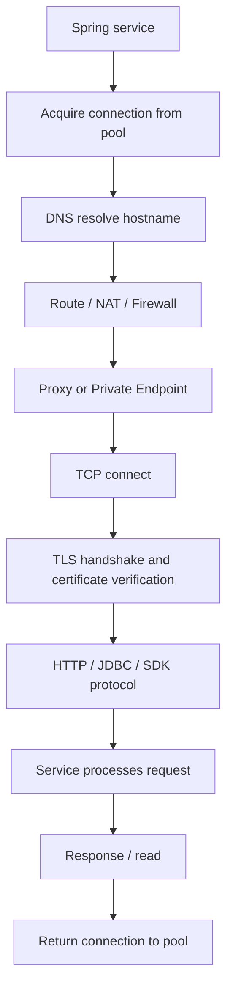

# Timeouts, TLS, proxy, and connection pool exhaustion

When Spring Boot calls a managed service on AWS, Azure, or Google Cloud, connectivity errors commonly surface as timeouts, TLS handshake failures, proxy errors, or exhausted connection pools. The symptoms may look identical at the API layer, yet their root causes live in different layers: DNS, network routes, firewalls, proxies, TLS, HTTP/JDBC clients, pools, or the target service itself.

Effective diagnostics require identifying **which step the application is waiting on** and **which resource is exhausted**. `Connection timed out` when opening TCP is not the same as `Read timed out` after connecting; `PKIX path building failed` is not a firewall issue; Hikari's `Connection is not available, request timed out` usually means waiting to borrow a connection from the pool, not necessarily that the database is unreachable.

This lesson builds a layer-by-layer investigation workflow, illustrates timeout configuration for JDBC and HTTP clients in Spring Boot, explains how to handle TLS/proxies, and shows how to analyze connection pool exhaustion. The principles apply to connections to databases, object storage, message brokers, APIs, and managed services across multiple cloud providers.

After this lesson, you can:

- Distinguish DNS timeout, TCP connect timeout, TLS handshake timeout, response/read timeout, and pool-acquire timeout.
- Read common exceptions to isolate the root cause.
- Verify DNS, routes, ports, proxies, certificate chains, and hostnames from the application's actual runtime environment.
- Configure timeouts, TLS, and proxies for JDBC/WebClient within each client's boundaries.
- Analyze HikariCP and HTTP connection pools, spotting leaks, excessive load, and slow queries.
- Design retries, backoff, pool sizing, and monitoring without amplifying incidents.

## 1. Tracing the path of a connection

A request from Spring Boot to a managed service can pass through the following steps:



Not every client executes these steps in the exact order shown: for instance, a proxy might be resolved/connected first, TLS might be established with a proxy before tunneling to the destination, or a connection already exists in the pool so the request skips a new handshake. The diagram helps pinpoint where waiting time can accumulate.

| Layer | Question to answer | Common error signs |
|---|---|---|
| Pool acquisition | Is an idle connection available? | Hikari `Connection is not available`; Reactor Netty `Pending acquire queue has reached its maximum size` |
| DNS | Does the hostname resolve to the right IP? | `UnknownHostException`, DNS resolution timeout |
| Network/TCP | Is there a route and permission to open a connection to IP:port? | `ConnectException`, `Connection timed out`, `No route to host` |
| Proxy | Is the request traversing the proxy properly? | HTTP `407`, `502`, `504`, `CONNECT` tunnel failure |
| TLS | Are the certificate, hostname, protocol, and client certificate valid? | `SSLHandshakeException`, `PKIX path building failed`, hostname mismatch |
| Protocol/response | Did the server receive the request and reply within the deadline? | `SocketTimeoutException: Read timed out`, HTTP 5xx, JDBC query timeout |
| Pool return | Is the connection returned after use? | Active connections stay high, pending borrowers grow, leak detection alerts |

## 2. Distinguishing timeout types

The word "timeout" is routinely used for many different limits. Before changing configuration, identify which timer expired.

| Timeout type | When does it start counting? | Where is it typically configured? | Meaning when expired |
|---|---|---|---|
| DNS resolution timeout | When the client needs to resolve a hostname | Resolver/OS, DNS client, or runtime | Could not resolve an IP within the allotted time |
| Pool acquisition timeout | When the application requests a connection from the pool | Hikari `connectionTimeout`, Reactor Netty `pendingAcquireTimeout` | The pool could not provide a connection in time |
| TCP connect timeout | When the client opens a socket to the server/proxy | JDBC driver, HTTP client, socket | Could not establish a TCP connection |
| TLS handshake timeout | While both sides negotiate TLS | TLS engine/client, handshake wrapper timeout | Handshake did not complete; could be network, proxy, or TLS negotiation |
| Response/read timeout | After sending a request or waiting for data | HTTP client, JDBC driver, SDK | Server stopped sending data within the limit |
| Query/statement timeout | While the database executes a statement | JDBC `Statement`, JPA/provider, database | Query exceeded the allowed business duration |
| Overall request deadline | From start of processing until a result must be returned | Gateway, application, resilience layer | The entire request ran out of time budget |

### 2.1. Reading exceptions accurately

| Exception/message | Initial investigation direction |
|---|---|
| `java.net.UnknownHostException` | Hostname, DNS resolver, private DNS zone, search domain, and endpoint configuration |
| `java.net.ConnectException: Connection refused` | IP may be reachable, but the port is not listening or a firewall actively rejected it; check endpoint/port/service state |
| `java.net.SocketTimeoutException: connect timed out` | TCP handshake did not complete; check routes, firewalls, NAT, security groups, and proxies |
| `java.net.SocketTimeoutException: Read timed out` | Connection was established, but the response/read phase was slow; check server, query, payload, and read timeout |
| `javax.net.ssl.SSLHandshakeException` | Certificate chain, hostname, SNI, client certificate, TLS protocol/ciphers, and proxy interception |
| `sun.security.validator.ValidatorException: PKIX path building failed` | JVM could not build a chain to a trusted CA; check CA bundle/truststore and certificate chain |
| HTTP `407 Proxy Authentication Required` | Proxy requires authentication or proxy credentials are wrong |
| HTTP `502` / `504` from proxy/gateway | Proxy could not connect upstream or upstream did not respond in time; determine whether the proxy or target service generated the response |
| Hikari `Connection is not available, request timed out` | No connection was granted within `connectionTimeout`; check pool, leaks, queries, and DB capacity |
| Reactor Netty `PoolAcquireTimeoutException` | Could not acquire a connection from the HTTP pool; check max connections, pending queue, and hold times |

Note: Java's standard TLS exception package is `javax.net.ssl` even in Spring Boot 3 applications using Jakarta for persistence/validation APIs. Do not assume TLS packages moved to `jakarta`.

### 2.2. Setting timeouts according to an end-to-end budget

Layer timeouts must fit inside the overall deadline. For example, an API with an 8-second deadline should not let one downstream call wait 15 seconds and then retry twice more. In that case, the request expires before completing.

An illustrative allocation for an API with an 8-second deadline:

| Component | Example budget |
|---|---:|
| Pool wait | 0.5 seconds |
| TCP/TLS connect (if a new connection is needed) | 1.5 seconds |
| Service call and response read | 4 seconds |
| Processing/serialization and buffer | 2 seconds |

This is only an example. Measure p95/p99, determine service SLAs, and allocate time along the real path. Timeouts are not a substitute for resource limits; if a server consistently responds slowly, raising timeouts may only keep more requests holding threads/connections longer.

## 3. Diagnosing step by step from the runtime environment

Perform checks from the exact pod/container/VM running the application whenever possible. Results from a laptop or admin machine do not prove the workload shares the same DNS, routes, firewalls, proxies, or truststore.

### 3.1. Verify endpoint and DNS

Check the hostname from runtime configuration, especially for private endpoints. A common mistake is production still pointing to a public endpoint, a staging hostname, or an endpoint in another region.

On Linux/containers:

```bash
getent hosts <service-hostname>
nslookup <service-hostname>
```

On Windows PowerShell:

```powershell
Resolve-DnsName <service-hostname>
```

Verify whether the result returns the private/public IP expected by the design. For private endpoints, the hostname may require a private DNS zone or records linked to the right VPC/VNet/network. Never hard-code IPs to bypass DNS errors: managed service IPs can change, span multiple nodes, or depend on region/zone.

### 3.2. Check TCP ports and network path

Linux:

```bash
nc -vz -w 3 <service-hostname> <port>
```

Windows PowerShell:

```powershell
Test-NetConnection -ComputerName <service-hostname> -Port <port>
```

If TCP cannot open, check:

- Hostname and port match the service's endpoint.
- Routes from the subnet/pod/VM to the target network.
- Security groups, network ACLs, NSGs, VPC/VNet firewalls, or firewall policies.
- NAT gateway, route tables, and outbound egress if traffic traverses the Internet.
- Private endpoint/PrivateLink/Private Service Connect and DNS mapping.
- Source IP allowlists on the managed service, if the service uses an allowlist mechanism.
- Whether a proxy is a mandatory path for outbound traffic.

Successful TCP only confirms a socket can open to `host:port`. It does not confirm TLS, authentication, service account permissions, or request protocol behavior.

### 3.3. Test TLS directly

For TLS endpoints, you can use OpenSSL from the same network environment:

```bash
openssl s_client -connect <service-hostname>:443 \
  -servername <service-hostname> -showcerts
```

Observe the certificate chain, subject/SAN, issuer, validity, and verification result. `-servername` sends SNI; omitting SNI can cause a server/proxy to return a default certificate that does not match the hostname. If the endpoint uses a port other than 443, substitute the corresponding port.

For HTTP, `curl` helps inspect the handshake and response:

```bash
curl -v --connect-timeout 3 --max-time 8 \
  https://<service-hostname>/<health-path>
```

Do not use `curl -k` as a way to confirm TLS works in production; that flag skips certificate verification. It can temporarily help separate trust issues from connectivity issues in a controlled test environment, but it is never a production fix.

## 4. TLS and certificate errors

TLS protects data in transit and verifies the server's identity. If a client disables certificate verification "just to make it work", connections can be spoofed without the application noticing.

### 4.1. Common causes

| Symptom | Possible cause | How to check |
|---|---|---|
| `PKIX path building failed` | Missing root/intermediate CA or server did not send full chain | Inspect chain with OpenSSL; verify CAs issued by provider/internal PKI |
| `No subject alternative DNS name matching ...` | Configured hostname is not in the certificate SAN | Use the official DNS endpoint published by the provider; check private DNS overrides |
| `certificate expired` / `NotAfter` | Certificate expired or system clock is wrong | Check certificate validity dates and host/container NTP/clock |
| `unknown_ca` | Client does not trust the server's CA or TLS-inspecting proxy | Check issuer and truststore in the exact environment |
| `handshake_failure` / `protocol_version` | Incompatible TLS version, cipher suite, or policy | Compare endpoint TLS policy against JDK/client version |
| Server requests client certificate | mTLS not configured or wrong certificate/key | Check client keystore, certificate chain, private key, and file permissions |
| Fails only through proxy | Proxy inspection swaps certificates or `CONNECT` tunnel is blocked | Compare issuer/chain directly vs. via proxy; check proxy policy |

### 4.2. Fixing truststores properly

First determine which certificate is being presented and which CA must be trusted. Use a CA bundle/truststore published by your organization or service provider through a trusted channel. If your enterprise uses TLS inspection, the workload's truststore needs the approved corporate CA; only import CAs when you know their origin and scope.

Java can use a dedicated truststore via JVM properties:

```text
-Djavax.net.ssl.trustStore=/path/to/truststore.p12
-Djavax.net.ssl.trustStoreType=PKCS12
-Djavax.net.ssl.trustStorePassword=<injected-secret>
```

Never hard-code real passwords into shared scripts or command lines. Pass secrets via an appropriate runtime mechanism and restrict file read permissions. A custom truststore can replace the default truststore for the process, so it must include all CAs needed by every connection in the JVM; do not create a truststore with only one CA and accidentally break other connections.

With Spring Boot versions supporting SSL Bundles, trust material can be declared centrally and injected into compatible clients. Syntax and integration depth depend on the Boot version and HTTP client library; verify that the client actually uses the SSL bundle. Not all cloud SDKs automatically read `spring.ssl.bundle` configuration.

Never use `TrustAllStrategy`, `NoopHostnameVerifier`, a custom `X509TrustManager` accepting all certificates, or disable hostname verification to fix errors. If debugging is needed, enable TLS logging temporarily in a controlled environment, then turn it off once enough data is collected:

```text
-Djavax.net.debug=ssl,handshake
```

Handshake logs can be very long and contain certificate/connection metadata; enable intentionally and protect the logs.

### 4.3. mTLS and client certificates

Some services or proxies require mutual TLS: the client must also present a certificate. Distinguish clearly:

- **Truststore:** CAs the client trusts to verify the server's certificate.
- **Keystore:** the certificate and private key the client presents to the server.

Configuring only a truststore is insufficient for mTLS. Verify that the certificate is unexpired, SAN/EKU are appropriate, the private key matches the certificate, the chain is complete, and the right alias is selected. Private keys must be protected as secrets and never baked into public container images.

## 5. Proxies and private networks

In enterprise environments, workloads may need to traverse an HTTP/HTTPS proxy to reach the Internet or external APIs. Meanwhile, some managed services are accessed through private endpoints inside a VPC/VNet. Both paths must be configured explicitly.

### 5.1. Common proxy symptoms

| Symptom | Possible cause |
|---|---|
| HTTP 407 | Missing/wrong proxy credentials or unauthorized account |
| `CONNECT tunnel failed` | Proxy forbids tunneling to target `host:port` |
| HTTP 502/504 from proxy | Proxy cannot resolve/reach upstream, or upstream timed out |
| Only some hostnames fail | Missing `NO_PROXY`/bypass or proxy policy blocks the domain |
| TLS fails after enabling proxy | Proxy performs TLS inspection and presents a different CA from the origin server |
| SDK ignores proxy even though `curl` works | SDK uses its own HTTP client and does not automatically read proxy env vars |

### 5.2. Checking runtime proxy settings

On Linux:

```bash
env | grep -i proxy
```

On PowerShell:

```powershell
Get-ChildItem Env:*proxy*
```

Check `HTTP_PROXY`, `HTTPS_PROXY`, and `NO_PROXY` (some tools are case-sensitive). Never print proxy credentials to logs or share output containing usernames/passwords. `NO_PROXY` must include internal hostnames/IPs that genuinely need to bypass the proxy, such as private database endpoints, brokers, or metadata services per platform policy. CIDR/wildcard syntax support varies across runtimes and libraries; verify the behavior of your client.

Do not assume every Java SDK automatically reads `HTTP_PROXY`/`HTTPS_PROXY`. JDK networking, Apache HttpClient, Reactor Netty, JDBC drivers, and cloud SDKs configure proxies differently. Configure proxies directly on the client being used, or via JVM system properties if the client supports them. Avoid JVM-wide proxy settings if only one integration needs a proxy while other private endpoints must connect directly.

### 5.3. Configuring proxy for WebClient using Reactor Netty

Example creating a `WebClient` with an HTTP proxy, connect timeout, response timeout, and dedicated pool:

```java
import java.time.Duration;
import org.springframework.context.annotation.Bean;
import org.springframework.context.annotation.Configuration;
import org.springframework.http.client.reactive.ReactorClientHttpConnector;
import org.springframework.web.reactive.function.client.WebClient;
import reactor.netty.http.client.HttpClient;
import reactor.netty.resources.ConnectionProvider;
import reactor.netty.transport.ProxyProvider;
import io.netty.channel.ChannelOption;

@Configuration
class PartnerHttpClientConfiguration {

    @Bean
    WebClient partnerWebClient(ProxyProperties proxy) {
        ConnectionProvider pool = ConnectionProvider.builder("partner-api")
            .maxConnections(50)
            .pendingAcquireTimeout(Duration.ofSeconds(2))
            .pendingAcquireMaxCount(100)
            .maxIdleTime(Duration.ofSeconds(20))
            .maxLifeTime(Duration.ofMinutes(5))
            .build();

        HttpClient httpClient = HttpClient.create(pool)
            .option(ChannelOption.CONNECT_TIMEOUT_MILLIS, 3_000)
            .responseTimeout(Duration.ofSeconds(8))
            .proxy(spec -> spec
                .type(ProxyProvider.Proxy.HTTP)
                .host(proxy.host())
                .port(proxy.port())
                .connectTimeoutMillis(2_000));

        return WebClient.builder()
            .clientConnector(new ReactorClientHttpConnector(httpClient))
            .baseUrl("https://partner.example")
            .build();
    }
}
```

This is an example for a dedicated outbound client. If the proxy requires authentication, configure credentials using the compatible Reactor Netty API and load secrets from runtime; never put passwords in source code. If internal endpoints must bypass the proxy, create a separate non-proxied client/pool or configure bypass rules according to your Reactor Netty version's API. Never let one client's global proxy policy affect other databases or private services.

Note: Reactor Netty's `responseTimeout` bounds waiting for response/read per client semantics; it does not replace an overall request deadline or pool-acquire timeout. `pendingAcquireTimeout` bounds waiting for a connection from the pool. Values in the example must be tuned to your SLA and Reactor Netty/Spring Boot version.

### 5.4. Private endpoints and cloud networking

When a managed service is accessed over a private network, verify both DNS and routes:

| Cloud | Network components typically checked |
|---|---|
| AWS | VPC route tables, security groups, network ACLs, NAT Gateway, VPC endpoint/PrivateLink, private DNS, and endpoint policy |
| Azure | VNet/subnet, NSGs, route tables/UDRs, Private Endpoint, Private DNS Zone, DNS links, and workload outbound path |
| Google Cloud | VPC firewall rules, routes, Cloud NAT, Private Service Connect, Cloud DNS, and subnet/egress configuration |

Exact product names and settings depend on the service, region, and deployment model. Not every database, broker, or API supports the same private endpoint type. Obtain hostnames/ports and network prerequisites from the documentation for the exact service/region.

If private DNS returns a private IP yet the workload has no route to that subnet, connections still time out. If the workload uses a proxy and `NO_PROXY` omits internal domains, requests may be routed to the proxy instead of the private endpoint. If workloads span multiple subnets/zones, check the path for each replica; partial pod failures can result from differing routes or DNS.

## 6. Connection pool exhaustion with databases and JDBC

HikariCP is the common pool in Spring Boot JDBC/JPA. When the application requests a connection and the pool cannot provide one before `connectionTimeout`, Hikari reports an error like:

```text
HikariPool-1 - Connection is not available, request timed out after 30000ms
```

This message states that the request waited too long on the pool. Causes can include all connections being in use, connections held too long, slow queries, leaks, the database failing to create new connections, or the pool having not yet initialized connections successfully. Do not assume this is a network error by default.

### 6.1. Reading pool metrics

Monitor at minimum:

- **Active:** connections currently borrowed by the application.
- **Idle:** idle connections in the pool.
- **Pending/ThreadsAwaitingConnection:** number of threads waiting for a connection.
- **Max:** maximum pool connection limit.
- **Acquire time:** duration from requesting to receiving a connection.
- **Usage time:** duration a connection is held before being returned.

Common patterns:

| Observation | Likely investigation target |
|---|---|
| Active = Max, Idle = 0, Pending growing | Pool saturated; long queries, high concurrency, or leak |
| Low Active, high Pending | Pool not initialized sufficiently, new connection creation failing, thread scheduling, or asynchronous metric sampling |
| Acquire time rises alongside DB query latency | Slow queries/transactions keeping connections borrowed longer |
| Active steadily rises and does not drop after load subsides | Connection leak or held transactions/sessions |
| DB reports too many connections despite small per-instance pools | Multiple replicas, multiple datasources, or background tasks exceeding total quota |
| Connections reset after idle periods | Server/proxy/NAT closed idle sockets; pool holds stale connections or keepalive/maxLifetime is misconfigured |

### 6.2. Configuring HikariCP

Example `application.yml`:

```yaml
spring:
  datasource:
    url: ${DB_JDBC_URL}
    username: ${DB_USERNAME}
    password: ${DB_PASSWORD}
    hikari:
      pool-name: orders-db
      maximum-pool-size: 20
      minimum-idle: 5
      connection-timeout: 3000
      validation-timeout: 1000
      idle-timeout: 300000
      max-lifetime: 1500000
      keepalive-time: 120000
      leak-detection-threshold: 20000
```

These values are illustrative only. Note:

- `connection-timeout` is the wait time to borrow a connection from the Hikari pool; it is not the JDBC TCP connect timeout.
- `validation-timeout` bounds connection validity checks and must be smaller than `connection-timeout`.
- `max-lifetime` caps a connection's lifetime in the pool. Set it safely below the lifetime/idle timeout of the database, proxy, or network middlebox; connections currently in use are not closed mid-transaction solely because `maxLifetime` expired.
- `keepalive-time` only checks idle connections; it must be smaller than `maxLifetime` and has no effect on borrowed connections.
- `idle-timeout` only evicts idle connections when `minimum-idle` is less than `maximum-pool-size`.
- `leak-detection-threshold` is a diagnostic tool; a warning means a connection was held beyond the threshold, not automatic proof of a code leak. Do not set the threshold too low in production, as it can emit false positives for legitimately long queries/transactions.

### 6.3. Distinguishing pool timeouts from driver/query timeouts

JDBC drivers have their own properties depending on the engine and driver version. For instance, MySQL Connector/J has `connectTimeout` and `socketTimeout`; PostgreSQL JDBC has `connectTimeout` and `socketTimeout`. These are not Hikari properties, and syntax differs across drivers.

Illustrative MySQL URL example:

```text
jdbc:mysql://<host>:3306/<database>?connectTimeout=5000&socketTimeout=30000
```

Illustrative PostgreSQL example:

```text
jdbc:postgresql://<host>:5432/<database>?connectTimeout=5&socketTimeout=30
```

Check units and semantics in the documentation for your exact driver version before use. You can also set a query timeout on a JDBC `Statement` or via JPA/provider configuration; query timeouts and socket read timeouts address two different layers. A socket timeout can sever a connection while a query is still executing on the server; check transaction state and whether the request already executed before retrying.

### 6.4. Sizing pools across the entire system

When running multiple replicas, total potential connections are not just one pod's `maximum-pool-size`:

```text
Maximum total connections ≈ number of replicas × pool size per replica
                          + migration/job/worker/admin connections
```

For example, 8 replicas with a pool of 20 can open up to 160 connections from the application alone, excluding batch jobs and operational tools. If the database only permits 120 connections for the workload, a pool size of 20 is unsafe even if a single pod runs fine in isolation.

Do not increase pool size just because Pending rises. Larger pools can push more load onto the database and make queries slower. Measure connection hold time, query latency, database CPU/IOPS, and actual concurrency. Shorten transactions, optimize indexes/queries, avoid calling external APIs while holding a transaction, limit concurrency, or scale the database when supported by evidence.

## 7. Connection pools for HTTP clients

HTTP clients also pool connections. If many requests call a service concurrently while connections are held for a long time, pending acquires grow and clients can time out before even sending requests.

With Reactor Netty, monitor:

- Active/idle connection counts and `maxConnections` limit.
- Pending acquire count and connection wait time.
- Response latency and connection reuse.
- Closed/reset connections, new connection creation rate, and TLS handshake rate.
- Requests canceled due to caller timeouts or downstream deadlines.

The configuration example in the proxy section sets `maxConnections`, `pendingAcquireTimeout`, `pendingAcquireMaxCount`, `maxIdleTime`, and `maxLifeTime`. When pending acquire timeouts appear, investigate whether the pool is too small, downstream is responding slowly, response bodies are not being consumed/released, or concurrency exceeds limits. Do not merely raise `pendingAcquireMaxCount`: a larger queue increases latency and memory while downstream still cannot keep up.

### 7.1. Releasing response bodies

With `WebClient`, always consume the body or release the response. APIs like `retrieve().bodyToMono(...)` normally consume the body within the pipeline; when using `exchangeToMono` or low-level APIs, ensure the body is read or released in every branch. Discarding response bodies can prevent connections from returning to the pool.

Example:

```java
Mono<PartnerResult> result = webClient.get()
    .uri("/v1/status")
    .retrieve()
    .bodyToMono(PartnerResult.class);
```

Do not arbitrarily call `.block()` on WebFlux event-loop threads. If an MVC application uses `WebClient` synchronously, limit concurrency and choose an appropriate scheduler/architecture; blocking threads in the wrong place can cause starvation even when the connection pool still has capacity.

### 7.2. Avoid creating a new client/pool per request

Constructing a `WebClient`/`HttpClient` per request can spawn multiple pools, increasing TCP/TLS handshakes, sockets, and memory usage. Register shared client beans per upstream/policy. If multiple upstreams have different timeouts, proxies, or TLS policies, define a few clearly named clients/pools rather than one giant shared pool or countless ad-hoc pools.

## 8. Common root causes and remediation

### 8.1. Connection leaks or transactions held too long

Possible causes:

- JDBC connections not closed in manually managed code; prefer try-with-resources.
- Transactions wrapping slow HTTP/SDK calls, holding database connections while waiting on another service.
- Streams or cursors left unclosed.
- Threads hanging in business code after acquiring a connection.
- Exception paths skipping cleanup.

For manually managed JDBC:

```java
try (Connection connection = dataSource.getConnection();
     PreparedStatement statement = connection.prepareStatement(
         "select status from orders where id = ?")) {
    statement.setLong(1, orderId);
    try (ResultSet resultSet = statement.executeQuery()) {
        if (resultSet.next()) {
            return resultSet.getString("status");
        }
    }
}
```

When using Spring Data/`JdbcTemplate`, the framework manages connections per transaction; avoid manually closing Spring-managed connections or holding references outside the transaction. Keep transactions short and never call unrelated network services while holding DB locks/connections.

### 8.2. Database or managed service limits reached

Databases can hit connection, CPU, IOPS, or max-client limits. Message brokers/APIs can enforce concurrent request or rate limits. Check service-side metrics, quotas, throttling, and slow queries. A client-side pool cannot safely exceed server quotas.

### 8.3. Idle connections closed by middleboxes

Proxies, NAT gateways, firewalls, or target services can close idle sockets after a period. A client keeping stale sockets in its pool and reusing them will encounter `Connection reset`, `Broken pipe`, or I/O errors. Compare server/proxy/network idle timeouts against client `maxIdleTime`, `keepaliveTime`, and `maxLifetime`. Set client lifetimes safely shorter than middlebox limits, enable appropriate validation/keepalive, and handle bounded reconnects.

You cannot fix every reset simply by enabling OS TCP keepalive; applications still need proper pool policies and retry semantics. TCP keepalive can also be ignored by firewalls or use timers longer than proxy timeouts.

## 9. Retries, circuit breakers, and avoiding incident amplification

Retries can overcome transient glitches, but excessive retries add load to a struggling dependency. Key principles:

- Use bounded retries with exponential backoff and jitter.
- Only retry transient errors such as certain network resets, timeouts, or throttling; never retry credential, certificate, validation, or permission errors.
- Only retry idempotent operations or operations with an idempotency key/state reconciliation.
- Total retry time must fit within the request's remaining deadline.
- Avoid simultaneous retries across gateway, service, SDK, and message consumer without accounting for total call multiplication.
- Use circuit breakers/bulkheads/rate limiters when dependency isolation is needed; configure business-meaningful fallbacks.
- For message consumers, use broker/binder retry policies and DLQs instead of tight retry loops inside handlers.

For example, an API may retry twice with 100 ms and 300 ms backoff if deadline remains and the read operation is idempotent. If each call has a 5-second timeout while only 2 seconds remain in the API deadline, retrying makes no sense. Cancel downstream requests when the caller's deadline expires if the client supports cancellation.

## 10. Observability and collecting evidence

When an incident occurs, collect enough information to distinguish the layers:

| Category | Evidence to gather |
|---|---|
| Request | Timestamp, correlation/trace ID, route, upstream host/port, method, and total duration |
| Runtime | Pod/VM/zone, image/JDK version, replica, CPU/memory, DNS resolver, and proxy policy |
| Network | Resolved IP, TCP test, routes, firewall/allowlist, and NAT/egress metrics |
| TLS | Issuer, SAN, certificate validity, TLS version, SNI, and handshake error (never log private keys/secrets) |
| Client | Timeout config, pool name, active/idle/pending, connect/read/acquire latency, and retry count |
| Database/service | Connection count, slow queries, throttling, server errors, quotas, and service health |
| Deployment | Timestamp when release/config/secret/certificate/network policy changed |

In Spring Boot Actuator/Micrometer, enable Hikari and HTTP client metrics compatible with your library versions. Use low-cardinality tags such as pool name, service name, and outcome; never use user IDs, request IDs, or object keys as metric tags.

Logs should record the failure phase (`pool-acquire`, `dns`, `connect`, `tls`, `response-read`) when the client exposes it. Preserve the full cause chain and provider request IDs. Never log URLs with usernames/passwords, `Authorization` headers, proxy credentials, private keys, or full environment variables.

## 11. Practical incident troubleshooting workflow

When an alert reports "managed service unreachable", follow this order:

1. **Determine scope:** all replicas or just one zone/pod? One endpoint or all upstreams? Did it start after a deploy, certificate rotation, secret update, or network policy change?
2. **Read the root exception:** pool acquire, DNS, connect, TLS, response read, or HTTP status? Do not stop at a generic controller message.
3. **Check runtime configuration:** hostname, port, private/public endpoint, timeouts, proxy/`NO_PROXY`, truststore, and credential source.
4. **Test from the actual workload:** DNS resolution, TCP port, TLS chain, and a safe request to a health endpoint.
5. **Inspect pool/client state:** active/idle/pending, acquire latency, usage duration, connection creation failures, and response body lifecycle.
6. **Check the target service:** quotas, connection limits, throttling, server-side latency, maintenance, or regional incidents.
7. **Mitigate impact:** cap concurrency, trip circuit breakers, pause batch jobs, scale carefully, or shift traffic per runbook.
8. **Fix root cause and verify:** re-run tests from the workload, watch metrics, and confirm no secondary errors remain.

Do not restart all replicas immediately before knowing the root cause. Restarting can temporarily clear broken connections, but it also triggers simultaneous DNS lookups, TLS handshakes, pool warm-ups, and a connection storm against the target service.

## 12. Symptom and remediation matrix

| Symptom | First check | Potentially appropriate fix |
|---|---|---|
| `UnknownHostException` | Resolve hostname from pod/VM, check private DNS | Fix DNS zone/link, hostname, resolver, or endpoint config |
| TCP connect timeout | Test port, routes, SG/NSG/firewall, NAT, and proxy | Fix route/egress/allowlist or use private endpoint properly |
| Connection refused | IP/port, service endpoint, and reject policy | Fix port/endpoint or listener/service state |
| `PKIX path building failed` | Certificate chain and actual JVM truststore | Install trusted CA properly, fix chain or proxy inspection policy |
| Hostname mismatch | SAN and configured hostname | Use valid DNS endpoint; fix private DNS override |
| HTTP 407 | Proxy auth and policy | Configure proxy credentials securely or grant proxy access |
| HTTP 502/504 | Determine which proxy/gateway returned the response and upstream latency | Check proxy route, upstream health, timeouts, and network path |
| Hikari pool timeout | Active/idle/pending, query/transaction duration, and DB connections | Fix leak/query/transaction, bound concurrency, recalculate pool size |
| HTTP pool acquire timeout | Active/pending, response bodies, max connections, and downstream latency | Release bodies, reuse clients, tune pool/concurrency based on measurements |
| Connection reset after idle | Server/proxy/NAT idle timeout and client pool | Tune `maxIdle`/`maxLifetime`/`keepalive` and reconnect policy |
| Errors on only some replicas | DNS, subnet, zone, image/JDK, secret/truststore, and network policy per replica | Compare configs/node paths and fix drift |

## 13. Pre-production checklist

- [ ] Endpoint, port, region, and private/public DNS match the environment.
- [ ] Workloads have required routes and egress; firewall, allowlist, and proxy policies are explicit.
- [ ] Timeouts are separated by pool acquire, connect, TLS/handshake, response/read, query, and overall deadline.
- [ ] TLS verifies both chain and hostname; mTLS has both keystore/truststore where needed.
- [ ] Certificate validation is never disabled, and secrets are never placed in source, logs, or shared commands.
- [ ] Proxy and `NO_PROXY` are configured per client; private endpoints are not misrouted through proxies.
- [ ] JDBC/HTTP clients are reused; pool sizes are calculated across total replicas and server quotas.
- [ ] Connections/responses/streams are closed or consumed properly; transactions are short.
- [ ] Retries are bounded with appropriate backoff, jitter, deadlines, and idempotency.
- [ ] Metrics exist for active/idle/pending/acquire/usage, timeouts, latency, retries, and service-side quotas.
- [ ] A runbook exists to test from the actual pod/VM and failure modes are tested before release.

## 14. Conclusion

Timeouts, TLS errors, proxy failures, and connection pool exhaustion are symptoms across distinct layers. Determine whether a request is waiting on the pool, DNS, TCP, TLS, or response; then test directly from the application's runtime environment. Align timeouts with an overall deadline, verify certificates, configure proxies per client, size pools across the whole system, and measure connection hold durations. A layered approach uncovers root causes, avoids guesswork configuration changes, and prevents turning a connectivity glitch into a widespread overload incident.

## References

- [Spring Boot — Data Access](https://docs.spring.io/spring-boot/reference/data/sql.html): configuring JDBC, `DataSource`, and HikariCP.
- [HikariCP — Configuration](https://github.com/brettwooldridge/HikariCP#configuration-knobs-baby): semantics of pool size, connection timeout, max lifetime, keepalive, and leak detection.
- [Spring Framework — WebClient](https://docs.spring.io/spring-framework/reference/web/webflux-webclient.html): configuring and using the reactive HTTP client.
- [Reactor Netty — HTTP Client](https://projectreactor.io/docs/netty/release/reference/http-client.html): connection pools, timeouts, proxies, and TLS for Reactor Netty.
- [Java Secure Socket Extension (JSSE) Reference Guide](https://docs.oracle.com/en/java/javase/17/security/java-secure-socket-extension-jsse-reference-guide.html): truststores, keystores, and TLS debugging.
- [AWS — VPC endpoints](https://docs.aws.amazon.com/vpc/latest/privatelink/vpc-endpoints.html): accessing services via private endpoints/PrivateLink.
- [Azure — Private Endpoint overview](https://learn.microsoft.com/azure/private-link/private-endpoint-overview): private endpoints and DNS.
- [Google Cloud — Private Service Connect](https://cloud.google.com/vpc/docs/private-service-connect): private connectivity to published services.
