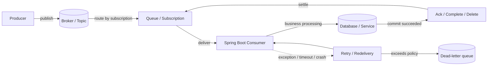
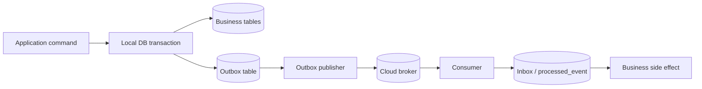

# Messages not received, not acknowledged, or processed multiple times

In Spring Boot systems using message brokers or managed messaging services, a message can go missing or misbehave at several stages: the producer fails to send it, the broker receives it but fails to route it to the desired subscription, the consumer does not receive it, the consumer processes it without acknowledging (ack), or the consumer finishes processing yet the broker redelivers the message. The symptoms "message missing" and "message processed twice" usually have different root causes.

The key is separating three stages: **publish and routing**, **receive and processing**, and **acknowledgement/settlement**. Each cloud service uses distinct terminology and mechanics: Amazon SQS deletes a message after successful processing; Azure Service Bus completes a message in Peek-Lock mode; Google Cloud Pub/Sub acknowledges a message using an ack ID. All of these mechanisms can trigger redelivery if the consumer does not finish on time or if the acknowledgement outcome is ambiguous.

This lesson guides you through stage-by-stage investigation, compares popular messaging services across AWS, Azure, and Google Cloud, and shows how to design idempotent consumers, retries, and dead-letter queues (DLQs) so the system tolerates redelivery safely.

After this lesson, you can:

- Identify whether a message stopped at publish, routing, receive, processing, or acknowledgement.
- Distinguish ack, delete, complete, abandon, nack, and checkpoint per service.
- Diagnose wrong subscription/consumer groups, filters, IAM permissions, visibility timeouts, and expired lock/ack deadlines.
- Explain why messages are redelivered and processed repeatedly.
- Design idempotency, inbox/outbox, bounded retries, and DLQs.
- Monitor message age, backlog, delivery attempts, ack latency, and processing success rate.

## 1. Tracing the lifecycle of a message

A message-driven workflow typically follows these stages:



This is a logical model. Some services combine topics and subscriptions, while others have dedicated queues; push subscriptions deliver messages to HTTP endpoints, whereas pull consumers actively fetch messages. Yet the diagnostic questions remain similar:

1. Did the producer send the message and receive a successful publish result?
2. Did the broker receive the message and route it to the right queue/subscription?
3. Does the consumer have permissions and listen on the right queue/subscription/group?
4. Did the consumer start processing, finish business logic, and commit data?
5. Did the broker receive acknowledgement/settlement before the deadline?
6. Was the message retried, redelivered, moved to a DLQ, or filtered/deleted by a policy?

Do not start by scaling concurrency or restarting consumers before identifying where the message stopped. Doing so can increase load or cause messages to be processed concurrently multiple times.

## 2. Distinguishing states and terminology

| Term | Practical meaning | Things to note |
|---|---|---|
| Publish/send | Producer sends a message to the broker | A producer timeout does not prove the broker never received the message |
| Route | Broker forwards the message to matching queues/subscriptions | Wrong topic, subscription, filter, or policy can prevent consumers from seeing the message |
| Receive/deliver | Broker delivers the message to a consumer | The message may currently be in-flight/locked/invisible |
| Ack/acknowledge | Consumer confirms message processing per protocol | Ack is usually not part of an atomic transaction with the application's database |
| Delete | Removes the message from the queue after processing, e.g., SQS `DeleteMessage` | If delete fails or visibility expires, the message can be redelivered |
| Complete | Finalizes the message in Azure Service Bus Peek-Lock | The lock can expire before `Complete`; the message then becomes available again |
| Nack/negative acknowledgement | Consumer signals it cannot process or declines the message | Broker may requeue, retry, or dead-letter depending on configuration |
| Visibility timeout | Duration SQS hides a message from other consumers after receive | If not deleted before expiration, the message can reappear |
| Lock duration | Duration Azure Service Bus holds a lock on a message in Peek-Lock | Must `Complete`/settle before lock expiration or renew the lock properly |
| Ack deadline | Duration Pub/Sub waits for a subscriber to acknowledge a message | If expired, the message can be redelivered; clients can extend the deadline automatically |
| Checkpoint/offset | Records the processed position in a stream partition | Different from per-message ack; checkpointing the wrong position can skip or replay data |

**Ack does not mean "once and only once".** In many at-least-once systems, a broker can redeliver a message if it does not receive an ack, even if the consumer already completed side effects. Consumers must therefore be designed to handle redelivery safely.

## 3. Determining whether a message was lost at publish or routing

### 3.1. Check the publish result on the producer

Producers should observe the send result instead of firing and forgetting. With synchronous APIs, check exceptions and responses. With asynchronous APIs, observe completion callbacks/futures and record the message ID or broker receipt if available. If publishing fails, persist enough information to investigate and apply policy-driven retries.

Spring Cloud Stream example using `StreamBridge`:

```java
import org.springframework.cloud.stream.function.StreamBridge;
import org.springframework.stereotype.Component;

@Component
public class OrderEventPublisher {
    private final StreamBridge streamBridge;

    public OrderEventPublisher(StreamBridge streamBridge) {
        this.streamBridge = streamBridge;
    }

    public void publish(OrderCreated event) {
        boolean accepted = streamBridge.send("orderCreated-out-0", event);
        if (!accepted) {
            throw new IllegalStateException("Broker binding did not accept the event");
        }
    }
}
```

`send()` returning `true` indicates the binding accepted the send per the binder's contract; it is not necessarily proof that a consumer processed the message. With some binders/clients, sending is asynchronous or uses separate callbacks. Verify the semantics of your specific binder and broker, enable producer confirmations where supported, and log the message ID/correlation ID.

Do not blindly retry on a producer timeout. The broker may have received the message while the response was lost on the return path. Retrying with a new event ID causes consumers to see two distinct events; retrying with the same event ID allows idempotent consumers to deduplicate. Producers should generate a stable event ID before the first send and reuse that ID across retries.

### 3.2. Check topics, queues, and subscriptions

Common configuration mistakes:

- Producer sends to topic A, while consumer subscribes to topic B.
- Queue or subscription has not been created, was deleted, or resides in a different region/project/namespace.
- Consumer uses the wrong queue name, subscription, consumer group, or binding destination.
- Message is dropped by a subscription filter, routing key, tag, or rule.
- Topic has multiple subscriptions, yet the consumer only reads one; publishing successfully does not automatically place the message into every arbitrary queue.
- Message was routed to a DLQ or subscription DLQ due to retry policy.
- Producer and consumer point to mismatched dev/staging/production environments.

With pub/sub, a topic is where producers publish while a subscription defines the message stream a subscriber receives. With queues, producers normally send directly to the queue. With SNS, a topic fans out to subscriptions (such as SQS queues or HTTP endpoints); check subscription status and delivery policies. Do not equate "the topic received the message" with "the queue consumer will definitely receive the message".

### 3.3. Check access permissions

Some permission errors occur in one direction but not the other:

- Producer has publish/send permissions, while consumer lacks receive/consume permissions.
- Consumer has receive permissions, while lacking ack/delete/complete/modify permissions.
- SNS is blocked from delivering to an SQS queue due to a missing queue resource policy for the SNS topic.
- Service account can subscribe but lacks acknowledge permissions or access to the subscription.
- Workload credentials expired or point to a different account/project/subscription.

Inspect the workload's actual identity (IAM role, managed identity, service account), resource policies, queue/topic policies, and audit logs. Do not fix by granting broad admin permissions; grant only the required actions on the exact topic, queue, or subscription.

## 4. Consumer does not receive messages

### 4.1. Verify the consumer is actually running

Verify:

- Did the Spring application start the listener/binding successfully?
- Is the consumer connecting to the right broker endpoint, namespace, account, and region?
- Do the queue/subscription/group names match and exist?
- Is any consumer instance receiving messages, or are all instances failing auth/network?
- Is the consumer paused, scaled to 0, starved of threads, or out of connections?
- Did a filter, selector, routing key, tag, or subscription rule exclude this message?
- Is the message currently in-flight/locked by another consumer?

In Spring Cloud Stream, check `destination`, `group`, binding name, and binding status. When `group` is omitted, some binders create an anonymous/ephemeral subscription; messages may not be retained as expected when instances stop or restart. Exact behavior depends on the binder.

### 4.2. Check consumer group and subscription semantics

Not every system uses the term "consumer group" identically:

- In Kafka/Event Hubs, a consumer group typically identifies an independent group reading a stream together; checkpoints/offsets and partition assignments govern read positions.
- In SQS, each queue is a message stream; multiple workers polling the same queue share messages without needing a Kafka-style consumer group.
- In Pub/Sub, a subscription stores delivery state; multiple subscribers on the same subscription load-balance messages.
- In Azure Service Bus, a queue or topic subscription receives messages; multiple processors compete via locks/settlement.

Do not copy a `group` setting from one binder to another without checking its semantics. For instance, creating two separate Pub/Sub subscriptions for two consumers typically gives each subscription a copy of every message; running two instances on the same subscription shares the load of one subscription.

### 4.3. Push and pull have different diagnostic paths

**Pull consumers** actively poll/stream messages. Check credentials, endpoints, permissions, poll timeouts, flow control, and client lifecycle.

**Push subscriptions** deliver messages to an HTTP endpoint. Check URL, DNS/certificates, firewall/ingress, authentication tokens, HTTP response codes, and response latency. If the endpoint returns non-success status codes or responds too slowly per policy, the broker may retry delivery. Avoid returning HTTP 2xx before business logic commits; returning success too early lets the broker treat the message as handled even if database writes fail.

For SNS HTTP/S subscriptions, verify subscription confirmation and delivery policy. If SNS pushes into SQS, also inspect the SQS queue policy, subscription redrive policy, and messages in the queue/DLQ.

## 5. Consumer receives messages but fails to ack

### 5.1. Business processing fails

A consumer may receive a message without acking because:

- Handler throws an exception or times out.
- Downstream database/API is unreachable.
- Validation/schema fails or message version is incompatible.
- Process is killed/restarted before completion.
- Consumer takes longer than the visibility timeout, lock duration, or ack deadline.
- Ack API fails due to network, auth, or broker unavailability.
- Code catches an exception and proceeds as if successful while side effects remain incomplete.

Inspect listener logs by message ID/correlation ID, root exception, start/end timestamps, transaction state, and ack result. Distinguish "handler returned" from "broker received ack": these two events happen separately and can fail independently.

### 5.2. Ack after successful processing

With auto-ack integrations, frameworks typically acknowledge a message when the listener returns normally and apply a separate policy when the listener throws an exception. Check the ack mode, error handler, retry interceptor, and binder/client version in use. Do not assume every framework requeues by default on exceptions.

Spring Cloud Stream consumer example:

```java
import java.util.function.Consumer;
import org.springframework.context.annotation.Bean;
import org.springframework.context.annotation.Configuration;
import org.springframework.messaging.Message;

@Configuration
public class OrderConsumerConfiguration {

    @Bean
    Consumer<Message<OrderCreated>> orderCreated(OrderProcessor processor) {
        return message -> {
            OrderCreated event = message.getPayload();
            processor.process(event);
            // Normal return leads to successful settlement
            // according to the semantics of the binder in use.
        };
    }
}
```

If `processor.process()` throws an exception, the binder may retry, requeue, reject, or route to a DLQ depending on configuration. Explicitly configure retries and DLQs, and test failure behavior against the real broker. Never swallow exceptions and return normally when data has not been processed: doing so can ack the message and turn a transient failure into data loss.

### 5.3. Never ack before database commit

A dangerous bug is acknowledging a message before durable side effects are committed:

```text
Receive -> Ack -> database write -> process crash
```

If the process crashes after acking but before committing, the broker will not redeliver the message and business data can be lost. For database-backed processing, the safer order is:

```text
Receive -> process -> commit database -> Ack
```

However, if the database commit succeeds and the ack is lost or times out, the broker can redeliver the message. Therefore, this order must be paired with idempotency/inbox tracking so duplicates do not trigger side effects a second time.

Spring's `@Transactional` only manages transactional resources enlisted in that transaction (typically the database). It does not automatically create an atomic transaction spanning both the database and every broker. Some brokers offer dedicated transaction integrations, but semantics and limits depend on technology/configuration.

### 5.4. Example of idempotent processing with an inbox table

Each event requires a stable ID generated by the producer. The consumer stores the event ID in an inbox table inside the same transaction as the business changes. A unique constraint prevents the same event from being applied twice:

```sql
CREATE TABLE processed_message (
    event_id VARCHAR(100) PRIMARY KEY,
    processed_at TIMESTAMP NOT NULL
);
```

Example service:

```java
import org.springframework.stereotype.Service;
import org.springframework.transaction.annotation.Transactional;

@Service
public class OrderProcessor {
    private final ProcessedMessageRepository processed;
    private final OrderRepository orders;

    public OrderProcessor(
        ProcessedMessageRepository processed,
        OrderRepository orders
    ) {
        this.processed = processed;
        this.orders = orders;
    }

    @Transactional
    public void process(OrderCreated event) {
        // insertIfAbsent must be an atomic operation based on the unique key.
        if (!processed.insertIfAbsent(event.eventId())) {
            return;
        }

        orders.markCreated(event.orderId());
    }
}
```

`insertIfAbsent()` must execute an atomic operation per your database dialect, returning `true` when the inbox row is inserted and `false` when `event_id` already exists. For example, PostgreSQL can use `INSERT ... ON CONFLICT (event_id) DO NOTHING` and check the inserted row count. For other engines, use an equivalent construct verified for your driver/database version. Avoid checking `existsById()` followed by inserting: two concurrent consumers can both see the row as absent. Also avoid blindly catching `DuplicateKeyException` and continuing inside the same transaction; some databases mark the transaction as aborted after a constraint violation.

When the transaction commits, both the inbox record and the order update succeed together. If processing fails before commit, both roll back and the broker can retry. If the commit succeeds but the ack fails, redelivery sees the event ID already exists and returns normally; the listener can then ack without repeating side effects.

If the consumer produces external side effects outside the database (sending email, calling a payment API), an inbox transaction alone cannot roll back those side effects. Use downstream idempotency keys, an outbox for follow-up actions, or an appropriate state machine/reconciliation.

## 6. Why are messages processed multiple times?

Duplicate delivery is expected behavior in at-least-once systems. Common causes include:

1. Consumer finishes processing, but ack/delete/complete never reaches the broker.
2. Consumer takes longer than the visibility timeout, lock duration, or ack deadline.
3. Process restarts after committing to the database but before acking.
4. Producer retries after a timeout and resends the same event.
5. Publisher emits the event twice because database write and broker publish are not coordinated consistently.
6. Multiple independent subscriptions receive the same event by fan-out design; operators mistake this for duplicate handling within one consumer.
7. Retry policy or manual redrive/replay intentionally re-sends messages.
8. Consumer lacks idempotency and processes the same message concurrently once a lock expires.

Compare event IDs, broker message IDs, delivery counts/attempts, receive timestamps, consumer instances, transaction IDs, and ack results. If the event ID is the same while the broker message ID differs, the producer likely republished. If the broker message ID is the same with an increasing delivery count, it is usually redelivery of the same message. Services generate IDs and count attempts differently; inspect both business event IDs and broker metadata.

## 7. Visibility, lock, and acknowledgement deadlines

Consumers must finish and settle within the limits enforced by the broker. If processing can exceed those limits, extend the visibility/lock/ack deadline or break work into smaller units.

| Service | Mechanism | When expired or unacked |
|---|---|---|
| Amazon SQS | Visibility timeout after `ReceiveMessage`; message temporarily hidden from other consumers | Message becomes visible again; receive count rises; redrive policy may move it to DLQ |
| Azure Service Bus | Peek-Lock; consumer receives lock and calls `Complete`/`Abandon`/`DeadLetter` | Lock expiration makes message available again; lost lock causes settlement failure |
| Google Cloud Pub/Sub | Ack deadline; subscriber acks or extends deadline | Message may be redelivered; delivery attempt may increment and DLQ policy may apply |

### 7.1. Amazon SQS

In SQS, `ReceiveMessage` does not delete the message. The broker starts a visibility timeout so other consumers temporarily do not receive the same message. Upon successful processing, the consumer must delete the message via `DeleteMessage` (Spring Cloud AWS handles acknowledgement/deletion per ack mode). If visibility timeout expires before deletion, the message can reappear.

Investigate:

- Is the visibility timeout long enough relative to p95/p99 processing time?
- Does the listener block synchronously for too long or stall on a downstream call?
- Is visibility extension/heartbeat enabled appropriately for your Spring Cloud AWS version?
- Is `ApproximateReceiveCount` rising, and does the queue have a redrive policy?
- Are multiple consumers receiving the same message because visibility timeout is too short?
- Does the consumer role have `sqs:ReceiveMessage`, `sqs:DeleteMessage`, and required actions?

Set visibility timeout longer than typical processing time plus a safety margin. For long-running tasks, use client-supported visibility extension/heartbeats. Do not set an enormous timeout to mask hung consumers; you still need deadlines and recovery mechanisms.

With SQS FIFO, `MessageGroupId` governs ordering within a group and parallel processing capacity; an undeleted message can block subsequent messages in the same group. Deduplication windows and producer deduplication eliminate certain duplicate publishes but do not replace idempotency for business side effects.

### 7.2. Azure Service Bus

In Peek-Lock mode, the consumer receives a message along with a lock. After successful processing, call `Complete`; on transient failures you may `Abandon` to make it available for the next delivery; unprocessable failures can be `DeadLetter`ed. If the lock expires or is lost, `Complete`/`Abandon` can fail and the message can be redelivered.

Investigate:

- Is `LockDuration` sufficient for processing time?
- Does the processor auto-renew locks, and is the max renewal duration configured properly?
- Are there `MessageLockLostException`s or settlement failures?
- Is `DeliveryCount` reaching `MaxDeliveryCount` and moving to the DLQ?
- Is the consumer using Receive-and-Delete mode where durable processing is required? That mode deletes messages upon receipt, so a crash after receive can lose messages.
- Did a session lock expire or did the consumer lose its session?

For session-based ordering, use a consistent session ID per aggregate and manage session concurrency intentionally. Service Bus duplicate detection removes certain duplicate sends within the configured window based on `MessageId`; it does not replace inbox/idempotency because post-receive redelivery can still occur.

### 7.3. Google Cloud Pub/Sub

In Pub/Sub, subscribers confirm messages using an ack ID. The ack deadline specifies how long Pub/Sub waits for an ack; clients can extend the deadline during processing. If an ack is not received before the deadline, the message can be redelivered.

Investigate:

- Does the subscriber call ack after successful processing?
- Is the ack deadline shorter than processing time or client-side queueing delay?
- Does the client extend the ack deadline properly when handlers run long?
- Does the subscription point to the right project, region/endpoint, and filter?
- Does the service account have permissions to consume/ack the subscription?
- Are a dead-letter topic policy and max delivery attempts configured appropriately?

Pub/Sub supports exactly-once delivery for certain supported pull subscription configurations. This feature has requirements on subscription setup, client/API versions, and deployment scope; consult current documentation. It strengthens Pub/Sub's delivery/ack guarantees, yet it does not make Pub/Sub and your application database atomic in a single transaction. Consumers still need idempotency for business side effects and handling for ambiguous ack outcomes.

## 8. Retries, poison messages, and dead-letter queues

Not every error should be retried. Classify errors first:

| Error group | Examples | Typical appropriate action |
|---|---|---|
| Transient | DB timeout, network reset, service 503, throttling | Retry with backoff/jitter, capped attempts and total duration |
| Data error | Malformed JSON, unsupported schema version, missing required field | Do not retry indefinitely; route to DLQ/quarantine to fix data or code |
| Config/permission error | 401/403, wrong endpoint, untrusted certificate | Stop hot retries, alert, and fix credentials/policies/config |
| Permanent business error | Order already canceled, invalid state transition | Record business outcome; ack if handled per rules, or route to a dedicated flow |
| Unknown outcome | Consumer crash, ack timeout, unclear whether server committed | Redelivery may occur; idempotency and reconciliation are mandatory |

A DLQ holds messages that exceeded the retry policy or were intentionally dead-lettered for investigation. A DLQ neither repairs messages on its own nor guarantees eventual data processing automatically.

### 8.1. DLQ configuration by service

| Service | Common mechanism | Things to verify |
|---|---|---|
| SQS | Redrive policy with `maxReceiveCount` and dead-letter queue | Matching queue type/region, redrive permissions, retention, and redrive procedure |
| SNS | Subscription redrive policy for failed deliveries to an endpoint | DLQ attached to the subscription, distinct from any downstream SQS queue's DLQ |
| Azure Service Bus | Dead-letter subqueue | `DeadLetterReason`, `DeadLetterDescription`, TTL/max delivery count, and DLQ read permissions |
| Pub/Sub | Dead-letter topic attached to subscription policy | IAM for the Pub/Sub service agent, max delivery attempts, and a subscription on the dead-letter topic |

Broker delivery counts can be approximate or follow service-specific semantics; do not use them in place of event IDs or business processing counters. Retain message payloads, metadata, dead-letter reasons, and correlation IDs in compliance with data protection policies.

### 8.2. Safe redrive

Before replaying messages from a DLQ back into the main flow:

1. Confirm the root cause has been fixed.
2. Inspect message schema/version and sensitive data.
3. Verify consumers are idempotent and original event IDs are preserved.
4. Test a small batch of messages in a test or canary environment.
5. Rate-limit redrive to avoid overwhelming downstream systems.
6. Monitor success/failure rates and keep an audit record.

Do not redrive an entire DLQ into production just to "clear the backlog". If poison messages are unfixed, they will bounce right back to the DLQ while inflating cost and load. If a consumer already executed side effects before ack failed, redriving without inbox/idempotency will cause duplicates.

## 9. Outbox on producers and inbox on consumers

### 9.1. The dual-write problem

A producer often writes to a database and publishes an event. These two operations are not automatically atomic:

```text
DB write succeeds -> publish fails     => data exists without event
Publish succeeds -> DB rolls back      => consumer sees event for uncommitted data
```

A transactional outbox closes this gap by writing business data and the event record inside the same database transaction. A separate publisher reads the outbox, sends to the broker, and marks the record sent. If the publisher crashes after the broker receives the message but before marking it sent, it may send it again; consumers still require idempotency.



### 9.2. What does an outbox record need?

An outbox table typically stores event ID, aggregate ID, event type, schema version, payload, occurred timestamp, publish status, attempt count, and next retry time. Publishers should claim records safely when running multiple instances, such as via leases/locks or database-appropriate row claiming. Avoid keeping database transactions open during slow broker calls; claim records briefly, publish outside the transaction, then update status. Design for the case where publish succeeds but updating status to sent fails.

### 9.3. Inbox on the consumer

The inbox records processed event IDs in the same transaction as database side effects. A unique constraint ensures two concurrent deliveries never apply the same event twice. If a consumer handles multiple event types, include consumer name/handler ID in the unique key so multiple logical consumers can process the same event independently.

Inbox/outbox do not create broker-level exactly-once delivery. They achieve effectively-once business behavior within controlled data/transaction boundaries, provided IDs are stable, unique constraints are right, and side effects either stay inside the transaction or target idempotent downstreams.

## 10. Ordering, concurrency, and parallel processing

When event ordering matters, determine the ordering scope supported by the broker:

- SQS Standard gives no strict ordering guarantee; SQS FIFO provides ordering per `MessageGroupId`.
- Azure Service Bus offers sessions to group and process messages in order per session; session locks/ownership must be managed.
- Pub/Sub supports ordering keys when ordering is enabled per configuration and support conditions; ordering applies per key/region per service semantics.
- Event Hubs/Kafka are partitioned streams; ordering is guaranteed within a single partition, not across the entire topic.

High consumer concurrency increases parallel processing but can break business ordering if events for the same aggregate run simultaneously. Use aggregate-scoped keys, appropriate partitions/sessions/groups, and bound concurrency as required. When a message retries, determine whether it blocks subsequent messages in the same group/partition.

Do not use a global database lock as your default ordering solution; it throttles throughput and creates contention. Prefer partitioning/session keys by business entity and designing state transitions to reject stale or out-of-order versions.

## 11. Configuring and verifying Spring Boot consumers

### 11.1. Verifying bindings/listeners

With Spring Cloud Stream, check:

- Was the function bean discovered and do binding names match?
- Does `destination` point to the right topic/queue?
- Is `group` stable and aligned with the binder's semantics?
- Does consumer concurrency/instance count exceed downstream capacity?
- Are retry, DLQ, ack mode, and error handler configured under the right binder prefix?
- Is serialization/content type compatible with the producer?

Conceptual example declaring a function and destination:

```yaml
spring:
  cloud:
    function:
      definition: orderCreated
    stream:
      bindings:
        orderCreated-in-0:
          destination: order-created
          group: order-projection-v1
          content-type: application/json
```

Retry/DLQ properties differ across binders. Do not copy `maxAttempts` or dead-letter settings from a Kafka binder to SQS, Pub/Sub, or Service Bus assuming identical semantics. Check binder documentation and test behavior when handlers throw exceptions.

### 11.2. Amazon SQS and Spring Cloud AWS

With Spring Cloud AWS, listeners can be declared using `@SqsListener`. Example:

```java
import io.awspring.cloud.sqs.annotation.SqsListener;
import org.springframework.stereotype.Component;

@Component
public class OrderQueueListener {
    private final OrderProcessor processor;

    public OrderQueueListener(OrderProcessor processor) {
        this.processor = processor;
    }

    @SqsListener("orders")
    public void receive(OrderCreated event) {
        processor.process(event);
    }
}
```

Spring Cloud AWS offers acknowledgement modes and related acknowledgement batching/visibility mechanisms depending on version. Verify the active mode, when `DeleteMessage` is invoked, and what happens when the listener throws an exception. If manual acknowledgement is enabled, ack only after business processing finishes and the database transaction commits. If using auto acknowledgement, test that the framework only deletes on listener success as expected.

### 11.3. Azure Service Bus and Google Pub/Sub

For Azure Service Bus, check `ReceiveMode` (Peek-Lock vs. Receive-and-Delete), auto-complete, lock renewal, max concurrent calls, max delivery count, and DLQ. When fine-grained settlement control is needed, use the appropriate processor/client APIs and invoke `Complete`/`Abandon`/`DeadLetter` at the right moment.

For Google Pub/Sub, check ack deadline, deadline extension, flow control, max outstanding messages, subscriber concurrency, subscription filters, and dead-letter policies. When using Spring Integration/Spring Cloud GCP abstractions, verify the actual inbound adapter ack mode and library version; do not assume every handler's normal return behaves identically.

## 12. Symptom-based diagnostic table

| Symptom | First check | Next action |
|---|---|---|
| Producer reports success, consumer sees nothing | Topic/destination, queue/subscription, region/project/namespace, filters, and consumer group | Check broker metrics, subscription backlog, IAM, and DLQ |
| Producer times out; unclear if broker received it | Producer confirmations, message ID/event ID, and broker metrics | Retry with the same event ID or use outbox; consumer must be idempotent |
| Consumer listener fails to start | Spring binding/listener logs, endpoint, credentials, and bean discovery | Fix config, permissions, or dependencies; verify exact environment |
| Messages sit in queue unconsumed | Consumer health, poll/flow control, in-flight count, and receive permissions | Restore listener, check concurrency, connections, and visibility/locks |
| Message is received but reappears | Handler exceptions, process restarts, ack/delete/complete failures, deadlines | Measure processing time, adjust deadline/renewal, fix ack policy |
| Message processed twice after DB commit | Ack failure or ambiguous ack outcome | Inbox/idempotency key, unique constraint, and ack after commit |
| Delivery count climbs rapidly | Poison message, downstream outage, too-short timeout, or hot retries | Classify error, add backoff, cap attempts, and use DLQ |
| Message moves to DLQ despite seeming handler success | Ack/Complete never reached broker, lock expired, or framework settlement failed | Check broker audits/metrics, client logs, and deadlines |
| Wrong event ordering | Partition/group/session/key and consumer concurrency | Choose ordering key, reduce per-aggregate concurrency, check retry blocking |
| Only one subscription receives no messages | Filters, subscription policy, group, IAM, and dedicated endpoint | Compare working subscription configuration against failing one |

## 13. Observability and runbook

Monitor producer, broker, and consumer together. With only consumer logs, you cannot tell whether a message was never published or misrouted.

| Component | Recommended metrics/logs |
|---|---|
| Producer | Publish success/failure, send latency, retry count, event ID, broker message ID/receipt |
| Broker/queue | Queue depth, oldest message age, in-flight/unacked count, delivery attempts, DLQ depth, throttling |
| Consumer | Receive rate, processing success/failure, processing duration, ack latency, redelivery count, active concurrency |
| Database/downstream | Transaction latency, rollbacks, timeouts, connection pool, idempotency conflicts, downstream status |
| Trace | Correlation ID, event ID, aggregate ID, producer span, consumer span, and retry attempt |

Avoid using event IDs, order IDs, or message IDs as high-cardinality metric labels. Record them in structured logs/traces; keep metric tags low-cardinality such as topic, subscription, consumer group, outcome, and error class.

A minimal runbook should answer:

1. Which queue/subscription is affected and since when?
2. Are message age and backlog growing? Are messages stuck in-flight/locked?
3. Did the producer publish successfully? Are there event IDs/broker IDs to trace?
4. Does the consumer have running listeners and receive/ack permissions?
5. What is the most common exception? Are there downstream or schema errors?
6. Are ack deadlines/visibility/locks long enough?
7. Is the DLQ growing, and is redrive safe?
8. Are there duplicate side effects? Are inbox/idempotency mechanisms working?

## 14. Pre-production checklist

- [ ] Producers verify publish results and generate stable event IDs.
- [ ] Topics, queues, subscriptions, groups, filters, and region/project/namespace are verified.
- [ ] IAM/RAM/managed identity/service accounts hold scoped publish, receive, and ack/settle permissions.
- [ ] Consumer listener startup, health, and concurrency are monitored.
- [ ] Ack occurs only after business processing succeeds and durable data is committed.
- [ ] Visibility timeouts, lock durations, or ack deadlines fit processing times; long tasks have renewal mechanisms.
- [ ] Consumers are idempotent via event ID/inbox/unique constraints or downstream idempotency keys.
- [ ] Retries use backoff, attempt caps, and transient vs. permanent error classification.
- [ ] DLQs are configured, monitored, secured, and backed by a redrive procedure.
- [ ] Ordering keys/sessions/partitions and consumer concurrency match business requirements.
- [ ] An outbox is used if producers need consistent database writes and event publishing.
- [ ] Producer/broker/consumer metrics, correlation IDs, and an investigation runbook are in place.

## 15. Conclusion

Messages not being received, not being acknowledged, and being processed repeatedly are three issues requiring investigation across three distinct stages. Check publish/routing first, then consumer health and bindings, and finally settlement/ack. SQS uses visibility timeouts and delete, Azure Service Bus uses locks and settlement, and Pub/Sub uses ack deadlines and ack IDs; each service has specific settings, yet all require idempotent consumers whenever redelivery is possible. Combining post-commit acks, inbox/outbox patterns, bounded retries, DLQs, and observability protects business data against network faults, restarts, and ambiguous deliveries.

## References

- [Amazon SQS — Visibility timeout](https://docs.aws.amazon.com/AWSSimpleQueueService/latest/SQSDeveloperGuide/sqs-visibility-timeout.html): hiding messages after receive and handling undeleted messages.
- [Amazon SQS — Dead-letter queues](https://docs.aws.amazon.com/AWSSimpleQueueService/latest/SQSDeveloperGuide/sqs-dead-letter-queues.html): redrive policies and DLQs.
- [Spring Cloud AWS — SQS integration](https://docs.awspring.io/spring-cloud-aws/docs/current/reference/html/index.html): `@SqsListener`, acknowledgement modes, and listener containers.
- [Azure Service Bus — Message transfers, locks, and settlement](https://learn.microsoft.com/azure/service-bus-messaging/message-transfers-locks-settlement): Peek-Lock, Complete, Abandon, and lock expiration.
- [Azure Service Bus — Dead-letter queues](https://learn.microsoft.com/azure/service-bus-messaging/service-bus-dead-letter-queues): DLQs and dead-letter reasons.
- [Google Cloud Pub/Sub — Message states and delivery](https://cloud.google.com/pubsub/docs/pubsub-basics): topics, subscriptions, and message delivery.
- [Google Cloud Pub/Sub — Acknowledging messages](https://cloud.google.com/pubsub/docs/subscribe-best-practices): ack deadlines, acknowledgements, and subscriber behavior.
- [Google Cloud Pub/Sub — Exactly-once delivery](https://cloud.google.com/pubsub/docs/exactly-once-delivery): prerequisites and limitations of exactly-once delivery.
- [Spring Cloud Stream — Consumer groups and error handling](https://docs.spring.io/spring-cloud-stream/reference/spring-cloud-stream/overview-error-handling.html): consumer behavior, error handling, and binder-specific retries.
