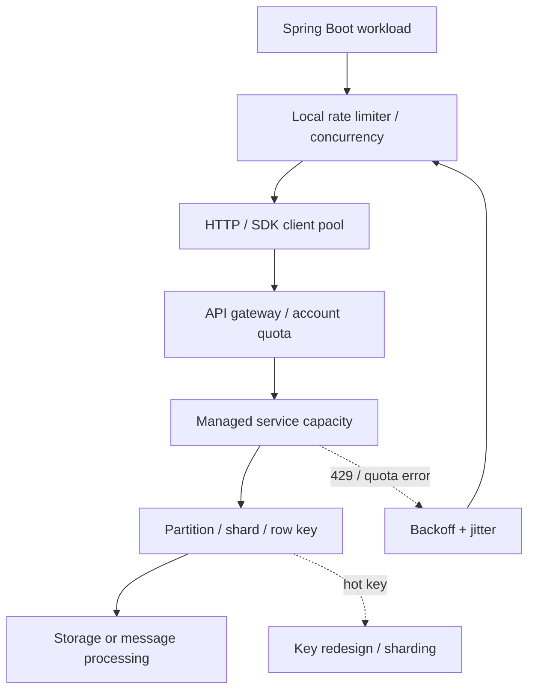

# Throttling, quota exceeded, and hot partitions

When a Spring Boot application sends requests to a managed service on AWS, Azure, or Google Cloud, the service may temporarily reject traffic because the rate exceeds processing capacity or allocated limits. Applications typically encounter HTTP `429`, `RESOURCE_EXHAUSTED`, `ThrottlingException`, `ProvisionedThroughputExceededException`, `RequestRateTooLarge`, or similar errors. A subtler scenario is when only a single partition, shard, row key, or message group is overloaded while overall system traffic remains low.

Three concepts must be distinguished:

- **Throttling:** the service actively slows or rejects requests for a period because the rate or concurrency exceeds current thresholds. Usually recoverable by slowing down, waiting as instructed, and retrying within bounds.
- **Quota/limit exceeded:** the workload hit a limit enforced per account, project, region, namespace, resource, or API. Some quotas can be raised via configuration/support requests; others are hard limits or service design limits.
- **Hot partition:** traffic is skewed, concentrating on a specific partition key, shard, tablet, queue group, or resource. Total throughput may not be high yet, while one partition has reached its limit.

Increasing retries or raising quotas does not always fix the root cause. If all requests target the same key, retries can worsen the hot spot. This lesson explains how to identify limit types, regulate traffic in Spring Boot, design partition keys, and monitor popular data/messaging services.

After this lesson, you can:

- Distinguish temporary throttling, hard quotas, and hot partitions using error codes, headers, and metrics.
- Apply retries with backoff, jitter, `Retry-After`, and overall deadlines.
- Bound concurrency/rate at the producer, consumer, and application layers.
- Design partition keys to distribute load and avoid one key/row/shard absorbing most traffic.
- Investigate scenarios on DynamoDB/Kinesis, Azure Cosmos DB/Service Bus, and Google Pub/Sub/Bigtable.
- Build dashboards, alerts, and controlled procedures for raising quotas or shedding load.

## 1. How do throttling, quotas, and hot partitions differ?

| Scenario | Common signs | Limit scope | Primary remediation direction |
|---|---|---|---|
| Rate throttling | 429, throttled requests, `Retry-After` | API, resource, account, or service | Reduce rate/concurrency, wait the proper duration, then retry |
| Hard quota or account quota | `QuotaExceeded`, `RESOURCE_EXHAUSTED`, resource creation errors | Project/account/region/namespace | Check quota, stop doomed requests, request quota increase or redistribute resources |
| Resource capacity | `ProvisionedThroughputExceeded`, excessive RU/s | Table/container/partition/shard | Increase capacity appropriately, optimize queries, or reduce load |
| Hot partition/key | High throttling on one partition key/shard, skewed request distribution | One subset of data or one message stream | Redesign key, shard/salt, apply per-key rate limiting |
| Client-side saturation | Pending queues, thread pools, or connection pools full; server may not even return 429 yet | Application process/instance | Tune concurrency, pools, batching, and backpressure |
| Downstream overload | Latency spikes, 5xx/timeouts alongside throttling | Target service or downstream dependency | Shed load, circuit breakers, bulkheads, and capacity coordination |

**Not every HTTP 429 means the same thing.** Status codes must be read alongside error codes, response headers, resource names, service metrics, and timing. For instance, a 429 from Cosmos DB usually ties to request units (RU) or partition distribution; a 429 from a control-plane API may be a rate limit at a different layer. Similarly, Google Cloud's `RESOURCE_EXHAUSTED` can reflect project quota, API limits, or resource capacity.

## 2. Where does a request get throttled?

Limits can exist at multiple layers. An application can simultaneously face limits at the gateway, SDK, API service, partition, database, or message broker.



When troubleshooting, identify which layer returned the error. If an in-app rate limiter rejects a request before sending, that is local throttling. If the SDK receives HTTP 429 from the endpoint, the service or an upstream gateway rejected it. If only one partition is throttling, growing pools or replicas can make things worse because even more requests pile onto the hot key.

## 3. Reading error codes, headers, and metrics

### 3.1. Information to record

Every throttling error should be logged in structured form with these fields:

- Service name, operation/API, and region.
- Masked or normalized resource identifier (table/container/topic/queue/shard).
- HTTP status and provider error code.
- `Retry-After` or equivalent retry header if present.
- Request ID/correlation ID from the provider.
- Partition key hash or shard ID if provided by the service and logging it does not expose sensitive data.
- Attempt number, wait time, latency, and final outcome.
- Client-side concurrency, queue depth, and rate.

Never log full payloads, access tokens, credentials, or partition keys containing personal data. When analyzing key skew, log a stable hash or bucket category rather than the raw key.

### 3.2. Common error codes

| Service | Possible symptoms | What to check |
|---|---|---|
| Amazon DynamoDB | `ProvisionedThroughputExceededException`, `ThrottlingException`, `RequestLimitExceeded` | Table/index capacity, key range/partition, consumed capacity, throttled requests, and account quotas |
| Amazon Kinesis Data Streams | `ProvisionedThroughputExceededException`, `LimitExceededException` | Shard write/read throughput, partition key distribution, shard count, and consumer mode |
| Amazon SQS | `RequestThrottled`, API throttling, or quota errors | Request rate, batch size, account/queue quotas, FIFO message groups, and API operations |
| Azure Cosmos DB | HTTP 429, rate-limit substatus, `x-ms-retry-after-ms` header | RU consumption, normalized RU/s per physical partition, partition key skew, and hot logical partitions |
| Azure Service Bus | `ServiceBusy`, `QuotaExceeded`, or transient server busy | Namespace/entity limits, concurrent links/operations, message size, and SDK retries |
| Google Cloud Pub/Sub | `RESOURCE_EXHAUSTED`, quota exceeded | Project/region quotas, publish/subscribe throughput, outstanding messages, and flow control |
| Google Cloud Bigtable | Often surfaces as high latency/high CPU rather than a single 429 code | Tablet hotspots, row-key distribution, node utilization, and request latency |

Exception names and headers vary by API, SDK version, and transport. Use provider request IDs to look up service-side logs/metrics. Do not search logs solely for the string `429`, because the SDK may have already retried and only surfaced the final exception after multiple attempts.

## 4. Retrying properly: backoff, jitter, and Retry-After

Retries help when failures are transient. Retries do not create extra capacity and do not fix hard quotas. When multiple instances retry at the same time, exponential backoff without jitter can cause all requests to return in lockstep (thundering herd).

### 4.1. Exponential backoff with jitter

A common strategy increases wait time per attempt and adds random jitter:

\[
delay_n = random(0, \min(cap, base \times 2^n))
\]

For example, with `base = 100 ms` and `cap = 5 s`, wait windows grow across 0–100 ms, 0–200 ms, 0–400 ms... up to 5 seconds max. Full jitter spreads retry timing across instances. Some policies use equal jitter or decorrelated jitter; what matters is having a cap and never retrying infinitely.

If the response includes `Retry-After` or a provider-equivalent header, prioritize honoring that hint within the request's deadline. With Cosmos DB, the SDK may read `x-ms-retry-after-ms`; with HTTP APIs, `Retry-After` can represent integer seconds or an HTTP date. Do not assume every header parses as an integer if the protocol permits multiple formats.

### 4.2. Retries must fit inside the overall deadline

Suppose an application API has a 3-second deadline. If one downstream call already took 2.5 seconds and the provider asks to wait 2 more seconds, retrying no longer fits within the deadline. Return a controlled error or offload work to a queue for asynchronous processing instead of holding the request thread past its budget.

Principles:

- Only retry transient, recoverable errors.
- Cap both retry count and total wait duration.
- Honor `Retry-After`/provider retry delays when present.
- Add jitter to spread load across instances.
- Never retry validation, authentication, authorization, or hard quota limits as if they were transient faults.
- Ensure writes have idempotency keys or safe semantics in case the first request succeeded.
- Account for internal SDK retries; avoid multiplying retries across the SDK, Spring Retry, gateways, and message consumers unintentionally.

### 4.3. Java backoff helper example

The following example illustrates computing the delay for a subsequent attempt. It does not replace SDK retry policies or provider error classification:

```java
import java.time.Duration;
import java.util.concurrent.ThreadLocalRandom;

public final class BackoffPolicy {
    private BackoffPolicy() {}

    public static Duration fullJitter(
        int attempt,
        Duration base,
        Duration cap
    ) {
        long baseMillis = base.toMillis();
        long capMillis = cap.toMillis();
        if (baseMillis < 0 || capMillis <= 0 || capMillis == Long.MAX_VALUE) {
            throw new IllegalArgumentException("base must be non-negative and cap must be positive and bounded");
        }
        int exponent = Math.min(Math.max(attempt, 0), 20);
        long factor = 1L << exponent;
        long upper = baseMillis > capMillis / factor
            ? capMillis
            : Math.min(capMillis, baseMillis * factor);
        long delay = ThreadLocalRandom.current().nextLong(upper + 1);
        return Duration.ofMillis(delay);
    }
}
```

In production code, guard against duration multiplication overflow, handle `Duration.ZERO`, large caps, and remaining deadlines. `attempt` should start at 0 for the first retry. When a provider returns `Retry-After`, use a protocol-specific parser combined with the overall deadline; do not add random backoff longer than the provider's directive if documentation requires strict adherence.

## 5. Shaping load in Spring Boot

Applications should enforce proactive limits before requests reach managed services. Common mechanisms:

- **Rate limiter:** caps requests per unit of time.
- **Concurrency limiter/bulkhead:** caps concurrent in-flight operations.
- **Bounded queue:** caps queued work; applies backpressure or fails fast when full.
- **Batching:** groups multiple items into one request when supported by the API, reducing overhead without exceeding size/frequency limits.
- **Adaptive throttling:** lowers rate when throttling/latency rises and gradually recovers as the system stabilizes.
- **Per-key limiter:** isolates limits by tenant, customer, partition key, or hot resource so one key cannot starve the entire budget.

### 5.1. Rate limits differ from concurrency limits

A rate limit controls how fast requests start, e.g., at most 100 requests/second. A concurrency limit controls how many requests run simultaneously. If each request takes 2 seconds, 100 requests/second creates roughly 200 concurrent requests under Little's Law at steady state. Thus, setting only a rate limit without tracking latency/concurrency can still exhaust pools.

### 5.2. Resilience4j RateLimiter example

Resilience4j can limit call rates to a dependency. Configuration example:

```yaml
resilience4j:
  ratelimiter:
    instances:
      inventory-api:
        limit-for-period: 80
        limit-refresh-period: 1s
        timeout-duration: 0
```

You can attach the limiter to a service method via the integration matching your Spring Boot/Resilience4j version or invoke it directly via decorator APIs. `timeout-duration: 0` means do not wait for a permit; if no permit is available, the application fails fast to prevent unbounded queueing. These values are illustrative only—set them based on real quotas/throughput and divide the budget across replicas.

An in-memory limiter only throttles **per instance**. With 10 replicas each allowing 80 requests/second, aggregate traffic can reach roughly 800 requests/second. For a global limit, use a gateway/distributed limiter or allocate per-instance budgets based on replica count. When autoscaling, update budgets or use a centralized token distribution mechanism.

### 5.3. Bounded concurrency and backpressure

For asynchronous consumers, do not merely increase listener/thread counts to clear backlogs. Limit outstanding messages and concurrent database/API calls. If downstream starts returning 429, reduce concurrency; once stable, ramp up gradually based on measurements.

With Reactor, avoid unbounded queues or overly high `flatMap` concurrency. Specify explicit concurrency:

```java
Flux.fromIterable(events)
    .flatMap(this::callManagedService, 20)
    .onErrorContinue((error, event) -> recordFailure(event, error));
```

This example only illustrates concurrency of 20; `onErrorContinue` is not a universally suitable default error handler because it can silently skip items. In business processing, it is usually better to map per-item errors into typed results, perform bounded retries, or route failed items into an explicit recovery flow.

## 6. AWS: DynamoDB, Kinesis, and SQS

### 6.1. DynamoDB throttling and hot partition keys

DynamoDB distributes data by partition key. A table with ample total capacity can still throttle if one partition key or subset of keys receives a disproportionate share of requests. Adaptive capacity helps redistribute capacity more flexibly in some cases, yet it does not eliminate all physical or per-partition/key limits.

Signs to inspect:

- `ThrottledRequests`, `ReadThrottleEvents`, `WriteThrottleEvents`.
- `ConsumedReadCapacityUnits` and `ConsumedWriteCapacityUnits`.
- Throttling reason/resource inside exceptions when provided by the SDK.
- Key skew: a few partition keys receive most requests.
- A GSI having its own hot partition key even when the base table is evenly distributed.
- Transactional writes or burst traffic causing short-term capacity spikes.

A key design such as `customerId` can become a hot key if one large tenant generates most traffic. Do not blindly append a random suffix without considering queries: once data is split across shards, querying by customer may require fan-out and aggregation.

### 6.2. Partition key design and write sharding

Ways to mitigate hot keys:

- Choose a partition key with high cardinality and relatively even distribution under real workloads.
- Combine attributes to spread data, such as tenant + resource or date + hash bucket, if queries can support it.
- For an immutable hot key, use write sharding: append a shard suffix to spread writes, then read/aggregate across shards.
- Use caching or counter aggregation when business rules permit reducing repeated reads/writes to the same key.
- Isolate a heavy tenant/resource onto its own table or resource if isolation is needed.
- Inspect Global Secondary Indexes too; an index partition key can run hot even when the base table key does not.

Write sharding example:

```java
int shard = Math.floorMod(event.eventId().hashCode(), 16);
String partitionKey = event.customerId() + "#" + shard;
```

This is purely illustrative. When reading by `customerId`, the application may need to query 16 shards and merge results. Choose shard counts based on throughput, fan-out cost, and resharding needs; do not arbitrarily change the shard count after writing data without a versioning/migration strategy.

### 6.3. Kinesis Data Streams

Kinesis assigns records to shards using partition keys. If many records share the same partition key, they concentrate on one shard and exceed that shard's read/write limits even when the overall stream still has spare capacity. Inspect `WriteProvisionedThroughputExceeded`, `ReadProvisionedThroughputExceeded`, iterator age, and incoming bytes/records per shard.

Remediation approaches:

- Choose well-distributed partition keys; avoid one static key for an entire producer.
- If per-entity ordering is needed, key by entity while evaluating how hot large entities get.
- Increase shard count or use on-demand mode when aligned with traffic patterns and quotas; adding total shards will not automatically fix a partition key that still funnels into one shard.
- Tune consumer parallelism per shard/partition and prevent slow consumers from letting iterator age grow.
- Batch records to cut overhead while respecting request/record size limits and handling partial failures.

### 6.4. SQS and message groups

For SQS Standard, throughput and API request quotas can apply at the account/queue/region level; batch receive/send/delete reduces request overhead. For SQS FIFO, `MessageGroupId` defines ordering groups and parallel processing capability. A single group can become a hot spot and serialize all processing.

If business logic needs ordering per order/customer, use a group ID scoped to that aggregate. If global ordering is unnecessary, avoid using one shared group. Monitor `ApproximateNumberOfMessagesVisible`, `ApproximateNumberOfMessagesNotVisible`, oldest message age, API throttling, and receive/delete batch sizes. DLQs/redrive do not replace regulating producer rates and consumer concurrency.

## 7. Azure: Cosmos DB and Service Bus

### 7.1. Cosmos DB RU throttling

Azure Cosmos DB uses Request Units (RUs) to measure request cost. When requests exceed provisioned throughput or a single physical partition is overloaded, the service can return HTTP 429. Responses may carry `x-ms-retry-after-ms` indicating how long to wait before retrying. The SDK usually has built-in retry/throttling handling; observe retry counts and total wait time to tell whether latency came from SDK retries or server execution.

Metrics to check:

- Total requests and HTTP 429 rate.
- Normalized RU Consumption per physical partition (when enabled and supported).
- RU consumption by operation/query and container.
- Request latency, retry counts, and SDK diagnostics.
- Partition key distribution and dominant logical partitions.

One logical partition can turn into a hot partition if most requests hit the same partition key. Increasing overall RU/s may not solve key skew or per-logical-partition limits. Consider a different partition key, hierarchical partition keys where supported by your API/feature, or intentional splitting by tenant/time/hash.

### 7.2. Optimizing request units

Lowering RU consumption can be more effective than raising throughput:

- Use point reads with partition key and item ID instead of broad queries whenever possible.
- Project only needed fields and cap page sizes.
- Create indexes matching queries; avoid unnecessary scans/`ORDER BY`.
- Use batch/transactional batch within the same logical partition when appropriate.
- Cache read-heavy, slowly changing data with clear TTL/invalidation.
- Avoid frequent cross-partition queries when queries can be designed around the partition key.

Do not blindly drop indexes just to save write RUs; measure the read/write trade-off. Inspect SDK diagnostics to pinpoint which operations consume the most RUs.

### 7.3. Service Bus throttling

Azure Service Bus enforces limits per namespace, entity, tier, and operation. When a namespace is busy, the SDK can throw transient errors like `ServiceBusy` or quota-related exceptions. Check CPU/throughput/requests, message sizes, concurrent sends/receives, links, and connection reuse.

Remediation approaches:

- Share a single `ServiceBusClient` across the application lifecycle instead of creating a client per message.
- Batch messages where suitable without exceeding maximum size limits.
- Bound concurrent sends/receives and configure flow control on processors and consumers.
- Use the Azure SDK's retry policy while avoiding nested retries with Spring Retry unless total attempts are accounted for.
- Check tier/namespace quotas and request a quota increase if legitimate workloads exceed current limits.
- Separate namespaces/entities for workloads needing isolation if architecture and budget permit.

## 8. Google Cloud: Pub/Sub and Bigtable

### 8.1. Pub/Sub `RESOURCE_EXHAUSTED`

Pub/Sub enforces quotas and limits per project, region, publisher/subscriber, and subscription. `RESOURCE_EXHAUSTED` can indicate project quotas, throughput, outstanding message counts, or client-side flow-control limits. Check Cloud Monitoring, quota pages, request metrics, and client logs to distinguish service-side from client-side limits.

Publishers should use batching and flow control. Flow control caps messages/bytes awaiting publish confirmation; when exceeded, clients can block or error depending on configuration. Subscribers must likewise cap outstanding messages/bytes and concurrent callbacks to avoid pulling faster than they can process.

Avoid creating too many publisher/subscriber clients per request. Reuse clients, close them cleanly on shutdown, and tune batch/flow-control settings to measured throughput. When scaling publish rates, check regional and project quotas; once a hard quota is hit, backoff only slows requests without raising the cap.

### 8.2. Bigtable hotspots

Bigtable distributes data by row key range. If row keys use monotonically increasing timestamps or low-cardinality prefixes, new writes can pile onto the single tablet serving the tail key range. This causes hotspots, higher latency, and uneven node utilization.

Sequential row key example:

```text
2026-11-24#customer-001
2026-11-24#customer-002
2026-11-24#customer-003
...
```

New rows cluster into adjacent key ranges. You can add a hash/salt prefix to distribute writes:

```text
07#2026-11-24#customer-001
13#2026-11-24#customer-002
02#2026-11-24#customer-003
...
```

The salt must be computed deterministically from the entity ID so queries know how to locate rows. If querying by customer, compute the salt from customer ID; if the salt is random per event, queries will require fan-out or secondary indexes. Row key design must balance write distribution against read patterns and range scan needs.

Monitor node CPU, storage utilization, request latency, hot tablets/key ranges, and distribution. Adding nodes increases total capacity but does not always eliminate hotspots caused by row-key design.

## 9. Tuning producers and consumers in messaging

Throttling often occurs when producers emit faster than the broker allows, or consumers process faster than downstreams can sustain. Regulation is needed on both ends:

- Producer: batching, bounded send concurrency, flow control, quota-aware rate limiting, and retries.
- Broker: partition/shard/queue capacity, topic/namespace quotas, retention, and subscription policies.
- Consumer: max outstanding messages, concurrency, batch sizes, and ack deadline/visibility/locks.
- Downstream: database pools, API rate limits, bulkheads, and transaction durations.

If a consumer writes to a database per message, raising consumer concurrency from 10 to 100 can exhaust database connections. Measure end-to-end throughput and locate the bottleneck before scaling a single component in isolation.

### 9.1. Concurrency tuning example

In Spring Cloud Stream, some binders expose properties for concurrency, prefetch, or max outstanding messages. No single property guarantees identical semantics across all binders. You should:

1. Check documentation for your specific broker binder.
2. Start concurrency below downstream limits.
3. Measure consumer lag, processing latency, database pool pending counts, and throttling.
4. Ramp concurrency gradually until reaching target throughput without sharp spikes in p95/p99 or errors.
5. Lower concurrency automatically or per runbook during sustained downstream throttling.

For custom consumers, use a bounded executor/queue. When the queue fills up, apply backpressure or pause pulling more messages if the protocol supports it; never create an unbounded in-heap queue.

### 9.2. Adaptive rate control

An adaptive regulator can lower rates when:

- The 429/throttling ratio exceeds a threshold within an observation window.
- Average `Retry-After` rises.
- p95/p99 latency or pending queues grow continuously.
- Partition-specific throttling concentrates on a single key.

Once stable, increase rates gradually (additive increase) rather than jumping straight back to peak. Per-resource/per-key rate limits stop one hot tenant from consuming the entire budget of other tenants. When running multiple replicas, coordinate limiters or allocate explicit quotas so aggregate rate stays within limits.

## 10. Hot partitions: identifying and redesigning keys

### 10.1. Signs of key skew

- Total table/stream/container throughput is still low, yet throttling rises.
- A few partitions/shards/tablets show abnormally high latency or utilization.
- One tenant, customer, device, or product generates the bulk of requests.
- Adding total nodes/throughput yields little improvement.
- Queries/scans targeting a single key or range generate repeated load.

### 10.2. Design patterns to mitigate hotspots

| Pattern | Idea | Trade-off |
|---|---|---|
| High-cardinality key | Pick a key with many distinct values and even spread | Can make querying by other business attributes harder |
| Composite key | Combine tenant, resource, time bucket, or data type | Queries must align with the exact prefix/partition |
| Write sharding/salting | Split one hot logical key across multiple physical keys | Reads require fan-out/aggregation; needs shard versioning |
| Time bucketing | Partition data by hour/day/month | Time-range queries must read multiple buckets |
| Per-tenant isolation | Move large tenants onto dedicated resources | Higher operational and migration overhead |
| Aggregation/caching | Coalesce updates or cache hot reads | Introduces staleness and requires invalidation |
| Queue partitioning/groups | Spread messages by aggregate or key | Ordering applies only within each partition/group |

No single key works for every workload. Capture actual key distributions, identify dominant queries, and simulate both read and write patterns before changing keys. Changing a partition key is normally a data migration, not a one-line code deploy.

### 10.3. Care with keys requiring ordering

A customer or order may require sequential processing to preserve business invariants. Do not shard arbitrarily if operations on the same aggregate depend on order. You can preserve ordering within each aggregate while distributing across aggregates using separate keys. If a single aggregate exceeds one partition's capacity, revisit the domain model: coalesce counters, batch updates, append events for asynchronous aggregation, or split responsibilities into sub-entities with clear semantics.

## 11. Distinguishing quota increases from design fixes

When a quota is exceeded, answer these questions before submitting a quota increase request:

1. Which quota is hit: request rate, throughput, connections, message size, partitions, resource count, or project-wide API limit?
2. Is the quota a hard limit, an adjustable quota, or auto-scaling capacity?
3. Is traffic a short burst or steady organic growth?
4. Is there key skew, a retry storm, duplicate requests, or inefficient batch sizing?
5. Are clients opening excess connections/client instances or exceeding concurrency limits?
6. Can you cache, batch, shrink payloads, optimize queries, or split workloads?
7. If you raise the quota, can cost budgets, regional availability, and downstream capacity sustain it?

**Request a quota increase** when the workload is valid, well-distributed, request-optimized, and driven by forecasted growth. **Fix the architecture first** when one key/partition is hot, retries loop, requests are redundant, or one consumer group creates excessive concurrency. Sometimes both are needed: fix key skew and raise overall capacity.

## 12. Throttling investigation runbook

1. **Scope the incident:** service, region, resource, operation, and start time.
2. **Read the error:** status, provider error code, retry-after, request ID, and attempt count.
3. **Inspect the client:** local rate limiters, concurrency, pending queues, pools, SDK retries, and client instance counts.
4. **Inspect service metrics:** quota utilization, consumed capacity/RUs, throttled requests, shard/tablet utilization, and server latency.
5. **Check for key skew:** top partition key hashes, shards, message groups, or tenants by traffic share.
6. **Mitigate impact:** lower producer rate/concurrency, pause batches, throttle hot tenants/keys, or trip circuit breakers.
7. **Choose remediation:** backoff, batching, caching, capacity/quota increase, key sharding, or workload isolation.
8. **Canary and verify:** roll out partially, compare 429s, latency, backlog, cost, and business success.
9. **Monitor post-recovery:** ensure retry backlogs do not trigger a second wave; check DLQs and dropped requests.

Do not restart all producers/consumers simultaneously while the service is throttling. When instances restart together, they may simultaneously warm connections, replay backlogs, and trigger a fresh burst.

## 13. Observability and alerting

Dashboards should combine client, broker, and data-service metrics:

| Layer | Metrics to track |
|---|---|
| Producer/application | Requests per second, accepted/rejected, retry count, backoff duration, limiter denials, concurrency |
| SDK/client | Attempt counts, request latency, connection pool pending, timeouts, and error codes |
| Database/storage | Consumed capacity/RUs, throttled requests, partition utilization, hot keys, query latency |
| Messaging | Publish/consume throughput, backlog, oldest message age, outstanding messages, redelivery/DLQ |
| Infrastructure | CPU, memory, network, connection counts, autoscaling events, and quota utilization |
| Cost | Provisioned RUs/capacity, shard/node counts, request volume, and egress where relevant |

Base alerts on trends and business impact rather than a single isolated 429. For example, alert when throttling rate stays above threshold for 5 minutes, oldest message age climbs, p99 breaches SLA, or one partition's utilization diverges sharply from the median. Set exact thresholds from actual baselines and resource quotas.

Never use partition keys, customer IDs, or request IDs as high-cardinality metric labels. Log top key hashes in structured logs/traces or specialized sampled dashboards with appropriate data protection.

## 14. Pre-production checklist

- [ ] Quotas and throughput limits are known per service, region, resource, and account/project.
- [ ] Service 429s, gateway 429s, local client limiters, and partition-specific throttling are distinguishable.
- [ ] SDK retries are configured explicitly; total attempts across layers do not multiply unexpectedly.
- [ ] Retries use exponential backoff, jitter, `Retry-After`, and an overall deadline.
- [ ] Provider request IDs, error codes, attempts, and resource contexts are logged without leaking secrets.
- [ ] Rate limiters and concurrency limiters have budgets sized across total replicas.
- [ ] Queues/pending work are bounded; backpressure applies when full.
- [ ] Partition/shard/row keys and message groups are validated for distribution under realistic workloads.
- [ ] A hot-key mitigation plan exists: sharding, bucketing, batching, caching, or tenant isolation.
- [ ] Consumer concurrency does not exceed database/downstream capacity.
- [ ] Metrics/alerts cover throttling, capacity, backlog, p95/p99, and key skew.
- [ ] Runbooks exist for load shedding, quota increase requests, and post-change canarying.

## 15. Conclusion

Throttling signals the need to pace traffic; quota exceeded indicates a specific limit was reached; hot partitions reveal skewed load distribution. Retries with backoff, jitter, and `Retry-After` absorb transient faults, while rate/concurrency limits and bounded queues protect downstreams. When only a single partition key, shard, row key, or message group runs hot, revisit how data and processing streams are partitioned. Combining client-side metrics with managed-service metrics lets you decide accurately when to shed load, optimize keys, scale capacity, or request quota increases.

## References

- [Amazon DynamoDB — Handling throttling](https://docs.aws.amazon.com/amazondynamodb/latest/developerguide/Programming.Errors.html): throttling errors, retries, and capacity.
- [Amazon DynamoDB — Partition key design](https://docs.aws.amazon.com/amazondynamodb/latest/developerguide/bp-partition-key-design.html): partition key design and write sharding.
- [Amazon Kinesis Data Streams — Resharding and partition keys](https://docs.aws.amazon.com/streams/latest/dev/kinesis-record-processor-using-shard.html): shards, partition keys, and throughput handling.
- [Amazon SQS — Quotas](https://docs.aws.amazon.com/AWSSimpleQueueService/latest/SQSDeveloperGuide/quotas-messages.html): quotas and limits per queue/region.
- [Azure Cosmos DB — Request units](https://learn.microsoft.com/azure/cosmos-db/request-units): RUs and throughput.
- [Azure Cosmos DB — Diagnose and troubleshoot 429](https://learn.microsoft.com/azure/cosmos-db/troubleshoot-request-rate-too-large): throttling, retry-after, and partition utilization.
- [Azure Service Bus — Throttling operations](https://learn.microsoft.com/azure/service-bus-messaging/service-bus-throttling): limits and throttling.
- [Google Cloud Pub/Sub — Quotas and limits](https://cloud.google.com/pubsub/quotas): project/region quotas and throughput limits.
- [Google Cloud Pub/Sub — Publisher flow control](https://cloud.google.com/pubsub/docs/flow-control): batching, outstanding messages, and flow control.
- [Google Cloud Bigtable — Schema design](https://cloud.google.com/bigtable/docs/schema-design): row key design and avoiding hotspots.
- [Resilience4j — RateLimiter](https://resilience4j.readme.io/docs/ratelimiter): rate limiting in Java applications.
