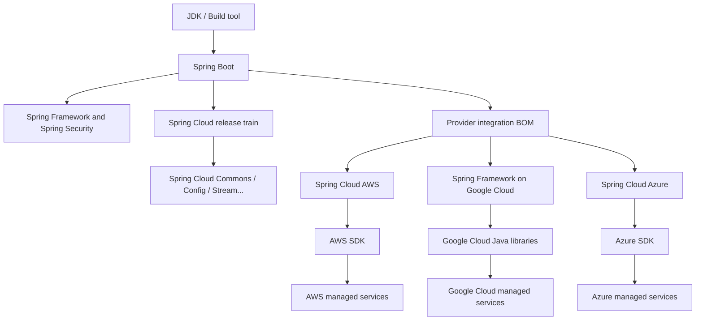
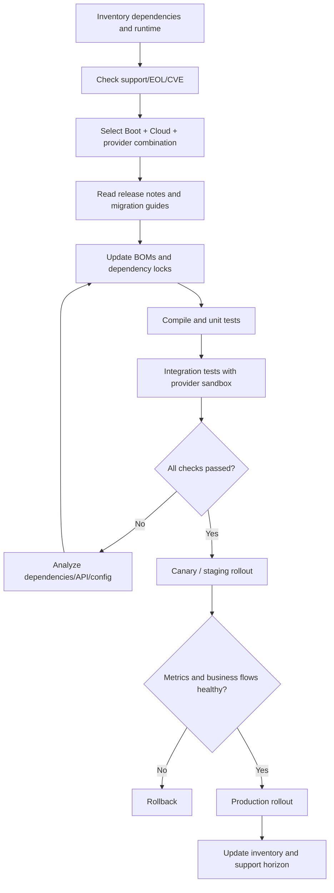

# Tracking the Lifecycle of Spring Boot, Spring Cloud, and Provider Libraries

A Spring Boot application integrating with AWS, Azure, or Google Cloud typically depends on multiple library groups with separate release schedules and support policies. Spring Boot manages the application platform; Spring Cloud provides distributed patterns and release trains; each provider's library connects to the corresponding managed services and SDKs. A new version of Spring Boot or Spring Cloud does not mean every provider library is immediately compatible.

Therefore, tracking the integration lifecycle needs to answer four questions: **which versions are still supported, whether the versions lie within the official compatibility matrix, whether actual dependencies converge, and whether the upgrade process has verified behavior against cloud services**. Simply looking at the latest version numbers or letting Maven/Gradle choose dependencies automatically can result in a combination that compiles but is unsupported by the provider.

This lesson belongs to the **Integration Upgrades** chapter of the **SPRING_CLOUD_PROVIDER_INTEGRATION** module. The module practices integrating Spring Boot with AWS, Azure, and Google Cloud managed services through the corresponding Spring Cloud libraries, covering identity, storage, messaging, data, secrets, testing, and evaluating differences across providers.

## 1. Learning Objectives

After this lesson, you will be able to:

- Distinguish between Spring Boot, Spring Framework, the Spring Cloud release train, and provider libraries.
- Read compatibility matrices instead of choosing versions by guesswork.
- Understand the support lifecycle of Spring Boot, Spring Cloud, and each AWS/Azure/Google Cloud library.
- Choose a combination of JDK, Boot, Cloud, and provider BOM that has an overlapping support window.
- Manage dependencies with BOMs and avoid arbitrary transitive version overrides.
- Track release notes, migration guides, CVEs, and EOL dates.
- Detect dependency convergence issues, binary incompatibilities, and auto-configuration errors.
- Establish a step-by-step upgrade process with cloud integration testing and rollback.
- Maintain an inventory table that helps operations teams know which components are nearing end of support.

## 2. Version Layer Map

A Spring Cloud provider integration application typically consists of the following layers:



These layers are interrelated but do not release on the same cadence:

| Layer | Role | Where to check lifecycle |
| --- | --- | --- |
| JDK | Runtime, compiler, and foundational APIs | JDK distribution support policy and Spring requirements |
| Spring Boot | Auto-configuration, dependency management, Actuator, and packaging | Spring Boot Supported Versions, release notes |
| Spring Framework | Container, web, data binding, transaction, and core APIs | Spring Framework releases and support policy |
| Spring Cloud | Distributed components and release train | Spring Cloud compatibility/support matrix |
| Spring Cloud AWS | Integration with S3, SQS, SNS, Secrets Manager, and AWS SDK | README, release notes, AWSpring compatibility table |
| Spring Framework on Google Cloud | Integration with GCS, Pub/Sub, Secret Manager, and Google Cloud libraries | Spring Cloud GCP compatibility table and release notes |
| Spring Cloud Azure | Integration with Azure Storage, Service Bus, Key Vault, and Azure SDK | Spring Versions Mapping, changelog |
| Provider SDK | HTTP/gRPC client, authentication, retry, and model APIs | AWS SDK, Google Cloud Java libraries, Azure SDK release/support notes |

An application can use a supported Spring Boot version while still depending on an EOL provider library. Conversely, a new release of a provider library does not mean it is compatible with the current Spring Boot version. You must check each layer and their intersection.

## 3. Distinguishing Versions and Release Trains

### 3.1. Spring Boot version

Spring Boot uses `major.minor.patch` versioning, for example `4.0.2` or `4.2.0`.

- **Major:** may introduce incompatible API and behavioral changes.
- **Minor:** may add features, change/deprecate APIs, and upgrade dependencies.
- **Patch:** mainly fixes bugs and security vulnerabilities, prioritizing backward compatibility within the same branch.

Spring Boot releases major/minor versions roughly every six months, typically in May and November; patch releases are issued as needed. Spring Boot's OSS policy states that major versions are supported for at least three years and minor versions for at least twelve months, provided you are running on a supported minor branch. Check the Supported Versions page to see whether a specific branch still receives updates.

### 3.2. Spring Cloud release train

Spring Cloud groups multiple projects into a release train. The train version is not the Spring Boot version. For example:

- Spring Boot `4.0.x` uses Spring Cloud `2025.1.x`.
- Spring Boot `3.5.x` uses Spring Cloud `2025.0.x`.
- Spring Boot `3.4.x` uses Spring Cloud `2024.0.x`.

Each train has a `spring-cloud-dependencies` BOM to manage the versions of Spring Cloud projects. Select the train based on the Spring Boot version in use, then pick the latest supported service release in that train.

Spring Cloud has its own support policy: major for at least three years, minor for at least twelve months. A release train does not have a single independent EOL date; the support window is aggregated from the projects included in the train. When checking status, inspect the specific project and the status of the Spring Boot version that the train supports.

### 3.3. Provider libraries have separate schedules

Provider libraries do not automatically follow the Spring Cloud train version:

- **Spring Cloud AWS** is released by the AWSpring team, with its own BOM and Boot/Cloud matrix.
- **Spring Framework on Google Cloud** is maintained by Google Cloud, with its own compatibility table.
- **Spring Cloud Azure** is maintained by Azure SDK for Java, with its own Boot/Cloud/provider version and JDK mapping.

Do not assume a provider library is compatible just because a Spring Cloud train already supports that Boot version. You need a compatibility table, release notes, or official confirmation from the provider project.

## 4. Reading Compatibility Matrices

The compatibility matrix is the first prerequisite before modifying dependencies. It tells you which Spring Boot, Spring Cloud, Spring Framework, and JDK versions a provider release line is tested against.

<text color="secondary" size="xs">Snapshot of public matrices checked on 24-11-2026. This is a reference point for how to select versions; before every upgrade, reopen the current matrices.</text>

| Spring Boot | Spring Cloud train | Spring Cloud GCP | Spring Cloud AWS | Spring Cloud Azure |
| --- | --- | --- | --- | --- |
| `4.2.x` | `2026.0.x` | Not yet confirmed in provider matrix | Not yet confirmed in provider matrix | Not yet confirmed in provider matrix |
| `4.0.x` | `2025.1.x` | `8.x` | `4.x` | `7.x` |
| `3.5.x` | `2025.0.x` | `7.x` | `3.4.x` | `6.x` or `5.x` |
| `3.4.x` | `2024.0.x` | `6.x` | `3.3.x` | `5.x` |

Key points to read alongside the table:

1. Spring Boot `4.2.0` was released on 19-11-2026; Spring Cloud `2026.0.0` (Paddington) was released on 20-11-2026 and is based on Boot `4.2.0`.
2. The Spring Cloud core matrix may already announce Boot `4.2`, while provider matrices have not yet been updated or have not confirmed adapter compatibility.
3. For an intersection confirmed by provider documentation across all three clouds in this snapshot, the Boot `4.0.x` + Spring Cloud `2025.1.x` combination is a conservative baseline; the corresponding provider lines are GCP `8.x`, AWS `4.x`, and Azure `7.x`.
4. GCP `8.x` announces support for Boot `4.0.x` and `4.1.x`; the table above picks `4.0.x` to show the common intersection with AWS and Azure.
5. The row “Not yet confirmed in provider matrix” does not necessarily mean it cannot run. It means there is not yet sufficient public evidence to declare the combination supported; you should wait for the compatibility table or confirmation from the provider.

Do not use static tables in a lesson as a substitute for checking the latest releases. Matrices can change after an update to a README, changelog, or release train.

### 4.1. Example of choosing a combination

Suppose a service needs to integrate S3, Pub/Sub, and Azure Key Vault in the same application. Selection process:

- Choose a JDK supported by all framework/provider lines.
- Choose a Boot minor version that still has OSS support.
- Choose the Spring Cloud train corresponding to Boot.
- Verify that each provider BOM announces support for that exact Boot/Cloud line.
- Only then check the specific SDKs and starters that the service actually uses.

If you want to move to Boot `4.2.x`, you need to check Spring Cloud `2026.0.x`, Spring Cloud AWS, Spring Cloud GCP, and Spring Cloud Azure separately. Do not upgrade all three adapters simply because Spring Cloud core has released a new train.

## 5. Support Lifecycle and EOL

`Latest` is not synonymous with `Supported`. A new release may have just shipped without provider adapter support yet; an older branch may still receive security patches for some time; a minor version may reach EOL even though the major version still has a commercial lifecycle.

### 5.1. Milestones to track

| Milestone | Meaning | Action for the development team |
| --- | --- | --- |
| GA (General Availability) | Stable release | Read release notes and compatibility matrix |
| Maintenance | Branch only receives bug fixes/patches per policy | Monitor patches and prepare for minor upgrade |
| End of OSS support | No longer receives OSS updates per policy | Plan migration to a supported branch |
| End of commercial support | Corresponding commercial support period ends | Complete upgrade or accept risk with formal approval |
| Security advisory | A CVE or vulnerability is published | Identify affected dependencies and exposure level |
| Deprecation | API/property still works but is marked for removal | Replace before the API is removed in a future major/minor |

### 5.2. Do not track only Spring Boot

An inventory table should record at least:

| Component | Current version | Target version | Support/EOL | Verification source |
| --- | --- | --- | --- | --- |
| JDK | `17` | Per runtime policy | Per distribution | JDK Vendor |
| Spring Boot | `4.0.x` | Supported branch | Per Boot support page | Spring Boot |
| Spring Cloud | `2025.1.x` | Corresponding train | Per projects in train | Spring Cloud |
| Spring Cloud GCP | `8.x` | Per Boot/Cloud matrix | Per GCP project | Google Cloud |
| Spring Cloud AWS | `4.x` | Per Boot/Cloud matrix | Per AWSpring | AWSpring |
| Spring Cloud Azure | `7.x` | Per Boot/Cloud matrix | Per Azure mapping | Azure SDK |
| AWS/Google/Azure SDK BOM | Per provider BOM | Compatible patch | Per SDK lifecycle | Provider SDK |
| Maven/Gradle plugin | Build version | Supported version | Per build tool | Apache/Gradle |

Fill in EOL dates and statuses from official sources at the time of building the inventory. Do not calculate EOL by simply adding months to the release date; there may be exceptions, commercial support extensions, or policy adjustments.

## 6. BOM Management and Dependency Alignment

A BOM (Bill of Materials) manages a set of compatible dependency versions. Instead of specifying versions for every starter and SDK, the project imports the appropriate BOM and declares dependencies without individual versions.

### 6.1. Role of each BOM

| BOM | Maven coordinates | Manages |
| --- | --- | --- |
| Spring Boot | `org.springframework.boot:spring-boot-dependencies` | Spring Boot and many foundational dependencies |
| Spring Cloud | `org.springframework.cloud:spring-cloud-dependencies` | Projects in the Spring Cloud train |
| Spring Cloud GCP | `com.google.cloud:spring-cloud-gcp-dependencies` | Spring Framework on Google Cloud modules |
| Spring Cloud AWS | `io.awspring.cloud:spring-cloud-aws-dependencies` | Spring Cloud AWS modules |
| Spring Cloud Azure | `com.azure.spring:spring-cloud-azure-dependencies` | Spring Cloud Azure modules |
| AWS SDK BOM | `software.amazon.awssdk:bom` | AWS SDK v2 modules |
| Azure SDK BOM | `com.azure:azure-sdk-bom` | Azure Java SDK modules |
| Google Cloud libraries BOM | `com.google.cloud:libraries-bom` | Google Cloud Java client libraries |

An application integrating with only one provider usually needs only the corresponding provider BOM. A multi-cloud application may require multiple BOMs, which can manage some overlapping or differing transitive dependencies. When importing multiple BOMs, you must inspect the effective POM and actual dependency resolution; do not assume import order always yields the expected result.

### 6.2. Maven example for a single provider

Example illustrating the dependency management structure for Spring Boot `4.0.x`, Spring Cloud `2025.1.x`, and Spring Cloud GCP `8.x` according to the compatibility matrix above. Replace `x` with the specific GA version confirmed on the release page at implementation time.

```xml
<properties>
    <java.version>17</java.version>
    <spring-cloud.version>2025.1.x</spring-cloud.version>
    <spring-cloud-gcp.version>8.x</spring-cloud-gcp.version>
</properties>

<dependencyManagement>
    <dependencies>
        <dependency>
            <groupId>org.springframework.cloud</groupId>
            <artifactId>spring-cloud-dependencies</artifactId>
            <version>${spring-cloud.version}</version>
            <type>pom</type>
            <scope>import</scope>
        </dependency>

        <dependency>
            <groupId>com.google.cloud</groupId>
            <artifactId>spring-cloud-gcp-dependencies</artifactId>
            <version>${spring-cloud-gcp.version}</version>
            <type>pom</type>
            <scope>import</scope>
        </dependency>
    </dependencies>
</dependencyManagement>

<dependencies>
    <dependency>
        <groupId>com.google.cloud</groupId>
        <artifactId>spring-cloud-gcp-starter-storage</artifactId>
    </dependency>
</dependencies>
```

If using AWS, replace the provider BOM and starter with the corresponding `io.awspring.cloud` coordinates. If using Azure, use `com.azure.spring:spring-cloud-azure-dependencies` and the service-specific starter. Do not copy GCP versions to AWS/Azure or vice versa.

### 6.3. Provider BOM import examples

AWS:

```xml
<dependency>
    <groupId>io.awspring.cloud</groupId>
    <artifactId>spring-cloud-aws-dependencies</artifactId>
    <version>4.x</version>
    <type>pom</type>
    <scope>import</scope>
</dependency>
```

Azure:

```xml
<dependency>
    <groupId>com.azure.spring</groupId>
    <artifactId>spring-cloud-azure-dependencies</artifactId>
    <version>7.x</version>
    <type>pom</type>
    <scope>import</scope>
</dependency>
```

These are fragments illustrating BOM coordinates, not three BOMs that must be imported together. When a service actually uses multiple providers, import the required BOMs, read each project's dependency management guide, and verify dependency convergence.

### 6.4. Gradle using platform

```kotlin
dependencies {
    implementation(platform(
        "org.springframework.cloud:spring-cloud-dependencies:$springCloudVersion"
    ))
    implementation(platform(
        "com.google.cloud:spring-cloud-gcp-dependencies:$springCloudGcpVersion"
    ))

    implementation("com.google.cloud:spring-cloud-gcp-starter-storage")
}
```

For AWS or Azure, add the corresponding provider platform. Do not use `force` to pin a transitive dependency to an arbitrary version without verifying compatibility.

## 7. Avoiding Dependency Drift and Transitive Conflicts

Dependency drift happens when the build resolves a different version from the one the development team thinks is in use. Common causes are missing BOMs, explicit custom versions, transitive dependencies, or build plugin changes.

Dependency groups that frequently cause conflicts:

- `spring-core`, `spring-context`, `spring-web`, `spring-security`.
- `spring-cloud-commons`, `spring-cloud-context`, `spring-cloud-stream`.
- Reactor, Netty, and HTTP clients.
- Jackson, Guava, and protobuf.
- AWS SDK v2 modules.
- Google Cloud Java libraries and gRPC.
- Azure Core and Azure SDK modules.

### 7.1. Checking with Maven

Inspect the dependency tree:

```bash
./mvnw dependency:tree -Dverbose
```

Inspect the effective POM after importing BOMs:

```bash
./mvnw help:effective-pom
```

You can enable Maven Enforcer `dependencyConvergence` to detect multiple versions of the same artifact in the graph. If there are exclusions or overrides, document the reason clearly and test dependent modules.

### 7.2. Checking with Gradle

```bash
./gradlew dependencies --configuration runtimeClasspath
```

Inspect why a dependency was selected:

```bash
./gradlew dependencyInsight --dependency spring-core --configuration runtimeClasspath
```

Use Gradle dependency locking or a version catalog for reproducible builds. When updating a BOM, update lock state in a controlled manner and review changes in the dependency tree.

### 7.3. Common symptoms

| Symptom | Possible cause | How to check |
| --- | --- | --- |
| `NoSuchMethodError` | Runtime loads a different API version than compile time | Dependency tree, BOM, and runtime classpath |
| `ClassNotFoundException` | Starter/module removed or artifact changed package | Dependency tree and migration guide |
| Auto-configuration does not create bean | Condition/property/classpath changed | Condition evaluation report, release notes |
| Multiple beans of the same type | New starter adds auto-config or bean override behavior changed | Application context report and bean configuration |
| `NoClassDefFoundError` in gRPC/Netty | Transitive versions fail to converge | Dependency insight and provider BOM |
| Authentication fails after upgrade | Credential chain, token provider, or SDK changed behavior | Provider migration guide and identity integration tests |
| Retry/timeout changed | HTTP client or SDK defaults changed | Release notes and client configuration |
| Native image/buildpack failure | Reflection metadata or build plugin changed | Native build report and compatibility notes |

Do not fix `NoSuchMethodError` by adding an arbitrary dependency version. Identify which artifact was resolved incorrectly and which BOM should manage it.

## 8. Tracking Release Notes, Migration Guides, and CVEs

Every upgrade should check at least four sources:

1. Spring Boot release notes and migration guides between minor/major versions.
2. Spring Cloud release notes and compatibility matrix.
3. Provider library release notes/changelogs.
4. Security advisories/notes for SDKs and transitive dependencies.

Types of changes to watch for:

- Deprecated or removed APIs/properties.
- Starters changing artifact names, packages, or auto-configuration.
- Authentication chains and credential providers changing defaults.
- Changes to retry, timeout, endpoint, region, or transport client.
- Changes to serialization, protobuf, and gRPC versions.
- Increased Java baseline.
- Major upgrades to Spring Framework or Spring Security.
- Changes to test support, emulators, and Testcontainers.

For example, Spring Boot `4.2.0` (19-11-2026) notes changes related to Spring Framework `7.1`; `RestTemplate`/`TestRestTemplate` support is deprecated in favor of `RestClient` and `RestTestClient`. A provider integration application with HTTP client customizers or tests using `TestRestTemplate` needs to read the migration notes before upgrading, even if business code does not change.

### 8.1. Do not look only at starter CVEs

A starter may have no direct CVEs while pulling in an affected SDK or HTTP client. You must scan the entire runtime dependency graph and SBOM, then determine:

- Affected artifact and version.
- Whether the CVE actually applies to the module being used.
- Which services load that artifact.
- Whether a compatible patch exists within the same release line.
- If a version override is required, whether the provider confirms compatibility.
- Whether the entire BOM or provider library needs to be upgraded.

Do not delay security patches just because a major upgrade cycle has not arrived. Prioritize patches within compatible branches; if no patch exists, evaluate mitigations and a time-bound upgrade plan.

## 9. Scheduling Lifecycle Tracking

A practical operational workflow can be divided into three cadences:

| Cadence | Work | Artifacts to record |
| --- | --- | --- |
| Weekly | Monitor security advisories, patch releases, and critical compatibility issues | Advisory list, owner, and priority |
| Monthly | Update dependency reports/SBOM, check new versions and support status | Dependency inventory and delta |
| Quarterly | Check EOL horizon, JDK/build tools, major/minor roadmap, and test capacity | Upgrade roadmap and maintenance window |
| Before each release | Check matrix, release notes, lock files, and integration tests | Go/no-go decision |
| When a critical CVE hits | Immediately assess blast radius and patch/mitigation | Incident/change record |

Set alerts early enough before EOL to leave time for upgrading, such as three to six months in advance depending on complexity. This is an internal governance rule, not an EOL milestone defined by Spring.

A tracking table should include: component, current version, target version, support status, EOL date/source, owner, CVE status, compatibility evidence, last checked date, and issue link.

## 10. Controlled Upgrade Process



### 10.1. Step 1 — Establish baseline

Record:

- JDK vendor/version and build tool.
- Spring Boot, Spring Framework, and Spring Security.
- Spring Cloud train and each Spring Cloud project in use.
- Provider BOMs/starters and SDK BOMs.
- Container base image, buildpack, and deployment runtime.
- List of cloud services actually integrated.
- Existing tests: unit, emulator, Testcontainers, cloud sandbox.

Generate a dependency tree and SBOM to know exactly which artifacts are packaged into the runtime.

### 10.2. Step 2 — Choose target by support intersection

Do not choose the target based solely on the latest release. Verify:

- Boot minor version is still supported.
- Corresponding Spring Cloud train.
- Provider matrix confirms the Boot/Cloud line.
- JDK is supported by all three groups.
- SDK BOM is within its support policy.

If the provider has not announced compatibility for a new Boot version, keep the confirmed baseline or test the upgrade in a separate experimental branch until official confirmation is available.

### 10.3. Step 3 — Read migration guides

Read changes along the exact upgrade path. If moving from Boot 3.5 to 4.0, read the 3.5 → 4.0 migration guide and Spring Cloud/provider release notes. If moving from Boot 4.0 to 4.2, read migration notes for every intermediate minor release, not just the 4.2 release notes.

Search for keywords: `removed`, `deprecated`, `breaking`, `auto-configuration`, `property`, `authentication`, `retry`, `timeout`, `JDK`, `HTTP client`.

### 10.4. Step 4 — Upgrade dependencies in groups

A controllable sequence:

1. Upgrade JDK/build tool if required by the target.
2. Upgrade Spring Boot and Boot-managed dependencies.
3. Upgrade the corresponding Spring Cloud BOM.
4. Upgrade provider BOMs/starters according to the matrix.
5. Upgrade SDKs directly only when required by the provider or for a security fix.
6. Run dependency convergence and review lock files.

For major upgrades, avoid changing every provider integration in one large commit unless necessary. Split by group so you know which change caused an error.

### 10.5. Step 5 — Test integration behavior

At a minimum, verify:

- ADC/workload identity or the provider's credential chain.
- IAM/RBAC and resource read/write permissions.
- Storage upload/download, metadata, and retries.
- Messaging publish/consume, ack/nack, redelivery, and ordering if used.
- Database connections, transactions, pooling, and failover.
- Secret retrieval, rotation, and refresh.
- Timeouts, retries, backoff, circuit breakers, and rate limits.
- Tracing, metrics, log correlation, and health/readiness.
- Serialization, payload compatibility, and schemas.
- Startup/shutdown and graceful termination.

Unit tests with mocks do not replace integration tests against a sandbox or emulator. Changes to authentication, IAM, and networking must be verified with the corresponding principal/runtime.

### 10.6. Step 6 — Canary and rollback

Deploy to a small group of instances or a single revision first. Monitor:

- Startup failures and readiness.
- Error rates per provider API.
- Authentication/authorization failures.
- Latency, timeouts, and retry volume.
- Message backlog/redelivery.
- Connection pool saturation.
- CPU/memory and startup time.

Keep the pre-upgrade artifact and configuration ready for redeployment. Rollback must include the image, BOM/dependency lock, and runtime configuration if any contract changed. Do not roll back an application to an old version after breaking schemas or credentials that the old version requires.

## 11. Compatibility Testing per Provider

Each provider carries specific risks beyond Spring compatibility.

| Provider | Components to verify | Test examples |
| --- | --- | --- |
| AWS | Spring Cloud AWS, AWS SDK v2, credential chain, region/provider endpoint | S3 read/write, SQS ack/redelivery, SNS publish, Secrets Manager retrieval |
| Google Cloud | Spring Framework on Google Cloud, Google Cloud Java libraries, ADC, gRPC | GCS upload/download, Pub/Sub publish/subscribe, Secret Manager access |
| Azure | Spring Cloud Azure, Azure SDK BOM, TokenCredential, managed identity | Blob upload/download, Service Bus send/receive, Key Vault secret retrieval |

A test may pass using user credentials on a laptop yet fail on Cloud Run, GKE, ECS, or Azure managed identity. Integration tests must use an identity type and policy as close to production as possible.

If using multiple providers in the same service, also test the case where one provider is temporarily unavailable. Do not let auto-configuration or dependencies of provider A accidentally break startup of provider B when the corresponding feature is disabled.

## 12. Signals to Include in Dashboards

A lifecycle dashboard should not show only current versions. It should highlight the gap to a supported state.

| Metric | Meaning | Action to take |
| --- | --- | --- |
| `days_until_eol` | Days remaining before verified EOL date | Create upgrade issue when threshold is crossed |
| `unsupported_dependency_count` | Number of artifacts no longer supported | Prioritize replacement/upgrade |
| `dependency_cve_count` | CVE count by severity | Triage and patch |
| `compatibility_matrix_verified` | Combination has official compatibility evidence | Block release if unverified |
| `dependency_convergence_failures` | Number of dependency conflicts | Fix BOM/overrides |
| `last_upgrade_test_at` | Last time the integration suite ran against target | Schedule testing |
| `provider_smoke_test_status` | Smoke test results across AWS/GCP/Azure | Investigate failing provider |

Not every signal needs to become a runtime metric. Some information fits better in CI reports, SBOM dashboards, or a dependency inventory.

## 13. Hands-On Exercise: Evaluating an Upgrade for a Multi-Cloud Service

**Context:** `invoice-service` currently uses Spring Boot `3.5.x`, Spring Cloud `2025.0.x`, Spring Cloud GCP `7.x`, Spring Cloud AWS `3.4.x`, and Spring Cloud Azure `6.x`. The service uses GCS, S3, Azure Blob, Pub/Sub, and Azure Service Bus.

The goal is to evaluate upgrading to Boot `4.0.x` and Spring Cloud `2025.1.x`.

### Step 1 — Establish dependency baseline

Run:

```bash
./mvnw dependency:tree -Dverbose
./mvnw help:effective-pom
```

Record the JDK, Boot, Cloud train, the three provider BOMs, and direct SDKs. Save the SBOM of the current artifact.

### Step 2 — Check the compatibility matrix

Cross-check these lines:

- Boot `4.0.x` with Cloud `2025.1.x`.
- GCP `8.x` with Boot `4.0.x` and Cloud `2025.1.x`.
- AWS `4.x` with Boot `4.0.x` and Cloud `2025.1.x`.
- Azure `7.x` with Boot `4.0.x` and Cloud `2025.1.x`.

Save links, the check date, and exact patch versions confirmed by the matrix. Do not record just `latest`.

### Step 3 — Read release notes

Review changes in Boot 4, Cloud 2025.1, and each provider's changelog. Look for removed APIs, renamed properties, authentication changes, SDK transport changes, and Java baseline updates.

### Step 4 — Update BOMs

Update the Spring Boot parent, Spring Cloud BOM, and provider BOMs according to the compatibility table. Do not manually declare versions for `spring-core`, `spring-web`, Reactor, gRPC, or SDKs if a BOM manages them, unless there is a verified reason.

### Step 5 — Verify dependency convergence

Re-run the dependency tree and check Spring, Reactor, Netty, Jackson, gRPC, AWS SDK, Google Cloud libraries, and Azure Core groups. Investigate every version override or exclusion.

### Step 6 — Run integration tests

- GCS and S3: upload, download, metadata, retries.
- Azure Blob: upload/download using test managed identity.
- Pub/Sub and Service Bus: publish/consume, ack, redelivery.
- Identity: run with test workload identity or managed identity.
- Observability: verify tracing, metrics, and correlation IDs.

### Step 7 — Canary and record results

Deploy to staging/canary and compare error rate, latency, startup time, and resource usage. If healthy, complete the rollout. If errors occur, roll back both the artifact and configuration together, noting the exact dependency or behavior that caused the failure.

### Step 8 — Update inventory

Record the new versions, compatibility matrix links, check date, support status, and next review date. Create reminders ahead of each provider line's EOL.

## 14. Self-Check Questions

1. Why is the Spring Cloud release train version not the Spring Boot version?
2. Why does a supported Boot version not guarantee that a provider starter is also supported?
3. How does a BOM solve dependency alignment issues?
4. Why should you not manually override `spring-core`, Reactor, or gRPC without checking the provider matrix?
5. Does a Spring Cloud release train have a single common EOL date for all projects?
6. What must be checked before upgrading from Boot 3.5 to Boot 4.0?
7. Why might Boot 4.2 and Spring Cloud 2026.0 already be GA while provider matrices have not yet confirmed compatibility?
8. What is the difference between `dependency:tree`, `effective-pom`, and Gradle `dependencyInsight`?
9. Why must integration tests use a workload identity close to production?
10. Which metrics help detect that an upgrade increased provider API errors?
11. When do you need to upgrade a provider SDK BOM separately?
12. What components besides the container image must a rollback restore?

## 15. Key Takeaways

The integration lifecycle sits at the intersection of multiple projects. Spring Boot, Spring Cloud, Spring Framework, and AWS/Azure/Google Cloud libraries each have their own release cadence, compatibility matrix, and support policy. Choose versions based on **the published intersection**, not on whether every component has a latest release.

Use BOMs to manage dependencies, track release notes/support/EOL/CVEs, and enforce dependency convergence in CI. When upgrading, read migration guides, run tests against real or sandbox cloud services and identities, canary, and then roll out. **A combination should only go to production when there is compatibility evidence, a clean dependency graph, and tested critical integration flows.**

## Official References

- [Spring Boot — Supported Versions](https://github.com/spring-projects/spring-boot/wiki/Supported-Versions)
- [Spring Boot — Release Notes and Migration Guides](https://github.com/spring-projects/spring-boot/wiki)
- [Spring Boot 4.2.0 Release Notes](https://github.com/spring-projects/spring-boot/wiki/Spring-Boot-4.2-Release-Notes)
- [Spring Cloud — Project and Boot compatibility](https://spring.io/projects/spring-cloud/)
- [Spring Cloud — Supported Versions](https://github.com/spring-cloud/spring-cloud-release/wiki/Supported-Versions)
- [Spring Cloud 2026.0.0 release announcement](https://spring.io/blog/2026/11/20/spring-cloud-2026-0-0-has-been-released/)
- [Spring Framework on Google Cloud — Compatibility matrix](https://github.com/GoogleCloudPlatform/spring-cloud-gcp)
- [Spring Cloud AWS — Compatibility matrix and supported integrations](https://github.com/awspring/spring-cloud-aws)
- [Spring Cloud Azure — Spring Versions Mapping](https://github.com/Azure/azure-sdk-for-java/wiki/Spring-Versions-Mapping)
- [Spring Initializr](https://start.spring.io/)
