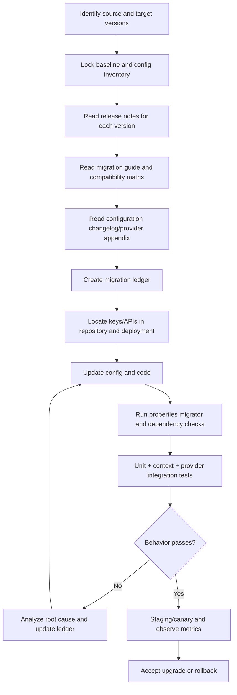

# Reading Release Notes, Migration Guides, and Configuration Changes Before Upgrading

An upgrade to Spring Boot or a Spring Cloud library can change application behavior even when business code does not change. Properties can be renamed, starters can split into modules, SDKs can change defaults for credentials or HTTP clients, and message converters can serialize payloads differently than before. If you only bump versions in pom.xml or build.gradle, many changes will only surface when the application starts up or calls real cloud services.

Before upgrading, read three groups of documentation in order: **release notes to learn what changed, migration guides to know what to fix, and configuration changelogs to map every old property to its new property**. Then compare those changes against the actual configuration, dependencies, and integration flows your application uses. The result should be a change list that can be reviewed, tested, and rolled back.

This lesson belongs to the **Integration Upgrades** chapter of the **SPRING_CLOUD_PROVIDER_INTEGRATION** module. The module practices integrating Spring Boot with AWS, Azure, and Google Cloud managed services via the corresponding Spring Cloud libraries. The content focuses on preparing for upgrades, especially configuration, auto-configuration, identity, HTTP clients, serialization, storage, messaging, and secret integration.

## 1. Learning Objectives

After this lesson, you will be able to:

- Distinguish the roles of release notes, migration guides, configuration changelogs, and compatibility matrices.
- Accurately identify the source version, target version, and intermediate releases that must be read.
- Locate properties that are deprecated, renamed, removed, or have changed defaults.
- Use spring-boot-properties-migrator to detect outdated configuration during the transition phase.
- Cross-check properties across YAML, environment variables, command-line arguments, Helm values, and platform configuration.
- Read changes in Spring Cloud AWS, Spring Framework on Google Cloud, and Spring Cloud Azure.
- Recognize changes that can alter credential chains, HTTP clients, JSON payloads, retries, timeouts, and refresh behavior.
- Build a migration checklist and test cases from release notes instead of only checking whether the application compiles.
- Record upgrade decisions, compatibility conditions, risks, and rollback plans.

## 2. Four Types of Documentation to Read

Upgrade documents serve different purposes. Reading the right type helps you find needed details quickly and avoid missing configuration changes.

| Document | Answers the question | What to look for |
| --- | --- | --- |
| Release notes | What changed in the new version? | New features, bug fixes, breaking changes, deprecations, dependency upgrades, security fixes |
| Migration guide | What must be done to move from the old version to the new one? | Prerequisites, removed APIs, package/class changes, code migration, dependency changes, upgrade sequence |
| Configuration changelog | What did an old property change into? | Renamed, deprecated, removed, added properties, changed defaults |
| Compatibility matrix | Which version combinations are supported? | Spring Boot, Spring Framework, Spring Cloud train, provider library, JDK |

Beyond those four types, certain changes require reading specialized documentation:

- API reference/Javadoc when classes, methods, or interfaces change.
- Starter reference documentation when auto-configuration or bean customization changes.
- SDK migration guides when upgrading the AWS SDK, Google Cloud Java libraries, or Azure SDK.
- Security advisories when a release includes CVEs or security patches.
- Testcontainers/emulator documentation when test modules or service connections change.

**Release notes do not replace migration guides.** Release notes usually summarize changes by module; migration guides describe the transition path from a specific version. Configuration changelogs are especially useful when searching for an old key across hundreds of lines of YAML.

## 3. Defining the Exact Upgrade Path

Before reading documentation, write down the current version and target version for each layer. For example:

```text
JDK:                 17 -> 21
Spring Boot:         3.5.x -> 4.0.x
Spring Framework:    6.2.x -> 7.0.x
Spring Cloud train:  2025.0.x -> 2025.1.x
Spring Cloud AWS:    3.4.x -> 4.x
Spring Cloud GCP:    7.x -> 8.x
Spring Cloud Azure:  6.x -> 7.x
```

This is a planning example, not a directive to upgrade all providers at once. Each provider has its own matrix; only record a target after confirming compatibility with the chosen Boot, Cloud train, and JDK.

### 3.1. Read every release crossed along the path

If upgrading from 3.3 to 4.0, read the release notes of relevant intermediate branches, the major migration guide, and configuration documentation between the current version and the target version. Do not read only the final release notes. A property might be deprecated in 3.4, renamed in 3.5, and removed in 4.0.

Spring Boot guidance for upgrading from 3.x requires reviewing the corresponding migration guide and the release notes of skipped versions. If you are multiple releases behind, read intermediate release notes as well to catch cumulative changes.

### 3.2. Upgrade to the latest patch of the source branch first

For major upgrades, first upgrade the application to the latest patch of the currently supported minor branch. For example, before moving from Boot 3.5 to 4.0, upgrade to the latest 3.5 patch. This ensures the baseline has the final fixes and dependencies of the source branch, reducing unknown failures when migration begins.

Then record the commit, artifact version, JDK, dependency tree, and baseline test results. This serves as the reference point for comparison when the target encounters errors.

## 4. Listing Actual Configuration Sources

A property can be declared in multiple places. Editing only application.yml while ignoring environment variables or Helm values can leave production using the old key.

Inventory the following sources:

| Source | Example | What to check |
| --- | --- | --- |
| application.yml / application.properties | spring.cloud.gcp.project-id | Old properties, new keys, profiles, and default values |
| Profile files | application-prod.yml | Environment-specific overrides, imports, and load order |
| Environment variables | SPRING_CLOUD_AZURE_KEYVAULT_SECRET_ENDPOINT | Relaxed binding, duplicate keys, and platform-injected values |
| Java system properties | -Dspring.cloud.aws.region.static=... | JVM flags and container configuration |
| Command-line arguments | --spring.profiles.active=prod | Deployment and pipeline parameters |
| Helm/Kubernetes | values.yaml, ConfigMap, Secret | Templates, ConfigMap keys, mounted files, and envFrom |
| Cloud Run/App Service/ECS | Revision variables, task definitions, app settings | Runtime configuration and secret references |
| Infrastructure as Code | Terraform, Pulumi, Bicep, CDK | Field names, resource attributes, and deployment templates |
| Java code | @ConfigurationProperties, @Value, Environment#getProperty | Prefixes, getters/setters, defaults, and bean customizers |

For each critical property, record both **where it is declared** and **the effective source at runtime**. A new key in YAML can be overridden by an old environment variable while the application still starts normally.

### 4.1. Searching for properties in the repository

Search by prefix and old key, for example:

```bash
rg -n "spring\\.http\\.(client|reactiveclient)" .
rg -n "cloud\\.aws|spring\\.cloud\\.aws" .
rg -n "spring\\.cloud\\.(gcp|azure)" .
rg -n "@ConfigurationProperties|@Value|Environment#getProperty" src
```

Do not search only inside src/main/resources. Check src/test/resources, Helm charts, Docker Compose, CI/CD workflows, manifests, and deploy directories if the project uses them. Never print secret values to the terminal or include sensitive configuration contents in tickets.

## 5. Reading Spring Boot Release Notes and Migration Guides

Spring Boot release notes typically contain an upgrading section and a New and Noteworthy section. Migration guides explain major changes by topic: system requirements, dependency management, configuration properties, auto-configuration, web, data, messaging, observability, and testing.

As you read, categorize each change into four groups:

1. **Must fix:** removed classes/properties, changed packages, unmanaged dependencies, or unmet runtime baselines.
2. **Must verify behavior:** new defaults, new retries/timeouts, auto-configuration conditions, or serialization changes.
3. **Can defer:** deprecated APIs that still work in the target branch.
4. **Relevant only if feature is used:** changes in modules that the application does not place on the classpath.

### 5.1. Example major upgrade from Boot 3.5 to Boot 4.0

The Boot 4.0 migration guide highlights key prerequisites and changes:

- Java 17 or higher.
- Jakarta EE 11 and Servlet 6.1 baseline.
- Spring Framework 7.x if the application manages dependencies directly.
- APIs, methods, and properties deprecated in Boot 3 are removed in Boot 4.
- Boot 4 has a smaller modular structure and more specialized starters.
- Jackson 3 becomes the preferred JSON library.

This directly affects provider integration applications. For example, an application using SQS/Pub/Sub/Service Bus can be affected by Jackson 3 and message converters; an application using a custom servlet container needs to verify Servlet 6.1; an application using HTTP clients needs to check new APIs and properties.

### 5.2. New modules and starters

Boot 4 reorganizes modules and starters. Previously, if a project declared only a third-party library to obtain a feature that Boot auto-configured indirectly, it may now need to add the corresponding official starter. The migration guide also calls for reviewing test dependencies: test support for several technologies has been split into dedicated starters.

Do not look only for removed artifacts. Compare your starter list against the technologies actually in use, such as Flyway, Liquibase, Security test, GraphQL test, or web modules. If a starter is missing, code may compile while auto-configuration or test slices stop working as before.

### 5.3. Jackson 2 to Jackson 3

Boot 4 prefers Jackson 3. Notable changes include:

- Jackson 3 packages move from com.fasterxml.jackson to tools.jackson, except jackson-annotations which keeps its corresponding package/group.
- Several classes/customizers are renamed to reflect Jackson 3.
- JSON-specific properties are moved under spring.jackson.json.*.
- Boot 4 provides a deprecated spring-boot-jackson2 module as a transitional bridge for applications that cannot upgrade immediately.

For cloud integrations, this is a change that must be tested at system boundaries. JSON sent over SQS, SNS, Pub/Sub, Service Bus, or HTTP APIs can include timestamps, enums, polymorphic types, null fields, and type metadata. Verify actual payloads and backward compatibility with consumers running older versions.

## 6. Reading Configuration Changelogs and Updating Properties

The configuration changelog lists renamed, deprecated, removed, or newly added properties. It is the primary reference for migrating keys in YAML and deployment configurations.

### 6.1. Example HTTP client properties in Boot 4.0

The configuration changelog between Boot 3.5.8 and 4.0.0 marks old HTTP client properties and specifies replacement keys:

| Old property | New property |
| --- | --- |
| spring.http.client.connect-timeout | spring.http.clients.connect-timeout |
| spring.http.client.factory | spring.http.clients.imperative.factory |
| spring.http.client.read-timeout | spring.http.clients.read-timeout |
| spring.http.client.redirects | spring.http.clients.redirects |
| spring.http.client.ssl.bundle | spring.http.clients.ssl.bundle |
| spring.http.reactiveclient.connector | spring.http.clients.reactive.connector |
| spring.http.reactiveclient.read-timeout | spring.http.clients.read-timeout |

Configuration before upgrade:

```yaml
spring:
  http:
    client:
      connect-timeout: 2s
      read-timeout: 5s
    reactiveclient:
      connector: reactor
      read-timeout: 5s
```

Configuration after updating keys:

```yaml
spring:
  http:
    clients:
      connect-timeout: 2s
      read-timeout: 5s
      reactive:
        connector: reactor
```

After changing keys, still verify whether timeouts are actually applied to the real HTTP client. A provider SDK may use its own HTTP transport rather than reading Boot's general HTTP client properties. If the application uses the AWS SDK, Google API client, or Azure SDK, check the provider's client customization and test timeouts on that exact client.

### 6.2. Distinguishing renamed, deprecated, and removed

| Status | Meaning | Action |
| --- | --- | --- |
| Added | Newly supported property | Read defaults, activation conditions, and whether declaration is needed |
| Renamed | Replacement key exists | Update all configuration sources and verify precedence |
| Deprecated | Still works but may be removed later | Migrate to the new key/API before the next major release |
| Removed | No longer read | Remove the old key and use the published alternative |
| Default changed | No key rename needed, but default behavior changed | Declare explicit value if retaining old behavior and test |

A property being present in a configuration file does not prove the framework still uses it. If a key was removed, Spring may start normally while the property has no effect. This is why diagnostics and runtime behavior must be checked, not just startup success.

## 7. Using Spring Boot Properties Migrator Properly

Spring Boot provides spring-boot-properties-migrator to analyze the environment at startup, log diagnostics, and temporarily translate certain renamed properties so the application can run during the migration phase.

Maven:

```xml
<dependency>
    <groupId>org.springframework.boot</groupId>
    <artifactId>spring-boot-properties-migrator</artifactId>
    <scope>runtime</scope>
</dependency>
```

Gradle:

```kotlin
dependencies {
    runtimeOnly("org.springframework.boot:spring-boot-properties-migrator")
}
```

Usage workflow:

1. Add the migrator to a temporary upgrade branch.
2. Start the application with each profile and configuration source matching production.
3. Collect warnings/errors about old properties.
4. Update properties to the new keys in configuration files and deployment templates.
5. Restart the application and confirm no related diagnostics remain.
6. Remove the migrator from dependencies before official release.

In supported versions, spring.properties.migrator.fail can be used to choose how warnings/errors are handled: never, on-error, or on-warning. Use fail mode in the migration pipeline to prevent removed keys from slipping into builds; check the exact Boot version's documentation before enabling it.

The migrator has limitations. Properties added late to the Environment, such as via @PropertySource, may not be analyzed. It also does not replace reading provider configuration changelogs and cannot know if a custom third-party library key changed unless the provider integrates with the tool.

Do not keep the migrator in production long-term. It is a transitional tool; the final configuration must use the new keys and be verified by tests.

## 8. Reading Spring Cloud Release Train Changes

Spring Cloud release notes can change the behavior of multiple projects within the same train. When an application uses Config, Gateway, Stream, Bus, OpenFeign, or Kubernetes, read the release notes of the corresponding project rather than only the train overview.

For example, Spring Cloud 2026.0.0 is based on Spring Boot 4.2.0. This release train moves Spring Cloud Bus into Spring Cloud Stream; Bus artifact coordinates are preserved so transitions for applications using Bus remain seamless. Spring Cloud Config adds OAuth 2 for client authentication with Config Server, supports Azure DevOps workload identity, and supports Google Cloud Storage as a Config Server backend.

These changes can affect configuration even if property names stay the same:

- If using Bus, verify the dependency graph, startup, and messaging topology after upgrading the train.
- If using Config Server, verify OAuth client credentials, token endpoint, scopes, and trust configuration.
- If using GCS as a backend, verify IAM roles, bucket paths, object versions, and behavior when files do not exist.
- If using Azure DevOps workload identity, verify federation subject/issuer and identity mapping.

Read the release notes of the projects in use and check CVEs patched in the train. Some security fixes may alter authentication, origin validation, caching, or invalid input handling; do not skip the security fixes section just because it is outside the migration section.

## 9. Reading Provider-Specific Release Notes

Provider libraries have their own configurations, client customizations, and SDKs. When upgrading a provider, search across these categories: configuration, credentials, region, endpoint, retry, timeout, message converter, serialization, health, auto-configuration, testcontainers, and breaking changes.

### 9.1. Spring Cloud AWS

Spring Cloud AWS 4.0 is the major line compatible with Spring Boot 4 and Spring Framework 7. Key highlights from release notes and reference documentation:

- Spring Integration AWS is integrated into Spring Cloud AWS with modules for SQS, SNS, S3, DynamoDB, and Kinesis.
- Supports Jackson 3; during the transition period, a Jackson 2 compatibility mechanism is provided.
- Test support is modernized with ServiceConnection and Testcontainers 2.
- Deprecated customizer APIs may be removed; for example, AwsClientCustomizer is removed from core.

In the 4.2 branch, release notes add further SQS behavior changes: SqsTemplate supports sending more than 10 messages in a batch, preserves generic listener payload types, and adds QueueNotFoundStrategy. Release 4.2.0 also fixes AppConfig token refresh issues. These items should be turned into test cases for producers, listeners, queue lookup, and configuration refresh.

For example, legacy configurations from Spring Cloud AWS 2.x may use prefixes cloud.aws.* or aws.paramstore.*; from 3.x onward, many properties moved to spring.cloud.aws.* or Config Data import. For example:

```yaml
# Legacy configuration in the 2.x branch
cloud:
  aws:
    region:
      static: ap-southeast-1
```

```yaml
# Current configuration
spring:
  cloud:
    aws:
      region:
        static: ap-southeast-1
```

For Parameter Store, old configurations relying on property prefixes/names may need to move to spring.config.import=aws-parameterstore:/path/. Do not apply 2.x-to-3.x migration examples blindly to every 3.x-to-4.x application; identify the source version before selecting the right guide.

### 9.2. Spring Framework on Google Cloud

Spring Cloud GCP 8.0 moves the project onto the Spring Boot 4.0 and Spring Framework 7.0 baseline. This is a major platform shift, not merely a bump of Google Cloud Java libraries. When upgrading from GCP 7.x to 8.x, verify:

- Compatibility matrix among Spring Boot, Spring Cloud train, and Spring Framework.
- Auto-configuration for GCS, Pub/Sub, Secret Manager, Cloud SQL, and data modules.
- ADC/workload identity and spring.cloud.gcp.* properties.
- Google Cloud Java libraries BOM and gRPC/protobuf transitive dependencies.
- Pub/Sub serializer/deserializer, ack deadline, retries, and error handlers.
- Spring Data repositories, transaction managers, and connection pools if using Spanner/Datastore/Firestore.

Do not assume every GCP property is renamed just because the major version changed. Compare configuration metadata, the reference appendix, and release notes between the exact two versions being upgraded. If no key migration is published, keep the existing key and verify via binding/auto-configuration tests instead of guessing replacement names.

### 9.3. Spring Cloud Azure

Spring Cloud Azure maintains a Spring Versions Mapping table and per-module changelogs. You must check both the Boot/Cloud/JDK mapping and the changelog of specific modules: App Configuration, Key Vault, Storage, Service Bus, or Event Hubs.

For example, Spring Cloud Azure 7.5.0 released on 24-11-2026 announces tested compatibility with Boot 4.0.0–4.1.2 and Spring Cloud 2025.1.0–2025.1.3. This release adds Snapshot References support for App Configuration; fixes synchronous blocking refresh by moving refresh checks to asynchronous execution; fixes startup retry reporting success even when configuration failed to load; and adds filter patterns for Key Vault SSL bundle certificate aliases.

This leads to concrete tests:

- App Configuration snapshot references resolve to the expected properties.
- Refresh does not block request threads and refresh failures are still logged/recorded.
- Startup does not report healthy when all clients remain in backoff and config has not loaded.
- Key Vault SSL bundle loads only certificate aliases matching the declared filter.

Note: release 7.5.0 explicitly states its tested scope up to Boot 4.1.2 and Cloud 2025.1.3; a note that “newer patches may be compatible but are untested” is not official confirmation. When targeting Boot 4.2 or Cloud 2026.0, wait for provider matrix/release-note confirmation.

## 10. Checking Provider Configuration Changes by Category

Do not read changelogs by property name alone. Group configuration by behavior so you know which tests must run.

| Group | AWS | Google Cloud | Azure | Post-upgrade checks |
| --- | --- | --- | --- | --- |
| Identity | DefaultCredentialsProvider, web identity, IAM role | ADC, service account, Workload Identity | TokenCredential, managed identity | Correct principal, token acquired, correct scope/role |
| Region/endpoint | spring.cloud.aws.region.*, endpoint override | Project ID, location, endpoint | Azure endpoint, subscription, resource ID | Calls target the right resource/environment |
| Storage | S3 client, transfer manager | GCS Storage/Resource | Blob client | Upload/download, metadata, checksums, retries |
| Messaging | SQS/SNS/Kinesis | Pub/Sub | Service Bus/Event Hubs | Payload, ordering, ack, redelivery, DLQ |
| Secret/config | Secrets Manager, Parameter Store, AppConfig | Secret Manager, Config | Key Vault, App Configuration | Load, prefix, optional/required, refresh |
| HTTP/transport | AWS SDK sync/async client | gRPC/HTTP client | Azure Core pipeline | Timeout, proxy, TLS, retry, connection pool |
| Serialization | Jackson converter, SQS headers | JSON/protobuf payload | Jackson/AMQP/Service Bus converter | Wire format compatible with older consumers |
| Observability | CloudWatch metrics/tracing | Cloud Logging/Monitoring/Trace | Azure Monitor | Metric names, health, trace context, log fields |

For each group, locate the properties and classes used in code/config, then find the corresponding items in the provider's release notes and reference documentation. If the provider changed a default, write an explicit configuration or test to catch behavior drift.

## 11. Creating a Migration Ledger from Documentation

A migration ledger table turns documentation into actionable tasks with owners and completion evidence.

| Field | Information to record |
| --- | --- |
| Source / target | Current and target versions of framework/provider |
| Source document | Release notes, migration guide, or config changelog URL |
| Change type | Renamed, removed, deprecated, default changed, new behavior, CVE |
| Old key/API | Property/class/method currently in use |
| New key/API | Replacement published by the provider |
| Affected locations | YAML, profiles, env, Helm, Terraform, code, tests |
| Runtime effect | Behavior that may change in production |
| Required test | Concrete test case and expected outcome |
| Owner/status | Assignee, status, and PR link |
| Rollback note | Which config/image/secret/schema must be restored |

Do not mark an item complete merely because the key was changed. Require evidence that the application reads the correct property after startup and that runtime behavior matches expectations.

## 12. Process for Reading and Applying Upgrade Documentation



### 12.1. Step 1 — Capture baseline

Save build results, test results, dependency tree, effective POM/Gradle resolution, SBOM, and currently deployed configuration. Record the exact image digest and revision ID for post-upgrade comparison.

### 12.2. Step 2 — Read sources in order

Read release notes for Boot, the Cloud train, and providers. Then read the migration guide from the source version to the target, the configuration changelog, and provider configuration appendices. Flag every change affecting modules in use; do not turn every release item into work if that module is not on the classpath.

### 12.3. Step 3 — Find and fix all configuration sources

Search for old keys across the repository and deployments. Update YAML, profiles, env vars, Helm, Terraform, Cloud Run/ECS/App Service settings, and test fixtures. Remove old aliases/fallbacks once tests prove the new keys take effect.

### 12.4. Step 4 — Run diagnostics and check auto-configuration

Start up with every profile. Use the Properties Migrator when appropriate. Inspect the condition evaluation report, bean definitions, and client configurations. For provider starters, verify the auto-configured credential provider, region, endpoint, and HTTP transport.

### 12.5. Step 5 — Test contracts and cloud behavior

Run tests against emulators/sandboxes and production-like identities. Test not only the happy path, but also permission errors, timeouts, missing resources, retries, duplicate messages, and config refresh. Compare JSON/event payloads between the old and new versions.

### 12.6. Step 6 — Canary and decide

Deploy a new revision/canary and monitor startup, request errors, provider API errors, latency, retries, queue backlog, connection pools, and health indicators. Proceed with broader rollout only when mandatory ledger items are closed and a clear rollback plan is ready.

## 13. Hands-On Exercise: Upgrading invoice-service from Boot 3.5 to Boot 4.0

**Context:** invoice-service uses Spring Boot 3.5, Spring Cloud 2025.0, Spring Cloud AWS 3.4, Spring Cloud GCP 7.x, and Spring Cloud Azure 6.x. The application uses S3, GCS, Azure Blob, SQS, Pub/Sub, Service Bus, and secret/config services. The goal is to prepare a migration to Boot 4.0 and the corresponding confirmed provider lines.

### Step 1 — Establish baseline

Run:

```bash
./mvnw dependency:tree -Dverbose
./mvnw help:effective-pom
```

Record the JDK, Boot, Spring Cloud train, provider BOMs, SDK BOMs, starters, and overridden dependencies. Save current test results.

### Step 2 — Read documentation

- Spring Boot 4.0 migration guide and release notes.
- Spring Boot 4.0 configuration changelog.
- Spring Cloud 2025.1 release notes.
- Spring Cloud AWS 4.0 release notes/reference.
- Spring Framework on Google Cloud 8.x compatibility/release notes.
- Spring Cloud Azure 7.x Spring Versions Mapping and changelog.

Record the check date, version URLs, and every item impacting the service.

### Step 3 — Create migration ledger

Example entries:

| Change | Action | Test |
| --- | --- | --- |
| spring.http.client.* prefix change | Update YAML, Helm, and env mappings | Verify outbound HTTP timeouts |
| Boot 4 uses Jackson 3 | Review ObjectMapper, modules, and message converters | Golden JSON tests for SQS/Pub/Sub/Service Bus |
| Spring Cloud AWS 4 changes Jackson and SQS support | Review converters, listener generic types, and acknowledgement | SQS round-trip, batch, redelivery |
| GCP 8 moves to Boot 4/Framework 7 | Check starters, ADC, and Google libraries BOM | GCS, Pub/Sub, Secret Manager smoke tests |
| Azure 7 App Configuration refresh | Check startup/reload behavior and snapshot refs | Refresh success/failure and thread behavior |

### Step 4 — Migrate properties and dependencies

Change properties that have official mappings. Update BOMs per the compatibility matrix. For properties without a clear mapping, check configuration metadata/reference docs and test binding; do not guess new keys.

### Step 5 — Run tests per provider

- AWS: S3 upload/download, SQS listener generic payload, ack, batch, and LocalStack ServiceConnection.
- Google Cloud: ADC/Workload Identity, GCS object metadata, Pub/Sub ack/redelivery, and Secret Manager access.
- Azure: managed identity, Blob read/write, Service Bus message conversion, and App Configuration refresh.
- Shared platform: HTTP timeouts, TLS/SSL bundles, JSON payloads, and tracing context.

### Step 6 — Validate production configuration

Render Helm/Terraform/Cloud Run settings. Compare property keys after rendering, checking profiles and env overrides. Ensure no old keys are silently ignored and no secrets are exposed when debug diagnostics are enabled.

### Step 7 — Canary

Deploy a new revision, run smoke tests, and observe error rates, message backlog, retries, and connection pools. Retain the pre-upgrade image/config to roll back if provider behavior changes unexpectedly.

## 14. Review Checklist Before Merging a Migration PR

- [ ] Clearly recorded source and target versions of Boot, Cloud, and each provider.
- [ ] Read release notes of skipped intermediate releases.
- [ ] Read the migration guide for the corresponding major/minor upgrade.
- [ ] Checked compatibility matrix and JDK baseline.
- [ ] Read configuration changelog and provider property appendices.
- [ ] Searched for old keys across YAML, profiles, env, Helm, Terraform, and CI/CD.
- [ ] Replaced deprecated/removed keys using official mappings.
- [ ] Verified property precedence and runtime values.
- [ ] Checked starters/modules, auto-configuration, and bean customizers.
- [ ] Checked credential chains, regions, endpoints, timeouts, and retries.
- [ ] Checked JSON/message payloads and backward compatibility.
- [ ] Ran unit, context, emulator/sandbox, and provider integration tests.
- [ ] Removed spring-boot-properties-migrator after migration.
- [ ] Updated ledger, dependency inventory, and rollback notes.

## 15. Self-Check Questions

1. How do release notes differ from migration guides and configuration changelogs?
2. Why must you read intermediate releases when upgrading across multiple minor versions?
3. Why should you upgrade to the latest patch of the source branch before a major upgrade?
4. What configuration sources besides application.yml can hold a property?
5. What platform changes does Boot 4 require regarding JDK, Servlet, and Spring Framework?
6. How does spring-boot-properties-migrator help, and why must it be removed after migration?
7. Which key did the spring.http.client.connect-timeout property change to?
8. How can Jackson 3 affect message payloads across providers?
9. Why can you not assume every provider property will rename under the same rule?
10. What changes in Spring Cloud AWS 4 need testing with SQS and Testcontainers?
11. What Spring baselines must be checked before upgrading to GCP 8.x?
12. What App Configuration refresh changes in Azure 7.5.0 require testing?
13. Why might a new provider release not yet confirm compatibility with the latest Boot/Cloud?
14. What fields should a migration ledger contain so reviewers can verify changes?
15. Which metrics should be monitored during a post-upgrade canary?

## 16. Key Takeaways

Read release notes to understand changes, migration guides to know the upgrade path, and configuration changelogs to fix individual properties. Start from clear source/target versions, upgrade the source branch to its baseline patch, check compatibility matrices, and only then update dependencies. Search for old keys across every configuration source, including profiles, environment variables, Helm, Terraform, and code.

Spring Boot Properties Migrator is useful during discovery of old keys, but it does not replace updating configuration and must be removed after migration. For AWS, Google Cloud, and Azure, read each provider's release notes separately because credential chains, HTTP clients, serialization, retries, and refresh behavior can change outside Spring Boot's scope. **Every documentation change must become a migration ledger entry with edit locations, verification tests, and a rollback plan.**

## Official References

- [Spring Boot — Upgrading](https://docs.spring.io/spring-boot/upgrading.html)
- [Spring Boot 4.0 Migration Guide](https://github.com/spring-projects/spring-boot/wiki/Spring-Boot-4.0-Migration-Guide)
- [Spring Boot 4.0 Configuration Changelog](https://github.com/spring-projects/spring-boot/wiki/Spring-Boot-4.0-Configuration-Changelog)
- [Spring Boot 4.2.0 Release Announcement](https://spring.io/blog/2026/11/19/spring-boot-4-2-0-available-now/)
- [Spring Cloud 2026.0.0 Release Announcement](https://spring.io/blog/2026/11/20/spring-cloud-2026-0-0-has-been-released/)
- [Spring Cloud AWS — Releases](https://github.com/awspring/spring-cloud-aws/releases)
- [Spring Cloud AWS 4.2.2 Reference Documentation](https://docs.awspring.io/spring-cloud-aws/docs/4.2.2/reference/html/index.html)
- [Spring Framework on Google Cloud — Releases](https://github.com/GoogleCloudPlatform/spring-cloud-gcp/releases)
- [Spring Framework on Google Cloud — Compatibility Matrix](https://github.com/GoogleCloudPlatform/spring-cloud-gcp#compatibility-with-spring-project-versions)
- [Spring Cloud Azure — Releases](https://github.com/Azure/azure-sdk-for-java/releases)
- [Spring Cloud Azure — Spring Versions Mapping](https://github.com/Azure/azure-sdk-for-java/wiki/Spring-Versions-Mapping)
