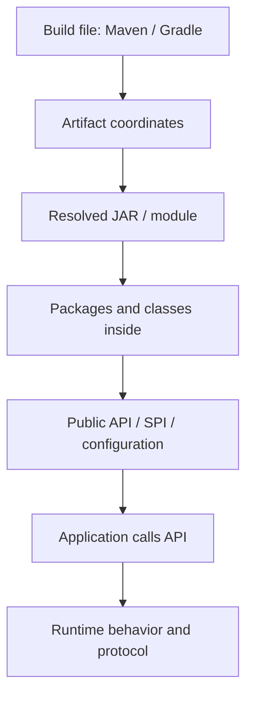

# Distinguishing Changes in Artifacts, Packages, and Public APIs

When upgrading a Spring Boot application that integrates with AWS, Azure, or Google Cloud managed services, a change in a library can appear at multiple layers: dependency coordinates change, classes move packages, or the methods/contracts called by the application change. These three types of changes are related but not synonymous. If you only look at artifact names or only fix imports until compilation succeeds, the application can still fail with linkage errors at runtime, lose auto-configuration, or change behavior when calling services.

To evaluate an upgrade accurately, separate three questions:

1. **Which artifact is loaded?** This is the dependency identity in Maven/Gradle: group, artifact, version, classifier, and repository.
2. **Which package does the class belong to?** This is the fully qualified class name in bytecode and how source code imports that class.
3. **Has the public contract changed?** This is the API that the application is allowed to use: classes, methods, constructors, annotations, properties, SPIs, exceptions, and documented semantics.

An artifact can change its name while keeping packages/APIs unchanged; a package can change within the same artifact; or the artifact and package can remain unchanged while the API changes. Distinguishing these cases helps define the scope of code edits, select the right inspection tools, and plan an appropriate migration.

After this lesson, you will be able to:

- Distinguish artifact coordinates, Java packages, and public APIs.
- Identify source compatibility, binary compatibility, and behavioral compatibility changes.
- Inspect actually resolved dependencies with Maven/Gradle and inspect JAR contents.
- Assess the impact of package migrations, API signature changes, and Spring configuration.
- Plan Spring/SDK library upgrades by layer of change.
- Use the compiler, bytecode inspection, API diffs, and integration tests to verify compatibility.

## 1. Three Concepts Across Three Different Layers

| Concept | Definition | Identification example | Upgrade question |
|---|---|---|---|
| Artifact | Distribution unit of a dependency built and published to a repository | `groupId:artifactId:version` in Maven | Which dependency coordinates are downloaded and which version is selected? |
| Package | Namespace containing classes/interfaces/enums/annotations in Java | `software.amazon.awssdk.services.s3` | Which package does source code import classes from? Which class name does bytecode reference? |
| Public API | Contract published by a library for consumers to use | Methods, constructors, types, annotations, properties, SPIs, and semantics | Can application code compile, link, and work properly under the new contract? |



An artifact is how a library is distributed. A package is how code is organized and named. The public API is what consumers are permitted to depend on. One artifact can contain multiple packages; the same package can be split across multiple artifacts; and an artifact can change its API without changing coordinates or packages.

## 2. Changes in Artifact Coordinates

### 2.1. What is an artifact?

With Maven, basic dependency coordinates include:

- `groupId`: publishing organization or namespace.
- `artifactId`: name of the published module.
- `version`: version of the module.
- `type`/`packaging`: artifact type, typically `jar` or `pom`.
- `classifier`: additional variant if any, such as an artifact containing sources or a native classifier.

Example declaration:

```xml
<dependency>
    <groupId>com.example.cloud</groupId>
    <artifactId>storage-client</artifactId>
    <version>2.4.0</version>
</dependency>
```

In Gradle, notation typically takes the form `group:artifact:version`:

```kotlin
dependencies {
    implementation("com.example.cloud:storage-client:2.4.0")
}
```

Changing `artifactId` or `groupId` alters dependency coordinates, but does not by itself prove that Java packages or APIs have changed. Maintainers may rename, split, merge, or relocate a module to another publishing group while keeping public classes unchanged.

### 2.2. Common types of artifact changes

| Change | Example | Possible impact |
|---|---|---|
| Version change | `client:1.8` to `client:2.0` | May include API, package, or behavioral breaking changes; must read migration guide |
| `artifactId` change | `cloud-starter-old` to `cloud-starter-new` | Build file must be updated; packages/APIs may stay the same or change |
| Artifact split | One large SDK split into `core`, `auth`, `storage` | Must add needed modules; classes may move JARs while keeping packages |
| Artifact merge | Multiple modules combined into one starter | Can cause duplicate dependencies or conflicts if the old artifact remains |
| `groupId` change | Module moves to a different publishing namespace | Dependency coordinates and version management rules may need updates |
| Relocation | Old POM declares Maven relocation to new artifact | Maven may warn and guide consumers to migrate to the new coordinates |
| Classifier/packaging change | Artifact adds runtime/platform variants | May download wrong contents or miss required classes |

### 2.3. Changing an artifact does not necessarily change the API

Suppose a library is split from one JAR into two JARs:

```text
Before:
com.example.cloud:cloud-sdk:1.5.0

After:
com.example.cloud:cloud-core:2.0.0
com.example.cloud:cloud-storage:2.0.0
```

If `com.example.cloud.storage.StorageClient` moves from the old JAR to the new JAR while keeping its package, class name, and methods, source code may not need import changes. However, the build file must add the artifact containing the class; transitive dependencies, service loader resources, module metadata, and the runtime classpath must also be verified.

The reverse can also happen: artifact coordinates stay the same while maintainers change method signatures or semantics. Therefore, looking at `pom.xml` alone is not enough to conclude API compatibility.

### 2.4. Inspecting resolved artifacts

With Maven:

```bash
mvn dependency:tree -Dverbose
mvn help:effective-pom
```

Filter a group of dependencies:

```bash
mvn dependency:tree -Dincludes=com.alibaba.cloud,com.aliyun,software.amazon.awssdk,com.azure,com.google.cloud
```

With Gradle:

```bash
./gradlew dependencies --configuration runtimeClasspath
./gradlew dependencyInsight --dependency storage-client --configuration runtimeClasspath
```

These commands help answer which artifact is selected, which version wins during conflicts, and which dependency brings it in. Distinguish `compileClasspath` from `runtimeClasspath`: an application may compile fine while runtime selects a different version due to dependency scope or resolution rules.

## 3. Changes in Packages and Class Names

### 3.1. The package is part of the class name

A class's fully qualified name consists of its package and class name, for example:

```java
com.example.storage.ObjectClient
```

If the class is moved to:

```java
com.example.cloud.storage.ObjectClient
```

then this is a different class name to both the compiler and the JVM. Source code usually needs `import` updates, and the impact does not stop at imports: older bytecode references the old class name and cannot automatically locate the new class just because the simple name is still `ObjectClient`.

### 3.2. Package migration can occur within the same artifact

A prominent example in the Java ecosystem is moving from Java EE `javax.*` to Jakarta EE `jakarta.*`. With Spring Framework 6/Spring Boot 3, many foundational APIs changed namespaces:

```java
// Legacy API generation
import javax.servlet.Filter;
import javax.persistence.Entity;
import javax.validation.Valid;

// Jakarta generation
import jakarta.servlet.Filter;
import jakarta.persistence.Entity;
import jakarta.validation.Valid;
```

This is a package/type migration with broad impact on source and binary compatibility. You cannot simply swap one dependency and expect `javax.*` and `jakarta.*` classes to substitute for each other: they are two distinct types in the JVM. An older library still referencing `javax.servlet.Filter` does not become compatible with the new API just because the application added `jakarta.servlet-api`.

When upgrading Spring Boot 2 to 3, inventory application code, the servlet container, persistence provider, validation provider, OpenAPI library, security adapters, and third-party libraries. Packages outside the migrated group must not be replaced mechanically; for instance, `javax.crypto` and `javax.net.ssl` remain Java SE packages.

### 3.3. The artifact can keep its name while the package changes

Maintainers can publish a new version under the same artifact while moving classes to a different package. The build still resolves because coordinates did not change, yet code importing the old class fails to compile or misses the old class at runtime. This is why you must read the migration guide and compare JAR contents rather than checking only the dependency tree.

### 3.4. The package can stay the same while the class moves artifacts

A project can split modules while keeping packages intact. If a consumer only declares the old artifact and the class is no longer inside that JAR, the typical failure is `ClassNotFoundException` or `NoClassDefFoundError`. Adding the right new artifact can restore the class without changing imports. However, you must verify version alignment and avoid putting two versions containing the same class on the runtime classpath.

### 3.5. Finding classes inside a JAR

Once the resolved JAR is identified, you can inspect its contents:

```bash
jar tf path/to/library.jar
```

Filter classes by package:

```bash
jar tf path/to/library.jar | grep 'com/example/cloud'
```

On PowerShell, you can use `Select-String` to filter output. For Java modules, also check `module-info.class` and resources such as `META-INF/services/*`, Spring auto-configuration imports files, and metadata. A class still existing does not mean service provider or auto-configuration registrations were preserved.

## 4. What Is a Public API?

The public API is the portion of the contract published by a library for other applications to use. In Java, the API usually comprises documented `public` or `protected` types and members; however, the practical API surface also includes annotations, configuration, SPIs, resource conventions, and semantics.

### 4.1. API elements to inspect

| Element | Example | Types of breaking changes |
|---|---|---|
| Class/interface/enum/record | `StorageClient`, `CloudCredentials` | Removed, renamed, moved package, changed superclass or interfaces |
| Constructor | `new StorageClient(config)` | Removed constructor, changed parameters, or reduced visibility |
| Method | `upload(String, byte[])` | Removed/renamed, changed parameters, return type, or checked exceptions |
| Field/constant | `DEFAULT_REGION` | Removed, renamed, changed type, or changed value semantics |
| Annotation | `@EnableCloudStorage` | Removed attributes, changed target/retention, or changed auto-configuration handling |
| Generic/type bounds | `Client<T extends Request>` | Changing bounds can break consumer compilation or alter overload resolution |
| Exception contract | `CloudException` | Changed hierarchy, error codes, or checked/unchecked behavior |
| Configuration property | `cloud.storage.endpoint` | Changed prefix, property name, defaults, or binding semantics |
| SPI/service loader | `META-INF/services/...` | Changed interface or failed to register new provider |
| Auto-configuration | Beans created by classpath/property | Changed conditions, bean name, order, or back-off behavior |
| Protocol/schema | HTTP endpoint, JSON fields, message schema | Wire contract changes even if Java API stays the same |

### 4.2. `public` does not always mean supported

A class with the `public` modifier may be an implementation detail exposed due to technical constraints. Conversely, a configuration property or annotation can be part of the public contract even though it is not a regular Java method. Distinguish among:

- **Documented public API:** officially documented with compatibility guarantees under project policy.
- **SPI/extension point:** designed for consumers to supply implementations or plugins.
- **Internal API:** packages/classes named `internal`, `impl`, `support`, or documented as unstable.
- **Incidental API:** accidentally accessible without any support commitment.

Do not build long-term integrations on internal classes merely because they are `public`. If forced to use an unstable extension, isolate it behind an adapter and write tests to catch changes.

### 4.3. Java API and cloud service API are two different contracts

An SDK can change Java methods while the cloud-side HTTP API remains unchanged. Conversely, the Java SDK stays unchanged while the cloud service alters defaults, permissions, quotas, response fields, or server-side behavior. Evaluate all four:

1. Java API between the application and the SDK.
2. Runtime client behavior (retries, timeouts, signing, serialization).
3. Wire/API contract between the SDK and the managed service.
4. Data contract between the application and the database, topic, queue, or object storage.

For example, changing `upload()` to `putObject()` is a Java API change. Changing region endpoints, request signing, IAM permission requirements, or versioning semantics is a change at the service integration layer, even though the code still compiles.

## 5. Source Compatibility, Binary Compatibility, and Behavioral Compatibility

A change can break code at different stages. Evaluate at least three layers of compatibility.

### 5.1. Source compatibility

Source compatibility answers: does the old source code still compile against the new library?

For example, code currently calling:

```java
client.upload(bucket, key, content);
```

If the method changes to:

```java
client.upload(UploadRequest request);
```

the old source will not compile until migrated. Likewise, changing packages causes old imports to fail resolution; changing generic bounds or checked exceptions may require updating call sites.

The compiler is a good tool for detecting source incompatibility, but only when compiling all consumer modules, generated code, test sources, and related integration modules.

### 5.2. Binary compatibility

Binary compatibility answers: can previously compiled bytecode link and run with the new library? The JVM links classes/methods/fields based on binary names and descriptors. If a method is removed or its descriptor changes, previously compiled code can still fail at runtime.

Common linkage errors:

| Error | Typical meaning |
|---|---|
| `NoSuchMethodError` | Bytecode invokes a method that no longer exists with the old descriptor |
| `NoSuchFieldError` | Field referenced by bytecode is missing or changed incompatibly |
| `NoClassDefFoundError` | Class needed at runtime is missing or failed static initialization earlier |
| `ClassNotFoundException` | Code loads a class dynamically by name but the class cannot be found |
| `AbstractMethodError` | Runtime implementation does not provide a method required by bytecode/interface |
| `IllegalAccessError` | Runtime access privileges are no longer compatible with compiled bytecode |
| `IncompatibleClassChangeError` | Incompatible change to class/interface/static/instance structure or related hierarchy |

Example: the application is compiled against SDK 1.x which has `Client.send(String)`, but runtime loads SDK 2.x which only has `Client.send(Request)`. If the compile and runtime classpaths differ, the error can appear when invoking the method even though artifact build succeeded.

### 5.3. Behavioral compatibility

Behavioral compatibility answers: does the old code continue producing the same results and side effects as before? An application can compile and link cleanly while behavior still changes:

- Default retries increase from 2 to 5 attempts, lengthening requests and increasing load.
- Default timeouts change or shift from connect timeout to overall timeout.
- Serializers change how enums/nulls/timestamps are written, breaking data compatibility.
- SDK changes default region, endpoint resolution, or credential chain.
- A new exception is thrown instead of returning an empty/null result.
- Default pool sizes or concurrency change, increasing database connections.
- Auto-configuration creates different beans when additional dependencies are on the classpath.
- Message consumers change ack mode or retry policy.

Behavioral incompatibility usually surfaces only through integration tests, contract tests, load tests, and canary observation. The compiler cannot catch all of it.

### 5.4. Configuration and wire compatibility

In Spring integrations, property keys are part of the operational contract. Changing `spring.cloud.vendor.old.endpoint` to a new prefix may not fail compilation; the application simply falls back to defaults or fails to connect at runtime. Likewise, changing JSON fields, message headers, database columns, or HTTP endpoints can break other consumers even when internal Java APIs remain unchanged.

Specifically check:

- Property names, defaults, types, validation, and relaxed binding.
- Environment variable mapping and precedence among files, env, command line, and config server.
- HTTP request/response schemas, status/error mappings, and authentication.
- Message schemas, content types, headers, ordering, and ack semantics.
- Database migrations, column types, indexes, transactions/isolation, and serialization.

## 6. Example: Package Change Without Necessarily Changing the Artifact

Suppose a dependency remains declared under the same coordinates:

```xml
<dependency>
    <groupId>com.example.integration</groupId>
    <artifactId>cloud-web-adapter</artifactId>
    <version>3.0.0</version>
</dependency>
```

Version 2 contains:

```java
import javax.servlet.Filter;
```

Version 3 requires:

```java
import jakarta.servlet.Filter;
```

Artifact coordinates only changed the version. The API package switched namespaces and brought binary incompatibility. If the application still keeps the old servlet API or a filter library that only implements `javax.servlet.Filter`, the types are incompatible even though the simple interface name is identical.

Handling workflow:

1. Identify which dependencies still reference `javax.servlet`, `javax.persistence`, or `javax.validation`.
2. Choose library versions that support Jakarta.
3. Update imports and annotations in application code.
4. Verify the container/runtime, filters, persistence provider, validation, and security integration.
5. Run context tests and integration tests against the actual runtime.

Do not use an unofficial dependency bridge to mix two namespaces across the same API boundary unless explicitly supported by documentation.

## 7. Example: Artifact/Package/API Changes Across Cloud SDKs

### 7.1. AWS SDK for Java v1 and v2

The two SDK generations have different package/API structures. For example, the S3 client:

```java
// AWS SDK for Java 1.x
import com.amazonaws.services.s3.AmazonS3;

// AWS SDK for Java 2.x
import software.amazon.awssdk.services.s3.S3Client;
```

This is not just a dependency rename. Client APIs, builders, request/response types, credential providers, exceptions, and region/HTTP transport configuration all differ. The application must migrate call sites and verify behaviors such as retries, timeouts, stream handling, and resource lifecycles.

Do not place two SDK generations side by side assuming classes will interoperate automatically. If migrating service by service, isolate each implementation and control dependencies to prevent conflicts or wrong imports.

### 7.2. Azure SDK Java

Azure SDK has different API generations and packages between legacy libraries and modern Azure SDKs. Modern clients use builders, pipelines, and credential abstractions such as `TokenCredential`; legacy libraries may use different client/configuration models. When upgrading, check:

- Which artifacts were renamed or replaced.
- Packages for clients, models, and credential types.
- Builders/constructors, async/sync APIs, and exception hierarchies.
- Retry policies, pipeline policies, timeouts, and telemetry.
- How managed identity credentials are acquired in the deployment environment.

Do not assume every Azure SDK follows the same migration steps; each service has its own migration guide.

### 7.3. Google Cloud Java libraries

Google Cloud Java client libraries typically have per-service artifacts and can change versions independently or via a BOM. Some libraries transitioned from legacy APIs to modern clients with different builders, transports, retry settings, and resource name types. Check packages, generated API versions, the artifact BOM, gRPC/HTTP transport, and credential integration.

When using the Google Cloud BOM, let the BOM manage compatible library groups instead of pinning individual transitive dependencies unnecessarily. If upgrading a single client independently, verify it does not pull in gRPC/protobuf versions that conflict with other clients in the same application.

### 7.4. Alibaba Cloud OSS SDK

OSS Java SDK V1 and OSS SDK for Java 2.0 have different APIs/packages and client management models. When switching generations, check builders, credential providers, response/body stream lifecycles, exceptions, multipart uploads, and shutdown/close semantics. An internal adapter can keep the application contract stable while the underlying implementation changes.

The examples above illustrate how to categorize changes. Specific artifact names and versions must come from the migration guide and BOM of the release you are using; never copy versions from an old article without checking compatibility.

## 8. Public API Changes in Spring Integration

A Spring Cloud starter typically provides more than a Java client. It can register auto-configuration, bind properties, create beans, add annotations, or implement Spring Cloud interfaces. Therefore, when upgrading a starter, inspect the following surfaces:

### 8.1. Auto-configuration and bean contracts

A starter may create a `CloudStorageClient` bean when the SDK is on the classpath and properties are configured. A new version may:

- Change auto-configuration classes or the registration mechanism.
- Change `@ConditionalOnClass`, `@ConditionalOnProperty`, or bean back-off conditions.
- Change bean names/types or switch to another factory.
- Stop creating a default bean when a required property is missing.
- Change auto-configuration ordering or lifecycle/shutdown behavior.

The application may still compile yet fail at startup with `NoSuchBeanDefinitionException` or have two competing beans. Use the Spring Boot condition evaluation report (`--debug`) and context tests to confirm which beans are created.

### 8.2. Configuration properties

Example of an old property:

```yaml
cloud:
  storage:
    endpoint: ${STORAGE_ENDPOINT}
```

A new version may move to a different prefix or nested object structure. Do not edit YAML using guessed names; check `spring-configuration-metadata.json` metadata, the migration guide, and `@ConfigurationProperties` classes in the new release. If a property is ignored, Spring may fall back to defaults, causing the application to connect to the wrong region/endpoint.

Write context tests to bind values and assert that the bean actually receives the expected endpoint, region, timeout, and credential provider. Never print secrets when assertions fail.

### 8.3. Annotations and extension points

Annotations such as `@Enable...`, `@CloudListener`, or custom conditions may change packages, attributes, targets, or semantics. SPIs may change interfaces or provider registration mechanisms. Check `META-INF/services`, Spring imports metadata, and reflection usage; the compiler cannot detect missing providers loaded dynamically at runtime.

### 8.4. Async and reactive APIs

An SDK may switch from blocking APIs to async/reactive APIs, or change return types such as `Future`/`CompletableFuture`/`Mono`. This is a source API change and can also alter cancellation semantics, thread execution, exception wrapping, and resource lifecycles. During migration, verify:

- Who owns the executor/event loop and client lifecycle.
- Whether cancellation cancels the server-side request or only stops waiting on the client.
- How backpressure and concurrency are bounded.
- How exceptions are wrapped/unwrapped.
- Whether there are `.block()` or blocking calls on an event loop.

## 9. Tools for Checking API and Binary Compatibility

No single tool verifies every compatibility layer. Combine builds, dependency inspection, bytecode/API diffs, and integration tests.

### 9.1. Dependency tree and effective model

Maven:

```bash
mvn dependency:tree -Dverbose
mvn help:effective-pom
```

Gradle:

```bash
./gradlew dependencies --configuration compileClasspath
./gradlew dependencies --configuration runtimeClasspath
./gradlew dependencyInsight --dependency cloud-client --configuration runtimeClasspath
```

The goal is to identify actual artifacts/versions, conflict resolution, exclusions, and which BOM manages each dependency.

### 9.2. JAR contents and binary names

```bash
jar tf path/to/client.jar
javap -classpath path/to/client.jar -public com.example.cloud.Client
```

`jar tf` shows which classes/resources are inside the JAR. `javap -public` displays public members seen by the compiler/runtime. You can use `javap -s` to view method descriptors, which helps when investigating `NoSuchMethodError`.

`jdeps` helps inspect dependency/package references at the bytecode level:

```bash
jdeps --summary path/to/application.jar
jdeps --multi-release 17 --recursive path/to/client.jar
```

Choose `--multi-release` based on your Java target and JAR structure. This tool does not prove runtime behavior or API semantics.

### 9.3. API diff

Tools such as Revapi or japicmp can compare the APIs of two library versions to detect removed classes/methods/fields, changed visibility, changed descriptors, or other structural changes. Use them in pipelines if your organization builds internal libraries or wants to gate critical dependency upgrades.

API diffs still require interpretation: a change flagged by a tool may not affect your application if the app does not use that API; conversely, config properties, reflection, SPIs, serialized forms, or wire behavior can break even when API diff reports nothing.

### 9.4. Compile and test on the real runtime

Run a clean build to avoid stale classes left in the output directory. Test on the exact JDK, container, profile, and target runtime. Verify startup, graceful shutdown, health checks, and a real request to a test service. If the SDK uses retries or async APIs, test failure modes and resource cleanup.

## 10. Process for Evaluating an Upgrade

### Step 1: Record the baseline

Collect the Java version, Spring Boot/Framework/Cloud releases, BOMs, artifact coordinates, runtime classpath, and APIs/properties currently in use. Record current tests and metrics for comparison.

### Step 2: Read release notes and migration guides

Look for breaking changes, deprecated APIs, artifact relocations, package migrations, Java baselines, Jakarta migrations, auto-configuration changes, and default behavior changes. Use documentation for the exact release and the exact service SDK.

### Step 3: Categorize every change

Tag each change under one or more groups:

- Artifact coordinates/dependency graph.
- Package/class binary names.
- Public API signature/visibility/type hierarchy.
- Configuration/auto-configuration/SPI.
- Runtime behavior/retry/timeout/serialization.
- Wire contract/permissions/service-side behavior.

Do not lump everything under a generic “breaking change” label; each group requires a different verification method.

### Step 4: Map consumers

Locate where artifacts, imports, methods, annotations, properties, and reflection are used. Check other modules, test code, generated sources, plugins, and operational scripts. A dependency can be used both directly and transitively.

### Step 5: Update dependencies in a controlled way

Select compatible BOMs/release trains, remove obsolete dependencies or unnecessary exclusions, and avoid mixing SDK generations. Upgrade by capability group to isolate failures easily.

### Step 6: Migrate source and configuration

Update imports, method calls, constructors, exception handling, bean configurations, and properties per the migration guide. Check relevant `javax`/`jakarta` packages instead of running blind search-and-replace everywhere.

### Step 7: Verify binary and runtime state

Run a clean compile, check dependency convergence, API diff, startup condition report, and runtime classpath. Confirm there are no duplicate classes or version conflicts.

### Step 8: Test behavior and service integration

Run unit/contract/integration tests for auth, endpoints, request signing, serialization, timeouts, retries, pooling, transactions, messaging ack, and shutdown. Test against the cloud provider's test environment or sandbox.

### Step 9: Canary and rollback

Deploy a small group of instances first, comparing error rates, latency, throttling, connection counts, message lag, and business outcomes. Keep old artifacts/configs and define rollback criteria. Never perform a one-way incompatible schema/protocol migration without a data plan.

## 11. Example Analysis of an Upgrade Failure

Suppose after upgrading an SDK, the application starts up, but when uploading an object the log shows:

```text
java.lang.NoSuchMethodError:
  'com.example.cloud.Result com.example.cloud.Client.upload(java.lang.String, byte[])'
```

Workflow:

1. Identify which JAR loaded `com.example.cloud.Client` at runtime.
2. Run `dependency:tree` or `dependencyInsight` to see the resolved version and which dependency pulled it in.
3. Run `javap -s` on the class in the runtime JAR to inspect method descriptors.
4. Compare compile classpath with runtime classpath; look for compilation against version A but execution against version B.
5. Inspect BOMs, dependency management, shading, application server shared libraries, and container layers.
6. Update the dependency graph so compile and runtime share one compatible set of versions; run a clean build and re-test.

If the error is `ClassNotFoundException` after changing an artifact, check whether the class moved to another module or changed packages. If compilation fails with `cannot find symbol`, check source APIs/imports. If both compilation and startup succeed yet requests return different results, investigate behavior, properties, serialization, and service-side changes.

## 12. Common Misconceptions

| Misconception | Reality |
|---|---|
| “If the artifact changed names, the package definitely changed.” | An artifact is a distribution unit; packages may stay the same. |
| “If the package stayed the same, the API did not change.” | Method signatures, visibility, annotations, or semantics can still change. |
| “Build success means binary compatibility.” | Runtime may load a different version and throw linkage errors. |
| “No compile errors means behavior stayed the same.” | Retries, timeouts, serializers, default configs, and ack semantics may have changed. |
| “Every `public` class is a stable API.” | Internal classes may be public for implementation reasons without support guarantees. |
| “A BOM makes every dependency automatically compatible.” | A BOM selects versions from a managed set; it does not guarantee third-party libraries outside the BOM or optional SDKs are compatible. |
| “Keeping both old and new artifacts for gradual migration is safe.” | It can cause class duplication, conflicts, duplicate auto-configuration, or incompatible types. |
| “Replacing `javax` with `jakarta` across the whole repo is enough.” | Only migrated namespaces change; Java SE packages like `javax.net.ssl` still remain. |
| “API diff reporting no errors means no breaking changes.” | Config, SPIs, reflection, wire contracts, and behavior can fall outside the tool's scope. |

## 13. Pre-Acceptance Upgrade Checklist

- [ ] Recorded artifact coordinates and dependency graph before/after.
- [ ] Identified classes/packages added, removed, moved, or renamed.
- [ ] Distinguished public/documented APIs from internal implementations.
- [ ] Evaluated source, binary, and behavioral compatibility.
- [ ] Checked annotations, configuration properties, auto-configuration, and SPIs.
- [ ] Reviewed Java/Jakarta namespaces and Java baseline.
- [ ] Compile and runtime classpaths use compatible versions with no dependency conflicts.
- [ ] Used API diff/bytecode inspection for critical libraries where appropriate.
- [ ] Ran clean builds, startup/context tests, and integration tests against test services.
- [ ] Verified timeouts, retries, credentials, serialization, transactions, and messaging behavior.
- [ ] Prepared canary, metrics baseline, and rollback plan.
- [ ] Updated internal documentation on new artifacts, packages, properties, and APIs.

## 14. Conclusion

Artifact, package, and public API describe three distinct layers of a dependency. The artifact identifies which module the build system downloads; the package defines the class names referenced by the compiler/JVM; the public API defines the contract applications are allowed to use. A safe upgrade requires checking source, binary, behavior, configuration, and wire contracts. Dependency trees show what is resolved, JAR/bytecode inspection shows which classes are actually present, API diffs catch structural breaking changes, and integration tests plus canaries verify behavior against managed services. Categorizing changes correctly from the start avoids mechanical import edits and reduces risk when upgrading Spring Boot, Spring Cloud, or cloud SDKs.

## References

- [Maven — Introduction to the Dependency Mechanism](https://maven.apache.org/guides/introduction/introduction-to-dependency-mechanism.html): dependency coordinates, scope, and mediation.
- [Maven — POM Relocation](https://maven.apache.org/guides/mini/guide-relocation.html): migrating artifact coordinates.
- [Gradle — Dependency Insight](https://docs.gradle.org/current/userguide/viewing_debugging_dependencies.html): inspecting dependency graphs and version selection.
- [Java Language Specification — Packages](https://docs.oracle.com/javase/specs/jls/se17/html/jls-7.html): package and import declarations.
- [Java Virtual Machine Specification — Binary Compatibility](https://docs.oracle.com/javase/specs/jls/se17/html/jls-13.html): binary compatibility and API changes.
- [Spring Boot 3.0 Migration Guide](https://github.com/spring-projects/spring-boot/wiki/Spring-Boot-3.0-Migration-Guide): Java 17, Spring Framework 6, and Jakarta EE migration.
- [AWS SDK for Java 2.x Migration Guide](https://docs.aws.amazon.com/sdk-for-java/latest/developer-guide/migration.html): API and package changes across SDK generations.
- [Revapi](https://revapi.org/revapi-site/main/index.html): checking public API changes.
- [japicmp](https://siom79.netbeans.org/japicmp/): comparing API/binary compatibility across JARs.
