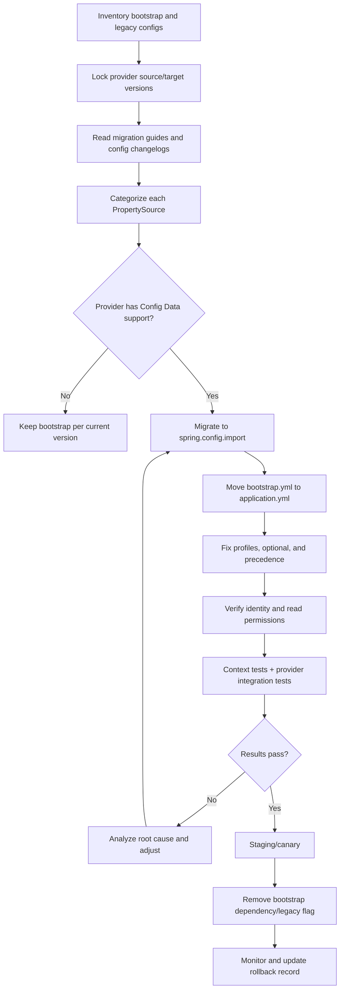

# Migrating from Bootstrap or Legacy Configuration Mechanisms When Required by a Version

Many older Spring Cloud applications load configuration from `bootstrap.yml`, the Spring Cloud bootstrap context, or a `PropertySourceLocator` that runs before the main ApplicationContext. When upgrading Spring Boot and provider libraries, this mechanism may be replaced by the Spring Boot Config Data API. If you simply rename the file to `application.yml` or remove the bootstrap dependency without replacing how configuration is loaded, the application may start up with default values, fail to fetch configuration from the cloud, or use the wrong precedence order.

The right way to migrate is to identify **what the legacy mechanism is doing**, find the replacement API supported by the target library version, and then migrate each configuration source to `spring.config.import` or the new PropertySource mechanism. This lesson also distinguishes the bootstrap context from Spring Boot's legacy config file processing mode, because the two mechanisms have similar names yet solve different problems.

This lesson belongs to the **Integration Upgrades** chapter of the **SPRING_CLOUD_PROVIDER_INTEGRATION** module. The module practices integrating Spring Boot with AWS, Azure, and Google Cloud managed services through the corresponding Spring Cloud libraries. Examples focus on Spring Cloud Config, AWS Systems Manager Parameter Store/Secrets Manager, Google Cloud Secret Manager, Azure App Configuration, and Azure Key Vault.

## 1. Learning Objectives

After this lesson, you will be able to:

- Distinguish `bootstrap.yml`, bootstrap context, Spring Boot Config Data API, and `spring.config.use-legacy-processing`.
- Identify when an application still needs the bootstrap context and when it can move to Config Data.
- Migrate Spring Cloud Config Client from `spring.cloud.config.uri` in bootstrap to `spring.config.import=configserver:`.
- Migrate AWS Parameter Store/Secrets Manager configuration to current Config Data import schemes.
- Migrate Google Cloud Secret Manager from the legacy `sm://` syntax to `sm@` when required by the library version.
- Migrate Azure App Configuration from `bootstrap.yml` to `application.yml` and `spring.config.import=azureAppConfiguration`.
- Migrate profile configuration, multi-document YAML, and external configuration sources according to the new Spring Boot rules.
- Understand the effects of `optional:`, import ordering, and property source precedence.
- Retain bootstrap extension points properly when newer libraries still require them.
- Build a migration workflow with testing, observability, and rollback.

## 2. Distinguishing Four Frequently Confused Concepts

The terms bootstrap and legacy often appear together in upgrade documentation, yet they are not the same mechanism.

| Concept | Role | When is it activated? |
| --- | --- | --- |
| `bootstrap.yml` / `bootstrap.properties` | Configuration files dedicated to the bootstrap context | Read only when the bootstrap context is enabled |
| Spring Cloud bootstrap context | Parent ApplicationContext loading external property sources before the main context | Via `spring-cloud-starter-bootstrap` or `spring.cloud.bootstrap.enabled=true` |
| Spring Boot Config Data API | Mechanism for loading config during Environment preparation, supporting multiple import sources | Used with `application.yml` and `spring.config.import` |
| `spring.config.use-legacy-processing` | Re-enables Spring Boot 2.3-style config file processing during transition | When set in the Environment on a Boot version supporting this mode |

### 2.1. What is the bootstrap context?

In the traditional Spring Cloud bootstrap mechanism, the application creates a bootstrap context as the parent context of the main ApplicationContext. The bootstrap context is used to load configuration from external sources such as Spring Cloud Config Server, Vault, or a provider PropertySource. Those values are then placed into the application's Environment.

A `bootstrap.yml` file typically holds information needed before the application loads its main configuration, such as:

```yaml
spring:
  application:
    name: invoice-service
  cloud:
    config:
      uri: https://config.internal.example
      username: ${CONFIG_SERVER_USER}
      password: ${CONFIG_SERVER_PASSWORD}
```

Merely placing `bootstrap.yml` on the classpath does not mean the bootstrap context is always active. In current Spring Cloud versions, bootstrap must be enabled via the `spring-cloud-starter-bootstrap` dependency or the `spring.cloud.bootstrap.enabled=true` property set as a system property/environment variable. Only when bootstrap is enabled does the Config Client use the properties inside the bootstrap context to locate the Config Server.

### 2.2. What is the Config Data API?

Spring Boot 2.4 introduced the Config Data API to load configuration from multiple sources. Instead of needing a separate context, the application declares configuration sources directly inside `application.yml`:

```yaml
spring:
  config:
    import: "configserver:https://config.internal.example"
```

Spring Boot invokes the corresponding resolver/loader to load data before finishing ApplicationContext initialization. Provider libraries can register custom schemes such as `aws-parameterstore:`, `aws-secretsmanager:`, `sm@`, or `azureAppConfiguration`.

Config Data lets the application explicitly specify which sources are loaded, the import order, and which sources are required. It also allows remote configuration to activate additional profiles. Consequently, many libraries moved from a bootstrap `PropertySourceLocator` to Config Data imports.

### 2.3. spring.config.use-legacy-processing is not the bootstrap context

This property belongs to Spring Boot and is used to revert to legacy `application.yml`/`application.properties` file processing when transitioning from Boot 2.3 or earlier to Boot 2.4. It does not enable the Spring Cloud bootstrap context and does not replace `spring-cloud-starter-bootstrap`.

Treat it as a temporary bridge when an older file layout cannot be migrated immediately. Once profile activation, multi-document YAML, and external configs are updated, remove this property so the application uses standard Config Data processing.

## 3. When Should You Keep the Bootstrap Context?

Do not remove bootstrap mechanically. First, check the library versions and integration patterns your application uses.

You may need to keep bootstrap when:

- An older provider version only offers `PropertySourceLocator` and has no equivalent Config Data resolver/loader.
- Documentation for the target library version requires `spring-cloud-starter-bootstrap` or `spring.cloud.bootstrap.enabled=true`.
- The application has a custom `BootstrapConfiguration` or extension point running in the bootstrap context that has not yet been migrated to the new mechanism.
- A third-party library explicitly depends on the bootstrap context and has no migration guide yet.

You should migrate to Config Data when:

- Spring Cloud Config Client supports `spring.config.import=configserver:`.
- The provider has an official Config Data scheme.
- The new version removed the legacy bootstrap PropertySource.
- You need explicit control over import order and profile activation.
- You want to reduce the number of contexts and avoid two mechanisms loading the same config source.

Some libraries still have extension points that must be registered even when primary data is loaded via Config Data. For example, provider documentation might require registering a customizer via `BootstrapConfiguration` or bootstrap registry to configure the client before the Config Data loader runs. **Keeping that extension point does not mean continuing to load all configuration via the bootstrap context.** Read the provider's exact guidance before deleting `spring.factories` or bootstrap configuration classes.

Do not run both a bootstrap PropertySource and a Config Data import for the same source concurrently if the library does not support it. Some integrations disallow dual loading paths; the result can be duplicate API calls, duplicate property sources, or unpredictable precedence. Choose one loading path per configuration source.

## 4. Migrating Spring Cloud Config Client to Config Data

### 4.1. Legacy configuration

Legacy application using `bootstrap.yml`:

```yaml
spring:
  application:
    name: invoice-service
  cloud:
    config:
      uri: https://config.internal.example
      fail-fast: true
      username: ${CONFIG_SERVER_USER}
      password: ${CONFIG_SERVER_PASSWORD}
```

Dependencies may contain:

```xml
<dependency>
    <groupId>org.springframework.cloud</groupId>
    <artifactId>spring-cloud-starter-config</artifactId>
</dependency>

<dependency>
    <groupId>org.springframework.cloud</groupId>
    <artifactId>spring-cloud-starter-bootstrap</artifactId>
</dependency>
```

Here, `spring-cloud-starter-bootstrap` activates the bootstrap context. Config Client uses the URI and credentials from bootstrap to connect to Config Server.

### 4.2. New configuration

Keep `spring.application.name` in `application.yml`, and declare the Config Data import:

```yaml
spring:
  application:
    name: invoice-service
  config:
    import: "configserver:https://config.internal.example"
  cloud:
    config:
      username: ${CONFIG_SERVER_USER}
      password: ${CONFIG_SERVER_PASSWORD}
```

Or use the default URI in the import and configure the endpoint separately:

```yaml
spring:
  application:
    name: invoice-service
  config:
    import: "configserver:"
  cloud:
    config:
      uri: https://config.internal.example
      username: ${CONFIG_SERVER_USER}
      password: ${CONFIG_SERVER_PASSWORD}
```

When an endpoint is written directly in `spring.config.import`, that endpoint takes precedence over `spring.cloud.config.uri`. Do not declare two different addresses unintentionally.

Once migrated successfully, remove `spring-cloud-starter-bootstrap` if no other integration still requires the bootstrap context. Keep only `spring-cloud-starter-config` and dependencies actually in use.

### 4.3. Choosing optional or required

If Config Server is required for the service to operate, do not add `optional:`:

```yaml
spring:
  config:
    import: "configserver:https://config.internal.example"
```

If remote config is only supplementary for local development or the service can run safely without that source, you can use:

```yaml
spring:
  config:
    import: "optional:configserver:https://config.internal.example"
```

Omitting `optional:` causes Config Client to fail startup if it cannot connect. Adding `optional:` allows skipping the source when loading fails; therefore, do not use it to mask IAM, authentication, or misconfiguration errors for a required source.

Config Data may call Config Server multiple times during startup: first with the `default` profile to discover profiles activated by remote config, and then again for the actual active profiles. This is normal behavior, not necessarily a duplicate request caused by a bug.

### 4.4. Retry and discovery

With Config Data import, retries can be configured via parameters on the import URL when needed, especially if the import resides in a profile-specific file. For example:

```yaml
spring:
  config:
    import: "configserver:https://config.internal.example?fail-fast=true&max-attempts=8&initial-interval=1000&max-interval=5000&multiplier=1.5"
```

If using discovery-first lookup, you still need to configure DiscoveryClient and `spring.cloud.config.discovery.enabled=true`. Discovery-first adds a network round trip to locate Config Server; weigh the benefit when the Config Server endpoint can change.

## 5. Migrating Legacy Spring Boot Config Files to Config Data Processing

Beyond the bootstrap context, many older projects also use pre-Spring Boot 2.4 profile declarations and multi-document YAML syntax. When upgrading Boot, update these structures so files do not remain present while profile conditions stop behaving as expected.

### 5.1. spring.profiles in multi-document YAML

Legacy configuration:

```yaml
spring:
  application:
    name: invoice-service
---
spring:
  profiles: production
  datasource:
    url: jdbc:postgresql://prod-db:5432/invoice
```

New configuration:

```yaml
spring:
  application:
    name: invoice-service
---
spring:
  config:
    activate:
      on-profile: production
  datasource:
    url: jdbc:postgresql://prod-db:5432/invoice
```

Use `spring.config.activate.on-profile` to specify that the document applies when the corresponding profile is active.

### 5.2. Do not place spring.profiles.active inside a profile-specific document

You can declare the default active profile in a document without a profile condition:

```yaml
spring:
  profiles:
    active: production
---
spring:
  config:
    activate:
      on-profile: production
  logging:
    level:
      root: INFO
```

Do not place `spring.profiles.active` or `spring.profiles.include` inside a document that already has `spring.config.activate.on-profile`. If you need to group multiple profiles, use `spring.profiles.group` in a non-profile-specific document.

### 5.3. Document order and external files

Spring Boot 2.4 changed how multi-document YAML ordering is processed. Property sources are added in the order documents are declared; do not rely on the older version's profile-activation sorting behavior.

External file precedence also changed: configuration files outside the JAR can override files packaged inside the JAR, including profile-specific files. During migration, re-verify:

- `application.yml` inside the JAR.
- `application-prod.yml` inside the JAR.
- Externally mounted configuration files.
- Externally mounted profile-specific files.
- Environment variable and system property overrides.

Do not assume a value in the JAR file will beat a mounted file. Verify effective properties using tests or protected diagnostics.

### 5.4. Use legacy processing only as a bridge

If a complex file structure cannot be converted immediately on a Boot version that supports it, you can temporarily set:

```yaml
spring:
  config:
    use-legacy-processing: true
```

Then list the items to migrate: profile documents, YAML order, external file locations, and config imports. Do not let this flag become a permanent default. Once migration is done, remove the flag and re-run all configuration tests.

## 6. Migrating Spring Cloud AWS from Bootstrap PropertySource to Config Data

Spring Cloud AWS 2.x previously loaded Parameter Store and Secrets Manager through bootstrap PropertySources. Starting with versions supporting Config Data, config sources can be declared directly in `application.yml`. Spring Cloud AWS 2.3 introduced Config Data import for Parameter Store; bootstrap PropertySource was treated as legacy and dropped from the 3.x line.

### 6.1. Parameter Store: from bootstrap prefixes to import paths

Legacy 2.x configs might use properties such as `aws.paramstore.enabled`, `aws.paramstore.prefix`, `aws.paramstore.name`, and `aws.paramstore.profileSeparator` in `bootstrap.yml`.

With Spring Cloud AWS 3.x/4.x, paths are specified directly in `spring.config.import`. For example:

```yaml
spring:
  application:
    name: invoice-service
  config:
    import:
      - "aws-parameterstore:/config/application/"
      - "aws-parameterstore:/config/invoice-service/"
```

Paths after the scheme are used directly to look up parameters. A trailing `/` in the prefix matters when mapping parameter names to property keys under system conventions.

You can add a prefix to loaded keys:

```yaml
spring:
  config:
    import: "aws-parameterstore:/config/invoice-db/?prefix=spring.datasource."
```

If Parameter Store contains `url`, `username`, and `password`, those keys can be exposed in the Environment as `spring.datasource.url`, `spring.datasource.username`, and `spring.datasource.password`.

### 6.2. Secrets Manager: importing secrets by name

Add the starter and import the secret:

```xml
<dependency>
    <groupId>io.awspring.cloud</groupId>
    <artifactId>spring-cloud-aws-starter-secrets-manager</artifactId>
</dependency>
```

```yaml
spring:
  config:
    import: "aws-secretsmanager:/secrets/invoice-service"
```

If the JSON secret contains top-level keys like `username` and `password`, those keys are added to the Spring Environment. You can add a prefix to avoid collisions:

```yaml
spring:
  config:
    import: "aws-secretsmanager:/secrets/database?prefix=spring.datasource."
```

For plaintext secrets, property references are created from the secret name. Only use `optional:aws-secretsmanager:` when the secret is genuinely optional. For primary database or partner API credentials, keep the import required so the application does not start in an unconfigured state.

### 6.3. AppConfig also uses Config Data import

Spring Cloud AWS now supports AppConfig through its starter:

```xml
<dependency>
    <groupId>io.awspring.cloud</groupId>
    <artifactId>spring-cloud-aws-starter-app-config</artifactId>
</dependency>
```

Import example:

```yaml
spring:
  config:
    import: "aws-app-config:invoice-application#production#prod"
```

The import string consists of Application, Configuration Profile, and Environment. If a component is missing or the resource does not exist, the Config Data loader can fail startup unless the import is marked optional.

### 6.4. Checking IAM and identity after migration

When migrating from bootstrap to Config Data, the credential provider still needs to work early enough for the Config Data loader to call AWS. At runtime, prefer IAM roles, task roles, instance profiles, or web identity. Do not put access keys/secret keys into `bootstrap.yml` just so the loader has credentials.

After migration, verify required permissions, for example:

- Parameter Store: `ssm:GetParametersByPath` or permissions to read specific parameters.
- Secrets Manager: `secretsmanager:GetSecretValue`.
- AppConfig: permissions to read the corresponding configuration session/data.

## 7. Migrating Google Cloud Secret Manager to Config Data

Spring Framework on Google Cloud provides a Config Data resource for Secret Manager. Older versions used the `sm://` syntax; starting with Spring Cloud GCP 6.0, the `sm@` syntax is recommended and the old syntax emits deprecation/migration warnings.

### 7.1. Legacy configuration

Legacy placeholder example:

```yaml
invoice:
  database:
    password: "${sm://projects/invoice-prod/secrets/invoice-db-password/versions/12}"
```

Some older applications placed the project ID and related settings in `bootstrap.yml` because a bootstrap PropertySource was used to load secrets before ApplicationContext initialization.

### 7.2. New configuration

Add the Secret Manager starter managed by the Spring Framework on Google Cloud BOM:

```xml
<dependency>
    <groupId>com.google.cloud</groupId>
    <artifactId>spring-cloud-gcp-starter-secretmanager</artifactId>
</dependency>
```

Move configuration into `application.yml`:

```yaml
spring:
  config:
    import: "sm@"
  cloud:
    gcp:
      secretmanager:
        project-id: invoice-prod

invoice:
  database:
    password: "${sm@projects/invoice-prod/secrets/invoice-db-password/versions/12}"
```

`spring.config.import=sm@` registers the Secret Manager Config Data resolver. Placeholders use `sm@` to specify the secret resource. You can use either the full resource name or a short form using the default project.

When migrating from `sm://` to `sm@`, do not merely replace characters in placeholders. Check:

- The Spring Framework on Google Cloud starter and BOM are on the right version.
- Project ID is declared in application config or inferred by ADC.
- The runtime identity has permission to read the exact secret.
- Version ID and resource name are accurate.
- The property is not overridden by another environment variable.

## 8. Migrating Azure App Configuration and Key Vault

Azure has two distinct integration styles: App Configuration provides settings/feature flags; Key Vault manages secrets/certificates. Some older versions of App Configuration used a bootstrap file, whereas newer versions moved to Config Data import.

### 8.1. App Configuration: migrating bootstrap.yml to application.yml

With App Configuration library v6, legacy configurations using `bootstrap.yml` or `bootstrap.properties` must move to `application.yml` or `application.properties`. `spring.config.import=azureAppConfiguration` is required to load App Configuration.

Example dependency:

```xml
<dependency>
    <groupId>com.azure.spring</groupId>
    <artifactId>spring-cloud-azure-appconfiguration-config</artifactId>
</dependency>
```

New configuration:

```yaml
spring:
  config:
    import: "azureAppConfiguration"
  cloud:
    azure:
      appconfiguration:
        stores:
          - endpoint: "${AZURE_APPCONFIG_ENDPOINT}"
```

In this example, the endpoint is non-sensitive configuration and can come from an environment variable. The runtime identity must be granted permission to read the App Configuration store, such as App Configuration Data Reader. If using managed identity or DefaultAzureCredential, verify the credential chain in the deployment environment.

### 8.2. Authentication changes when upgrading the App Configuration library

Migrating to App Configuration v6 introduces a notable change: default authentication switches from `ManagedIdentityCredential` to `DefaultAzureCredential`. If the application previously relied on a specific Managed Identity, verify that DefaultAzureCredential selects the intended credential source in the target environment.

Also review global Spring Cloud Azure properties. App Configuration can share credential/client configuration with other Azure libraries; a shared environment variable or property could cause the client to connect to App Configuration with an unexpected identity.

Some App Configuration v6 versions removed the `fail-fast` property; do not carry old properties over into the new file without checking the changelog. Use the availability/replica mechanisms and retry behavior supported by the current version's documentation.

### 8.3. Key Vault: PropertySource differs from Config Data import

Spring Cloud Azure Key Vault Secrets can create a PropertySource to expose secrets in the Spring Environment. Do not assume it uses a Config Data scheme like App Configuration.

Example using the starter:

```xml
<dependency>
    <groupId>com.azure.spring</groupId>
    <artifactId>spring-cloud-azure-starter-keyvault-secrets</artifactId>
</dependency>
```

Configure the endpoint and enable PropertySource using the current version's property prefix:

```yaml
spring:
  cloud:
    azure:
      keyvault:
        secret:
          endpoint: "https://invoice-vault.vault.azure.net/"
          property-source-enabled: true
```

Older library lines may use the `azure.keyvault.*` prefix. Newer versions move to `spring.cloud.azure.keyvault.secret.*`. Check the configuration appendix for your exact release to migrate `endpoint`, `secret-keys`, `tenant-id`, and related properties.

Key Vault can also be referenced indirectly from Azure App Configuration via Key Vault references. In that case, the App Configuration library loads settings and a resolver resolves the references; this is a different flow from registering a Key Vault PropertySource directly.

## 9. Precedence Order and Importing Multiple Sources

Config Data imports are processed as additional configuration sources. Imported values are placed directly beneath the document declaring the import and can therefore override values in that document. If there are multiple locations, a location declared later takes higher precedence than an earlier one.

For example:

```yaml
spring:
  config:
    import:
      - "configserver:https://config.internal.example"
      - "aws-parameterstore:/config/invoice-service/"
      - "sm@"
```

In the example above, later imports can override properties with the same name from earlier imports. Sources with higher precedence than Config Data—such as environment variables, Java system properties, and command-line arguments—can still override imported values.

Do not place the same property in multiple sources unintentionally. For sensitive properties such as database passwords, check whether an old environment variable, Kubernetes Secret, or JVM argument is overriding the secret reference.

### 9.1. Separating required and optional sources

Each import can be marked independently:

```yaml
spring:
  config:
    import:
      - "configserver:https://config.internal.example"
      - "optional:aws-parameterstore:/config/feature-flags/"
      - "aws-secretsmanager:/secrets/invoice-database"
```

Config Server and the database secret are required; feature flags can be optional. Do not mark all imports optional just because one source might be temporarily unavailable.

### 9.2. Profile-specific imports

You can place an import inside a profile-specific file if the source is used only for that profile. For example:

```yaml
# application-prod.yml
spring:
  config:
    import: "aws-parameterstore:/config/invoice-prod/"
```

When an import depends on a profile, verify when the profile is activated. `spring.profiles.active` must be set in a non-profile-specific configuration source or via environment/command line; do not put it in a document that already has `spring.config.activate.on-profile`.

## 10. Common Errors During Migration

| Symptom | Possible cause | How to fix |
| --- | --- | --- |
| Application does not call Config Server after removing bootstrap | Config Data import not declared or Config Client starter missing | Add `spring.config.import=configserver:` and check starter |
| Config Server always calls localhost:8888 | Import uses `configserver:` without URI/endpoint configured | Put URL in import or `spring.cloud.config.uri` |
| Remote properties no longer override local ones as before | Property source precedence changed | Check import order and effective property sources |
| Application starts even though required secret is missing | Import was marked optional | Remove `optional:` for required sources |
| AWS cannot read Parameter Store after upgrading to 3.x | Still using 2.x bootstrap property source or old prefix | Switch to `aws-parameterstore:` and update starter |
| AWS reads wrong path | Import path does not match Parameter Store path | Check trailing slash, prefix, and `spring.application.name` |
| GCP warns about legacy secret syntax | Placeholder still uses `sm://` | Switch to `sm@` on GCP 6.x or newer |
| Azure App Configuration loads no data | Still using bootstrap.yml or missing import | Move to application.yml and add `azureAppConfiguration` |
| Azure identity fails after upgrade | Default credential chain changed | Check `DefaultAzureCredential` and Data Reader permissions |
| Key Vault properties do not appear | Wrong prefix used or PropertySource not enabled | Check `spring.cloud.azure.keyvault.secret.*` |
| Properties unexpectedly overridden | Environment/JVM/CLI has higher precedence than Config Data | Find duplicate sources and inspect effective Environment |
| Two sources load the same key | Both bootstrap enabled and Config Data import declared | Pick one mechanism per source or follow provider guidance |

## 11. Keeping Bootstrap Extension Points When Truly Needed

A migration often involves two separate changes:

1. Switching the property source loading mechanism from bootstrap to Config Data.
2. Switching how customizers/credential builders are registered to run before the Config Data loader calls the service.

These two tasks are not always replaced by a single line of `spring.config.import`.

For example, a library may require registering `BootstrapConfiguration` to create a custom `ConfigurationClientCustomizer` or `SecretClientCustomizer`, while App Configuration settings are still loaded via `spring.config.import=azureAppConfiguration`.

Before deleting:

- Search for `org.springframework.cloud.bootstrap.BootstrapConfiguration` in `META-INF/spring.factories`.
- Search for classes implementing `PropertySourceLocator`, `BootstrapConfiguration`, or `BootstrapRegistryInitializer`.
- Read the provider's release notes to see which extension points are still required.
- Check whether the Config Data loader supports `BootstrapRegistryInitializer` or dedicated customizers.
- Remove the extension only when the target version has a documented replacement.

Do not keep `spring-cloud-starter-bootstrap` merely because the project still has a `spring.factories` file. Determine whether that entry loads a legacy property source or registers a client initialization component.

## 12. Step-by-Step Migration Process



### 12.1. Step 1 — Inventory configuration sources

Search in the repository:

```bash
rg -n "bootstrap\\.yml|bootstrap\\.properties|spring-cloud-starter-bootstrap" .
rg -n "spring\\.cloud\\.bootstrap\\.enabled|spring\\.config\\.use-legacy-processing" .
rg -n "PropertySourceLocator|BootstrapConfiguration|BootstrapRegistryInitializer" .
rg -n "spring\\.cloud\\.config|aws\\.paramstore|aws\\.secretsmanager|sm://|azureAppConfiguration|azure\\.keyvault" .
```

Check source code, test resources, Docker/Helm, Terraform, CI/CD, and environment variables. Record each file, profile, owner, and corresponding data source.

### 12.2. Step 2 — Lock source and target versions

Read the provider's compatibility matrix and migration guide. For example, do not apply AWSpring 2.x → 3.x guidance to an application upgrading from 3.x → 4.x. The same property may already have migrated from bootstrap to Config Data in an earlier major release.

### 12.3. Step 3 — Build a mapping table

| Legacy source | New mechanism | Action required |
| --- | --- | --- |
| Config Server in bootstrap.yml | `configserver:` | Migrate URI, credentials, and fail-fast semantics |
| AWS Parameter Store bootstrap PropertySource | `aws-parameterstore:` | Convert path to import location |
| AWS Secrets Manager bootstrap PropertySource | `aws-secretsmanager:` | Convert secret name/path to import |
| GCP Secret Manager `sm://` | `sm@` | Convert placeholders and import syntax |
| Azure App Configuration bootstrap.yml | `azureAppConfiguration` | Move to application.yml and add import |
| Azure Key Vault `azure.keyvault.*` | `spring.cloud.azure.keyvault.secret.*` | Update prefix per provider version |
| Boot `spring.profiles` in multi-doc YAML | `spring.config.activate.on-profile` | Migrate profile conditions |
| Boot legacy config processing | Config Data processing | Fix file order, profiles, and imports |

### 12.4. Step 4 — Migrate one source at a time, not all at once

Migrate one source, run context tests and integration tests, and only then migrate the next source. In a multi-cloud service, you might migrate Config Server first, AWS Parameter Store next, then Secret Manager and Azure App Configuration. This makes it easy to pinpoint which source caused an issue if precedence or identity changes.

### 12.5. Step 5 — Verify identity and permissions

The Config Data loader accesses services very early during startup. Therefore, credentials used to access external sources must be available before properties from those sources are loaded.

- AWS: verify the default credentials chain, task role, instance profile, or web identity.
- Google Cloud: verify ADC and Workload Identity.
- Azure: verify DefaultAzureCredential, managed identity, and Data Reader/Key Vault permissions.
- Config Server: verify TLS, authentication, and permissions to read config per application/profile.

Do not fetch Config Server access credentials from Config Server itself if that is the only source holding them. That creates a circular dependency preventing the application from bootstrapping.

### 12.6. Step 6 — Test and remove legacy mechanisms

Remove `spring-cloud-starter-bootstrap`, `spring.cloud.bootstrap.enabled`, or `spring.config.use-legacy-processing` only after tests prove:

- Every required source is imported.
- The right profiles are activated.
- Precedence order did not change unexpectedly.
- The application fails properly when a required source is unavailable.
- Optional sources are skipped only when business rules allow.
- The runtime identity accesses the right project/account/vault.
- No remaining `bootstrap.yml` is still used by another library.

## 13. Hands-On Exercise: Migrating invoice-service to Config Data

**Context:** `invoice-service` uses Spring Cloud Config Server, AWS Parameter Store, Google Cloud Secret Manager, and Azure App Configuration. Newer versions of the providers support Config Data. The application still has `bootstrap.yml` and several legacy property prefixes.

### Step 1 — Legacy configuration

```yaml
# bootstrap.yml
spring:
  application:
    name: invoice-service
  cloud:
    config:
      uri: https://config.internal.example
    aws:
      parameterstore:
        enabled: true
        prefix: /config/
        name: invoice-service
```

Another `application.yml` file still contains `sm://` placeholders and Azure App Configuration does not have an import yet.

### Step 2 — Update dependencies

Keep the corresponding provider starters and remove the bootstrap starter once no integration requires it:

```xml
<dependency>
    <groupId>org.springframework.cloud</groupId>
    <artifactId>spring-cloud-starter-config</artifactId>
</dependency>

<dependency>
    <groupId>io.awspring.cloud</groupId>
    <artifactId>spring-cloud-aws-starter-parameter-store</artifactId>
</dependency>

<dependency>
    <groupId>com.google.cloud</groupId>
    <artifactId>spring-cloud-gcp-starter-secretmanager</artifactId>
</dependency>

<dependency>
    <groupId>com.azure.spring</groupId>
    <artifactId>spring-cloud-azure-appconfiguration-config</artifactId>
</dependency>
```

Versions must be managed by BOMs compatible with Spring Boot/Spring Cloud/providers. Do not copy illustrative versions into a project without checking compatibility matrices.

### Step 3 — Write the new application.yml

```yaml
spring:
  application:
    name: invoice-service

  config:
    import:
      - "configserver:https://config.internal.example"
      - "aws-parameterstore:/config/application/;/config/invoice-service/"
      - "sm@"
      - "azureAppConfiguration"

  cloud:
    gcp:
      secretmanager:
        project-id: invoice-prod
    azure:
      appconfiguration:
        stores:
          - endpoint: "${AZURE_APPCONFIG_ENDPOINT}"

invoice:
  database:
    password: "${sm@projects/invoice-prod/secrets/invoice-db-password/versions/12}"
```

This example illustrates multiple providers imported together. In a real application, add only the starters and import schemes the service actually uses. If two sources both declare `invoice.database.password`, verify the import order and which source has higher precedence.

### Step 4 — Migrate profiles

If `bootstrap-prod.yml` previously held endpoint information or profile-specific sources, move it to `application-prod.yml` or a document with `spring.config.activate.on-profile`. Set `spring.profiles.active=prod` from the deployment environment or a non-profile-specific document.

### Step 5 — Verify rendered configuration

Render Helm/Terraform or inspect Cloud Run/ECS/App Service settings. Ensure no old environment variables override Config Data properties. Verify endpoints and secret references match the staging/production environments.

### Step 6 — Run tests

- Context startup with `dev`, `staging`, and `prod` profiles.
- Config Server unavailable: the service must fail if the import is required.
- AWS Parameter Store path missing: verify optional/required behavior matches expectations.
- Secret Manager permission denied: the application must not start with an empty password.
- Azure App Configuration unreachable: verify behavior per library version and replica configuration.
- Runtime identity: verify the actual principal can read the right sources.

### Step 7 — Remove legacy bootstrap

After all tests pass:

- Remove `spring-cloud-starter-bootstrap` if no component still requires it.
- Remove `spring.cloud.bootstrap.enabled`.
- Remove `spring.config.use-legacy-processing` if present.
- Delete `bootstrap.yml` and `bootstrap-<profile>.yml` once no consumers remain.
- Keep `BootstrapConfiguration` or dedicated initializers if the target provider version still requires them.
- Re-run the dependency tree to confirm the bootstrap starter is no longer pulled in transitively.

## 14. Review Checklist Before Merging

- [ ] Distinguished bootstrap context from Spring Boot legacy config processing.
- [ ] Recorded source/target versions for Boot and each provider.
- [ ] Verified target provider versions support Config Data.
- [ ] Searched for all `bootstrap.yml`/`bootstrap.properties`.
- [ ] Searched for `spring-cloud-starter-bootstrap` and `spring.cloud.bootstrap.enabled`.
- [ ] Searched for `spring.config.use-legacy-processing`.
- [ ] Checked `PropertySourceLocator`, `BootstrapConfiguration`, and custom initializers.
- [ ] Migrated Config Server to `spring.config.import=configserver:`.
- [ ] Migrated AWS Parameter Store/Secrets Manager/AppConfig to the new import schemes.
- [ ] Migrated GCP `sm://` to `sm@` when required by version.
- [ ] Migrated Azure App Configuration to `application.yml` and `azureAppConfiguration`.
- [ ] Updated Key Vault property prefix per provider version.
- [ ] Migrated profile documents to `spring.config.activate.on-profile`.
- [ ] Verified import order, `optional:`, and property source precedence.
- [ ] Verified identity/IAM/RBAC for each provider.
- [ ] Ran context tests and integration tests using production-like identities.
- [ ] Removed bootstrap dependencies/legacy flags once migration is complete.
- [ ] Prepared rollback to pre-migration artifacts and configuration.

## 15. Self-Check Questions

1. How does `bootstrap.yml` differ in role from `application.yml`?
2. Why does a `bootstrap.yml` file not automatically enable the bootstrap context?
3. What two ways can activate the Spring Cloud bootstrap context?
4. What role of the bootstrap context does the Spring Boot Config Data API replace?
5. How does `spring.config.use-legacy-processing` differ from `spring.cloud.bootstrap.enabled`?
6. When does an application still need to keep the bootstrap context?
7. Why should you not load the same source simultaneously via bootstrap PropertySource and Config Data import?
8. What must Config Server Client declare in `spring.config.import`?
9. How does `optional:` affect startup behavior?
10. What configuration did Spring Cloud AWS 3.x move Parameter Store paths to?
11. What syntax does Google Cloud Secret Manager 6.0 recommend instead of `sm://`?
12. What file move and import does Azure App Configuration v6 require?
13. Why should Key Vault PropertySource not be confused with App Configuration Config Data import?
14. Which property replaces `spring.profiles` in multi-document YAML?
15. Why must identity be checked before the Config Data loader accesses cloud services?
16. When can `spring-cloud-starter-bootstrap` and `bootstrap.yml` be safely removed?

## 16. Key Takeaways

Both the bootstrap context and the Config Data API can bring external configuration into the Spring Environment, yet they have different lifecycles and load ordering. The bootstrap context uses a parent context and must be explicitly enabled; the Config Data API declares sources via `spring.config.import` in application configuration. Meanwhile, `spring.config.use-legacy-processing` is a compatibility mechanism for Spring Boot's legacy config file handling.

When upgrading, verify which mechanism the target provider version supports. Migrate Config Server, AWS Parameter Store/Secrets Manager, GCP Secret Manager, and Azure App Configuration according to official schemes; update profiles and config files to Config Data rules; verify `optional:`, identity, and precedence. Remove bootstrap dependencies only when no extension point still needs them. **Every configuration source needs one clear loading path, a verified precedence order, and tests for both success and failure cases.**

## Official References

- [Spring Cloud Config Client — Config Data Import and Legacy Bootstrap](https://docs.spring.io/spring-cloud-config/reference/client.html)
- [Spring Boot — Config Data Migration Guide](https://github.com/spring-projects/spring-boot/wiki/Spring-Boot-Config-Data-Migration-Guide)
- [Spring Boot — Externalized Configuration](https://docs.spring.io/spring-boot/reference/features/external-config.html)
- [Spring Cloud AWS 4.1 — Secrets Manager, Parameter Store and AppConfig](https://docs.awspring.io/spring-cloud-aws/docs/4.1.0/reference/html/index.html)
- [Spring Framework on Google Cloud — Secret Manager Config Data](https://googlecloudplatform.github.io/spring-cloud-gcp/reference/html/)
- [Spring Cloud Azure — Upgrade App Configuration library to version 6](https://learn.microsoft.com/en-us/azure/azure-app-configuration/howto-convert-to-the-new-spring-boot)
- [Spring Cloud Azure — App Configuration Quickstart](https://learn.microsoft.com/en-us/azure/azure-app-configuration/quickstart-java-spring-app)
- [Spring Cloud Azure — Key Vault and Spring integration](https://spring.io/projects/spring-cloud-azure/)
