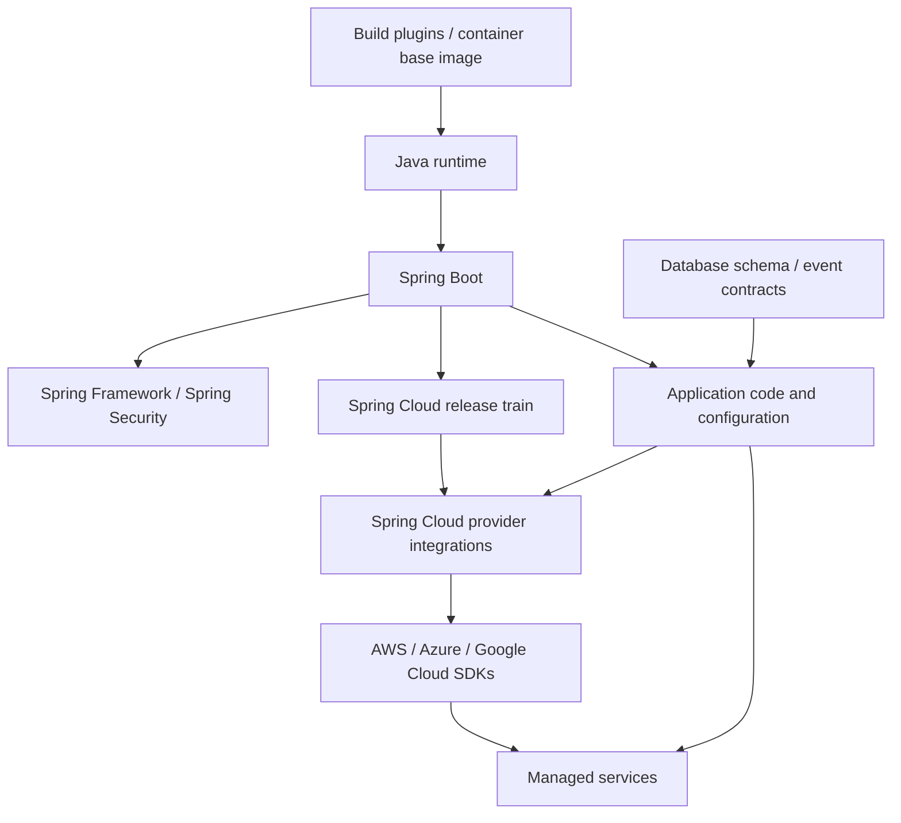
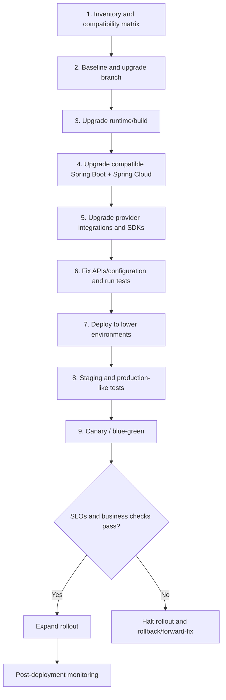
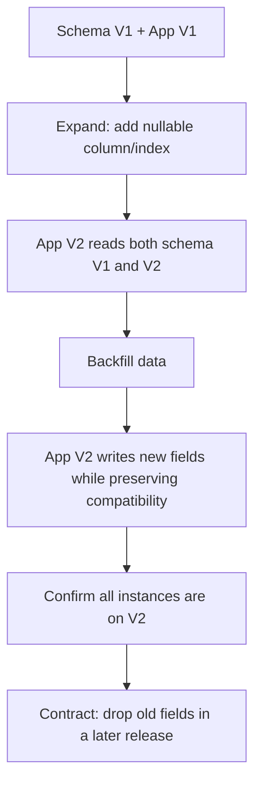
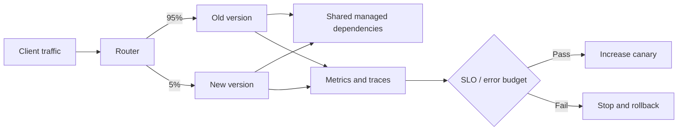

# Phased Upgrades and Preparing a Rollback Plan

> **Chapter:** Integration Upgrades  
> **Module:** SPRING_CLOUD_PROVIDER_INTEGRATION — hands-on integration of Spring Boot with AWS, Azure, and Google Cloud managed services via the corresponding Spring Cloud libraries. This lesson guides upgrading stacks and cloud integrations in phases, controlling changes during deployment, and preparing an actionable rollback plan.

A version change in Spring Boot, Spring Cloud, or a cloud SDK can affect multiple layers simultaneously: auto-configuration, dependency injection, credential chains, serialization, retries, timeouts, endpoints, metrics, and how the application calls managed services. A successful upgrade is not just a green build. The application must maintain business behavior, security, and SLOs when running in a real environment.

Therefore, break upgrades into verifiable steps. Each step needs a baseline, acceptance criteria, reproducible artifacts, and a safe stopping point. Rollback must be designed alongside data migrations, message schemas, and cloud configuration; simply reverting to an old container image cannot undo every change already written to a database or managed service.

## 1. Learning Objectives

After this lesson, you will be able to:

1. Build a compatibility matrix for Java, Spring Boot, Spring Cloud, cloud integration libraries, and SDKs.
2. Select versions using BOMs and official compatibility matrices.
3. Determine an upgrade order that isolates failures.
4. Categorize breaking changes across API, configuration, identity, data, and messaging.
5. Build baseline tests and compare pre-/post-upgrade behavior.
6. Roll out canary or blue-green deployments in traffic increments.
7. Maintain backward compatibility for database schemas and event/message contracts.
8. Define rollback triggers based on SLOs, error rates, latency, and backlogs.
9. Write a rollback runbook with clear owners, data notes, commands, and stop conditions.
10. Know when to roll back, when to forward-fix, and when to halt a rollout for investigation.

## 2. Upgrading Means Changing a System with Many Dependencies

A Spring Boot application integrating AWS, Azure, and Google Cloud typically has a dependency graph like this:



Upgrading one node can cascade across many other nodes. For example:

- Upgrading Spring Boot can change Spring Framework, Jackson, logging, embedded servers, and auto-configuration.
- The Spring Cloud release train must be compatible with the Spring Boot version in use.
- Spring Cloud AWS/Azure/GCP may require a different version line or change packages/configuration.
- Upgrading an SDK can alter credential providers, retry policies, HTTP transports, or response models.
- Upgrading the Java runtime can surface reflection, TLS, certificate, native library, or bytecode issues.
- Database/event migrations can prevent old application versions from reading newly written data.

Therefore, never treat an upgrade as a single version bump in a build file. It is a scoped change with dependencies and risks that must be managed.

## 3. Build a Compatibility Matrix Before Editing Code

Record the running version and target version for each layer. This matrix serves as the single source of truth for the upgrade.

| Component | Current version | Target version | Compatibility evidence |
|---|---|---|---|
| JDK | In use | Selected | Spring Boot and runtime support matrix |
| Spring Boot | In use | Selected | System requirements and migration guide |
| Spring Framework | Managed by Boot | Per target Boot | Boot dependency management |
| Spring Cloud | Current release train | Target release train | Spring Cloud supported versions |
| Spring Cloud AWS/Azure/GCP | Current modules | Target modules | Corresponding integration documentation |
| Cloud SDK | Current BOM/transitives | Target BOM/transitives | SDK compatibility/release notes |
| Database driver | Current | Target | Database and driver support |
| Build/container | Current plugins/base image | Target | CI builds, image scans, runtime tests |

Do not fill in a version merely because it is the latest on Maven Central. Select versions inside supported matrices, then lock them in BOMs or version catalogs.

### 3.1. Spring Boot and Spring Cloud must form a compatible pair

Spring Cloud releases in release trains. Each train supports a specific Spring Boot range. Before changing versions:

1. Look up the Spring Cloud compatibility matrix.
2. Select a release train compatible with the target Spring Boot.
3. Read migration guides and release notes for both.
4. Verify each Spring Cloud provider integration in use.
5. Run the compatibility verifier and startup tests in CI.

Do not blindly pair the newest Spring Boot with the newest Spring Cloud train if the matrix has not confirmed that pair is supported.

### 3.2. Use BOMs to manage versions

Maven can import the Spring Boot BOM and Spring Cloud BOM:

```xml
<properties>
    <java.version>17</java.version>
    <spring-boot.version>BOOT_VERSION_APPROVED</spring-boot.version>
    <spring-cloud.version>CLOUD_TRAIN_APPROVED</spring-cloud.version>
</properties>

<dependencyManagement>
    <dependencies>
        <dependency>
            <groupId>org.springframework.boot</groupId>
            <artifactId>spring-boot-dependencies</artifactId>
            <version>\${spring-boot.version}</version>
            <type>pom</type>
            <scope>import</scope>
        </dependency>
        <dependency>
            <groupId>org.springframework.cloud</groupId>
            <artifactId>spring-cloud-dependencies</artifactId>
            <version>\${spring-cloud.version}</version>
            <type>pom</type>
            <scope>import</scope>
        </dependency>
    </dependencies>
</dependencyManagement>
```

`BOOT_VERSION_APPROVED` and `CLOUD_TRAIN_APPROVED` are placeholders that must be replaced with a project-verified pair. Do not commit placeholders into real builds.

If the application calls SDKs directly, you can use the official BOM for each SDK, such as the AWS SDK BOM, Azure SDK BOM, or Google Cloud Libraries BOM. Import only needed BOMs and verify they do not override versions required by Spring Cloud integrations. Avoid declaring scattered versions for individual modules of the same SDK.

### 3.3. Do not upgrade all dependencies at once

A single pull request changing Java, Spring Boot, Spring Cloud, three cloud SDKs, the database driver, and the container base image makes root-causing test failures difficult.

Split changes into bounded groups:

- Runtime/build toolchain.
- Spring Boot and Spring Framework.
- Spring Cloud release train.
- Provider integration libraries.
- Direct cloud SDKs.
- Database/message clients.
- Container images and deployment platform.

Some groups may need to be coordinated in the same step when required by the compatibility matrix, but document the dependencies between them and test each group separately.

## 4. Establish a Pre-Upgrade Baseline

A baseline is evidence showing how the system behaves before changes.

### 4.1. Technical baseline

Record:

- Build commands, test commands, and build duration.
- JDK, framework, release train, SDK, and container image.
- Startup time, readiness time, and memory footprint.
- API latency p50/p95/p99.
- Error rate per endpoint and dependency.
- Connection pool, thread pool, and HTTP client settings.
- Retry counts, timeout counts, throttling, and circuit breaker states.
- Database query latency, connection errors, and migration state.
- Message publish/consume rates, age, retries, and dead-letter counts.

### 4.2. Business baseline

Select several representative flows:

1. Workload authentication and storage access.
2. Uploading then downloading an object and verifying checksums.
3. Publishing/consuming events with idempotency.
4. Reading/writing managed database services.
5. Reading secrets and verifying rotation behavior.
6. Calling APIs with retries and timeouts.
7. Restoring a backup or replaying a test message.

Record results and input data used so the exact flows can be re-run on the new version.

### 4.3. Save current artifacts and configuration

Before upgrading, save:

- Image digest of the current production release.
- SBOM or dependency lock report.
- Helm values/manifests or deployment configuration.
- Runtime flags and environment variable key names.
- Database migration version.
- Event schema version.
- IAM/RBAC policy references.
- Secret references/versions per secure management procedures.

Never export plaintext secrets into upgrade records. Record which secrets are referenced and how to restore prior versions via the secret manager's workflow.

## 5. Inventory Changes and Categorize Risks

Read release notes, migration guides, and deprecation notices. Do not search only for the keyword “breaking”; a changed default can also alter behavior while the code still compiles.

| Area | Questions to check | Risk examples |
|---|---|---|
| Java | Did runtime, modules, TLS, or reflection change? | Legacy library cannot access encapsulated APIs |
| Spring Boot | Did auto-configuration, properties, or bean lifecycles change? | Expected bean is no longer created |
| Spring Cloud | Did the release train/binders/config import change? | Compatibility verifier fails |
| Security | Did filter chains, token decoders, or credential chains change? | Workload loses access permissions |
| Storage | Did retries, checksums, versioning, or multipart behavior change? | Upload succeeds with wrong metadata |
| Messaging | Did acknowledgement, retries, or serialization change? | Messages get redelivered or routed to DLQ |
| Database | Did driver, pooling, dialect, or TLS change? | Connection timeouts or altered query behavior |
| Observability | Did metric/tag names or tracing bridges change? | Dashboards lose data |
| Deployment | Did health probes, base images, or memory limits change? | Containers enter restart loops |

### 5.1. Categorize every change

- **Compatible:** behavior remains intact per verified contracts.
- **Deprecated:** still works, but APIs must be replaced before removal in a later release.
- **Breaking source/API:** requires updating code or imports.
- **Breaking configuration:** properties, defaults, or config structure changed.
- **Behavioral:** code compiles, but runtime behavior differs.
- **Operational:** requires changes to IAM, networking, quotas, deployment, or monitoring.
- **Data contract:** data/message schemas or semantics changed.

Prioritize behavioral, security, data, and operational changes because they are easily missed by compilation tests.

## 6. Phased Upgrade Process

A workflow suitable for a Spring Boot application integrating with multiple clouds:



### Phase 1 — Create upgrade branch and freeze baseline

- Create a dedicated branch or change set.
- Link an issue/ADR stating goals and scope.
- Capture the baseline and current image digest.
- Do not mix unrelated business features into the same change.
- Designate who makes the go/no-go decision.

### Phase 2 — Upgrade runtime and build toolchain

Verify JDK, Maven/Gradle wrapper, compiler plugins, test plugins, container base images, and CI runners. Compile and run tests with the existing source before changing frameworks.

If the new runtime breaks existing code, fix runtime issues first in isolation. This separates Java/toolchain errors from Spring errors.

### Phase 3 — Upgrade Spring Boot and Spring Cloud per matrix

- Update the Boot BOM.
- Update the compatible Cloud release train.
- Address deprecated APIs and configuration properties.
- Inspect the auto-configuration report if expected beans disappear.
- Run startup tests for each provider configuration.
- Verify the Spring Cloud compatibility verifier.

Never disable the verifier just to get a green build. If the verifier reports an unsupported version pair, fix dependency alignment or formally record a controlled exception decision.

### Phase 4 — Upgrade provider integrations and SDKs

Upgrade each integration library and SDK per the compatibility matrix. For each provider, verify:

- Clients are built using the right credential provider chain.
- Regions, endpoints, projects, subscriptions, and buckets/containers are accurate.
- Timeouts/retries/backoff did not shift unexpectedly.
- IAM/RBAC and workload identities still work.
- API responses/errors are properly translated by adapters.
- Health/readiness checks do not invoke operations with side effects.

Whenever possible, upgrade and test each provider adapter independently. When dependency constraints force upgrading together, still keep separate test suites per provider.

### Phase 5 — Update code and configuration

Replace deprecated APIs, update properties, fix packages/imports, adjust bean conditions, and configure HTTP clients. Avoid changing business behavior in the same commit unless necessary.

Build a property mapping table:

| Old property | New property | Config source | Restart needed? | Test |
|---|---|---|---|---|
| Old name | New name | Profile/env/config server | Yes/no | Context startup |
| Old credential property | Workload identity | Runtime identity | Yes/no | Token + access test |
| Old retry property | New retry policy | Application config | Yes/no | Fault injection |

Do not assume a removed old property will fail startup. Frameworks often ignore unbound properties while the application continues running with new defaults.

### Phase 6 — Run tests before deployment

Run in order:

1. Compilation and static checks.
2. Unit tests.
3. Spring context/startup tests.
4. Contract tests for storage/messaging/data adapters.
5. Integration tests against emulators or test services.
6. Integration tests in real cloud sandboxes.
7. Regression and performance tests.
8. Security/configuration checks.

Passing tests only have value if they cover the changed behaviors. Never treat a unit test checking mock invocations as proof that IAM, TLS, or managed services work.

## 7. Managing Breaking Changes in Spring Boot and Spring Cloud

### 7.1. Auto-configuration and bean registration

Frameworks may change auto-configuration conditions or bean names. If the application relies on default beans:

- Inspect the condition evaluation report.
- Confirm required beans are present.
- Confirm only one implementation of each port exists.
- Check `@ConditionalOnClass`, `@ConditionalOnProperty`, `@Profile`, and `@ConditionalOnMissingBean`.
- Do not add `@Primary` to mask duplicate adapter creation.

Startup tests should initialize contexts for each provider profile/property set and verify the intended adapter is injected.

### 7.2. Configuration properties

Properties can change prefixes, defaults, types, or locations. Use `@ConfigurationProperties` with validation so errors fail fast at startup:

```java
@ConfigurationProperties(prefix = "app.storage")
@Validated
public record StorageProperties(
        @NotBlank String bucket,
        @NotBlank String region,
        @Min(1) long maxObjectSizeBytes) {
}
```

When upgrading the framework, test binding with real configuration files and corresponding environment variables. Do not test only the properties record constructor.

### 7.3. Spring Security and workload identity

Upgrading Spring Security can affect filter chains, authorization matchers, OAuth2 resource servers, token decoders, and client credential configurations.

For cloud integrations, specifically verify:

- Token audiences and issuers.
- Roles/permissions attached to the workload.
- Token refresh and credential rotation.
- Private endpoints/network routes.
- TLS truststores/certificates.
- Separation between user tokens and workload credentials.

A successful application startup does not prove workload identity obtained a token or has permission to access resources.

### 7.4. Spring Cloud Stream and messaging

When upgrading Spring Cloud Stream/binders:

- Verify destinations, consumer groups, and partition mappings.
- Verify acknowledgement modes.
- Verify retries/backoff and dead-letter routing.
- Verify header/content-type mappings.
- Verify serialization and schema evolution.
- Verify transaction/outbox behavior.

Never upgrade a binder version and assume queue/topic semantics stayed identical. Test duplicates, poison messages, redelivery, ordering, and consumer restarts.

### 7.5. Spring Cloud provider integrations

For Spring Cloud AWS, Azure, and GCP, review:

- Changed or deprecated package/class APIs.
- Auto-configuration conditions and bean names.
- Property prefixes and region/project/endpoint bindings.
- Credential provider chains and identity integration.
- Template/client abstractions and exception mappings.
- Health indicators, metrics, and tracing integration.
- SDK versions managed by the modules.

If the application also uses SDKs directly alongside Spring Cloud integrations, verify that two different versions of the same SDK are not on the classpath.

## 8. Database Migrations Must Stay Compatible with Both Old and New Versions

Rolling back an application is only safe if the schema/database can still be read and written properly by the old version.

### 8.1. Expand-contract

Do not make breaking schema changes in the same deployment as application changes.



Example:

1. Add a nullable `document_checksum` column.
2. Deploy the new app still able to read records without checksums.
3. Write checksums for new records.
4. Backfill old records in retryable batches.
5. Verify data completeness and confirm no old consumers remain.
6. Only in a later release set NOT NULL or drop old columns.

If you deploy the new app and then roll back to the old app, the schema must remain compatible with the old app throughout the rollback window.

### 8.2. Avoid destructive migrations during the rollback window

Never do the following in the same release:

- Rename a column without keeping an alias/compatibility layer.
- Drop an old column immediately after new code stops using it.
- Change enum values such that old consumers cannot parse them.
- Change types/precision in ways older drivers handle differently.
- Change partition keys or primary keys without a migration strategy.

Destructive migrations should occur only after the rollback window closes and a tested backup/restore plan is in place.

### 8.3. Data migrations must be idempotent

Batch migrations must support checkpointing, retries, and reconciliation. When a batch re-runs, it must neither duplicate data nor skip records. Record:

- Number of records read/written.
- Number of records succeeded/failed.
- Checksums or invariants used for reconciliation.
- Last checkpoint.
- How to resume or reverse.

If a migration is irreversible, prove the old app remains compatible or choose a forward-fix instead of a binary rollback.

## 9. Message and Event Schemas Must Support Rolling Deployments

During rollout, old and new consumer versions may run concurrently. New producers must not emit schemas that old consumers cannot read.

### 9.1. Backward compatibility rules

- Add optional fields with sensible defaults.
- Do not change the meaning of published fields.
- Do not rename or delete fields while old consumers remain.
- Maintain enum fallbacks or unknown-value handling rules.
- Increment schema versions when semantics change.
- Retain the ability to read old messages throughout retention/replay periods.

### 9.2. Producer-consumer rollout

1. Deploy new consumers capable of reading both old and new schemas.
2. Confirm the entire consumer group is ready.
3. Deploy producers emitting the new schema.
4. Monitor deserialization errors, DLQs, and processing lag.
5. Remove compatibility code only after replay and rollback windows close.

If old consumers cannot be made to understand the new schema, keep producers on the old schema during rollout or use versioned topics/routes.

### 9.3. Avoid two consumers applying the same side effect

Blue-green deployments can leave two consumer groups running simultaneously. If both receive the same event, side effects can occur twice. You must:

- Share the same consumer group when broker semantics ensure distribution across instances in the group.
- Or stop/disable old consumers before enabling new consumers.
- Design idempotent consumers keyed by event ID.
- Use transactional outbox/inbox when side-effect control and deduplication are needed.
- Check schedulers/background jobs so they do not run twice.

Do not assume an HTTP load balancer controls queue consumer traffic.

## 10. Canary and Blue-Green Rollouts

Choose a strategy based on traffic routing capabilities, data compatibility, and how workloads process messages.

### 10.1. Rolling deployment

Gradually replaces old instances with new instances within the same deployment group.

Suitable when:

- Old and new apps can both read the schema.
- Message contracts are compatible.
- Readiness/liveness probes are accurate.
- Sessions or local state do not cause data loss during rollout.

Risk: two versions run concurrently for a period. Ensure schedulers, consumers, and cache invalidations do not produce duplicate side effects.

### 10.2. Blue-green

Runs two separate environments:

- Blue: currently serving version.
- Green: new, pre-verified version.

Shift traffic via load balancer, ingress, or DNS once green passes readiness. Rollback can route traffic back to blue if data and side effects remain compatible.

Blue-green requires enough capacity for two environments and careful control of background workers/consumers. Never leave both environments active for non-idempotent jobs.

### 10.3. Canary

Routes a small fraction of traffic to the new version:



Canaries should start at a traffic level small enough to limit blast radius yet large enough to yield signal. For low-traffic workloads, use synthetic transactions or a test tenant.

### 10.4. Defining rollout steps

Example plan:

| Phase | Share/target | Observation window | Expansion condition |
|---|---|---|---|
| Smoke | Synthetic/test tenant | Until all flows complete | No config/security errors |
| Canary 1 | 1–5% traffic | Per baseline and volume | Errors/latency within threshold |
| Canary 2 | 10–25% | Covers representative load cycle | No increase in DLQ/throttling |
| Rollout | 50% then 100% | Checkpoint at each step | Business metrics and SLOs pass |
| Post-deploy | Full traffic | Heightened monitoring | No anomalous signals |

Percentages and durations above are examples. Choose them based on traffic, blast radius, failure detection time, and rollback capability.

## 11. Set Measurable Rollback Triggers

Never rely on vague feelings like “seems slow” or “a few errors” to decide. Define triggers before deploying.

### 11.1. Metric groups

| Group | Metrics |
|---|---|
| Availability | HTTP 5xx, failed requests, readiness failures |
| Latency | p95/p99 per endpoint and dependency |
| Security | Authentication failures, authorization denials, token refresh failures |
| Cloud API | 429/throttling, timeouts, access denied, SDK retry exhaustion |
| Storage | Upload/download failures, checksum mismatches, missing revisions |
| Messaging | Publish failures, consumer lag, redeliveries, DLQ growth |
| Database | Connection failures, query latency, pool exhaustion, migration errors |
| Runtime | Crashes/restarts, OOM, GC pauses, thread exhaustion |
| Business | Invoice issuance failures, duplicate events, missing documents |

### 11.2. Compare against baseline and SLOs

Triggers should include:

- Absolute thresholds tied to SLOs.
- Relative increases compared to baseline.
- Time windows.
- Minimum request volume for statistical significance.
- Critical error types requiring immediate halt.

Illustrative examples:

- Halt canary if 5xx exceeds the SLO threshold across two consecutive windows.
- Halt if p95 increases beyond the agreed margin at comparable volume.
- Halt immediately if workload identity loses access to data.
- Halt immediately if checksum mismatches, cross-tenant access, or duplicate financial side effects occur.
- Halt expansion if DLQ depth or consumer lag climbs continuously.

Exact thresholds must come from your system's SLOs and baseline—do not use these sample examples as production defaults.

### 11.3. Distinguish rollback triggers from general alerts

Not every alert warrants a rollback. An outage in an external dependency can affect both old and new versions. Compare the canary against the control group and check deployment correlation.

A good rollback trigger demonstrates:

1. The problem started after the new version received traffic.
2. The new version has a higher error rate than the control group or violates an invariant.
3. Rolling back is likely to reduce the blast radius.
4. The rollback action will not further corrupt data.

If root cause is unclear or rollback risks data loss, halt the rollout and execute incident triage per runbook.

## 12. Design Rollback Before Upgrading

A rollback plan must answer who decides, what changes, within what timeframe, what data changed, and how to verify the system returned to a safe state.

### 12.1. Rolling back application artifacts

Prerequisites:

- Preserve the old version's image digest.
- Old artifacts remain retained in the registry and pullable.
- Old deployment manifests/values are version-controlled.
- Runtime and platform still support the old image.
- Database/message schemas remain compatible with the old app.
- Credentials and permissions required by the old app remain valid.

Do not rebuild from an old source branch during an incident if a verified production artifact already exists. Deploy the exact previously deployed digest.

### 12.2. Rolling back configuration

Version pre-/post-upgrade configuration:

- Profile/provider selection.
- Endpoints, regions, and resource identifiers.
- Timeouts/retries/concurrency.
- Feature flags.
- Secret references/versions (never plaintext).
- IAM/RBAC policy references.

A configuration rollback can fail if old resources or credentials were deleted. Verify dependencies before switching back.

### 12.3. Rolling back the database

Prefer backward-compatible schemas so rolling back the app does not require rolling back the database. If restoring a backup is unavoidable:

- Determine the exact point from which data will be lost.
- Identify transactions/events already emitted outside the database.
- Have reconciliation for external side effects.
- Measure actual restore time and RPO.
- Obtain data owner approval.

Restoring a database can drop recent transactions; it is a severe incident decision, not a routine application rollback step.

### 12.4. Rolling back messages/events

You cannot “unsend” events already processed by other consumers simply by reverting an image. You need:

- Old producers still emitting compatible schemas.
- Old consumers able to process existing messages.
- Idempotency/deduplication.
- Compensating actions or reconciliation if new events already triggered side effects.
- Never purge DLQs or event archives to hide errors.

### 12.5. Rolling back cloud resources and policies

Some managed service changes are difficult or impossible to reverse:

- Applied S3 Object Lock Compliance retention.
- Locked Azure immutable policies.
- Locked Google Cloud Bucket Lock retention.
- Database engine upgrades or storage format migrations.
- Key rotation/disabling affecting historical data.
- Resource renames/recreation changing endpoints or identity bindings.

For such changes, you may need a forward-fix, creating new resources and migrating, or keeping the new policy while rolling back to a compatible application version. Never put irreversible operations into an automated rollback script.

## 13. Sample Rollback Runbook

A runbook must be specific enough for an on-call operator to follow under pressure.

### Pre-rollout information

| Field | Value to fill in |
|---|---|
| New service/version | Image tag and digest |
| Old version | Previously running image tag and digest |
| Deployment | Cluster/namespace/region |
| Database migration | Current version and status |
| Message schema | Producer/consumer schema versions |
| Decision owner | Incident commander/release owner |
| Operator | On-call/platform engineer |
| Rollback trigger | Approved thresholds |
| RTO/RPO | Committed targets |

### Rollback sequence

1. **Stop rollout:** lock pipeline/canary promotion so no new instances are added.
2. **Limit blast radius:** reduce traffic to the new version or disable the failing feature if safe.
3. **Capture evidence:** record deployment digests, config versions, trace IDs, errors, and metrics.
4. **Check data compatibility:** confirm schemas, messages, and side effects remain compatible with the old version.
5. **Restore application:** revert traffic/deployment to the old image digest.
6. **Restore configuration:** apply the verified previous config version; verify identity and endpoints.
7. **Verify health:** readiness, API smoke checks, database, storage, messaging, and secret access.
8. **Verify business invariants:** no missing/duplicated invoices, valid document checksums, tenant isolation intact.
9. **Reconcile:** process pending/DLQ messages and data created during the failure window.
10. **Hold deployment:** freeze new rollouts until root cause is identified and next steps are decided.

### Rollback exit criteria

- Traffic has shifted back to the old version or the system is in an approved safe state.
- SLOs recovered or approved mitigations are in place.
- No lingering side effects remain running from the new version.
- Database and message pipelines are verified.
- Incident owner confirms completion.
- Evidence and timeline are saved for post-incident review.

## 14. When to Roll Back vs. When to Forward-Fix?

| Situation | Usually appropriate action | Reason |
|---|---|---|
| Bean not created, new app fails startup | Roll back artifact/config | Cannot serve traffic |
| SDK retries increase latency while old app runs normally | Halt canary, roll back or revert retry config | Limit load on dependencies |
| New credential lacks S3 permissions | Roll back if old credentials remain safe; fix IAM via standard process | Authorization errors can block all operations |
| Schema expanded, new app fails | Can roll back app if schema is backward-compatible | No need to undo additive schema |
| Schema dropped old column | Forward-fix or approved restore/reconcile | Old app may fail to run |
| New event schema published and old consumers cannot read it | Stop producers, deploy compatible consumers, or forward-fix | Published messages cannot simply be recalled |
| Objects locked under compliance retention | Keep policy, fix application toward compatibility | Policy may be irreversible |
| Duplicate payment/invoice side effects | Halt rollout, reconcile, and run incident response | Reverting binaries does not undo executed transactions |

Rollback is not always the safest option. If the new version already wrote data in a format the old version cannot parse, reverting can worsen the outage. Base decisions on actual data state and side effects.

## 15. Example: Upgrading Spring Cloud AWS in Invoice Service

Suppose the service currently:

- Runs an older Spring Boot/Spring Cloud version pair.
- Uses Spring Cloud AWS to build an S3 client.
- Uses SQS to receive invoice events.
- Stores metadata in a managed PostgreSQL service.
- Obtains credentials via workload identity.

The goal is to upgrade to a newer supported Spring Boot/Spring Cloud pair and update the corresponding integration library/SDK.

### 15.1. Inventory and compatibility

Create a table:

| Component | Checks |
|---|---|
| JDK | Is the target version supported by Boot |
| Spring Boot | Migration guide and auto-configuration changes |
| Spring Cloud | Compatible release train |
| Spring Cloud AWS | Changed modules/APIs/properties |
| AWS SDK | BOM, HTTP client, retries, and credentials |
| PostgreSQL driver | TLS, pooling, type mapping |
| SQS | Acknowledgement, redelivery, DLQ |
| S3 | Versioning, checksums, multipart, encryption |

### 15.2. Splitting commits

1. Lock the compatibility matrix and BOMs.
2. Upgrade JDK/build toolchain and fix runtime issues.
3. Upgrade Boot/Cloud and handle source/config changes.
4. Upgrade Spring Cloud AWS and AWS SDK.
5. Upgrade database driver if needed.
6. Add/update tests, metrics, and runbooks.

Every commit must build cleanly or have clear dependency ordering. Avoid changing both framework versions and business logic in the same commit.

### 15.3. Testing

- Context startup with AWS configuration.
- Fetching credentials from workload identity in sandbox.
- Object upload/download, verifying checksums and revisions.
- Publishing/consuming SQS test messages.
- Handling duplicates, timeouts, throttling, and DLQs.
- PostgreSQL reads/writes/transactions.
- Load testing comparing p95/p99 and connection pools.

### 15.4. Rollout

1. Deploy to staging using the same IAM policies and network model as production.
2. Run smoke tests against dedicated buckets/queues.
3. Canary 5% of HTTP traffic.
4. Monitor S3/SQS errors, retries, p95, DLQs, and business metrics.
5. Increase traffic at checkpoints.
6. Shut down old versions only after confirming consumer groups, scheduled jobs, and schemas are compatible.

If the new version errors without destructive data migrations, route traffic back to the old image digest. Keep messages/DLQs for investigation; do not purge queues.

## 16. Upgrade Test Suite

| Test type | Question to answer | Tools/execution |
|---|---|---|
| Compile/static | Are sources and dependencies compatible? | Maven/Gradle, compiler, static analysis |
| Context startup | Are beans/properties/profiles right? | @SpringBootTest, ApplicationContextRunner |
| Unit | Is business behavior preserved? | JUnit, Mockito |
| Contract | Do adapters preserve semantics? | Shared contract test suite |
| Integration | Do real identities/APIs work? | Cloud sandbox, Testcontainers/emulators |
| Security | Are permissions, tokens, and TLS right? | IAM/RBAC tests, security scans |
| Resilience | Are retries/timeouts/circuit breakers right? | Fault injection, mock servers |
| Performance | Did latency/throughput/resources change? | Load tests against baseline |
| Migration | Are schemas/events compatible? | Migration tests, old/new consumer matrix |
| Recovery | Do rollback/restore procedures work? | Rollback rehearsals, restore drills |

Emulators like LocalStack, Azurite, or fake GCS servers are helpful for fast feedback, yet do not fully prove IAM, quotas, managed policies, networking, and production failure modes. High-risk behaviors must be confirmed in a real cloud sandbox.

## 17. Go/No-Go Checklist

### Before rollout

- [ ] Compatibility matrix reviewed.
- [ ] BOMs and dependency tree locked.
- [ ] Migration guides and deprecations addressed.
- [ ] Baseline metrics and business tests saved.
- [ ] New artifact has an immutable image digest.
- [ ] Old artifacts/config are recoverable.
- [ ] Database and event schemas are backward-compatible.
- [ ] IAM/RBAC, secrets, endpoints, and networking tested.
- [ ] Canary/blue-green routing tested.
- [ ] Rollback triggers and owners agreed upon.
- [ ] Runbook includes commands/contacts and has been rehearsed.

### During rollout

- [ ] Increase traffic only after passing checkpoints.
- [ ] Monitor new metrics alongside the control group.
- [ ] Monitor retries, throttling, DLQs, and database pools.
- [ ] Verify business invariants.
- [ ] Halt expansion if any trigger fires.

### After rollout

- [ ] Stable across representative load cycles.
- [ ] Old consumers/jobs stopped properly.
- [ ] No messages or tasks left behind.
- [ ] Backups and recovery paths confirmed.
- [ ] Final versions/config recorded.
- [ ] Run contract migrations only after the rollback window closes.

## 18. Hands-On Exercise

**Context:** A Spring Boot application integrating S3, SQS, and PostgreSQL runs an older Spring Boot/Spring Cloud version. The team wants to upgrade the framework and AWS integration library in one release. Because the system processes invoices, duplicate events or lost documents are critical failures.

### Part A — Planning

1. Build a compatibility matrix for JDK, Spring Boot, Spring Cloud release train, Spring Cloud AWS, AWS SDK, and PostgreSQL driver.
2. Choose versions based on official support documentation.
3. List breaking, deprecated, behavioral, operational, and data contract changes.
4. Define the upgrade sequence and inter-step dependencies.
5. Record the technical and business flow baselines.

### Part B — Executing the upgrade

1. Create an upgrade branch and lock BOMs.
2. Upgrade runtime/build toolchain.
3. Upgrade Spring Boot and Spring Cloud per the matrix.
4. Upgrade provider integrations/SDKs.
5. Fix properties/APIs and update startup tests.
6. Run unit, contract, integration, security, and performance tests.

### Part C — Preparing data and rollout

1. Propose an expand-contract migration if metadata columns must be added.
2. Ensure producers/consumers can read both old and new event schemas.
3. Choose rolling, canary, or blue-green; explain how consumers and schedulers are controlled.
4. Set rollback triggers for error rate, latency, IAM, S3 checksums, SQS DLQs, and business duplicates.
5. Write a rollback runbook keyed by image digests and config versions.

### Part D — Rehearsal

1. Simulate new credentials lacking S3 permissions.
2. Simulate a new consumer failing deserialization.
3. Simulate increased latency caused by retry policies.
4. Execute rollout halt and rollback to old artifacts.
5. Verify databases, messages, and objects remain consistent.
6. Write a post-incident note covering timeline, triggers, actions, and improvements.

**Rollout decision template:**

| Item | Decision |
|---|---|
| Compatibility matrix | Verified version pair |
| Old/new artifacts | Image digests |
| Data migration | Expand/contract or none needed |
| Event compatibility | Which schemas old/new consumers can read |
| Rollout | Canary/blue-green/rolling |
| Rollback triggers | Metrics, thresholds, time windows |
| Rollback owner | Responsible role |
| Reconciliation | Handling messages/objects/records in failure window |
| Go/no-go | Approver and timestamp |

**Completion criteria:** The upgrade is broken into verifiable steps; framework pairs are chosen from compatibility matrices; database/message contracts support rolling deployments and rollback; triggers are measurable; the runbook verifies both technical health and business invariants.

## Official References

1. [Spring Boot — Upgrading](https://docs.spring.io/spring-boot/reference/upgrading.html): guidance and considerations when upgrading Spring Boot.
2. [Spring Boot — Dependency Management](https://docs.spring.io/spring-boot/reference/using/build-systems.html): managing dependencies with BOMs.
3. [Spring Cloud — Supported Versions](https://spring.io/projects/spring-cloud): release trains and Spring Boot compatibility.
4. [Spring Cloud AWS](https://awspring.io/): Spring Cloud AWS documentation and migration guides.
5. [Spring Cloud Azure](https://spring.io/projects/spring-cloud-azure): Spring integration documentation for Azure.
6. [Spring Cloud GCP](https://spring.io/projects/spring-cloud-gcp): Spring integration documentation for Google Cloud.
7. [AWS SDK for Java 2.x — Developer Guide](https://docs.aws.amazon.com/sdk-for-java/latest/developer-guide/home.html): credentials, retries, HTTP clients, and service APIs.
8. [Azure SDK for Java](https://learn.microsoft.com/java/api/overview/azure/): clients, identity, and version guidance.
9. [Google Cloud Java Libraries](https://cloud.google.com/java/docs/reference): client library reference.
10. [Spring Cloud Stream — Reference](https://docs.spring.io/spring-cloud-stream/reference/index.html): binders, consumers, and message configuration.
11. [OpenTelemetry](https://opentelemetry.io/docs/): instrumentation and observability.

> **Key takeaway:** Phased upgrades begin with a compatibility matrix and baseline. Keep database schemas, event contracts, and credentials compatible throughout the rollout window. Canary/blue-green deployments reduce blast radius only when backed by clear metrics and triggers. Rollback requires old artifacts/configs, compatible data, and a rehearsed runbook; irreversible changes must be handled via forward-fixes or controlled migrations.
