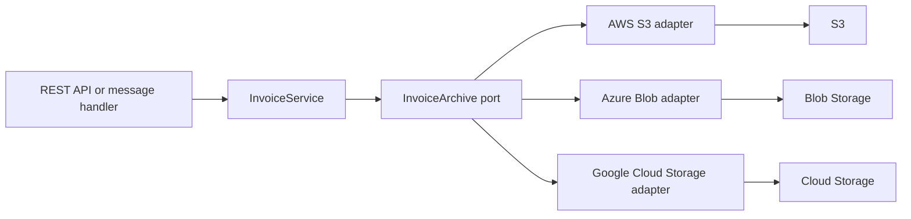

# Swapping Provider Adapters and Re-Verifying the Business Contract

When migrating a Spring Boot application from AWS to Azure or Google Cloud, the most visible change is usually the SDK and connection configuration. However, simply replacing `S3Client` with an Azure Blob client or a Google Cloud Storage client is not enough to prove the application still behaves correctly. Each service has different resource representations, metadata, errors, retries, access controls, and semantics. If those differences leak into the business layer, switching providers can alter system behavior even when all SDK calls succeed.

In the `SPRING_CLOUD_PROVIDER_INTEGRATION` module, the goal of this lab is to swap a managed service adapter without changing the business contract. We define the behavior the application needs, place that behavior behind a port, implement an adapter for each cloud provider, and run the exact same suite of contract tests against every adapter. The lesson also extends this process to messaging, where differences in acknowledgement, redelivery, and ordering can directly affect business logic.

## Expected Outcomes

After this lesson, you will be able to:

- Decouple business contracts from AWS, Azure, and Google Cloud APIs.
- Clearly define storage or messaging operation semantics before swapping adapters.
- Write ports and adapters following the ports-and-adapters pattern in Spring Boot.
- Select a single adapter via configuration without accidentally activating multiple implementations.
- Use a shared contract test suite to verify every implementation.
- Combine unit tests, emulator tests, and real cloud integration tests.
- Plan data migration, traffic shifting, observability, and rollback when switching providers.

## 1. Starting from the Business Contract

An invoice management application may need to store PDF contents, read an invoice back by ID, delete invoices per retention policy, and know the file's content type. Business logic does not need to know whether the object lives in an S3 bucket, an Azure Blob container, or a Google Cloud Storage bucket. It needs a stable set of behaviors.

That is the boundary of the business contract. The contract must describe what the application expects, including both success and failure cases:

| Business need | Contract to specify |
|---|---|
| Store invoice | Stable key, content, content type, and overwrite rules |
| Read invoice | Content and metadata returned accurately |
| Read non-existent key | Consistent representation for missing data |
| Delete invoice | Rules when the key exists and when it has already been deleted |
| Temporary service error | Errors classified so callers can decide whether to retry |
| Insufficient permissions | Report an access error rather than disguising it as not found |

The contract must clarify details that are easy to overlook. For example, does `save` overwrite an existing object or raise a conflict? Is `delete` on a non-existent key considered a success? Is the content type preserved when reading back? Are keys case-sensitive? If adapters answer differently, the same test suite will catch the incompatibility.

Do not leak types like `S3Object`, `BlobClient`, `StorageObject`, or SDK exceptions into the business model. They belong in adapters. The contract should use application-defined types such as `InvoiceId`, `byte[]`, `String contentType`, and `Optional`.

### Ports and adapters architecture



`InvoiceService` depends solely on `InvoiceArchive`. Adapters translate port calls into the corresponding SDK calls and translate responses or errors into application-understood types. Consequently, changing providers means swapping the implementation at the infrastructure boundary while keeping the contract used by business logic intact.

## 2. Creating a Port for Invoice Storage

In this example, the business conventions are:

- Keys are deterministically derived from the invoice ID in the format `invoices/{invoiceId}.pdf`.
- `save` overwrites existing content if the key already exists. This is an intentional rule for the example; systems requiring versioning can choose a different rule.
- `find` returns `Optional.empty()` when the object does not exist.
- `delete` is idempotent: deleting an already-deleted key is considered complete.
- Content type must be stored and returned accurately.
- Access errors and transient errors must be distinguished from missing-object cases.

Defining the model and port:

```java
public record InvoiceId(String value) {
    public InvoiceId {
        if (value == null || value.isBlank()) {
            throw new IllegalArgumentException("invoice id is required");
        }
    }
}

public record ArchivedInvoice(
        InvoiceId id,
        byte[] content,
        String contentType) {
}

public interface InvoiceArchive {
    void save(ArchivedInvoice invoice);

    Optional<ArchivedInvoice> find(InvoiceId id);

    void delete(InvoiceId id);
}
```

The example uses `byte[]` to keep the contract clear. For large files, replace it with `InputStream`/`Resource`, a streaming API, or an abstraction supporting multipart uploads; the contract must then specify who owns and closes the stream, size limits, retry rules, and partial-read handling. Never change domain data types simply because one provider's SDK offers a convenient type.

The business layer uses the port:

```java
@Service
public class InvoiceService {

    private final InvoiceArchive archive;

    public InvoiceService(InvoiceArchive archive) {
        this.archive = archive;
    }

    public void archive(InvoiceId id, byte[] pdf) {
        ArchivedInvoice invoice = new ArchivedInvoice(
                id, pdf, "application/pdf");
        archive.save(invoice);
    }

    public ArchivedInvoice get(InvoiceId id) {
        return archive.find(id)
                .orElseThrow(() -> new InvoiceNotFoundException(id));
    }

    public void remove(InvoiceId id) {
        archive.delete(id);
    }
}
```

The service knows nothing about buckets, containers, regions, ARNs, resource IDs, or credentials. That is a good sign: if an SDK change forces edits to `InvoiceService`, the adapter boundary may not have been designed properly.

## 3. Implementing an Adapter per Provider

Each adapter accepts the business model, builds the SDK request, invokes the managed service, and maps the response back to the business model. Adapters are also responsible for translating SDK exceptions into stable application exceptions.

### Error conventions at the adapter boundary

You can define application exceptions such as:

```java
public class ArchiveUnavailableException extends RuntimeException {
    public ArchiveUnavailableException(String message, Throwable cause) {
        super(message, cause);
    }
}

public class ArchiveAccessException extends RuntimeException {
    public ArchiveAccessException(String message, Throwable cause) {
        super(message, cause);
    }
}
```

Error translation rules should be consistent:

- Not found translates to `Optional.empty()` for read operations.
- Access denied translates to an access error; never convert it into not found.
- Timeouts, throttling, or temporary service errors translate to retryable errors if business logic permits.
- Invalid requests, wrong content types, or invalid keys must fail fast without infinite retries.
- Conflicts should only be returned if the contract forbids overwriting.

Never catch all exceptions and return `Optional.empty()`. Doing so makes permission or network failures look like missing data, masking incidents and potentially leading to wrong business decisions.

### AWS S3 adapter

The S3 adapter uses AWS SDK for Java v2. The example below shows model and metadata mapping; exception handling is abbreviated to focus on the boundary:

```java
@Component
@ConditionalOnProperty(prefix = "app.archive", name = "provider", havingValue = "aws")
class S3InvoiceArchive implements InvoiceArchive {

    private final S3Client s3;
    private final String bucket;

    S3InvoiceArchive(S3Client s3,
                     @Value("${app.archive.bucket}") String bucket) {
        this.s3 = s3;
        this.bucket = bucket;
    }

    @Override
    public void save(ArchivedInvoice invoice) {
        String key = keyOf(invoice.id());
        PutObjectRequest request = PutObjectRequest.builder()
                .bucket(bucket)
                .key(key)
                .contentType(invoice.contentType())
                .build();
        s3.putObject(request, RequestBody.fromBytes(invoice.content()));
    }

    @Override
    public Optional<ArchivedInvoice> find(InvoiceId id) {
        String key = keyOf(id);
        try {
            ResponseInputStream<GetObjectResponse> response =
                    s3.getObject(GetObjectRequest.builder()
                            .bucket(bucket).key(key).build());
            try (response) {
                return Optional.of(new ArchivedInvoice(
                        id,
                        response.readAllBytes(),
                        response.response().contentType()));
            }
        } catch (NoSuchKeyException ex) {
            return Optional.empty();
        }
    }

    @Override
    public void delete(InvoiceId id) {
        s3.deleteObject(DeleteObjectRequest.builder()
                .bucket(bucket).key(keyOf(id)).build());
    }

    private String keyOf(InvoiceId id) {
        return "invoices/" + id.value() + ".pdf";
    }
}
```

This is an illustrative skeleton for small objects and a pre-provisioned bucket. In production, add error translation based on actual SDK error codes, timeouts, non-leaky logging, size limits, and streaming support if needed. In some S3 setups, a missing object may surface via `NoSuchKeyException` or a corresponding service error; check the response and principal permissions. Lacking `s3:ListBucket` permission can affect how S3 reports non-existent keys.

`S3Client` should be created and closed by Spring configuration or the starter. The adapter only uses the injected client; never instantiate a new client on every operation.

### Azure Blob Storage adapter

The Azure adapter maps the same port to `BlobContainerClient` or the appropriate Azure Storage SDK client. Container name and endpoint come from environment configuration; credentials should come from `DefaultAzureCredential` or the workload's managed identity.

Operations to map:

- `save`: obtain a `BlobClient` from the key, upload content, and set the corresponding HTTP content type. Overwrite semantics must be stated explicitly via the SDK's overwrite option.
- `find`: download content and read `BlobHttpHeaders` for the content type. Only translate `BlobNotFound` to `Optional.empty()`; 401/403 and network errors must translate to the corresponding application errors.
- `delete`: use a deletion operation matching idempotent semantics; if the SDK distinguishes non-existent blobs, the adapter handles it to preserve the published contract.

Upload snippet example:

```java
BlobClient blob = containerClient.getBlobClient(keyOf(invoice.id()));
BlobHttpHeaders headers = new BlobHttpHeaders()
        .setContentType(invoice.contentType());
blob.upload(new ByteArrayInputStream(invoice.content()),
        invoice.content().length, true);
blob.setHttpHeaders(headers);
```

This example shows setting the content type as a separate step after upload. If the application requires content and metadata to change atomically across failure cases, check whether the upload API supports passing headers directly in the request and use the overload matching your SDK version. Avoid having an adapter upload bytes while forgetting metadata, as contract tests will catch the discrepancy.

### Google Cloud Storage adapter

The Google Cloud adapter uses `Storage` from the Google Cloud Java client. The key becomes the object name; bucket and content type are configured in the adapter:

```java
BlobInfo info = BlobInfo.newBuilder(bucket, keyOf(invoice.id()))
        .setContentType(invoice.contentType())
        .build();

storage.create(info, invoice.content());
```

Reading an object can use `storage.get(bucket, key)`. If the result is `null`, the adapter returns `Optional.empty()`. If present, the adapter extracts bytes and content type from the blob's metadata. Deletion uses `storage.delete(bucket, key)`; boolean results or errors must be mapped to the idempotent semantics defined by the port.

Across all three providers, standardize key normalization, content type, overwrite behavior, missing objects, and exceptions. Never let one adapter normalize keys automatically while another leaves them untouched, as that can cause the same `InvoiceId` to point to different objects.

## 4. Selecting the Adapter via Spring Configuration

An application should activate only one `InvoiceArchive` implementation in a single deployment. Configuration example:

```yaml
app:
  archive:
    provider: aws
    bucket: orders-invoices-prod
```

When switching to Azure:

```yaml
app:
  archive:
    provider: azure
    bucket: orders-invoices-prod
```

In the Azure adapter, the `bucket` value can map to the container name even though the shared property is named `bucket`. To avoid confusing terminology, production configuration can use a neutral name like `container` or `resource-name`. The example above keeps the property concise to illustrate adapter selection.

Provider configuration classes should use `@ConditionalOnProperty` or an equivalent selection mechanism. At startup, the application should fail fast if the provider is unsupported or if multiple adapters match simultaneously. You can add configuration validation to prevent production deployments from accidentally enabling two adapters.

Example provider client configuration:

```java
@Configuration
@ConditionalOnProperty(prefix = "app.archive", name = "provider", havingValue = "aws")
class AwsArchiveClientConfiguration {

    @Bean(destroyMethod = "close")
    S3Client s3Client() {
        return S3Client.builder().build();
    }
}
```

Similarly, Azure configuration creates `BlobServiceClient`/`BlobContainerClient`, and Google Cloud provides the `Storage` client. Credentials should come from workload identity and the provider's credential chain. Never add access keys, connection strings, or service account keys to committed YAML files.

Spring Cloud starters simplify client creation, credentials, and Spring integration. Property names, auto-configured beans, and SDK versions change per BOM. Pin versions using your project's dependency management and check the documentation for the matching version. Business ports should outlive the lifecycle of any specific starter.

## 5. Writing Shared Contract Tests for Every Adapter

Unit tests for `InvoiceService` can mock `InvoiceArchive` to verify business logic. However, those unit tests do not prove that `S3InvoiceArchive`, `AzureBlobInvoiceArchive`, and `GcsInvoiceArchive` share identical behavior. Contract tests close that gap: the exact same test suite runs against every implementation.

### Building the contract test suite

Create an abstract test class describing the required behavior:

```java
abstract class InvoiceArchiveContractTest {

    protected abstract InvoiceArchive createArchive();
    protected abstract void cleanupArchive();

    private InvoiceArchive archive;

    @BeforeEach
    void setUp() {
        archive = createArchive();
    }

    @AfterEach
    void tearDown() {
        cleanupArchive();
    }

    @Test
    void savesAndReadsContentAndContentType() {
        InvoiceId id = new InvoiceId("contract-1001");
        byte[] content = "%PDF-test".getBytes(StandardCharsets.UTF_8);
        archive.save(new ArchivedInvoice(id, content, "application/pdf"));

        ArchivedInvoice loaded = archive.find(id).orElseThrow();

        assertArrayEquals(content, loaded.content());
        assertEquals("application/pdf", loaded.contentType());
    }

    @Test
    void returnsEmptyWhenObjectDoesNotExist() {
        assertTrue(archive.find(new InvoiceId("missing-1002")).isEmpty());
    }

    @Test
    void replacesContentWhenSavingTheSameId() {
        InvoiceId id = new InvoiceId("contract-1003");
        archive.save(new ArchivedInvoice(id, new byte[] {1}, "application/pdf"));
        archive.save(new ArchivedInvoice(id, new byte[] {2, 3}, "application/pdf"));

        assertArrayEquals(new byte[] {2, 3},
                archive.find(id).orElseThrow().content());
    }

    @Test
    void deleteIsIdempotent() {
        InvoiceId id = new InvoiceId("contract-1004");
        archive.save(new ArchivedInvoice(id, new byte[] {4}, "application/pdf"));

        archive.delete(id);
        archive.delete(id);

        assertTrue(archive.find(id).isEmpty());
    }
}
```

Each test uses a distinct key to prevent collisions across runs or parallel CI workers. In practice, add a test namespace keyed by build ID and clean up by prefix. If tests run in parallel, never share a fixed key.

The tests above verify the core contract: round trip, metadata, missing objects, overwrite, and delete idempotency. You can add tests for empty payloads, Unicode characters in IDs, maximum sizes, access errors, timeouts, and retries. Add only behaviors genuinely required by business logic; contracts should not turn every SDK quirk into an application commitment.

### Wiring contract tests to each adapter

Each provider has a subclass instantiating the real adapter and providing a test environment:

```java
class S3InvoiceArchiveContractTest extends InvoiceArchiveContractTest {
    @Override
    protected InvoiceArchive createArchive() {
        return testEnvironment.createS3Archive();
    }

    @Override
    protected void cleanupArchive() {
        testEnvironment.deleteS3TestObjects();
    }
}
```

`testEnvironment` is a project fixture responsible for creating clients, test buckets, and configuring credentials. Equivalent classes are created for Azure Blob and Google Cloud Storage. You can use JUnit 5 `@TestFactory`, test templates, or test profiles to reuse fixtures, but the crucial point is running the exact same contract suite against each adapter.

Do not mock the SDK inside contract tests. Mocking the SDK mostly verifies how the adapter calls the mock and stops testing real provider semantics. Mocks belong in unit tests for error mapping or rare edge branches; integration contract tests must talk to real services or emulators.

## 6. Combining Unit Tests, Emulators, and Real Clouds

No single test layer catches every issue. A practical strategy uses three layers:

| Layer | Purpose | Environment |
|---|---|---|
| Unit tests | Verify business logic, key mapping, error mapping, and adapter selection config | Mock ports or narrow collaborators |
| Emulator integration tests | Verify SDK request/response, metadata, upload/download, delete, and partial semantics | LocalStack for certain AWS services, Azurite for Azure Storage, fake-gcs-server for GCS |
| Cloud integration tests | Verify IAM, workload identity, networking, encryption, policies, quotas, and real service behavior | Dedicated sandbox account/project/subscription |

Emulators run fast and reduce costs, but do not guarantee faithful simulation of IAM, consistency, retries, versioning, encryption, or all service limits. Passing emulator tests does not replace real cloud testing, especially when changing identities or policies.

### Testing permissions and credentials

In cloud integration tests, run tests using the same type of workload identity used in production or an equivalently scoped identity. Never use a developer's personal credentials to conclude a workload has the right permissions. Verify both allowed and denied operations:

- The principal can write and read within the authorized bucket/container.
- The principal cannot read or delete data outside its granted scope.
- The principal lacks infrastructure admin rights if business logic does not need them.
- 401/403 errors translate to access errors, not not-found errors.

Never put tokens or secrets into assertion messages, test logs, or CI reports. Test resources need isolated names and cleanup policies so shared data is never deleted accidentally.

## 7. Testing Messaging Contracts When Swapping Brokers

For messaging, swapping adapters is even more sensitive than storage because brokers differ in delivery semantics. Ports should express business intent, such as `OrderEventPublisher.publish(OrderCompleted)` or `OrderCommandConsumer`, rather than coupling the domain to `SqsMessage`, `ServiceBusReceivedMessage`, or `PubsubMessage`.

Before swapping brokers, align on:

- **Delivery:** at-most-once, at-least-once, or another guarantee the system actually enforces.
- **Acknowledgement:** under which business condition a message is acknowledged.
- **Redelivery:** where duplicate handling and deduplication live.
- **Ordering:** whether ordering is guaranteed per queue, partition, session, or ordering key.
- **Retries and dead-lettering:** attempt counts, backoff, dead-letter triggers, and replay workflows.
- **Message contract:** schema, version, encoding, headers, and correlation ID.
- **Durability:** when the publisher is considered to have succeeded and how ambiguous publish timeouts are handled.

| Concept | Amazon SQS/SNS | Azure Service Bus | Google Cloud Pub/Sub |
|---|---|---|---|
| Receiving messages | SQS polling; SNS typically delivers to target subscriptions | Receiver or processor | Subscriber pull/push |
| Acknowledging | Delete message after processing per acknowledgement mode | Complete, abandon, defer, or dead-letter | Ack or nack per subscription mode |
| Processing lock | Visibility timeout | Peek-lock and lock renewal | Ack deadline and deadline extension |
| Ordering | FIFO queues with message groups and specific rules | Session-enabled entities | Ordering keys when enabled and configured |
| Retries | Visibility/redelivery and redrive policy | Delivery count and dead-letter queue | Retry policy and dead-letter topic when configured |

This table only summarizes concepts. Never assume the three brokers share identical semantics simply because all three support ack and retry. Compare actual limits, ordering guarantees, and configurations for each service.

Consumer contract tests should verify that valid messages apply business effects only once even when delivered multiple times; invalid messages are classified properly; newer/older message versions obey schema compatibility; and messages sharing an ordering key follow business ordering rules. Publisher tests should verify payload, schema version, correlation ID, and well-defined send outcomes.

To avoid broker coupling, you can define a port:

```java
public interface OrderEventPublisher {
    CompletionStage<PublishResult> publish(OrderCompleted event);
}

public record PublishResult(String eventId) {
}
```

`CompletionStage` represents an asynchronous send. The contract must state whether future completion means the broker durably accepted the message or merely queued it in a local buffer. Never complete `PublishResult` prematurely if the network send can still fail. For events requiring consistency with database transactions, using a transactional outbox and a retrying publisher worker is generally safer than publishing directly inside a transaction.

## 8. Switching Providers in Real Environments

Once the new adapter passes contract tests, plan data and traffic migration. Changing `provider=azure` in production configuration does not automatically move objects sitting in S3 into Blob Storage. Likewise, creating a new subscription does not automatically move messages sitting in an old queue.

### Storage migration workflow

1. **Inventory:** determine object count, total size, keys, metadata, versions, retention, encryption, and access policies.
2. **Provision destination:** create buckets/containers, networking, encryption keys, lifecycle rules, and workload identities using IaC.
3. **Copy data:** use migration tools or dedicated jobs with checkpointing and failure resumption.
4. **Reconcile:** compare object counts, keys, sizes, checksums, and critical metadata. ETag is not always an equivalent content checksum across providers or multipart uploads.
5. **Run contract tests on destination:** use the real workload identity and verify read/write/delete permissions match the contract.
6. **Switch application:** enable the new adapter in staging, then canary or shift traffic in waves.
7. **Monitor and preserve rollback:** keep the old source readable for an approved retention window; clean up only after reconciliation and expiration of the rollback period.

If the system continues receiving writes during copying, prepare a strategy to sync incremental changes: pause writes during a cutover window, replay a change log/outbox, or run a verified delta-sync process. Direct dual-writes to two providers can create drift if one write succeeds and the other fails; do not use dual-writes as a default without reconciliation.

### Messaging migration workflow

For brokers, handle both in-flight messages and new messages produced during cutover. A workflow can include:

1. Create the new queue/topic/subscription and configure policies, retries, dead-lettering, and ordering.
2. Deploy the new consumer idle or receiving only test messages.
3. Choose a clean cutover point for producers, potentially via an outbox or router.
4. Drain the old queue down to an agreed threshold or forward messages while preserving IDs and schemas.
5. Ensure two consumers do not concurrently execute side effects beyond business idempotency boundaries.
6. Compare throughput, backlog, dead-letter rates, duplicates, and latency before decommissioning the old broker.

If running two consumers in parallel for comparison, a shadow consumer should only read and write verification metrics to an isolated store; never execute real business side effects such as billing invoices or charging cards. Use stable event IDs to trace messages across both systems.

### Feature flags and rollback

Providers can be toggled via deployment configuration or feature flags. Record changes alongside release IDs. When errors appear, you can switch back to the old adapter if data and traffic remain compatible. Before rolling back, check:

- Was new data written to the new provider after the switch?
- Can the old adapter read those changes?
- Does the new provider use provider-specific metadata, encryption, or key formats?
- Can old consumers parse messages published on the new broker?
- Could replaying messages or shifting traffic cause duplicate side effects?

Rolling back code does not automatically reverse written data. Establish a reverse-sync plan or recovery runbook before permitting bidirectional switching.

## 9. Multi-Adapter Test Pipeline Example

A CI pipeline can run the same contract tests across each adapter using a matrix. General conceptual example:

```yaml
strategy:
  matrix:
    archive-provider: [aws, azure, gcp]

steps:
  - name: Run adapter contract tests
    run: ./mvnw test -Dtest.profile=contract-${{ matrix.archive-provider }}
```

This illustrates matrix structure; exact property syntax and Maven flags must match your project's test setup. Each job needs an isolated environment or namespace, securely provisioned credentials, and bounded cleanup steps. For cloud integration tests, prefer workload identity federation or short-lived CI credentials over long-lived secret keys.

The pipeline should record results per provider for easy comparison. When a contract test fails only on Azure, you can isolate Azure adapter metadata, permissions, or semantics. When all adapters fail together, inspect the contract, fixtures, or business changes before editing individual adapters.

## 10. Common Pitfalls When Swapping Adapters

| Symptom | Common cause | How to fix |
|---|---|---|
| New adapter saves, but reads fail to find object | Key prefix or ID encoding differs | Use a shared key builder and add contract tests for special characters |
| Content matches, but content type is wrong | Metadata was not written or read back | Check upload request and provider metadata mapping |
| Missing object raises system error | Adapter failed to map not found to `Optional.empty()` | Map provider not-found codes accurately; keep access denied and timeouts separate |
| 403 treated as missing data | Overly broad exception catching | Separate permission errors from not found and inspect workload identity |
| Tests pass locally, fail in cloud | Emulator does not simulate real IAM, networking, or policies | Run integration tests in a sandbox with production-equivalent identities |
| One adapter overwrites while another raises conflict | Unstandardized overwrite semantics | Pick one business rule and test across all implementations |
| Flaky parallel tests | Shared bucket/key or overlapping cleanup | Isolate namespaces per test run and clean up by prefix |
| Messages processed twice after broker migration | At-least-once delivery and non-idempotent consumer | Use stable event IDs, deduplication, and proper transactions |
| Out-of-order messages after migration | Ordering key/session/FIFO group unmapped | Define business ordering scope and configure the new broker accordingly |
| Cost spikes after switching providers | Unoptimized retries, small requests, lifecycle, or storage tiers | Measure requests, data transfer, retention, and storage classes under realistic workloads |

When failures occur, classify them across four layers: business contract, adapter mapping, config/identity/network, and managed service behavior. Modify only the layer with evidence of fault; if you change the contract, re-run the test suite across every adapter.

## 11. Lab Completion Checklist

- [ ] The port uses only application-owned data types and behaviors.
- [ ] The contract explicitly defines missing, overwrite, delete, metadata, and error behaviors.
- [ ] Domain services depend solely on the port.
- [ ] Each provider has an adapter implementing the same port.
- [ ] Only one adapter is activated per deployment.
- [ ] Credentials come from workload identity or secure runtime mechanisms.
- [ ] Shared contract tests pass on every adapter.
- [ ] Unit tests, emulator tests, and cloud integration tests serve distinct goals.
- [ ] Tests use isolated keys/prefixes, run cleanup, and never log secrets.
- [ ] IAM, networking, encryption, and metadata are verified on real clouds.
- [ ] For messaging, delivery, acknowledgement, ordering, and retries are defined.
- [ ] Data copy, traffic shift, reconciliation, and rollback plans exist.
- [ ] Pipeline records results by provider and release ID.

## Conclusion

Swapping adapters safely starts by precisely specifying the business contract your application needs, placing it behind a port, and implementing an adapter for each provider. One shared contract test suite must verify behaviors such as round trips, metadata, missing objects, overwrites, deletes, and error classification across every implementation. Emulators provide fast feedback, while cloud integration tests verify real identities, policies, networking, and service semantics. Combined with data migration plans, message controls, and rollback readiness, a Spring Boot application can switch managed providers while keeping business behavior stable.
