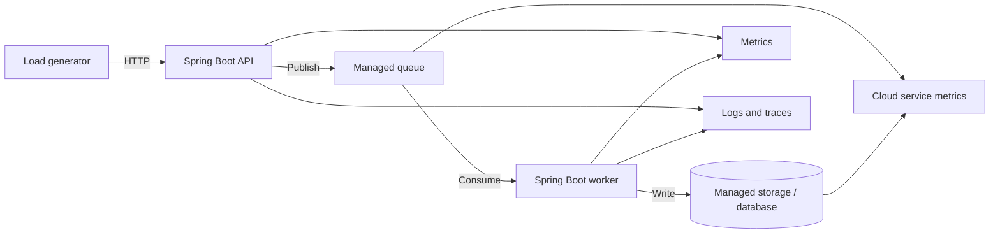

# Deploying a Test Environment, Load Testing, and End-to-End Flow Observability

An integration test is only valuable when its runtime environment closely resembles the real deployment environment and provides full visibility across the data path. An HTTP endpoint returning success does not prove a message was processed, an object was stored, or data was written to the database. Under higher load, failures can emerge in connection pools, managed service quotas, queues, consumers, or the network between components.

In the `SPRING_CLOUD_PROVIDER_INTEGRATION` module, this lab builds a test environment for a Spring Boot application integrating with managed services on AWS, Azure, and Google Cloud. You will isolate test resources, generate sample transaction traffic, step up load gradually, track metrics, logs, and traces end to end, and evaluate results before promoting changes to production.

## Lab Objectives

After this lesson, you will be able to:

- Prepare a test environment with production-equivalent networking, identities, configuration, and managed services.
- Generate identifiable, repeatable, and safely cleanable test data.
- Generate load using k6 or an equivalent tool with controlled ramp-up.
- Trace requests from the Spring Boot API through queues, consumers, storage, or databases.
- Read application metrics and cloud service metrics to pinpoint bottlenecks.
- Evaluate latency, throughput, error rates, queue lag, retries, and costs.
- Archive test evidence to compare across providers or across deployments.

## 1. Lab Problem and Architecture

We use an order-processing flow as our example:

1. The client sends an order creation request to the `order-service` REST API.
2. Spring Boot validates the payload and publishes a message to a queue service.
3. A consumer receives the message and executes business processing.
4. The consumer writes the result or event copy to storage/database.
5. The application emits metrics, logs, and traces to observe the entire transaction.

Specific services vary by cloud provider. The business logic and measurement criteria remain constant so results stay comparable.



Example service mapping:

| Role | AWS | Azure | Google Cloud |
|---|---|---|---|
| Queue or messaging | Amazon SQS or SNS + SQS | Azure Service Bus Queue/Topic | Pub/Sub |
| Object storage | Amazon S3 | Azure Blob Storage | Cloud Storage |
| Optional database | Amazon RDS or DynamoDB | Azure Database or Cosmos DB | Cloud SQL or Firestore |
| Workload identity | IAM role, EKS Pod Identity, or IRSA depending on platform | Managed Identity or Workload Identity on AKS | Service Account or Workload Identity Federation |
| Observability | CloudWatch, X-Ray, or OpenTelemetry | Azure Monitor, Application Insights, or OpenTelemetry | Cloud Monitoring, Cloud Trace, or OpenTelemetry |

You do not need to provision every resource type in the table. Pick one service per role fitting the problem, then use the corresponding provider adapter. When comparing clouds, keep payloads, load scenarios, observation windows, and metric calculations identical.

## 2. Preparing the Test Environment

### 2.1. Creating an isolated environment

The test environment should mirror production topology while using dedicated resources and data. You can use a non-production Kubernetes namespace, resource group, project, or account/subscription.

Create a set of clearly named resources, for example:

- `provider-lab-order-api`: application receiving requests.
- `provider-lab-orders-queue`: queue receiving messages.
- `provider-lab-order-worker`: consumer processing messages.
- `provider-lab-results`: bucket/container storing test results.
- `provider-lab-observability`: observability workspace or configuration.

Actual names must follow each provider's naming rules. Avoid sharing queues, buckets, databases, or secrets with production.

Environment components to verify:

- Subnets, routes, DNS, and private endpoints if the lab uses private networking.
- Firewalls/security groups/NSGs for the right protocols and ports.
- Workload identities bound to the right pods, VMs, or services.
- Least-privilege test permissions: publish/consume, object read/write, or database queries.
- Test-specific secrets and configuration.
- Quotas, throughput limits, and budget alerts.

Provision resources via Infrastructure as Code if your team already has standard modules. Tag/label resources with environment, owner, and expiration to prevent test resources from lingering unexpectedly.

### 2.2. Separating application configuration from source code

Spring Boot can read configuration from environment variables, ConfigMaps, or secret managers. Example:

```yaml
# application.yml
app:
  orders:
    queue-name: ${ORDERS_QUEUE_NAME}
    result-resource: ${RESULT_RESOURCE}
    provider: ${CLOUD_PROVIDER}
    publish-timeout: 3s

management:
  endpoints:
    web:
      exposure:
        include: health,info,metrics,prometheus
  endpoint:
    health:
      probes:
        enabled: true
  tracing:
    sampling:
      probability: 0.1
  metrics:
    distribution:
      percentiles-histogram:
        http:
          server:
            requests: true
```

This is an illustrative configuration for an application using Spring Boot Actuator and Micrometer. Only expose observability endpoints inside management networks or behind proper authentication. `CLOUD_PROVIDER` serves only as a configuration identifier label; SDKs must still be initialized with the provider's actual region/project and credential chain.

For `/actuator/prometheus` to export Prometheus-formatted metrics, the application needs the matching registry, such as `micrometer-registry-prometheus`, alongside Spring Boot Actuator. If exporting traces to a collector via OTLP, add the bridge/exporter compatible with your Spring Boot version and configure the collector endpoint per environment.

Never place access keys, client secrets, connection strings, or secret values into committed YAML files. Use workload identities and environment-specific secret managers. Non-production configuration must never point to production resources.

### 2.3. Preparing test data

Each request should carry a test identifier for tracing across components. Example:

```json
{
  "testRunId": "load-2026-11-24-a",
  "orderId": "lab-order-000001",
  "customerRef": "synthetic-customer-01",
  "amount": 125000,
  "currency": "VND"
}
```

These fields are purely synthetic data. Never use real personal data, tokens, or payment details. Generate a fresh `testRunId` for every run to distinguish logs and results.

Design consumers to be idempotent in case messages are redelivered. Use `orderId` or an idempotency key to prevent duplicate processing. With production-like queues, record both retry counts and dead-letter queue message counts.

Prepare post-test cleanup: delete objects under the test prefix, purge remaining test messages, clean up database records, and tear down temporary resources after archiving results.

## 3. Instrumentation in Spring Boot

For end-to-end visibility, measure both HTTP traffic and managed service operations. Default web server metrics do not fully capture message publish latency, consumer processing time, or object writes.

### 3.1. Signals to collect

| Signal | Question to answer | Examples |
|---|---|---|
| Metrics | How much is the system processing and where is it slow? | Requests/s, p95, publish latency, consumer duration, queue depth |
| Logs | What error hit a specific transaction? | Correlation ID, operation, dependency, error category |
| Traces | Which span consumed the time? | HTTP request → publish → consume → storage write |
| Cloud metrics | Are managed services throttled or backed up? | Throttling, age of oldest message, API errors, storage latency |

Use RED metrics for requests (Rate, Errors, Duration) alongside resource metrics like connection pools, thread pools, CPU, and memory. For queues, add backlog depth, oldest message age, received count, ack count, retries, and dead-letter counts.

### 3.2. Recording metrics for publish operations

Spring Boot Actuator and Micrometer provide `MeterRegistry` for custom metrics. Example:

```java
import io.micrometer.core.instrument.MeterRegistry;
import io.micrometer.core.instrument.Timer;
import org.springframework.stereotype.Component;

@Component
public class OrdersPublisherMetrics {

    private final MeterRegistry registry;

    public OrdersPublisherMetrics(MeterRegistry registry) {
        this.registry = registry;
    }

    public <T> T recordPublish(String provider,
                               java.util.function.Supplier<T> operation) {
        Timer.Sample sample = Timer.start(registry);
        try {
            T result = operation.get();
            sample.stop(Timer.builder("orders.publish")
                    .tag("provider", provider)
                    .tag("outcome", "success")
                    .register(registry));
            return result;
        } catch (RuntimeException exception) {
            sample.stop(Timer.builder("orders.publish")
                    .tag("provider", provider)
                    .tag("outcome", "error")
                    .register(registry));
            throw exception;
        }
    }
}
```

This example uses `Timer.Sample` to tag `outcome` after the operation completes. You can add dedicated error counters if dashboards need direct queries. Never tag with `orderId`, email, queue message ID, or correlation ID because these values have high cardinality and bloat metric storage.

### 3.3. Measuring consumer processing

Consumers should record at least:

- Elapsed time from message receipt to processing completion.
- Outcome: success, retryable failure, or permanent failure.
- Delivery/retry count if exposed by the SDK.
- Storage/database write duration.
- Counts of acked, abandoned/nacked, or dead-lettered messages.

Do not log full payloads if they could contain sensitive data. Log only permitted test identifiers, states, and error categories.

### 3.4. Propagating correlation IDs and trace context

A request can finish at the HTTP layer while work continues asynchronously in a queue. Propagate linking metadata through message attributes/headers to connect corresponding logs and traces.

Use a business correlation ID, such as `testRunId` and `orderId`, along with W3C Trace Context when supported by libraries and brokers. When publishing a message, pass `traceparent` and `tracestate` in message headers/attributes per your SDK or Spring Cloud Stream binder. The consumer resumes the trace from the received context or creates a linked span per messaging instrumentation conventions.

Correlation IDs serve transaction search; trace IDs link spans. Both can appear together, but should not be conflated arbitrarily.

### 3.5. Configuring tracing and exporters

Spring Boot integrates Micrometer Tracing with OpenTelemetry bridges and exporters. For example, configure sampling below 100% in high-load environments to limit overhead:

```yaml
management:
  tracing:
    sampling:
      probability: 0.1
```

10% sampling is an example, not a strict rule. When inspecting a specific test run, you can raise sampling conservatively in the test environment or use tail sampling in the collector. Avoid 100% sampling during long stress tests if your collector or observability backend lacks capacity.

## 4. Generating Load with k6

k6 is an HTTP load generator that runs independently of the application. Scenarios should ramp up load gradually to locate the degradation knee rather than blasting huge request volumes immediately.

If k6 is not installed, install it per your OS instructions or use the official container image in CI. The load generator must run on a network with access to the test endpoint; for private APIs, place the generator in the same network or a properly peered network.

Example `orders-load.js` script:

```javascript
import http from 'k6/http';
import { check, sleep } from 'k6';

export const options = {
  stages: [
    { duration: '2m', target: 5 },
    { duration: '3m', target: 20 },
    { duration: '5m', target: 20 },
    { duration: '2m', target: 0 }
  ],
  thresholds: {
    http_req_failed: ['rate<0.01'],
    http_req_duration: ['p(95)<500', 'p(99)<1000']
  }
};

export default function () {
  const runId = __ENV.TEST_RUN_ID || 'local-smoke';
  const orderId = `order-${__VU}-${__ITER}`;

  const payload = JSON.stringify({
    testRunId: runId,
    orderId,
    customerRef: 'synthetic-customer',
    amount: 125000,
    currency: 'VND'
  });

  const response = http.post(
    `${__ENV.BASE_URL}/api/orders`,
    payload,
    {
      headers: {
        'Content-Type': 'application/json',
        'X-Correlation-Id': `${runId}-${orderId}`
      },
      timeout: '5s'
    }
  );

  check(response, {
    'accepted for processing': (r) => r.status === 202
  });

  sleep(1);
}
```

This script assumes the API returns HTTP 202 after accepting the request and enqueueing the message. If your API uses a different response contract, adjust the `check` assertion accordingly.

Run a quick test with a small number of virtual users:

```bash
k6 run \
  -e BASE_URL=https://test-api.example.internal \
  -e TEST_RUN_ID=load-2026-11-24-a \
  orders-load.js
```

Never pass credentials in CLI flags or hardcode them in scripts. If the API requires authentication, use your k6 runner's secure token issuance, secret injection, or a dedicated load-generator identity. Ensure tokens never appear in logs or test reports.

### 4.1. Load testing phases

A test run can be structured into phases:

1. **Smoke:** 1–2 virtual users briefly to confirm endpoints and data flow.
2. **Baseline:** low, steady load to record normal latency and throughput.
3. **Load:** gradual ramp-up to the application's expected target load.
4. **Stress:** push beyond expected load in a bounded environment to find saturation points.
5. **Soak:** hold steady load over a longer duration to expose memory leaks, pool exhaustion, or accumulating backlogs.
6. **Recovery:** drop load to 0 and observe whether the system drains its backlog, releases resources, and returns to baseline.

Never start stress or soak tests before verifying quotas, concurrency limits, and budgets. Start from low load, cap maximum generator rates, and have an operator watching dashboards throughout the test.

### 4.2. Virtual users vs. request rate vs. concurrency

Virtual users are concurrent script-executing threads. Request rate is the number of requests sent per unit of time. Concurrency is the number of operations actively in flight at once. They are related, not identical.

If each iteration includes sleep time or slow responses, the same number of virtual users produces different request rates. Record actual throughput from k6 and server metrics instead of assuming RPS directly from VU count.

## 5. Running the Lab in Stages

### Step 1: Verify environment and baseline

- Deploy the API and worker into the test environment.
- Check readiness, identities, DNS, TLS, and permissions to queues/storage.
- Send one test request with a distinct correlation ID.
- Confirm the message enters the queue, the worker processes it, and the result is persisted.
- Record baseline metrics across API, queue, worker, and storage/database.

Save: image version, provider config, region, resource aliases, run timestamp, and baseline dashboard snapshots.

### Step 2: Run smoke test

Run k6 with one or two VUs briefly. Verify response statuses, error rates, and latency. Then trace the correlation ID across API logs, message metadata, worker logs, and persisted output records.

An HTTP 202 only confirms the API accepted the work. Independently verify the worker succeeded and output data appeared.

### Step 3: Ramp up load under control

Increase VU counts in steps. Hold each step long enough for metrics to stabilize. Record:

- Request rate and p50/p95/p99 response times.
- HTTP error rates and timeouts.
- Queue depth and oldest message age.
- Consumer throughput, retries, and DLQ counts.
- Storage/database latency and errors.
- CPU, memory, thread pools, and connection pools.
- Managed service throttling/quota signals.

Halt ramp-up if errors cross configured thresholds or shared resources risk impact.

### Step 4: Verify recovery

Once the generator stops, watch whether queue backlog drains near 0. Check that workers finish remaining messages, retries subside, DLQ does not spike unexpectedly, and storage/database load returns to normal.

If backlog keeps growing after incoming traffic stops, consumers may be concurrency-bound, failing repeatedly, or throttled. Record full drain/recovery time, not just when the API returned to normal.

### Step 5: Repeat on another provider

Run the exact same payload, VU count, duration, timeouts, and metrics on a second or third provider. Use isolated resources per run and label by provider. If quota or config differences are intentional, document them clearly in the report to avoid misleading conclusions.

## 6. Full-Flow Observability Dashboard

Dashboards should show operators exactly where data stalls. Reference layout:

| Area | Key metrics | Operational question |
|---|---|---|
| API ingress | Requests/s, p95/p99, 4xx/5xx, timeouts | Is the API absorbing the load? |
| Producer | Publish rate, publish latency, publish errors | Is the app getting messages into the broker? |
| Queue | Depth, oldest message age, enqueue/dequeue rate | Are messages piling up? |
| Consumer | Processing rate, duration, retries, failures, DLQ | Are workers keeping up and succeeding? |
| Storage/database | Operation latency, errors, throttling, pool usage | Is persisting results the bottleneck? |
| Runtime | CPU, memory, GC, threads, connection pools | Are application resources saturated? |
| Cost/quota | Request units, API calls, egress, quota usage | Is load testing breaching limits or budget? |

### 6.1. Reading relationships between metrics

Common patterns:

- API latency rises alongside publish latency: check broker connectivity, retries, DNS, TLS, and request limits.
- API stays fast while queue depth climbs: producer ingestion outpaces consumer processing.
- Queue depth stays low while DLQ climbs: consumers receive messages but fail processing.
- Consumer duration rises alongside storage latency: storage/database may be saturated or throttled.
- Low CPU alongside low throughput: check network waits, connection pools, concurrency settings, or managed service limits.
- Stable p95 with spiking p99: likely retries, cold starts, or occasional slow downstream calls.

Never jump to a root cause from a single metric. Correlate traces, logs, and provider metrics over the same time window.

### 6.2. Following traces end to end

A clean trace for this flow can contain spans:

```text
POST /api/orders
  ├── validate-order
  ├── orders.publish
  └── broker.publish

orders.consume
  ├── deserialize-message
  ├── process-order
  └── storage.write
```

With asynchronous processing, consumer spans may form a separate trace linked via message context or span links, depending on libraries and brokers. Do not assume traces always render as a single synchronous span tree. What matters is that correlation IDs and trace contexts tie related steps together.

### 6.3. Metrics and logs to avoid

Never use high-cardinality values like `orderId`, `customerRef`, emails, tokens, or message IDs as metric labels. They explode cardinality, storage costs, and dashboard query times. Put those values inside sanitized logs or trace attributes with appropriate retention policies.

Never log access tokens, secrets, connection strings, payment details, or personal data. For errors, log error categories and safe provider error codes; do not log full request bodies by default.

## 7. Interpreting Results and Finding Bottlenecks

Suppose a 20-VU run produces these numbers:

| Metric | Baseline | Steady load | Observation |
|---|---:|---:|---|
| API throughput | 8 req/s | 42 req/s | Throughput scales with load |
| API p95 | 180 ms | 420 ms | Within illustrative 500 ms threshold |
| Publish error rate | 0% | 0.2% | Inspect error types and retries |
| Queue oldest age | 0.4 s | 18 s | Messages starting to wait longer |
| Consumer throughput | 8 msg/s | 30 msg/s | Slower than publish rate |
| DLQ | 0 | 3 | Investigate failed messages |
| Storage p95 | 90 ms | 260 ms | Latency increased, not conclusive bottleneck yet |

These numbers merely illustrate interpretation. Here, the API responds relatively fast, but consumers lag behind the publish rate, increasing oldest message age. Inspect consumer concurrency, per-message processing time, storage limits, and DLQ errors. Adding more API instances will not clear the backlog if workers or storage are the bottleneck.

### 7.1. Computing end-to-end throughput

Do not equate HTTP request rate with completed business throughput. For asynchronous flows, measure orders successfully processed and persisted per time window:

\[
\text{Completed throughput} =
\frac{\text{Successfully completed transactions}}
{\text{Measurement duration}}
\]

Reconcile accepted requests, published messages, consumed messages, successful results, and error/DLQ counts. Gaps between stages indicate messages stuck in backlog or missing telemetry.

### 7.2. Measuring business completion time

Record timestamps when the API accepts the request and when the worker persists the result. Use a consistent clock source or trace duration to compute end-to-end latency. With queues, this includes backlog wait time.

\[
\text{End-to-end latency} =
t_{\text{result persisted}} - t_{\text{request accepted}}
\]

Report p50, p95, and p99 rather than averages alone. Averages can hide a tail of severely delayed transactions.

## 8. Comparing AWS, Azure, and Google Cloud

When running the same lab across multiple providers, keep workloads and measurement definitions constant. Explicitly note differences caused by configuration, quotas, regions, or service designs.

| Aspect | AWS | Azure | Google Cloud |
|---|---|---|---|
| Queue metrics | SQS visible/in-flight messages, oldest message age, send/receive/delete errors | Service Bus active messages, dead-letter messages, incoming/outgoing requests | Pub/Sub undelivered messages, oldest unacked age, publish/ack latency |
| Storage metrics | S3 request metrics, 4xx/5xx, latency via appropriate observability tools | Blob request metrics, availability, latency, and throttling | Cloud Storage request count, latency, and errors |
| Runtime/tracing | CloudWatch, X-Ray, or OpenTelemetry | Azure Monitor, Application Insights, or OpenTelemetry | Cloud Monitoring, Cloud Trace, or OpenTelemetry |
| Identity | IAM roles and policies | Managed Identity and Azure RBAC | Service Accounts and IAM |
| Networking | VPC, security groups, VPC endpoints, NAT | VNet, NSG, Private Endpoints, NAT Gateway | VPC firewall, PSC, Private Google Access, Cloud NAT |

Metric names and collection mechanisms vary by SKU, queue tier, region, and monitoring setup. Verify available metrics for your exact services before building dashboards.

### 8.1. Standardizing reports

A comparison report should include:

- Provider, region, and managed service tiers.
- Spring Boot, Spring Cloud, SDK versions, and image digests.
- Instance/pod specs, CPU, memory, and worker concurrency.
- Actual load level, warm-up period, and measurement window.
- p50/p95/p99 latencies, completed throughput, error rates, and backlog.
- Retries, throttling, DLQ counts, and recovery time.
- Estimated cost or request units/operations if available.
- Configuration differences affecting results.

Never compare two providers if one ran near the load generator and the other ran across continents, or if one used private endpoints while the other traversed public endpoints without documenting those differences.

## 9. Cost Controls and Limits During Load Tests

Load tests generate charges from API requests, messages, storage operations, database capacity, log/trace ingestion, data egress, and compute runtime. Before each run:

1. Define max VU/RPS caps and run duration.
2. Check managed service quotas and rate limits.
3. Enable budget alerts or appropriate usage alarms.
4. Bound log/trace sampling and retention.
5. Use synthetic data, isolated resources, and test prefixes.
6. Monitor costs during and after tests; abort if budget thresholds are threatened.
7. Clean up test resources once evidence is saved.

Never use production to discover saturation points. If production readiness checks are required, execute tightly scoped smoke tests or minimal-load verifications per operational runbooks with clear abort criteria and active monitoring.

## 10. Troubleshooting Common Issues

| Symptom | Where to check | Investigation path |
|---|---|---|
| API returns 202 but no results appear | Producer, queue, consumer | Verify publish succeeded, queue/subscription name matches, consumers are running |
| Queue depth grows continuously | Consumers and downstream dependencies | Compare publish vs. consume rates, concurrency, slow processing, and throttling |
| DLQ spikes under high load | Consumer logs and message metadata | Classify transient vs. permanent errors, serialization, and retry policies |
| p99 spikes sharply | Traces, retries, and pools | Locate slow spans, connection waits, cold starts, or timeouts |
| HTTP 429/503 from cloud | Quota metrics and SDK | Check quotas, jittered backoff, concurrency, and retry amplification |
| Some pods fail DNS | Resolvers and network policies | Compare subnets, DNS caches, private zones, and conditional forwarding |
| App metrics work but cloud metrics missing | Exporters/permissions | Check monitoring API read permissions, agents, and scrape configs |
| Traces break across the queue | Message headers and instrumentation | Check trace context propagation, correlation IDs, and sampling |
| Costs rise rapidly | Billing/usage dashboards | Identify which requests, logs, egress, or resources drive cost |

When retrying, use exponential backoff with jitter and cap total attempts. Retrying concurrently across multiple layers can amplify request storms against dependencies and worsen outages. Track attempt counts and separate retryable errors from DLQ-bound failures.

## 11. Completing the Lab and Saving Evidence

A lab run is complete when both the data path and measurement evidence are verified:

- [ ] Test environment uses isolated resources, synthetic data, and least-privilege identities.
- [ ] API, queue, worker, and storage/database operate under the selected configuration.
- [ ] Smoke test traces a correlation ID across every involved component.
- [ ] Load test ramps up in stages with defined stop limits.
- [ ] Dashboard displays request rate, latency, errors, queue backlog, consumer throughput, and storage latency.
- [ ] Traces or logs connect a transaction from request ingress to persisted output.
- [ ] At least one bottleneck is identified or target SLA thresholds are proven under load.
- [ ] Ramp-down and backlog drain recovery are observed.
- [ ] Provider, region, configuration, versions, and results are documented.
- [ ] Test data and resources are cleaned up per procedure.

Archive in your report: k6 scripts, test run IDs, image digests, secret-free configs, dashboard screenshots, sanitized sample traces, and result tables. Do not store sensitive payloads or credentials to reproduce tests.

## 12. Extended Exercises

After completing the baseline flow, run these experiments in an isolated environment:

1. Step up worker concurrency incrementally and observe queue oldest age, consumer throughput, and storage latency.
2. Lower quotas or concurrency limits in a sandbox to observe retries, backoff, and DLQ behavior.
3. Introduce a controlled misconfiguration, such as a wrong test queue name, and use logs/traces to pinpoint the failing layer.
4. Run the same scenario across two providers and normalize reports to identical units.
5. Adjust trace sampling rates and observe impacts on troubleshooting capability and telemetry volume.
6. Run a moderate-load soak test to check for growing backlogs, resource leaks, or unreleased connection pools.

For each experiment, state a hypothesis beforehand, pick metrics to watch, and record results. Never deliberately inject faults against shared resources or production.

## Conclusion

A strong test environment mirrors the networking, identities, and managed services the application will use. Load tests must ramp up under control and measure completed business throughput, not just HTTP request rates. When metrics, logs, and traces connect the API, broker, consumer, and storage/database, teams can pinpoint bottlenecks, evaluate provider limits, and archive trustworthy evidence before broad rollouts.
