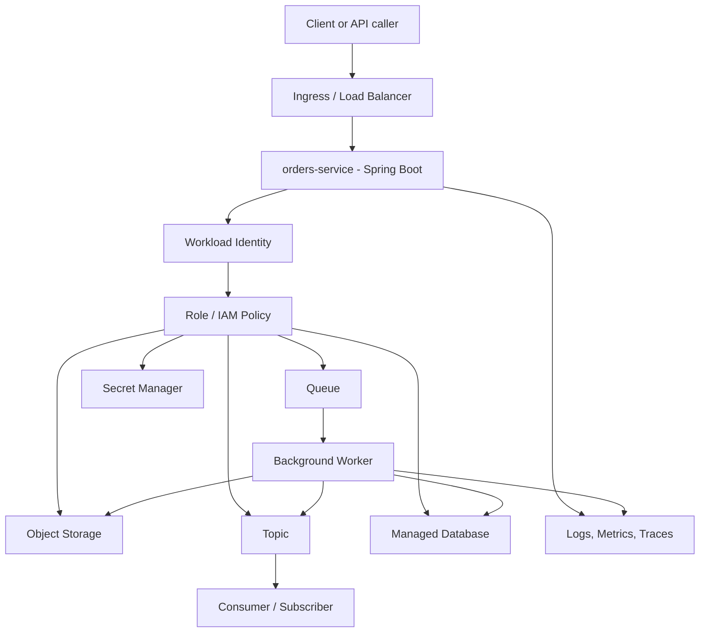
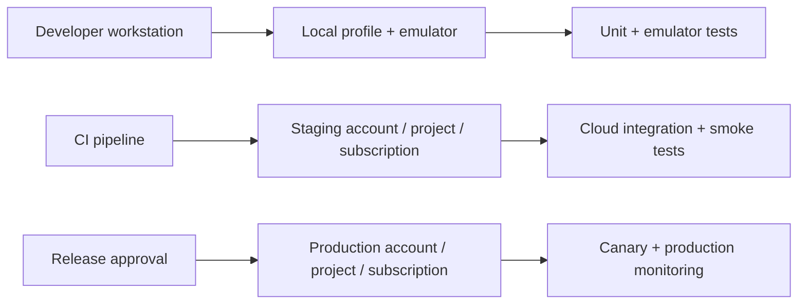
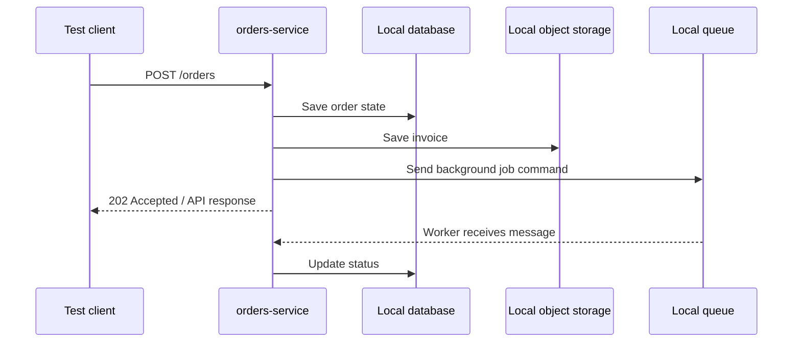
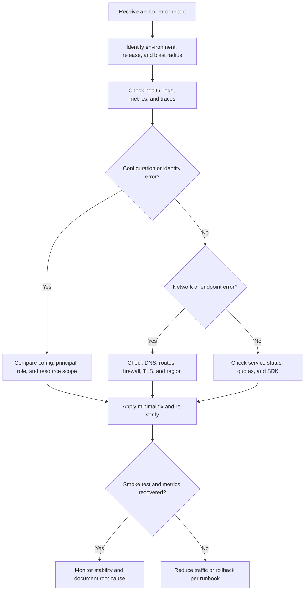

# Writing Runbooks, Resource Diagrams, and Incident Response Procedures

A Spring Boot application integrating with managed services on AWS, Azure, or Google Cloud needs far more than a startup command. Deployers must know which resources must exist, which identity the workload runs under, where configuration comes from, which services depend on which, and what to verify before opening traffic. When failures occur, operations teams also need a clear procedure to isolate configuration errors, access permissions, networking, cloud resources, and application code.

This lab builds a comprehensive runbook for a sample `orders-service`. The service receives order requests, stores invoices in object storage, sends jobs to a queue, and publishes events via a topic. A database stores order state; a secret manager holds sensitive credentials. The goal is to create documentation that developers can use to run locally, deploy to cloud environments, run post-release checks, and troubleshoot incidents consistently across all three providers.

## Expected Outcomes

After this lesson, you will be able to:

- Diagram resources and data flows between Spring Boot and managed services.
- List prerequisites and configuration for each environment.
- Start the application locally with the right profile and verify connectivity.
- Provision resources, workload identities, policies, and networking for AWS, Azure, or Google Cloud.
- Execute post-deployment smoke tests and record operational evidence.
- Classify incidents by symptom, collect information safely, and perform controlled recovery.
- Maintain runbooks so every release is deployed and supported consistently.

## 1. Defining the Scope of the Runbook

A runbook should begin with a brief service overview and support boundaries. For `orders-service`, the main business flow is:

1. The API receives an order creation request and validates the payload.
2. The service saves order state to the database.
3. The service saves the invoice or attachment to object storage.
4. The service sends a background processing command to a queue.
5. Upon completion, the worker publishes an order event to a topic for downstream systems.
6. The application reads required secrets from a secret manager using workload identity.

In real environments, some steps may run via a transactional outbox or separate workers to guarantee consistency. The runbook must reflect the actual deployed architecture; never imply that a single synchronous HTTP request executes all of those steps directly.

### Resource overview diagram



The workload identity acts as the authentication bridge; roles or policies determine what that identity can do on each resource. The diagram shows logical flow and does not require every service to live in the same subnet. Some services expose public endpoints gated by IAM; environments requiring private connectivity can use private endpoints, VPC endpoints, or provider-equivalent mechanisms.

### Service mapping across providers

| Capability | AWS | Azure | Google Cloud |
|---|---|---|---|
| Object storage | Amazon S3 | Azure Blob Storage | Cloud Storage |
| Queue / messaging | Amazon SQS | Azure Service Bus Queue | Pub/Sub subscription or suitable queue service |
| Publish / topic | Amazon SNS or EventBridge depending on pattern | Azure Service Bus Topic or Event Grid | Pub/Sub Topic |
| Database | RDS, DynamoDB, or suitable service | Azure SQL, Cosmos DB, or suitable service | Cloud SQL, Firestore, or suitable service |
| Secrets | Secrets Manager or Systems Manager Parameter Store | Azure Key Vault | Secret Manager |
| Workload identity | IAM role, task role, IRSA/EKS Pod Identity | Managed Identity or Workload Identity | Service Account and Workload Identity Federation |
| Observability | CloudWatch, X-Ray | Azure Monitor, Application Insights | Cloud Logging, Cloud Monitoring, Trace |

Do not treat services in the same row as completely identical. For example, SQS, Service Bus, and Pub/Sub differ in ordering, acknowledgement, retries, dead-lettering, and subscription models. When choosing an alternative service, verify against business requirements and contract tests.

## 2. Preparing Environment and Configuration

Before running the application, confirm the supported JDK version, the BOM-managed Spring Boot/Spring Cloud versions, build tools, provider CLIs, and access to the target environment. Use the dependency management chosen by the project; never upgrade an individual SDK or starter mid-runbook without evaluating compatibility.

### Required configuration

Divide configuration into three groups:

- **Application configuration:** profiles, ports, queue/topic names, buckets/containers, regions, and timeouts.
- **Authentication configuration:** local profiles or cloud workload identities. Never store access keys, client secrets, or service account keys in source code.
- **Connectivity configuration:** endpoints, DNS, proxies, TLS, and private networking if required by the environment.

Example non-sensitive environment variables:

```dotenv
SPRING_PROFILES_ACTIVE=local
APP_CLOUD_PROVIDER=aws
APP_CLOUD_REGION=ap-southeast-1
APP_INVOICE_BUCKET=orders-local-invoices
APP_ORDERS_QUEUE=orders-local-processing
APP_EVENTS_TOPIC=orders-local-events
APP_DB_URL=jdbc:postgresql://localhost:5432/orders
```

These are illustrative variable names for application-defined settings. Each provider starter may use its own properties to select regions, endpoints, or credential providers. Check the configuration matching the library versions in your project. Never add secret values to a committed `.env` file; local files holding secrets must stay outside version control and be protected per team policy.

Example `application.yml` excerpt for shared business configuration:

```yaml
spring:
  application:
    name: orders-service
  lifecycle:
    timeout-per-shutdown-phase: 30s

server:
  port: ${SERVER_PORT:8080}
  shutdown: graceful

app:
  cloud:
    provider: ${APP_CLOUD_PROVIDER}
    region: ${APP_CLOUD_REGION}
  storage:
    invoice-container: ${APP_INVOICE_BUCKET}
  messaging:
    orders-queue: ${APP_ORDERS_QUEUE}
    events-topic: ${APP_EVENTS_TOPIC}

management:
  endpoints:
    web:
      exposure:
        include: health,info,metrics
  endpoint:
    health:
      probes:
        enabled: true
```

`app.*` properties are illustrative application settings, not standard properties automatically understood by every Spring Cloud starter. `management` requires Actuator in dependencies. Expose only endpoints permitted by security policy; production typically restricts access via a management network or dedicated authentication.

### Local profile vs. cloud profile

The local profile should use emulators, development containers, or dedicated sandbox resources. Cloud profiles use real endpoints and workload identities. Never let the local profile be activated accidentally in production.

Example local profile:

```yaml
# application-local.yml
app:
  cloud:
    provider: local
  storage:
    endpoint: ${LOCAL_STORAGE_ENDPOINT:http://localhost:4566}
  messaging:
    endpoint: ${LOCAL_MESSAGING_ENDPOINT:http://localhost:4566}
```

This is only an example endpoint config for an emulator partially compatible with AWS APIs. With Azurite or fake-gcs-server, endpoints, mock credentials, and resource initialization differ. Do not share a single local endpoint across all providers.

## 3. Environment Deployment Diagram

Separate at least three environments: local, staging, and production. Each environment needs its own resource names, identities, policies, networking, and secret scopes. Never reuse production buckets, queues, or databases for local integration tests.



| Attribute | Local | Staging | Production |
|---|---|---|---|
| Goal | Development and debugging | Production-like integration verification | Serving business traffic |
| Services | Emulator or isolated sandbox | Real managed services | Real managed services |
| Identity | Local developer credential or emulator | Dedicated workload identity | Production workload identity |
| Data | Synthetic data | Test data; no real data unless explicitly approved | Production data per policy |
| Permissions | Local scope only | Narrow permissions scoped to test suite | Least privilege per workload |
| Cleanup | Entire test environment can be wiped | Scheduled per log/data retention policy | Per operational and retention procedures |

Staging should mirror production service tiers, identity mechanisms, and networking styles as closely as needed. If production uses private endpoints while staging uses public endpoints, staging can miss DNS, routing, or firewall issues.

## 4. Running the Application Locally

Local startup should be repeatable without relying on production credentials. General steps:

1. Install the JDK and build tools matching the project's required versions.
2. Start the required database and emulators using compose or the team's dev tooling.
3. Create local buckets/containers, queues, and topics if the emulator does not auto-create them.
4. Provide non-sensitive local configuration variables.
5. Run the application with the `local` profile.
6. Check the health endpoint, startup logs, and a sample business flow.

If the project uses Maven Wrapper:

```bash
./mvnw spring-boot:run -Dspring-boot.run.profiles=local
```

On Windows, you can use `mvnw.cmd`. If the project uses Gradle Wrapper:

```bash
./gradlew bootRun --args='--spring.profiles.active=local'
```

Use the wrapper and tasks provided by the repository. These commands are common examples, not an assertion that a specific project uses Maven or Gradle.

After startup, check:

```bash
curl -i http://localhost:8080/actuator/health
```

If the endpoint is not exposed or the app runs on a different port, adjust for your local profile. Health `UP` only confirms configured indicators report healthy; it does not prove every storage and messaging path works. Proceed to send an order creation request and verify database state, invoice object, and queue/topic message delivery per design.

### Suggested local test flow



This diagram illustrates one sample flow. If the application uses a transactional outbox, message publishing is performed by a publisher worker reading the outbox after commit. Your project's runbook must reflect that exact flow and never assume an API response means the consumer has finished processing.

## 5. Preparing Cloud Resources and Identities

Before deployment, provisioning must create required resources via IaC or repeatable infrastructure governance workflows. Every resource should be named with the application, environment, and region. Deployment pipelines need resource IDs, endpoints, and names as traceable outputs.

### AWS

An AWS deployment may include:

- S3 bucket for invoices with Block Public Access enabled and appropriate encryption.
- SQS queue for background jobs with visibility timeout, retention, redrive policy, and dead-letter queue configured.
- SNS topic or EventBridge depending on the event distribution model.
- RDS or DynamoDB depending on the data model.
- Secrets Manager or Parameter Store for sensitive values.
- IAM role attached to EC2, ECS task, or EKS workload.

Pipelines must verify data-plane policies for each action: `s3:PutObject`/`s3:GetObject`, queue send/receive permissions, topic publish, secret access, and database connectivity. If objects use customer-managed KMS keys, verify the key policy too. Avoid embedding long-lived access keys inside containers.

### Azure

An Azure deployment may include:

- Storage account and Blob container for invoices.
- Service Bus namespace with queues/topics and dead-letter behavior.
- Azure SQL or Cosmos DB depending on the data model.
- Key Vault for secrets.
- Managed Identity attached to App Service, Container Apps, VM, or appropriate workload.

Assign data-plane roles such as `Storage Blob Data Contributor`, Service Bus Data Sender/Receiver, or Key Vault secret reader roles at the exact required actions and scopes. `Contributor` at the resource group level does not automatically grant read/write access inside blobs or queues. Check network rules, private endpoints, and DNS if resources are non-public.

### Google Cloud

A Google Cloud deployment may include:

- Cloud Storage bucket for invoices.
- Pub/Sub topics and subscriptions for events or background jobs.
- Cloud SQL or Firestore depending on the data model.
- Secret Manager for secrets.
- Service account attached to Cloud Run, Compute Engine, or GKE workloads.

Assign IAM roles at bucket, topic, subscription, and secret scopes. For example, publishers need publish permission on the topic; subscribers need consume permission on the subscription; object-reading apps need object read permission. On GKE, prefer Workload Identity Federation for GKE over service account key files where appropriate.

### Pre-deploy preflight checklist

- [ ] Correct account, project, or subscription and region.
- [ ] Buckets/containers, queues, topics, databases, and secrets already exist.
- [ ] Dead-lettering, retention, encryption, backups, and lifecycle policies configured.
- [ ] Workload identity attached to the right runtime.
- [ ] Policies match exact principals, actions, and resource scopes.
- [ ] DNS, routes, firewalls, and private endpoints allow runtime connectivity.
- [ ] Quotas and throughput limits match expected load.
- [ ] Runtime config points to the environment's exact endpoints and resource names.

## 6. Deploying the Application and Post-Release Verification

Artifacts should be immutable between staging and production. Pipelines build one image or package, record its digest/version, and inject configuration and identity at deploy time. Never build separate images embedding production credentials or endpoints.

Recommended deployment sequence:

1. Provision or verify infrastructure state.
2. Attach workload identity and policies.
3. Wait within bounded limits for role assignment or policy propagation.
4. Verify networking and service access from the exact runtime context.
5. Deploy the artifact with environment-specific configuration.
6. Wait for startup and readiness.
7. Run storage, messaging, and database smoke tests.
8. Open traffic via rolling, canary, or blue-green rollout.
9. Monitor post-release metrics and logs.

### Smoke tests by capability

| Capability | Verification action | Expected evidence |
|---|---|---|
| Identity | Safely record runtime principal | Matches expected role/managed identity/service account |
| Storage | Write object to test prefix, read back, verify metadata, delete | Content and content type match; cleanup succeeds |
| Messaging | Send message with test correlation ID | Broker accepts message; consumer processes and acks per contract |
| Database | Run health query or write/read isolated test record | Connects using valid runtime identity or credential |
| Secrets | Read scoped test secret | Value never appears in logs or responses |
| HTTP | Call health endpoint and sample business API | Status codes, latencies, and business outputs match expectations |

Smoke tests must use isolated test data, finite timeouts, and explicit cleanup. Never verify delete permissions by deleting real business objects. Never treat a successful CLI run under a personal account as proof that the container has identical permissions.

### Post-deploy monitoring

Monitor at minimum:

- HTTP 5xx rates, timeouts, p50/p95/p99 latencies, and active in-flight requests.
- Queue depth, oldest message age, throughput, retries, and dead-letter counts.
- SDK errors such as access denied, throttling, timeouts, resource not found, and credential failures.
- Connection pools, active connections, executor queues, and active threads.
- Storage error rates, object sizes, request counts, and data transfer costs.
- Database connection saturation, query latencies, and transaction failures.
- Logs correlated by release ID, trace ID, and correlation ID.

Never log secrets, tokens, connection strings, or sensitive payloads. On errors, log the provider, logical resource name, operation, error category, and correlation ID; avoid logging credentials or full request bodies.

## 7. Incident Response Procedure

When an alert fires, prioritize determining blast radius and preserving evidence before changing configuration. Actions like granting broad admin roles or blindly restarting everything can erase root-cause evidence and widen incidents.

### Triage workflow



### Information to collect

Before making changes, record:

1. Start time and last known healthy timestamp.
2. Environment, provider, region, release ID, and image digest.
3. Affected APIs or workers; all traffic or a subset of requests.
4. Failing operation and logical resource, correlation IDs, and error codes.
5. Actual runtime principal and active configuration revision.
6. Metrics for latency, retries, backlog, throttling, connection pools, and quotas.
7. Recent changes to IAM, networking, secrets, resources, or deployments.

Collect sanitized logs. Never ask incident reporters to send access tokens, secret values, or credential files.

### Symptom-based diagnosis table

| Symptom | Possible causes | How to verify | Resolution |
|---|---|---|---|
| `AccessDenied`, `Forbidden`, `PERMISSION_DENIED` | Wrong principal, missing data-plane role, wrong resource scope, or unpropagated policy | Verify process identity; compare action, resource, and policies | Grant least-privilege permission; wait bounded propagation and re-test |
| `401` or credential unavailable | Credential chain cannot locate identity or token expired | Check runtime identity binding and credential provider errors without printing tokens | Fix identity attachment or federation; do not add static keys as a long-term fix |
| DNS lookup or connection timeout | Wrong endpoint, DNS/private DNS, route, firewall, proxy, or region | Test from the failing pod/task/VM; compare endpoints against provisioning outputs | Fix DNS/network rules/routes or endpoints; retry from runtime context |
| `ResourceNotFound` | Wrong name, wrong region/account/project, or incomplete provisioning | Compare resource IDs, endpoints, and environment | Fix runtime config or complete provisioning at the right scope |
| `429`, throttling, or quota exceeded | Load exceeds quota, heavy bursts, or aggressive retries | Check quota metrics, request rates, and retry counts | Add jittered backoff, cap concurrency, and request quota increases if needed |
| Storage write succeeds but read fails | Asymmetric policies, mismatched keys, metadata, or encryption keys | Check key mapping, read permissions, and KMS/key access | Fix policies/key mapping; verify metadata and key permissions |
| Message backlog grows continuously | Consumer stopped, missing receive permission, processing errors, or low throughput | Check consumer health, delivery counts, dead-letter queue, and handler latency | Restore consumers, fix permissions/schemas, or scale concurrency carefully |
| Messages processed repeatedly | At-least-once delivery, late ack, or non-idempotent consumer | Compare event IDs, delivery counts, and business state | Add deduplication/idempotency; ack after commit |
| Messages lost from business flow | Ack/delete before commit or non-durable publish | Compare broker acknowledgements with transactions and outbox | Fix commit/ack ordering; recover from outbox or source data per procedure |
| New secret exists but app uses old value | Cached secret, connection pool, or unrefreshed process | Check secret version and load time on instances | Refresh via supported mechanism or controlled rollout; rotate credentials safely |
| Only some instances fail | Inconsistent rollout, differing identity/config, or node network fault | Compare revisions, labels, identities, endpoints, and zones/regions | Isolate bad instances; sync config or replace instances after gathering evidence |
| Health `UP` yet business logic fails | Health indicators skip critical dependencies or smoke tests are incomplete | Exercise each storage/messaging/database operation | Add appropriate readiness/smoke checks without turning liveness into a full dependency probe |

### Classifying errors to avoid bad retries

| Error category | Examples | Usually appropriate action |
|---|---|---|
| Config or request | Missing resource name, wrong format, invalid payload | Fix config/data; do not retry indefinitely |
| AuthN/AuthZ | Invalid token, 401/403 | Fix identity or policy; retry only after changes propagate |
| Transient | Timeouts, throttling, 5xx from service | Bounded retries with exponential backoff and jitter |
| Not found | Bucket/queue/object absent in the right scope | Verify resource and not-found contract; never mask with blind retries |
| Business | Order state violation or duplicate event | Apply domain rules, idempotency, or appropriate dead-lettering |

Retrying is not a universal fix. Retrying a permission error will not fix IAM policies; retrying a malformed request will not fix bad data; retrying aggressively during throttling can deepen service overload.

## 8. Recovery and Rollback Procedure

When an incident impacts production, pick actions by blast radius and recoverability:

1. **Contain impact:** halt rollouts, shed/reduce traffic, disable feature flags, or pause consumers if continuing risks data corruption.
2. **Preserve evidence:** save release IDs, secret-redacted logs, metrics, traces, and config revisions.
3. **Fix identified root cause:** policies, endpoints, DNS, quotas, secret references, or application configuration.
4. **Verify on one instance or small canary:** run smoke tests and watch errors before expanding.
5. **Roll back if needed:** revert to the prior stable artifact/configuration using a tested strategy.
6. **Reconcile data:** check objects, messages, transactions, and side effects that may have duplicated or stalled mid-flight.
7. **Post-recovery monitoring:** watch backlogs, retries, latencies, and error rates until stable.

Rolling back application code does not delete resources or undo written data. Never delete queues, buckets, databases, or secrets as part of a default rollback. If a new release wrote data under a new schema or metadata format, verify the older version can read it before shifting traffic back.

### Example rollback decisions

| Situation | Preferred action | Exit criteria before closing incident |
|---|---|---|
| New release fails startup | Halt rollout and roll back artifact | Old version boots, passes readiness and smoke tests |
| Missing permission for one operation | Fix policy for exact action/resource | Workload identity performs required action; out-of-scope actions stay denied |
| Wrong endpoint/private DNS | Restore last-known-good network config | Runtime resolves and reaches the right endpoint |
| Consumer fails on new schema | Pause consumers or roll back consumer | Message backlog drains with compatible schema; zero duplicate side effects |
| Bad secret rotation | Run recovery/re-rotation workflow | Instances run on valid version and connection pools are refreshed |

## 9. Incident Record Template

Every incident should have a concise record using a template:

```text
Incident ID:
Environment / Provider / Region:
Service / Release ID / Image digest:
Start time / Recovery time:
Impact and affected operations:
Error code / Correlation IDs:
Runtime principal:
Resource IDs (logical names only where appropriate):
Recent changes:
Evidence: logs, metrics, traces:
Root cause:
Mitigation and recovery steps:
Data/message reconciliation:
Follow-up actions and owner:
```

Never put secrets, tokens, private keys, or payloads containing personal data into incident records. Use resource IDs and correlation IDs sufficient for tracing under internal access controls.

## 10. Maintaining the Runbook Across Releases

Runbooks must be updated alongside application and infrastructure changes. When adding a new bucket, queue, or secret, update resource diagrams, policies, config variables, smoke tests, and troubleshooting tables. When upgrading Spring Cloud or SDK versions, re-verify properties, credential chains, timeouts, and how starters manage clients.

A documentation review workflow can include:

- Developers update local run commands and config variables when profiles or dependencies change.
- Platform engineers update resource maps, IaC outputs, identities, policies, and network paths.
- Operators verify alerts, dashboards, log fields, and recovery steps.
- Reviewers ensure examples contain no secrets, real production resources, or excessive permissions.
- After an incident, add confirmed root causes and early detection steps to the runbook.

### Release checklist

- [ ] Resource diagrams accurately reflect the running architecture.
- [ ] Local commands match the project's build wrapper and profiles.
- [ ] Configuration variables are documented; no secrets appear in source or logs.
- [ ] Resources and identities are provisioned for the target environment.
- [ ] Policies distinguish control plane from data plane following least privilege.
- [ ] Networking, DNS, endpoints, and TLS are verified from the runtime.
- [ ] Health, readiness, and smoke tests pass.
- [ ] Dashboards, logs, and traces support tracing by release/correlation ID.
- [ ] Incident response and rollback procedures are executable step by step.
- [ ] Data, messages, and side effects are reconciled after rollbacks.
- [ ] Runbook is updated and reviewed alongside the release.

## Conclusion

A strong runbook connects how an application runs to resource diagrams, identities, permissions, configuration, and operational procedures. Developers get a repeatable local workflow; pipelines get clear provisioning order and smoke checks; operators can classify failures before retrying, altering policies, or rolling back. When this information ships with every release and stays updated across changes, Spring Boot applications integrating with AWS, Azure, and Google Cloud become far easier to deploy, verify, and recover.
