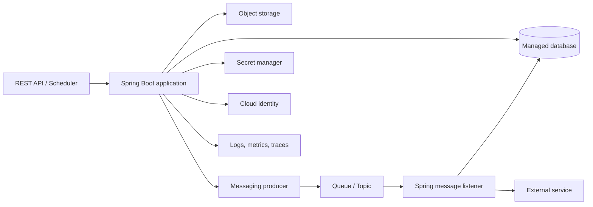
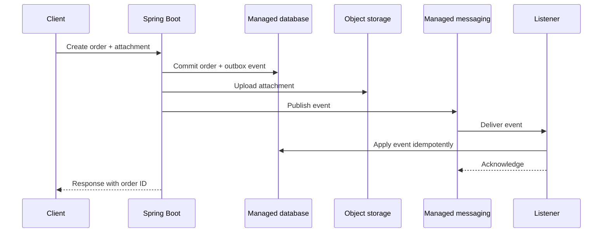

# Evaluating Integration Results and Cleaning Up All Lab Resources

After completing the Spring Boot integrations with AWS, Azure, and Google Cloud managed services, the entire system must be evaluated as an operable product: do business flows run correctly, are access permissions sufficiently narrow, are messages handled safely under retries, are errors observable and recoverable, do costs stay within limits, and are test resources thoroughly reclaimed?

This capstone lab connects the outcomes of previous lessons into an evidence-backed acceptance process. You will build an acceptance criteria matrix, run smoke/integration/failure tests, compare behavior across cloud providers, document risks, and plan cleanup. **Only delete resources after confirming owners, archiving necessary evidence, and verifying data no longer needs to be retained.**

## 1. Lab Objectives

After completing this lesson, you will be able to:

- Evaluate Spring Boot integrations with storage, messaging, databases, secrets, and identity across cloud providers.
- Define verifiable acceptance criteria instead of relying on "it works" conclusions.
- Run smoke tests, integration tests, failure/retry tests, and security checks before acceptance.
- Compare meaningful differences across AWS, Azure, and Google Cloud.
- Gather technical, operational, and cost evidence for handover.
- Inventory resources by environment, owner, project/account, and IaC stack.
- Stop producers/consumers, handle remaining messages, preserve required data, and delete resources in dependency order.
- Verify no orphaned resources or unexpected ongoing charges remain.

## 2. Lab Context

Suppose a team builds an order-processing service. Spring Boot receives requests, persists data, stores attachments, emits events, and processes asynchronous tasks. The application may deploy to a single cloud or run in parallel across multiple providers for comparison.



Specific services vary by provider. For instance, messaging may use Amazon SQS/SNS, Azure Service Bus, or Google Cloud Pub/Sub; object storage may use Amazon S3, Azure Blob Storage, or Google Cloud Storage. Evaluate both the application's business contract and each service's distinct semantics.

## 3. Preparing Acceptance Scope

Before running tests, record the exact environment and versions:

| Field | Information to record |
|---|---|
| Application | Service name, commit/build version, active profile |
| Java/Spring | Java version, Spring Boot version, Spring Cloud release train |
| Cloud SDK | Spring Cloud AWS/Azure/GCP versions and corresponding SDKs |
| Environment | Local, integration, sandbox, staging, or production |
| Account | AWS account ID, Azure subscription, Google Cloud project ID |
| Region | Regions for compute, storage, database, and messaging |
| IaC | Terraform/Pulumi/CloudFormation/Bicep stack or deployment ID |
| Contacts | Technical owner, data owner, and cleanup approver |
| Boundaries | Budget, run duration, retention, and permitted data |

Use only synthetic or approved data. Never put access keys, refresh tokens, connection strings, secret values, or customer data into acceptance reports.

### 3.1. Defining criteria before measuring

For each business flow, document pass/fail criteria upfront. For example:

- One order creation request creates only one order record and one logical event.
- A consumer receiving the same event twice does not repeat side effects.
- When the database or messaging is temporarily unavailable, the application retries per policy.
- Failing messages route to DLQ/quarantine after configured thresholds with a replay process.
- The application obtains credentials from the environment's identity/secret manager.
- Logs/traces include correlation IDs without exposing secrets or sensitive payloads.
- Lab resources are identifiable via IaC, tags/labels, and inventory.

Do not alter criteria after seeing results just to turn a failed test into a pass. If criteria must change, document the rationale and updated business requirement explicitly.

## 4. Acceptance Criteria Matrix

Use the table below as an acceptance checklist. Add concrete thresholds matching your system's SLAs.

| Category | Criteria | Minimum evidence |
|---|---|---|
| Functional | Create/read/update flows and event processing behave accurately | Integration tests, verification records, event IDs |
| Identity | Application uses environment-appropriate identity and least privilege | Role/service principal/service account, policy review |
| Secrets | Secrets come from secret manager and never appear in logs/committed configs | Config review, secret scan, redacted log samples |
| Storage | Upload/download, metadata, access control, and cleanup work | Test file checksum, object metadata, policies |
| Messaging | Publish/consume, acknowledgement, retry, DLQ, and replay work properly | Test reports, queue metrics, message correlation |
| Database | Transactions, connection lifecycle, and idempotency work properly | Integration tests, migration results, query/constraint review |
| Reliability | Timeouts, retry/backoff, duplicates, and recovery are verified | Failure injection results, DLQ/recovery evidence |
| Observability | Logs, metrics, traces, and alerts suffice for investigation | Dashboards/trace IDs/alert tests |
| Performance | Latency/throughput meet defined targets | Load test reports, p95/p99, resource metrics |
| Cost | Resources, retention, and usage remain within budget | Cost estimates/actuals, usage metrics |
| Operability | Deploy, restart, graceful shutdown, and rollback procedures exist | Runbooks, deployment/rollback evidence |
| Cleanup | Temporary resources reclaimed or tagged with clear owner/expiry | IaC destroy outputs, post-cleanup inventory |

### 4.1. Mandatory acceptance gates

A high composite score cannot offset a critical flaw. These gates must pass before handover:

1. No hardcoded secrets or credentials in code or logs.
2. Runtime identity has no administrative permissions beyond its need.
3. Consumers implement idempotency matching delivery semantics.
4. Failing messages have retry/DLQ policies or equivalent handling.
5. Data and resources have assigned owners, retention, and cleanup plans.
6. Deployed application versions, configurations, and resources are traceable.

If any mandatory gate fails, mark `BLOCKED` or `NEEDS_REMEDIATION`; never average scores to declare acceptance.

## 5. Running the Test Suite in Order

Progress from cheap, fast checks to tests requiring managed resources:

1. Compile, unit tests, and static checks.
2. Contract/schema tests for payloads, event types, and message attributes.
3. Integration tests with emulators/containers or service test environments.
4. Cloud sandbox smoke tests: identity, secrets, storage, database, and messaging.
5. Failure tests: timeouts, throttling, permission denied, consumer restarts, duplicates, and DLQ.
6. Performance tests under representative load and bounded concurrency.
7. Observability checks: traces, metrics, alerts, and log redaction.
8. Deployment, rolling restart, graceful shutdown, and rollback checks.

Each test must record inputs, environment conditions, expected results, actual results, duration, and evidence links. For time-dependent tests, use bounded polling instead of fixed `Thread.sleep()`.

## 6. End-to-End Functional Verification

Pick a representative business flow, such as order creation and event processing:



Verify invariants:

- Order ID and event ID are generated deterministically/stably.
- The database contains no partial records if a transaction fails.
- Stored files have checksums/metadata matching input data.
- Events are published only after business data is durably persisted, typically via transactional outbox.
- Consumers check idempotency keys before applying side effects.
- Acknowledgements happen only after business work completes per policy.
- Correlation IDs link requests, events, listeners, and logs.

If storage and database do not share a transaction, explicitly define sagas/compensation or intermediate states. Never assume an object upload and a database transaction form an atomic distributed transaction.

## 7. Evaluating Identity, Permissions, and Secrets

Verify the application runs with a dedicated workload runtime identity:

| Provider | Common identity | What to verify |
|---|---|---|
| AWS | IAM role, workload identity, or task/instance role | Trust policy, role session, policy scope, no unnecessary long-lived access keys |
| Azure | Managed Identity or workload identity federation | Right tenant/subscription, narrow-scoped role assignments, Key Vault/Storage/Service Bus access |
| Google Cloud | Service account or Workload Identity Federation | Right principal, resource-scoped IAM bindings, avoid long-lived service account keys |

Security checklist:

- Separate runtime application identities from infrastructure deployment identities.
- Grant permissions per required resource and action; remove unjustified wildcards.
- Verify tokens/credentials refresh properly without stale caching.
- Keep secrets out of source code, Docker images, application logs, and CI artifacts.
- Use secret managers and appropriate rotation policies.
- Restrict secret read access strictly to services needing them.
- Enable encryption at rest/in transit per requirements and identify key owners.
- Inspect audit logs for sensitive operations.

For acceptance, archive redacted policy/role definitions and resource names. Never copy secret values or tokens into reports.

## 8. Evaluating Storage and Databases

For object storage, verify:

- Object upload/download and checksums.
- Metadata, content types, encodings, and naming conventions.
- Public/private access controls and workload identity permissions.
- Versioning, retention, lifecycle, and encryption.
- Behavior on duplicate-key uploads, interrupted uploads, or missing objects.
- CORS/event notifications if used by the business flow.

For databases, verify:

- Connection pools, timeouts, retries, and connection limits.
- Migrations run cleanly at target versions with rollback/forward-fix strategies.
- Transaction boundaries between data writes and outbox event creation.
- Unique constraints/idempotency tables blocking duplicate side effects.
- Backups/restores or snapshots verified in an appropriate environment.
- No credentials or sensitive data written to query logs.

Do not declare storage/databases "equivalent" across providers merely because CRUD APIs share similar names. Compare semantics for consistency, versioning, retention, transactions, indexing, failover, and service limits.

## 9. Evaluating Messaging and Resilience

For each queue/topic/subscription, record:

| Item | Acceptance question |
|---|---|
| Delivery | At-least-once, at-most-once, or other semantics? |
| Ordering | Queue-wide, per-partition/group, or unordered? |
| Deduplication | Does the broker deduplicate? What are its window and scope? |
| Acknowledgement | When does the broker consider a message settled? |
| Retry | Immediate retry, visibility/lock timeout, or subscription retry policy? |
| Dead-letter | Is a DLQ/dead-letter topic configured and monitored? |
| Replay | Can messages be redriven intact, or are dedicated tools/consumers needed? |
| Retention | How long are messages retained and how is age calculated? |
| Backpressure | How are concurrency, prefetch, lock renewal, and rate limits controlled? |

Minimum tests:

1. Send a valid event and verify the consumer produces the right result.
2. Resend the same event ID and verify idempotency.
3. Fail the consumer before acknowledgement and verify retries.
4. Send an invalid payload and verify DLQ/quarantine routing.
5. Restart the consumer while messages are in-flight and verify recovery.
6. Replay a corrected message in the test environment.
7. Generate a burst and verify backpressure prevents overwhelming downstream services.

Providers do not share a single message model. For example, SQS visibility timeout, Azure Service Bus lock duration/renewal, and Pub/Sub acknowledgement deadlines sound similar but differ in extension rules, retries, ordering, and dead-letter behavior. Document the tested behavior of each adapter rather than relying solely on a shared abstraction.

## 10. Multi-Cloud Comparison by Capability

Use a capability matrix instead of comparing class names or method counts:

| Capability | AWS | Azure | Google Cloud | Evaluation question |
|---|---|---|---|---|
| Workload identity | IAM role/federation | Managed Identity/federation | Service account/WIF | Are long-lived secrets eliminated? |
| Object storage | S3 | Blob Storage | Cloud Storage | How do versioning, retention, lifecycle, and consistency behave? |
| Messaging | SQS/SNS | Service Bus | Pub/Sub | How do delivery, ordering, retries, dedup, and DLQs work? |
| Secrets | Secrets Manager/Parameter Store | Key Vault | Secret Manager | How do rotation, access scoping, and auditing work? |
| Database | DynamoDB/RDS and others | Cosmos DB/Azure SQL | Firestore/Cloud SQL and others | How do transactions, queries, consistency, and connection models work? |
| Observability | CloudWatch/X-Ray | Azure Monitor/Application Insights | Cloud Monitoring/Trace | Are trace contexts and metrics sufficient for diagnosis? |

Evaluate each capability across three layers:

1. **Application contract:** interfaces/domain events used by Spring Boot.
2. **Adapter/provider:** Spring Cloud/provider SDK configuration and APIs.
3. **Managed service semantics:** delivery, consistency, retention, IAM, quotas, and failure behavior.

Shared abstractions are helpful when they preserve business intent. When a provider has distinct semantics, surface those differences in adapter/configuration and tests rather than forcing every service into a lowest-common-denominator abstraction that hides critical controls.

## 11. Verifying Observability and Runbooks

An accepted system must answer: which request created this event, which queue holds it, which consumer received it, how long did processing take, which dependency failed, and is the message retrying or in the DLQ?

Verify:

- Logs include timestamps, service, environment, trace/correlation IDs, event IDs, and error categories.
- Secrets, access tokens, receipt handles, and sensitive payloads are never logged.
- Metrics cover throughput, latency, error rates, queue depth, retry/DLQ counts, and dependency saturation.
- Traces connect inbound requests, publishes, consumes, and downstream calls where instrumentation supports it.
- Alerts specify owners, severity, runbooks, and actionable thresholds.
- Dashboards distinguish application bugs, IAM errors, throttling, networking, and quota limits.

Conduct at least one game day: intentionally make a downstream service error, verify alerts fire, locate the event ID in traces/logs, and follow the runbook to recover.

## 12. Measuring Performance and Load Limits

Do not measure messages per second alone. Record:

- Ingress and egress throughput.
- p50/p95/p99 latency from publish to final completion.
- Queue backlog and oldest message age.
- In-flight/locked message counts and redelivery rates.
- CPU, heap, GC, thread pools, and connection pools.
- Database latency, throttling, and downstream rate limits.
- Receive/delete request counts and empty receives where exposed by the service.
- Incurred cost over the test duration.

Step load up gradually while keeping datasets and configurations identical when comparing providers. Never raise concurrency merely to force a test to pass without checking downstream capacity. Find the saturation point and set safe operating limits below it.

## 13. Evaluating Cost and Budgets

Build an estimate table by resource category:

| Resource group | Typical unit | What to record |
|---|---|---|
| Compute | vCPU/hour, memory/hour, requests | Runtime duration, autoscaling, idle capacity |
| Messaging | Requests, operations, throughput units, or message volume | Send/receive/delete, retries, empty polls, retention |
| Object storage | GB-month, requests, data transfer | Capacity, versions, lifecycle, egress |
| Database | Instances/throughput, storage, I/O, backups | Provisioned capacity, autoscaling, backup retention |
| Secrets/KMS | API operations, keys, rotations | Access frequency, keys, and audit requirements |
| Observability | Log ingestion/retention, metrics, traces | Sampling, retention, and high-cardinality labels |
| Networking | Egress, NAT, private endpoints, inter-region | Data paths and cross-zone/cross-region traffic |

Compare costs across identical workloads and time windows. Include costs of retried requests, empty message polling, logs, and network egress. A service with low per-request pricing can still cost more overall if it requires extra supporting components.

Configure sandbox budgets/alerts where supported. Budget alerts do not automatically stop resources; cleanup still requires an explicit procedure.

## 14. Scoring Integration Results

You can use a 100-point rubric to summarize progress. Scores are meaningful only with attached evidence:

| Category | Weight |
|---|---:|
| Functional correctness and contract | 20 |
| Reliability, retries, idempotency, and recovery | 20 |
| Identity, secrets, and data protection | 20 |
| Observability and runbook | 10 |
| Performance and scalability | 10 |
| Cost and resource governance | 10 |
| Deployment, operability, and cleanup | 10 |
| **Total** | **100** |

Suggested interpretation:

- 90–100: sufficient evidence for acceptance scope, all mandatory gates pass.
- 75–89: usable in controlled test environments; remediation plan required for gaps.
- Below 75: insufficient evidence for acceptance.
- Any mandatory security, data, or recovery gate fails: overall status remains `BLOCKED` regardless of total score.

Never award points for unexecuted tests or features that are merely configured without runtime evidence.

## 15. Preparing Cleanup: Inventory and Ownership

Before deleting resources, build an inventory from IaC state, cloud consoles/CLIs, and tags/labels. Never rely solely on resource names because many auto-created resources receive generated names.

| Inventory field | Example |
|---|---|
| Provider | AWS / Azure / Google Cloud |
| Account scope | Account ID / Subscription ID / Project ID |
| Environment | `integration-lab-2026-11` |
| Resource ID | ARN, resource ID, or full resource name |
| Resource type | Queue, topic, bucket, database, key, identity |
| Owner | Responsible team or individual |
| IaC stack | Workspace, stack name, or deployment ID |
| Data disposition | Delete / retain / archive / legal hold |
| Dependencies | Dependent apps, queues, keys, identities, or networks |
| Cleanup status | Pending / approved / deleted / retained |

Attach consistent tags/labels at creation time, for example:

```text
application = provider-integration-lab
environment = integration
owner       = platform-team
expires-at  = 2026-12-01
managed-by  = terraform
```

Never delete a resource simply because its name contains `test`, `dev`, or `lab`. Verify account/project, owner, tags, IaC state, and dependencies before acting.

## 16. Safe Cleanup Procedure

Follow dependency order to avoid deleting queues or storage while consumers are still running:

1. **Close ingress:** stop jobs/schedulers, test API producers, and automation that might create new resources/messages.
2. **Notify and record state:** confirm owners, cleanup window, account/project scope, and resource list.
3. **Archive evidence:** export logs/metrics/test reports, inventory, redacted configs, and retained data.
4. **Decide on remaining messages:** drain, archive, replay, or purge as required; never delete messages still under investigation.
5. **Stop consumers:** halt listeners/workers and confirm no instances are still polling or processing.
6. **Delete messaging:** remove subscriptions, queues, topics/event rules per dependencies and agreed retention.
7. **Delete supporting compute:** remove compute instances, schedulers, containers, functions, endpoints, and test runners.
8. **Delete data resources:** remove databases, storage, and temporary snapshots/backups after confirming retention.
9. **Revoke identities and secrets:** remove unused role assignments, service accounts, managed identities, secret versions, and policies.
10. **Clean up keys/networking:** delete or schedule deletion for keys only after zero dependent resources remain; delete temporary private endpoints, NATs, networks, and firewalls.
11. **Preserve required audits:** archive logs/traces/cost reports per retention before deleting workspaces/log groups.
12. **Post-cleanup verification:** check inventory, IaC state, cloud resource listings, and billing/usage to confirm no unexpected resources remain.

When using IaC, prefer destroying the exact environment's stack/workspace so the tool handles dependencies. Always inspect the destroy plan beforehand for resources with `retain`, `prevent_destroy`, soft-delete, or deletion protection.

## 17. Cleanup with Infrastructure as Code

IaC is the primary source of truth for which resources belong to the lab. Before destroying:

- Select the right account, subscription/project, region, and workspace.
- Inspect state/plan and verify every resource lies within lab scope.
- Check for imported resources or resources created outside IaC; they may not appear in destroy plans.
- Check for shared resources, shared VPCs/networks, shared KMS keys, and shared log workspaces.
- Save plan outputs, approvals, and destroy results.

With Terraform:

```bash
terraform workspace show
terraform plan -destroy -out=cleanup.tfplan
terraform show cleanup.tfplan
# After verifying the right workspace and resource scope:
terraform apply cleanup.tfplan
```

With Pulumi:

```bash
pulumi stack
pulumi preview --diff
# After verifying the right stack:
pulumi destroy
```

Never use `terraform destroy -auto-approve` or `pulumi destroy --yes` in default lab workflows. Keep the review step to catch out-of-scope resources or data that must be retained. After cleanup, re-run plan/preview to confirm zero IaC-managed resources remain.

## 18. Cleanup on AWS

First verify the active account and Region:

```bash
aws sts get-caller-identity
aws configure get region
```

If the entire lab is managed by a dedicated CloudFormation stack, inspect the stack and its resources before deleting:

```bash
aws cloudformation describe-stacks --stack-name provider-integration-lab
aws cloudformation list-stack-resources --stack-name provider-integration-lab
```

Once confirmed the stack only contains lab resources and required data has been archived, delete the stack:

```bash
aws cloudformation delete-stack --stack-name provider-integration-lab
aws cloudformation wait stack-delete-complete --stack-name provider-integration-lab
```

CloudFormation may retain resources configured with `DeletionPolicy: Retain` or resources not managed by the stack. Check inventory after stack deletion finishes.

### 18.1. Manually deleting SQS/SNS/S3 resources

Run commands only against verified lab queues/topics/buckets:

```bash
# Queue
aws sqs delete-queue --queue-url "$QUEUE_URL"

# SNS topic
aws sns delete-topic --topic-arn "$TOPIC_ARN"

# S3: delete required objects/versions first, then delete the bucket.
aws s3 rm "s3://$BUCKET_NAME" --recursive
aws s3api delete-bucket --bucket "$BUCKET_NAME" --region "$AWS_REGION"
```

With S3 versioning enabled, `aws s3 rm --recursive` does not delete all object versions and delete markers. Inventory and delete versions/delete markers per approved retention before deleting the bucket. Buckets with Object Lock or retention/legal holds cannot delete protected objects.

### 18.2. Databases, secrets, and KMS

Before deleting DynamoDB tables or RDS instances, take snapshots or export required data and confirm backup retention. Delete secrets following your organization's recovery window policy; do not force immediate deletion without approval. KMS customer-managed keys typically require scheduled deletion after verifying no dependent data or resources remain.

Example deleting a lab DynamoDB table:

```bash
aws dynamodb delete-table --table-name provider-integration-lab
aws dynamodb wait table-not-exists --table-name provider-integration-lab
```

Never delete shared IAM roles, policies, or KMS keys. Revoke lab-specific roles/policies only after compute, queues, databases, and secrets have stopped using them.

## 19. Cleanup on Microsoft Azure

Verify the subscription and resource group:

```bash
az account show --query '{subscription:id, name:name, tenant:tenantId}'
az group show --name "$RESOURCE_GROUP"
az resource list --resource-group "$RESOURCE_GROUP" --output table
```

If the resource group contains only lab resources and no shared resources, you can delete the entire group:

```bash
az group delete --name "$RESOURCE_GROUP" --yes --no-wait
az group wait --name "$RESOURCE_GROUP" --deleted
```

Resource locks can block resource/group deletion. Check locks and owners before removing them; never remove locks protecting production.

### 19.1. Key Vault and soft-deleted data

Key Vault has soft-delete and may have purge protection enabled. Deleting a vault moves it into soft-deleted state; its name and data may remain for the retention period. Purge only when policy and permissions allow. Never try to bypass purge protection just to speed up lab cleanup.

For Storage Accounts, Blob Containers, Service Bus namespaces, or databases, verify the resource belongs to the lab resource group and has no remaining dependent consumers/triggers before deleting. If keeping backups or snapshots, record owner, expiry, and ongoing cost.

## 20. Cleanup on Google Cloud

Verify the project and billing scope:

```bash
gcloud config get-value project
gcloud projects describe "$PROJECT_ID"
gcloud services list --enabled --project "$PROJECT_ID"
```

If the lab has a dedicated project, the cleanest approach is managing all resources in that project via IaC and destroying the stack first. Delete the project only after confirming it contains no shared workloads, datasets, logs, or services:

```bash
gcloud projects delete "$PROJECT_ID"
```

Project deletion is a project-level action that places the project into a pending deletion/recovery state per Google Cloud policy. Never run this command on a shared project or simply because one lab ended. If other teams share the project, delete only the resources belonging to your lab stack.

### 20.1. Deleting lab-specific messaging and service accounts

Example deleting a Pub/Sub subscription/topic:

```bash
gcloud pubsub subscriptions delete "$SUBSCRIPTION_ID"
gcloud pubsub topics delete "$TOPIC_ID"
```

After verifying no workloads still use the lab service account:

```bash
gcloud iam service-accounts delete "$SERVICE_ACCOUNT_EMAIL"
```

Cloud Storage buckets, databases, secrets, and key rings must be handled according to their retention, versioning, and dependencies. Never delete shared service accounts, VPCs, or key rings simply because part of a lab used them.

## 21. Checking for Orphaned Resources After Cleanup

A successful stack destroy does not prove every resource is gone. Inspect these categories:

- Queues, topics, subscriptions, DLQs, and event notifications.
- Buckets/containers, object versions, snapshots, database backups, and retained data.
- Database instances, read replicas, serverless capacity, and connection proxies.
- Secrets, secret versions, keys, certificates, and scheduled key deletions.
- IAM roles/policies, service principals, managed identities, service accounts, and role bindings.
- Compute instances, container registries, functions, schedulers, and autoscaling groups.
- Load balancers, NAT gateways, public IPs, private endpoints, firewall rules, and network interfaces.
- Log groups, log buckets, trace stores, metric alerts, and dashboards.
- DNS records, domain mappings, webhooks, subscriptions, and integration triggers.

Cross-check three sources: post-destroy IaC state, cloud account/project resource listings, and cost/usage reports. If you find resources with no owner or unclear origin, mark `REVIEW_REQUIRED`; never auto-delete blindly.

## 22. Data to Retain and Retention

Before cleanup, classify data:

| Data category | Required decision |
|---|---|
| Synthetic test payloads | Can be deleted once verification finishes |
| Audit logs/traces | Archive per team/organizational retention |
| Database snapshots | Keep if required for recovery or comparison; tag owner/expiry |
| Object versions | Delete per approved lifecycle/retention |
| DLQ messages | Replay, archive, or delete per owner decision |
| Secrets/credentials | Revoke/rotate and verify no workloads still use them |
| KMS keys | Schedule deletion only when no data remains requiring decryption |
| Cost/test reports | Store in approved document repository without secrets |

Never delete databases or keys before confirming backups are restorable and retention obligations are cleared. A backup created without ever being restore-tested is not proven recovery capability.

## 23. Acceptance Report Template

Use the following template to hand over results:

```text
Project: spring-cloud-provider-integration
Environment: integration-lab
Build/commit: <build-id>
Test window: <start> - <end>

Functional: PASS / FAIL / BLOCKED
Identity and secrets: PASS / FAIL / BLOCKED
Storage and database: PASS / FAIL / BLOCKED
Messaging and recovery: PASS / FAIL / BLOCKED
Observability: PASS / FAIL / BLOCKED
Performance: PASS / FAIL / BLOCKED
Cost: PASS / FAIL / BLOCKED
Cleanup: PASS / FAIL / BLOCKED

Evidence:
- Test report: <link>
- Dashboard/trace: <link>
- IAM/security review: <link>
- Resource inventory: <link>
- IaC plan/destroy output: <link>

Open issues:
- <issue, owner, due date>

Retained resources:
- <resource ID, owner, reason, expiry>

Final decision: ACCEPTED / ACCEPTED_WITH_ACTIONS / BLOCKED
Approved by: <reviewer>
```

Replace links with approved internal storage locations. Never include tokens, secrets, access keys, or raw customer data in reports.

## 24. Final Hands-On Exercises

**Exercise 1 — Business flow acceptance:** Run create order → persist → upload object → publish event → consume → update status. Save event IDs, trace IDs, and assertion results.

**Exercise 2 — Failure/recovery:** Make the database or messaging temporarily unavailable. Verify retries/backoff, idempotency, DLQ, and recovery after the dependency returns.

**Exercise 3 — Security review:** Audit workload identities, IAM/RBAC, secret manager, encryption, and log redaction. Document unnecessary permissions to remove.

**Exercise 4 — Provider comparison:** Pick one messaging capability and one storage capability across at least two providers. Document differences in delivery/ordering, retention, access control, quotas, and cost.

**Exercise 5 — Performance:** Step load up incrementally, recording p95/p99, throughput, queue depth, database connections, and cost. Identify saturation points and safe concurrency limits.

**Exercise 6 — Cleanup rehearsal:** Build an inventory, inspect the IaC plan, classify retained data, and perform cleanup in a dedicated sandbox. Never use shared projects/accounts.

**Exercise 7 — Orphan audit:** After destroy, cross-check IaC state against cloud inventory and usage reports. Document every unexplained resource with an owner and next action.

**Exercise 8 — Handover:** Finalize the acceptance report, evidence pack, retained-resource list, open issues, and final decision.

## 25. Self-Check Questions

1. Why define acceptance criteria before running tests? **So pass/fail outcomes reflect defined requirements rather than shifting criteria to match results.**
2. Why cannot a high overall score compensate for a leaked secret? **Certain security and data conditions are mandatory gates, not items that can be traded off with points.**
3. Why should multi-cloud abstractions not hide delivery semantics? **Because retries, ordering, deduplication, retention, and acknowledgements differ across managed services.**
4. Why inventory before cleanup? **To verify exact owners, accounts/projects, dependencies, data, and resources permitted for deletion.**
5. Why stop producers before consumers? **To avoid generating new messages while consumers are stopping and queues are being prepared for cleanup.**
6. Why archive data/evidence before deleting resources? **Because deletion can destroy data, logs, or forensic evidence.**
7. Why is IaC destroy alone insufficient to prove complete cleanup? **Retained resources, out-of-state imports, or manually created resources can still remain.**
8. Why handle KMS keys and Key Vaults carefully? **Deleting keys/secrets can make data or other apps inaccessible; soft-delete/purge protection also governs deletion timing.**
9. Why check cost reports after cleanup? **Residual resources, backups, logs, IPs, or storage can continue incurring charges.**
10. When can acceptance be concluded? **When all mandatory criteria pass, evidence is complete, remaining issues have owners, and cleanup/retention is verified.**

## 26. References

- [AWS — Deleting a CloudFormation stack](https://docs.aws.amazon.com/AWSCloudFormation/latest/UserGuide/cfn-console-delete-stack.html): deleting stacks and handling retained resources.
- [AWS — Deleting an Amazon S3 bucket](https://docs.aws.amazon.com/AmazonS3/latest/userguide/delete-bucket.html): conditions and workflow for deleting buckets.
- [AWS — Deleting a queue](https://docs.aws.amazon.com/AWSSimpleQueueService/latest/SQSDeveloperGuide/sqs-queue-delete.html): deleting SQS queues.
- [Microsoft Azure — Delete resource groups](https://learn.microsoft.com/azure/azure-resource-manager/management/delete-resource-group): deleting resource groups and handling resource locks/dependencies.
- [Microsoft Azure — Key Vault recovery overview](https://learn.microsoft.com/azure/key-vault/general/key-vault-recovery): soft delete and purge protection.
- [Google Cloud — Creating and managing projects](https://cloud.google.com/resource-manager/docs/creating-managing-projects): project lifecycle and project deletion.
- [Google Cloud — Delete Pub/Sub topics](https://cloud.google.com/pubsub/docs/delete-topic): deleting topics and related subscriptions.
- [Terraform — Destroy infrastructure](https://developer.hashicorp.com/terraform/cli/commands/destroy): planning and destroying Terraform-managed resources.
- [Pulumi — Destroy a stack](https://www.pulumi.com/docs/iac/cli/commands/pulumi_destroy/): previewing and deleting stack resources.

**Key takeaway:** Acceptance must rest on defined criteria and evidence; cleanup must rest on inventory, ownership, dependencies, and retention. Stop ingress first, handle remaining messages and data deliberately, destroy the exact IaC scope, and cross-check cloud inventory and billing to confirm zero orphaned resources remain.
