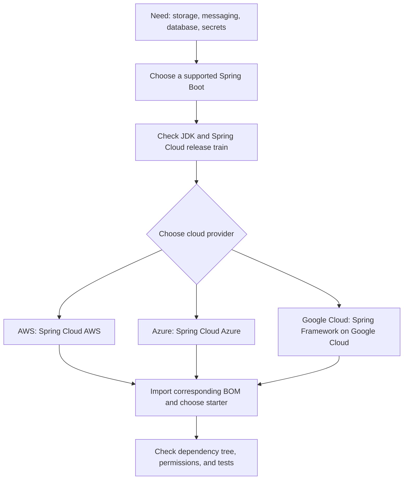

# Choosing the Java, Spring Boot, Spring Cloud, and Provider Library Stack

> **Chapter:** Project Bootstrap  
> **Scope:** Spring Cloud Provider Integration — integrating Spring Boot applications with managed services on AWS, Azure, and Google Cloud.

A Spring Boot application may run fine on a developer machine yet fail as soon as you add a library for S3, Azure Blob Storage, or Google Cloud Pub/Sub. Sometimes the cause does not lie in the cloud API itself, but in an incompatible version combination: Java does not meet Spring Boot's requirements, the Spring Cloud release train belongs to a different generation, or a provider BOM manages foundational libraries that conflict with Spring Boot.

This lesson guides you through **choosing a combination that can be explained, verified, and maintained** before writing business logic for accessing storage, messaging, data, secrets, and cloud identity.

## 1. Learning Outcomes

After this lesson, you will be able to:

1. Distinguish the roles of the JDK, Spring Boot, Spring Cloud release train, cloud integration libraries, SDKs, BOMs, and starters.
2. Consult the right compatibility matrices and lock in a version set for AWS, Azure, or Google Cloud.
3. Bootstrap a Maven project with consistently managed dependencies; know when a Spring Cloud BOM is needed and when only the provider BOM is needed.
4. Verify the actually resolved versions, configure identity using the cloud's default mechanisms, and design tests before calling managed services.
5. Recognize version conflicts, outdated artifacts, and common configuration mistakes.

## 2. Understanding the Version Layers

| Component | Responsibility | How to Choose |
|---|---|---|
| **Java/JDK** | Compiles and runs on the JVM; determines the Java syntax and APIs available. | Meet the requirements of Spring Boot and the deployment environment; use an LTS JDK supported by your organization. |
| **Spring Boot** | Application foundation, auto-configuration, management of most dependencies, build plugins, and operations. | Choose a supported branch, then pick an appropriate patch release. |
| **Spring Cloud release train** | Synchronized set of versions for Spring Cloud projects such as Config, Gateway, OpenFeign, and Stream. | Check the **Spring Cloud ↔ Spring Boot** matrix; do not pick one merely because the year number is larger. |
| **Provider integration library** | Integrates Spring with AWS, Azure, or Google Cloud; provides starters, configuration, and utility clients. | Check each project's **own matrix** after determining the Spring Boot branch. |
| **Cloud SDK** | Low-level APIs for calling S3, Service Bus, Cloud Storage, etc. | Prefer the version managed by the corresponding BOM; override only with good reason and after testing. |
| **BOM (Bill of Materials)** | Declares a compatible set of versions in Maven's `dependencyManagement`. | Import the right BOM, then declare starters **without versions**. |
| **Starter** | Bundles dependencies and activates auto-configuration integration for a service. | Add only the starters you need; avoid umbrella starters when you do not use everything they include. |

**Distinguish two easily confused concepts:** `Spring Cloud` is a group of projects in the Spring ecosystem; `Spring Cloud AWS`, `Spring Cloud Azure`, and `Spring Framework on Google Cloud` (commonly called Spring Cloud GCP) have their own release cycles and BOMs. For example, Spring Cloud `2025.1.x` **does not mean** Spring Cloud AWS also carries version `2025.1.x`.

A selection flow diagram:



## 3. Compatibility Matrix to Get Started

**Reference date: November 24, 2026.** The following table describes **version branches**, not a guarantee that every patch within a branch is compatible with every other. Each time you bootstrap or upgrade, you must check the release notes and official matrices of both Spring and the cloud provider.

| Layer | Option for New Projects | Option for Maintaining Spring Boot 3 Systems |
|---|---|---|
| JDK | Java **21 LTS** as an example; Java 17 is the minimum for Spring Boot 4.0 | Java 17+ per the Spring Boot 3.5 matrix and related libraries |
| Spring Boot | **4.0.x** | **3.5.x** |
| Spring Cloud release train | **2025.1.x (Oakwood)** | **2025.0.x (Northfields)** |
| Spring Cloud AWS | **4.x** | **3.4.x** |
| Spring Cloud Azure | **7.x** | **6.x** |
| Spring Framework on Google Cloud | **8.x** | **7.x** |

**Why choose 4.0.x as the common example?** The matrices for AWS, Azure, and Google Cloud all publish corresponding branches for Spring Boot 4.0.x. Spring Cloud 2025.1.x supports Boot 4.0.x, and has also supported 4.1.x since version 2025.1.2. However, you must not assume that **every** provider library has already verified 4.1.x: check each compatibility table before upgrading Boot.

By this point, the ecosystem may have released newer branches. **The latest release is not automatically the right choice** if the cloud library or runtime environment does not yet support it. When choosing the older 3.5.x line for maintenance, check its support status and security patches before using it for a new system.

Matrix sources to consult:

- [Spring Cloud — Boot compatibility](https://spring.io/projects/spring-cloud/) and [Supported Versions](https://github.com/spring-cloud/spring-cloud-release/wiki/Supported-Versions).
- [Spring Cloud AWS — Compatibility](https://github.com/awspring/spring-cloud-aws#compatibility-with-spring-project-versions).
- [Spring Cloud Azure — Spring Versions Mapping](https://github.com/Azure/azure-sdk-for-java/wiki/Spring-Versions-Mapping).
- [Spring Framework on Google Cloud — Getting Started](https://googlecloudplatform.github.io/spring-cloud-gcp/8.2.4/reference/html/getting-started.html).
- [Spring Boot 4.0 — System Requirements](https://docs.spring.io/spring-boot/4.0/system-requirements.html).

### Practical Decision Order

1. **Lock in the technical goal:** for example, uploading invoices to object storage, receiving events via a queue, querying a managed database, and retrieving secrets. Each feature must identify the exact service actually needed.
2. **Lock in runtime constraints:** the JDK available on CI/CD, container base image, deployment platform, support timeline, and security policy. Java 21 is used as an example; Java 25 may fit if the entire toolchain has been verified.
3. **Choose Spring Boot, then check Spring Cloud:** note `4.0.x → 2025.1.x`, select a supported patch release, and follow the release notes.
4. **Check the provider integration table:** for example `Boot 4.0.x → AWS 4.x`; check similarly for Azure or GCP.
5. **Lock in the BOM and starters:** pin BOM versions, avoid declaring individual versions on each starter; add a native SDK only when the Spring abstraction API does not meet your needs.
6. **Verify with build and tests:** Maven effective POM, dependency tree, compilation, unit tests, and integration tests with least privilege.

Record the result in your project's architecture documentation: `JDK / Boot / Spring Cloud / Provider BOM / build tool / resolved SDK version / verification date`. This makes it easier to reproduce issues and evaluate upgrades.

## 4. Choosing Starters by Service to Integrate

For the same business requirement, each cloud has different services and starters:

| Purpose | AWS | Azure | Google Cloud |
|---|---|---|---|
| Object storage | S3 — `io.awspring.cloud:spring-cloud-aws-starter-s3` | Blob Storage — `com.azure.spring:spring-cloud-azure-starter-storage-blob` | Cloud Storage — `com.google.cloud:spring-cloud-gcp-starter-storage` |
| Queue / messaging | SQS — `io.awspring.cloud:spring-cloud-aws-starter-sqs` | Service Bus — `com.azure.spring:spring-cloud-azure-starter-servicebus` | Pub/Sub — `com.google.cloud:spring-cloud-gcp-starter-pubsub` |
| Secret | Secrets Manager — `io.awspring.cloud:spring-cloud-aws-starter-secrets-manager` | Key Vault — `com.azure.spring:spring-cloud-azure-starter-keyvault-secrets` | Secret Manager — `com.google.cloud:spring-cloud-gcp-starter-secretmanager` |
| Managed data | DynamoDB — `io.awspring.cloud:spring-cloud-aws-starter-dynamodb` | Cosmos DB — `com.azure.spring:spring-cloud-azure-starter-cosmos` | Cloud SQL PostgreSQL — `com.google.cloud:spring-cloud-gcp-starter-sql-postgresql` |

This table is a **dependency guide** and does not imply that the services are completely equivalent. SQS is a queue, Pub/Sub operates on a topic/subscription model, and Azure Service Bus supports both queues and topics; message acknowledgment, retries, ordering, and dead-letter handling all differ. Databases also differ significantly in data models and querying.

If you only need a low-level SDK API or a service without a suitable starter, you can use the official SDK directly. In that case, you must configure the client, credentials, retries, timeouts, and observability yourself; it is not mandatory to add a starter just to call an SDK.

## 5. Hands-on: Bootstrapping Spring Boot with Amazon S3

This example implements a service that stores objects on S3. Choose a concrete combination to keep the code easy to follow:

| Component | Example Version |
|---|---|
| Java | 21 |
| Spring Boot | 4.0.10 |
| Spring Cloud BOM | 2025.1.5 |
| Spring Cloud AWS BOM | 4.1.1 |
| Maven | Version supported by Spring Boot 4.0 |

These version numbers are an **example snapshot at the time of writing**. Before deploying, re-verify compatibility and choose the latest secure patch within the same branch. Whether the application builds depends on Maven, plugins, Java, and all resolved dependencies.

### Step 1 — Create the skeleton

Go to [Spring Initializr](https://start.spring.io/) and select:

- Project: **Maven**, Language: **Java**, Spring Boot: **4.0.x** (choose an appropriate patch version).
- Group `com.example`, Artifact `provider-demo`, Packaging `Jar`, Java **21**.
- Spring Web MVC dependency if you need a REST API; cloud starters can be added to `pom.xml` after downloading the project.

Check your environment before editing dependencies:

```bash
java -version
./mvnw -version
```

On Windows PowerShell, use `.\mvnw.cmd -version`. Both developer machines and CI must use a compatible JDK; running Maven on JDK 21 while `maven.compiler.release` or `java.version` is set differently can produce unpredictable results.

### Step 2 — Declare the BOM and starters

Minimal complete `pom.xml` example:

```xml
<?xml version="1.0" encoding="UTF-8"?>
<project xmlns="http://maven.apache.org/POM/4.0.0"
         xmlns:xsi="http://www.w3.org/2001/XMLSchema-instance"
         xsi:schemaLocation="http://maven.apache.org/POM/4.0.0
          https://maven.apache.org/xsd/maven-4.0.0.xsd">
    <modelVersion>4.0.0</modelVersion>

    <parent>
        <groupId>org.springframework.boot</groupId>
        <artifactId>spring-boot-starter-parent</artifactId>
        <version>4.0.10</version>
        <relativePath/>
    </parent>

    <groupId>com.example</groupId>
    <artifactId>provider-demo</artifactId>
    <version>0.0.1-SNAPSHOT</version>

    <properties>
        <java.version>21</java.version>
        <spring-cloud.version>2025.1.5</spring-cloud.version>
        <spring-cloud-aws.version>4.1.1</spring-cloud-aws.version>
    </properties>

    <dependencyManagement>
        <dependencies>
            <dependency>
                <groupId>org.springframework.cloud</groupId>
                <artifactId>spring-cloud-dependencies</artifactId>
                <version>${spring-cloud.version}</version>
                <type>pom</type>
                <scope>import</scope>
            </dependency>
            <dependency>
                <groupId>io.awspring.cloud</groupId>
                <artifactId>spring-cloud-aws-dependencies</artifactId>
                <version>${spring-cloud-aws.version}</version>
                <type>pom</type>
                <scope>import</scope>
            </dependency>
        </dependencies>
    </dependencyManagement>

    <dependencies>
        <dependency>
            <groupId>org.springframework.boot</groupId>
            <artifactId>spring-boot-starter-webmvc</artifactId>
        </dependency>
        <dependency>
            <groupId>io.awspring.cloud</groupId>
            <artifactId>spring-cloud-aws-starter-s3</artifactId>
        </dependency>
        <dependency>
            <groupId>org.springframework.boot</groupId>
            <artifactId>spring-boot-starter-test</artifactId>
            <scope>test</scope>
        </dependency>
    </dependencies>

    <build>
        <plugins>
            <plugin>
                <groupId>org.springframework.boot</groupId>
                <artifactId>spring-boot-maven-plugin</artifactId>
            </plugin>
        </plugins>
    </build>
</project>
```

Notes:

- `spring-boot-starter-parent` manages Spring Boot dependencies; the two BOMs in `dependencyManagement` manage Spring Cloud and Spring Cloud AWS. `dependencyManagement` **does not automatically add libraries to the classpath**; the S3 integration is only loaded when `spring-cloud-aws-starter-s3` is declared in `dependencies`.
- `spring-boot-starter-webmvc` is the preferred Web MVC starter name in Spring Boot 4. Do not blindly carry over habits of using Boot 2/3 starter names or packages into Boot 4.
- If the application **only uses Spring Cloud AWS** and no other Spring Cloud projects, a separate Spring Cloud BOM may not be necessary. It is included here to illustrate how to synchronize a system that also plans to use Spring Cloud Config/Stream.
- Do not write `<version>` on `spring-cloud-aws-starter-s3` when the BOM already manages it. Also do not bring in AWS SDK v1 (`com.amazonaws`) alongside it unless there is an explicit migration requirement.

### Step 3 — Configure region and identity

`src/main/resources/application.yml`:

```yaml
spring:
  application:
    name: provider-demo
  cloud:
    aws:
      region:
        static: ${AWS_REGION:ap-southeast-1}
```

This example uses the `AWS_REGION` environment variable to configure the region. Do not put access keys or secret keys in configuration files or repositories. Spring Cloud AWS uses AWS SDK v2's `DefaultCredentialsProvider` mechanism to find suitable credentials on a developer machine or runtime environment. For production environments, prefer an IAM role attached to the workload (such as a task role or web identity-based identity) and scope permissions by bucket and object prefix.

Before running S3 operations, an appropriate identity needs the `s3:PutObject` permission on the target resource, the bucket must already exist, and the region must be correct. Sign in via AWS CLI profile/SSO or run in a cloud environment with a valid role; there is no need to pass secrets into Java code.

### Step 4 — Call S3 through a Spring-managed client

Place the class in a package covered by the application's component scan:

```java
package com.example.providerdemo;

import org.springframework.stereotype.Service;
import software.amazon.awssdk.core.sync.RequestBody;
import software.amazon.awssdk.services.s3.S3Client;
import software.amazon.awssdk.services.s3.model.PutObjectRequest;

@Service
public class ObjectUploadService {
    private final S3Client s3Client;

    public ObjectUploadService(S3Client s3Client) {
        this.s3Client = s3Client;
    }

    public void upload(String bucket, String objectKey, byte[] content) {
        PutObjectRequest request = PutObjectRequest.builder()
                .bucket(bucket)
                .key(objectKey)
                .build();

        s3Client.putObject(request, RequestBody.fromBytes(content));
    }
}
```

Here, `S3Client` is auto-configured by `spring-cloud-aws-starter-s3`. The upload method **will make a real cloud call** if invoked; only call it against an authorized test bucket whose costs have been agreed upon. In a real application, you should add size limits, data type checks, content type, timeouts, appropriate retries, and safeguards against accidentally overwriting object keys.

### Step 5 — Build and inspect actual dependencies

```bash
./mvnw clean verify
./mvnw dependency:tree
./mvnw help:effective-pom
```

The Maven wrapper on Windows uses `.\mvnw.cmd`. From `dependency:tree`, verify:

- Only one version is selected for `spring-core`, `spring-boot`, and key AWS SDK libraries.
- Spring Cloud modules belong to a branch compatible with Spring Boot 4.0.x.
- No Spring Cloud AWS 2.x or AWS Java SDK v1 artifacts are unintentionally pulled onto the classpath.

If you spot an unexpected version, run `dependency:tree -Dverbose` (if supported by your plugin version) to inspect the dependency path; analyze the parent/BOM and direct declarations before reaching for exclusions. Note that a dependency tree can be valid from Maven's perspective yet still fail at runtime; only running tests confirms the integration.

## 6. Switching Providers: Keep the Principles, Swap the BOM and Starters

The AWS example above picks **one provider** for hands-on practice. If your project uses Azure or Google Cloud, keep an appropriate Spring Boot/JDK baseline, then swap the BOM and starters according to the provider's matrix. The two snippets below are **the parts to replace in `pom.xml`**, not two complete `pom.xml` files and not instructions to install all three providers into the same project.

### Azure — Blob Storage

With Boot 4.0.x, use Spring Cloud Azure 7.x per the compatibility table; for example BOM `7.5.0`:

```xml
<dependencyManagement>
    <dependencies>
        <dependency>
            <groupId>com.azure.spring</groupId>
            <artifactId>spring-cloud-azure-dependencies</artifactId>
            <version>7.5.0</version>
            <type>pom</type>
            <scope>import</scope>
        </dependency>
    </dependencies>
</dependencyManagement>

<dependencies>
    <dependency>
        <groupId>com.azure.spring</groupId>
        <artifactId>spring-cloud-azure-starter-storage-blob</artifactId>
    </dependency>
</dependencies>
```

If you also use Spring Cloud modules, keep the compatible `spring-cloud-dependencies` BOM as well. Configure the endpoint or storage account according to the official documentation; prefer Microsoft Entra ID and `DefaultAzureCredential`/managed identity rather than putting an account key in code. The identity used by the application must be granted an appropriate data role, such as **Storage Blob Data Contributor** at the required scope; regular Azure resource management permissions do not implicitly grant data access.

### Google Cloud — Cloud Storage

With Boot 4.0.x, use Spring Framework on Google Cloud 8.x; for example BOM `8.2.4`:

```xml
<dependencyManagement>
    <dependencies>
        <dependency>
            <groupId>com.google.cloud</groupId>
            <artifactId>spring-cloud-gcp-dependencies</artifactId>
            <version>8.2.4</version>
            <type>pom</type>
            <scope>import</scope>
        </dependency>
    </dependencies>
</dependencyManagement>

<dependencies>
    <dependency>
        <groupId>com.google.cloud</groupId>
        <artifactId>spring-cloud-gcp-starter-storage</artifactId>
    </dependency>
</dependencies>
```

Keep the `spring-cloud-dependencies` BOM if your project has corresponding Spring Cloud modules. The application needs to know the project ID and use **Application Default Credentials (ADC)**. On a developer machine you can run `gcloud auth application-default login`; in production, prefer a service account attached to the workload or workload identity. `gcloud auth login` and ADC are not the same thing. Grant Cloud Storage IAM roles at an appropriate bucket scope, and avoid distributing JSON files containing private keys.

### What if you must integrate multiple clouds simultaneously?

A service might use S3 as its primary store and Pub/Sub for a downstream system, but importing multiple provider BOMs increases the likelihood of conflicts in shared libraries such as gRPC, Netty, Jackson, and HTTP clients. First consider **separating adapters or services** along business boundaries. If they must reside in the same process, pin each compatible BOM, inspect the effective POM, and test both the AWS/Azure/GCP call paths. Do not treat a BOM as an automatic guarantee that all providers are mutually compatible.

## 7. Identity, Secrets, and Environment-Specific Configuration

Choosing library versions only solves the **class/interface/API** problem. A working cloud integration also requires authentication and authorization:

| Runtime Environment | AWS | Azure | Google Cloud |
|---|---|---|---|
| Laptop | AWS CLI profile/SSO, default credential chain | Azure CLI/IDE credential via DefaultAzureCredential | `gcloud auth application-default login`, ADC |
| Cloud workload | IAM role / appropriate workload identity | Managed identity / workload identity | Service account / workload identity and ADC |
| Least privilege | Policy by action and resource ARN | RBAC at resource/container scope | IAM role at project/bucket/service scope |
| Application secrets | Secrets Manager / Parameter Store | Key Vault | Secret Manager |

Principles:

1. **Distinguish identity from secrets**: an identity allows the application to authenticate; a secret is confidential data the application needs to use. Do not replace identity by hard-coding access tokens.
2. **Distinguish authentication from authorization**: successfully signing in does not guarantee permission for `PutObject` or publishing messages.
3. **Keep sensitive information out of artifacts**: never commit tokens, passwords, or service account keys; use workload identity or a secret manager. Never log the entire environment or credential configuration objects.
4. **Separate configuration by environment**: endpoints, bucket names, queues, project IDs, subscriptions, and timeouts can come from environment variables or a secret store without recompiling the JAR.
5. **Bound retries**: for non-idempotent operations, blind retries can cause side effects. Define idempotency keys, backoff, and dead-letter policies per service.

## 8. Testing at the Right Layer

Not every test needs to connect to AWS, Azure, or GCP. Split testing into layers:

| Layer | What to Verify | How to Do It |
|---|---|---|
| **Build/compatibility** | POM resolution, compilation, proper Spring context | Maven `verify`, dependency tree, context tests |
| **Adapter unit tests** | Request mapping, bucket/key, business error handling | Mock the SDK client; no internet or credentials required |
| **Local integration tests** | Request/response, serialization, listeners, retries | LocalStack for AWS when features are supported; Azurite for Blob; Google Cloud emulators where available |
| **Real cloud smoke tests** | IAM, region, endpoint, quotas, network, secret config | Authorized test environment, isolated resources, cleanup mechanism |

Unit test example for `ObjectUploadService`:

```java
package com.example.providerdemo;

import static org.junit.jupiter.api.Assertions.assertEquals;
import static org.mockito.ArgumentMatchers.any;
import static org.mockito.Mockito.verify;

import java.nio.charset.StandardCharsets;
import org.junit.jupiter.api.Test;
import org.junit.jupiter.api.extension.ExtendWith;
import org.mockito.ArgumentCaptor;
import org.mockito.InjectMocks;
import org.mockito.Mock;
import org.mockito.junit.jupiter.MockitoExtension;
import software.amazon.awssdk.core.sync.RequestBody;
import software.amazon.awssdk.services.s3.S3Client;
import software.amazon.awssdk.services.s3.model.PutObjectRequest;

@ExtendWith(MockitoExtension.class)
class ObjectUploadServiceTest {
    @Mock
    S3Client s3Client;

    @InjectMocks
    ObjectUploadService uploadService;

    @Test
    void uploadsToExpectedBucketAndKey() {
        byte[] payload = "hello".getBytes(StandardCharsets.UTF_8);
        uploadService.upload("test-documents", "invoices/001.txt", payload);

        ArgumentCaptor<PutObjectRequest> request =
                ArgumentCaptor.forClass(PutObjectRequest.class);
        verify(s3Client).putObject(request.capture(), any(RequestBody.class));

        assertEquals("test-documents", request.getValue().bucket());
        assertEquals("invoices/001.txt", request.getValue().key());
    }
}
```

This test proves that the application adapter sends to the expected destination and object key; it **does not prove** IAM permissions, network connectivity, or the ability to write data to a real bucket. Integration tests must verify those separately. Emulators also do not replicate every managed service or security policy accurately; a smoke test in a test environment is the final verification step before deploying to production.

## 9. Common Issues and How to Resolve Them

| Symptom | Possible Cause | Resolution |
|---|---|---|
| `UnsupportedClassVersionError` | Runtime JDK is older than the compiled bytecode. | Compare `java -version`, the JDK in CI/container, and `java.version`. |
| `NoSuchMethodError` / `NoClassDefFoundError` | Spring, Jackson, Netty, or SDK libraries were forced onto an incompatible version. | Check the dependency tree, effective POM, and BOM ordering; remove arbitrary overrides. |
| `Could not resolve ... starter` | Wrong groupId/artifactId or using an artifact from an older generation. | Look up the starter name and BOM version in the official documentation for the **exact branch**. |
| `Bean ... not found` | Missing starter, auto-config condition not met, misconfiguration, or outside component scan. | Check dependencies, the auto-configuration report, and package placement; do not manually create the client before identifying the cause. |
| `Unable to load credentials` / `401 Unauthorized` | No valid identity found or credentials have expired. | Check the provider chain, proper local login, workload identity, and token scopes. |
| `AccessDenied` / `403 Forbidden` | Valid identity exists, but lacks permissions on the resource or another policy denies access. | Check IAM/RBAC, scopes, resource policies, bucket policies, and firewalls. |
| `Region ... not found` / wrong endpoint | Missing region/project/account or resource is in a different region. | Specify the correct region, endpoint, and project ID, and verify resource names. |
| Build passes but startup fails after Boot upgrade | Provider starter does not yet support the new Boot version; auto-config/namespace changes. | Revert to a verified combination, read the migration guide, and upgrade along synchronized branches. |

**Combinations to avoid:** Spring Boot 4 with Spring Cloud 2025.0.x; Spring Boot 3.5 with Spring Cloud AWS 4.x; Spring Boot 4 with Spring Cloud GCP 7.x or Azure 6.x. These fall outside the version pairs published in the matrices above. Also avoid copying guides that use `javax.*`, AWS SDK v1, or legacy auto-config or starters into a Spring Boot 4 project without checking the migration guide.

## 10. Checklist Before Starting Cloud Feature Implementation

- [ ] Documented the JDK, Spring Boot, Spring Cloud release train, provider BOM, and build tool versions.
- [ ] Consulted the official documentation of **each** project, including support status and patch versions.
- [ ] Selected starters for the right managed services and removed unused dependencies.
- [ ] Ran a build and inspected the dependency tree; no unexplained overrides remain.
- [ ] Defined local and production identities, least-privilege permissions, and region/project/endpoint.
- [ ] Designed unit tests, integration/emulator tests, and smoke tests in a test environment.
- [ ] Separated secrets from source code, and reviewed retries, timeouts, idempotency, and observability.

## 11. Self-Practice Exercise

**Context:** A system receives documents from users, stores files in object storage, and emits an event for another service to process. Choose **one** of the three providers: AWS, Azure, or Google Cloud.

1. Build a version table for JDK, Spring Boot, Spring Cloud, and the provider BOM; link the pages proving compatibility.
2. Create a `pom.xml` with minimal storage and messaging starters. Open `dependency:tree` and record the resolved SDK versions.
3. Write a service with a `store(document)` method and an adapter that emits an event after a successful save. Redesign if needed to ensure consistency between saving the file and publishing the message.
4. Write unit tests for the bucket/container and key/path; add an integration test using an emulator or an authorized test environment.
5. Describe the identity, required permissions, secret management approach, and why credentials should not be embedded in `application.yml`.

**Pass criteria:** A compatibility table with sources, a buildable project, requests targeting the right resources, no embedded secrets, and an explanation of when to use the SDK directly instead of a Spring starter.

## References

- [Spring Cloud release trains and Spring Boot matrix](https://spring.io/projects/spring-cloud/).
- [Spring Cloud AWS — 4.1.1 Reference Documentation](https://docs.awspring.io/spring-cloud-aws/docs/4.1.1/reference/html/index.html).
- [Spring Cloud Azure — Developer Guide](https://learn.microsoft.com/azure/developer/java/spring-framework/developer-guide-overview).
- [Azure SDK for Java — Spring Versions Mapping](https://github.com/Azure/azure-sdk-for-java/wiki/Spring-Versions-Mapping).
- [Spring Framework on Google Cloud — Getting Started 8.2.4](https://googlecloudplatform.github.io/spring-cloud-gcp/8.2.4/reference/html/getting-started.html).
- [Spring Boot 4.0 — Build Systems](https://docs.spring.io/spring-boot/4.0/reference/using/build-systems.html).

> **Remember:** Always choose versions according to **compatibility matrices and support lifecycles**, manage dependencies with BOMs, and then verify through actual builds and tests. Configuring identity, permissions, and secrets is a mandatory part of provider integration, even after the project starts up successfully.
