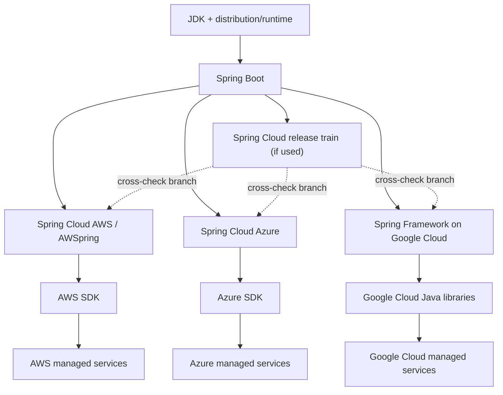
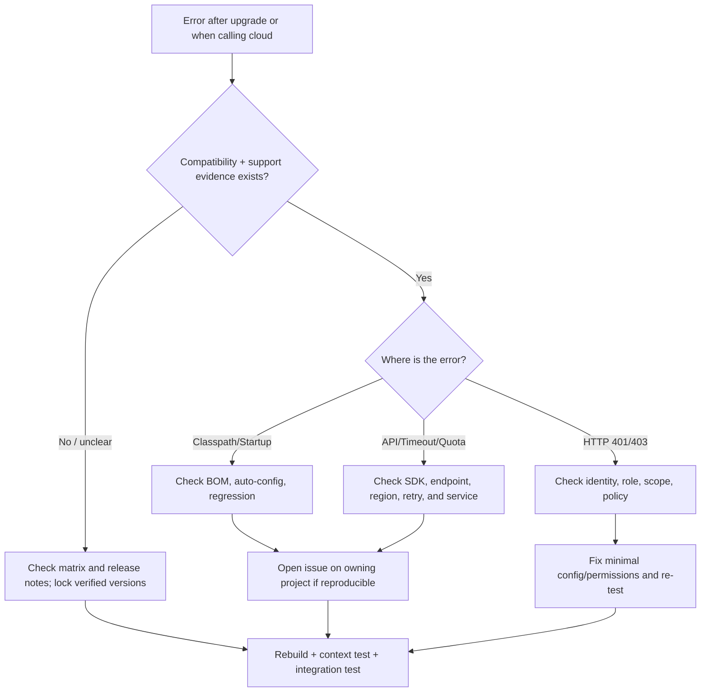

# Reading Compatibility Matrices and Identifying Each Project's Maintainer

> **Chapter:** Project Bootstrap  
> **Module:** Spring Cloud Provider Integration — integrating Spring Boot with managed services on AWS, Azure, and Google Cloud.

An application using Spring Boot, Spring Cloud Config, and Amazon S3 may compile cleanly after upgrading Spring Boot, yet fail at startup due to auto-configuration. Another application using Azure Blob Storage may still run while its Spring Cloud Azure version has already reached end of maintenance. Both cases show that **able to run**, **declared compatible**, and **still maintained** are three different things.

To choose a platform for a production application, an engineer must read multiple matrices published by **independent projects**, identify **who maintains which part**, verify each branch's support window, and record evidence for upgrade decisions.

## 1. Learning Objectives

After this lesson, you will be able to:

1. Read rows, columns, footnotes, exceptions, and version conditions in a compatibility matrix.
2. Identify maintenance boundaries across Spring Boot, Spring Cloud release train, Spring Cloud AWS, Spring Cloud Azure, Spring Framework on Google Cloud, cloud SDKs, and managed services.
3. Distinguish technical compatibility from OSS support lifecycle, commercial support, and feature support coverage.
4. Choose a valid version intersection when an application integrates one or multiple providers.
5. Document a sourced version profile and verify it via dependency resolution, tests, and an upgrade plan.

## 2. What Question Does a Compatibility Matrix Answer?

A compatibility matrix is a statement by **the project that owns the library** about which version combinations were designed or tested to work together. For example, Spring Cloud's table maps the **Spring Cloud release train** to a **Spring Boot generation**. Spring Cloud AWS's table additionally maps the **Spring Cloud AWS version**, **Spring Framework**, and **AWS SDK**. Spring Cloud Azure's table also publishes support status and JDK ranges. The Google Cloud project maintains a separate table for **Spring Framework on Google Cloud**.

Common notations:

| Notation | How to Interpret | Example |
|---|---|---|
| `4.0.x` | The Spring Boot 4.0 branch, including patches 4.0.0, 4.0.1... | A `4.0.x` cell is not a promise that every patch works at every point in time. |
| `2025.1.x` | The Spring Cloud 2025.1 release train branch, often named Oakwood | Do not confuse with Spring Boot 2025.1 or Spring Cloud AWS 2025.1. |
| `7.x` | An entire major branch of a provider library | You must pick a specific GA release, and check release notes and maintenance status. |
| `4.1.x (from 2025.1.2)` | Conditional support based on a **minimum patch version** | Spring Cloud 2025.1.0 does not automatically support Boot 4.1 just by being in the same release train branch. |
| `Yes / In Support` | The project records active support according to **that project's own** table | Does not mean other dependencies are also supported. |
| `EOL / Unsupported` | The branch is no longer within the published maintenance scope | Artifacts may still download and run, but you cannot assume patches will be issued. |
| `Beta / M / RC` | Preview / milestone / release candidate builds | Do not use as the default production version without an explicit risk-acceptance decision. |

**Example of reading one row:** The Spring Cloud table states `2025.1.x → Spring Boot 4.0.x, 4.1.x (starting from 2025.1.2)`. You may only conclude that the 2025.1.x branch can be paired with Boot 4.1.x **when selecting at least version 2025.1.2** and meeting other conditions; you cannot infer that Spring Cloud AWS, Azure, or Google Cloud all support Boot 4.1.x yet.

At the time of writing on **November 24, 2026**, Spring Cloud 2025.1.5 was released on November 20, 2026 and announced support for Boot 4.0.x/4.1.x. Both release announcements and compatibility tables are useful; when they differ, read the specific release notes to find patch-level exceptions.

Sources: [Spring Cloud Project](https://spring.io/projects/spring-cloud/), [Spring Cloud 2025.1.5 release announcement](https://spring.io/blog/2026/11/20/spring-cloud-2025-1-5-has-been-released/).

## 3. Dependency Graph: Compatibility Does Not Propagate Automatically

A multi-cloud project has at least the following layers:



The edges have **two different meanings**:

- A dependency edge (`A → B`) means project A uses APIs/libraries or services from B.
- A cross-check line means **you must consult both matrices**; it does **not** mean the Spring Cloud release train owns or releases Spring Cloud AWS/Azure/GCP.

Suppose two libraries both announce support for Boot 4.0.x. That still does not prove they are compatible **with each other on the same classpath**. They may pull in different versions of gRPC, Netty, Jackson, HTTP clients, or protobuf. Compatibility is a set of constraints, not a transitive property.

## 4. "Maintainer" Has Two Layers of Meaning

In software engineering documentation, you must identify both simultaneously:

1. **Release/maintenance unit:** which version branch receives bug fixes and security patches, and which BOM manages its artifacts.
2. **Accountable party:** which project, maintainer team, or vendor publishes the matrix, documentation, and release notes, and handles issues.

A release train may bundle multiple projects; the release train itself **does not necessarily have an independent support lifecycle**. Under Spring Cloud policy, a release train is a collection of component projects; support timelines must be evaluated per underlying project and its associated Spring Boot branch. Do not collapse everything under a single label like "Spring Cloud is supported."

### Ownership Breakdown Table

| Component | Who manages releases/docs? | Unit to track | Scope and limitations |
|---|---|---|---|
| **Java/JDK** | OpenJDK and the **JDK vendor/distribution** the team chooses | Java release, CPU patches, and actual JDK package in container/host | "Java 21 LTS" alone does not specify who provides updates or the support window. |
| **Spring Framework** | Spring Framework project | Major/minor branch and patches | Core APIs, DI, Web, transactions; does not directly manage cloud services. |
| **Spring Boot** | Spring Boot project | Branch `4.0.x`, `4.1.x`... and specific patches | Spring Boot BOM, starters, auto-configuration, build/plugins, system requirements. |
| **Spring Cloud Config, Gateway, Commons...** | Projects in the Spring Cloud ecosystem | Component projects and the coordinating **release train** | The release train manages the dependency set; support duration depends on each involved project's policy. |
| **Spring Cloud AWS** | **AWSpring** project at `awspring/spring-cloud-aws` | Spring Cloud AWS branch, BOM `io.awspring.cloud:spring-cloud-aws-dependencies`, starters, and service coverage | Has its own Boot/Cloud/Framework matrix; **must not be equated** with the Spring Cloud release train. |
| **Spring Cloud Azure** | Maintainer team within **Azure SDK for Java** | Spring Cloud Azure branch, BOM `com.azure.spring:spring-cloud-azure-dependencies`, Boot/Cloud/JDK mapping | Must check **Spring Cloud Azure**'s support policy/schedule alongside Azure SDK for Java. |
| **Spring Framework on Google Cloud** | Project at `GoogleCloudPlatform/spring-cloud-gcp` | Google Cloud library branch, BOM `com.google.cloud:spring-cloud-gcp-dependencies` | Common name in older docs: *Spring Cloud GCP*; always check documentation for the **exact major**. |
| **AWS/Azure/Google Cloud Java SDK** | Each provider's SDK project | SDK/BOM version, vulnerability advisories, and migration guides | SDKs have their own lifecycle; the resolved version may be a transitive dependency of a starter. |
| **S3, Service Bus, Pub/Sub, Cloud SQL...** | Respective managed service teams | APIs, quotas, regions, features, service changes/retirements | Service SLAs and API deprecation policies are **not** the Spring starter's maintenance window. |
| **Product team's application** | Application development/operations team | Dependency management files, CI images, IAM, accounts, tests, and upgrade plans | Internal responsibility remains even when all libraries are supported. |

Primary sources to consult:

- Spring: [Version mappings / generations](https://spring.io/projects/generations), [Spring support policy](https://spring.io/support-policy/), [Spring Cloud Supported Versions](https://github.com/spring-cloud/spring-cloud-release/wiki/Supported-Versions).
- AWS: [AWSpring repository and compatibility table](https://github.com/awspring/spring-cloud-aws).
- Azure: [Spring Versions Mapping](https://github.com/Azure/azure-sdk-for-java/wiki/Spring-Versions-Mapping), [Azure SDK support policy](https://github.com/Azure/azure-sdk/blob/main/docs/policies/support.md).
- Google Cloud: [Spring Framework on Google Cloud compatibility](https://googlecloudplatform.github.io/spring-cloud-gcp/8.2.4/reference/html/getting-started.html), [repository](https://github.com/GoogleCloudPlatform/spring-cloud-gcp).

**Consequence when errors happen:** a Spring Cloud Config API issue should be investigated in the Config project and its interaction with Boot; an S3 starter binding/auto-configuration issue may belong to AWSpring; an SDK request failure belongs to the AWS Java SDK; an `AccessDenied` error is usually caused by cloud policies and identity. Do not default to filing every issue with the Spring Cloud release train team.

## 5. Distinguishing Compatible, Still Supported, and Feature-Complete

| Question | Appropriate Evidence | What Cannot Be Concluded from That Evidence Alone |
|---|---|---|
| **Is it compatible?** | Version matrices, release notes, migration guides; tests on the actual combination | Cannot conclude it still receives security patches. |
| **Is it still maintained?** | Support policy, OSS/enterprise end dates, branch status in maintainer docs | Cannot conclude the application uses the right APIs or IAM. |
| **Does the starter support the needed service?** | Service coverage table, artifact list, reference guide of the chosen branch | Cannot conclude every cloud service feature has an abstraction. |
| **Does it run on the deployment platform?** | JDK requirements, runtime, CPU architecture, OS, container image, and testing | Cannot conclude cloud permissions are properly granted. |
| **Is it production-ready operationally?** | Network failure tests, retries, timeouts, least privilege, quotas, logs/metrics, upgrade plan | Cannot be inferred from a single passing `mvn test`. |

### OSS Support vs. Enterprise Support

"Supported" must be read in its **policy context**:

- **OSS/community support** refers to the period during which the project accepts and publishes public patches under current policy.
- **Enterprise/commercial support** may have separate contracts and extended timelines. Do not infer from "commercial support exists" that your application automatically has that entitlement.
- **Extended maintenance/community branches** do not necessarily carry the same bug-fix commitment as the main branch. Confirm specifically with maintainers and applicable terms.
- **A supported library** does not extend the lifecycle of the JDK, OS/container, dependent SDKs, or managed services.

In Spring Cloud, the Supported Versions page explains that a release train aggregates projects and ties support status to the Spring Boot lifecycle. That page contains historical data marked deprecated; when checking EOL, prioritize the current [Spring Support Policy](https://spring.io/support-policy/) and [Spring Cloud project support](https://spring.io/projects/spring-cloud/#support). Do not copy an EOL date from an old blog post into a long-term decision without re-verifying.

### Being Supported Does Not Mean Having Every Feature

For example, AWSpring's Supported AWS integrations table shows that some integrations such as RDS/EC2/ElastiCache/CloudFormation existed in the 2.x branch but are **not provided in the old way** in 3.x/4.x. Therefore, even though Spring Cloud AWS 4.x is compatible with Boot 4, engineers implementing related features must still check the supported integrations list or use the AWS SDK directly.

Similarly, "Cloud Storage has a starter" does not prove the starter replaces the entire Google Cloud Storage API; an Azure Service Bus starter does not mean every namespace management option is wrapped as a Spring bean. You must check the API and reference guide for your **exact version**.

## 6. Example: Reading Multiple Tables to Choose One Stack

**Documentation snapshot as of November 24, 2026:** The following branches appear in the projects' matrices. This table only illustrates the **compatibility intersection** and does not replace checking support status and patches on your deployment date.

| Application Boot Choice | Spring Cloud Release Train | Spring Cloud AWS | Spring Cloud Azure | Spring Framework on Google Cloud |
|---|---|---|---|---|
| **4.0.x** | **2025.1.x (Oakwood)** | **4.x** | **7.x** | **8.x** |
| **3.5.x** | **2025.0.x (Northfields)** | **3.4.x** | **6.x** (Azure's matrix also lists some compatible 5.x versions) | **7.x** |

References: [Spring Cloud](https://spring.io/projects/spring-cloud/), [AWSpring](https://github.com/awspring/spring-cloud-aws#compatibility-with-spring-project-versions), [Azure versions mapping](https://github.com/Azure/azure-sdk-for-java/wiki/Spring-Versions-Mapping), [Google Cloud 8.x getting started](https://googlecloudplatform.github.io/spring-cloud-gcp/8.2.4/reference/html/getting-started.html).

**Important note:** Spring Cloud 2025.1.x supports Spring Boot 4.1.x starting from **2025.1.2**. Google Cloud 8.x also lists Boot 4.1.x, whereas the AWSpring 4.x and Spring Cloud Azure 7.x tables referenced above list Boot **4.0.x**. Consequently, for an application using **all three providers simultaneously**, you cannot treat Boot 4.1.x as a verified choice solely based on the Spring Cloud and Google Cloud tables. You must check updated release notes/tables **from AWSpring and Azure**, and validate empirically before approving an upgrade.

### Scenario A: S3 and Spring Cloud Config

Requirements: Spring Boot 4.0, Java 21, using Config Server and Amazon S3.

Read in sequence:

1. [Spring Boot system requirements](https://docs.spring.io/spring-boot/4.0/system-requirements.html) to confirm compatible JDK/Maven/Gradle; check the actual JDK running in builds and containers.
2. [Spring Cloud compatibility](https://spring.io/projects/spring-cloud/) to get train `2025.1.x` for Boot `4.0.x`.
3. [AWSpring compatibility](https://github.com/awspring/spring-cloud-aws#compatibility-with-spring-project-versions) to get `4.x` for Boot `4.0.x`.
4. Read release notes for each branch, pick **specific GA releases**, and use the Spring Cloud BOM and Spring Cloud AWS BOM.
5. Build, inspect the dependency tree, and run Config Server and S3 adapter tests (unit + integration).

Output: A **locked version set** (for example, in the form `Boot 4.0.p / Cloud 2025.1.q / AWSpring 4.r.s`), evidence links, and test results. Here `p/q/r/s` are placeholders representing patch numbers **to be chosen from real releases**, not valid Maven version strings.

### Scenario B: Integrating Only Azure Blob Storage

If the application only uses `spring-cloud-azure-starter-storage-blob` and **does not use** Config/Gateway/Stream or any other module in the Spring Cloud release train, you should:

1. Check Boot ↔ Spring Cloud Azure in Microsoft's table.
2. Import `com.azure.spring:spring-cloud-azure-dependencies` and the required starter.
3. Determine whether any dependency requires `org.springframework.cloud:spring-cloud-dependencies`; **do not import the release train BOM just because the library name contains "Spring Cloud"**.
4. Inspect the Azure SDK set managed by the provider BOM, choose workload identity/managed identity, and run tests against Blob Storage.

This separation clarifies the **maintenance unit**: Spring Boot manages Boot; Spring Cloud Azure manages the Azure starter; the Azure SDK and Azure Blob Storage have separate policies and release channels.

### Scenario C: Upgrading the System to Boot 4.1

Suppose an application currently runs Boot 4.0, Cloud 2025.1, AWSpring 4.x, and Google Cloud 8.x. The team wants to upgrade to Boot 4.1 to receive patches.

1. Check Spring Cloud **2025.1.2 or higher** and compatibility conditions for the chosen Boot 4.1 release.
2. Check Google Cloud 8.x, which lists Boot 4.1.x in its table.
3. **Stop concluding at the AWSpring step:** the AWSpring branch table currently lists Boot 4.0.x; there is not enough evidence to approve Boot 4.1 for the entire application from the rows read so far.
4. Re-check AWSpring release notes at deployment time, ask maintainers if docs conflict, or stay on the verified Boot 4.0.x branch until sufficient evidence and tests are in place.

This is a classic example of the rule: **being able to upgrade one component does not mean you can upgrade the entire stack**.

## 7. A Repeatable Process for Reading Matrices

### Step 1 — Capture the project's current "coordinates"

Record:

| Field | Example to Record |
|---|---|
| Runtime | Java 21, JDK distribution, patch version, OS/container image |
| Build | Maven/Gradle and actual wrapper version |
| Framework | **Full** Spring Boot version, Spring Framework, Spring Cloud train if any |
| Provider | Spring Cloud AWS/Azure/GCP and starters in use |
| SDK | Resolved AWS SDK / Azure SDK / Google library versions |
| Workload | S3 upload, Blob download, Pub/Sub publish, Key Vault read secret, etc. |
| Support | Support policy, assessment date, current branch, EOL risks |

For example, an application using `spring-cloud-aws-starter-s3` should check which version of `software.amazon.awssdk:s3` the Spring Cloud AWS BOM manages. Do not guess from the starter version.

### Step 2 — Read official sources in order

1. **Spring Boot:** JDK requirements, build tools, Boot lifecycle status, and migration guide.
2. **Spring Cloud (if used):** Boot ↔ release train mapping and policies of each Spring project.
3. **Provider starter:** compatibility table **for the exact project and exact major**, release notes, and supported integrations list.
4. **SDK and managed services:** release policy, endpoints, API/feature compatibility, and deprecation policies if any.
5. **Java distribution and infrastructure:** whether the deployment environment supports the bytecode, TLS, native transports, containers, and chosen JDK.

Prefer the official branch's README/reference guide, Supported Versions page, and changelog over unversioned community answers. **The `main` branch README may describe features not yet present in the version you use**; when verifying details, open the documentation for the pinned release or corresponding tag.

### Step 3 — Find the intersection, do not combine by gut feeling

Frame each choice as constraints:

```text
Boot ∈ supportedBy(Java runtime)
CloudTrain ∈ supportedBy(Boot)                   [if using Spring Cloud]
ProviderRelease ∈ supportedBy(Boot, CloudTrain) [per provider matrix]
SDKRelease ∈ managedAndSupportedBy(Provider BOM)
RequiredFeature ∈ providerCoverage(ProviderRelease)
SupportWindow ∋ plannedDeploymentAndMaintenance
```

Each condition needs its own evidence. If a provider does not publish support for `Boot 4.1.x`, **do not mark it PASS** merely because the application builds with Boot 4.1; mark it `UNKNOWN / NEEDS VERIFICATION`.

### Step 4 — Distinguish signals and confidence levels

| Situation | Assessment | Action |
|---|---|---|
| Matrix states the exact combination, within support window, tests pass | **Sufficient evidence to consider approval** | Lock patches, security, regression, and operational checks. |
| Matrix states Boot 4.0 but you want Boot 4.1 | **Not yet verified** | Check official release notes/issues, ask maintainers; do not mark PASS yet. |
| Matrix says compatible but startup test fails | **Failed empirical check** | Analyze dependencies/auto-config, bugs, and specific patches. |
| Application runs but provider branch is EOL | **Maintenance risk** | Plan an upgrade or document a time-bounded risk acceptance. |
| Provider major supports Boot but lacks adapter for needed service | **Fails feature requirements** | Choose the SDK directly, an appropriate library, or design another adapter. |

### Step 5 — Record the decision as an artifact

A simple decision table can go into architecture documentation:

| Component | Approved Branch | Verification Source | Maintainer / Notification Channel | Next Check |
|---|---|---|---|---|
| JDK | Java 21 LTS (specify vendor) | JDK vendor's contract/support matrix | JDK vendor | Every CPU/security update |
| Spring Boot | 4.0.x | Spring Support Policy and release notes | Spring Boot | On patch upgrade or minor change |
| Spring Cloud | 2025.1.x | Spring Cloud Project | Spring Cloud and each sub-project | When changing Boot or train |
| AWSpring | 4.x | AWSpring compatibility/coverage | AWSpring | When upgrading starter/SDK |
| Azure | 7.x | Azure Spring Versions Mapping | Azure SDK for Java | When upgrading starter/SDK |
| Google Cloud | 8.x | Google Cloud compatibility | Spring Framework on Google Cloud | When upgrading starter/SDK |

This is a **branch-level** template. For deployment, add exact patch numbers, the assessment date, and your application's own verification results.

## 8. BOMs Apply Decisions; They Do Not Replace Matrices

Once valid branches are identified, use a BOM so Maven manages the related versions. With Maven:

```xml
<properties>
    <java.version>21</java.version>
    <spring-cloud.version>2025.1.5</spring-cloud.version>
    <spring-cloud-aws.version>4.1.1</spring-cloud-aws.version>
</properties>

<dependencyManagement>
    <dependencies>
        <dependency>
            <groupId>org.springframework.cloud</groupId>
            <artifactId>spring-cloud-dependencies</artifactId>
            <version>${spring-cloud.version}</version>
            <type>pom</type>
            <scope>import</scope>
        </dependency>
        <dependency>
            <groupId>io.awspring.cloud</groupId>
            <artifactId>spring-cloud-aws-dependencies</artifactId>
            <version>${spring-cloud-aws.version}</version>
            <type>pom</type>
            <scope>import</scope>
        </dependency>
    </dependencies>
</dependencyManagement>

<dependencies>
    <dependency>
        <groupId>io.awspring.cloud</groupId>
        <artifactId>spring-cloud-aws-starter-s3</artifactId>
    </dependency>
</dependencies>
```

The snippet above is a **POM excerpt**, assuming the project already uses an appropriate Spring Boot **4.0.x** parent/BOM. It is not a standalone `pom.xml`. `spring-cloud-dependencies` is only needed if the application actually uses Spring Cloud projects in the release train; `spring-cloud-aws-dependencies` manages the AWSpring group.

Observe carefully:

- A BOM only provides dependency management; importing a BOM **does not automatically add** starters to the classpath.
- Starters do not need individual version pins when managed by a BOM; arbitrary overrides can skew shared dependencies.
- When multiple BOMs manage the same dependency coordinates, Maven rules for dependency management, inheritance, and import order can yield counter-intuitive results. You must inspect the **effective POM** and dependency tree.
- Do not confuse the **Spring Cloud BOM** with the **Spring Cloud AWS/Azure/GCP BOM**; they are not interchangeable.
- If mixing multiple providers in the same process, BOMs do not guarantee that intermediate libraries have been cross-tested.

### Verification Commands

```bash
java -version
./mvnw -version
./mvnw help:effective-pom
./mvnw dependency:tree
./mvnw clean verify
```

On Windows, use `.\mvnw.cmd`. If using Gradle, run `./gradlew dependencies --configuration runtimeClasspath` and `dependencyInsight` for conflicting modules; Gradle platform BOM resolution differs slightly from Maven BOMs, so always check resolved versions rather than just reading declarations.

Look for warning signs:

1. A Spring Framework/Boot version outside the expected branch, or Spring Cloud modules from unsynchronized release trains.
2. Unintended coexistence of SDK v1 and v2; for example `com.amazonaws` (AWS SDK v1) alongside `software.amazon.awssdk` (AWS SDK v2).
3. `javax.*` dependencies pulled in where Jakarta namespaces are required in newer Boot generations.
4. A critical dependency skewed by the parent, another BOM, or an override relative to the provider's release notes.

**A passing build is only one gate.** You must boot the Spring context and run integration tests in an environment with appropriate identity and permissions to verify the real integration path.

## 9. Incident Ownership Model and Triage Flow

When an error occurs, identify the library or layer causing it and contact the **party capable of fixing it**. The table below is an initial triage tool, not a root-cause conclusion:

| Symptom | Where to Check First | Potentially Responsible Party for Fix |
|---|---|---|
| `NoSuchMethodError` in Spring Framework | Dependency tree, API changes between Spring versions | Application team if misconfigured; Spring project once a library bug is confirmed |
| `S3Client` bean not configured | Whether starter is present, auto-config conditions, AWSpring version | Application team or AWSpring |
| Blob SDK returns HTTP 403 | Managed identity, Azure RBAC, scope, network/firewall | IAM/application operations team; not automatically an Azure Spring starter bug |
| Pub/Sub client retries improperly when backend is unstable | Google libraries version, adapter, retry config, emulator tests | Application team, Google Cloud libraries, or service depending on root cause |
| A version has a CVE | Advisory, resolved dependency, patch from the artifact-owning project | Artifact maintainer releases patch; application team is responsible for upgrading and testing |
| SDK works but cloud API is deprecated | API deprecation notice, sunset date, changelog | Cloud provider team and application team needing migration |

### Information Required Before Opening an Issue

Record: **full patch versions** of Boot/Cloud/provider, JDK distribution/version, minimal relevant dependency tree, stack trace with secrets stripped, API/SDK versions, reproduction steps, OS/runtime, and expected/actual behavior. If it is a cloud error, include shareable request IDs, region, and authorization state **without exposing credentials**. Read the issue tracker and release notes before filing a new report.

Triage workflow:



## 10. Managing Upgrades as a Maintenance Plan

In a multi-cloud system, upgrading Spring Boot may trigger migrations across Spring Framework, Spring Cloud, and all providers. Group changes by scope:

| Change Type | Expectation | Minimum Verification |
|---|---|---|
| **Patch within the same minor** | Usually bug/security fixes, though regressions cannot be ruled out | Build, dependency tree, unit/context tests, smoke tests on relevant adapters |
| **Minor of Boot/Cloud/provider** | May alter auto-config, artifacts, or JDK support conditions | New matrices, migration guide, integration/contract tests, canary deployment |
| **Major** | May require changing Java, package namespaces, APIs, or starter names | Dedicated migration plan, evaluation of all providers and cloud APIs |
| **Direct SDK change** | May alter credential chains, transports, or serialization | Dependency management, contract tests, retries/timeouts, infrastructure checks |

### Suggested Maintenance Cadence

- Track security advisories from Spring, provider maintainers, and the JDK vendor; prioritize vulnerabilities affecting the live application.
- Periodically review each branch's EOL date and the **earliest** end-of-support date across the stack.
- When new Boot/Cloud/provider versions are released, evaluate matrices and prevent bots from auto-merging major upgrades without tests and human review.
- Record compatibility assessment results in PRs or architecture docs; link the policies and release notes used.
- Keep test environments close enough to production: JDK image, IAM, network, quotas, proxies, TLS, and endpoints.

The biggest risk in multi-cloud systems often lies at the **intersection of multiple release schedules**. A Boot branch that is still supported cannot compensate for an EOL provider starter; a new provider starter cannot fix an unpatched JDK runtime.

## 11. Practice Exercise: Evidence-Based Upgrade Decision

A document management application has three adapters:

- AWS S3 for storing files.
- Azure Service Bus for emitting events.
- Google Cloud Secret Manager for retrieving sensitive configuration.

The development team currently uses **Spring Boot 4.0.x, Spring Cloud 2025.1.x, AWSpring 4.x, Spring Cloud Azure 7.x, and Spring Framework on Google Cloud 8.x**. They propose upgrading Boot to **4.1.x** without changing the provider branches.

Carry out the following:

1. Read the four compatibility sources (Spring Cloud, AWSpring, Azure, Google Cloud), noting the minimum patch version if any and support status **as of the date you check**.
2. Fill in a `PASS / FAIL / UNKNOWN` table for each edge: Boot ↔ Cloud, Boot ↔ AWSpring, Boot ↔ Azure, Boot ↔ Google Cloud.
3. Formulate questions for maintainers or check release notes where a table does not yet list Boot 4.1.x. Explain clearly why a passing build is insufficient to mark `PASS`.
4. List the tests to run: S3 upload, Service Bus publish/receive, Secret Manager read, startup/context tests, credential injection, and retry regressions.
5. Document update responsibilities: application team, Spring, AWSpring, Azure Spring, Google Cloud, SDK/cloud services, and JDK vendor.
6. Recommend a decision: stay on Boot 4.0.x with appropriate patches, or upgrade to Boot 4.1.x after obtaining new evidence and completing full verification. Upgrading is not mandatory if conditions are not met.

**Submission table template:**

| Compatibility Edge | Assessment | Source + Check Date | Next Verification Step |
|---|---|---|---|
| Boot 4.1 ↔ Cloud 2025.1 | `PASS` if Cloud ≥ 2025.1.2 and accompanying conditions are met | Spring Cloud release notes | Context test |
| Boot 4.1 ↔ AWSpring 4.x | `UNKNOWN` per AWSpring table listing only 4.0.x | AWSpring compatibility | Check release notes/tags, ask maintainers, and test |
| Boot 4.1 ↔ Azure 7.x | `UNKNOWN` per Azure table listing only 4.0.x | Azure Spring Versions Mapping | Check mapping updates and changelog |
| Boot 4.1 ↔ Google Cloud 8.x | `PASS` per 8.x branch compatibility table | Google Cloud reference guide | Secret Manager integration test |

The assessments in this template only reflect **the source tables cited at the time of writing**; if the matrices are updated, revise the statuses according to the new evidence.

### Self-Check Questions

**1. If a project is named "Spring Cloud Azure", can we infer it belongs to the Spring Cloud release train?**  
No. Spring Cloud Azure has its own release branches, BOM, and support table. The Spring Cloud release train is the coordinated set of Spring Cloud projects belonging to that train.

**2. If two starters both support Spring Boot 4.0, is using them together always safe?**  
No. They can have conflicting dependencies and configurations; you must inspect the effective POM, dependency tree, Spring context, and integration flows.

**3. What if a branch has reached end of OSS support, yet the dependency still downloads from Maven Central?**  
The existence of an artifact does not prove it still receives patches. The project team must upgrade or document a risk-acceptance decision with an appropriate support plan.

**4. Should a 403 error when calling S3 be reported directly to AWSpring?**  
Not without further evidence. Check IAM roles, bucket policies, KMS permissions, region, and the request first; determine whether there is an actual starter/SDK bug.

**5. Should we pin each individual SDK version instead of using the provider BOM?**  
Usually no. Prefer the corresponding project's BOM, and override only when there is a documented reason, verified compatibility, and tests protecting the change.

## 12. Checklist Before Approving Versions

- [ ] The actual Java/JDK branch is supported by the runtime and build tool; the JDK patch provider is identified.
- [ ] Spring Boot, Spring Framework, and Spring Cloud release train (if used) match the matrix.
- [ ] Each AWSpring/Azure/GCP starter has an **independent matrix**, matching major/minor/patch without overlooking exceptions.
- [ ] The needed managed service has a corresponding starter/API in the **chosen branch**.
- [ ] OSS/enterprise support windows, EOL dates, and maintainer responsibilities have been evaluated for **every component**.
- [ ] The BOM and dependency tree resolve to the expected versions; no unexplained overrides remain.
- [ ] Build, startup/context tests, unit/integration tests, and IAM/secret tests pass in an authorized environment.
- [ ] The decision record specifies check date, official sources, patch versions, unresolved risks, and approver.

## Official Documentation

1. [Spring Cloud — Compatibility and support](https://spring.io/projects/spring-cloud/).
2. [Spring Cloud — Supported Versions (explaining release trains and component projects)](https://github.com/spring-cloud/spring-cloud-release/wiki/Supported-Versions).
3. [Spring Boot / Spring project generations](https://spring.io/projects/generations).
4. [Spring Support Policy](https://spring.io/support-policy/).
5. [Spring Cloud 2025.1.5 release notes — Nov 20, 2026](https://spring.io/blog/2026/11/20/spring-cloud-2025-1-5-has-been-released/).
6. [AWSpring / Spring Cloud AWS — Compatibility and service coverage](https://github.com/awspring/spring-cloud-aws).
7. [Spring Cloud Azure — Spring Versions Mapping](https://github.com/Azure/azure-sdk-for-java/wiki/Spring-Versions-Mapping).
8. [Azure SDK Support Policy](https://github.com/Azure/azure-sdk/blob/main/docs/policies/support.md).
9. [Spring Framework on Google Cloud 8.2.4 — Getting Started, Compatibility](https://googlecloudplatform.github.io/spring-cloud-gcp/8.2.4/reference/html/getting-started.html).
10. [Spring Boot 4.0 — System Requirements](https://docs.spring.io/spring-boot/4.0/system-requirements.html).

> **Remember:** Compatibility matrices are a **necessary condition**, maintenance records clarify **ownership and timelines**, and build/integration tests verify that **your specific application** works. With multiple cloud providers, you must have evidence for **every compatibility edge** before selecting or upgrading the entire stack.
