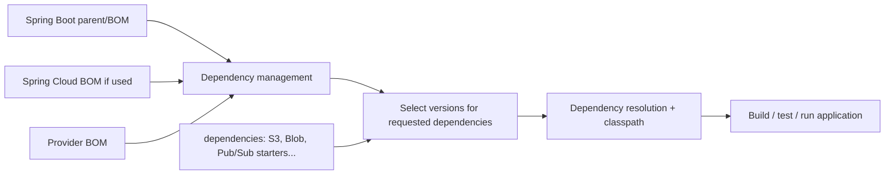
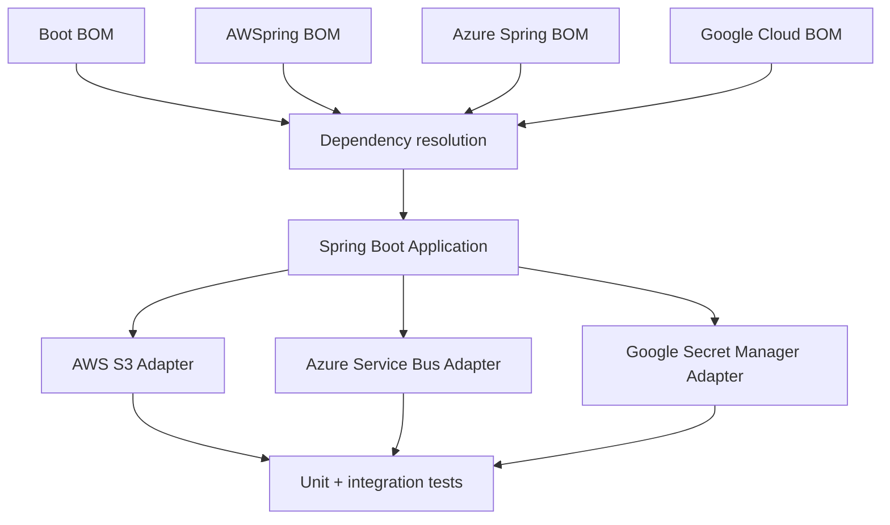

# Managing Versions with BOMs in Maven and Gradle

> **Chapter:** Project Bootstrap  
> **Module:** Spring Cloud Provider Integration — hands-on integration of Spring Boot with managed services on AWS, Azure, and Google Cloud.

A Spring Boot application calling S3, Azure Service Bus, or Google Cloud Pub/Sub often pulls in dozens of libraries: Spring Framework, Spring Cloud, provider SDKs, Jackson, HTTP clients, gRPC, Netty, and telemetry libraries. Manually assigning a `version` to each dependency makes the application hard to upgrade and prone to `NoSuchMethodError`, `NoClassDefFoundError`, or startup conflicts.

A **BOM (Bill of Materials)** helps manage **a coordinated set of versions published by a project**. However, a BOM does not automatically guarantee that all cloud providers are compatible with each other, does not add dependencies by itself, does not manage IAM/secrets, and does not replace integration testing. This lesson focuses on how to **declare, combine, and verify BOMs** in both Maven and Gradle.

## 1. Learning Outcomes

After this lesson, you will be able to:

1. Explain the differences between a BOM, Spring Boot parent, dependency management, starters, direct dependencies, and transitive dependencies.
2. Bootstrap Maven/Gradle projects using the Spring Boot BOM and the appropriate BOM for AWS, Azure, or Google Cloud.
3. Understand version selection rules when **multiple BOMs manage the same artifact**; distinguish Maven, Gradle native `platform()`, and the `io.spring.dependency-management` plugin.
4. Verify the **actually resolved** versions, detect wrong overrides, and document the rationale when an individual dependency must be upgraded.
5. Design an upgrade, testing, and dependency governance workflow suitable for applications using storage, messaging, data, and secrets.

## 2. What Does a BOM Actually Do?

Typically, a Maven BOM is a POM with `<packaging>pom</packaging>` and a `<dependencyManagement>` section containing `groupId:artifactId:version` coordinates. When a project imports a BOM, it uses the set of versions managed by that BOM without repeating the version on every dependency in that set.

Conceptual example:

```xml
<!-- This illustrates the inside of a BOM, not an application file. -->
<dependencyManagement>
    <dependencies>
        <dependency>
            <groupId>com.example.cloud</groupId>
            <artifactId>storage-client</artifactId>
            <version>2.3.1</version>
        </dependency>
        <dependency>
            <groupId>com.example.cloud</groupId>
            <artifactId>messaging-client</artifactId>
            <version>2.3.1</version>
        </dependency>
    </dependencies>
</dependencyManagement>
```

When the application declares `storage-client` without a `<version>`, Maven can pull `2.3.1` from dependency management. **Which dependencies actually appear on the classpath still depends on what the application or its libraries declare in `<dependencies>`.**

| Concept | Function | Do Not Confuse With |
|---|---|---|
| **BOM** | Defines coordinated versions for multiple modules | A "starter" that installs every module automatically |
| **Maven `dependencyManagement`** | Provides default versions, scopes, and certain metadata for dependencies; does not add dependencies by itself | `dependencies` |
| **Spring Boot parent POM** | Provides dependency management, plugin management, and default build configuration | Just a BOM alone; the parent does more |
| **Spring Boot BOM** | `org.springframework.boot:spring-boot-dependencies`, manages the Spring foundation and many third-party dependencies | Maven parent POM |
| **Spring Cloud release-train BOM** | `org.springframework.cloud:spring-cloud-dependencies` manages Spring Cloud modules belonging to a train | AWSpring/Azure/GCP BOMs |
| **Provider BOM** | Manages starters and corresponding provider components | A cross-compatibility guarantee across all providers |
| **Starter** | Declares the set of libraries needed for an integration and usually enables auto-configuration | A version management table |
| **Lockfile** | Records the exact versions resolved during a build | A BOM, which primarily specifies desired versions |

A core principle:



**A BOM is neither a security scanner nor an operational guarantee.** Even when the BOM selects the right library versions, S3 permission errors, expired Azure tokens, missing ADC on Google Cloud, or Pub/Sub quotas must still be handled separately. Compatibility among Java, Spring Boot, the Spring Cloud release train, and the provider must also be verified against official matrices **before importing the BOM**.

## 3. Choosing the Right BOM for Your Integration Libraries

The groups below **release independently**. Do not pick a BOM simply because its name contains "Spring Cloud."

| Library Suite | Maven/Gradle BOM | Example Starters |
|---|---|---|
| Spring Boot | `org.springframework.boot:spring-boot-dependencies` | `org.springframework.boot:spring-boot-starter-webmvc` |
| Spring Cloud Config, Gateway, Stream... | `org.springframework.cloud:spring-cloud-dependencies` | `org.springframework.cloud:spring-cloud-starter-config` |
| **AWSpring / Spring Cloud AWS** | `io.awspring.cloud:spring-cloud-aws-dependencies` | `io.awspring.cloud:spring-cloud-aws-starter-s3`, `spring-cloud-aws-starter-sqs` |
| **Spring Cloud Azure** | `com.azure.spring:spring-cloud-azure-dependencies` | `com.azure.spring:spring-cloud-azure-starter-storage-blob`, `spring-cloud-azure-starter-servicebus` |
| **Spring Framework on Google Cloud** | `com.google.cloud:spring-cloud-gcp-dependencies` | `com.google.cloud:spring-cloud-gcp-starter-storage`, `spring-cloud-gcp-starter-pubsub` |

**Choose by feature, not generically by cloud.** To upload files to S3, use the S3 starter; to consume events via SQS, you need the SQS starter and must check queue semantics. Azure Service Bus and Google Pub/Sub do not have identical acknowledgment, retry, or dead-letter semantics to SQS. A BOM helps select library versions; it does not standardize managed service characteristics.

Example branches used throughout this lesson:

| Component | Illustrative Version |
|---|---|
| Java | 21 |
| Spring Boot | `4.0.10` |
| Spring Cloud AWS | `4.1.0` |
| Spring Cloud release train (if using Config/Gateway/Stream) | `2025.1.5` |
| Spring Cloud Azure (alternative example) | `7.4.0` |
| Spring Framework on Google Cloud (alternative example) | `8.2.4` |

These are **real version numbers used to illustrate configuration**, not a directive to always pick the latest release. Before applying them to a real project, check the compatibility matrices and current patches for the right branch, verify JDK/build tool support, read release notes, and update in a controlled manner. The main example only uses **AWS S3**; Azure/GCP BOMs appear in the comparison section.

Sources: [Spring Boot 4.0 Gradle plugin](https://docs.spring.io/spring-boot/4.0/gradle-plugin/managing-dependencies.html), [Spring Cloud AWS 4.1.0](https://docs.awspring.io/spring-cloud-aws/docs/4.1.0/reference/html/index.html), [Spring Cloud Azure developer guide](https://learn.microsoft.com/azure/developer/java/spring-framework/developer-guide-overview), [Google Cloud getting started 8.2.4](https://googlecloudplatform.github.io/spring-cloud-gcp/8.2.4/reference/html/getting-started.html).

## 4. Maven: Spring Boot Parent and Provider BOM

### 4.1. Complete `pom.xml` Example for AWS S3

Create a Spring Boot project via [Spring Initializr](https://start.spring.io/) or an equivalent Maven project, then use the POM:

```xml
<?xml version="1.0" encoding="UTF-8"?>
<project xmlns="http://maven.apache.org/POM/4.0.0"
         xmlns:xsi="http://www.w3.org/2001/XMLSchema-instance"
         xsi:schemaLocation="http://maven.apache.org/POM/4.0.0
          https://maven.apache.org/xsd/maven-4.0.0.xsd">
    <modelVersion>4.0.0</modelVersion>

    <parent>
        <groupId>org.springframework.boot</groupId>
        <artifactId>spring-boot-starter-parent</artifactId>
        <version>4.0.10</version>
        <relativePath/>
    </parent>

    <groupId>com.example</groupId>
    <artifactId>provider-bom-demo</artifactId>
    <version>0.0.1-SNAPSHOT</version>

    <properties>
        <java.version>21</java.version>
        <spring-cloud-aws.version>4.1.0</spring-cloud-aws.version>
    </properties>

    <dependencyManagement>
        <dependencies>
            <dependency>
                <groupId>io.awspring.cloud</groupId>
                <artifactId>spring-cloud-aws-dependencies</artifactId>
                <version>${spring-cloud-aws.version}</version>
                <type>pom</type>
                <scope>import</scope>
            </dependency>
        </dependencies>
    </dependencyManagement>

    <dependencies>
        <dependency>
            <groupId>org.springframework.boot</groupId>
            <artifactId>spring-boot-starter-webmvc</artifactId>
        </dependency>
        <dependency>
            <groupId>io.awspring.cloud</groupId>
            <artifactId>spring-cloud-aws-starter-s3</artifactId>
        </dependency>
        <dependency>
            <groupId>org.springframework.boot</groupId>
            <artifactId>spring-boot-starter-test</artifactId>
            <scope>test</scope>
        </dependency>
    </dependencies>

    <build>
        <plugins>
            <plugin>
                <groupId>org.springframework.boot</groupId>
                <artifactId>spring-boot-maven-plugin</artifactId>
            </plugin>
        </plugins>
    </build>
</project>
```

In this POM:

1. **Boot parent** manages versions of Spring Boot modules, Spring Framework, and many common libraries.
2. **AWSpring BOM** manages versions of Spring Cloud AWS modules and libraries within that project's BOM scope.
3. **S3 starter** is what actually enters the dependency graph; it pulls in the necessary AWSpring/SDK modules.
4. `<type>pom</type>` and `<scope>import</scope>` are how Maven imports a BOM's dependency management into the project POM.
5. Do not write `<version>` on `spring-cloud-aws-starter-s3` because the BOM already manages it.
6. Do not import `spring-cloud-dependencies` just because the artifact is named `spring-cloud-aws`. The Spring Cloud release-train BOM is only needed when the application also uses projects belonging to that release train.

The distinction between **parent** and **BOM** matters when an application has an organization-specific parent. Maven allows only one direct `<parent>`. If you cannot inherit from `spring-boot-starter-parent`, you can import `spring-boot-dependencies` under `dependencyManagement`, but you must then explicitly manage the plugin/build configuration that the parent normally provides. Importing a BOM **does not automatically bring along the parent's plugin management**.

### 4.2. When to Add the Spring Cloud Release-Train BOM?

If the same application also uses Spring Cloud Config, add the BOM and starter **after verifying the compatible branch**:

```xml
<properties>
    <spring-cloud.version>2025.1.5</spring-cloud.version>
    <spring-cloud-aws.version>4.1.0</spring-cloud-aws.version>
</properties>

<dependencyManagement>
    <dependencies>
        <dependency>
            <groupId>org.springframework.cloud</groupId>
            <artifactId>spring-cloud-dependencies</artifactId>
            <version>${spring-cloud.version}</version>
            <type>pom</type>
            <scope>import</scope>
        </dependency>
        <dependency>
            <groupId>io.awspring.cloud</groupId>
            <artifactId>spring-cloud-aws-dependencies</artifactId>
            <version>${spring-cloud-aws.version}</version>
            <type>pom</type>
            <scope>import</scope>
        </dependency>
    </dependencies>
</dependencyManagement>

<!-- Inside <dependencies> of the main POM: -->
<dependency>
    <groupId>org.springframework.cloud</groupId>
    <artifactId>spring-cloud-starter-config</artifactId>
</dependency>
```

This is a **snippet to merge/replace into your POM**, not a standalone XML file. Avoid creating two adjacent `dependencyManagement` blocks via copy/paste. Adding Config also requires appropriate server/import configuration; an application with the Config starter that is not properly configured may fail to start as expected.

## 5. Gradle: Approach 1 — Using Native BOMs via `platform()`

Gradle supports importing Maven BOMs as **platform dependency constraints**. This is the native option, usually clearer and well suited for projects that want to rely on Gradle's dependency resolution mechanism. Unlike Maven, when using `platform()`, versions in a BOM act as **recommendations/constraints participating in resolution**, not necessarily the final version if a stronger requirement or higher version exists elsewhere in the graph.

### 5.1. Complete `build.gradle.kts` (Kotlin DSL) for S3

```kotlin
plugins {
    java
    id("org.springframework.boot") version "4.0.10"
}

group = "com.example"
version = "0.0.1-SNAPSHOT"

java {
    toolchain {
        languageVersion = JavaLanguageVersion.of(21)
    }
}

repositories {
    mavenCentral()
}

dependencies {
    // Gradle native does not automatically import the Boot BOM just by applying the Boot plugin.
    implementation(platform(
        org.springframework.boot.gradle.plugin.SpringBootPlugin.BOM_COORDINATES
    ))
    implementation(platform(
        "io.awspring.cloud:spring-cloud-aws-dependencies:4.1.0"
    ))

    implementation("org.springframework.boot:spring-boot-starter-webmvc")
    implementation("io.awspring.cloud:spring-cloud-aws-starter-s3")

    testImplementation("org.springframework.boot:spring-boot-starter-test")
    testRuntimeOnly("org.junit.platform:junit-platform-launcher")
}

tasks.withType<Test> {
    useJUnitPlatform()
}
```

Meaning:

- `org.springframework.boot` provides build/package/`bootRun` tasks; it **does not automatically import the Boot BOM in the native approach**. We bring in the Boot BOM via `SpringBootPlugin.BOM_COORDINATES` to avoid repeating the Boot version number.
- `implementation(platform(...))` applies constraints to classpaths that inherit from `implementation`; also watch out for configurations that do not inherit from it when special plugins or source sets exist.
- The AWSpring BOM is the second platform; `spring-cloud-aws-starter-s3` omits the version.
- The Java toolchain specifies the JDK used for compiling/testing in the project configuration, though CI/IDE/containers still need to be configured and verified properly.

To use this exact Kotlin DSL example, choose a Gradle wrapper version within the range supported by the Spring Boot Gradle plugin. Boot 4.0 documentation states Gradle **8.14+ in the 8.x branch or the 9.x branch**; re-check requirements when changing Boot. [Spring Boot Gradle Plugin](https://docs.spring.io/spring-boot/4.0/gradle-plugin/index.html).

### 5.2. Equivalent in `build.gradle` (Groovy DSL)

```groovy
plugins {
    id 'java'
    id 'org.springframework.boot' version '4.0.10'
}

group = 'com.example'
version = '0.0.1-SNAPSHOT'

java {
    toolchain {
        languageVersion = JavaLanguageVersion.of(21)
    }
}

repositories {
    mavenCentral()
}

dependencies {
    implementation platform(
        org.springframework.boot.gradle.plugin.SpringBootPlugin.BOM_COORDINATES
    )
    implementation platform('io.awspring.cloud:spring-cloud-aws-dependencies:4.1.0')

    implementation 'org.springframework.boot:spring-boot-starter-webmvc'
    implementation 'io.awspring.cloud:spring-cloud-aws-starter-s3'

    testImplementation 'org.springframework.boot:spring-boot-starter-test'
    testRuntimeOnly 'org.junit.platform:junit-platform-launcher'
}

tasks.named('test') {
    useJUnitPlatform()
}
```

Both DSLs do the same thing; **do not mix Kotlin and Groovy syntax**. Choose one style per build script in a repository. Commit the wrapper and verify `./gradlew --version` so CI uses the same toolchain.

### 5.3. `platform()` vs. `enforcedPlatform()`

Example:

```kotlin
dependencies {
    // Usual choice: participates in dependency conflict resolution.
    implementation(platform("io.awspring.cloud:spring-cloud-aws-dependencies:4.1.0"))

    // Use only intentionally; illustrative example, do not apply simultaneously with the line above.
    // implementation(enforcedPlatform("io.awspring.cloud:spring-cloud-aws-dependencies:4.1.0"))
}
```

| Property | `platform()` | `enforcedPlatform()` |
|---|---|---|
| Management style | BOM versions are constraints participating in selection | Forces BOM versions via strict constraints |
| If another dependency requests a higher version | Gradle can select the higher version when constraints allow | May force the BOM version or fail with a strict conflict |
| When to consider | Default for most applications | When you have confirmed the entire group must be locked and understand the impact |
| If publishing a library | Usually more appropriate | Use caution because strict constraints can leak to consumers |

Do not use `enforcedPlatform()` as a "quick fix" for all conflict warnings. If a library requires a higher version for a security patch, forcing it down to an older version can cause errors or reopen vulnerabilities. Investigate the dependency graph and update the **appropriate BOM** or apply an intentional constraint instead.

Sources: [Gradle — Platforms](https://docs.gradle.org/current/userguide/platforms.html), [Spring Boot — Managing Dependencies](https://docs.spring.io/spring-boot/4.0/gradle-plugin/managing-dependencies.html).

## 6. Gradle: Approach 2 — The `io.spring.dependency-management` Plugin

This plugin emulates the Maven-style dependency management model, supports importing BOMs via `mavenBom(...)`, and overriding versions via BOM properties in many cases. When applied **alongside** the Spring Boot Gradle plugin, the Boot BOM is automatically imported through integration between the two plugins.

Kotlin DSL example replacing the `platform()` approach:

```kotlin
plugins {
    java
    id("org.springframework.boot") version "4.0.10"
    id("io.spring.dependency-management") version "1.1.7"
}

group = "com.example"
version = "0.0.1-SNAPSHOT"

java {
    toolchain {
        languageVersion = JavaLanguageVersion.of(21)
    }
}

repositories {
    mavenCentral()
}

dependencyManagement {
    imports {
        mavenBom("io.awspring.cloud:spring-cloud-aws-dependencies:4.1.0")
    }
}

dependencies {
    // The Boot BOM is automatically imported when both plugins are applied.
    implementation("org.springframework.boot:spring-boot-starter-webmvc")
    implementation("io.awspring.cloud:spring-cloud-aws-starter-s3")
    testImplementation("org.springframework.boot:spring-boot-starter-test")
    testRuntimeOnly("org.junit.platform:junit-platform-launcher")
}

tasks.withType<Test> {
    useJUnitPlatform()
}
```

Within a single module, choose **one primary BOM management strategy**: Gradle native or the dependency-management plugin. Mixing both without understanding how each intervenes in dependency resolution makes version selection hard to explain.

| Aspect | Gradle Native BOM | `io.spring.dependency-management` |
|---|---|---|
| Declaration | `implementation(platform("g:a:v"))` | `dependencyManagement { imports { mavenBom("g:a:v") } }` |
| Boot BOM import | **Explicitly declared** | **Automatic** when applied with the Spring Boot plugin |
| Customizing versions via Maven BOM properties | Not directly via BOM properties | Supported via the plugin's mechanism |
| Version selection mechanism | Gradle dependency constraints/conflict resolution | Plugin-driven dependency management rules |
| Final verification | Inspect `dependencies` / `dependencyInsight` | Still must inspect `dependencies` / `dependencyInsight` |

Docs: [Spring Dependency Management Plugin](https://docs.spring.io/dependency-management-plugin/docs/current/reference/html/), [Spring Boot Gradle plugin — Managing Dependencies](https://docs.spring.io/spring-boot/4.0/gradle-plugin/managing-dependencies.html).

## 7. Importing Azure and Google Cloud BOMs

If you choose **Azure Blob Storage** instead of S3, use the Azure BOM and the matching group's starter:

**Maven — snippets to place in the corresponding sections of the POM**:

```xml
<!-- Inside <dependencyManagement><dependencies>: -->
<dependency>
    <groupId>com.azure.spring</groupId>
    <artifactId>spring-cloud-azure-dependencies</artifactId>
    <version>7.4.0</version>
    <type>pom</type>
    <scope>import</scope>
</dependency>

<!-- Inside <dependencies>: -->
<dependency>
    <groupId>com.azure.spring</groupId>
    <artifactId>spring-cloud-azure-starter-storage-blob</artifactId>
</dependency>
```

**Gradle native Kotlin DSL**:

```kotlin
dependencies {
    implementation(platform(
        org.springframework.boot.gradle.plugin.SpringBootPlugin.BOM_COORDINATES
    ))
    implementation(platform("com.azure.spring:spring-cloud-azure-dependencies:7.4.0"))
    implementation("com.azure.spring:spring-cloud-azure-starter-storage-blob")
}
```

If you choose **Google Cloud Pub/Sub**, use the BOM and starter from Spring Framework on Google Cloud:

**Maven — snippets to place in the appropriate sections**:

```xml
<!-- Inside <dependencyManagement><dependencies>: -->
<dependency>
    <groupId>com.google.cloud</groupId>
    <artifactId>spring-cloud-gcp-dependencies</artifactId>
    <version>8.2.4</version>
    <type>pom</type>
    <scope>import</scope>
</dependency>

<!-- Inside <dependencies>: -->
<dependency>
    <groupId>com.google.cloud</groupId>
    <artifactId>spring-cloud-gcp-starter-pubsub</artifactId>
</dependency>
```

**Gradle native Kotlin DSL**:

```kotlin
dependencies {
    implementation(platform(
        org.springframework.boot.gradle.plugin.SpringBootPlugin.BOM_COORDINATES
    ))
    implementation(platform("com.google.cloud:spring-cloud-gcp-dependencies:8.2.4"))
    implementation("com.google.cloud:spring-cloud-gcp-starter-pubsub")
}
```

These snippets are **alternatives** showing only the dependency parts to adjust; they are not standalone build files. With the Gradle dependency-management plugin, replace the provider's `implementation(platform(...))` line with `mavenBom("com.azure.spring:spring-cloud-azure-dependencies:7.4.0")` or `mavenBom("com.google.cloud:spring-cloud-gcp-dependencies:8.2.4")` inside `imports`.

With Azure, continue configuring Microsoft Entra ID/managed identity, account/endpoint, and RBAC; with Pub/Sub, you need a Google Cloud project ID, Application Default Credentials, and publish/subscribe IAM permissions. **A BOM does not grant access permissions or provision cloud resources.**

## 8. When Multiple BOMs Manage the Same Module

In multi-cloud integrations, two BOMs can propose two different versions of Jackson, Netty, gRPC, or a shared HTTP library. The outcome depends on the **build tool and import method**, so you cannot just look at line order in a build file and guess.

### 8.1. Maven: Current POM's Dependency Management First, Then Import Order

In Maven, a version declared directly in the current POM's `<dependencyManagement>` can override relevant inherited/imported entries. If **two BOMs imported at the same level** manage the same `groupId:artifactId` coordinate, Maven's rule is that **the first imported BOM wins** for the overlapping coordinate, unless the current POM itself declares management for that coordinate.

Hypothetical example, just to illustrate the rule:

| BOM | Managed Version for `com.example:common-client` |
|---|---|
| BOM A imported first | `1.5.0` |
| BOM B imported later | `1.6.0` |
| Current POM does not manage this module directly | Maven uses the version from **BOM A** |

Do not confuse this with Maven's **nearest dependency** rule when resolving transitive dependencies: `dependencyManagement` and dependency mediation are related but distinct mechanisms. When you actually have multiple BOMs, use `help:effective-pom` and `dependency:tree` to see the result.

Source: [Maven — Introduction to the Dependency Mechanism](https://maven.apache.org/guides/introduction/introduction-to-dependency-mechanism.html).

### 8.2. Gradle Native: Reconciling Constraints

When using multiple `platform()` calls, Gradle evaluates constraints across the entire graph. Under default resolution rules, Gradle may pick the higher version among compatible requests; therefore, **Maven's "first BOM wins" rule does not apply** to Gradle native.

Hypothetical example: platform A recommends `1.5.0`, platform B recommends `1.6.0` for the same module; the outcome may be `1.6.0` or something else if strict constraints, version ranges, or resolution rules exist. Only `dependencyInsight` reveals the actual reason.

### 8.3. Dependency-Management Plugin: The Last Imported BOM Can Win

With `io.spring.dependency-management`, when multiple BOMs are imported and manage overlapping dependencies, **the later imported BOM** can override versions from earlier BOMs. This rule **differs from Maven**. Do not rely on reordering imports as a trick to mask conflicts without checking real compatibility.

| Mechanism | When Two BOMs Manage the Same Dependency | Command/Output to Read |
|---|---|---|
| Maven BOM import | Usually prefers the **first BOM** among same-level imports; direct management in the current POM takes precedence | `mvn help:effective-pom`, `mvn dependency:tree` |
| Gradle `platform()` | Constraints are reconciled by Gradle's algorithm, usually picking the higher compatible version | `gradlew dependencyInsight` |
| Gradle `enforcedPlatform()` | Strict constraints can force a version or fail on conflict | `gradlew dependencyInsight`, conflict messages |
| Gradle dependency-management plugin | For overlapping BOM entries, the **last import** is used in the plugin's model | `gradlew dependencies` / `dependencyInsight` |

Docs: [Gradle — Dependency Constraints and Conflict Resolution](https://docs.gradle.org/current/userguide/dependency_constraints_conflicts.html), [Spring Dependency Management Plugin — Importing Multiple Boms](https://docs.spring.io/dependency-management-plugin/docs/current/reference/html/).

## 9. Verifying Resolved Versions

Do not evaluate BOM configuration solely by reading `pom.xml` or `build.gradle.kts`. You must inspect the **actual dependency graph** across compile/runtime/test.

### With Maven

In the project directory, run the Maven wrapper:

```bash
./mvnw -version
./mvnw help:effective-pom
./mvnw dependency:tree
./mvnw clean verify
```

On Windows PowerShell, the corresponding wrapper command is `.\mvnw.cmd`. To focus on the AWS SDK:

```bash
./mvnw dependency:tree -Dincludes=software.amazon.awssdk
```

`dependency:tree` shows which dependencies pull in the SDK and which final version is selected. `help:effective-pom` shows the effective dependency management after parent inheritance and BOM imports. If you need to save output for review, use `-DoutputFile=...` on the corresponding plugin in a sample project.

### With Gradle

```bash
./gradlew --version
./gradlew dependencies --configuration runtimeClasspath
./gradlew dependencyInsight --dependency software.amazon.awssdk:s3 --configuration runtimeClasspath
./gradlew test
./gradlew build
```

On Windows PowerShell, use `.\gradlew.bat`. With Gradle, `dependencyInsight` is the primary tool to see where a module comes from, which version was selected, and the reason such as `By constraint`, `By conflict resolution`, or `Forced`. Also inspect `compileClasspath` and `testRuntimeClasspath` if the test environment has different dependencies from runtime.

When inspecting, ask:

1. Is the dependency actually pulled onto the classpath, or is it only listed in the BOM?
2. Do the actual versions of Boot/Cloud/provider SDK modules match the release notes and compatibility matrix?
3. Why was that version selected: BOM import, parent, direct version, constraint, or transitive dependency?
4. Are unwanted legacy SDKs, incompatible `javax.*` versions, or modules from another generation coexisting?
5. Did any dependency have to be overridden for a CVE? Does that override break the consistency of the SDK stack?

### Example Conflict Analysis

Suppose after adding Azure Service Bus to an application that already has AWS S3, an HTTP client gets upgraded away from the version recommended by the AWSpring BOM:

1. Read `dependency:tree`/`dependencyInsight` to find **the path pulling in the module** and why Gradle/Maven chose that version.
2. Check compatibility/release notes of AWSpring, Azure Spring, and the related SDKs.
3. Prefer updating provider BOMs to a set published as compatible; only consider an override when there is a specific security requirement or bug.
4. Run adapter unit tests, startup/context tests, and integration tests for both S3 and Service Bus paths.
5. Record the final version, rationale, and rollback steps in case a regression appears.

Do not treat deleting a `dependency` or adding an `exclude` on a module as the default fix. Exclusions can leave a starter missing a required class and merely defer the failure from build time to runtime.

## 10. BOMs, Lockfiles, and Version Catalogs Serve Three Different Goals

| Mechanism | What Question Does It Answer? | Key Takeaway |
|---|---|---|
| **BOM** | "Which versions should this group of libraries move together with?" | Does not guarantee the final graph keeps every version when conflicts or overrides occur. |
| **Gradle version catalog** | "Where are coordinates and versions declared centrally?" | A catalog helps reuse aliases; it **does not enforce** final versions on the dependency graph. |
| **Gradle dependency locking** | "Will the next build use the exact same resolved versions?" | Lock state is saved and verified; the lockfile must be updated when intentionally upgrading versions. |
| **Maven effective POM/tree** | "What did parent/BOM manage and what did Maven choose?" | It is build verification output; by itself it is not a lockfile for the entire graph. |

Example enabling dependency locking in Gradle Kotlin DSL:

```kotlin
dependencyLocking {
    lockAllConfigurations()
}
```

After configuring and verifying the graph:

```bash
./gradlew dependencies --write-locks
./gradlew build
```

Review the generated `gradle.lockfile` and commit it to version control when appropriate for your team's workflow. When changing BOMs, update lock state in a tested PR; **do not manually edit individual version lines arbitrarily**. Locking makes builds reproducible, but does not assess whether a version is secure or maintained.

In multi-module projects, a BOM must be declared in the configurations/modules that need it. Placing `platform()` in the root module **does not automatically** apply constraints to every Gradle subproject. You can organize an internal platform via `java-platform` or convention plugins, but always verify final versions in each consuming module. Multi-module Maven projects can inherit `dependencyManagement` from an organization parent POM if the inheritance structure is designed for it.

Sources: [Gradle — Locking Versions](https://docs.gradle.org/current/userguide/dependency_locking.html), [Gradle — Platforms and Version Catalogs](https://docs.gradle.org/current/userguide/platforms.html).

## 11. Organizing and Upgrading BOMs in Multi-Cloud Applications

Example architecture of a Spring Boot application with three adapters: storing files on S3, emitting events via Azure Service Bus, and reading configuration from Google Cloud Secret Manager:



It is not mandatory to import every BOM into a single process. Some systems split adapters into independent services/modules to reduce shared-dependency risk; however, boundaries must follow business design, data consistency, and operational requirements, not merely avoiding dependency conflicts.

### Controlled Upgrade Process

1. **Establish a baseline:** JDK distribution, Boot, Spring Cloud release train (if any), each provider BOM, Gradle/Maven wrapper, and key resolved SDKs.
2. **Consult matrices:** check Boot compatibility, maintenance windows, and the starter/feature list in the target branch.
3. **Upgrade purposefully as a coherent group:** prefer bumping BOM versions and limiting individual overrides; update version catalogs/lockfiles when applicable.
4. **Diff the graph:** compare old and new `dependency:tree`/`dependencyInsight` output; flag logging, HTTP client, Jackson, Netty, gRPC, Google libraries, AWS SDK v2, and Azure SDK modules.
5. **Technical verification:** compile, unit tests, Spring context/startup, contract tests, and integration tests with emulators where suitable.
6. **Cloud verification:** smoke test in a dedicated account/environment with least-privilege IAM/RBAC; verify region, secret injection, timeouts, retries, idempotency, and quotas.
7. **Deployment review:** changelog, vulnerabilities, regression measurements, rollback plan, and support-evidence sources.

### Why You Still Must Test Identity, Secrets, and Services

BOMs only manage code dependencies. Spring Cloud AWS may use the AWS SDK credential chain and IAM roles; Spring Cloud Azure may use Microsoft Entra ID/managed identity; Spring Framework on Google Cloud may use ADC/workload identity. **Passing dependency resolution** does not prove the application has been granted `s3:PutObject`, Azure Service Bus Data Sender, or permission to read secrets on Google Cloud. Separate library tests (unit/context) from managed-environment tests (integration/smoke).

## 12. Common Mistakes When Using BOMs

| Symptom | Common Cause | Resolution |
|---|---|---|
| No starter in `dependencies`, application lacks client beans | Imported the BOM without declaring the starter | Add the starter dependency in `dependencies` or `implementation`. |
| Maven reports missing `version` for starter | BOM imported in the wrong place, coordinate/version doesn't exist, or BOM doesn't manage that starter | Check `dependencyManagement`, `type=pom`, `scope=import`, and effective POM. |
| `Could not find ...` | Wrong `groupId:artifactId:version`, missing repository, or network/proxy failure | Verify official coordinates, check Maven Central/mirrors, and repository config. |
| Gradle reports unable to resolve version when omitting `version` | Using Gradle native but forgot `platform(SpringBootPlugin.BOM_COORDINATES)` or the provider BOM | Check `implementation(platform(...))` and the applied configuration. |
| `NoSuchMethodError` or `NoClassDefFoundError` | Multiple BOMs/overrides skewed runtime APIs | Inspect dependency graph, remove unnecessary overrides, and choose compatible BOMs. |
| "Reordered BOMs" but Gradle still picks a higher version | Confused Maven rules with Gradle native constraints | Use `dependencyInsight`; read conflict resolution and strict rules. |
| Provider BOM upgraded and an integration disappeared | New major dropped a module/starter or changed APIs | Read the branch's migration guide and supported integrations table. |
| Build passes but smoke test fails with `401/403` | Incorrect cloud identity and permissions | Check credential chain/ADC, IAM/RBAC, resource policies, and scopes. |
| Used `enforcedPlatform()` and another library fails | Forcing an entire BOM caused a strict conflict | Re-evaluate why it was forced; prefer a regular platform/compatible BOM. |
| Bumped BOM without changing runtime version | Stale lockfile or override/constraint pinning the version | Inspect `dependencyInsight` and intentionally update the lockfile. |

Do not clear caches or bump every version to "latest" as your first step when hitting an error. Finding **the resolved version and why it was chosen** almost always yields a more accurate answer.

## 13. Practice Exercise

**Scenario:** A team is building a document intake service that stores files on object storage and sends events to a processing system. The team wants to choose Maven or Gradle and plans to deploy to one of the three providers.

### Part A — Create the project and manage dependencies

1. Pick **one** option: AWS S3 + SQS, Azure Blob Storage + Service Bus, or Google Cloud Storage + Pub/Sub.
2. Choose JDK/Spring Boot/provider BOM **with compatibility matrices and cited sources**; only include the Spring Cloud release-train BOM if using a module from that train.
3. Create the Maven or Gradle configuration. Provider starters must omit individual versions when managed by the BOM.
4. Build the project and use `dependency:tree`/`dependencyInsight` to record the versions of key SDKs/HTTP clients.
5. If using Gradle, explain why you chose `platform()` or the dependency-management plugin.

### Part B — Observe differences across mechanisms

1. On a sample project, add **in a controlled way** a dependency/constraint that proposes a different version of a shared library than the BOM.
2. Inspect Maven effective POM/tree or Gradle `dependencyInsight`, recording the final version and the reason.
3. Experiment with import order using **two sample BOMs not meant for production**. Compare Maven's "first import wins" with the dependency-management plugin's "last import wins"; explain why Gradle native behaves differently.
4. Revert the experiment, keep a clean production-appropriate configuration, and run tests.

### Part C — Ensure integration readiness

Write adapter unit tests to verify the bucket/container/topic name, object key/message format, and error handling. Next, run an integration test with an appropriate emulator (if supported) or a sandbox cloud environment. Document the required IAM/RBAC permissions and how credentials are obtained **outside source code**.

**Completion criteria:** Correct BOMs with sources, an explainable dependency graph, passing build/tests, no credentials in the repository, evidence of minimal integration capability, and clear awareness of BOM limitations.

## 14. Checklist Before Approving Build Configuration

- [ ] Read the Java ↔ Boot ↔ Cloud train ↔ provider matrices and support status of each branch.
- [ ] Used the exact Spring Boot, Spring Cloud, and provider BOMs **needed in practice**.
- [ ] Starters are declared in `dependencies`; did not import a BOM alone expecting clients to appear automatically.
- [ ] Maven: understood parent vs. BOM; `dependencyManagement` and `scope=import` are placed correctly.
- [ ] Gradle: chose native `platform()` or the dependency-management plugin and understood resolution rules.
- [ ] Checked overlapping BOM version cases, and any override has a documented reason and protective tests.
- [ ] Used the build wrapper and inspected effective POM/dependency tree/insight for the right configurations.
- [ ] If using a lockfile, updates were committed alongside BOM changes and verified before merging.
- [ ] Ran build, unit/context tests, and required integration/smoke tests for the cloud provider.
- [ ] Checked IAM/secrets, known vulnerabilities, maintenance windows, and migration docs.

## References

1. [Maven — Introduction to the Dependency Mechanism](https://maven.apache.org/guides/introduction/introduction-to-dependency-mechanism.html): `dependencyManagement`, BOM imports, precedence order.
2. [Spring Boot 4.0 — Gradle Managing Dependencies](https://docs.spring.io/spring-boot/4.0/gradle-plugin/managing-dependencies.html): native BOM and dependency-management plugin.
3. [Gradle — Platforms](https://docs.gradle.org/current/userguide/platforms.html): `platform`, `enforcedPlatform`, constraints.
4. [Gradle — Dependency Constraints and Conflict Resolution](https://docs.gradle.org/current/userguide/dependency_constraints_conflicts.html): how Gradle selects versions.
5. [Spring Dependency Management Plugin Reference](https://docs.spring.io/dependency-management-plugin/docs/current/reference/html/): BOM imports and last-BOM-wins rule.
6. [Gradle — Viewing and Debugging Dependencies](https://docs.gradle.org/current/userguide/viewing_debugging_dependencies.html): `dependencies` and `dependencyInsight`.
7. [Gradle — Locking Versions](https://docs.gradle.org/current/userguide/dependency_locking.html): dependency lockfiles.
8. [AWSpring 4.1.0 — Bill of Materials](https://docs.awspring.io/spring-cloud-aws/docs/4.1.0/reference/html/index.html): Maven/Gradle BOM and AWS starters.
9. [Spring Cloud Azure — Developer Guide](https://learn.microsoft.com/azure/developer/java/spring-framework/developer-guide-overview): BOM and Azure starters.
10. [Spring Framework on Google Cloud 8.2.4 — Getting Started](https://googlecloudplatform.github.io/spring-cloud-gcp/8.2.4/reference/html/getting-started.html): BOM, starters, and Gradle platforms.

> **Remember:** A BOM manages the **desired version set**, the build tool determines the **final resolved versions**, and tests plus maintenance matrices verify **the application can deploy safely**. Whenever adding a cloud provider, check all three layers rather than just adding a starter line.
