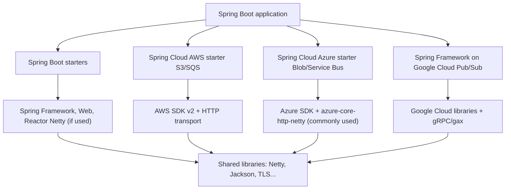
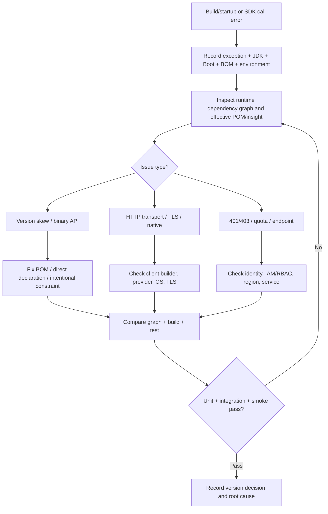

# Analyzing Dependency Trees and Resolving SDK, HTTP Client, and Netty Conflicts

> **Chapter:** Project Bootstrap  
> **Module:** SPRING_CLOUD_PROVIDER_INTEGRATION — integrating Spring Boot with managed services on AWS, Azure, and Google Cloud through the corresponding Spring Cloud libraries.

When building a Spring Boot application that uses Amazon S3, Azure Service Bus, and Google Cloud Pub/Sub, just a few starters can pull in hundreds of artifacts. A successful compilation does not guarantee the application can boot or call the cloud properly: a BOM may select a different version than expected, an SDK may require an API that has changed, and multiple HTTP transports may appear on the classpath simultaneously.

This lesson guides you through **observing the dependency graph before changing configuration**. The focus is on tracing transitive dependencies, identifying the version selected at runtime, distinguishing the mere presence of multiple HTTP clients from an actual conflict, and making the smallest verifiable change.

## 1. Learning Outcomes

After this lesson, you will be able to:

1. Distinguish **direct**, **transitive**, **BOM-managed**, **omitted**, and **final selected** dependencies.
2. Read `mvn dependency:tree`, Maven effective POM, Gradle `dependencies`, and `dependencyInsight` to determine where a module comes from.
3. Identify the AWS SDK v2, Azure SDK for Java, Google Cloud Java libraries, HTTP clients, and Netty artifact families.
4. Classify `NoSuchMethodError`, `NoClassDefFoundError`, linkage errors, HTTP transport issues, TLS failures, and IAM errors instead of trying to fix everything by bumping versions.
5. Choose the right fix: update a BOM, adjust direct declarations, remove wrong overrides, configure transports, or apply verified exclusions.
6. Set up tests confirming the application still properly accesses storage, messaging, data, and secrets after changing dependencies.

## 2. Why Is Spring Cloud Provider Integration Prone to Conflicts?

A starter does not add just a single JAR. For instance, an S3 starter may bring in AWS SDK v2; an Azure starter may use `azure-core` with the Netty transport; a Google Cloud starter may use `gax`, gRPC, and protobuf libraries. Spring Boot also manages HTTP, JSON, logging, security, and reactive stack libraries.



This diagram is directional. **Not every starter pulls in every module listed.** For example, **synchronous** and **asynchronous** AWS SDK v2 clients can use different HTTP transports; if you only use the synchronous `S3Client`, do not assume AWS has pulled in `netty-nio-client`.

Artifact groups to recognize:

| Role | Common Coordinates / Library Clusters | What to Check? |
|---|---|---|
| Spring Boot / Spring Framework | `org.springframework.boot:*`, `org.springframework:*` | Are they on the same Boot/Framework generation? |
| Spring Cloud release train | `org.springframework.cloud:*` | Are train modules compatible with Boot? |
| Spring Cloud AWS | `io.awspring.cloud:*` | Do the AWSpring BOM and starter match the branch? |
| AWS SDK v2 | `software.amazon.awssdk:*` | Are SDK modules aligned, and is SDK v1 `com.amazonaws:*` accidentally mixed in? |
| Spring Cloud Azure | `com.azure.spring:*` | Do the Spring Cloud Azure BOM and adapters use the right generation? |
| Azure SDK | `com.azure:*` | Are `azure-core`, transport, and specific libraries in a consistent set? |
| Spring Framework on Google Cloud | `com.google.cloud:spring-cloud-gcp-*` | Are provider BOM, starters, and Google libraries compatible? |
| Google Cloud libraries | `com.google.cloud:*`, `com.google.api:gax-*`, `io.grpc:*`, `com.google.protobuf:*` | Are gRPC/protobuf/gax versions skewed across multiple libraries? |
| Reactor Netty | `io.projectreactor.netty:*` | Is the Reactor Netty version compatible with Boot and Netty? |
| Core Netty | `io.netty:netty-*` | Are Netty modules resolved as a compatible set? |
| Other HTTP clients | Apache HttpComponents, OkHttp, JDK HttpClient | Which client is **actually built and used**? |

A library's groupId tells you its origin; it **does not prove it is causing an error**. Two HTTP clients coexisting on the classpath is a signal worth observing, not automatically a conflict.

## 3. Five Concepts to Distinguish Before Reading a Tree

| Concept | Meaning | Example |
|---|---|---|
| **Direct dependency** | Declared directly by the application | `spring-cloud-aws-starter-s3` |
| **Transitive dependency** | Pulled in by another dependency | `software.amazon.awssdk:s3` or `azure-core-http-netty` |
| **Managed/constraint version** | Suggested or managed by a POM parent/BOM/Gradle platform | `spring-cloud-aws-dependencies`, `spring-boot-dependencies` |
| **Requested version** | Version requested by a node in the graph | Provider A requests library X version 1.2 |
| **Selected/resolved version** | Version the build tool ultimately places in a configuration | Might be X 1.3 after conflict resolution |

**A standard dependency tree is already the result of resolution.** A plain tree may not show all versions that were discarded; Maven has verbose mode and Gradle has `dependencyInsight` to explain them. For an application, inspect at least `runtimeClasspath`; `compileClasspath` or `testRuntimeClasspath` may differ.

### Purely Hypothetical Illustrative Example

Suppose two starters both request `example.http:core`:

```text
application
+- cloud-starter-a:1.0
|  \- example.http:core:2.3
\- cloud-starter-b:1.0
   \- example.http:core:2.5

After resolution, the classpath may pick only one version:
example.http:core:2.5
```

The result depends on how dependencies are managed. Maven uses **dependency management** and **nearest definition** (at equal depth, declaration order affects the outcome); Gradle typically evaluates requests and constraints across the entire graph and selects an appropriate version. Do not treat this hypothetical outcome as a universal rule for every project.

## 4. Check the Project Baseline Before Hunting Conflicts

Record a snapshot of the system:

| Item | Value to Record |
|---|---|
| Java | `java -version`, JDK vendor, Docker/CI image |
| Build | Maven/Gradle wrapper and actual running version |
| Spring | Boot, Spring Framework, Spring Cloud release train if used |
| Provider | AWSpring, Spring Cloud Azure, Spring Framework on Google Cloud, and BOM versions |
| Services | S3/SQS, Blob/Service Bus, Cloud Storage/Pub/Sub/Secret Manager... |
| Runtime | JVM, OS, container architecture, native library/TLS provider |
| Error | Full exception, when it occurs, reproduction conditions, versions before and after the change |

Check the official compatibility matrices before attempting individual upgrades:

- [Spring Cloud releases and Boot compatibility](https://spring.io/projects/spring-cloud/).
- [Spring Cloud AWS](https://github.com/awspring/spring-cloud-aws).
- [Spring Cloud Azure: Spring Versions Mapping](https://github.com/Azure/azure-sdk-for-java/wiki/Spring-Versions-Mapping).
- [Spring Framework on Google Cloud: Getting Started](https://googlecloudplatform.github.io/spring-cloud-gcp/8.2.4/reference/html/getting-started.html).

A project on Boot 4 needs a **provider branch that has announced Boot 4 support**. If the tree shows a mix of modules from a branch meant for Boot 3, fix the BOM/starters first before chasing individual `NoSuchMethodError` exceptions.

## 5. Reading the Dependency Tree in Maven

The commands below apply to an **actual project directory**. This lesson walks through the workflow rather than running commands on another repository.

### 5.1. Basic Commands

```bash
./mvnw -version
./mvnw dependency:tree
./mvnw help:effective-pom
```

On Windows PowerShell, use `.\mvnw.cmd` instead of `./mvnw`. The Maven wrapper ensures dev teams and CI use a consistent tool version when properly configured and committed.

- `dependency:tree` shows the dependency branches in the project; read from the **directly declared starters** down to the underlying SDK/HTTP libraries.
- `help:effective-pom` reflects parent inheritance, active profiles, and dependency management after Maven merges the configuration.
- When the declared POM differs from the final tree, the **effective POM** is where to verify which version is managed by a BOM or parent.

### 5.2. Filter the Right Group Instead of Reading Thousands of Lines

```bash
# AWS SDK v2 group
./mvnw dependency:tree -Dincludes=software.amazon.awssdk:*

# Azure SDK and transport
./mvnw dependency:tree -Dincludes=com.azure:*

# Core Netty
./mvnw dependency:tree -Dincludes=io.netty:*

# Reactor Netty
./mvnw dependency:tree -Dincludes=io.projectreactor.netty:*

# View nodes omitted during resolution (when supported by plugin)
./mvnw dependency:tree -Dverbose
```

`-Dincludes` accepts a group/artifact filter per the Maven Dependency Plugin; depending on your shell, strings containing `*` may need quoting. You can add `-Dscope=runtime` to focus on runtime, remembering that test and compile have separate configurations/scopes. Current plugin versions support the `verbose` parameter to print omitted nodes in the rendered tree.

Source: [Maven Dependency Plugin — dependency:tree](https://maven.apache.org/plugins/maven-dependency-plugin/tree-mojo.html).

### 5.3. Reading a Sample Maven Tree

**Simulated output for learning how to read**; versions are illustrative only:

```text
[INFO] com.example:cloud-demo:jar:0.1
[INFO] +- com.azure.spring:spring-cloud-azure-starter-servicebus:jar:7.x:compile
[INFO] |  \- com.azure:azure-core-http-netty:jar:1.x:compile
[INFO] |     \- io.netty:netty-handler:jar:4.1.110.Final:compile
[INFO] \- software.amazon.awssdk:netty-nio-client:jar:2.x:compile
[INFO]    \- (io.netty:netty-handler:jar:4.1.100.Final:compile
[INFO]        - omitted for conflict with 4.1.110.Final)
```

What **can be read** from this example:

1. `netty-handler` arrives from at least two dependency paths.
2. In this example, Maven selected `4.1.110.Final` for the runtime node; `4.1.100.Final` was omitted.
3. `7.x`, `2.x`, and `1.x` in the example are branch labels, **not valid POM versions to copy**.
4. Two different requested versions alone are not yet proof of a runtime conflict. You must inspect other Netty modules, invoked APIs, BOMs, and tests.

**Note:** Maven's default plain tree may hide `omitted for conflict` nodes. Therefore, a filtered tree shows only part of the picture; read `-Dverbose` and the effective POM when analyzing root causes.

### 5.4. Maven Version Selection Order and Mechanism

Maven dependency mediation usually prefers the dependency on the shorter path (*nearest definition*). When branches have equal depth, declaration order can decide. However, `dependencyManagement` in the current POM or inherited/imported POMs also participates and can override transitive requested versions with the managed version.

When a single `dependencyManagement` imports two BOMs managing the same coordinate at the same level, the **earlier imported** BOM generally takes precedence for the overlapping coordinate, unless the current POM declares it directly. This is a Maven-specific rule and **does not apply** to Gradle native platforms.

Example:

```xml
<!-- Snippet inside <dependencyManagement><dependencies> of an example POM -->
<dependency>
    <groupId>org.springframework.cloud</groupId>
    <artifactId>spring-cloud-dependencies</artifactId>
    <version>${spring-cloud.version}</version>
    <type>pom</type>
    <scope>import</scope>
</dependency>
<dependency>
    <groupId>io.awspring.cloud</groupId>
    <artifactId>spring-cloud-aws-dependencies</artifactId>
    <version>${spring-cloud-aws.version}</version>
    <type>pom</type>
    <scope>import</scope>
</dependency>
```

In this snippet, both properties must be declared with **real, verified-compatible versions** in the project's `<properties>` section. It only illustrates BOM boundaries; to use AWS S3, you still must declare `spring-cloud-aws-starter-s3` inside `<dependencies>`. If the application does not use projects from the Spring Cloud release train, the `spring-cloud-dependencies` BOM may be unnecessary.

Source: [Maven — Introduction to the Dependency Mechanism](https://maven.apache.org/guides/introduction/introduction-to-dependency-mechanism.html).

## 6. Reading the Dependency Graph in Gradle

Gradle has multiple configurations: `compileClasspath`, `runtimeClasspath`, `testRuntimeClasspath`, and plugin-created configurations. For errors that only appear when calling an SDK in production, **`runtimeClasspath`** is usually the right starting point.

### 6.1. Commands to Inspect the Full Graph

```bash
./gradlew --version
./gradlew dependencies --configuration runtimeClasspath
./gradlew dependencies --configuration testRuntimeClasspath
```

Gradle uses specific notation in its reports:

| Notation | Common Meaning |
|---|---|
| `group:name:1.0 -> 1.2` | Version 1.0 was requested for the module, but 1.2 was selected. |
| `(*)` | Repeated dependency subtree, abbreviated in the report. |
| `(c)` | Dependency constraint; a constraint by itself does not pull in a module. |
| `(n)` | Node not resolved in the displayed context. |

Example:

```text
runtimeClasspath
+--- io.netty:netty-handler:4.1.100.Final -> 4.1.110.Final
+--- io.netty:netty-handler:4.1.110.Final (c)
\--- com.example:adapter:1.0
     \--- io.netty:netty-handler:4.1.100.Final (*)
```

This is **simulated data**; in a real project, check why a version was chosen using `dependencyInsight`.

### 6.2. Command to Remember: `dependencyInsight`

```bash
./gradlew dependencyInsight --dependency netty-handler --configuration runtimeClasspath
./gradlew dependencyInsight --dependency io.netty:netty-common --configuration runtimeClasspath
./gradlew dependencyInsight --dependency azure-core-http-netty --configuration runtimeClasspath
./gradlew dependencyInsight --dependency grpc-netty-shaded --configuration runtimeClasspath
```

For multi-module applications, prefix the project path:

```bash
./gradlew :api:dependencyInsight --dependency netty-handler --configuration runtimeClasspath
```

Here `:api` is an **example** name; replace it with your actual module.

In the `dependencyInsight` report, look for:

- **Selection reason: By conflict resolution:** branches requested different versions and Gradle selected one.
- **By constraint:** a platform/BOM or `constraints` block influenced the selection.
- **Forced:** an enforced platform or resolution rule is forcing the version.
- **Selected by rule:** build logic intervened in resolution; inspect why.
- **Requested/selected paths:** the path from a starter or direct dependency to the library in question.

A report often shows multiple paths to the same module. Inspect all important paths before deleting/excluding anything. Gradle native `platform()` participates in conflict resolution via constraints; Maven's "first BOM wins" rule does not apply to it.

Sources: [Gradle — Viewing and Debugging Dependencies](https://docs.gradle.org/current/userguide/viewing_debugging_dependencies.html), [Gradle — Dependency Constraints](https://docs.gradle.org/current/userguide/dependency_constraints.html).

## 7. Classifying Conflicts: Versions, Modules, and Transports

In cloud projects, several distinct situations are often lumped together as a "dependency conflict":

| Category | Symptom | Example | How to Evaluate |
|---|---|---|---|
| **Version conflict** | Multiple versions requested for the same `group:name` coordinate | Two branches request different `io.netty:netty-handler` versions | Check the resolved version, BOMs, and API/runtime tests. |
| **API/binary incompatibility** | Linkage fails when loading/running classes | `NoSuchMethodError`, `AbstractMethodError`, `IncompatibleClassChangeError` | Check the exact classes/SDK actually used and migration guides. |
| **Capability / duplicate implementation** | Two JARs provide the same capability or provider, sometimes with ServiceLoader contention | Multiple logging bindings, HTTP providers | Identify which implementation is picked and how the library selects transports. |
| **Transport configuration** | HTTP client configuration differs from expectations | Azure picks Netty instead of JDK client | Not an error if it works properly; verify builder/client wiring. |
| **Native/TLS issue** | Native library loading or handshake failure | Netty native transport, OpenSSL/tcnative, truststore/proxy | Check OS/architecture, TLS, certificates, and native dependencies. |
| **Cloud authentication/authorization** | SDK reaches endpoint but returns 401/403 | Missing IAM role or scope | Check identity, policies, RBAC, and resources; do not tweak Netty arbitrarily. |

A version conflict in the graph **can be completely normal** because build tools are designed to unify requests. Conversely, a runtime error can stem from **two artifacts with different coordinates containing incompatible classes/APIs**, even with zero version conflicts by `group:name`.

## 8. AWS SDK v2: Sync and Async Do Not Share the Same Default HTTP Stack

AWS SDK for Java 2.x separates transport selection by client type:

| Client | Common HTTP Transport | What to Watch |
|---|---|---|
| `S3Client` or **sync** clients | Apache HttpClient or URLConnection; AWS CRT option also available | Startup, pooling, proxies, socket timeouts, TLS |
| `S3AsyncClient` and **async** clients | `software.amazon.awssdk:netty-nio-client` or CRT option | Event loop, Netty, TLS, connection acquisition, concurrency |
| SDKs for other services | Depends on sync/async API and builder config | Do not guess solely from the starter name |

Current AWS documentation also describes HTTP client options based on Apache 5 for sync, URLConnection, and AWS CRT; for async, there are Netty and AWS CRT. **Default details can vary by SDK branch and how Spring auto-configuration builds the client**; always check the resolved version and the client bean actually constructed.

Source: [AWS SDK for Java 2.x — Configure HTTP clients](https://docs.aws.amazon.com/sdk-for-java/latest/developer-guide/http-configuration.html).

### Checking When Suspecting an AWS SDK Conflict

```bash
# Maven: AWS SDK v2 and Netty transport
./mvnw dependency:tree -Dincludes=software.amazon.awssdk:*
./mvnw dependency:tree -Dincludes=io.netty:*
```

Do not add `netty-nio-client` blindly just because you see SDK v2; sync clients may not need this module. If switching to async, check which client creation approach your Spring Cloud AWS version supports, how pools/event loops are configured, and bring in the appropriate transport per the SDK documentation.

**Scenario:** after adding async SQS, the graph shows `software.amazon.awssdk:netty-nio-client` alongside `azure-core-http-netty`. This may simply be two SDKs both using Netty, not enough to conclude an error. Check the final Netty version and test both messaging paths.

## 9. Azure SDK: Netty Is Typically the Default HTTP Transport

Azure SDK for Java provides the `com.azure.core.http.HttpClient` interface and several implementations. Per Microsoft's documentation, many Azure SDK libraries depend on `azure-core-http-netty`, making **Netty the default HTTP client**. Besides Netty, implementations exist for OkHttp and JDK HttpClient; swapping transports must align with the libraries and SDK version in use.

| Item | Common Coordinate | Note |
|---|---|---|
| Azure HTTP abstraction | `com.azure:azure-core` | Interfaces/pipeline, not Netty directly. |
| Netty transport | `com.azure:azure-core-http-netty` | Brings in `io.netty:*` modules and may involve native TLS. |
| OkHttp transport | `com.azure:azure-core-http-okhttp` | Alternative implementation when configured properly. |
| JDK transport | `com.azure:azure-core-http-jdk-httpclient` | Requires a JDK/API range supported by the library. |

If you want to replace Netty with another HTTP client, **do not simply exclude `azure-core-http-netty` and stop there**. You must supply the replacement implementation, configure/build with the right transport, check Spring Cloud Azure auto-configuration support, and run integration tests. If you remove the default transport without an available provider, client construction can fail.

Source: [Microsoft Learn — HTTP Clients and Pipelines in Azure SDK for Java](https://learn.microsoft.com/azure/developer/java/sdk/http-client-pipeline).

### Exception Case: Native TLS Errors Are Not Version Conflicts

Netty can use JDK SSL or a native implementation depending on configuration and environment. Errors loading `netty-tcnative` or OpenSSL can relate to CPU architecture, native libraries, and classifiers; do not try to solve them by upgrading `netty-handler` alone. Check the stack trace, OS/architecture, system truststore, and official Azure/Netty guidance.

## 10. Google Cloud Java Libraries: Watch gRPC, GAX, and Protobuf

Many Google Cloud clients use gRPC or HTTP/JSON depending on the service and client type. For Pub/Sub, the graph may contain:

- `com.google.cloud:google-cloud-pubsub`.
- `com.google.api:gax`, `com.google.api:gax-grpc`.
- `io.grpc:*` and `com.google.protobuf:*`.
- `io.grpc:grpc-netty-shaded` when using the shaded gRPC transport.

### Why `grpc-netty-shaded` Must Be Read Differently

`grpc-netty-shaded` packages Netty classes under a **relocated namespace** to avoid many classpath collisions with unshaded `io.netty:*`. Therefore, seeing both `grpc-netty-shaded` and `io.netty:netty-handler` **does not mean two artifacts are duplicate versions of the same coordinate**.

However, `grpc-netty-shaded` must still remain compatible with the rest of gRPC/GAX/protobuf; do not change a gRPC version in isolation just because one component reports a CVE without reading the security advisory and dependency resolution. For Google Cloud clients with different transport options, check documentation for the **exact service and version** rather than applying a single rule across all clients.

Investigation commands:

```bash
./mvnw dependency:tree -Dincludes=io.grpc:*
./mvnw dependency:tree -Dincludes=com.google.api:*
./mvnw dependency:tree -Dincludes=com.google.protobuf:*
```

With Gradle, use `dependencyInsight` for `grpc-core`, `grpc-netty-shaded`, `gax-grpc`, or `protobuf-java` on `runtimeClasspath`. Modules within the same gRPC/Google libraries family typically need to be upgraded **via the provider's BOM/recommendations**, testing serialization and publish/subscription paths.

Sources: [Spring Framework on Google Cloud reference](https://googlecloudplatform.github.io/spring-cloud-gcp/8.2.4/reference/html/), [Google Cloud Java libraries BOM](https://cloud.google.com/java/docs/bom).

## 11. Netty and Reactor Netty: Same Family, Not Identical

Netty is an asynchronous networking library; Reactor Netty provides a Reactor-based API on top of Netty. In a Spring Boot application, Reactor Netty may appear when using Spring WebFlux/`WebClient` or reactive adapters; the Azure SDK and AWS async SDK may use Netty in their own ways. An application using only Spring MVC with a servlet server does not necessarily use Reactor Netty as its HTTP server.

| Library | Form | What Must Stay Compatible |
|---|---|---|
| `io.netty:netty-common`, `netty-buffer`, `netty-transport`, `netty-handler`... | Core Netty modules | They should be resolved to a version set tested for compatibility. |
| `io.projectreactor.netty:reactor-netty-http` | Reactor Netty HTTP adapter | Compatible with Reactor, Spring Boot, and core Netty. |
| `com.azure:azure-core-http-netty` | Azure SDK HTTP transport | Compatible with Azure core/SDK and resolved Netty modules. |
| `software.amazon.awssdk:netty-nio-client` | AWS SDK v2 async HTTP transport | Compatible with AWS SDK core and Netty. |
| `io.grpc:grpc-netty-shaded` | Packaged/relocated gRPC Netty implementation | Compatible with gRPC/GAX; cannot be judged solely against `io.netty:*` directly. |
| `io.netty:netty-tcnative-*` | Native SSL/TLS bridge per runtime/architecture | Do not apply a "same version" rule with `netty-handler`; verify version/classifier separately. |

### Signs of Mixed Netty Versions

Suppose the tree shows:

```text
io.netty:netty-common:4.1.110.Final
io.netty:netty-buffer:4.1.110.Final
io.netty:netty-handler:4.1.100.Final
io.netty:netty-transport:4.1.110.Final
```

This is a **hypothetical snapshot**. Having `netty-handler` differ from the other three modules requires investigation because Netty modules can use internal APIs that change between patches. Yet **do not fix it by pinning `netty-handler` to the latest version in isolation**. Inspect the Spring Boot/provider BOMs, Netty release notes, and resolution reason, then align the entire related group to a verified set.

If Netty modules already match yet you still get `UnsatisfiedLinkError` or `SSLHandshakeException`, investigate native libraries, TLS, proxies, certificates, or the deployment environment. The dependency graph is only part of the diagnosis.

## 12. Step-by-Step Conflict Investigation Process



### Step 1 — Reproduce and gather facts

Record:

1. Does the error happen **at build time**, **at startup**, **during client creation**, or **after a real request**?
2. Class name, method name, and artifacts from the stack trace; which class tried to call the method, and which class no longer has that method?
3. Actual JDK running in the container, runtime dependency graph, and imported BOMs.
4. Changes made right before the error: added a starter? Changed Boot minor? Bumped an SDK for a CVE? Switched Netty to OkHttp?
5. Behavior of the exact same artifacts in test vs. production environments.

Strip secrets, access tokens, private keys, request signatures, and personal data before sharing logs. Include request IDs/regions if permitted and helpful for tracing.

### Step 2 — Trace backward from the failing class or coordinate

If the stack trace involves `io.netty.handler.ssl`, start with `io.netty:netty-handler` and `netty-tcnative`; if from `software.amazon.awssdk`, filter AWS SDK; if from `com.azure.core`, filter Azure SDK/transport; if from `io.grpc`, filter gRPC/GAX/protobuf.

Do not just grep for "netty" in dependency names: classes may be shaded, or the error may stem from TLS/provider issues even when Netty versions are fine.

### Step 3 — Identify what controls the final version

Distinguish:

- Versions managed by the **Spring Boot BOM/parent**.
- Versions managed by a **provider BOM**.
- **Directly declared** versions, `resolutionStrategy`, or Gradle constraints/lockfiles.
- Versions altered by **dependency mediation** or **conflict resolution**.

If adding a direct version that could override a BOM, state the reason clearly. With multiple BOMs, no single "always reorder them" advice works across both Maven and Gradle.

### Step 4 — Prefer fixes with an appropriate scope

| Approach | When to Use | What to Verify |
|---|---|---|
| **Upgrade provider BOM on the right branch** | The provider has a newer compatible SDK set fixing the bug | Boot/provider matrix, release notes, full graph |
| **Upgrade Boot/Spring Cloud train together** | The bug originates in the Spring stack or provider requires a newer generation | Matrices for **all** providers, migration guides, startup tests |
| **Remove unnecessary version overrides** | A module was pinned out of sync with the BOM | No remaining consumer requires the overridden version's API |
| **Commented, time-bounded pin/constraint** | Need to patch a CVE or apply a proven workaround | Compatibility risk, scope, review date, regression tests |
| **Swap HTTP transport** | Bug or specific requirement tied to Netty/OkHttp/JDK client | Properly remove old transport, wire new transport, check timeouts/proxies/TLS |
| **Exclude dependency** | Redundant module exists with a clear replacement | Does not drop a needed provider/client; check runtime and ServiceLoader |
| **Split adapters/services** | Two stacks cannot be cleanly reconciled or need separate lifecycles | Communication overhead, operations, data consistency, and cost |

Never use `force`, `enforcedPlatform`, or `exclude` as your first move. They can make dependency reports look "clean" while the application still fails due to mismatched APIs.

## 13. Fixing Dependencies in Maven: From BOMs to Intentional Exclusions

### 13.1. Prefer BOMs published as compatible

Example Boot application with AWS S3 and Azure Service Bus:

```xml
<!-- Illustrative snippet inside <dependencyManagement><dependencies> -->
<dependency>
    <groupId>io.awspring.cloud</groupId>
    <artifactId>spring-cloud-aws-dependencies</artifactId>
    <version>${spring-cloud-aws.version}</version>
    <type>pom</type>
    <scope>import</scope>
</dependency>
<dependency>
    <groupId>com.azure.spring</groupId>
    <artifactId>spring-cloud-azure-dependencies</artifactId>
    <version>${spring-cloud-azure.version}</version>
    <type>pom</type>
    <scope>import</scope>
</dependency>

<!-- Separate snippet placed inside <dependencies> -->
<dependency>
    <groupId>io.awspring.cloud</groupId>
    <artifactId>spring-cloud-aws-starter-s3</artifactId>
</dependency>
<dependency>
    <groupId>com.azure.spring</groupId>
    <artifactId>spring-cloud-azure-starter-servicebus</artifactId>
</dependency>
```

**This is not a standalone runnable POM.** `spring-cloud-aws.version` and `spring-cloud-azure.version` must be defined in `<properties>` using real versions compatible with Spring Boot and with each other, and the Spring Boot parent/BOM must be present in the POM. Two BOMs **do not guarantee** cross-compatibility; check effective management for every overlapping artifact.

### 13.2. Example of a verified exclusion

If you have confirmed that **one specific dependency** pulls in an unused HTTP implementation and you have already added the replacement transport, Maven exclusion syntax is:

```xml
<!-- Syntax example: apply only after the tree confirms this dependency path -->
<dependency>
    <groupId>com.example</groupId>
    <artifactId>legacy-adapter</artifactId>
    <version>1.0.0</version>
    <exclusions>
        <exclusion>
            <groupId>com.example.http</groupId>
            <artifactId>unused-transport</artifactId>
        </exclusion>
    </exclusions>
</dependency>
```

This is a **hypothetical** artifact illustrating how to scope an exclusion to the **exact dependency branch causing the problem**. For the real Azure SDK, follow the official guide when switching from Netty to OkHttp/JDK client. If a transport is pulled in along multiple branches, excluding it on only one path may not remove it from runtime.

After the change:

```bash
./mvnw help:effective-pom
./mvnw dependency:tree
./mvnw clean verify
```

### 13.3. Using Maven Enforcer for early detection

The Maven Enforcer Plugin has rules like `dependencyConvergence` and `requireUpperBoundDeps` to warn when the graph has inconsistent version paths. They are **detection tools**, not automatic fixes: projects using multiple BOMs may have differing transitive requests that still work properly, and overly strict rules can flag combinations already tested by providers.

Example rule configuration as a snippet:

```xml
<!-- Inside <build><plugins> of a Maven POM;
     pick a plugin version approved by your organization -->
<plugin>
    <groupId>org.apache.maven.plugins</groupId>
    <artifactId>maven-enforcer-plugin</artifactId>
    <executions>
        <execution>
            <id>enforce-upper-bounds</id>
            <goals>
                <goal>enforce</goal>
            </goals>
            <configuration>
                <rules>
                    <requireUpperBoundDeps/>
                </rules>
            </configuration>
        </execution>
    </executions>
</plugin>
```

To use this in practice, pin the plugin version, check parent/plugin management, and run `./mvnw validate`. If a rule fails, inspect the coordinates and requested versions; do not add broad exemptions just to turn CI green without investigating. Source: [Maven Enforcer — Require Upper Bound Dependencies](https://maven.apache.org/enforcer/enforcer-rules/requireUpperBoundDeps.html).

## 14. Fixing Dependencies in Gradle: Intentional Constraints

### 14.1. Keep BOMs on the normal path

**Kotlin DSL** example of a project using the Spring Boot Gradle plugin and Gradle native platforms:

```kotlin
dependencies {
    implementation(platform(
        org.springframework.boot.gradle.plugin.SpringBootPlugin.BOM_COORDINATES
    ))
    implementation(platform(
        "io.awspring.cloud:spring-cloud-aws-dependencies:4.1.0"
    ))

    implementation("io.awspring.cloud:spring-cloud-aws-starter-s3")
}
```

This is a **snippet inside `build.gradle.kts`**, assuming the Spring Boot plugin and repositories are already configured. The provider version is an **example that must be checked** against your Boot version. If using the `io.spring.dependency-management` plugin, BOM imports work differently and the two mechanisms should not be mixed unintentionally.

### 14.2. When a dedicated constraint is truly needed

```kotlin
dependencies {
    constraints {
        implementation("com.example:shared-client:2.5.0") {
            because("Version 2.4.x has a reproducible bug; 2.5.0 passed regression tests")
        }
    }
}
```

`com.example:shared-client` is a hypothetical dependency. A normal constraint **does not automatically add** the module to runtime; it influences the version if the module is requested from another branch. With `strictly` or `enforcedPlatform()`, Gradle may fail if requests conflict. Do not use `force` silently.

For library families such as Netty, gRPC, and AWS SDK, prefer updating the appropriate BOM and **the entire corresponding group**. Pinning `netty-handler` or `grpc-core` alone can change the visible part while leaving sibling artifacts on an older version.

### 14.3. Re-check the exact configuration

```bash
./gradlew dependencies --configuration runtimeClasspath
./gradlew dependencyInsight --dependency netty-handler --configuration runtimeClasspath
./gradlew dependencyInsight --dependency azure-core-http-netty --configuration runtimeClasspath
./gradlew build
```

If using Gradle dependency locking, update the lockfile per your project's workflow when changing BOMs/constraints. An old lockfile can retain outdated versions; do not edit it arbitrarily just to force a pass. Sources: [Gradle Dependency Constraints](https://docs.gradle.org/current/userguide/dependency_constraints.html), [Gradle Locking Versions](https://docs.gradle.org/current/userguide/dependency_locking.html).

## 15. Three Hands-On Diagnostic Scenarios

### Case A — After adding Azure Service Bus, `WebClient` throws `NoSuchMethodError`

**Context:** An application uses Spring WebFlux and an Azure starter. Before adding Azure, `WebClient` calls worked; afterward, a Netty method is reported missing.

**How to diagnose:**

1. Capture the full stack trace; identify which module is **calling the method** and which module **defines the class**.
2. Inspect `runtimeClasspath` for `io.netty:*`, `io.projectreactor.netty:*`, and `com.azure:azure-core-http-netty`.
3. Check the chosen Spring Boot BOM and Spring Cloud Azure BOM; compare the final Netty modules and release notes.
4. If a custom override or version constraint exists, try removing it on a test branch and re-inspect the graph.
5. Select compatible Boot/provider BOMs, initialize both `WebClient` and the Azure client, and run tests on both request paths.

**Do not jump to the conclusion** that Azure Netty caused the bug merely because the error appeared after adding the starter. A project constraint or another library may have forced a different version.

### Case B — Google Pub/Sub works locally but gRPC fails in a container

**Context:** A developer machine publishes successfully, while the container reports `UnsatisfiedLinkError` or a TLS error when creating the gRPC channel.

**How to diagnose:**

1. Check JDK, container architecture, libc/native libraries, certificate store, and TLS/proxy environment variables.
2. Verify whether `gax-grpc`, `grpc-core`, `grpc-netty-shaded`, and `protobuf-java` deviate from the provider BOM.
3. Distinguish native errors from Java linkage errors: `UnsatisfiedLinkError` differs from `NoSuchMethodError`.
4. If changing the transport or TLS provider, follow the client-specific guide and test inside a **production-like** image.
5. Once connected, verify ADC/IAM to distinguish library issues from `PERMISSION_DENIED`.

**Only finalize the investigation once you have evidence**: having `grpc-netty-shaded` in the graph does not by itself prove an unshaded Netty bug.

### Case C — After adding async AWS SQS, connections spike and time out

**Context:** An SQS listener processes high message volume, logs show timeouts waiting for connections, and the queue backlog grows. The graph contains `netty-nio-client`.

**How to diagnose:**

1. Distinguish performance/connection-pool issues from binary compatibility issues. Without a linkage exception, focus on timeouts, pools, event loops, load, and backpressure.
2. Identify the `SqsAsyncClient` created by Spring Cloud AWS and the transport actually used; inspect listener concurrency and acknowledgment settings.
3. Check AWS SDK module and Netty versions, but only bump BOMs if there is a clear compatibility, bug, or security reason.
4. Measure latency and connection counts under simulated load; check idempotency, retries, DLQ, and SQS permissions.
5. Compare before/after metrics; do not treat bumping Netty to the latest version as a default way to increase throughput.

## 16. Testing After Fixing Dependencies

A "clean" dependency tree does not prove the application works. Design tests by layer:

| Test Layer | Goal | Example |
|---|---|---|
| **Build/compile** | Catch compilation, plugin, and referenced API errors | `./mvnw verify` or `./gradlew build` |
| **Spring context** | Auto-configuration, bean/client wiring, profiles, class loading | Test booting the Spring context with valid test config |
| **Adapter unit tests** | Correct bucket/queue/topic calls, message mapping, exception handling | Mock the SDK client or application interface |
| **Local integration tests** | Protocol/serialization/retries against simulated components | LocalStack for supported AWS features, Azurite for Blob, available Google Cloud emulators |
| **Cloud integration tests** | IAM/RBAC, TLS, network, region, quotas, endpoints, policies | Dedicated test bucket/queue/topic, short-lived credentials |
| **Load/soak tests** | Pools, event loops, timeouts, retries, and connection leaks | Publish/consume many messages, upload many objects, monitor resources |

### Metrics to Monitor Separately

- **HTTP:** active/idle connections, connection acquisition wait time, request timeouts, retry counts, SSL handshake failures.
- **Messaging:** throughput, consumer lag/backlog, delivery counts, retries/dead-lettering, ack success rate.
- **Storage:** upload/download latency, 429/503 errors, object sizes, timeouts, overwrite/idempotency outcomes.
- **Security:** credential retrieval errors, 401/403 responses, token refreshes, resource permissions; never log raw secrets/tokens.

When testing with emulators, understand their limits: emulators may not replicate full IAM/RBAC, TLS, routing, or real managed service behavior. A **cloud smoke test in an isolated test environment** is usually necessary before approving for production.

## 17. Team Practices and Preventing Recurrence

Bring dependency details into code reviews rather than leaving them on one engineer's machine:

1. **Versions:** pin Spring Boot/Cloud/provider BOMs per official matrices; do not use dynamic versions like `latest.release` in production builds without a controlled process.
2. **Provenance:** record JDK, build wrapper, and BOM versions plus any special overrides, explaining why each override exists.
3. **Verified changes:** include before/after graph diffs for key modules, test logs, release notes, and rollback steps.
4. **Vulnerability response:** analyze advisories to see whether the module is actually loaded and affected; prefer upgrading **BOM/vendor-supported patches**, and test if a backport/override is unavoidable.
5. **Monitoring:** keep alerts for timeouts/TLS/connection pools, cloud error rates, and memory/native transport health after deployment.
6. **Ownership:** Spring Boot/Cloud bugs belong to their projects; AWSpring/Azure/GCP starters have separate maintainers; underlying HTTP/SDK/Netty libraries have their own release channels; the application team owns integration, IAM, and deployment.

When a dependency has a CVE, **do not blindly bump every artifact named Netty**. Identify the affected module/version, the loaded dependency set, guidance from Spring/provider/Netty, and application impact; then update the library group intentionally and run regression tests.

## 18. Practice Exercise

**Context:** An invoice intake service uses Spring Boot. Files are stored on AWS S3; events are sent over Azure Service Bus; a Google Pub/Sub consumer processes downstream data. During integration, an `io.netty:*` module is requested by more than one starter.

### Task 1 — Draw an annotated dependency graph

1. Choose Java, Spring Boot, and cloud BOMs **matching compatibility matrices**, citing sources and check date.
2. Create a Maven **or** Gradle application declaring only the needed starters; avoid adding umbrella starters when unused.
3. Print the `runtimeClasspath`/runtime dependency graph and group AWS SDK, Azure SDK, Google Cloud/gRPC, Reactor Netty, and `io.netty:*`.
4. Pick one shared module, record its **requested version**, **selected version**, path from starters, and the BOM/rule that intervened.
5. Describe why there is or is not a conflict requiring a fix.

### Task 2 — Create a controlled conflict scenario

Using a **sandbox project**, add a carefully chosen or hypothetical constraint or direct dependency creating a conflicting version request for the same module. Observe:

- Maven `dependency:tree -Dverbose` and `help:effective-pom`, or
- Gradle `dependencies` and `dependencyInsight`.

Explain how the resolvers differ. Then revert the experimental change, restore the verified-compatible combination, and record the outcome.

### Task 3 — Prove the fix did not break integration

Write adapter tests for S3 upload, Azure Service Bus publish, and Google Pub/Sub publish/consume (mocks are fine for unit tests). Run integration tests against an appropriate environment; compare before/after for startup, timeouts, TLS, cloud permissions, retries, and ack/message delivery. Fill in the table:

| Component | Version/BOM Before | Version/BOM After | Reason for Change | Evidence |
|---|---|---|---|---|
| Spring Boot | ... | ... | ... | Context test |
| AWS SDK | ... | ... | ... | S3 integration test |
| Azure SDK/transport | ... | ... | ... | Service Bus integration test |
| gRPC/GAX | ... | ... | ... | Pub/Sub test |
| Netty | ... | ... | ... | Dependency graph + load/TLS |

**Pass criteria:** Clearly state **what pulled the dependency in**, **what decided the final version**, **what the real error was**, **why the fix is appropriate**, and **which tests prove the change is safe**.

## 19. Checklist Before Merging Dependency Changes

- [ ] Read the stack trace and separated binary/API conflicts from TLS, IAM, and network errors.
- [ ] Cross-checked Java, Spring Boot, Spring Cloud, and each provider BOM against support matrices.
- [ ] Inspected the runtime dependency graph of the right module, capturing requested/selected versions and starter paths.
- [ ] Identified the Maven dependency management/mediation or Gradle constraints/rules responsible for the selection.
- [ ] Evaluated core Netty, Reactor Netty, AWS async transport, Azure HTTP transport, and shaded gRPC in their **proper roles**.
- [ ] Did not pin a single Netty/gRPC/SDK module without understanding the impact on the whole group.
- [ ] Every exclusion and override has a documented reason, source reference, and review plan.
- [ ] Ran build, Spring context tests, and relevant unit/integration/smoke tests.
- [ ] Verified credentials/IAM/RBAC, region, endpoint, TLS, and timeouts in a test environment.
- [ ] Recorded before/after graphs, remaining risks, and rollback procedures.

## References

1. [Maven Dependency Plugin — dependency:tree](https://maven.apache.org/plugins/maven-dependency-plugin/tree-mojo.html) — filtering dependencies and displaying omitted nodes.
2. [Maven — Introduction to the Dependency Mechanism](https://maven.apache.org/guides/introduction/introduction-to-dependency-mechanism.html) — dependency management and mediation.
3. [Gradle — Viewing and Debugging Dependencies](https://docs.gradle.org/current/userguide/viewing_debugging_dependencies.html) — dependency reports and `dependencyInsight`.
4. [Gradle — Dependency Constraints](https://docs.gradle.org/current/userguide/dependency_constraints.html) — how platforms/constraints affect versions.
5. [Gradle — Dependency Conflict Resolution](https://docs.gradle.org/current/userguide/dependency_constraints_conflicts.html) — version and capability conflicts.
6. [Maven Enforcer Plugin — Require Upper Bound Dependencies](https://maven.apache.org/enforcer/enforcer-rules/requireUpperBoundDeps.html) — rule warning on inconsistent versions.
7. [AWS SDK for Java v2 — Configure HTTP clients](https://docs.aws.amazon.com/sdk-for-java/latest/developer-guide/http-configuration.html) — sync, async, Apache, Netty, CRT.
8. [Azure SDK for Java — HTTP clients and pipelines](https://learn.microsoft.com/azure/developer/java/sdk/http-client-pipeline) — default Netty and alternative HTTP implementations.
9. [Google Cloud — Java libraries BOM](https://cloud.google.com/java/docs/bom) — coordinated management of Google Cloud libraries.
10. [Spring Cloud AWS](https://docs.awspring.io/spring-cloud-aws/docs/4.1.0/reference/html/index.html), [Spring Cloud Azure](https://github.com/Azure/azure-sdk-for-java/wiki/Spring-Versions-Mapping), [Spring Framework on Google Cloud](https://googlecloudplatform.github.io/spring-cloud-gcp/8.2.4/reference/html/getting-started.html) — matrices and dependencies for each provider.

> **Remember:** A dependency conflict is a matter of the **resolved version graph and runtime behavior**, not simply seeing two SDKs use Netty. Trace dependency origins, identify the version selection mechanism, fix at the appropriate BOM/transport level, and prove it with tests on real cloud integration paths.
