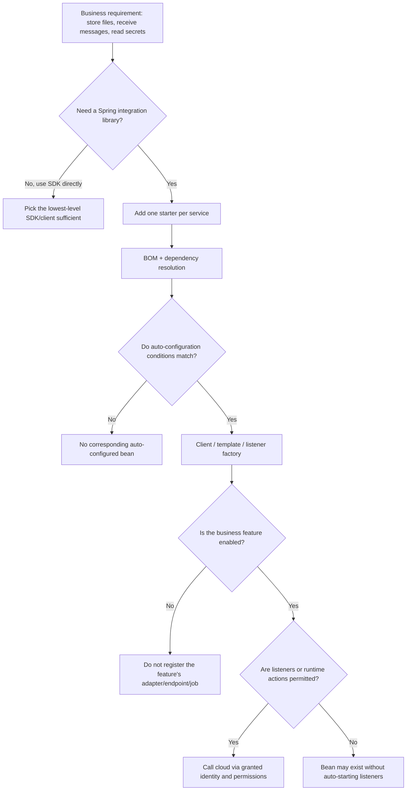

# Adding Only the Right Starters and Bounding Enabled Integrations

> **Chapter:** Project Bootstrap  
> **Module:** SPRING_CLOUD_PROVIDER_INTEGRATION — hands-on integration of Spring Boot with managed services on AWS, Azure, and Google Cloud via the corresponding Spring Cloud libraries.

An application that only needs to upload files to Amazon S3 yet adds starters for S3, SQS, Secrets Manager, and a large umbrella "cloud starter" ends up managing far more SDKs, beans, configuration, permissions, and connection paths than the business requires. In development or test environments, an auto-starting listener may begin polling messages from a real queue; a secret-loading configuration may attempt to call the cloud even before Spring initializes application beans.

This lesson presents how to **add only the necessary starters**, understand auto-configuration activation conditions, and precisely bound **clients, adapters, listeners, configuration sources, and cloud operations** per environment. This is a critical step when bootstrapping projects integrating storage, messaging, data, and secrets across AWS, Azure, and Google Cloud.

## 1. Learning Outcomes

After this lesson, you will be able to:

1. Distinguish a BOM, a starter, an SDK library, and an integration that is actually initialized.
2. Pick the right starter for the **service and operation needed**, rather than adding every service of a cloud provider.
3. Explain how `@SpringBootApplication`, the classpath, `@ConditionalOnClass`, `@ConditionalOnProperty`, and `@ConditionalOnMissingBean` govern auto-configuration.
4. Use properties to toggle S3, SQS, Azure Blob Storage, Azure Service Bus, Google Cloud Storage, and Pub/Sub integrations in the verified library branches.
5. Separate **client creation**, **business adapter registration**, **listener startup**, and **cloud configuration loading** into distinct decisions.
6. Test that environments with a feature disabled neither create unwanted beans nor perform unintended operations, while enabled environments still satisfy IAM, secrets, timeouts, and retries.

## 2. A Cloud Integration Has Multiple Activation Layers

You cannot judge an integration as "enabled" merely because a JAR exists in the build file. Consider four layers:

| Layer | What Does It Decide? | Control Mechanisms |
|---|---|---|
| **1. Build/classpath** | Are the service's classes and SDK brought into the application? | `pom.xml` / `build.gradle.kts`, BOM, starters, dependency tree |
| **2. Spring auto-configuration** | Does Spring automatically create clients, templates, factories, and related beans? | Classpath/bean/property conditions; `*.enabled` flags; exclude config when truly necessary |
| **3. Adapter/business logic** | Which services, REST endpoints, or jobs use the integration? | `@ConditionalOnProperty`, module structure, interfaces/adapters, profiles, and dependency injection |
| **4. Runtime activity** | Do listeners start polling, schedulers run, and apps send cloud requests? | Auto-startup/lifecycle, feature flags, schedulers, endpoints, IAM, and tests |

Beyond those four layers, **loading configuration** from a secret store via `spring.config.import` typically happens while Spring Boot prepares the `Environment`, **before** regular auto-configuration. Therefore, turning off a starter with `*.enabled=false` does not always prevent reading secrets from configuration if that source is still declared.



**Three key conclusions:**

- **Importing a BOM** only manages versions; it does not add clients or starters to the classpath.
- **Adding a starter** usually enables the *capability* for conditional auto-configuration, but does not guarantee a bean exists or has permission to call the cloud.
- **Disabling auto-configuration** does not automatically remove manually defined `@Bean` clients, scheduled jobs, or secret sources loaded independently during the configuration phase.

## 3. Choosing Starters from a Clear Requirement

First, write the requirement as **action + managed service + data direction**. "AWS integration" is too broad; "upload objects to S3" is specific enough to pick a starter.

| Business Need | AWS | Azure | Google Cloud |
|---|---|---|---|
| Store/read objects | S3: `io.awspring.cloud:spring-cloud-aws-starter-s3` | Blob Storage: `com.azure.spring:spring-cloud-azure-starter-storage-blob` | Cloud Storage: `com.google.cloud:spring-cloud-gcp-starter-storage` |
| Send/receive messages | SQS: `io.awspring.cloud:spring-cloud-aws-starter-sqs` | Service Bus: `com.azure.spring:spring-cloud-azure-starter-servicebus` | Pub/Sub: `com.google.cloud:spring-cloud-gcp-starter-pubsub` |
| Read secrets | Secrets Manager: `io.awspring.cloud:spring-cloud-aws-starter-secrets-manager` | Key Vault Secrets: `com.azure.spring:spring-cloud-azure-starter-keyvault-secrets` | Secret Manager: `com.google.cloud:spring-cloud-gcp-starter-secretmanager` |
| Managed data (example) | DynamoDB: `io.awspring.cloud:spring-cloud-aws-starter-dynamodb` | Cosmos DB: `com.azure.spring:spring-cloud-azure-starter-cosmos` | Cloud SQL PostgreSQL: `com.google.cloud:spring-cloud-gcp-starter-sql-postgresql` |

This table shows **directional coordinates** for modern integration lines. Check the documentation for your **exact provider major/version** and per-service support before copying dependencies. For an app that only needs S3, start with **only the S3 starter**. Only add the **SQS starter** and design a separate listener when a requirement to consume SQS events arises.

### How Do Starters, Direct SDKs, and Abstractions Differ?

- **Starter:** adds required modules and registers auto-configuration per Spring Boot conventions.
- **Direct SDK:** the provider's low-level API, useful when you need features lacking a Spring abstraction or want full control over client/lifecycle construction.
- **Spring abstraction:** templates, resource loaders, listener annotations, or repositories that reduce boilerplate, without replacing every feature and semantic of the underlying service.

For instance, SQS is a queue with visibility timeouts; Pub/Sub organizes topics and subscriptions; Azure Service Bus has queues/topics/subscriptions and its own lock/settlement mechanism. You cannot swap starters among the three and assume retries, acknowledgments, and dead-letter handling behave identically.

### Decision Questions Before Adding a Dependency

1. Which feature actually uses this service in production?
2. Does the app need to **send**, **receive**, **read**, **write**, or **administer** resources? For example, a publisher does not necessarily need a consumer listener.
3. Should the feature be active identically on laptops, CI, staging, and production?
4. Does the Spring starter support the required API in the selected version, or is the direct SDK needed?
5. Which SDKs/HTTP clients does the starter pull in, and do they conflict with the existing BOMs?
6. Are IAM/RBAC identities and an isolated test environment ready for testing connectivity?

## 4. Choosing Versions and Declaring Starters in Maven

The example below illustrates a project using **Spring Boot 4.0.x** and a matching **Spring Cloud AWS 4.x** release. Exact patch numbers must be locked from the provider's compatibility table at implementation time; the POM snippet uses the `spring-cloud-aws.version` property defined in the project.

**Maven — BOM import inside `dependencyManagement`:**

```xml
<dependencyManagement>
    <dependencies>
        <dependency>
            <groupId>io.awspring.cloud</groupId>
            <artifactId>spring-cloud-aws-dependencies</artifactId>
            <version>${spring-cloud-aws.version}</version>
            <type>pom</type>
            <scope>import</scope>
        </dependency>
    </dependencies>
</dependencyManagement>
```

**Maven — add only S3 when the feature is object upload:**

```xml
<dependencies>
    <dependency>
        <groupId>io.awspring.cloud</groupId>
        <artifactId>spring-cloud-aws-starter-s3</artifactId>
    </dependency>
</dependencies>
```

These snippets go into the **corresponding sections of a POM that already has the Spring Boot parent/BOM**, not as two standalone POMs. When `spring-cloud-aws-dependencies` manages the starter, do not declare an individual `<version>` on the starter. If the application also uses Spring Cloud Config, Gateway, or Stream, evaluate and additionally import the compatible `org.springframework.cloud:spring-cloud-dependencies` BOM. The name "Spring Cloud AWS" does **not** mean an S3 app automatically needs the Spring Cloud release-train BOM.

When SQS is truly needed:

```xml
<!-- Add to <dependencies>, keeping the S3 starter if still using S3. -->
<dependency>
    <groupId>io.awspring.cloud</groupId>
    <artifactId>spring-cloud-aws-starter-sqs</artifactId>
</dependency>
```

Do not install the SQS starter "just in case" if there is no plan to use it. If the binary must include SQS before it is actively used, add explicit activation settings for real environments.

### Switching to Azure or Google Cloud

**Azure Blob Storage — BOM and starter snippet:**

```xml
<!-- Inside <dependencyManagement><dependencies> -->
<dependency>
    <groupId>com.azure.spring</groupId>
    <artifactId>spring-cloud-azure-dependencies</artifactId>
    <version>${spring-cloud-azure.version}</version>
    <type>pom</type>
    <scope>import</scope>
</dependency>

<!-- Inside <dependencies> -->
<dependency>
    <groupId>com.azure.spring</groupId>
    <artifactId>spring-cloud-azure-starter-storage-blob</artifactId>
</dependency>
```

**Google Cloud Pub/Sub — BOM and starter snippet:**

```xml
<!-- Inside <dependencyManagement><dependencies> -->
<dependency>
    <groupId>com.google.cloud</groupId>
    <artifactId>spring-cloud-gcp-dependencies</artifactId>
    <version>${spring-cloud-gcp.version}</version>
    <type>pom</type>
    <scope>import</scope>
</dependency>

<!-- Inside <dependencies> -->
<dependency>
    <groupId>com.google.cloud</groupId>
    <artifactId>spring-cloud-gcp-starter-pubsub</artifactId>
</dependency>
```

Version properties must be declared under `<properties>` according to the **Boot ↔ provider matrix** and the provider's release notes. If you only integrate Azure Blob, you do not need all three provider BOMs. If a project uses multiple clouds simultaneously, inspect the actual graph because importing separate BOMs **does not prove** they were cross-tested.

## 5. Gradle: Import the BOM and Declare Only Needed Starters

With Gradle native platforms, an application using the Spring Boot Gradle plugin can be written as:

```kotlin
plugins {
    java
    id("org.springframework.boot") version "<VERIFIED_BOOT_VERSION>"
}

repositories {
    mavenCentral()
}

dependencies {
    implementation(platform(
        org.springframework.boot.gradle.plugin.SpringBootPlugin.BOM_COORDINATES
    ))
    implementation(platform(
        "io.awspring.cloud:spring-cloud-aws-dependencies:<AWSPRING_VERSION>"
    ))

    // Only S3 is required by the current business logic:
    implementation("io.awspring.cloud:spring-cloud-aws-starter-s3")

    // Add when an SQS use case arrives:
    // implementation("io.awspring.cloud:spring-cloud-aws-starter-sqs")
}
```

**This is a structural snippet**, not a ready-to-run script: the two placeholders `<VERIFIED_BOOT_VERSION>` and `<AWSPRING_VERSION>` must be replaced with **real versions** checked for compatibility. Full Java toolchain, repository, test, and build plugin configurations must be set up per project.

For Azure or GCP, swap the platform and starter for the provider's BOM and service:

```kotlin
// Azure Blob Storage:
implementation(platform(
    "com.azure.spring:spring-cloud-azure-dependencies:<AZURE_VERSION>"
))
implementation("com.azure.spring:spring-cloud-azure-starter-storage-blob")

// Google Cloud Pub/Sub (alternative):
implementation(platform(
    "com.google.cloud:spring-cloud-gcp-dependencies:<GCP_VERSION>"
))
implementation("com.google.cloud:spring-cloud-gcp-starter-pubsub")
```

Do not copy all of the snippets above together if the application does not use all three clouds. In Gradle, another option is the `io.spring.dependency-management` plugin to import BOMs via `mavenBom(...)`; when used alongside the Spring Boot Gradle plugin, Spring Boot BOM management differs from native platforms. Pick one clear strategy for the project and inspect `runtimeClasspath` after declaring dependencies.

**Dependency inspection commands:**

```bash
# Maven
./mvnw dependency:tree
./mvnw help:effective-pom

# Gradle
./gradlew dependencies --configuration runtimeClasspath
./gradlew dependencyInsight --dependency spring-cloud-aws-starter-s3 \
    --configuration runtimeClasspath
```

On Windows, use `.\mvnw.cmd` or `.\gradlew.bat`. The Gradle command uses `\` line continuation for Unix shells; in PowerShell, write it on one line or use PowerShell's line-continuation syntax.

## 6. How Spring Boot Auto-Configuration Is Activated

An application annotated with `@SpringBootApplication` enables auto-configuration by default. The framework loads the list of auto-configuration classes declared by libraries and checks conditions such as:

| Condition | Question | Example Impact |
|---|---|---|
| `@ConditionalOnClass` | Are the required SDK classes on the classpath? | Without `S3Client`, an S3 auto-configuration may not match. |
| `@ConditionalOnMissingBean` | Has the application already declared a matching bean? | The provider can back off if the app defines its own client. |
| `@ConditionalOnProperty` | Does the feature toggle property have the expected value? | `spring.cloud.aws.s3.enabled=false` prevents S3 auto-config in branches supporting this flag. |
| `@ConditionalOnBean` | Does a required foundational bean already exist? | A secondary adapter may only activate when the root client is configured. |
| `@Profile` | Is the required profile active? | A test bean only loads under the `local` profile. |

Conditions work together. **Having everything on the classpath does not mean a bean will exist**, and having a bean does not mean a network request has occurred. Some clients instantiate local objects at startup and only connect when used; listeners or Config Data importers may perform requests earlier.

### When Does Spring "Back Off" for an Application-Provided Bean?

If auto-configuration uses `@ConditionalOnMissingBean` and the developer declares a bean of the same type, the framework usually skips creating a second default bean. This is a valid customization mechanism, but **it is not an integration kill-switch**: your custom bean still runs and can connect to the cloud.

For example, to test against a mock/emulator endpoint, you can configure a custom `S3Client` instead of the default client. When doing so, test bean creation as well, because **two beans of the same type** or **unexpected bean replacement** can trigger `NoUniqueBeanDefinitionException` or cause the app to hit the wrong endpoint.

## 7. Documented Service Activation Switches

The properties below are documented for AWSpring 4.x, modern Spring Cloud Azure, and Spring Framework on Google Cloud 8.x. When using a different branch, consult the configuration reference appendix for that exact version.

| Provider / Feature | Property | Effect When Set to `false` |
|---|---|---|
| AWS S3 | `spring.cloud.aws.s3.enabled` | Does not run the corresponding S3 integration auto-configuration. |
| AWS SQS | `spring.cloud.aws.sqs.enabled` | Does not enable the corresponding SQS auto-configuration. |
| Azure Blob Storage | `spring.cloud.azure.storage.blob.enabled` | Does not enable the corresponding Blob Storage auto-configuration. |
| Azure Service Bus | `spring.cloud.azure.servicebus.enabled` | Does not enable the corresponding Service Bus auto-configuration. |
| Google Cloud Storage | `spring.cloud.gcp.storage.enabled` | Does not enable the corresponding Cloud Storage auto-configuration. |
| Google Cloud Pub/Sub | `spring.cloud.gcp.pubsub.enabled` | Does not enable the corresponding Pub/Sub auto-configuration. |

**These flags do not strip JARs from the binary.** Nor do they stop an SDK bean **written directly by the application**, a job calling the SDK directly, or an independent cloud Config Data import source. To guarantee a dependency is absent, remove the starter from the build file; to control network actions, verify runtime behavior and actual call paths.

Official sources:

- [AWSpring 4.1.x — Common application properties](https://docs.awspring.io/spring-cloud-aws/docs/4.1.1/reference/html/appendix.html).
- [Azure — Storage configuration properties](https://learn.microsoft.com/azure/developer/java/spring-framework/configuration-properties-azure-storage) and [Azure Service Bus configuration](https://learn.microsoft.com/azure/developer/java/spring-framework/spring-messaging-service-bus-support).
- [Google Cloud — Storage](https://googlecloudplatform.github.io/spring-cloud-gcp/8.2.4/reference/html/storage.html) and [Pub/Sub](https://googlecloudplatform.github.io/spring-cloud-gcp/8.2.4/reference/html/pubsub.html).

### Example 1 — Enabling Only S3 in an AWS Application

```yaml
# src/main/resources/application.yml
spring:
  cloud:
    aws:
      region:
        static: ${AWS_REGION:ap-southeast-1}
      s3:
        enabled: ${APP_S3_ENABLED:false}
      sqs:
        enabled: false

app:
  integrations:
    s3:
      enabled: ${APP_S3_ENABLED:false}
  storage:
    s3:
      bucket: ${APP_S3_BUCKET:}
```

In environments **not using S3**, `APP_S3_ENABLED` defaults to `false`, so neither S3 auto-config nor the conditional business adapter is registered (see the next section). In environments using S3, set `APP_S3_ENABLED=true`, `APP_S3_BUCKET`, and the appropriate IAM role/credentials. Do not treat `ap-southeast-1` as valid for every bucket: the region must match the actual provisioned resource.

`spring.cloud.aws.sqs.enabled=false` only matters if the SQS module is on the classpath; if the SQS starter is not present, this is no reason to add it. In the final configuration of an S3-only application, you can drop the entire SQS block.

### Example 2 — Selecting One Azure Service

```yaml
spring:
  cloud:
    azure:
      storage:
        blob:
          enabled: ${APP_AZURE_BLOB_ENABLED:false}
      servicebus:
        enabled: ${APP_AZURE_SERVICEBUS_ENABLED:false}
```

When an app only works with Azure Blob, add the Blob starter and enable `APP_AZURE_BLOB_ENABLED` in relevant environments. **Do not add the Service Bus starter** if messaging is not needed yet. If both are needed, manage data permissions and endpoints separately per service; a token valid for Blob access still lacks roles to send messages to Service Bus.

### Example 3 — Selecting One Google Cloud Service

```yaml
spring:
  cloud:
    gcp:
      project-id: ${GCP_PROJECT_ID:}
      storage:
        enabled: ${APP_GCP_STORAGE_ENABLED:false}
      pubsub:
        enabled: ${APP_GCP_PUBSUB_ENABLED:false}
```

Include only the Storage or Pub/Sub starter as needed. Even when one integration is disabled, other core GCP modules may still be present if required by another starter; **do not assume every GCP bean is absent**. Project ID and Application Default Credentials must be configured for environments that actually call Google Cloud.

## 8. Distinguishing Disabling the Client from Stopping the Listener

For messaging applications, there are three distinct intents:

| Intent | Primary Approach | What to Know |
|---|---|---|
| **Do not integrate SQS** | Remove the SQS starter; or set `spring.cloud.aws.sqs.enabled=false` if the dependency must stay | Avoids SQS auto-config/beans; check custom beans and separate config sources. |
| **Need to send SQS, not consume yet** | Keep the SQS client/template; set `spring.cloud.aws.sqs.listener.auto-startup=false` if supported by the listener container | Message sending can still work; listeners are registered without auto-starting. |
| **Want automatic SQS consumption** | Enable SQS integration, allow listener startup, and configure queues/ack/retries | Startup may look up queue URLs/attributes and poll; must use the right environment/queue. |

Example test environment that only wants to test publishing without pulling messages from the queue:

```yaml
spring:
  cloud:
    aws:
      sqs:
        enabled: true
        listener:
          auto-startup: false
```

**Key distinction:** `listener.auto-startup=false` is not `sqs.enabled=false`. It controls **listener container lifecycle**, does not remove the SQS client, and does not block SQS calls made explicitly by other code. Check the auto-startup flag against your AWSpring branch and any custom containers; if the application builds its own listener container, configure that container's lifecycle directly.

Docs: [AWSpring SQS — auto-configuration and listener container lifecycle](https://docs.awspring.io/spring-cloud-aws/docs/4.1.1/reference/html/index.html).

### With Azure Service Bus and Google Pub/Sub

Do not carry `spring.cloud.aws.sqs.listener.auto-startup` over to Azure Service Bus or Google Pub/Sub: they use different APIs and consumer lifecycles. If you only publish messages, pick the appropriate starter/client and **do not register subscribers/listeners** when unneeded. If a listener is conditionally enabled, test that disabled configs neither create nor start the listener. Check the container/binder docs for your **exact branch** before choosing lifecycle properties, since a service may support multiple consumption models: native SDK, Spring Messaging, or Spring Cloud Stream binder.

### Listeners vs. Config Data Importers

A listener normally starts as the Spring context comes up. A `spring.config.import` source may be processed **before the context is built**. For example, if a profile imports secrets from the cloud, do not expect listener or client flags to disable secret fetching. Remove or adjust the import source in the specific profile/environment where it should be off.

## 9. Bounding Business Beans with Feature Flags Too

Suppose the application can store invoices on S3, yet on developer laptops or in CI we want to run other business logic without instantiating the upload adapter.

**Setting `spring.cloud.aws.s3.enabled=false` alone is not enough** if a service still has a mandatory dependency on `S3Client`. That service can prevent startup due to a missing bean. Toggle **along a single business boundary**.

### Step 1 — Define a storage contract

```java
package com.example.providerdemo.storage;

public interface InvoiceStore {
    void put(String objectKey, byte[] bytes);
}
```

### Step 2 — Write an independent S3 adapter

```java
package com.example.providerdemo.storage;

import software.amazon.awssdk.core.sync.RequestBody;
import software.amazon.awssdk.services.s3.S3Client;
import software.amazon.awssdk.services.s3.model.PutObjectRequest;

public final class S3InvoiceStore implements InvoiceStore {
    private final S3Client client;
    private final String bucket;

    public S3InvoiceStore(S3Client client, String bucket) {
        this.client = client;
        this.bucket = bucket;
    }

    @Override
    public void put(String objectKey, byte[] bytes) {
        var request = PutObjectRequest.builder()
                .bucket(bucket)
                .key(objectKey)
                .build();
        client.putObject(request, RequestBody.fromBytes(bytes));
    }
}
```

This example focuses on the **activation mechanism** and omits file size checks, content type, object key validation, timeouts, and retries. Those must be completed before taking the adapter to production.

### Step 3 — Register the adapter only when the feature is enabled

```java
package com.example.providerdemo.storage;

import org.springframework.beans.factory.annotation.Value;
import org.springframework.boot.autoconfigure.condition.ConditionalOnProperty;
import org.springframework.context.annotation.Bean;
import org.springframework.context.annotation.Configuration;
import software.amazon.awssdk.services.s3.S3Client;

@Configuration(proxyBeanMethods = false)
public class InvoiceStorageConfiguration {

    @Bean
    @ConditionalOnProperty(
            prefix = "app.integrations.s3",
            name = "enabled",
            havingValue = "true"
    )
    InvoiceStore invoiceStore(
            S3Client s3Client,
            @Value("${app.storage.s3.bucket}") String bucket) {
        return new S3InvoiceStore(s3Client, bucket);
    }
}
```

Here `app.integrations.s3.enabled` is an **application-owned feature flag**. It is independent of AWSpring's `spring.cloud.aws.s3.enabled`. The `application.yml` example in Section 7 binds **the same environment variable** `APP_S3_ENABLED` to both flags to prevent one from being on while the other is off.

If **the adapter is enabled while S3 auto-config is disabled**, Spring may fail due to a missing `S3Client`. A clear startup failure is usually better than a half-configured adapter; still, verify conditions in CI. If the application defines a custom `S3Client`, design accordingly and do not rely on AWSpring properties to suppress a manually created client.

### Step 4 — Bound REST endpoints or jobs using the adapter

Example REST controller registered only when the feature is enabled:

```java
package com.example.providerdemo.storage;

import org.springframework.boot.autoconfigure.condition.ConditionalOnProperty;
import org.springframework.http.ResponseEntity;
import org.springframework.web.bind.annotation.PostMapping;
import org.springframework.web.bind.annotation.RequestBody;
import org.springframework.web.bind.annotation.RequestParam;
import org.springframework.web.bind.annotation.RestController;

@RestController
@ConditionalOnProperty(
        prefix = "app.integrations.s3",
        name = "enabled",
        havingValue = "true"
)
public class InvoiceUploadController {
    private final InvoiceStore store;

    public InvoiceUploadController(InvoiceStore store) {
        this.store = store;
    }

    @PostMapping("/internal/invoices/upload")
    public ResponseEntity<Void> upload(
            @RequestParam String key,
            @RequestBody byte[] content) {
        store.put(key, content);
        return ResponseEntity.noContent().build();
    }
}
```

This endpoint **only illustrates registration**; it lacks authentication, upload limits, object key sanitization, and HTTP authorization. **Never expose an S3-writing endpoint like this publicly.** In practice, register such a controller only with proper authorization, validation, and storage policies.

When `APP_S3_ENABLED=false`, neither `InvoiceStore` nor the conditional controller is registered. When enabled, adapter, client, and endpoint must all have complete configuration. If an **always-registered** business bean requires `InvoiceStore`, either make that bean conditional too or provide an alternative implementation for non-S3 environments; do not paper over it with `@Autowired(required=false)` and silently ignore failures.

## 10. Environment Configuration: Enable Explicitly, Avoid Unintended Connections

Different environments may require different capabilities:

| Environment | Storage | Messaging Consumer | Secrets / Managed Data | Testing |
|---|---|---|---|---|
| Laptop without cloud access | Real adapter off; optional test/local storage fake | Do not auto-poll real queues | Do not import real secrets | Unit tests and offline context startup |
| CI unit tests | Feature flags off; fake/mock clients | Listener auto-startup off or no listener | Do not load secrets from cloud | Reproducible context and unit tests |
| Local integration tests | Adapter connected to supported emulator or local service | Consumer connected to test queue/emulator | Fake/test secrets | Test protocol, mapping, retries |
| Staging | Enable exact used integrations, least-privilege IAM | Staging queues/subscriptions only | Staging secrets/data | Smoke/integration tests in dedicated account |
| Production | Approved features enabled with metrics/alerts | Listeners running with configured concurrency, DLQ, retries | Workload identity, secret manager | Monitoring and rollback |

**Do not rely solely on profiles for access control.** Profiles select application configuration; cloud accounts and IAM determine what an identity is allowed to do. Even when a feature is disabled, never grant overly broad permissions to the workload.

### Structuring `application.yml` and Dedicated Profiles

For example, in `application.yml`, leave side-effecting features **off by default**:

```yaml
app:
  integrations:
    s3:
      enabled: ${APP_S3_ENABLED:false}

spring:
  cloud:
    aws:
      s3:
        enabled: ${APP_S3_ENABLED:false}
      sqs:
        enabled: ${APP_SQS_ENABLED:false}
        listener:
          auto-startup: ${APP_SQS_LISTENER_ENABLED:false}
```

In staging/production, provide explicit environment variables:

```text
APP_S3_ENABLED=true
APP_SQS_ENABLED=true
APP_SQS_LISTENER_ENABLED=true
APP_S3_BUCKET=<created-bucket-name>
AWS_REGION=<actual-region>
```

This is an **environment variable template**; `<...>` must be replaced with real environment values. Never put access keys or secret keys into files. For AWS, use the credential chain and an IAM role/workload identity; for Azure, use Microsoft Entra ID/managed identity; for Google Cloud, use ADC/workload identity.

### When Using `spring.config.import` with Secrets

An application may load configuration from AWS Secrets Manager, Azure Key Vault, or Google Secret Manager before instantiating business clients. If the `local` profile is not allowed to call secret stores, **remove the import source from local configuration** and use test values in an isolated environment. Do not merely add `optional:` and assume the importer will not run: `optional` usually only prevents errors in some missing-source cases, **it does not mean skipping network requests**.

General rule: **starters govern runtime logic**, **Config Data imports govern Environment preparation**, and **IAM/RBAC governs permissions**. Check all three when the goal is "offline startup."

## 11. When to Use Auto-Configuration Exclusion?

Spring Boot supports excluding a specific auto-configuration via `@SpringBootApplication(exclude=...)`, `excludeName`, or `spring.autoconfigure.exclude`. This is meant for cases where **you have identified the exact auto-configuration class to block**. Do not copy class names from Spring Boot 3 into Boot 4 or from another provider version because packages and class names can change.

For a service with a documented `*.enabled` property, start with the **service property**. To remove the integration capability altogether, the cleanest solution is usually **not adding the starter**. Only use exclusion when neither option fits and you have verified the exact class in the artifact you use.

Common misconceptions:

| Approach | What It Achieves | What It Does Not Guarantee |
|---|---|---|
| Remove `spring-cloud-aws-starter-sqs` from build | Removes dependencies declared by that starter | That SQS modules aren't pulled transitively by another library |
| `spring.cloud.aws.sqs.enabled=false` | Blocks the corresponding SQS auto-configuration | That manually defined `SqsAsyncClient` code won't run |
| `spring.cloud.aws.sqs.listener.auto-startup=false` | Prevents listeners from auto-starting via supported mechanism | That no SQS client/template exists or no calls are made by other code |
| `@ConditionalOnProperty` on adapter | Skips registering the app bean when flag doesn't match | That the provider starter itself won't create underlying beans |
| `spring.autoconfigure.exclude` | Blocks the named auto-config class | That other services, custom configs, or Config Data imports won't run |
| Read-only IAM role | Restricts writes via real policy | That clients aren't created or the app won't attempt API calls |

## 12. Verifying That Only Expected Integrations Are Active

Do not consider "the application started without errors" sufficient. Verify **bean presence**, **auto-config origins**, **listener lifecycle**, **network behavior**, and **cloud permissions**.

### 12.1. Condition Evaluation Report

Spring Boot can print the condition report when run with:

```bash
./mvnw spring-boot:run -Dspring-boot.run.arguments=--debug
```

Or when running the JAR:

```bash
java -jar target/provider-demo.jar --debug
```

The JAR filename is only an example. The **Condition Evaluation Report** shows positive/negative matches and why each auto-configuration was applied or skipped. In development with Spring Boot Actuator, `/actuator/conditions` helps inspect results, though diagnostic endpoints should not be exposed publicly in production; restrict exposure and protect appropriately.

Source: [Spring Boot — Auto-configuration](https://docs.spring.io/spring-boot/reference/using/auto-configuration.html).

### 12.2. Unit Testing Conditional Adapters

Example using `ApplicationContextRunner` to test `InvoiceStorageConfiguration` from Section 9. This test **does not call AWS**:

```java
package com.example.providerdemo.storage;

import org.junit.jupiter.api.Test;
import org.springframework.boot.test.context.runner.ApplicationContextRunner;
import software.amazon.awssdk.services.s3.S3Client;

import static org.assertj.core.api.Assertions.assertThat;
import static org.mockito.Mockito.mock;

class InvoiceStorageConfigurationTest {

    private final ApplicationContextRunner runner = new ApplicationContextRunner()
            .withUserConfiguration(InvoiceStorageConfiguration.class)
            .withBean(S3Client.class, () -> mock(S3Client.class));

    @Test
    void doesNotRegisterAdapterWhenDisabled() {
        runner.withPropertyValues("app.integrations.s3.enabled=false")
                .run(context -> assertThat(context)
                        .doesNotHaveBean(InvoiceStore.class));
    }

    @Test
    void registersAdapterWhenEnabled() {
        runner.withPropertyValues(
                        "app.integrations.s3.enabled=true",
                        "app.storage.s3.bucket=test-invoices")
                .run(context -> assertThat(context)
                        .hasSingleBean(InvoiceStore.class));
    }
}
```

`ApplicationContextRunner` comes from Spring Boot's test utilities and `mock` from Mockito. The project needs `spring-boot-starter-test` and the right branch's S3 SDK/starter. This test verifies that the **application bean** is conditional; it does not yet prove the provider's auto-configured `S3Client` is also disabled.

### 12.3. Testing Provider Auto-Config Flags

To test AWSpring 4.x's S3 auto-configuration class itself, build an isolated context with `AutoConfigurations` and the disable flag:

```java
package com.example.providerdemo.storage;

import io.awspring.cloud.autoconfigure.s3.S3AutoConfiguration;
import org.junit.jupiter.api.Test;
import org.springframework.boot.autoconfigure.AutoConfigurations;
import org.springframework.boot.test.context.runner.ApplicationContextRunner;
import software.amazon.awssdk.services.s3.S3Client;

import static org.assertj.core.api.Assertions.assertThat;

class S3AutoConfigurationDisabledTest {

    @Test
    void disabledPropertyPreventsAutoConfiguredClient() {
        new ApplicationContextRunner()
                .withConfiguration(
                        AutoConfigurations.of(S3AutoConfiguration.class))
                .withPropertyValues("spring.cloud.aws.s3.enabled=false")
                .run(context -> assertThat(context)
                        .doesNotHaveBean(S3Client.class));
    }
}
```

This test is **intentionally coupled to AWSpring 4.x's package/class names**. If you change majors/versions and auto-config packages shift, update the test to match the artifact in use. It only confirms that **the auto-configuration loaded into the test runner was skipped**; it does not prove the entire application has no custom client or network calls elsewhere.

### 12.4. Testing Enabled and Disabled Environments

| Scenario | Expectation | How to Prove |
|---|---|---|
| S3 flag false | No conditional `InvoiceStore`/REST endpoint; no S3 auto beans from starter | ContextRunner, condition report, controller mappings |
| S3 flag true | Exactly one adapter and client; uploads to expected bucket/key | Context test, mocked-SDK unit test, S3 integration test |
| SQS enabled but listener auto-startup false | Publisher can use client; listener does not auto-poll | Check container lifecycle and absence of `ReceiveMessage` requests |
| Azure Blob disabled | Blob auto-config beans not created per the branch's property | Context test + condition report |
| Pub/Sub disabled | No corresponding Pub/Sub integration created; no business subscriber registered | Condition report + startup/behavioral test |
| Local profile without secrets | No unintended secret fetch at startup | Check `spring.config.import` and network/test logs |
| Production with right features | Identity accesses right resources, reasonable retries/timeouts | Smoke test with least privilege and dedicated resources |

Emulators are useful for local integration tests, yet they do not fully verify IAM/RBAC, TLS, quotas, and real managed service behavior. A smoke test in a dedicated staging environment verifies the infrastructure layer. Run these tests with the exact JDK, Spring Boot, and provider BOM versions planned for deployment.

## 13. Bounding Integrations to Reduce Security and Operational Risk

Minimizing starters does more than simplify the dependency tree. It shrinks the surface of called APIs, configuration paths to maintain, credential chains to audit, and libraries needing patches.

### Identity and Least Privilege

| Need | Permissions to Consider | Do Not Grant by Default |
|---|---|---|
| AWS S3 upload | `s3:PutObject` on allowed prefix/bucket; add KMS permissions if using SSE-KMS | `s3:*` across all buckets |
| AWS SQS send | `sqs:SendMessage` on specific queue | Receive/delete/administration permissions if only publishing |
| Azure Blob upload | Appropriate data role, e.g. Storage Blob Data Contributor at required scope | Subscription Owner/Contributor just to read/write blobs |
| Azure Service Bus send | Role such as Azure Service Bus Data Sender with right scope | Data Receiver/Owner if not consuming/administering |
| Google Cloud Storage write | IAM role sufficient for object operations in bucket per org policy | Broad Project Editor |
| Google Cloud Pub/Sub publish | Publish permission on the target topic | Pub/Sub Admin if the app does not manage topics |

Never hard-code AWS access keys, Azure connection strings, or Google service account JSON keys in `application.yml`. Prefer roles/managed identities/workload identities and proper secret sources. Distinguish **authentication** (who is verified) from **authorization** (which resources they may access).

### Do Not Equate "Feature Off" with "Zero Cost"

If an SQS listener is running, it can poll the queue even when empty; a periodic upload job can call S3; a Config Data source can hit a secret store on startup. Controlling cost and connections therefore requires reviewing **listener auto-startup**, **schedulers**, **retries**, **health checks**, and **secret imports** at runtime, not just counting starters.

## 14. Common Mistakes and How to Fix Them

| Symptom | Possible Explanation | Diagnostic Direction |
|---|---|---|
| Added BOM but no `S3Client` | BOM only manages versions; starter missing or condition unmet | Check `dependencies`, classpath, condition report |
| `NoSuchBeanDefinitionException` for `S3Client` | S3 auto-config off or class missing; adapter still enabled | Align app and provider feature flags; check SDK/starter |
| Cloud beans exist despite `*.enabled=false` | Bean created by app, another starter, or custom config | Check bean definition origin, auto-config report, and `@Bean`s |
| CI attempts cloud calls right at startup | Listener auto-startup, startup runner, or Config Data import | Inspect listeners/`@PostConstruct`/`ApplicationRunner`/`spring.config.import` |
| SQS still sends when listener startup is off | Listener flag only stops consumer; publisher client still exists | May be desired behavior; verify business requirements |
| Azure Blob fails to create client | Wrong property prefix, missing starter, unmet condition, or version mismatch | Check Azure branch appendix, debug conditions |
| Pub/Sub returns `PERMISSION_DENIED` | Client works, but ADC/service account lacks permissions | Check project ID, principal, topic/subscription IAM |
| S3 returns 403 | IAM/bucket policy/KMS, not necessarily a starter bug | Verify role, actions, and resource ARNs |
| Auto-config skips a bean and integration test fails | Test requires that bean; no substitute adapter exists | Separate profiles/features or provide a contract-compliant fake adapter |
| `optional:` config still calls secret store | `optional` does not mean "disable importer" | Declare imports only in environments needing real secrets |
| Boots up, but listener receives no messages | `listener.auto-startup=false`, wrong queue/subscription, missing permissions, or bad ack | Check lifecycle, endpoints, IAM, and consumer logs |
| Slow startup, mismatched Netty/SDK versions | Multiple starters or conflicting BOMs | Check Maven dependency tree / Gradle `dependencyInsight`; use compatible BOMs |

Do not add a second `@Bean` client or delete all dependencies as a knee-jerk reaction. Identify which boundary is wrong: **missing starter, unmet condition, missing business bean, unstarted listener, or insufficient cloud permissions**.

## 15. Practice Exercise: One Binary for Two Roles

**Context:** A document management application uses S3 for storing files, SQS for emitting/consuming events, and may replace S3 with Azure Blob or Google Cloud Storage in the future. The team wants to run the same codebase on laptops, CI, and production while enabling only the integrations needed.

### Part A — Design minimal starters

1. For the **uploader-only** role, choose the AWSpring BOM and S3 starter; omit SQS if the app neither sends nor receives messages.
2. For the **publisher/consumer** role, add the SQS starter; specify how publisher, listener, and IAM permissions are configured for each role.
3. Sketch two alternatives using Azure Blob and Google Cloud Storage, noting which starter/BOM must change and which identity and permissions must be set.
4. Record a dependency tree table showing key SDKs/HTTP clients; explain why an unnecessary extra starter bloats the classpath.

### Part B — Bound by environment

Create configurations for:

- `local`: all cloud adapters off, no real secret imports, no queue polling.
- `ci`: fake/mock clients and context tests only; no production credentials.
- `staging`: S3 upload on, SQS publisher on, while the listener does not auto-start in a publish-only job.
- `production`: exact needed roles enabled, IAM and consumer lifecycle verified.

Implement `InvoiceStore`, `S3InvoiceStore`, and a configuration using `@ConditionalOnProperty`. When S3 is disabled, the app neither creates the adapter nor registers the real upload route.

### Part C — Verify

Run at least these tests:

1. `APP_S3_ENABLED=false` → context has neither `InvoiceStore` nor upload route.
2. `APP_S3_ENABLED=true` → context has `InvoiceStore` with the expected bucket configuration.
3. SQS client enabled, `listener.auto-startup=false` → no automatic polling occurs.
4. Staging with valid credentials → test object upload succeeds; insufficient permissions → error handled cleanly.
5. No `spring.config.import` pointing to real secrets in offline profiles.

**Sample results table:**

| Role / Environment | Starter Present | Auto-Config Enabled | Business Bean | Listener Running | Evidence |
|---|---|---|---|---|---|
| Offline CI | S3 may be present to compile | S3=false | No | No | Context test |
| Staging uploader | S3 | S3=true | `InvoiceStore` | No SQS listener | Upload integration test |
| Staging SQS publisher | SQS | SQS=true | Publisher bean | false | Lifecycle test |
| Production SQS consumer | SQS | SQS=true | Consumer bean | true | Queue test + metrics |

**Completion criteria:** Able to explain **why each starter is needed**, **which beans are created**, **which services may be called**, **which listeners run**, and **which tests prove features stay inactive when disabled**.

## 16. Checklist Before Bootstrapping a Project or Merging a Feature

- [ ] Listed business needs for storage, messaging, data, and secrets along with required APIs/access directions.
- [ ] Added only starters actually used; provider BOMs match Java/Spring Boot/release train.
- [ ] Inspected the dependency tree and the SDK/HTTP clients pulled in by starters.
- [ ] Cross-checked `*.enabled` properties against the reference guide of the exact version.
- [ ] Business feature flags and provider flags are coordinated consistently.
- [ ] For messaging, separated **publisher client**, **subscriber/listener**, and **auto-startup**.
- [ ] Audited every `spring.config.import`, scheduler, startup runner, and custom `@Bean` that could call the cloud.
- [ ] Offline/CI environments never automatically call real managed services or fetch production secrets.
- [ ] Staging/production have workload identities, least-privilege IAM/RBAC, and accurate endpoints/regions/projects.
- [ ] Tests cover both enabled and disabled cases, Spring context checks, and real integration tests.
- [ ] Any auto-config exclusion has a documented rationale, narrow scope, and re-verification on dependency upgrades.

## References

1. [Spring Boot — Auto-configuration](https://docs.spring.io/spring-boot/reference/using/auto-configuration.html): conditional mechanisms, `--debug`, and intentional auto-configuration exclusions.
2. [Spring Cloud AWS 4.1.1 — Reference Guide](https://docs.awspring.io/spring-cloud-aws/docs/4.1.1/reference/html/index.html): S3/SQS starters and lifecycle configuration.
3. [Spring Cloud AWS 4.1.1 — Common Application Properties](https://docs.awspring.io/spring-cloud-aws/docs/4.1.1/reference/html/appendix.html): `spring.cloud.aws.s3.enabled` and `spring.cloud.aws.sqs.enabled`.
4. [Spring Cloud Azure — Configuration](https://learn.microsoft.com/azure/developer/java/spring-framework/configuration): property prefixes per service.
5. [Spring Cloud Azure — Blob Storage configuration](https://learn.microsoft.com/azure/developer/java/spring-framework/resource-handling): starter and `storage.blob.enabled`.
6. [Spring Cloud Azure — Service Bus](https://learn.microsoft.com/azure/developer/java/spring-framework/spring-messaging-service-bus-support): messaging model and `servicebus.enabled`.
7. [Spring Framework on Google Cloud — Getting Started 8.2.4](https://googlecloudplatform.github.io/spring-cloud-gcp/8.2.4/reference/html/getting-started.html): Storage and Pub/Sub starters and BOM.
8. [Spring Framework on Google Cloud — Pub/Sub 8.2.4](https://googlecloudplatform.github.io/spring-cloud-gcp/8.2.4/reference/html/pubsub.html): Pub/Sub flags and connecting to the emulator.
9. [Spring Framework on Google Cloud — Storage 8.2.4](https://googlecloudplatform.github.io/spring-cloud-gcp/8.2.4/reference/html/storage.html): Storage flags and configuration.
10. [Maven — Dependency mechanism](https://maven.apache.org/guides/introduction/introduction-to-dependency-mechanism.html), [Gradle — Viewing dependencies](https://docs.gradle.org/current/userguide/viewing_debugging_dependencies.html): inspecting actual resolved dependencies.

> **Remember:** Integration scope is governed across multiple layers: **whether the starter is present**, **whether auto-configuration runs**, **whether the business adapter is registered**, **whether listeners auto-start**, and **whether cloud requests are authorized**. Drawing clear boundaries at each layer keeps Spring Boot startup intentional, reduces dependency conflicts, and prevents unintended cloud operations.
