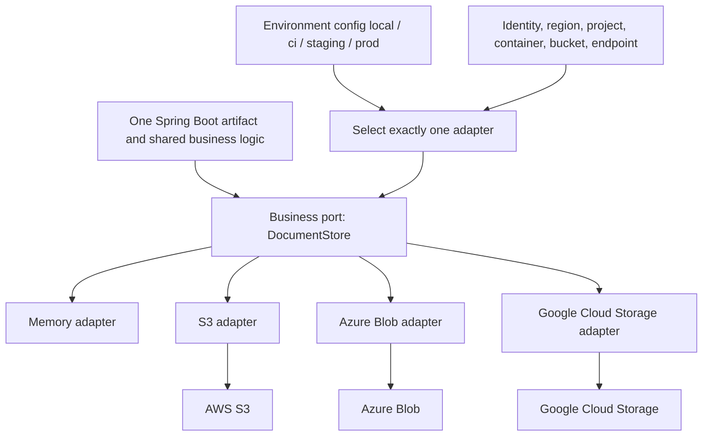

# Organizing Configuration and Adapters by Environment

> **Chapter:** Project Bootstrap  
> **Module:** SPRING_CLOUD_PROVIDER_INTEGRATION — hands-on integration of Spring Boot with managed services on AWS, Azure, and Google Cloud via the corresponding Spring Cloud libraries.

A document management service might use in-memory storage when running on a laptop, store files on Amazon S3 in staging, and deploy a variant using Azure Blob Storage or Google Cloud Storage for another customer. If business logic calls SDKs directly and reads environment variables scattered across every layer, every cloud change forces changes in business logic, configuration becomes hard to control, and tests may accidentally hit production resources.

The solution is to **separate the deployment environment from the provider choice**, externalize settings outside the application, and use adapters implementing a **stable business port**. The same processing flow can use a local, S3, Blob Storage, or Cloud Storage implementation, while each environment activates only the adapter and resources it is permitted to use.

## 1. Learning Objectives

After this lesson, you will be able to:

1. Distinguish **environment** (`local`, `ci`, `staging`, `prod`), **provider** (AWS, Azure, Google Cloud), and **capability/feature** (storage, messaging, data, secrets).
2. Organize `application.yml` and profile files according to Spring Boot's configuration rules; explain which property source takes precedence.
3. Read typed configuration via `@ConfigurationProperties`, validate required values, and bound adapters using `@Profile` or `@ConditionalOnProperty`.
4. Design a `DocumentStore` port with memory, S3, Azure Blob, and Google Cloud Storage adapters without coupling business logic directly to cloud SDKs.
5. Choose secure identity mechanisms, keep secrets out of source code, and prevent unexpected cloud calls in offline or CI environments.
6. Test every configuration combination: right adapter, right resources, no duplicate implementations injected, and no unintended requests.

## 2. Separating Three Configuration Dimensions Often Mixed Together

| Dimension | Question | Example | Unit of Change |
|---|---|---|---|
| **Environment** | Where is the application running, and what deployment policies apply? | `local`, `ci`, `staging`, `prod` | Pipeline / deployment |
| **Provider** | Which adapter implements a capability? | `memory`, `s3`, `azure-blob`, `gcs` | Architecture and deployment config |
| **Capability / feature** | Which features should be enabled? | Store files, publish/consume messages, read secrets, connect to database | Business needs and permissions |

Do not hard-assume `prod = AWS`, `staging = Azure`, or `local = no provider`. For example, staging should test **the same storage type** as production when the goal is verifying real behavior; local can use memory or emulators; multiple production tenants may deploy across different clouds.

One way to visualize the relationship:



**Important rule:** a single application port should have **exactly one selected implementation** when business logic injects a single bean. If two adapters are created, Spring can throw `NoUniqueBeanDefinitionException`; if none is created when business logic requires it, Spring can throw `NoSuchBeanDefinitionException`. In a production deployment, failing at startup due to incomplete configuration is usually far easier to handle than silently falling back to temporary memory and losing data.

## 3. Designing Code Layers Before Writing YAML

Organize packages/modules by **responsibility**:

```text
com.example.providerdemo
├── ProviderDemoApplication.java
├── document
│   ├── DocumentStore.java              # Business port
│   └── DocumentService.java            # Business logic, knows only the port
├── config
│   └── StorageSettings.java            # Typed configuration
├── adapter
│   ├── memory
│   │   ├── MemoryDocumentStore.java
│   │   └── MemoryStorageConfiguration.java
│   ├── aws
│   │   ├── S3DocumentStore.java
│   │   └── S3StorageConfiguration.java
│   ├── azure
│   │   ├── AzureBlobDocumentStore.java
│   │   └── AzureBlobStorageConfiguration.java
│   └── gcp
│       ├── GcsDocumentStore.java
│       └── GcsStorageConfiguration.java
└── resources
    ├── application.yml
    ├── application-local.yml
    ├── application-ci.yml
    ├── application-staging.yml
    └── application-prod.yml
```

This is a **recommended structure**, not files you need to create outside this lesson. If each provider lives in its own Gradle/Maven module, the business module should depend on `DocumentStore`; adapter modules depend inward on the port module, never the reverse. A binary that does not need every provider only packages the modules/starters actually used. If multiple providers must be supported in the same binary, bean wiring and dependencies must be tested across all branches.

### Stable Boundary: Business Port

```java
package com.example.providerdemo.document;

public interface DocumentStore {
    void save(String objectKey, byte[] content);
}
```

The application calls the port, not the SDK:

```java
package com.example.providerdemo.document;

import org.springframework.stereotype.Service;

@Service
public class DocumentService {
    private final DocumentStore store;

    public DocumentService(DocumentStore store) {
        this.store = store;
    }

    public void saveInvoice(String invoiceId, byte[] bytes) {
        if (invoiceId == null || invoiceId.isBlank()) {
            throw new IllegalArgumentException("invoiceId is required");
        }
        String key = "invoices/" + invoiceId + ".pdf";
        store.save(key, bytes);
    }
}
```

This example focuses on adapter selection. In a real application, `invoiceId` must be validated/sanitized so it cannot craft dangerous object keys; enforce file size and type limits, protect API authorization, and handle idempotency, checksums, metadata, and streaming for large files. `byte[]` is only suitable for examples or small files; avoid holding very large files entirely in RAM.

## 4. Understanding Spring Boot Configuration Precedence

Spring Boot allows reading configuration from YAML/properties files inside the JAR, external files, environment variables, system properties, command-line arguments, and additional Config Data sources. When the same key is declared in multiple places, **the higher-precedence source** determines the final value.

A useful model of common sources, from lowest to highest precedence:

| Source | Example | Notes |
|---|---|---|
| Shared config packaged inside JAR | `application.yml` | Non-secret defaults applied broadly |
| Profile config packaged inside JAR | `application-prod.yml` | Overrides shared config in the same location |
| External config outside JAR | `./config/application.yml` and profile variants | Can override packaged config; exact order depends on location/location group |
| OS environment variables | `APP_STORAGE_BACKEND=s3` | Well suited for deployments; can override file values |
| Java system properties | `-Dapp.storage.backend=s3` | Typically higher precedence than environment variables |
| Command-line arguments | `--app.storage.backend=s3` | Typically higher precedence than the sources above |
| Test properties | `@SpringBootTest(properties=...)`, `@TestPropertySource` | Have dedicated precedence rules for tests |

This is a **condensed summary for everyday decisions**. Spring Boot also processes JNDI, `SPRING_APPLICATION_JSON`, `@DynamicPropertySource`, Devtools, and location groups. When conflicts occur, consult [Spring Boot Externalized Configuration](https://docs.spring.io/spring-boot/4.0/reference/features/external-config.html) rather than guessing from a YAML line's position.

When multiple profiles are active, all matching `application-{profile}.yml` files may be read; within the same location group, **a profile processed later can override an earlier one**. For example, `--spring.profiles.active=staging,metrics` can allow `metrics` to override keys from `staging`. Therefore, minimize declaring the same key across multiple profiles and test the actual combination.

### Two Common Profile Syntaxes

**Approach 1: one file per profile.** Spring Boot automatically looks up `application-local.yml` when running `--spring.profiles.active=local`.

**Approach 2: a multi-document YAML file:**

```yaml
app:
  feature:
    audit-enabled: false
---
spring:
  config:
    activate:
      on-profile: "staging | prod"
app:
  feature:
    audit-enabled: true
```

The second document applies only when the profile expression matches; later documents can override keys from earlier ones. **Do not place `spring.profiles.active` or `spring.profiles.include` inside `application-prod.yml` or inside a document with `spring.config.activate.on-profile`.** Profile activation settings must reside in an unconditional source (such as the `SPRING_PROFILES_ACTIVE` environment variable or command-line arguments). Source: [Spring Boot Profiles](https://docs.spring.io/spring-boot/4.0/reference/features/profiles.html).

### Why Not Put Every Setting Into Profiles?

Profiles should hold stable environment-level differences: enabling mocks, appropriate log levels, auto-startup policies. Deployment-varying values like buckets, endpoints, project IDs, regions, queue names, accounts, and instances usually fit better in **environment variables or config external to the JAR**. Credentials, tokens, and private keys need dedicated secret delivery channels, never committed to YAML.

## 5. Sample Configuration Set for Local, CI, Staging, and Production

This example **defaults to no cloud adapter**, explicitly enabled by the environment. The configuration below illustrates architecture; properties under `app.*` are **application-defined**, while `spring.cloud.*` are defined by each starter/provider.

### 5.1. `application.yml` — shared configuration, safe when no environment is chosen

```yaml
spring:
  application:
    name: provider-integration-demo
  cloud:
    aws:
      s3:
        enabled: ${APP_AWS_S3_ENABLED:false}
      sqs:
        enabled: ${APP_AWS_SQS_ENABLED:false}
    azure:
      storage:
        blob:
          enabled: ${APP_AZURE_BLOB_ENABLED:false}
    gcp:
      storage:
        enabled: ${APP_GCP_STORAGE_ENABLED:false}
      pubsub:
        enabled: ${APP_GCP_PUBSUB_ENABLED:false}

app:
  storage:
    backend: ${APP_STORAGE_BACKEND:none}
    bucket: ${APP_STORAGE_BUCKET:}
    container: ${APP_STORAGE_CONTAINER:}
```

- `app.storage.backend` is the **application's adapter selection key**; accepts `memory`, `s3`, `azure-blob`, `gcs`, and `none` in this example.
- `spring.cloud.aws.s3.enabled`, `spring.cloud.azure.storage.blob.enabled`, and `spring.cloud.gcp.storage.enabled` control **provider auto-configuration** in branches supporting these flags.
- If `backend=s3` while `APP_AWS_S3_ENABLED=false`, the S3 adapter will lack an auto-configured SDK bean unless the app defines its own client; contradictory configuration should be caught at startup.
- `APP_STORAGE_BUCKET` is used for S3 or GCS, and `APP_STORAGE_CONTAINER` for Azure Blob; larger projects can split into separate per-provider property groups to avoid confusing naming.
- Setting `*.enabled=false` **does not automatically stop** custom `@Bean` clients, `ApplicationRunner`s, manually created listeners, or secret sources imported via `spring.config.import`.

These flags must be verified against the **reference guide for the exact branch of AWSpring, Spring Cloud Azure, and Spring Framework on Google Cloud** you are using. Do not extrapolate flag names from one provider to another.

### 5.2. `application-local.yml` — offline execution

```yaml
app:
  storage:
    backend: memory
```

Locally, enable only the memory adapter. Provider flags in the shared file default to `false` and should stay that way; if leftover `APP_AWS_S3_ENABLED` environment variables exist from another session, unset or explicitly override them. **The local profile is not a firewall**: environment variables take higher precedence and code that directly calls the cloud can still run.

### 5.3. `application-ci.yml` — reproducible tests

```yaml
app:
  storage:
    backend: memory
```

CI should run unit/context tests without real credentials. If integration tests require LocalStack, Azurite, or a Pub/Sub emulator, create a **dedicated profile/test configuration targeting local endpoints**, with appropriate timeouts and mock identities. Never use production permissions in CI just to make tests "run easily."

### 5.4. `application-staging.yml` and `application-prod.yml` — require explicit backend selection

**`application-staging.yml`:**

```yaml
app:
  storage:
    backend: ${APP_STORAGE_BACKEND}
```

**`application-prod.yml`:**

```yaml
app:
  storage:
    backend: ${APP_STORAGE_BACKEND}
```

These are minimal files: deployments must supply the backend and resource details rather than "falling back to memory" if an environment variable is missing. Add **startup configuration validation** to reject `none`, `memory`, or invalid combinations in staging/prod when real data must be persisted durably. `${APP_STORAGE_BACKEND}` is a Spring Boot placeholder, not a Java expression. Without a default value, binding/using the property will fail if the variable is omitted.

Example of **a staging deployment selecting AWS S3**:

```text
SPRING_PROFILES_ACTIVE=staging
APP_STORAGE_BACKEND=s3
APP_STORAGE_BUCKET=invoice-staging-bucket
APP_AWS_S3_ENABLED=true
AWS_REGION=ap-southeast-1
```

These lines are illustrative names/values, **not a complete shell script**; the bucket must exist and be in the right region. An **Azure Blob** deployment would use `APP_STORAGE_BACKEND=azure-blob`, `APP_AZURE_BLOB_ENABLED=true`, `APP_STORAGE_CONTAINER`, and Azure storage account/endpoint settings. A **GCS** deployment would use `APP_STORAGE_BACKEND=gcs`, `APP_GCP_STORAGE_ENABLED=true`, `APP_STORAGE_BUCKET`, and the appropriate project ID/ADC. Do not enable all starters simultaneously when only one adapter is used.

### 5.5. Environment Variables and Corresponding Spring Properties

| Variable / Property | Meaning | Illustrative Value |
|---|---|---|
| `SPRING_PROFILES_ACTIVE` | Select environment | `staging` |
| `APP_STORAGE_BACKEND` | Select business adapter | `s3`, `azure-blob`, `gcs` |
| `APP_STORAGE_BUCKET` | S3/GCS bucket | `invoice-staging-bucket` |
| `APP_STORAGE_CONTAINER` | Azure Blob container | `invoice-staging` |
| `APP_AWS_S3_ENABLED` | Enable S3 auto-config | `true` if S3 is selected |
| `APP_AZURE_BLOB_ENABLED` | Enable Azure Blob auto-config | `true` if Azure is selected |
| `APP_GCP_STORAGE_ENABLED` | Enable GCS auto-config | `true` if GCS is selected |
| `spring.cloud.aws.region.static` | AWS region when configured explicitly | `ap-southeast-1` |
| `spring.cloud.azure.storage.blob.account-name` / `endpoint` | Azure storage account and endpoint | Supplied by deployment, do not infer from bucket |
| `spring.cloud.gcp.project-id` | Google Cloud project | Environment project ID |

A common mistake is setting `AWS_REGION` and assuming it **automatically** populates `spring.cloud.aws.region.static` in every AWSpring version. Use the default region provider chain **or** set the appropriate Spring property, and check the docs for your branch; the two mechanisms should not be conflated. Likewise, `GCP_PROJECT_ID` is a team-chosen variable in this example and must be bound to `spring.cloud.gcp.project-id` or rely on the provider's documented discovery mechanism.

## 6. Reading Configuration via `@ConfigurationProperties`

Scattering `@Value` across many services makes configuration checks hard to cover comprehensively. Spring Boot supports binding `app.storage.*` into a typed object:

```java
package com.example.providerdemo.config;

import org.springframework.boot.context.properties.ConfigurationProperties;

@ConfigurationProperties(prefix = "app.storage")
public record StorageSettings(
        String backend,
        String bucket,
        String container
) {
}
```

Register scanning in the application:

```java
package com.example.providerdemo;

import org.springframework.boot.SpringApplication;
import org.springframework.boot.autoconfigure.SpringBootApplication;
import org.springframework.boot.context.properties.ConfigurationPropertiesScan;

@SpringBootApplication
@ConfigurationPropertiesScan
public class ProviderDemoApplication {
    public static void main(String[] args) {
        SpringApplication.run(ProviderDemoApplication.class, args);
    }
}
```

**Illustrative scope:** `StorageSettings` holds backend selection and resource names; full constraints are omitted here. In a real system, use `@Validated` and Jakarta Bean Validation for always-required fields, add **backend-specific validation rules** (S3/GCS require a bucket, Azure requires a container), and reject `memory`/`none` in production. With Spring Boot 4, verify the required validation starter/dependency when using `jakarta.validation.*` annotations.

### Why Not Put Credentials Inside `StorageSettings`?

Ports and adapters should receive **clients whose identity is already configured by the SDK/provider**, while application configuration holds bucket names, containers, or timeouts. Do not keep a copy of an access token or secret key inside a configuration object passed across layers. If business logic needs a **secret**, define a dedicated port to fetch secrets on demand with proper caching/rotation and authorization; never leak secrets via logs or `/actuator/env`.

## 7. Memory Adapter: Local and CI Without Cloud Calls

`DocumentStore` has an implementation running entirely in-process:

```java
package com.example.providerdemo.adapter.memory;

import com.example.providerdemo.document.DocumentStore;
import java.util.Arrays;
import java.util.concurrent.ConcurrentHashMap;

public final class MemoryDocumentStore implements DocumentStore {
    private final ConcurrentHashMap<String, byte[]> objects =
            new ConcurrentHashMap<>();

    @Override
    public void save(String objectKey, byte[] content) {
        objects.put(objectKey, Arrays.copyOf(content, content.length));
    }

    public byte[] get(String objectKey) {
        byte[] value = objects.get(objectKey);
        return value == null ? null : Arrays.copyOf(value, value.length);
    }
}
```

Register the bean **only in local or CI** and when the backend is `memory`:

```java
package com.example.providerdemo.adapter.memory;

import com.example.providerdemo.document.DocumentStore;
import org.springframework.boot.autoconfigure.condition.ConditionalOnProperty;
import org.springframework.context.annotation.Bean;
import org.springframework.context.annotation.Configuration;
import org.springframework.context.annotation.Profile;

@Configuration(proxyBeanMethods = false)
@Profile("local | ci")
@ConditionalOnProperty(
        prefix = "app.storage",
        name = "backend",
        havingValue = "memory"
)
public class MemoryStorageConfiguration {
    @Bean
    DocumentStore memoryDocumentStore() {
        return new MemoryDocumentStore();
    }
}
```

`@Profile("local | ci")` uses a Spring profile expression. This configuration ensures **the memory bean is not created when only staging/prod is active**, though it does not prevent other beans registered by application code; always verify real deployments. In-process memory is **not durable**, is not shared across instances, and does not faithfully replicate object storage ACLs, versioning, or consistency.

## 8. AWS S3 Adapter: Configured by Backend, Identity by Environment

Pick the Spring Cloud AWS BOM/starter compatible with your Spring Boot version. Example starter coordinates:

```xml
<dependency>
    <groupId>io.awspring.cloud</groupId>
    <artifactId>spring-cloud-aws-starter-s3</artifactId>
</dependency>
```

Assuming the provider starter registers a `software.amazon.awssdk.services.s3.S3Client` bean:

```java
package com.example.providerdemo.adapter.aws;

import com.example.providerdemo.document.DocumentStore;
import software.amazon.awssdk.core.sync.RequestBody;
import software.amazon.awssdk.services.s3.S3Client;
import software.amazon.awssdk.services.s3.model.PutObjectRequest;

public final class S3DocumentStore implements DocumentStore {
    private final S3Client client;
    private final String bucket;

    public S3DocumentStore(S3Client client, String bucket) {
        this.client = client;
        this.bucket = bucket;
    }

    @Override
    public void save(String objectKey, byte[] content) {
        var request = PutObjectRequest.builder()
                .bucket(bucket)
                .key(objectKey)
                .build();
        client.putObject(request, RequestBody.fromBytes(content));
    }
}
```

Adapter configuration separated from business logic:

```java
package com.example.providerdemo.adapter.aws;

import com.example.providerdemo.config.StorageSettings;
import com.example.providerdemo.document.DocumentStore;
import org.springframework.boot.autoconfigure.condition.ConditionalOnClass;
import org.springframework.boot.autoconfigure.condition.ConditionalOnProperty;
import org.springframework.context.annotation.Bean;
import org.springframework.context.annotation.Configuration;
import org.springframework.util.StringUtils;
import software.amazon.awssdk.services.s3.S3Client;

@Configuration(proxyBeanMethods = false)
@ConditionalOnClass(S3Client.class)
@ConditionalOnProperty(
        prefix = "app.storage",
        name = "backend",
        havingValue = "s3"
)
public class S3StorageConfiguration {
    @Bean
    DocumentStore s3DocumentStore(
            S3Client client, StorageSettings settings) {
        if (!StringUtils.hasText(settings.bucket())) {
            throw new IllegalStateException(
                    "app.storage.bucket is required for s3");
        }
        return new S3DocumentStore(client, settings.bucket());
    }
}
```

Class-level `@ConditionalOnClass` lets Spring evaluate the condition before configuring a specific SDK; however, **the source code must still compile against that SDK**. If you want a binary that excludes the AWS SDK completely, move the adapter class to a module only included when needed.

Locally, you can use an AWS CLI profile/SSO when testing real S3; in production workloads, prefer IAM roles/workload identity and scope `s3:PutObject` by bucket and prefix. Never hard-code access keys or call `DefaultCredentialsProvider` directly from `DocumentService`. Region, retries, and timeouts should be managed at the client layer, backed by integration tests against a test bucket.

## 9. Azure Blob Storage Adapter: Same Contract, Different Client and Permissions

Spring Cloud Azure provides the `com.azure.spring:spring-cloud-azure-starter-storage-blob` starter. On supported branches, you can inject the `com.azure.storage.blob.BlobServiceClient` created by the starter. Actual client creation also depends on classpath, properties, account, and identity.

```java
package com.example.providerdemo.adapter.azure;

import com.azure.storage.blob.BlobServiceClient;
import com.example.providerdemo.document.DocumentStore;
import java.io.ByteArrayInputStream;

public final class AzureBlobDocumentStore implements DocumentStore {
    private final BlobServiceClient client;
    private final String container;

    public AzureBlobDocumentStore(
            BlobServiceClient client, String container) {
        this.client = client;
        this.container = container;
    }

    @Override
    public void save(String objectKey, byte[] content) {
        client.getBlobContainerClient(container)
                .getBlobClient(objectKey)
                .upload(
                        new ByteArrayInputStream(content),
                        content.length,
                        true);
    }
}
```

Corresponding bean factory:

```java
package com.example.providerdemo.adapter.azure;

import com.azure.storage.blob.BlobServiceClient;
import com.example.providerdemo.config.StorageSettings;
import com.example.providerdemo.document.DocumentStore;
import org.springframework.boot.autoconfigure.condition.ConditionalOnClass;
import org.springframework.boot.autoconfigure.condition.ConditionalOnProperty;
import org.springframework.context.annotation.Bean;
import org.springframework.context.annotation.Configuration;
import org.springframework.util.StringUtils;

@Configuration(proxyBeanMethods = false)
@ConditionalOnClass(BlobServiceClient.class)
@ConditionalOnProperty(
        prefix = "app.storage",
        name = "backend",
        havingValue = "azure-blob"
)
public class AzureBlobStorageConfiguration {
    @Bean
    DocumentStore azureDocumentStore(
            BlobServiceClient client, StorageSettings settings) {
        if (!StringUtils.hasText(settings.container())) {
            throw new IllegalStateException(
                    "app.storage.container is required for azure-blob");
        }
        return new AzureBlobDocumentStore(client, settings.container());
    }
}
```

`upload(..., true)` illustrates **overwriting if the blob already exists**. In a real product, explicitly decide idempotency and concurrency requirements; do not enable overwrite blindly if business policy forbids it. The container must exist beforehand; do not grant administrative permissions to create containers just to simplify application APIs.

On a laptop, the SDK can use `DefaultAzureCredential` with Azure CLI/IDE login; in Azure production, prefer managed identity/Workload Identity with a data role such as `Storage Blob Data Contributor` at the required scope. Resource-layer `Storage Account Contributor`/`Contributor` does not automatically grant blob data permissions. Endpoint or account name must be configured per the Spring Cloud Azure branch in use.

## 10. Google Cloud Storage Adapter: Same Port, Google Client

With Spring Framework on Google Cloud 8.x, the `com.google.cloud:spring-cloud-gcp-starter-storage` starter auto-configures a `com.google.cloud.storage.Storage` bean.

```java
package com.example.providerdemo.adapter.gcp;

import com.example.providerdemo.document.DocumentStore;
import com.google.cloud.storage.BlobId;
import com.google.cloud.storage.BlobInfo;
import com.google.cloud.storage.Storage;

public final class GcsDocumentStore implements DocumentStore {
    private final Storage client;
    private final String bucket;

    public GcsDocumentStore(Storage client, String bucket) {
        this.client = client;
        this.bucket = bucket;
    }

    @Override
    public void save(String objectKey, byte[] content) {
        var blobId = BlobId.of(bucket, objectKey);
        var blobInfo = BlobInfo.newBuilder(blobId).build();
        client.create(blobInfo, content);
    }
}
```

Bean factory:

```java
package com.example.providerdemo.adapter.gcp;

import com.example.providerdemo.config.StorageSettings;
import com.example.providerdemo.document.DocumentStore;
import com.google.cloud.storage.Storage;
import org.springframework.boot.autoconfigure.condition.ConditionalOnClass;
import org.springframework.boot.autoconfigure.condition.ConditionalOnProperty;
import org.springframework.context.annotation.Bean;
import org.springframework.context.annotation.Configuration;
import org.springframework.util.StringUtils;

@Configuration(proxyBeanMethods = false)
@ConditionalOnClass(Storage.class)
@ConditionalOnProperty(
        prefix = "app.storage",
        name = "backend",
        havingValue = "gcs"
)
public class GcsStorageConfiguration {
    @Bean
    DocumentStore gcsDocumentStore(
            Storage client, StorageSettings settings) {
        if (!StringUtils.hasText(settings.bucket())) {
            throw new IllegalStateException(
                    "app.storage.bucket is required for gcs");
        }
        return new GcsDocumentStore(client, settings.bucket());
    }
}
```

Locally, you can run `gcloud auth application-default login` for ADC when testing against the real cloud; `gcloud auth login` is not a full substitute for ADC. In production, use a service account/workload identity with appropriate permissions, avoiding committed service account JSON key files. With Google Cloud Storage, define overwrite policies and generation/precondition checks if business rules disallow overwrites. The code above is a minimal example and does not yet handle generation preconditions.

### Why Should Adapter Configuration Classes Be Separate?

Putting `S3Client`, `BlobServiceClient`, and `Storage` inside **one** `@Configuration` class with conditional `@Bean` methods can complicate class loading/introspection when some SDKs are absent from the classpath. Separating `@Configuration` per provider, applying `@ConditionalOnClass` at the class level, and splitting build modules when needed is much cleaner. Verify the right starter and BOM for each provider; no single universal BOM guarantees all SDKs are mutually compatible.

## 11. Adapter Configuration Differs from Identity and Secret Management

Each adapter shares the same business port yet has its own permissions and credentials:

| Environment | AWS | Azure | Google Cloud |
|---|---|---|---|
| Local testing real cloud | AWS CLI profile/SSO or allowed credential chain | Azure CLI/IDE via `DefaultAzureCredential` | Application Default Credentials (ADC) |
| Offline CI | No cloud credentials needed | No cloud credentials needed | No cloud credentials needed |
| Cloud integration tests | Test role/principal with dedicated bucket/queue | Test managed identity/service principal with minimal RBAC | Test service account with minimal IAM |
| Production | IAM role/workload identity attached to workload | Managed identity/Workload Identity | Service account/workload identity |

**Authentication (identity)** differs from **authorization (permissions)**. A client that obtains credentials yet gets `403` when writing a file may be blocked by a bucket policy, Azure RBAC, Google IAM, KMS, or scope; it is not automatically a configuration-binding or BOM bug.

### Secrets May Be Fetched in a Different Phase

If an application loads secrets from AWS Secrets Manager, Azure Key Vault, or Google Secret Manager via Spring Config Data (`spring.config.import`), secret fetching can happen **before the business adapter is even created**. For CI/local to stay truly offline, ensure that profile **declares no cloud import sources** and no always-active shared import exists. `spring.config.import` prefixes and syntax depend on the provider integration/branch; never copy configuration verbatim from another cloud.

Do not treat `optional:` as a "skip connecting" flag: `optional` usually only adjusts behavior when a source is missing or unreachable per the resolver's semantics, while network requests can still occur.

**Security rule:** source code should contain only **resource names and non-sensitive configuration**; identities come from credential chains/workload identity, and secrets come from secret stores or organization-approved secret injection mechanisms. Avoid logging the full `Environment`, environment variables, access tokens, connection strings with keys, or secret configurations.

## 12. Applying the Same Pattern to Messaging, Data, and Secrets

Storage is only one example; the same structure applies to:

| Capability | App-Defined Port | Adapters / Providers | Provider-Specific Decisions |
|---|---|---|---|
| Publish events | `DomainEventPublisher.publish(event)` | AWS SQS, Azure Service Bus, Google Pub/Sub | Topic/queue, retries, event IDs, idempotency |
| Receive events | `DomainEventHandler.handle(event)` | SQS listener, Service Bus processor, Pub/Sub subscriber | Concurrency, ack/settlement, DLQ, auto-startup |
| Data | `InvoiceRepository` | DynamoDB, Cosmos DB, Cloud SQL/JPA | Data model, transactions, pooling/connections, consistency |
| Secrets | `SecretReader.read(key)` | Secrets Manager, Key Vault, Secret Manager | TTL/caching, rotation, read permissions, and audit |

Do not try to build an oversized "unified multi-cloud API" when services have different semantics. For example:

- **SQS** handles visibility timeouts and delete/ack; **Pub/Sub** uses topics/subscriptions and ack deadlines; **Service Bus** has message locks and settlement.
- **DynamoDB**, **Cosmos DB**, and **Cloud SQL** are not equivalent in querying, transactions, indexing, and data limits.
- **Secret Manager / Key Vault / Secrets Manager** differ in versioning, rotation, IAM, and access costs.

Ports should represent **the actual business behavior needed**, while adapters translate provider APIs and errors at the application boundary. Do not accidentally mask retryable vs. non-retryable errors; for messaging, design idempotency and DLQs from the start.

### Separating Consumers from Publishers

For example, a deployment that only needs to **emit** messages registers `DomainEventPublisher` without registering a processing listener. In test environments, an `InMemoryEventPublisher` can be used. With SQS, AWSpring's listener auto-startup property can separate client creation from automatic polling; Azure and Google have their own listener/container mechanisms. Always check the exact provider docs rather than applying SQS flag names to Pub/Sub or Service Bus.

## 13. Testing Adapter Selection Without Calling Cloud Services

Two **distinct** things must be tested:

1. **Bean selection:** With `backend=memory`, only `MemoryDocumentStore` is created; with a cloud backend, only one cloud adapter is registered and no memory adapter exists.
2. **Cloud behavior:** With the adapter enabled, the client sends to the right bucket/container/object key and only makes requests in authorized test environments.

### 13.1. Fast Context Tests with `ApplicationContextRunner`

Test loading only the memory configuration, requiring no AWS/Azure/GCP SDKs:

```java
package com.example.providerdemo.adapter.memory;

import com.example.providerdemo.document.DocumentStore;
import org.junit.jupiter.api.Test;
import org.springframework.boot.test.context.runner.ApplicationContextRunner;

import static org.assertj.core.api.Assertions.assertThat;

class MemoryStorageConfigurationTest {
    private final ApplicationContextRunner runner =
            new ApplicationContextRunner()
                    .withInitializer(context ->
                            context.getEnvironment()
                                    .setActiveProfiles("local"))
                    .withUserConfiguration(MemoryStorageConfiguration.class);

    @Test
    void createsMemoryStoreWhenConfigured() {
        runner.withPropertyValues("app.storage.backend=memory")
                .run(context -> assertThat(context)
                        .hasSingleBean(DocumentStore.class));
    }

    @Test
    void doesNotCreateMemoryStoreForCloudBackend() {
        runner.withPropertyValues("app.storage.backend=s3")
                .run(context -> assertThat(context)
                        .doesNotHaveBean(DocumentStore.class));
    }
}
```

This proves **the isolated memory configuration** honors its conditions. To ensure the full application picks the right bean, run a **full-context test** with the starters/providers actually packaged in the binary, disabling network calls or injecting mock clients where appropriate.

### 13.2. Unit Testing the S3 Adapter with Mocks

```java
package com.example.providerdemo.adapter.aws;

import static org.mockito.ArgumentMatchers.any;
import static org.mockito.Mockito.mock;
import static org.mockito.Mockito.verify;
import static org.junit.jupiter.api.Assertions.assertEquals;

import org.junit.jupiter.api.Test;
import org.mockito.ArgumentCaptor;
import software.amazon.awssdk.core.sync.RequestBody;
import software.amazon.awssdk.services.s3.S3Client;
import software.amazon.awssdk.services.s3.model.PutObjectRequest;

class S3DocumentStoreTest {
    @Test
    void writesToConfiguredBucketAndKey() {
        var client = mock(S3Client.class);
        var store = new S3DocumentStore(client, "invoice-test-bucket");
        store.save("invoices/42.pdf", new byte[] {1, 2, 3});

        var request = ArgumentCaptor.forClass(PutObjectRequest.class);
        verify(client).putObject(request.capture(), any(RequestBody.class));
        assertEquals("invoice-test-bucket", request.getValue().bucket());
        assertEquals("invoices/42.pdf", request.getValue().key());
    }
}
```

Unit tests do not verify credentials, TLS, bucket policies, or networking. Separate integration tests are required for those. For Azure/GCP, similar tests verify the container/bucket and object key while mocking the exact SDK API; avoid testing business layers by asserting unnecessary implementation details.

### 13.3. Environment Test Matrix

| Scenario | Expectation | Verification |
|---|---|---|
| `local` + `memory` | One `MemoryDocumentStore`, no cloud calls | Context test, behavioral test, network control |
| `ci` + `memory` | Tests require no real credentials | CI runs without cloud secrets; outbound requests blocked |
| `staging` + `s3` | Right `S3DocumentStore`, uploads to staging bucket | Context test + AWS integration test |
| `staging` + `azure-blob` | Right Azure adapter, staging account/container | Context test + Azure integration test |
| `staging` + `gcs` | Right GCS adapter, right project and bucket | Context test + Google Cloud integration test |
| `prod` + `memory` backend | Rejected by deployment policy | Configuration validation and startup/deployment test |
| `s3` + `APP_AWS_S3_ENABLED=false` | Contradictory configuration detected | Context startup failure or explicit config check |
| Missing bucket/container | Error names missing key without exposing secrets | Startup test |
| Two adapters both match | Never silently pick the wrong provider | Full-context bean count test |
| CI has `spring.config.import` to real secret | Fails offline requirement | Inspect Config Data and network logs |

### 13.4. Integration Tests Tailored to Managed Services

- AWS: LocalStack can support part of S3/SQS; when verifying IAM/region/policies, use a test AWS account.
- Azure: Azurite can emulate Blob Storage to a certain extent; real Azure RBAC/managed identity needs separate testing.
- Google Cloud: Pub/Sub emulator exists for messaging, along with SDK-specific storage testing approaches; do not assume an emulator replaces every Cloud Storage feature.
- Managed databases: use Testcontainers/corresponding DBs where appropriate, then smoke test permissions and connectivity against staging resources.

Emulators help verify protocols and logic, yet **do not fully reproduce** IAM, TLS, quotas, routing, or managed service behavior. Keep test resources separate from production; tag them, enforce cleanup TTLs, and control costs.

## 14. Inspecting Effective Configuration at Runtime

When the application picks the wrong bucket, wrong endpoint, or wrong adapter, check in order:

1. Log the **active profile names** and **selected backend**, without logging secrets, tokens, or the entire environment.
2. Check higher-precedence config sources: OS env vars, CLI flags, system properties, external YAML, `spring.config.import`.
3. Use Spring Boot's Condition Evaluation Report (`--debug`) to see which auto-configurations matched and which conditions failed.
4. With Actuator (if enabled), `/actuator/conditions`, `/actuator/configprops`, and `/actuator/env` aid debugging, but restrict exposure, enforce authentication, and sanitize sensitive values.
5. Verify actual beans via context tests rather than trusting YAML on disk alone.
6. If the client was created but requests fail, separate `403` IAM/RBAC, wrong region/project/endpoint, firewall/proxy, TLS, or quota issues from Spring configuration bugs.

### Pitfall When Both Profile and Environment Declare a Key

If `application-ci.yml` sets `app.storage.backend=memory` while the CI job accidentally has `APP_STORAGE_BACKEND=s3`, the OS environment variable can override the file value. Therefore, **CI runners must strip production cloud credentials and config**, and tests should assert the expected backend. Profiles are a configuration selection mechanism, not a security boundary.

### Pitfall When Changing Backend Without Changing Auto-Config

If you select `backend=azure-blob` while leaving `APP_AWS_S3_ENABLED=true` in the container environment, AWS S3 beans may still be auto-configured even though business logic never uses them; the starter remains on the classpath and adds complexity. Ensure only authorized integrations are enabled, and avoid unconditional classes that instantiate clients or call cloud APIs.

## 15. Deployment and Operational Rules

A production-ready design should maintain:

| Rule | Why Needed | How to Apply |
|---|---|---|
| **Same artifact, different config** | Easy comparison between staging/prod and clean rollbacks | Do not rebuild JARs per bucket; inject deployment config |
| **One explicit provider choice** | Prevent injecting the wrong bean | `app.storage.backend` + startup validation |
| **No silent memory fallback in prod** | Prevent data loss | Allow `MemoryDocumentStore` only in `local/ci` |
| **Secrets via managed channels** | Reduce key leakage | Workload identity/secret manager, never commit credentials |
| **Least privilege per service** | Limit blast radius if an identity is compromised | Scoped S3 PutObject, Blob Data role, Storage object permissions |
| **Typed, validated configuration** | Fail fast, easier to trace | `@ConfigurationProperties` and backend-specific checks |
| **Per-adapter timeouts, retries, idempotency** | Cloud APIs differ | Do not blindly force identical policies onto every provider |
| **Observability at adapter boundaries** | Identify which provider is failing | Success/failure metrics, latency, shareable request IDs |
| **Test both enabled and disabled paths** | Prevent unintended cloud calls | Context tests, denied egress, integration/smoke tests |

When upgrading Spring Boot or Spring Cloud AWS/Azure/GCP versions, check each provider's compatibility matrix and dependency tree. Sharing a port interface **does not guarantee** the AWS SDK, Azure SDK, and Google Cloud libraries coexist safely when multiple BOMs are imported; compile/runtime graphs and actual integration paths must still be verified.

## 16. Common Errors and How to Fix Them

| Symptom | Possible Cause | Resolution |
|---|---|---|
| `NoUniqueBeanDefinitionException` for `DocumentStore` | Two adapters registered simultaneously | Check `@Profile`, `@ConditionalOnProperty`, and final resolved backend |
| `NoSuchBeanDefinitionException` for `DocumentStore` | Backend is `none`, starter missing, or condition unmet | Set a valid backend, inspect config sources/bean report |
| S3 adapter enabled but no `S3Client` | S3 auto-config disabled or starter missing | Align `APP_STORAGE_BACKEND` with `APP_AWS_S3_ENABLED`; check dependencies |
| Local/CI still calls the cloud | Leftover env vars, custom client/listener, Config Data import, or startup runner | Remove unneeded config, block egress, and test for zero outbound requests |
| Production saves files yet loses them on restart | Accidentally selected `memory` | Disallow the memory adapter outside `local/ci`; require durable storage |
| Azure returns `403` despite successful login | Missing data role / wrong scope | Check managed identity, Blob Data role, and container |
| GCS reports project or credential errors | Wrong project ID/ADC or missing permissions | Check `spring.cloud.gcp.project-id`, identity, and IAM |
| Spring profile ignores overrides | Declared in lower-precedence source or unexpected profile order | Trace `PropertySource`, CLI/env, external config, and profile ordering |
| `spring.profiles.active` in `application-prod.yml` throws error | Spring Boot forbids declaring active profiles inside profile-specific documents | Move active profiles to env vars/CLI or an unconditional file |
| Secret importer runs even though adapter is off | `spring.config.import` executes during `Environment` preparation | Remove imports from profiles that should not fetch secrets |
| Passwords/keys found in config inside repo | Broken secret provisioning workflow | Revoke/rotate exposed keys and move to secret store/workload identity |

## 17. Practice Exercise: One Business Flow, Four Environments, Three Providers

**Context:** A document intake service operates as follows: laptops and CI must not call the cloud; staging uses AWS S3; production will deploy for three tenants using S3, Azure Blob, and GCS respectively. The application can also emit events and retrieve secrets through separate managed services.

### Part A — Design

1. Propose a `DocumentStore` port and dependency diagram ensuring `DocumentService` imports zero provider SDKs.
2. List the starters/BOMs needed per binary/deployment. Explain the single-binary multi-adapter option versus split build modules.
3. Choose application-owned (`app.storage.*`) and provider (`spring.cloud.*`) property names. Specify `none` as the default backend and a guard blocking memory storage in production.
4. Design `DomainEventPublisher` and `SecretReader` ports without conflating SQS, Service Bus, and Pub/Sub semantics.

### Part B — Configuration Practice

1. Create `application.yml`, `application-local.yml`, `application-ci.yml`, `application-staging.yml`, and `application-prod.yml` following the examples.
2. Implement `StorageSettings`, `MemoryDocumentStore`, `S3DocumentStore`, and at least one Azure or GCS adapter.
3. Configure `@ConditionalOnProperty` so only one `DocumentStore` exists. Add validation rejecting `none/memory` when production data must be durable.
4. Run locally without cloud credentials; verify the context neither creates cloud adapters nor hits secret endpoints unexpectedly.

### Part C — Testing and Evaluation

1. Write unit tests for port/adapters, context tests for every backend, and missing bucket/container cases.
2. Run minimal integration tests for staging storage; verify identity, permissions, region/project/account, and network error handling.
3. Demonstrate two failure scenarios: `APP_STORAGE_BACKEND=s3` while S3 auto-config is off; `APP_STORAGE_BACKEND=memory` in prod. Prove the application catches errors early.
4. Build an ownership table showing who grants permissions, manages secrets, updates configuration, and monitors errors.

**Report template:**

| Deployment | Backend | Starter/SDK Present | Adapter Created | Identity | Evidence |
|---|---|---|---|---|---|
| Local | Memory | Cloud SDK not required | `MemoryDocumentStore` | None needed | Offline context test |
| CI | Memory | Adapter may compile, unused | `MemoryDocumentStore` | None needed | No-network test |
| Staging AWS | S3 | AWSpring S3 | `S3DocumentStore` | Test IAM role | Upload/download test |
| Prod Azure | Azure Blob | Spring Cloud Azure Blob | `AzureBlobDocumentStore` | Managed identity | Blob smoke test |
| Prod Google | GCS | Spring Framework on Google Cloud Storage | `GcsDocumentStore` | Workload identity/ADC | Storage smoke test |

**Pass criteria:** One artifact/business flow can run across environments via configuration; each deployment wires the right adapter; local/CI run offline; production disallows memory fallback; secrets and identities are managed separately; and every assumption is verified by tests.

## 18. Checklist Before Merging

- [ ] Clearly separated **environment**, **provider**, and **feature**; did not hardcode clouds to profiles merely for convenience.
- [ ] Business classes depend on ports rather than calling SDKs everywhere.
- [ ] Shared and profile-specific configurations follow Spring Boot rules, with no `spring.profiles.active` inside profile-specific documents.
- [ ] Deployment values (bucket/container/project/endpoint/region) come from external configuration; zero committed credentials.
- [ ] `@ConfigurationProperties` and backend-specific required-config validation are in place.
- [ ] Each provider adapter has explicit activation conditions and isolated classes/modules to manage SDKs.
- [ ] Local/CI environments never call real managed services or import real secrets automatically.
- [ ] Production never silently falls back to memory/no-op when cloud configuration is missing.
- [ ] Verified IAM/RBAC, identities, timeouts/retries, and semantic differences across providers.
- [ ] Ran bean-selection tests, adapter tests, and integration/smoke tests on dedicated resources.
- [ ] Checked dependency trees and compatibility matrices when adding providers or upgrading Spring Boot.

## Official References

1. [Spring Boot 4.0 — Externalized Configuration](https://docs.spring.io/spring-boot/4.0/reference/features/external-config.html): PropertySource ordering, profile-specific files, imports, and variable binding.
2. [Spring Boot 4.0 — Profiles](https://docs.spring.io/spring-boot/4.0/reference/features/profiles.html): `@Profile`, `spring.profiles.active`, profile groups, and limits on profile-specific documents.
3. [Spring Boot — Type-safe Configuration Properties](https://docs.spring.io/spring-boot/reference/features/external-config.html#features.external-config.typesafe-configuration-properties): `@ConfigurationProperties` and structured binding.
4. [Spring Boot — Testing auto-configuration](https://docs.spring.io/spring-boot/reference/features/developing-auto-configuration.html#features.developing-auto-configuration.testing): `ApplicationContextRunner`.
5. [Spring Cloud AWS 4.1.1 — S3](https://docs.awspring.io/spring-cloud-aws/docs/4.1.1/reference/html/index.html): S3 client, region config, and Spring integration.
6. [Spring Cloud Azure — Blob Storage with Spring Boot](https://learn.microsoft.com/azure/developer/java/spring-framework/configure-spring-boot-starter-java-app-with-azure-storage): BOM, starter, account/endpoint, and `DefaultAzureCredential`.
7. [Azure — Passwordless connection / managed identity](https://learn.microsoft.com/azure/storage/common/multiple-identity-scenarios): permissions and SDK clients.
8. [Spring Framework on Google Cloud 8.2.4 — Getting Started](https://googlecloudplatform.github.io/spring-cloud-gcp/8.2.4/reference/html/getting-started.html): BOM/starter and Spring Boot compatibility.
9. [Spring Framework on Google Cloud — Cloud Storage](https://googlecloudplatform.github.io/spring-cloud-gcp/reference/html/): `Storage` bean, configuration, and Spring Resource abstraction.
10. [Google Cloud — Application Default Credentials](https://cloud.google.com/docs/authentication/application-default-credentials): local and workload identities.

> **Remember:** Environment configuration decides **where you run and with what permissions**; backend configuration decides **which adapter implements the business port**. Keep these two decisions separate, block dangerous fallbacks, keep secrets out of source code, and test both **enabled** and **disabled** paths so your Spring Boot system behaves predictably across AWS, Azure, and Google Cloud.
