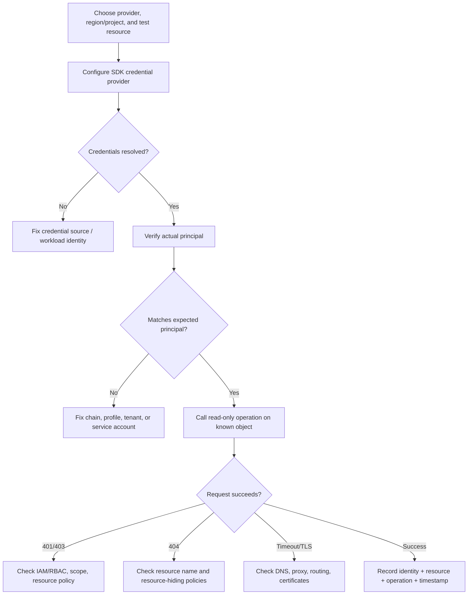

# Performing Minimal Connectivity Checks and Verifying the Active Identity

> **Chapter:** Project Bootstrap  
> **Module:** SPRING_CLOUD_PROVIDER_INTEGRATION — hands-on integration of Spring Boot with managed services on AWS, Azure, and Google Cloud through the corresponding Spring Cloud libraries.

An application that boots cleanly is not guaranteed to be able to connect to the cloud. The SDK might not find credentials, the credentials might belong to an unexpected account, or the identity might authenticate successfully yet lack permissions on the bucket/container. When testing from a personal machine, CLI commands may use a different account from the credential chain selected by the Java application.

This lesson walks through a small, repeatable workflow: **configure a minimal client, determine the identity actually used by the SDK, perform one read-only operation against a test resource, and interpret the result**. Examples apply to S3, Azure Blob Storage, and Google Cloud Storage; the same principles apply when connecting to messaging, databases, or secret managers.

## 1. Learning Objectives

After this lesson, you will be able to:

1. Distinguish network connectivity, identity authentication, and permission authorization.
2. Configure a minimal client for AWS, Azure, or Google Cloud using SDK-supported credential chain/identity mechanisms.
3. Verify the principal actually used by the application rather than checking only the CLI login account.
4. Execute a read operation on a test object with the minimum required permissions.
5. Recognize missing-credential, wrong-identity, missing-permission, wrong-region/project/endpoint, and network/TLS errors.
6. Design smoke tests that never expose tokens, secrets, connection strings, or sensitive details in logs.

## 2. Distinguishing Three Questions When Checking Connectivity

| Question | Scope | Example Evidence |
|---|---|---|
| **Can it connect?** | DNS, routing, proxy, TLS, endpoint, and network port work | Request reaches the endpoint and receives an HTTP/gRPC response |
| **Who is the application?** | Which principal did the credential chain select? | AWS STS returns ARN/account; Azure sign-in/resource logs record principal; Google Cloud Audit Logs record `principalEmail` |
| **What can the identity do?** | Is the principal permitted to perform the operation on that specific resource? | S3 `HeadObject`, Blob `getProperties`, GCS metadata read on the test object |

These three questions are related but not interchangeable:

- Successful DNS and TLS do not prove the application is authenticated.
- Having a valid access token does not prove the principal can read an object.
- A working CLI does not prove the Java application uses the same credentials.
- A successful read proves permission for **that operation and resource** at check time; it does not prove upload, delete, or access across all buckets/containers.



## 3. Preparing Before Calling the Service

Pick **one** provider and one minimal operation the application actually needs:

| Provider | Test Resource | Read Operation | Typical Data Permission |
|---|---|---|---|
| AWS | Pre-existing marker object in test bucket | S3 `HeadObject` | `s3:GetObject` on that object/prefix |
| Azure | Pre-existing marker blob in test container | Blob `getProperties()` | Appropriate data-plane read role, e.g. Storage Blob Data Reader |
| Google Cloud | Pre-existing marker object in test bucket | `Storage.get(BlobId)` | `storage.objects.get` on the corresponding object |

Do not use an operation that lists the entire bucket/container just to test credentials if the application does not need list permissions. **Testing the exact business behavior** verifies least privilege and avoids granting broad extra IAM/RBAC permissions. The marker object should have a fixed name under a test prefix, contain no personal data, and be created ahead of time during environment provisioning.

Record non-sensitive parameters:

- AWS: expected account, expected role/role session, region, bucket, and object key.
- Azure: tenant, subscription/resource group if needed for administration, storage account, container, blob, and expected identity type.
- Google Cloud: project ID, bucket, object, and expected service account or workload principal.

Never put access keys, secret keys, bearer tokens, private keys, SAS tokens, or connection strings with credentials in source code, Git-committed YAML, tickets, or logs.

## 4. Choosing Credential Sources by Environment

| Environment | AWS | Azure | Google Cloud |
|---|---|---|---|
| Developer machine | AWS IAM Identity Center/SSO or provisioned profile | Azure CLI/IDE credential via Azure Identity | ADC created via `gcloud auth application-default login` |
| CI | OIDC/workload identity federation if supported by platform | Workload identity federation or service principal per policy | Workload Identity Federation or short-lived credentials |
| Production workload | IAM role attached to workload (ECS task role, EC2 instance profile, EKS IRSA/pod identity depending on architecture) | Managed identity or workload identity | Service account attached to workload or Workload Identity Federation |

Avoid creating static keys just to "make it run." If long-lived credentials must be used due to legacy system constraints, enforce dedicated secret storage, rotation, revocation, and auditing processes; never make them the default for exercises.

### Credential Chains Are Not a Single Account

- AWS SDK v2 `DefaultCredentialsProvider` searches a chain of supported sources, which may include system properties, environment variables, web identity, profiles, container credentials, or instance metadata. A stale environment variable can cause the SDK to pick a different identity from the profile a developer is looking at.
- Azure `DefaultAzureCredential` tries supported credential sources depending on the Azure Identity version and runtime environment; locally it may pick Azure CLI/IDE, while in a workload it may pick managed identity or workload identity.
- Google Application Default Credentials (ADC) can come from `GOOGLE_APPLICATION_CREDENTIALS`, a local ADC file, or a workload-attached service account/metadata server, depending on the environment and the order supported by the SDK.

**Do not assume** `aws configure list`, `az account show`, or `gcloud auth list` always describes the credentials picked by your Java application. Those commands inspect the CLI context; they only match the application when you are certain the SDK is using that exact credential source.

## 5. AWS: Using the Same Credential Provider for S3 Calls and STS Verification

### 5.1. Minimal dependencies and configuration

In a Maven project that has already imported a Spring Cloud AWS BOM compatible with Spring Boot, add the S3 starter and the STS module whose version is managed by AWS SDK v2:

```xml
<!-- Inside <dependencies> of an existing POM -->
<dependency>
    <groupId>io.awspring.cloud</groupId>
    <artifactId>spring-cloud-aws-starter-s3</artifactId>
</dependency>
<dependency>
    <groupId>software.amazon.awssdk</groupId>
    <artifactId>sts</artifactId>
</dependency>
```

Do not add an explicit version if the AWSpring BOM manages AWS SDK v2. Inspect the dependency tree to confirm `s3` and `sts` belong to the same compatible SDK set. The example below explicitly configures both clients to share **one `AwsCredentialsProvider`**; if the project already uses AWSpring's auto-configured client, configure/inject the provider per that version's mechanism and avoid creating two competing clients.

```yaml
# application-staging.yml
app:
  cloud:
    aws:
      region: ${AWS_REGION}
      bucket: ${APP_S3_BUCKET}
      probe-key: ${APP_S3_PROBE_KEY}
```

Region, bucket, and object key are not secrets. Do not declare access keys or secret keys here.

### 5.2. Creating a shared provider and clients

```java
package com.example.providerdemo.aws;

import org.springframework.beans.factory.annotation.Value;
import org.springframework.context.annotation.Bean;
import org.springframework.context.annotation.Configuration;
import software.amazon.awssdk.auth.credentials.AwsCredentialsProvider;
import software.amazon.awssdk.auth.credentials.DefaultCredentialsProvider;
import software.amazon.awssdk.regions.Region;
import software.amazon.awssdk.services.s3.S3Client;
import software.amazon.awssdk.services.sts.StsClient;

@Configuration(proxyBeanMethods = false)
public class AwsProbeConfiguration {

    @Bean
    AwsCredentialsProvider awsCredentialsProvider() {
        return DefaultCredentialsProvider.create();
    }

    @Bean
    Region awsRegion(@Value("${app.cloud.aws.region}") String region) {
        return Region.of(region);
    }

    @Bean
    S3Client s3Client(
            AwsCredentialsProvider credentials,
            Region region) {
        return S3Client.builder()
                .region(region)
                .credentialsProvider(credentials)
                .build();
    }

    @Bean
    StsClient stsClient(
            AwsCredentialsProvider credentials,
            Region region) {
        return StsClient.builder()
                .region(region)
                .credentialsProvider(credentials)
                .build();
    }
}
```

In this example, STS and S3 use the same provider, so `GetCallerIdentity` results reflect the credential provider that the S3 client also uses. In an application that already has AWSpring auto-configuration, do not copy the configuration above verbatim without checking existing beans. You can take one consistent management approach: let Spring Cloud AWS create clients from its configuration and verify the same credential source, or configure both clients yourself with a shared provider as above.

### 5.3. Verifying identity with STS

```java
package com.example.providerdemo.aws;

import org.springframework.stereotype.Component;
import software.amazon.awssdk.services.sts.StsClient;
import software.amazon.awssdk.services.sts.model.GetCallerIdentityResponse;

@Component
public class AwsIdentityProbe {
    private final StsClient sts;

    public AwsIdentityProbe(StsClient sts) {
        this.sts = sts;
    }

    public GetCallerIdentityResponse currentIdentity() {
        return sts.getCallerIdentity();
    }
}
```

`GetCallerIdentity` returns fields such as the account, ARN, and user ID of the principal signing the request. AWS documents that this operation does not require separate IAM permissions for the principal to call the identity verification API. An `assumed-role` ARN typically identifies the active role session; it is not the ARN of a secret access key.

At startup or during smoke tests, log only fields approved by your organization for auditing, such as account and ARN; avoid logging credentials or signed request contents. Do not call the probe continuously on every business request; identity usually only needs verification at startup, via a protected health diagnostic, or during a smoke test step.

### 5.4. Checking read access on the test object

```java
package com.example.providerdemo.aws;

import org.springframework.beans.factory.annotation.Value;
import org.springframework.stereotype.Component;
import software.amazon.awssdk.services.s3.S3Client;
import software.amazon.awssdk.services.s3.model.HeadObjectRequest;
import software.amazon.awssdk.services.s3.model.HeadObjectResponse;

@Component
public class S3ConnectionProbe {
    private final S3Client s3;
    private final String bucket;
    private final String key;

    public S3ConnectionProbe(
            S3Client s3,
            @Value("${app.cloud.aws.bucket}") String bucket,
            @Value("${app.cloud.aws.probe-key}") String key) {
        this.s3 = s3;
        this.bucket = bucket;
        this.key = key;
    }

    public HeadObjectResponse checkReadAccess() {
        return s3.headObject(HeadObjectRequest.builder()
                .bucket(bucket)
                .key(key)
                .build());
    }
}
```

The object must exist beforehand. `HeadObject` inspects object metadata and requires appropriate read permission (`s3:GetObject`) on that object; bucket policies, object ownership, encryption, and resource policies can also affect the outcome. If the application needs to upload, test separately on a test prefix with `s3:PutObject`; never grant write permissions just so a metadata-reading health check succeeds.

**CLI sanity check:** `aws sts get-caller-identity` is helpful for checking the AWS CLI. However, if Java uses web identity or a container role while the CLI uses a profile, the two results can differ. The decisive proof for the application is an STS call from the process itself using the same provider as the business client.

## 6. Azure: Identifying Selected Credentials and Checking Blob Storage

### 6.1. Configuring `TokenCredential` and `BlobServiceClient`

Starter dependency in a Maven project that has already imported a compatible Spring Cloud Azure BOM:

```xml
<!-- Inside <dependencies> -->
<dependency>
    <groupId>com.azure.spring</groupId>
    <artifactId>spring-cloud-azure-starter-storage-blob</artifactId>
</dependency>
```

The example below uses Azure Identity's `DefaultAzureCredential` directly to make it clear which credentials are passed into the client. If using the `BlobServiceClient` auto-configured by Spring Cloud Azure, check the credential chain used by the starter configuration; do not create a second manual client with a different identity.

```yaml
# application-staging.yml
app:
  cloud:
    azure:
      blob-endpoint: ${APP_AZURE_BLOB_ENDPOINT}
      container: ${APP_AZURE_BLOB_CONTAINER}
      probe-name: ${APP_AZURE_BLOB_PROBE_NAME}
```

Endpoints usually look like `https://<storage-account>.blob.core.windows.net`; obtain them from deployment/resource configuration rather than hardcoding them in logic.

```java
package com.example.providerdemo.azure;

import com.azure.identity.DefaultAzureCredentialBuilder;
import com.azure.core.credential.TokenCredential;
import com.azure.storage.blob.BlobServiceClient;
import com.azure.storage.blob.BlobServiceClientBuilder;
import org.springframework.beans.factory.annotation.Value;
import org.springframework.context.annotation.Bean;
import org.springframework.context.annotation.Configuration;

@Configuration(proxyBeanMethods = false)
public class AzureProbeConfiguration {

    @Bean
    TokenCredential azureTokenCredential() {
        return new DefaultAzureCredentialBuilder().build();
    }

    @Bean
    BlobServiceClient blobServiceClient(
            TokenCredential credential,
            @Value("${app.cloud.azure.blob-endpoint}") String endpoint) {
        return new BlobServiceClientBuilder()
                .endpoint(endpoint)
                .credential(credential)
                .buildClient();
    }
}
```

`DefaultAzureCredential` is a credential chain. Which component gets selected depends on the Azure Identity version, environment variables, and runtime environment. Locally it may use Azure CLI/IDE; in production it may use managed identity or workload identity. Never log tokens to identify credentials.

### 6.2. Verifying the active principal

Azure does not have a single simple call equivalent to STS `GetCallerIdentity` on `BlobServiceClient` that returns the principal for every credential type. Practical workflow:

1. Choose the expected identity for the environment: for example, an Azure CLI logged-in user locally, a user-assigned managed identity in staging, or workload identity in production.
2. When using `DefaultAzureCredential`, enable appropriate Azure Identity diagnostic logging in a test environment to see **which credential source was selected**. Never enable logging of tokens or HTTP bodies containing sensitive data.
3. Send a Blob read request using the application's actual `BlobServiceClient`.
4. Enable Azure Storage diagnostic/resource logs and Entra sign-in/audit logs per organizational policy; cross-check caller details such as tenant and application/object identity (where provided by the log schema and auth type) against the expected identity.
5. Record the result without logging bearer tokens.

`az account show` displays the current Azure CLI account. It is valid evidence for the application only if `DefaultAzureCredential` actually picked `AzureCliCredential`; if the SDK picked environment credentials or managed identity, the CLI context does not represent the app's principal.

When strict identity control is required, you can select credentials **explicitly per environment** (e.g., `ManagedIdentityCredential` with a specified client ID for workloads, or `AzureCliCredential` locally) instead of letting `DefaultAzureCredential` auto-select. This makes configuration clearer at the cost of flexibility; use it only when verified as supported by your SDK version and environment.

### 6.3. Checking Blob read access

```java
package com.example.providerdemo.azure;

import com.azure.storage.blob.BlobServiceClient;
import com.azure.storage.blob.models.BlobProperties;
import org.springframework.beans.factory.annotation.Value;
import org.springframework.stereotype.Component;

@Component
public class AzureBlobConnectionProbe {
    private final BlobServiceClient client;
    private final String container;
    private final String blobName;

    public AzureBlobConnectionProbe(
            BlobServiceClient client,
            @Value("${app.cloud.azure.container}") String container,
            @Value("${app.cloud.azure.probe-name}") String blobName) {
        this.client = client;
        this.container = container;
        this.blobName = blobName;
    }

    public BlobProperties checkReadAccess() {
        return client.getBlobContainerClient(container)
                .getBlobClient(blobName)
                .getProperties();
    }
}
```

The marker blob must exist. `getProperties()` verifies read permission on the specific blob; a data role such as `Storage Blob Data Reader` can fit a read-only probe depending on scope and policy. If the application must upload, test write permission on a test container/prefix with the corresponding data role. Resource management roles do not implicitly grant blob data read/write permissions.

## 7. Google Cloud: ADC, Storage Client, and Principal in Audit Logs

### 7.1. Configuring the client from Application Default Credentials

Add the Cloud Storage starter under the Spring Framework on Google Cloud BOM:

```xml
<!-- Inside <dependencies> -->
<dependency>
    <groupId>com.google.cloud</groupId>
    <artifactId>spring-cloud-gcp-starter-storage</artifactId>
</dependency>
```

Example using the Storage SDK directly to clearly show which credentials are passed in:

```yaml
# application-staging.yml
app:
  cloud:
    gcp:
      project-id: ${GCP_PROJECT_ID}
      bucket: ${APP_GCS_BUCKET}
      probe-object: ${APP_GCS_PROBE_OBJECT}
```

```java
package com.example.providerdemo.gcp;

import com.google.auth.oauth2.GoogleCredentials;
import com.google.cloud.storage.Storage;
import com.google.cloud.storage.StorageOptions;
import java.io.IOException;
import java.util.List;
import org.springframework.beans.factory.annotation.Value;
import org.springframework.context.annotation.Bean;
import org.springframework.context.annotation.Configuration;

@Configuration(proxyBeanMethods = false)
public class GcpProbeConfiguration {

    @Bean
    GoogleCredentials googleCredentials() throws IOException {
        return GoogleCredentials.getApplicationDefault()
                .createScoped(List.of(
                        "https://www.googleapis.com/auth/cloud-platform"));
    }

    @Bean
    Storage googleCloudStorage(
            GoogleCredentials credentials,
            @Value("${app.cloud.gcp.project-id}") String projectId) {
        return StorageOptions.newBuilder()
                .setProjectId(projectId)
                .setCredentials(credentials)
                .build()
                .getService();
    }
}
```

This example illustrates ADC in the Google Auth SDK. When using Spring Framework on Google Cloud's starter auto-configuration, inspect how the starter builds the `Storage` bean and avoid creating a second client with a different credential source or project ID. In some workload environments, credentials are already scoped/provisioned through a dedicated mechanism; follow the SDK/provider version guidance rather than adding scopes arbitrarily.

### 7.2. Where does ADC get its identity?

ADC can use:

- The file pointed to by `GOOGLE_APPLICATION_CREDENTIALS` (which can be an external account configuration for Workload Identity Federation; it does not have to be a private-key JSON).
- The local ADC file created by `gcloud auth application-default login`.
- Credentials of a service account/workload attached to the runtime environment via the metadata server or federation mechanism.

`gcloud auth list` shows the Google Cloud CLI account and **does not guarantee** it is the principal in ADC used by the Java SDK. `gcloud auth application-default login` creates a separate ADC credential set for local applications; it is a different flow from `gcloud auth login`.

To verify the principal in production:

1. Confirm the service account or workload identity attached to the workload in the deployment configuration.
2. Execute a Storage request from the application using the ADC client.
3. Enable/query Cloud Audit Logs **Data Access** for Cloud Storage per organizational policy (Data Access logs may need to be enabled/configured; they are not always on by default).
4. Match `principalEmail` or the corresponding principal field in the log entry against the expected service account/workload.

Never print access tokens or ADC files. If `GOOGLE_APPLICATION_CREDENTIALS` points to a stale file, it can cause the SDK to use a different identity from the workload-attached service account; always check the actual ADC source.

### 7.3. Checking object read access

```java
package com.example.providerdemo.gcp;

import com.google.cloud.storage.Blob;
import com.google.cloud.storage.BlobId;
import com.google.cloud.storage.Storage;
import org.springframework.beans.factory.annotation.Value;
import org.springframework.stereotype.Component;

@Component
public class GcsConnectionProbe {
    private final Storage storage;
    private final String bucket;
    private final String objectName;

    public GcsConnectionProbe(
            Storage storage,
            @Value("${app.cloud.gcp.bucket}") String bucket,
            @Value("${app.cloud.gcp.probe-object}") String objectName) {
        this.storage = storage;
        this.bucket = bucket;
        this.objectName = objectName;
    }

    public Blob checkReadAccess() {
        return storage.get(BlobId.of(bucket, objectName));
    }
}
```

`storage.get(BlobId)` reads object metadata. If the object does not exist, the SDK may return `null`; if denied, the request may fail with a permission error. The typical permission is `storage.objects.get` on that object. Do not grant Storage Admin or Project Editor just so a read probe works.

## 8. Identity Verification: CLI Commands Are Only Secondary Evidence

| Provider | Sanity Check Command | What Does It Prove? | Limitation |
|---|---|---|---|
| AWS | `aws sts get-caller-identity` | The principal AWS CLI is using | May differ from the Java process's credential chain |
| Azure | `az account show` | Current CLI tenant/subscription and account | Does not prove the app uses Azure CLI credentials; app may use managed identity |
| Google Cloud | `gcloud auth list` | Active CLI account | Does not prove the Java app's ADC uses that account |

To prove the **application's** identity, prefer:

- AWS: call STS from the process using the same `AwsCredentialsProvider` as the service client.
- Azure: identify the Azure Identity credential source, then correlate sign-in/resource diagnostic logs for requests sent by the app.
- Google Cloud: send a request using ADC inside the app and verify the principal in enabled Cloud Audit Logs Data Access entries.

Do not share outputs containing tokens, secrets, sensitive credential file paths, or full environment variables. ARNs, principal IDs, and service account names should also be handled according to your organization's logging policy.

## 9. Checking Permissions by Operation, Not Broad Roles

| Application Need | AWS | Azure | Google Cloud |
|---|---|---|---|
| Read marker object | `s3:GetObject` | Appropriate Blob data read role | `storage.objects.get` |
| Upload object | `s3:PutObject` | Appropriate Blob data write role | `storage.objects.create` |
| Delete object | `s3:DeleteObject` | Data role with appropriate delete permission | `storage.objects.delete` |
| List objects | `s3:ListBucket` (scoped to bucket/prefix per policy) | Appropriate container/blob list permission | `storage.objects.list` |
| Read secret | Required Secrets Manager action, e.g. `secretsmanager:GetSecretValue` | Key Vault Secrets User or appropriate role | `secretmanager.versions.access` |

The permission/role names in this table are analytical starting points, not complete policies. You must account for KMS encryption, resource policies, deny rules, scopes, conditions, firewalls, and access boundaries. For example, S3 `HeadObject` needs object read permission; if a bucket policy or KMS key policy denies it, an IAM identity policy alone is still insufficient.

**Do not resolve a 403 error by immediately granting Owner/Administrator.** Identify the principal, resource, operation, policy evaluation, and missing scope; grant least privilege and repeat the exact test operation.

## 10. Interpreting Connectivity Errors

| Symptom | Cause Category | First Action |
|---|---|---|
| AWS `Unable to load credentials` | No valid credentials in provider chain | Check credential sources inside the Java process, profile, web identity, container/instance role |
| Azure `CredentialUnavailableException` | Credential sources in the chain are unavailable | Verify local/workload identity and Azure Identity version |
| Azure `AuthenticationFailedException` / HTTP 401 | Invalid token, wrong tenant/audience/scope, or expired token | Check tenant, credential source, system clock, and sign-in logs |
| Google `IOException`/credential exception loading ADC | Cannot resolve ADC or metadata credentials | Check `GOOGLE_APPLICATION_CREDENTIALS`, local ADC, or workload identity |
| HTTP 401 | Request lacks valid authentication | Check token/credential source, audience, clock skew |
| HTTP 403 / `AccessDenied` / `PERMISSION_DENIED` | Principal authenticated, but lacks permissions or policy denies | Cross-check principal, operation, resource, scope, and audit logs |
| HTTP 404 or object not found | Wrong bucket/container/key, or service hides unauthorized resources | Verify resource name and read permissions |
| DNS/connection timeout | Endpoint, DNS, routing, proxy, firewall, or service outage | Test from the same container/network namespace |
| `SSLHandshakeException` | Truststore, certificate chain, TLS inspection, proxy, or system clock | Inspect certificates and TLS; never disable hostname verification |
| `NoSuchMethodError` / `NoClassDefFoundError` | Dependency/API mismatch | Inspect dependency tree and BOM; do not change IAM |
| Read succeeds, but upload fails | Read permission exists, but write or encryption conditions fail | Check write permissions, KMS/keys, policies, and quotas |

Some services intentionally return 404 or 403 depending on policy to avoid disclosing resource existence. Never conclude solely from the status code; combine request IDs, provider-side logs, and the exact operation.

## 11. A Repeatable Minimal Smoke Test Workflow

### Step 1 — Define the target

State clearly: provider, environment, expected principal, region/project/tenant, test resource, and one minimal read/write operation. Example: AWS staging, assumed role `provider-demo-staging`, test bucket, and marker object `probes/identity.txt`.

### Step 2 — Check non-sensitive configuration

Verify profile, endpoint, region, project ID, bucket/container, and object name. Never dump `Environment`, credential chains, or secret files to logs. When using a local profile, confirm the profile name inside the process itself or via explicit configuration.

### Step 3 — Verify the principal

- AWS: STS `GetCallerIdentity` using the same provider as S3.
- Azure: identify the credential source and check Azure sign-in/resource logs.
- GCP: check the principal in Cloud Audit Logs Data Access for the ADC request.

Compare with the expected principal before touching resources. If they differ, stop the smoke test; do not continue writing data to resources under an unintended identity.

### Step 4 — Execute a read-only operation

Call `HeadObject`, `BlobClient.getProperties()`, or `Storage.get(BlobId)` on the known marker object. This tests the client, endpoint, identity, and read access on one specific resource.

### Step 5 — Record an auditable result

Example smoke test record:

| Field | Sample Value |
|---|---|
| Timestamp | UTC timestamp |
| Application | `provider-integration-demo` |
| Environment | `staging` |
| Provider | `aws` |
| Principal | ARN approved for logging |
| Region | `ap-southeast-1` |
| Resource | Test bucket and marker object |
| Operation | `HeadObject` |
| Result | `SUCCESS` |
| Request ID | Provider response ID if available |

Never record access tokens, secret keys, SAS tokens, private keys, or full HTTP `Authorization` headers. The record should show **who called which operation on which resource and when**, without copying credentials.

### Step 6 — Test writes only when business logic requires them

If the application must upload, create a dedicated object in a test prefix using harmless data. Pre-define cleanup procedures and delete permissions; never use real production resources for ad-hoc testing. Verify checksums/metadata after writing, and verify deletion if required by the workflow.

## 12. Verifying the Same Identity Inside Spring Boot

An application can construct multiple clients with different credential sources. For instance, the S3 client might use a custom credential provider while an STS probe accidentally uses a different default chain. To avoid false conclusions:

1. Use the same provider instance/configuration when building both business clients and identity-verification clients if the SDK permits.
2. If using Spring Cloud provider auto-configuration, verify how the starter constructs credentials/clients and avoid creating a separate probe using different credentials.
3. When credentials auto-refresh (role sessions, managed identity, ADC), do not manually cache access tokens beyond their lifetime; let the provider SDK handle refresh.
4. When switching profiles or workload identities, restart/refresh the appropriate components per design and re-verify the principal.
5. Never expose a public `/identity` endpoint returning ARNs, tenants, principals, or projects; if a diagnostic endpoint is needed, restrict access and limit returned fields.

### Health Checks vs. Smoke Tests

| Type | Goal | Appropriate Cadence |
|---|---|---|
| Liveness | Is the JVM/process still alive? | Frequent, zero cloud calls |
| Readiness | Can the app serve traffic under operational conditions? | Per policy; avoid calling many cloud APIs on every probe |
| Startup check | Can required config/clients initialize? | At startup or deployment check |
| Identity smoke test | Does the actual principal match expectations? | At deployment, identity change, or audit schedule |
| Permission smoke test | Does a minimal business operation succeed? | At deployment or controlled periodic checks |

If readiness calls S3/Blob/GCS every few seconds, a transient cloud hiccup can mark every instance unready and trigger a cascading failure. Base readiness checks on SLOs and dependency criticality; never assume every managed service belongs in liveness checks.

## 13. Extending the Same Principle to Messaging, Databases, and Secrets

| Service | Identity Verification | Appropriate Probe | What Not to Do |
|---|---|---|---|
| SQS | STS from the same AWS credential provider | Send/receive a test message on a dedicated queue per business permissions | Poll production queues just to check credentials |
| Azure Service Bus | Credential source + Entra/resource logs | Send/receive on a test queue | Grant Data Owner when only Data Sender is needed |
| Pub/Sub | ADC principal in Audit Logs | Publish to a test topic; subscribe only if the app truly consumes | Create ad-hoc production subscriptions/consumers |
| Managed database | Identity token/certificate/user used by the driver | Open connection and run an appropriate read-only query | Use a DB admin account for health checks |
| Secret Manager / Key Vault | Principal recorded in audit logs | Read one pre-created test secret, or check metadata if permitted | Log secret values or read all secrets |

For messaging, "connected successfully" must separate producers from consumers. Publishers only need send permissions; consumers need receive/ack permissions and listener configuration. A probe can mutate a queue/subscription, so always use dedicated test resources with clear cleanup.

For databases, a `SELECT 1` probe confirms connectivity and basic query execution but does not prove read/write access on business tables. For secret managers, reading one marker secret does not prove the application can access all secrets; and there is never a reason to log the secret value in test outputs.

## 14. Secure Credential Handling Checklist

- [ ] Only use credential sources approved for the environment; production prefers workload identity/managed identity.
- [ ] Identified the credential provider/chain actually chosen by the SDK, not just the CLI account.
- [ ] Identity probes and business clients share the same credential source or have equivalent proof.
- [ ] No static access keys, private keys, or bearer tokens stored in Git, YAML, or container images.
- [ ] No tokens, secrets, connection strings, or `Authorization` headers written to logs.
- [ ] Principal compared against expected identity before calling resources.
- [ ] Permissions scoped strictly to needed operations/resources; read probes do not request write/admin rights.
- [ ] Verified region/project/tenant/endpoint and marker object name.
- [ ] Request IDs/audit logs captured for traceability without storing credentials.
- [ ] Revocation/rotation process exists in case credentials leak or workloads change environments.

## 15. Practice Exercise

**Context:** A Spring Boot application needs to read metadata for documents in storage. Staging uses AWS S3; another deployment uses Azure Blob; another customer uses Google Cloud Storage. Each environment must prove its actual identity and read access on a test object.

### Part A — Choose identity

1. For AWS, identify the expected workload role and configure the Java SDK to use an appropriate credential chain. Call STS `GetCallerIdentity`.
2. For Azure, identify the tenant and expected managed identity/workload identity. Use `DefaultAzureCredential` or explicit credentials; verify the credential source and inspect resource logs.
3. For GCP, identify the service account/workload identity and configure ADC. Verify the principal in Cloud Audit Logs Data Access.
4. Explain why `aws sts get-caller-identity`, `az account show`, and `gcloud auth list` can differ from the application's identity.

### Part B — Run a read-only probe

1. Create a harmless marker object in a test bucket/container.
2. Execute `HeadObject` on S3, `getProperties()` on Azure Blob, or `Storage.get(BlobId)` on GCS.
3. Grant least-privilege read access; record missing-permission cases and error outcomes.
4. Do not print tokens/secrets; record timestamp, principal, resource, operation, result, and request ID.

### Part C — Analyze errors

Simulate at least three scenarios:

- Credential source does not exist or is disabled.
- Correct principal, but missing object read permission.
- Wrong endpoint/region/project, or network/TLS cannot connect.

Correlate SDK/HTTP errors with audit logs and propose fixes. Never elevate to Administrator/Owner as a default fix.

**Sample results table:**

| Provider | Expected Principal | Actual Principal | Operation | Result | Required Permission |
|---|---|---|---|---|---|
| AWS | Staging role | ARN from STS | S3 `HeadObject` | `SUCCESS`/`403` | `s3:GetObject` on test object |
| Azure | Managed identity | Caller in resource logs | Blob `getProperties` | `SUCCESS`/`401`/`403` | Blob data read role |
| GCP | Service account | `principalEmail` in Audit Logs | Storage object metadata read | `SUCCESS`/`403` | `storage.objects.get` |

**Pass criteria:** Able to determine the identity actually used by the application, distinguish authentication from authorization, probe the exact target resource, and explain how to resolve each error class without exposing credentials.

## 16. Official References

1. [AWS SDK for Java 2.x — Default credentials provider chain](https://docs.aws.amazon.com/sdk-for-java/latest/developer-guide/credentials-chain.html): credential sources and provider order.
2. [AWS SDK for Java 2.x — Configure credentials](https://docs.aws.amazon.com/sdk-for-java/latest/developer-guide/credentials.html): configuring providers on clients.
3. [AWS STS — GetCallerIdentity](https://docs.aws.amazon.com/STS/latest/APIReference/API_GetCallerIdentity.html): verifying account, ARN, and user ID.
4. [Amazon S3 — HeadObject](https://docs.aws.amazon.com/AmazonS3/latest/API/API_HeadObject.html): checking object metadata and permissions.
5. [Azure Identity — DefaultAzureCredential](https://learn.microsoft.com/azure/developer/java/sdk/authentication/credential-chains): credential chain for local and workloads.
6. [Azure SDK for Java — Authenticate with Azure services](https://learn.microsoft.com/azure/developer/java/sdk/authentication/): authentication mechanisms and workload identity.
7. [Azure Storage — Authorize access to blobs using Microsoft Entra ID](https://learn.microsoft.com/azure/storage/blobs/authorize-access-azure-active-directory): data-plane RBAC for Blob Storage.
8. [Google Cloud — Application Default Credentials](https://cloud.google.com/docs/authentication/application-default-credentials): local ADC, production environments, and credential sources.
9. [Google Cloud — Audit logging](https://cloud.google.com/logging/docs/audit): principals and logs for resource requests.
10. [Google Cloud Storage — IAM permissions](https://cloud.google.com/storage/docs/access-control/iam-permissions): object/bucket operation permissions.

> **Remember:** Do not stop at checking "CLI is logged in" or "the app started." Prove **which principal the SDK is actually using**, then execute **one minimal operation on the exact test resource** with least privilege. Log enough for auditing, but never log credentials.
