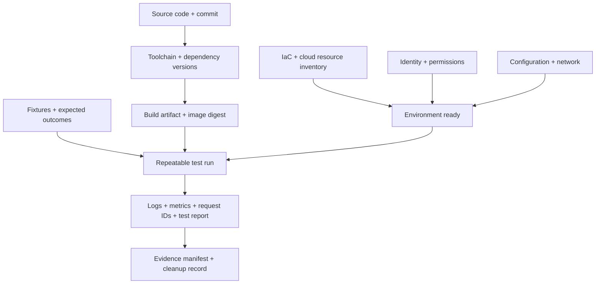

# Recording Versions, Resources, and Runtime Conditions for Reproducible Examples

> **Chapter:** Project Bootstrap  
> **Module:** SPRING_CLOUD_PROVIDER_INTEGRATION — hands-on integration of Spring Boot with managed services on AWS, Azure, and Google Cloud via the corresponding Spring Cloud libraries.

An S3 file upload example might work on the author's machine yet fail on a colleague's machine. An Azure Blob Storage example might return different results when a data role changes; a Pub/Sub example might fail to reproduce if a topic, subscription, or message was deleted. The cause often does not reside in source code alone: JDK version, Spring Boot, SDKs, container images, cloud resources, identity, permissions, sample data, and environment variables all influence the outcome.

For someone else to re-run an example and verify the same behavior, you must record **enough information to recreate the runtime conditions**, along with procedures for provisioning, execution, verification, and resource cleanup. This lesson shows how to build a verifiable run record for Spring Boot applications integrating AWS, Azure, or Google Cloud.

## 1. Learning Objectives

After this lesson, you will be able to:

1. Distinguish build, runtime, and cloud behavioral reproducibility; understand the limits when managed services evolve over time.
2. Accurately record Java, build tool, Spring Boot, Spring Cloud release train, provider BOM, SDK, and container image versions.
3. Build a cloud resource inventory covering region/project/account, buckets/containers, queues/topics, identity, permissions, and security configuration.
4. Describe sample data, fixtures, checksums, input preconditions, and expected outcomes so tests can run repeatably.
5. Use Infrastructure as Code (IaC), lockfiles, dependency reports, and secret-free manifests to recreate environments.
6. Write a runbook from setup through testing and cleanup; store sufficient evidence to analyze discrepancies between two runs.

## 2. What Does "Reproducible" Mean?

A guide that runs once is not necessarily reproducible. Separate four levels:

| Level | Question | Example Evidence |
|---|---|---|
| **Build reproducibility** | Do the same source and toolchain produce an equivalent dependency graph/artifact? | Commit SHA, wrapper, BOM, lockfile, JAR checksum |
| **Runtime reproducibility** | Does the application run in the same runtime and configuration? | JDK distribution, OS/architecture, image digest, environment variables |
| **Environment reproducibility** | Can cloud resources, networking, identity, and permissions be provisioned similarly? | IaC, region, resource inventory, IAM/RBAC, endpoints |
| **Behavioral reproducibility** | Do the same inputs yield verifiable matching results and state? | Fixtures, checksums, message IDs, expected results, test reports |

With managed services, you cannot freeze every provider-side factor completely: control planes, firmware, quotas, network routing, organizational security policies, and service state can change. The practical goal is to **reproduce the configuration controlled by the application and deployment team, document external factors, and state limitations explicitly**.



## 3. The Run Record: What to Record and Where?

Do not rely on memory or stuff everything into one YAML file. Organize the record by group:

| Group | What to Record | Verifiable Source |
|---|---|---|
| Source | Repository, commit SHA, branch/tag, working tree status | Git |
| Build toolchain | JDK vendor/version, Maven/Gradle wrapper, OS, architecture | `java -version`, wrapper version, CI image |
| Framework/dependencies | Boot, Spring Cloud train if used, AWSpring/Azure/GCP BOMs, resolved SDKs | POM/effective POM, Gradle dependency reports, SBOM |
| Artifact | JAR/WAR checksum, OCI image reference and digest | SHA-256, registry |
| IaC | Terraform/Bicep/CloudFormation version, module/provider versions, lockfile, commit | IaC repository, plan/apply output |
| Cloud resources | Account/subscription/project, region, resource IDs, buckets/queues/topics/containers | IaC outputs, console/CLI metadata |
| Identity/permissions | Expected and actual principal, roles/policies, scope, credential mechanism | IAM/RBAC config, audit logs |
| Configuration | Profiles, endpoints, region, feature flags, timeouts, retries, proxies | Manifests and deployment variables |
| Data/test fixtures | Object/message names, schema version, checksums, seed scripts | Test resources, fixture files |
| Run evidence | Timestamp, operator/CI run, request IDs, outcomes, test reports | Secret-scrubbed logs, CI artifacts |
| Cleanup | Resources deleted/retained, reason, and TTL | Teardown report, resource inventory |

**Distinguish configuration values from secrets:** you may record region, bucket name, project ID, image digest, principal ARN, and SDK versions per organizational policy. Never record access keys, private keys, bearer tokens, SAS tokens, connection strings with secrets, ADC files containing private keys, or secret manager values.

### Reference Run-Record Directory Layout

```text
reproducibility/
├── run-manifest.yml
├── resources.yml
├── fixtures/
│   ├── invoice-small.pdf
│   └── expected-checksums.txt
├── iac/
│   ├── main.tf
│   ├── variables.tf
│   └── .terraform.lock.hcl
├── reports/
│   ├── dependency-tree.txt
│   ├── sbom.json
│   └── integration-test.xml
└── evidence/
    ├── identity-check.txt
    ├── smoke-test.json
    └── cleanup-report.txt
```

This is a suggested layout, not a mandate that every project create this exact directory. Manifests and reports should be versioned alongside the documentation/guide; logs and state containing sensitive details must be stored in locations with appropriate access control.

## 4. Recording Source, JDK, and Build Tool Versions

### 4.1. Source code

Record the full commit SHA rather than just a branch name like `main` or `develop`, since branches move:

```bash
git rev-parse HEAD
git status --short
git describe --tags --always
```

If the working tree has uncommitted changes, record the approved patch/diff or commit changes before publishing the example. A guide citing an abbreviated commit without specifying the full repository and commit becomes hard to reproduce a few months later.

### 4.2. JDK

Do not write only "Java 21." Record:

- Vendor/distribution (Temurin, Corretto, Microsoft Build of OpenJDK, Oracle JDK, or organization-approved distribution).
- Full version and build number if relevant.
- Operating system, CPU architecture, and how the JDK is installed (toolchain, container image, CI runner).
- Version command output for Java and the build tool.

```bash
java -version
./mvnw -version
./gradlew --version
```

Run only the wrapper command for the build tool your project uses. If multiple JDKs exist on a machine, record the `JAVA_HOME`/toolchain actually used by the build process; `java -version` in a terminal may differ from the IDE or CI JDK.

### 4.3. Maven Wrapper and Gradle Wrapper

Commit the wrapper to the repository so others use the exact same build tool version:

| Tool | Files to Commit | What to Verify |
|---|---|---|
| Maven Wrapper | `.mvn/wrapper/maven-wrapper.properties`, `mvnw`/`mvnw.cmd` scripts, and wrapper JAR/scripts per setup | `distributionUrl`, checksum if supported, Maven version |
| Gradle Wrapper | `gradle/wrapper/gradle-wrapper.properties`, `gradlew`/`gradlew.bat`, wrapper JAR | `distributionUrl`, `distributionSha256Sum`, Gradle version |

Gradle Wrapper supports verifying the distribution checksum via `distributionSha256Sum`. Maven Wrapper can configure distribution checksums on supported wrapper versions. Do not write only "Maven 3" or "Gradle 8"; pin exact versions and check wrapper docs for the version in use.

Sources: [Maven Wrapper](https://maven.apache.org/wrapper/), [Gradle Wrapper](https://docs.gradle.org/current/userguide/gradle_wrapper.html).

## 5. Recording Spring and Resolved Dependencies

A build file may declare a BOM, yet final runtime versions still depend on parent POMs, multiple BOMs, dependency constraints, exclusions, lockfiles, and transitive dependencies. The record must capture **both declared versions and actually resolved versions**.

### 5.1. Spring version set

| Component | Example Record Entry | Why Needed |
|---|---|---|
| Spring Boot | `4.0.x` branch and exact patch | Manages auto-configuration, starters, framework dependencies |
| Spring Cloud release train | Train name + patch if using Config/Gateway/Stream | Synchronizes Spring Cloud modules |
| AWSpring | BOM `io.awspring.cloud:spring-cloud-aws-dependencies` and patch | Manages AWSpring starters/SDK |
| Spring Cloud Azure | BOM `com.azure.spring:spring-cloud-azure-dependencies` and patch | Manages Azure Spring starters/SDK |
| Spring Framework on Google Cloud | BOM `com.google.cloud:spring-cloud-gcp-dependencies` and patch | Manages Google Cloud integration libraries |
| Java SDKs | Resolved AWS SDK v2, Azure SDK, Google Cloud libraries | Diagnoses actual API/transport behavior |

Do not assume every application needs all three provider BOMs. Record only BOMs actually used; if not using the Spring Cloud release train, record `not used` instead of adding the BOM simply because the provider name contains "Spring Cloud."

Before locking versions, verify the Boot ↔ Cloud train ↔ provider matrix. A BOM resolving cleanly still does not imply all providers are supported within the same process.

### 5.2. Maven: saving effective POM and dependency tree

```bash
./mvnw help:effective-pom -Doutput=reports/effective-pom.xml
./mvnw dependency:tree -DoutputFile=reports/dependency-tree.txt
./mvnw clean verify
```

The `reports/...` paths are examples; create the directory first or adapt to your build process. Read the dependency tree to record resolved versions of AWS SDK v2, Azure Core/transport, Google GAX/gRPC/protobuf, and Netty. The effective POM shows dependency management after parent inheritance and BOM imports.

Maven lacks a standard dependency graph lockfile equivalent to Gradle Dependency Locking in typical setups. To improve reproducibility, pin BOMs/parents/plugins, save effective POM/trees, use stable repositories, and optionally publish an SBOM.

### 5.3. Gradle: dependency locking and version catalogs

Gradle supports locking resolved versions:

```kotlin
dependencyLocking {
    lockAllConfigurations()
}
```

Generate/update lock state through an intentional workflow:

```bash
./gradlew dependencies --write-locks
./gradlew build
```

Commit lockfiles per project policy. When bumping BOMs, update lock state in the same change and review the diff. Version catalogs (`libs.versions.toml`) centralize aliases and declared versions; they do not by themselves replace BOMs or lock all transitive versions.

### 5.4. SBOM and artifact checksums

An SBOM (Software Bill of Materials) lists an artifact's components, versions, and identifying metadata. It aids dependency, license, and vulnerability reviews, though it does not replace build manifests or lockfiles.

Record the JAR checksum:

```bash
# Linux/macOS
sha256sum target/provider-demo.jar

# Windows PowerShell
Get-FileHash .\target\provider-demo.jar -Algorithm SHA256
```

Record the filename, SHA-256, source commit, and build command. If using containers, record the image **digest** (`sha256:...`), not just a tag like `latest` or `4.0`. Tags can be repointed to different images over time; digests identify immutable image contents.

Sources: [Gradle Dependency Locking](https://docs.gradle.org/current/userguide/dependency_locking.html), [Docker image digests](https://docs.docker.com/dhi/core-concepts/digests/).

## 6. Recording Runtime and Application Configuration

An example should keep only non-sensitive configuration in its manifest file. Secret values are injected at runtime from a secret manager or an organization-approved mechanism.

Information to record:

- Active profiles (`local`, `ci`, `staging`, `prod`).
- Java runtime, OS/architecture, container base image, and image digest.
- Region, endpoint, project ID, account/subscription, and resource names.
- Timeouts, retries, concurrency, listener auto-startup, batch sizes, and feature flags.
- Descriptive summary of proxy, private endpoint, DNS, TLS truststore/certificate policy, and network path.
- Timezone, locale, and data formats if they affect results.

Never put in manifests: access keys, client secrets, SAS tokens, OAuth refresh tokens, private keys, ADC files containing private keys, connection strings with credentials, or secret values read from vaults.

### Example Recordable Configuration Manifest

```yaml
application:
  name: provider-integration-demo
  profile: staging
  artifact:
    version: 1.2.0
    sha256: "sha256-of-the-built-jar"
runtime:
  java:
    vendor: "Eclipse Adoptium"
    version: "21.0.x+build"
  os: "linux"
  architecture: "amd64"
  timezone: "UTC"
spring:
  boot: "4.0.x"
  cloudTrain: "2025.1.x"
provider:
  type: "aws"
  region: "ap-southeast-1"
  storage:
    bucket: "invoice-staging-example"
    prefix: "repro/run-001/"
configuration:
  storageBackend: "s3"
  s3Enabled: true
  s3ListenerEnabled: false
identity:
  method: "workload-role"
  expectedPrincipal: "arn:aws:iam::000000000000:role/provider-demo-staging"
secrets:
  source: "aws-secrets-manager"
  reference: "staging/provider-demo"
  valuesIncluded: false
```

This is an illustrative manifest, not real versions or ARNs for deployment. `sha256-of-the-built-jar` and the sample account ID must be replaced with actual values. If your organization treats principal ARNs, bucket names, or project IDs as internal data, store the manifest with appropriate access controls.

## 7. Recording Cloud Resources

Every example should include an inventory listing pre-created resources, application-used resources, test-only resources, and resources slated for cleanup. Avoid vague notes like "created bucket" without region, account, or actual name.

### 7.1. AWS

| Resource | Attributes to Record | Notes |
|---|---|---|
| Account | Account ID, partition if relevant | Do not confuse the CLI account with the workload account |
| Region | Full region | Bucket, queue, and client must align with the design |
| S3 bucket | Bucket name, region, encryption, versioning, public access block, lifecycle | Record the object prefix used in the lesson |
| IAM role | Role ARN, trust relationship summary, policy version/revision | Never store access keys/secrets |
| SQS queue | Queue URL/ARN, region, visibility timeout, retention, DLQ | Queue name and policy affect consumer behavior |
| Secrets Manager | Secret ARN/reference, version stage if relevant | Never store secret values |

Example inventory:

```yaml
aws:
  accountId: "000000000000"
  region: "ap-southeast-1"
  resources:
    s3:
      bucket: "invoice-staging-example"
      objectPrefix: "repro/run-001/"
      encryption: "SSE-S3"
      versioning: true
    sqs:
      queueName: "invoice-events-staging"
      deadLetterQueue: "invoice-events-staging-dlq"
  identity:
    roleArn: "arn:aws:iam::000000000000:role/provider-demo-staging"
```

Never copy fake account IDs or role ARNs into real configurations. When using SSE-KMS, record the KMS key ARN/alias and policy reference; never record key material. S3 bucket names are globally unique within a partition, so example names may already be taken; generate names following your organization's naming convention.

### 7.2. Azure

Record tenant ID, subscription ID, resource group, region, storage account, Blob container, Service Bus namespace/queue/topic/subscription, Key Vault reference, and assigned identities/roles.

Example:

```yaml
azure:
  tenantId: "00000000-0000-0000-0000-000000000000"
  subscriptionId: "00000000-0000-0000-0000-000000000000"
  resourceGroup: "rg-provider-demo-staging"
  region: "southeastasia"
  resources:
    storage:
      accountName: "providerdemostg"
      container: "invoices"
    serviceBus:
      namespace: "provider-demo-staging"
      queue: "invoice-events"
  identity:
    type: "managed-identity"
    principalId: "00000000-0000-0000-0000-000000000000"
```

IDs/names are illustrative placeholders. Storage account names have character/length rules and uniqueness constraints; Service Bus namespaces also have their own naming scope. Record data-plane role assignments and scopes, not just subscription Contributor. If using private endpoints, record network/subnet/private DNS references.

### 7.3. Google Cloud

Record organization/folder if needed, project ID, region/multi-region, bucket, topic, subscription, Secret Manager secret reference, service account or workload identity principal, and IAM bindings.

```yaml
gcp:
  projectId: "provider-demo-staging"
  region: "asia-southeast1"
  resources:
    storage:
      bucket: "provider-demo-staging-invoices"
      objectPrefix: "repro/run-001/"
    pubsub:
      topic: "invoice-events"
      subscription: "invoice-worker-staging"
    secretManager:
      secretReference: "provider-demo-config"
  identity:
    serviceAccount: "provider-demo-runtime@provider-demo-staging.iam.gserviceaccount.com"
```

Replace example project IDs, buckets, and service accounts with real resources. Record exact bucket location (region/dual-region/multi-region) rather than a generic region if they differ. Record subscription acknowledgment deadlines, retention, and dead-letter policies when using a Pub/Sub consumer.

### 7.4. Common Resources and Configuration

Across all three providers, the inventory should record:

- Full resource names and identifiers (ARN, resource ID, project/resource path).
- Region/zone, public/private endpoints, account/project/subscription.
- Encryption at rest, versioning/retention, lifecycle, and public access policies.
- IAM/RBAC policies or bindings, principals, scopes, and effective dates.
- Key quotas/rate limits, retry/timeout settings, and size limits.
- IaC module/version, commit, plan/apply run ID, and scrubbed outputs.
- Owner, purpose, TTL, and cleanup procedure.

## 8. Infrastructure as Code for Recreating Resources

IaC lets you declare resources in a reviewable, repeatable format. You can use Terraform, AWS CloudFormation/CDK, Azure Bicep, or Google Cloud Terraform modules. Pick the tool suited to your organization; you do not need all four for one lesson.

### 8.1. What to pin in IaC

| Component | How to Control |
|---|---|
| IaC CLI | Pin Terraform/CLI version in toolchain or CI image |
| Provider plugins | Declare version constraints and commit lockfile (`.terraform.lock.hcl`) |
| Remote modules | Pin specific version/tag/commit; never rely solely on a moving branch |
| Input variables | Store non-sensitive values; inject secrets via a dedicated mechanism |
| State | Use a backend with access control, encryption, locking, and backups |
| Plan/apply | Save run ID, commit, environment, and scrubbed output |

Terraform's lockfile locks selected provider plugins and checksums; it does not automatically pin every remote module. Modules need explicit versions or source refs. Never commit Terraform state containing secrets or sensitive values to public repositories; protect state as sensitive data.

### 8.2. Reference Terraform workflow

```bash
terraform version
terraform init
terraform validate
terraform plan -out=tfplan
terraform apply tfplan
```

In CI, consider `terraform init -lockfile=readonly` so it does not silently alter the lockfile. `tfplan` and state can contain sensitive values; store them only in controlled artifact stores and expire them per retention policy. Never run `apply` against a production account when the exercise only needs test resources.

### 8.3. Minimal HCL example for an S3 test bucket

The snippet below illustrates a partial Terraform resource setup. Provider versions must be locked in `required_providers` and `.terraform.lock.hcl` in a real project:

```hcl
resource "aws_s3_bucket" "example" {
  bucket = var.bucket_name
  tags = {
    Application = "provider-integration-demo"
    Environment = var.environment
    ManagedBy   = "terraform"
  }
}

resource "aws_s3_bucket_versioning" "example" {
  bucket = aws_s3_bucket.example.id
  versioning_configuration {
    status = "Enabled"
  }
}

resource "aws_s3_bucket_public_access_block" "example" {
  bucket                  = aws_s3_bucket.example.id
  block_public_acls       = true
  block_public_policy     = true
  ignore_public_acls      = true
  restrict_public_buckets = true
}
```

This is not yet a complete production configuration. Add encryption, lifecycle rules, logging, bucket policies, IAM roles/policies, region, and organizational naming/retention policies. Never enable public access just to make an upload example easier.

### 8.4. Tooling mapping by provider

| Provider | Common IaC Tools | Additional Details to Record |
|---|---|---|
| AWS | Terraform, CloudFormation, CDK | Account/region, IAM role/trust, S3/SQS/KMS policies |
| Azure | Terraform, Bicep, ARM | Tenant/subscription, resource group, managed identity, RBAC assignments |
| Google Cloud | Terraform, Config Connector | Project, service account, IAM bindings, buckets/topics/subscriptions |

IaC cannot recreate everything if organizational permissions, quotas, API enablement, private DNS, peering, or approvals are missing. The manifest must record **external prerequisites outside IaC** and how to request/verify them.

## 9. Recording Identity, Permissions, and Credential Sources

Credentials should not be bundled with examples. Instead, record the **identity provisioning method**, expected principal, permission scope, and how to verify the principal.

| Provider | Identity Source to Record | Permissions / Identifiers to Record |
|---|---|---|
| AWS | IAM Identity Center, profile, web identity, ECS/EC2/EKS role | Account ID, role ARN, trust relationship, policy scope |
| Azure | Local Azure CLI/IDE, service principal, or managed/workload identity | Tenant, client/principal ID, role assignments, and scope |
| Google Cloud | Local ADC, service account, Workload Identity Federation | Project, service account/principal, IAM bindings |

Do not store tokens, client secrets, or private keys. If an example requires a learner to sign in:

1. State the required CLI/tool and exact sign-in command for the provider first.
2. State how to verify the CLI identity.
3. State how to verify the Java SDK's identity, since the two identities can differ.
4. State least-privilege permissions for the exact operation (read, write, publish, consume).
5. State how to revoke or sign out after completing the exercise.

Example checks:

```bash
aws sts get-caller-identity
az account show
gcloud auth list
gcloud auth application-default login
```

These commands verify the CLI/ADC in their respective contexts; they do not by themselves prove the Java app uses the same principal. AWS can call STS from the same `AwsCredentialsProvider`; Azure requires checking the selected credential source and cross-checking diagnostic logs; GCP can check Cloud Audit Logs principals for ADC requests.

## 10. Network and Runtime Conditions Must Also Be Recorded

Two users with identical SDK versions and roles can still see different outcomes if their network environments differ. The record should describe:

- DNS resolvers and endpoints (public/private).
- HTTP/HTTPS proxies, `NO_PROXY`, and where proxy settings are configured for the SDK.
- Egress firewalls, VPC/VNet, subnets, NAT, private endpoints, and private DNS.
- TLS versions, truststore/certificate chains, and certificate inspection if present.
- JVM options, memory limits, CPU requests/limits, and container architecture.
- Clock synchronization and timezone; token validation depends on accurate time.
- Timeouts, retry policies, connection pools, concurrency, and rate limits.

Never store private keys or truststore passwords in manifests. You can record references to secrets/certificates in a vault, truststore profile names, and public-safe certificate fingerprints.

### Differences Between Local Emulators and Real Clouds

Emulators are useful for reproducing request/response shapes, serialization, and partial service behavior. However:

- LocalStack does not fully replicate every AWS API, IAM evaluation, KMS, or network behavior.
- Azurite does not fully replace Azure RBAC, managed identity, private endpoints, or all Blob features.
- The Pub/Sub emulator does not verify IAM, Audit Logs, quotas, or full managed Pub/Sub behavior; Cloud Storage lacks a full equivalent emulator across all workflows.

Specify clearly which tests ran on an emulator and which ran against a real cloud account. Never write "integration tests passed" without stating the backend, emulator version, and its limitations.

## 11. Standardizing Sample Data and Input Preconditions

A reproducible example must specify how test data is produced. For storage:

- Fixed object key name or one including a run ID.
- Fixture contents stored in the repository or fetched from an immutable source with checksums.
- Expected size, content type, encoding, metadata, and checksum.
- Pre-run object state: exists/absent, versioning, encryption.

For messaging:

- Message schema/version, sample payload, message ID/correlation ID.
- Queue/topic/subscription, ack deadline/visibility timeout, retries, and DLQ.
- Consumer group/subscription state before the test.
- Expected delivery count, ack/settlement, and duplicate handling.

For databases:

- Schema migration version, seed data, transaction isolation, and input queries.
- Reproducible dataset, insertion order, and cleanup.
- Never use real production data in examples.

### Checksummed Fixtures

Example `expected-checksums.txt`:

```text
sha256  fixtures/invoice-small.pdf  <COMPUTED_SHA256>
content-type  application/pdf
object-key  repro/run-001/invoice-small.pdf
expected-size-bytes  <SIZE_IN_BYTES>
```

Replace placeholders with actual checksums/sizes when creating fixtures. On PowerShell, you can run:

```powershell
Get-FileHash .\fixtures\invoice-small.pdf -Algorithm SHA256
```

On Linux/macOS:

```bash
sha256sum fixtures/invoice-small.pdf
```

After uploading, download the object or read metadata/checksums as supported by the service and compare. Do not assume S3 `ETag` is always MD5; multipart uploads and encryption can make `ETag` differ from the file checksum. If integrity checksums are required, use checksum APIs/metadata appropriate for the service and SDK version.

### Idempotency and Run IDs

Running a test multiple times should not create uncontrolled duplicate resources. Use a unique `runId` per execution, such as `repro-20261124-001`, as an object prefix or correlation ID. If reproducing the exact same key is required, explicitly define overwrite/versioning behavior and cleanup. For messaging, avoid replaying messages into production queues; use dedicated test queues/topics.

## 12. Creating a Reproducible Run Manifest

A manifest does not need to hold every log line. It is **a summary linking to evidence**.

Example `run-manifest.yml`:

```yaml
schemaVersion: 1
run:
  id: "repro-20261124-001"
  purpose: "Verify object metadata read from S3"
  createdAt: "2026-11-24T09:00:00Z"
  owner: "team-provider-integration"
source:
  repository: "https://example.invalid/provider-integration"
  commit: "FULL_GIT_COMMIT_SHA"
  workingTreeClean: true
build:
  java:
    vendor: "Eclipse Adoptium"
    version: "21.0.x+build"
  buildTool:
    name: "Maven"
    version: "PINNED_WRAPPER_VERSION"
  springBoot: "4.0.x"
  springCloudTrain: "2025.1.x"
  providerBom:
    awspring: "4.x"
  artifact:
    path: "target/provider-demo.jar"
    sha256: "ACTUAL_SHA256"
runtime:
  os: "linux"
  architecture: "amd64"
  containerImage: "registry.example/provider-demo@sha256:IMAGE_DIGEST"
  activeProfiles:
    - "staging"
cloud:
  provider: "aws"
  accountId: "000000000000"
  region: "ap-southeast-1"
  resources:
    bucket: "invoice-staging-example"
    probeObject: "repro/run-001/marker.txt"
identity:
  method: "workload-role"
  expectedPrincipal: "arn:aws:iam::000000000000:role/provider-demo-staging"
  secretValuesRecorded: false
test:
  fixture: "fixtures/marker.txt"
  fixtureSha256: "ACTUAL_FIXTURE_SHA256"
  operation: "HeadObject"
  expectedResult: "SUCCESS"
evidence:
  dependencyTree: "reports/dependency-tree.txt"
  sbom: "reports/sbom.json"
  testReport: "reports/integration-test.xml"
  identityCheck: "evidence/identity-check.txt"
cleanup:
  required: true
  retentionHours: 24
```

`FULL_GIT_COMMIT_SHA`, `ACTUAL_SHA256`, and `IMAGE_DIGEST` are placeholders to replace with real values. Never leave placeholders in a manifest published as a completed run. If the repo or cloud resources are internal, use internal URLs/IDs with appropriate access controls.

### Do Not Put Secrets Into the Manifest

Record references, not values:

```yaml
secrets:
  source: "aws-secrets-manager"
  reference: "staging/provider-demo"
  versionStage: "AWSCURRENT"
  valueIncluded: false
```

For Azure Key Vault or Google Secret Manager, record the vault/secret reference and version ID if policy permits. Never record secret values, access tokens, connection strings, or credential files. A manifest may still contain principal ARNs, resource names, or account IDs; classify them according to internal policy.

## 13. Runbook: From a Clean Machine to Verified Results

A good runbook specifies **exact commands, working directory, preconditions, and expected outcomes**. Never force the reader to guess the next step.

### Step 1 — Check out the exact source version

```bash
git clone <REPOSITORY_URL>
cd <PROJECT_DIRECTORY>
git checkout <COMMIT_OR_TAG>
git rev-parse HEAD
```

Replace placeholders with the example's repository/commit. If the repo is already cloned, check `git status --short` and avoid overwriting unsaved local changes.

### Step 2 — Verify the toolchain

```bash
java -version
./mvnw -version
./mvnw clean verify
```

If the project uses Gradle, run `./gradlew --version` and `./gradlew clean build`. On Windows, use the `.cmd`/`.bat` wrapper scripts. Record the actual versions and test report.

### Step 3 — Inspect dependencies

```bash
./mvnw help:effective-pom
./mvnw dependency:tree
```

Or Gradle:

```bash
./gradlew dependencies --configuration runtimeClasspath
./gradlew dependencyInsight --dependency software.amazon.awssdk:s3 --configuration runtimeClasspath
```

Compare the BOMs and SDKs against the manifest; if the graph differs, stop before calling the cloud and investigate lockfiles, repository mirrors, build profiles, or dependency overrides.

### Step 4 — Provision resources

1. Verify the account/subscription/project and region match the environment.
2. Run IaC `plan` and review permissions/resources to be created.
3. Run `apply` in an authorized test account.
4. Save resource IDs and secret-scrubbed outputs.
5. Create marker objects/queues/topics/subscriptions and versioned fixtures.

### Step 5 — Verify identity

- AWS: `aws sts get-caller-identity` to check the CLI, then call STS from Java with the client's credential provider.
- Azure: `az account show` to check the CLI, verify the credential source picked by the Azure SDK, and check resource logs.
- GCP: `gcloud auth list` to check the CLI, verify ADC and the principal in Audit Logs for requests from the app.

If the actual principal differs from the manifest, stop the run. Do not perform write operations on resources until the right identity is confirmed.

### Step 6 — Run smoke/integration tests

Execute the documented minimal operation: read object metadata, upload a fixture to a test prefix, publish a message to a test topic/queue, or read a marker secret. Save timestamps, request IDs, outcomes, test reports, and checksums. Never save credentials.

### Step 7 — Cleanup and store evidence

Delete test resources per the inventory/IaC `destroy` when permitted; retain shared resources according to the published TTL. Save the cleanup report, final manifest, and resource state. If resources must stay alive for review, record owner, purpose, cost impact, and expiration date.

## 14. Example Resource Inventory by Provider

A unified inventory can be structured as follows:

| Field | AWS | Azure | Google Cloud |
|---|---|---|---|
| Tenant/account/project | AWS account ID | Tenant + subscription | Project ID |
| Region | `ap-southeast-1` | `southeastasia` | `asia-southeast1` |
| Storage | Bucket + prefix | Storage account + container | Bucket + prefix |
| Messaging | SQS queue + DLQ | Service Bus namespace + queue/topic | Pub/Sub topic + subscription |
| Secrets | Secrets Manager ARN/reference | Key Vault + secret reference | Secret Manager secret reference |
| Identity | IAM role ARN | Managed identity principal/client ID | Service account/workload principal |
| Permissions | IAM policy + resource policy | RBAC role + scope | IAM role/binding + scope |
| Network | VPC/subnet/endpoint | VNet/subnet/private endpoint | VPC/subnet/private service access |
| IaC | Terraform/CloudFormation | Terraform/Bicep | Terraform |

You do not need to provision every resource type in one example. Record only the services actually used. If a lesson only tests an S3 metadata read, do not create SQS, RDS, Azure Service Bus, or Pub/Sub.

## 15. Verifying Example Stability

One passing run is not enough to declare reproducibility. Re-run under the recorded conditions and compare:

| Component | What to Compare | Differences to Investigate |
|---|---|---|
| Source | Commit, working tree | Different commit or unrecorded local edits |
| Build | Wrapper/JDK/BOM/resolved graph | Different SDK, plugin, or repository mirror versions |
| Artifact | JAR/image digest | Different build or updated base image tag |
| Resources | Resource IDs, region, policies, versioning | IaC drift, quotas, or altered role bindings |
| Identity | Principal and credential source | CLI/app using different identities |
| Data | Fixture checksum, object/message state | Non-idempotent seeding or leftover data from prior runs |
| Runtime | Profile, env vars, endpoints, timeouts | Higher-precedence property overriding the profile |
| Result | HTTP status, request ID, checksum, test report | Changed service behavior or policies |

### Clocks and Time

Some examples depend on token expiry, timestamps, retention, or message visibility. Record UTC time, timezone, clock synchronization, and execution timestamp. Never use local time with an ambiguous timezone as a test precondition. When unit testing time-based logic, inject a `Clock` to fix time; integration tests involving tokens and managed services still require synchronized environment clocks.

### Retries and Nondeterminism

Managed services may retry due to throttling, transient network errors, or at-least-once delivery. If an example does not handle idempotency, re-runs can produce duplicate messages, objects, or versions. Record retry policies, backoff, timeouts, and expected duplicate handling. Never claim outputs are byte-for-byte identical if timestamps, generated IDs, or dynamic metadata exist; define which parts must match and which may vary.

## 16. Storing Evidence Without Leaking Information

A useful evidence bundle includes:

- Filled-in manifest with real values and zero secrets.
- Git commit and artifact checksums.
- Wrapper/JDK versions, effective POM/dependency tree or Gradle dependency report.
- SBOM and test reports if required by your process.
- IaC commit/lockfile, plan/apply run ID, and scrubbed resource inventory.
- Verified principal, operation, resource, request ID, and result.
- Fixture checksums, expected results, and UTC timestamps.
- Cleanup report and list of any remaining resources.

Before saving or sharing logs, strip:

- `Authorization` headers, bearer tokens, refresh tokens, and cookies.
- AWS secret access keys, session tokens, Azure client secrets, and SAS tokens.
- Private keys or JSON credentials containing private keys.
- Secret values from Secrets Manager, Key Vault, and Secret Manager.
- Terraform state/plans, environment dumps, or debug outputs that may contain secrets.

If credentials were ever written to logs or a repository, deleting the file from public view is not enough: revoke/rotate the credentials and remediate history according to your organization's incident procedure.

## 17. Common Pitfalls When Reproducing Examples

| Symptom | Possible Cause | Resolution |
|---|---|---|
| Build succeeds on machine A, fails in CI | Different JDK/Wrapper/BOM or repository mirror | Pin wrapper, JDK, and BOM; record version outputs |
| Same BOM version, different SDK version | Overrides, dependency mediation, lockfile, or build profile | Inspect effective POM/dependency tree/Gradle insight |
| Identical JAR, different container behavior | Base image tag shifted, different architecture, or runtime flags | Pin image digests; record OS/architecture/JVM options |
| CLI has permissions, app gets 403 | Java SDK selected a different principal | Verify identity from the process and check audit logs |
| Test object already exists before run | Previous run skipped cleanup or shared prefix | Use run IDs, seed scripts, and teardown |
| Pub/Sub/SQS test receives duplicate messages | At-least-once delivery, visibility/ack expiry, or consumer retries | Design idempotency; record delivery policy and DLQ |
| Azure Blob returns 403 despite subscription Contributor | Missing data-plane RBAC | Grant scoped data role, wait for propagation, and re-test |
| GCS fails writes even though ADC resolves | Missing IAM binding or wrong project/bucket | Cross-check principal, resource, and `storage.objects.create` |
| IaC plan differs from previous run | Provider/module version changed, state drift, or changed inputs | Lock providers/modules; review plan and state |
| Emulator passes, real cloud fails | Emulator does not replicate full IAM/network/quotas | Run smoke tests against staging resources |
| Fails to run a few months later | Region/API/service version or dependency reached EOL/changed | Record check date, lifecycle, and example update plan |
| Cleanup cannot delete resources | Resource protection, retention locks, dependencies, or missing permissions | Document owner, policy, and cleanup procedure upfront |

## 18. Practice Exercise

**Context:** Build a Spring Boot application that stores documents and emits events. Storage may use AWS S3, Azure Blob Storage, or Google Cloud Storage; messaging may use SQS, Service Bus, or Pub/Sub. The goal is for a teammate to fetch the exact source, stand up test resources, and re-run the smoke test.

### Part A — Build the manifest

1. Pick one provider and one test environment.
2. Record commit SHA, JDK vendor/version, Maven/Gradle wrapper, Spring Boot, Spring Cloud train (if used), provider BOM, and resolved SDK versions.
3. Record container image digest if containerized; record OS/architecture and JVM options.
4. Record account/project/subscription, region, bucket/container, queue/topic, and expected identity.
5. Record fixtures, checksums, object key/message ID, expected results, and cleanup TTL.

### Part B — Declare resources

1. Write IaC for at least one bucket/container and the required identity/role.
2. Pin IaC CLI, provider plugins, and remote modules; commit the lockfile.
3. Run `validate`/`plan` and review before applying.
4. Save the resource inventory and secret-scrubbed outputs.

### Part C — Run and reproduce

1. Have a second team member follow the runbook on a clean environment.
2. Verify identity inside the application itself, not just via CLI.
3. Execute read/write or publish/consume operations on test resources.
4. Compare manifests, dependency reports, checksums, and test results between both runs.
5. Clean up resources and write a cleanup report; if retained, record owner and expiration date.

**Evaluation table template:**

| Item | Run 1 | Run 2 | Result |
|---|---|---|---|
| Source commit | ... | ... | Same/different |
| JDK + wrapper | ... | ... | Same/different |
| Dependency graph | ... | ... | Same/different |
| Image digest | ... | ... | Same/different |
| Cloud resource + region | ... | ... | Same/different |
| Principal | ... | ... | Same/different |
| Fixture checksum | ... | ... | Same/different |
| Expected result | ... | ... | `PASS`/`FAIL` |
| Cleanup | ... | ... | Complete/incomplete |

**Pass criteria:** Another person can identify the exact source/toolchain, provision or locate the right resources, authenticate as the right principal, execute the exact operations, and compare outcomes. Any uncontrollable managed-service variations are documented clearly as limitations.

## 19. Checklist Before Publishing an Example

- [ ] Specific source commit/tag and working tree status recorded.
- [ ] JDK vendor/version, OS/architecture, and Maven/Gradle wrapper pinned.
- [ ] Spring Boot, Cloud train, and each provider BOM have full versions and compatibility sources.
- [ ] Dependency graph/effective POM/lockfile and artifact checksums saved appropriately.
- [ ] Container image uses an immutable digest if containerized.
- [ ] Cloud resources record account/project/subscription, region, resource IDs, policies, and owner.
- [ ] Identity source, principal, and least-privilege permissions recorded; zero credentials in manifest.
- [ ] Endpoints/network/TLS, profiles, timeouts/retries, and feature flags documented.
- [ ] Fixtures have checksums, seeding steps, expected results, and run IDs.
- [ ] IaC/provider/module versions and lockfiles controlled; state protected.
- [ ] Runbook includes setup, test execution, verification, and cleanup commands.
- [ ] Emulator/managed-service limitations, quotas, lifecycles, and check dates documented.
- [ ] Evidence scrubbed of secrets; any remaining resources have owners/TTLs.

## Official References

1. [Maven Wrapper](https://maven.apache.org/wrapper/): pinning Maven versions for a project.
2. [Gradle Wrapper](https://docs.gradle.org/current/userguide/gradle_wrapper.html): wrapper distributions and checksums.
3. [Gradle Dependency Locking](https://docs.gradle.org/current/userguide/dependency_locking.html): locking resolved versions.
4. [Spring Boot Externalized Configuration](https://docs.spring.io/spring-boot/4.0/reference/features/external-config.html): configuration sources and profiles.
5. [Docker Image Digests](https://docs.docker.com/dhi/core-concepts/digests/): content-addressable immutable image identifiers.
6. [Terraform Dependency Lock File](https://developer.hashicorp.com/terraform/language/files/dependency-lock): locking provider plugins and checksums.
7. [Terraform State](https://developer.hashicorp.com/terraform/language/state): managing and securing state.
8. [AWS CloudFormation](https://docs.aws.amazon.com/AWSCloudFormation/latest/UserGuide/Welcome.html): describing and managing AWS infrastructure.
9. [Azure Bicep](https://learn.microsoft.com/azure/azure-resource-manager/bicep/overview): IaC for Azure.
10. [Google Cloud Infrastructure as Code](https://cloud.google.com/docs/terraform): managing Google Cloud resources with Terraform.
11. [AWS SDK for Java 2.x Credentials](https://docs.aws.amazon.com/sdk-for-java/latest/developer-guide/credentials.html): credential provider chain.
12. [Azure Identity for Java](https://learn.microsoft.com/azure/developer/java/sdk/authentication/): credential sources and workload identity.
13. [Google Application Default Credentials](https://cloud.google.com/docs/authentication/application-default-credentials): ADC for local and workloads.

> **Remember:** A reproducible example needs more than a single source file. Lock and record **versions**, describe **resources and identity**, standardize **input data**, preserve **result evidence**, and provide a **cleanup** procedure. For managed-service elements that cannot be frozen, document the limitations and how to re-verify them.
