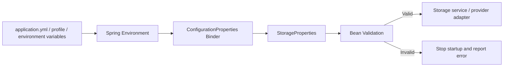

# Binding Service Configuration with `@ConfigurationProperties`

When a Spring Boot application uses Amazon S3, Azure Blob Storage, or Google Cloud Storage, the business logic needs to know **which service is selected**, **what the target bucket/container is**, and **what the application's operational policies are**. These values vary by deployment environment and should not be hardcoded in Java. Spring Boot's `@ConfigurationProperties` groups related values into a strongly typed object and supports input validation before the application serves requests.

This lesson builds a shared configuration model across the three cloud providers. The focus is on **binding and using configuration**; identity/permission provisioning and client initialization for each provider remain the responsibility of the corresponding Spring Cloud library.

## 1. What Problem Does `@ConfigurationProperties` Solve?

Suppose multiple classes in the application read independent values:

```java
@Value("${app.storage.target}")
private String target;

@Value("${app.storage.retry.max-attempts:3}")
private int maxAttempts;
```

`@Value` works well for a single value, but as a configuration group grows, this approach makes it difficult to validate constraints, detect missing values, get an overview of the configuration, and rename properties.

| Criterion | Multiple Individual `@Value`s | `@ConfigurationProperties` |
| --- | --- | --- |
| Organization | Scattered across multiple classes | One group sharing the same `prefix` |
| Data types | Converted per value | Binds to `enum`, `Duration`, nested classes, collections, etc. |
| Validation | Manual checks where used | Uses Bean Validation right at bean initialization |
| Maintainability | Easy to duplicate property names/defaults | A centralized configuration contract, easy to test |
| Code dependencies | Depends on property key strings | Injects a strongly typed configuration object |

The process that takes place when the application starts:



**Distinguishing the two configuration groups:** `app.storage.*` is **defined by the application itself** to express business requirements; keys such as `spring.cloud.aws.*`, `spring.cloud.azure.*`, and `spring.cloud.gcp.*` are defined by the **cloud provider starter** to auto-configure the SDK/client. Spring Boot does not automatically turn `app.storage.target` into a bucket for S3/Blob/GCS; integration code must explicitly use this value.

## 2. Designing a Shared Configuration Contract for Multiple Providers

Suppose an application enables only one object storage backend per environment:

| Property | Type | Meaning | Constraints |
| --- | --- | --- | --- |
| `app.storage.provider` | `AWS`, `AZURE`, `GCP` | Selected provider | Required |
| `app.storage.target` | `String` | S3/GCS **bucket** or Azure Blob **container** | Non-blank |
| `app.storage.operation-timeout` | `Duration` | Expected operation timeout of the application | Default `10s` |
| `app.storage.retry.max-attempts` | `int` | Maximum retry attempts per application policy | Default `3`, from 1 to 10 |
| `app.storage.retry.initial-delay` | `Duration` | Initial delay between retry attempts | Default `200ms` |

The name `target` is a **provider-neutral** naming choice. At the integration layer, the AWS/GCP adapter treats it as the bucket name; the Azure adapter treats it as the container name. Do not confuse it with an Azure account name or a GCP project ID.

### Declaring the Configuration Object

The example uses **Spring Boot 3.x and Java 17+**, with a record to prevent arbitrary mutation of configuration after binding:

```java
package example.cloud.config;

import jakarta.validation.Valid;
import jakarta.validation.constraints.Max;
import jakarta.validation.constraints.Min;
import jakarta.validation.constraints.NotBlank;
import jakarta.validation.constraints.NotNull;
import org.springframework.boot.context.properties.ConfigurationProperties;
import org.springframework.boot.context.properties.bind.DefaultValue;
import org.springframework.validation.annotation.Validated;

import java.time.Duration;

@Validated
@ConfigurationProperties(prefix = "app.storage", ignoreUnknownFields = false)
public record StorageProperties(
        @NotNull Provider provider,
        @NotBlank String target,
        @DefaultValue("10s") Duration operationTimeout,
        @Valid @DefaultValue Retry retry
) {
    public enum Provider { AWS, AZURE, GCP }

    public record Retry(
            @Min(1) @Max(10) @DefaultValue("3") int maxAttempts,
            @DefaultValue("200ms") Duration initialDelay
    ) {}
}
```

Key points to understand in the example:

1. `prefix = "app.storage"` tells the binder to look for properties under this namespace.
2. `Provider` is an `enum`; configuration values `aws`, `azure`, and `gcp` can be bound to the constants `AWS`, `AZURE`, and `GCP`.
3. `Duration` lets you write `10s`, `200ms`, or `2m` instead of an ambiguous unitless number.
4. `@DefaultValue` sets a default value when a key is absent. `@DefaultValue` **without arguments** on `retry` instructs the binder to instantiate the nested object even if the `retry` group is not provided.
5. `@Validated`, `@NotNull`, `@NotBlank`, `@Min`, `@Max`, and `@Valid` validate both the top-level group and the nested group. If the configuration is invalid, the application fails during bean creation rather than failing late when handling a request.
6. `ignoreUnknownFields = false` helps catch misspelled properties *inside* `app.storage`, such as `max-atempt` instead of `max-attempts`.

For Bean Validation on Spring Boot 3, `spring-boot-starter-validation` must be included in dependencies (annotations use the `jakarta.validation.*` namespace). Choose Spring Cloud AWS, Azure, and GCP versions through BOMs compatible with the running Spring Boot version; do not arbitrarily mix starter generations.

### Registering the Binding Bean

Place `StorageProperties` in a scanned package and enable configuration properties scanning on the main application class:

```java
package example.cloud;

import org.springframework.boot.SpringApplication;
import org.springframework.boot.autoconfigure.SpringBootApplication;
import org.springframework.boot.context.properties.ConfigurationPropertiesScan;

@SpringBootApplication
@ConfigurationPropertiesScan
public class ProviderIntegrationApplication {
    public static void main(String[] args) {
        SpringApplication.run(ProviderIntegrationApplication.class, args);
    }
}
```

If you do not want to scan the entire package, you can use `@EnableConfigurationProperties(StorageProperties.class)` on a `@Configuration` class instead of `@ConfigurationPropertiesScan`. With a single-constructor record as above, Spring Boot 3 performs constructor binding automatically; there is no need to add `@Component` or `@ConstructorBinding`.

## 3. YAML Declarations and Environment-Specific Loading

Define the shared part in `application.yml`:

```yaml
app:
  storage:
    target: ${STORAGE_TARGET}
    operation-timeout: 8s
    retry:
      max-attempts: 4
      initial-delay: 300ms
```

The `STORAGE_TARGET` environment variable is a required deployment value, for example `training-documents` for an S3/GCS bucket or `uploads` for an Azure Blob container. Leaving out a default here prevents accidentally writing data to an unintended location.

Each profile determines the provider and the properties that are meaningful only to the corresponding starter. The following examples assume the application has the appropriate starter and SDK for the selected provider.

**AWS — `application-aws.yml`:**

```yaml
app:
  storage:
    provider: aws

spring:
  cloud:
    aws:
      region:
        static: ${AWS_REGION}
```

**Azure — `application-azure.yml`:**

```yaml
app:
  storage:
    provider: azure

spring:
  cloud:
    azure:
      storage:
        blob:
          account-name: ${AZURE_STORAGE_ACCOUNT}
```

**Google Cloud — `application-gcp.yml`:**

```yaml
app:
  storage:
    provider: gcp

spring:
  cloud:
    gcp:
      project-id: ${GOOGLE_CLOUD_PROJECT}
```

Activate **one** profile, such as `SPRING_PROFILES_ACTIVE=aws`, and set `STORAGE_TARGET` along with the environment variables required by that profile. With the `azure` profile, `STORAGE_TARGET` is the container name; with `gcp` or `aws`, it is the bucket name. If run without an active profile, `provider` is absent and the `@NotNull` check will block startup.

The namespaces and auto-configuration of credentials/clients belong to each Spring Cloud **version**. Check the documentation of the actual starter before deploying: Spring Cloud AWS typically provides S3 integration, Spring Cloud Azure provides Blob Storage integration, and Spring Cloud GCP provides Cloud Storage integration. The examples above primarily illustrate the **boundary between application configuration and starter configuration**; YAML alone does not mean dependencies are installed or cloud permissions are granted.

### Relaxed Binding and Property Source Precedence

The binder accepts equivalent spellings; for example, `operation-timeout` in YAML binds to the Java component `operationTimeout`, and `max-attempts` binds to `maxAttempts`. Spring Boot also reads environment variables, profile properties, command-line arguments, and so on. Higher-precedence sources can override lower-precedence ones.

If you want to set `app.storage.retry.max-attempts` **directly via an environment variable** using Spring Boot's official name-conversion rules, use `APP_STORAGE_RETRY_MAXATTEMPTS` (replace dots with `_`, **remove `-`**, then convert to uppercase). The simplest and clearest approach for deployment environments is still placing the `${STORAGE_TARGET}` placeholder in YAML as shown in the example.

## 4. Injecting `StorageProperties` into the Integration Layer

The configuration bean is passed via **constructor injection**; business logic does not need to know whether properties come from YAML, environment variables, or another configuration system.

Example of a contract **defined by the application itself**, not a built-in Spring Cloud API:

```java
package example.cloud.storage;

public interface ObjectStorageGateway {
    void put(String objectKey, byte[] bytes);
}
```

The AWS adapter demonstrates using `target` after binding (once the compatible AWS S3 starter is added and the starter provides `S3Client`):

```java
package example.cloud.storage;

import example.cloud.config.StorageProperties;
import org.springframework.boot.autoconfigure.condition.ConditionalOnProperty;
import org.springframework.stereotype.Component;
import software.amazon.awssdk.core.sync.RequestBody;
import software.amazon.awssdk.services.s3.S3Client;
import software.amazon.awssdk.services.s3.model.PutObjectRequest;

@Component
@ConditionalOnProperty(
        prefix = "app.storage",
        name = "provider",
        havingValue = "aws"
)
public class AwsObjectStorageGateway implements ObjectStorageGateway {
    private final S3Client s3Client;
    private final StorageProperties properties;

    public AwsObjectStorageGateway(S3Client s3Client,
                                   StorageProperties properties) {
        this.s3Client = s3Client;
        this.properties = properties;
    }

    @Override
    public void put(String objectKey, byte[] bytes) {
        PutObjectRequest request = PutObjectRequest.builder()
                .bucket(properties.target())
                .key(objectKey)
                .build();
        s3Client.putObject(request, RequestBody.fromBytes(bytes));
    }
}
```

`@ConditionalOnProperty` ensures the AWS adapter is registered only when `provider=aws`. The Azure and GCP adapters can use the same `StorageProperties` and the same interface, while mapping to their respective SDKs:

| Adapter | Provider Client | How `properties.target()` Is Used |
| --- | --- | --- |
| AWS | AWS SDK v2 `S3Client` | Value for `.bucket(...)` in `PutObjectRequest` |
| Azure | Azure SDK `BlobServiceClient` | Calls `getBlobContainerClient(target)` and operates on the blob |
| GCP | Google Cloud Storage `Storage` | Bucket name when creating `BlobInfo`/writing objects |

Note: `operationTimeout` and `retry` in the model above are **only application policy data**. They do not automatically control SDK timeouts or retries. If implementing this policy, the adapter must apply it using the appropriate timeout/retry API for each provider while accounting for the SDK's built-in retry behavior to avoid nested retries and multiplied requests. Do not assume SDKs share the same semantics.

In a real application, you can also create each bean via `@Bean` combined with `@ConditionalOnProperty`, use a common interface, or select an adapter strategy at runtime. If packaging all three starters together, check how to disable/enable each cloud's auto-configuration to avoid creating unused clients or requiring configuration/credentials for another provider.

## 5. Catching Configuration Errors Before Calling the Cloud

Several errors can be detected **without an AWS/Azure/GCP account**:

| Misconfiguration | What Happens | How to Fix |
| --- | --- | --- |
| Missing `app.storage.provider` | `@NotNull` fails during binding/validation | Activate the right profile or declare `provider` |
| `provider: alibaba` | Cannot convert string to `Provider` enum | Choose `aws`, `azure`, or `gcp` |
| `target: ""` | `@NotBlank` is not satisfied | Provide a valid bucket/container |
| `max-attempts: 0` | `@Min(1)` is not satisfied | Use 1–10 |
| `operation-timeout: someday` | Cannot convert to `Duration` | Use syntax like `500ms`, `8s`, `2m` |
| Misspelled `app.storage.retry.max-atempt` | May be rejected because `ignoreUnknownFields=false` | Fix key to `max-attempts` |
| `StorageProperties` not registered | No bean available to inject | Add `@ConfigurationPropertiesScan` or `@EnableConfigurationProperties` |
| Validation does not run | May be missing a Bean Validation provider | Add `spring-boot-starter-validation` and `@Validated` |

Configuration errors caught at startup are **different** from cloud interaction errors. For example, a non-blank target whose bucket does not exist yet, insufficient IAM permissions, a wrong project/account, or blocked network traffic will only surface when the adapter/client actually calls the service (or when an appropriate health check runs).

### Unit Tests for Binding and Validation

`ApplicationContextRunner` (from `spring-boot-test`) creates a minimal Spring context to test only the configuration contract without initializing cloud clients. Example using JUnit 5 and AssertJ along with the validation dependency:

```java
package example.cloud.config;

import org.junit.jupiter.api.Test;
import org.springframework.boot.context.properties.EnableConfigurationProperties;
import org.springframework.boot.test.context.runner.ApplicationContextRunner;
import org.springframework.context.annotation.Configuration;

import static org.assertj.core.api.Assertions.assertThat;

class StoragePropertiesTest {
    private final ApplicationContextRunner runner =
            new ApplicationContextRunner()
                    .withUserConfiguration(TestConfig.class);

    @Test
    void bindDuocCauHinhHopLe() {
        runner.withPropertyValues(
                "app.storage.provider=gcp",
                "app.storage.target=example-documents",
                "app.storage.operation-timeout=6s",
                "app.storage.retry.max-attempts=5"
        ).run(context -> {
            assertThat(context).hasNotFailed();
            StorageProperties config = context.getBean(StorageProperties.class);
            assertThat(config.provider()).isEqualTo(StorageProperties.Provider.GCP);
            assertThat(config.target()).isEqualTo("example-documents");
            assertThat(config.operationTimeout().getSeconds()).isEqualTo(6);
            assertThat(config.retry().maxAttempts()).isEqualTo(5);
        });
    }

    @Test
    void tuChoiRetryKhongHopLe() {
        runner.withPropertyValues(
                "app.storage.provider=aws",
                "app.storage.target=example-documents",
                "app.storage.retry.max-attempts=0"
        ).run(context -> assertThat(context).hasFailed());
    }

    @Test
    void tuChoiTargetRong() {
        runner.withPropertyValues(
                "app.storage.provider=azure",
                "app.storage.target="
        ).run(context -> assertThat(context).hasFailed());
    }

    @Configuration(proxyBeanMethods = false)
    @EnableConfigurationProperties(StorageProperties.class)
    static class TestConfig {}
}
```

Because `ApplicationContextRunner` creates only a small context, this is a binding/validation test. To confirm an adapter operates on the right bucket/container, a separate integration test is needed using an emulator (where appropriate) or a cloud test environment with limited permissions, test data, and a cleanup mechanism.

## 6. Managing Identities, Permissions, and Secrets When Binding Configuration

`@ConfigurationProperties` does not grant cloud access. Separate **non-secret configuration values** (provider, project, region, target, timeout) from **identities and credentials**, which should be handled by the cloud SDK or a secret management system.

| Cloud | Recommended Identity When Running on Cloud | Least-Privilege Permissions to Consider |
| --- | --- | --- |
| AWS | IAM Role / workload identity recognized by the SDK credential chain | `s3:PutObject` permission on the target bucket/prefix |
| Azure | Managed Identity or workload identity via Azure Identity | Appropriate data role on the container/account, such as Storage Blob Data Contributor when writing |
| GCP | Application Default Credentials via service account / Workload Identity | Permission to write objects in the bucket, such as an appropriate bucket-scoped role |

Do not hardcode access keys, client secrets, or private keys in `application.yml`, commit them to Git, or print the full configuration to logs. If using a secret manager, put only the necessary reference in configuration and let the corresponding integration mechanism retrieve the secret. When enabling Actuator `/env` or `/configprops`, keep sensitive-value masking enabled; do not expose full unmasked values in production.

**Scope of validation:** `@NotBlank` only proves that a target name was provided; it does not prove that the object storage exists or that the credentials have permission. Verify permissions and connectivity through a separate integration test/health check, being mindful of costs and side effects from writing test objects.

## 7. Suggested Practice Exercises

1. Create `StorageProperties` and register scanning as in section 2. Run the unit tests in section 5 to confirm the binder converts `gcp` to `Provider.GCP`, `6s` to `Duration`, and rejects retry equal to 0.
2. Create `application.yml` and the three profiles `aws`, `azure`, and `gcp` as in section 3. Set `STORAGE_TARGET` and the corresponding environment variables; try omitting the profile to observe the required `provider` error.
3. Create `ObjectStorageGateway` and the AWS adapter as in section 4. Then switch profiles and write the Azure/GCP adapters; identify the exact place where `target` becomes the SDK's bucket/container name.
4. Test with credentials provisioned under the principle of least privilege. Compare the three failure categories: **binding syntax error**, **missing permissions**, and **non-existent resource**. Each category must have a distinct diagnosis.
5. When adding timeout/retry policies, check whether the SDK already retries automatically. Document the final policy where the client or adapter is constructed and add an integration test for transient failures if the test environment permits.

**Expected outcome:** each environment selects a provider via profile; Spring Boot creates and validates a strongly typed `StorageProperties`; integration code receives configuration via constructor; credentials and permissions are handled by the provider's identity mechanism. The application configuration layer can be tested independently before making any cloud calls.
