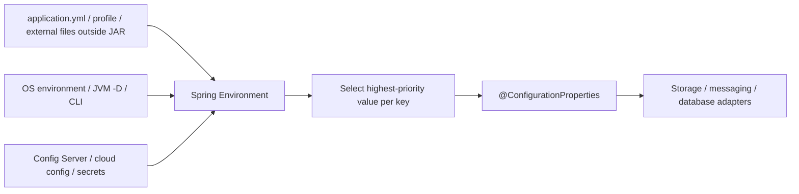

# Precedence Between Configuration Files, Environment Variables, and Remote Sources

In a Spring Boot project integrating managed services from AWS, Azure, and Google Cloud, the same property can appear in multiple places: the project's `application.yml`, `application-prod.yml`, external configuration files outside the JAR, environment variables injected by the deployment platform, and remote configuration or secret management services. Without knowing which source wins, the application may connect to the wrong bucket, send messages to the wrong topic, or use test settings in production.

This lesson explains **Spring Boot's configuration precedence rules**, how profiles and `spring.config.import` affect the outcome, specifics of Spring Cloud Config and remote cloud sources, and how to verify the final effective values the application actually uses.

## 1. Understanding "Configuration Precedence" at the Individual Property Level

Spring Boot assembles configuration sources into an `Environment`. Each source supplies key/value pairs; when the application reads a key, **the value from the highest-precedence source that defines that key** is used. Non-overlapping keys can still come from different sources.

For example, suppose an application has two keys:

- `integration.storage.bucket`: the bucket/container name for storing documents.
- `integration.messaging.topic`: the topic or destination name used by the messaging adapter.

If `application.yml` declares both keys while an environment variable overrides only the bucket, the bucket comes from the environment variable and the topic still comes from the file. There is no "all-file or all-environment" rule for an entire configuration group.

`@ConfigurationProperties` is bound **after the `Environment` has assembled its list of property sources**, so the configuration bean receives the effective values according to precedence order. This annotation does not alter the source order itself.



**Distinguish two questions:** *Which sources are loaded?* depends on profiles, locations, dependencies, importers, and access permissions. *Among loaded sources, which value wins?* depends on the precedence order defined by Spring Boot or the integration library.

## 2. Default Configuration Source Order in a Spring Boot Application

For a standalone Spring Boot application with no custom property source ordering, keep in mind the following common sources **from lowest to highest precedence**:

| Level | Configuration Source | Example |
| --- | --- | --- |
| Low | Application-defined default properties | `SpringApplication.setDefaultProperties(...)` |
| | `@PropertySource` on Java configuration | Additional files declared via annotation |
| | **Config Data**: YAML/properties inside and outside the JAR, plus configuration loaded by `spring.config.import` | `application.yml`, `application-prod.yml` |
| | OS environment variables | `INTEGRATION_STORAGE_BUCKET=prod-bucket` |
| | JVM system properties | `-Dintegration.storage.bucket=jvm-bucket` |
| | `SPRING_APPLICATION_JSON` | JSON string passed via env/system property |
| High | Command-line arguments | `--integration.storage.bucket=cli-bucket` |

The table above shows **common levels**, not an exhaustive list of every `PropertySource`: web applications, JNDI, test frameworks, and developer tools also have their own sources. During tests, for instance, `@TestPropertySource` and `@DynamicPropertySource` have their own precedence and can override the listed sources. Nor does the table replace the rules of a remote configuration integration that uses a special `bootstrap` mechanism.

For example, if a key appears simultaneously in the default sources above, command-line arguments beat JVM system properties, JVM system properties beat OS environment variables, and OS environment variables beat Config Data. A declared value that is an empty string can still shadow a valid value from a lower-precedence source; check this with validation rather than assuming empty means "absent."

### Ordering Within the Config Data Group

Under Spring Boot's default configuration search locations, the following file types increase in precedence:

1. `application.yml` or `application.properties` **packaged inside the JAR**.
2. `application-{profile}.yml` or `application-{profile}.properties` **packaged inside the JAR**.
3. `application.yml` or `application.properties` **outside the JAR**.
4. `application-{profile}.yml` or `application-{profile}.properties` **outside the JAR**.

For example, `./config/application-prod.yml` next to the JAR can override `application-prod.yml` inside the JAR. If both `application.properties` and `application.yml` exist in the same location, Spring Boot prefers the `.properties` format; stick consistently to one format to avoid confusion during troubleshooting.

When a document declares `spring.config.import`, **imported Config Data has higher precedence than the document that declared the import**. Imports are loaded as additional configuration documents; if there are multiple imports, a later import can override an earlier one when defining the same key. Exact ordering and locations also depend on `spring.config.location`, `spring.config.additional-location`, and the relevant library's import mechanism.

**Note on multiple profiles:** when multiple profiles are active at once, profile order can determine which profile's configuration wins on conflicting keys. Do not rely on arbitrary file order in a directory; declare and test allowed profile combinations explicitly.

## 3. Complete Example: One Value Appearing Across Multiple Sources

Consider the application `provider-integration`. In `src/main/resources/application.yml`:

```yaml
integration:
  storage:
    bucket: documents-default
    timeout: 10s
  messaging:
    topic: documents-created
```

In `src/main/resources/application-prod.yml`:

```yaml
integration:
  storage:
    bucket: documents-prod-file
    timeout: 8s
```

In production deployment, set the environment variables:

```text
SPRING_PROFILES_ACTIVE=prod
INTEGRATION_STORAGE_BUCKET=documents-prod-env
INTEGRATION_STORAGE_TIMEOUT=5s
```

`INTEGRATION_STORAGE_BUCKET` maps to `integration.storage.bucket` via Spring Boot's **relaxed binding**; `INTEGRATION_STORAGE_TIMEOUT` maps to `integration.storage.timeout`. For hyphenated names, the common rule for expressing them as environment variables is to replace `.` with `_`, omit `-`, and convert to uppercase. For example, `integration.storage.operation-timeout` becomes `INTEGRATION_STORAGE_OPERATIONTIMEOUT`.

Run the application and override `timeout` further with a JVM system property and `bucket` with a CLI argument:

```bash
java -Dintegration.storage.timeout=4s -jar provider-integration.jar --integration.storage.bucket=documents-prod-cli
```

This command illustrates the syntax; in Windows PowerShell, you may need quotes around the `-D...` argument if the shell treats special characters specially.

**Effective result:**

| Key | Base File | `prod` Profile | OS Environment | JVM `-D` | CLI | Final Value |
| --- | --- | --- | --- | --- | --- | --- |
| `integration.storage.bucket` | `documents-default` | `documents-prod-file` | `documents-prod-env` | — | `documents-prod-cli` | **`documents-prod-cli`** |
| `integration.storage.timeout` | `10s` | `8s` | `5s` | `4s` | — | **`4s`** |
| `integration.messaging.topic` | `documents-created` | — | — | — | — | **`documents-created`** |

If you remove the `--integration.storage.bucket=...` argument, the final bucket becomes `documents-prod-env`. If you also remove the corresponding environment variable, it becomes `documents-prod-file`. This demonstrates that a higher-precedence source affects only **the keys it declares**, without erasing other keys.

**Operational guideline:** shared configuration belongs in the default file; environment differences belong in profile files; deployment-specific values can be provided by the orchestrator via environment variables or mounted files. Avoid using CLI arguments for long-term "quick fixes," as they make configurations harder to reproduce.

## 4. Files Outside the JAR and Configuration Locations

Spring Boot supports external configuration outside the package so the same artifact can be deployed across environments:

```bash
java -jar provider-integration.jar --spring.config.additional-location=optional:file:./deployment-config/
```

`spring.config.additional-location` **adds** config search locations alongside the default locations; `spring.config.location` **replaces** the default locations (unless re-declared). Additional locations declared later can override earlier ones according to Config Data rules. For directory paths, keep the trailing `/`; `optional:` allows the application to start even if that location does not exist.

In `./deployment-config/application-prod.yml`:

```yaml
integration:
  storage:
    bucket: documents-prod-external
```

If the `prod` profile is active, the external value above beats the packaged file **when no higher-precedence source overrides that key**. If `INTEGRATION_STORAGE_BUCKET` is still set, the environment variable still wins as in section 3.

Do not confuse `spring.config.additional-location` with `spring.config.import`: additional-location expands where Spring searches for files following the `application[-profile]` naming convention; import specifies exact resources to load, which can be specific files or configuration systems supported by a starter.

## 5. When Remote Sources Are Involved: What Changes?

In a multi-cloud integration model, a "remote source" can be:

| Source | Common Purpose | How the Application Sees Configuration |
| --- | --- | --- |
| Spring Cloud Config Server | Centralized property management per application/profile | Spring Cloud Config Client loads into `Environment` via its integration mechanism |
| AWS Secrets Manager / Parameter Store | Secrets or operational parameters on AWS | Spring Cloud AWS integration loads/maps into property sources depending on starter and version |
| Azure Key Vault / App Configuration | Secrets and application configuration on Azure | Spring Cloud Azure integration loads via property sources or its own configuration mechanism |
| Google Cloud Secret Manager | Secrets for workloads on GCP | Spring Cloud GCP integration or SDK supplies values to the application |
| Kubernetes ConfigMap / Secret | Cluster-managed configuration | Can be mounted as files or exposed as environment variables; precedence follows **how it is loaded** |

**There is no universal rule that "remote always beats local" or "env always beats remote" across every library and every loading mode.** You must check the Spring Boot/Spring Cloud version, adapter, import mode, and override options.

### 5.1. Spring Cloud Config Server with the Config Data API

With Spring Boot 2.4+ and a compatible Spring Cloud Config Client, a common setup is:

```yaml
spring:
  application:
    name: provider-integration
  config:
    import: "configserver:https://config.internal.example"
```

The application needs the `spring-cloud-starter-config` dependency and a Spring Cloud version compatible with Spring Boot. At startup, the client queries Config Server based on `spring.application.name`, active profiles, and label/version metadata if configured. Config Server's repository might contain, for example:

```yaml
# provider-integration-prod.yml in Config Server's configuration repository
integration:
  messaging:
    topic: documents-created-prod
  storage:
    timeout: 7s
```

`spring.config.import` brings the Config Server resource into the Config Data processing pipeline. Imported data takes precedence over the document declaring the import per Config Data rules, while environment/command-line overrides and other override settings still depend on the client's actual behavior. Do not infer precedence just from the fact that the file lives "on a server."

When the URL is written as `optional:configserver:https://config.internal.example`, a missing source may be tolerated under the optional mechanism; for required production configuration, consider **fail fast** so the app does not silently run with stale local values or missing configuration. Authentication to Config Server must be secured separately, typically via an identity or secret provided by the deployment environment.

### 5.2. Why Some Documentation Says Remote Cannot Be Overridden Locally

Some Spring Cloud systems use the **legacy bootstrap context** to insert remote property sources into `Environment` at high precedence. In that model, remote properties cannot be overridden locally unless the **remote source** grants override permission:

- `spring.cloud.config.allowOverride=true`: permits overrides according to policy.
- `spring.cloud.config.overrideNone=true`: when overrides are allowed, lets local sources override more broadly.
- `spring.cloud.config.overrideSystemProperties=false`: when overrides are allowed, lets system properties, environment variables, and command-line arguments override, but not ordinary local config files.

These properties describe the behavior of a **remote/bootstrap model that supports them**, not a universal formula replacing Config Data ordering across every Spring Cloud release. Setting `allowOverride` only in a local file is insufficient if the remote side must grant permission. When migrating from legacy bootstrap to `spring.config.import=configserver:...`, verify the effective precedence directly on the version in use.

### 5.3. Secret Management Services on Each Cloud

With AWS, Azure, and GCP, integration libraries can either inject secrets into `Environment` or your code can actively fetch secrets through an SDK. These two approaches differ:

- **Loaded as a property source:** secrets participate in property resolution; precedence depends on where the starter inserts its property source, import placement, and adapter settings.
- **On-demand SDK calls:** the application receives data from a client at runtime; this is not automatically a Spring property and does not follow `Environment` override order.

Do not assume a secret service key automatically maps to `spring.datasource.password` or `integration.messaging.password`. You must configure mapping according to the starter/version or handle it explicitly in an appropriate bean. Avoid defining defaults for sensitive credentials just to "make the application start at all costs."

**Identity for accessing remote sources:** prefer IAM Role/Workload Identity on AWS, Managed Identity/Workload Identity on Azure, and Application Default Credentials/Workload Identity on GCP. Grant read access only to required secrets/parameters, separate staging and production environments, and never embed access keys or client secrets in Git.

## 6. Once Resolved, What Values Does `@ConfigurationProperties` Receive?

Suppose we define an application-specific storage configuration:

```java
package example.cloud.config;

import jakarta.validation.constraints.NotBlank;
import jakarta.validation.constraints.NotNull;
import org.springframework.boot.context.properties.ConfigurationProperties;
import org.springframework.validation.annotation.Validated;

import java.time.Duration;

@Validated
@ConfigurationProperties(prefix = "integration.storage")
public record StorageProperties(
        @NotBlank String bucket,
        @NotNull Duration timeout
) {}
```

Register the bean using `@ConfigurationPropertiesScan` on the application class or `@EnableConfigurationProperties(StorageProperties.class)` in Java configuration, together with `spring-boot-starter-validation` to enable Bean Validation.

When running the example in section 3, the `StorageProperties` bean receives:

```text
bucket  = documents-prod-cli
timeout = PT4S  (Duration of 4 seconds)
```

Spring Boot applies conversion to `Duration` and relaxed binding on property names. `@NotBlank`/`@NotNull` catch certain errors before calling S3, Azure Blob, or Google Cloud Storage. **Validation only confirms that configuration data has the right shape**; it does not prove that the bucket exists, the account is correct, or the credentials have permissions.

A service can depend on the bound configuration via constructor injection:

```java
package example.cloud.storage;

import example.cloud.config.StorageProperties;
import org.springframework.stereotype.Service;

@Service
public class StorageTargetResolver {
    private final StorageProperties properties;

    public StorageTargetResolver(StorageProperties properties) {
        this.properties = properties;
    }

    public String targetName() {
        return properties.bucket();
    }
}
```

This is an application-defined name for the configuration group, **not** a namespace automatically understood by AWS/Azure/GCP starters. The S3/GCS adapter uses this name as the bucket, whereas the Azure adapter can interpret it as a container if the application contract defines it that way.

## 7. Verifying Configuration Sources in a Real Environment

The surest way to explain a final value is to reproduce the loaded sources and trace the key's origin.

### Step 1 — Check Keys and Profiles

Verify the exact property name `integration.storage.bucket`, the selected profile, and the `SPRING_PROFILES_ACTIVE` variable. Check differences across `application.yml`, `application-prod.yml`, and external locations. Confirm that keys in environment variables use relaxed binding properly; if needed, test overriding via CLI argument to rule out variable-naming errors.

### Step 2 — Trace the Source Without Printing Secrets

With Spring Boot Actuator and a secured `/actuator/env` endpoint, property **source and origin** metadata can help identify which file or property source supplied a value. The `/actuator/configprops` endpoint shows the configuration bound into beans. Whether contents are shown or masked depends on security settings and the Spring Boot version.

Do not expose these endpoints publicly in production; restrict access and keep sensitive-value masking enabled. For secrets, log **source name, profile, connection status, and key name** when diagnosing issues; never log token contents, access keys, passwords, or decrypted secrets.

### Step 3 — Controlled Smoke Tests

Run the same JAR multiple times in a test environment and record the final value of a **non-sensitive** property:

| Run | Added Source | Expected Bucket |
| --- | --- | --- |
| A | No profile, no override | `documents-default` |
| B | Activate `prod` | `documents-prod-file` |
| C | Add `INTEGRATION_STORAGE_BUCKET=documents-prod-env` | `documents-prod-env` |
| D | Add `--integration.storage.bucket=documents-prod-cli` | `documents-prod-cli` |
| E | Remove CLI and env; add external file outside JAR containing `documents-prod-external` | `documents-prod-external` |

The test must control leftover environment variables, system properties, external files, and remote imports; otherwise results can easily be skewed by host state. If running tests with `@SpringBootTest(properties=...)` or `@TestPropertySource`, remember these are **test-specific sources with their own precedence**, so results do not fully represent production startup.

### Step 4 — Verify Remote Sources and Failure Policies

When adding Config Server or a cloud secret store, test sequentially: reachable source; unreachable source; missing key; key existing in both local and remote sources. Record whether the application **fails startup or falls back** and **which source wins**. If cloud connection settings, secrets, or security policies are mandatory, prefer failing explicitly before serving traffic.

To automate this, you can run integration tests against a controlled test Config Server or mocked property sources; tests should assert **effective values**, not merely that YAML parses cleanly.

## 8. Common Misconceptions and How to Handle Them

| Symptom | Common Cause | How to Diagnose |
| --- | --- | --- |
| Edited `application.yml` but app behavior didn't change | Profile/external file/env/CLI is overriding it | Check active profiles and property origin |
| Set an environment variable but another value is still used | Wrong env var name; JVM `-D` or CLI has higher precedence | Check variable name, CLI arguments, and system properties |
| Production profile runs with the dev bucket | Right profile not activated; key overridden by a higher-precedence source | Check `SPRING_PROFILES_ACTIVE` and all config locations |
| Added `spring.config.import` but remote values are missing | Missing dependency, wrong URL, missing permissions, or import marked optional | Check startup logs and connection status |
| Application starts even though remote source is unavailable | `optional:` configured or fallback mechanism allowed | Confirm fail-fast requirements and test disconnected source |
| Secret rotated but application still uses old value | Bean bound at startup with no refresh mechanism | Check refresh/restart policy of the library and beans |
| Value in `@ConfigurationProperties` differs from expectation | Prefix mismatch, relaxed binding, type conversion, or bean created before custom source | Check registration, property origin, and binding errors |
| Installing two or three cloud starters together causes startup errors | Auto-configuration of an unused provider still tries to create a client | Separate dependencies per deployment or configure enable/disable per starter |

**Especially regarding runtime changes:** updating a file, environment variable, or secret on a server **does not guarantee that already-bound beans update immediately**. Most configuration is loaded at startup; dynamic updates require an explicit refresh mechanism (such as refresh-capable Spring Cloud components, `@RefreshScope` where appropriate) or a restart/rollout. Do not treat `@ConfigurationProperties` as a real-time secret watcher.

## 9. Scenario Exercise: Running the Same Artifact Across Three Clouds

A team deploys the same document-upload application to AWS S3, Azure Blob Storage, and Google Cloud Storage. Environments share several configuration groups:

- `integration.storage.bucket`: bucket or container name interpreted by the adapter.
- `integration.messaging.destination`: SQS queue, Azure Service Bus entity, or Pub/Sub topic name decided by the adapter.
- `integration.storage.timeout`: application policy timeout.
- Connection credentials and secrets are provided via workload identity or a cloud secret store.

Follow this plan:

1. Declare **non-sensitive** defaults in `application.yml`, and put environment differences in `aws`, `azure`, `gcp`, and, if needed, `prod` profiles. Clearly separate provider selection from properties used by cloud starters.
2. Let each deployment supply specific resource names via environment variables or files outside the JAR. Demonstrate that the bucket name from env overrides the profile file, while timeout can still come from the file.
3. Load a non-sensitive parameter from remote config. When keys collide, observe the actual precedence on your Spring Cloud version; document the import type and override policy.
4. Configure secret read permissions via workload identity. Disable connectivity to the secret store in a test environment to verify whether the application stops or falls back according to the chosen policy.
5. Update remote config while the application is running to determine whether a restart or a refresh mechanism is required. For rotated secrets, also check SDKs/clients holding onto old credentials.

**Completion criteria:** learners can identify which source provides *each* property, predict when local/profile/env/CLI win over one another, explain why remote sources must be verified against their integration mechanism, and avoid leaks or misconfiguration in multi-cloud deployments.

## 10. Summary of Rules to Remember

- Spring Boot takes **each individual key's value** from the highest-precedence property source that provides that key.
- In a typical standalone application, **CLI > JVM system properties > OS environment > Config Data**. Within Config Data, profile files outside the JAR normally override packaged profile files.
- `spring.config.import` adds sources to Config Data using import precedence rules; cloud config/secret sources may have their own mechanisms. **Do not assume all remote sources share the same precedence.**
- `@ConfigurationProperties` only binds the resolved result; Bean Validation catches misconfigurations early but does not replace verifying cloud permissions and connectivity.
- To verify production configuration, focus on inspecting **key origin, active profiles, import mechanism, and fail-fast policy**, while masking sensitive data and testing refresh/restart behavior.
