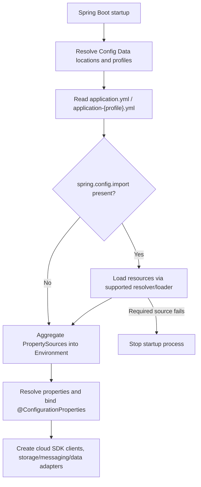
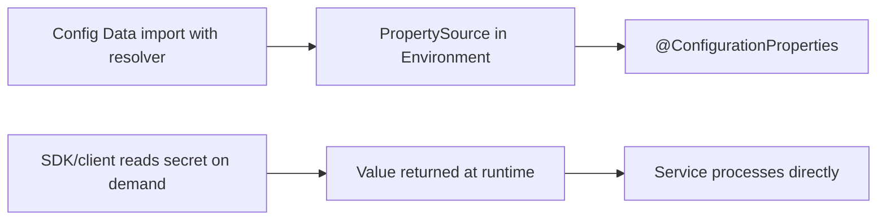

# Loading Configuration with Config Data and `spring.config.import` Where Supported

When building a Spring Boot application that integrates managed services from **AWS, Azure, and Google Cloud**, configuration typically comes from multiple places: YAML files packaged with the application, external files mounted alongside containers, Config Server, parameter stores, or secret management services. The application must load these values **early enough during startup**, before creating beans that connect to S3, Azure Blob Storage, Google Cloud Storage, messaging, or databases.

Since **Spring Boot 2.4**, the **Config Data** mechanism lets you explicitly declare configuration resources to load. The `spring.config.import` property allows importing local files, *configuration trees*, or remote sources **when a library provides the corresponding loader**. That is the topic of this lesson; the goal is to use the mechanism properly, verify the effective configuration, and handle unavailable configuration sources.

## 1. How Is Config Data Different from Reading Plain YAML?

Before creating application beans, Spring Boot prepares the `Environment` from `PropertySource`s. `application.properties`, `application.yml`, profile-specific files, and resources declared via `spring.config.import` all participate in the **Config Data** phase.



Key concepts to distinguish:

| Concept | Role |
| --- | --- |
| `Config Data` | Mechanism that locates, loads, and processes configuration documents during startup |
| `spring.config.import` | Declares additional configuration locations to load from within a configuration document |
| `PropertySource` | Collection of key/value pairs that `Environment` queries |
| `spring.profiles.active` / `spring.config.activate.on-profile` | Determines which configurations are activated per environment |
| `@ConfigurationProperties` | Binds effective values from `Environment` into a strongly typed Java bean |
| `ConfigDataLocationResolver` / `ConfigDataLoader` | Extension points libraries can provide to understand special import schemes |

**Key takeaway:** Spring Boot understands basic local locations out of the box; merely writing `spring.config.import: "aws-secretsmanager:..."` or `"configserver:..."` **does not automatically install** the library supporting them. An import scheme only works if the appropriate loader is on the classpath, the version is compatible, and connectivity prerequisites are met.

## 2. Syntax and Basic Import Types

You can declare a single import or a list of imports in `application.yml`:

```yaml
spring:
  config:
    import:
      - "classpath:/integration/storage-defaults.yml"
      - "optional:file:./runtime/storage-overrides.yml"
```

Or in `application.properties`:

```properties
spring.config.import=classpath:/integration/storage-defaults.yml,optional:file:./runtime/storage-overrides.yml
```

How to interpret common prefixes:

| Syntax | Source to Load | Condition |
| --- | --- | --- |
| `classpath:/integration/storage-defaults.yml` | File on the classpath, usually packaged inside the JAR | File exists and is in a supported format |
| `file:./runtime/storage-overrides.yml` | File on the filesystem, relative to the working directory | File exists |
| `optional:file:./runtime/storage-overrides.yml` | External file that may be absent | Skipped if the location is missing |
| `configtree:/run/secrets/` | Directory containing files, where each file represents a property | Valid directory |
| `configserver:...` | Data from Spring Cloud Config Server | Spring Cloud Config Client support present |
| AWS/Azure/GCP-specific scheme | Data from each cloud's secret/config service | Only when the installed **starter and version** support that scheme |

`optional:` is a **prefix on the import location**, not part of the filename. When a required Config Data location is missing, Spring Boot typically halts startup with an error in the `ConfigDataLocationNotFoundException` family. `optional:` lets Spring ignore a non-existent location; it **does not guarantee** ignoring other errors such as invalid YAML syntax, insufficient permissions, or network authentication failures. How remote service errors are handled also depends on the library's resolver/loader.

Practical notes:

- `classpath:` paths are packaged with the build, while `file:` paths are resolved against the running process's filesystem; in Docker, the working directory and volume mounts determine the actual path.
- Imports should point to explicit resources. When you want to add **convention-based search locations for `application[-profile]`**, consider `spring.config.additional-location` rather than importing every file individually.
- Avoid having two uncontrolled documents define the same key without a clear reason. Imports should be easy to trace so operators know which value is in effect.
- If there are multiple locations in an import list, later locations can override duplicate keys from earlier ones. Duplicate imports of the same resource are typically loaded only once under Config Data processing.

## 3. Working Example: Separating Default and Deployment Configuration

Suppose the application provides adapters for S3, Azure Blob, and GCS. We define our own `app.storage` namespace; these are **not** cloud SDK auto-configuration keys.

Example structure:

```text
src/main/resources/
├── application.yml
└── integration/
    └── storage-defaults.yml

runtime/
└── storage-overrides.yml   # optional, outside the JAR
```

**File `src/main/resources/application.yml`:**

```yaml
spring:
  application:
    name: provider-integration
  config:
    import:
      - "classpath:/integration/storage-defaults.yml"
      - "optional:file:./runtime/storage-overrides.yml"

app:
  storage:
    provider: aws
    target: archive-default
    operation-timeout: 10s
```

**File `src/main/resources/integration/storage-defaults.yml`:**

```yaml
app:
  storage:
    operation-timeout: 8s
    retry:
      max-attempts: 3
```

**File `./runtime/storage-overrides.yml` on the running host/container:**

```yaml
app:
  storage:
    target: archive-deployment
    operation-timeout: 6s
```

In this example, imported documents have higher precedence than the document that declared `spring.config.import`. An import placed later in the list can also override matching keys from an earlier import.

At startup **with no other overriding sources**, the resolved values are:

| Property | Effective Value | Why? |
| --- | --- | --- |
| `app.storage.provider` | `aws` | Defined only in `application.yml` |
| `app.storage.target` | `archive-deployment` | Imported from `runtime/storage-overrides.yml` |
| `app.storage.operation-timeout` | `6s` | Second import overrides `8s` from the first import and `10s` from the base file |
| `app.storage.retry.max-attempts` | `3` | Default import defines this key; second import does not override it |

If you delete `runtime/storage-overrides.yml`, the application still starts because `optional:file:...` was used. Then `target` reverts to `archive-default`, and `operation-timeout` takes `8s` from the default import.

If the deployment sets the environment variable `APP_STORAGE_TARGET=archive-env`, then in standard Spring Boot precedence the environment variable overrides Config Data values: `target` becomes `archive-env`. If you also run with `--app.storage.target=archive-cli`, the command-line argument overrides it further to `archive-cli`.

During practice, test one change at a time to understand where each value comes from; do not enable multiple sources simultaneously and guess which one wins.

## 4. Combining `spring.config.import` with Profiles

A profile can select configuration specific to the production environment. For a configuration file defining one or more YAML documents, you can bind an import to a profile:

```yaml
# src/main/resources/application.yml
spring:
  application:
    name: provider-integration
  config:
    import: "classpath:/integration/storage-defaults.yml"

app:
  storage:
    target: archive-local

---
spring:
  config:
    activate:
      on-profile: prod
    import: "optional:file:./runtime/prod-storage.yml"
```

In this example:

1. The `storage-defaults.yml` import is loaded when the application reads the base document.
2. When the `prod` profile is active, the second document becomes active and declares the import of the external `prod-storage.yml` file.
3. When the `prod` profile is not active, the import belonging only to that document does not apply.

You can activate the profile with the environment variable `SPRING_PROFILES_ACTIVE=prod` or the argument `--spring.profiles.active=prod`. With Config Data, Spring Boot also considers profile-specific file variants (for example `application-prod.yml`, or profile-specific files corresponding to an imported resource when supported).

Common pitfalls:

- `spring.config.activate.on-profile` is used to **activate a document for a profile**; it is not the right place to declare `spring.profiles.active`. Do not place `spring.profiles.active` inside a document that is already guarded by a profile condition.
- Multiple profiles can be active, but profile order can affect conflicting keys. Test the actual combinations of `prod` + `aws` / `azure` / `gcp` that are permitted.
- If an import depends on a profile, check startup logs and `Environment` **with that profile active**; testing without the profile active does not prove the source is broken.
- Provider-specific keys (such as AWS region, Azure account, GCP project) should be separated from the application's shared namespace; enable the matching adapter/cloud starter per deployment.

## 5. Loading `configtree` Secrets from Mounted Files

In Docker or Kubernetes, secrets and config can be mounted as **a directory containing multiple files**. Spring Boot's `configtree:` mechanism reads each filename as a property key and its file content as the value, avoiding putting secrets directly into YAML or environment variables.

Example mounted directory:

```text
/run/secrets/integration/
├── app.storage.target
├── app.storage.operation-timeout
└── app.messaging.api-token
```

The contents of those files might be `archive-prod`, `7s`, and a secret token (which must never be printed in logs). In `application.yml`:

```yaml
spring:
  config:
    import: "configtree:/run/secrets/integration/"
```

The application will see keys like `app.storage.target`, `app.storage.operation-timeout`, and `app.messaging.api-token` in `Environment`. `@ConfigurationProperties(prefix = "app.storage")` can bind the first two values. Sensitive keys should be consumed by the integration layer safely and kept masked or excluded from Actuator endpoints.

**Notes:**

- `configtree:` points to a **directory**, so keep the trailing `/`; mounting individual files is not equivalent to configuring a tree.
- Use `optional:configtree:/run/secrets/integration/` only when the directory can legitimately be absent. In production where secrets are mandatory, keep the location required so startup fails explicitly.
- Kubernetes can supply ConfigMap/Secret data as environment variables or volume files. **The two loading methods have different precedence**: env vars follow environment property source order; configtree volumes participate in Config Data.
- Updating a mounted secret file after application startup **does not automatically refresh already-bound beans**. An explicit reload/refresh mechanism or rolling restart is needed.

## 6. Integrating Remote Sources: Only When a Matching Loader Exists

This is the most important part of learning Spring Cloud Provider Integration. Spring Boot provides the **Config Data extension interface**; each cloud library decides whether to register an import scheme or only provide an SDK/API for reading configuration in another way.

### 6.1. Spring Cloud Config Server

With Spring Boot 2.4+ and a **compatible Spring Cloud Config Client**, add the `spring-cloud-starter-config` dependency. A typical configuration:

```yaml
spring:
  application:
    name: provider-integration
  config:
    import: "configserver:http://localhost:8888"
```

In a development environment, if Config Server is only supplementary, you can declare:

```yaml
spring:
  config:
    import: "optional:configserver:http://localhost:8888"
```

At startup, the Config Client queries the server using `spring.application.name`, active profiles, and label settings if configured, then participates in loading the matching properties. If the server holds configuration for the `prod` profile, test startup with `SPRING_PROFILES_ACTIVE=prod` to verify that data is loaded properly.

When remote configuration is **required**, do not use `optional:` by default: connection failures should be surfaced clearly rather than silently running with stale settings. In real environments, use HTTPS, proper authentication, and ensure connection credentials are available **before** Config Server is contacted.

**About precedence:** within Config Data, imported resources are generally evaluated according to import rules; however, Config Server and deployments using a **legacy bootstrap context** or remote override policies can resolve ordering differently. Never conclude "remote always beats local" or "env always beats remote" without checking the actual version, mechanism, and configuration.

### 6.2. AWS Secrets Manager and AWS Systems Manager Parameter Store

Some **Spring Cloud AWS** release lines provide Config Data integration for AWS Secrets Manager and Parameter Store. For versions supporting these schemes, the configuration may look like:

```yaml
spring:
  config:
    import:
      - "aws-secretsmanager:/secrets/provider-integration"
      - "aws-parameterstore:/config/provider-integration/"
```

**Prerequisites to apply this example:** a Spring Cloud AWS version that supports `aws-secretsmanager:` and `aws-parameterstore:`, the relevant modules/starters on the classpath, a resolved AWS region, and an AWS identity with sufficient permissions. Not all Spring Cloud AWS versions use the same modules, starters, or import syntax; check the documentation for your exact version.

During loading:

- The AWS SDK credential chain can resolve an IAM Role/workload identity, or development credentials.
- The identity must have read permissions for the target secret/parameter, such as `secretsmanager:GetSecretValue` or `ssm:GetParameter(s)`; encrypted parameters may also require KMS permissions.
- A JSON secret is mapped into multiple properties only if the integration mechanism and version format support it; a plain secret string does not automatically turn into a set of YAML keys.
- Missing permissions and a wrong region are **different errors** from a missing property; diagnose them from the cloud service response rather than "fixing" them with fake default tokens.

Do not use `optional:` for mandatory production secrets unless the business logic genuinely has a safe fallback path when the secret is absent.

### 6.3. Azure App Configuration, Key Vault, and Google Cloud Secret Manager

With Azure and GCP, do not copy `aws-secretsmanager:` syntax and swap the provider name. Each library's mechanism differs:

| Service | Purpose | What to Verify Before Using Import |
| --- | --- | --- |
| Azure App Configuration | Key/value management by application, environment, and label | Does the compatible Spring Cloud Azure starter load via Config Data or its own configuration mechanism? Which scheme and store/label selection are supported? |
| Azure Key Vault | Secret, certificate, and key management | Does the starter expose secrets as a `PropertySource`? Are endpoint/credential properties required before startup? |
| Google Cloud Secret Manager | Secret storage for workloads on GCP | Does the Spring Cloud GCP version support direct import, secret placeholders, or SDK-based reads? |
| Google Cloud Runtime Config / other sources | Operational configuration, if actually used by the project | Is that source supported and still appropriate in the current version? Do not assume a Config Data resolver exists. |

Libraries may provide a **property source**, a **placeholder resolver**, or a **client API**, but only when a library explicitly provides a Config Data integration can you use a provider-specific `spring.config.import` scheme. There are two distinct flows:



In the runtime SDK flow, the returned value **does not automatically become** a Spring property. If the library only supports SDK access, design a dedicated bean with caching, timeouts, retries, and an appropriate refresh strategy; do not invent an unsupported `spring.config.import` scheme.

When running on the cloud, prefer **IAM Role/Workload Identity** (AWS), **Managed Identity/Workload Identity** (Azure), and **Application Default Credentials/Workload Identity** (GCP). The identity used to read remote configs/secrets must already exist **before import runs**, so it cannot depend on a secret that is only available **after the import succeeds**.

## 7. How Does `Config Data` Relate to Configuration Precedence?

When multiple sources provide the same key, `Environment` selects the key according to precedence order. In a standard Spring Boot setup, you can picture it as:

```text
Command-line arguments
    > JVM system properties (-D...)
    > OS environment variables
    > Config Data (application.yml, profile, import...)
    > application default properties
```

This is a reference order for **common sources**; test frameworks, legacy bootstrap, library-added property sources, and remote override policies can alter the actual behavior.

Inside the Config Data group:

1. Profile-specific config files can take precedence over shared files within the same search location group.
2. External configuration locations outside the JAR generally take precedence over default locations inside the JAR.
3. Imported resources take precedence over **the document declaring the import**; among multiple imports in the same document, later imports can override earlier ones.
4. Profile-activated documents participate only when their profile matches; inactive documents contribute no keys.

Therefore, to understand why `app.storage.target` resolves to `archive-deployment`, looking at `application.yml` alone is not enough; you need to check active profiles, imports, external config, env vars, CLI arguments, and registered configuration libraries.

### Avoid Mixing `spring.config.import` and `spring.config.location` Arbitrarily

| Property | Primary Meaning | When to Use |
| --- | --- | --- |
| `spring.config.import` | Imports explicit resources declared **inside a configuration document** | Shared files, configtree, Config Server, supported remote resolvers |
| `spring.config.additional-location` | Adds search locations for `application[-profile]` | Adding an external config directory for deployment |
| `spring.config.location` | Changes/replaces the default search locations | When full control over config layout is required |
| `spring.config.name` | Changes the base name of the application config file to search for | When using a name other than `application` |

`spring.config.location`, `spring.config.additional-location`, and `spring.config.name` must be supplied early enough (typically via environment variables, system properties, or command-line arguments), because Spring Boot needs them before searching for Config Data. Placing them inside a document that is only discovered through them can create a circular dependency.

## 8. Binding Loaded Values and Protecting the Application from Misconfiguration

A configuration object validates inputs coming from any source, including remote ones:

```java
package example.cloud.config;

import jakarta.validation.constraints.NotBlank;
import jakarta.validation.constraints.NotNull;
import org.springframework.boot.context.properties.ConfigurationProperties;
import org.springframework.validation.annotation.Validated;

import java.time.Duration;

@Validated
@ConfigurationProperties(prefix = "app.storage")
public record StorageProperties(
        @NotBlank String target,
        @NotNull Duration operationTimeout
) {}
```

In Spring Boot 3.x, register this record with `@ConfigurationPropertiesScan` on the application class or `@EnableConfigurationProperties(StorageProperties.class)` in Java configuration. For Bean Validation to run, include the `spring-boot-starter-validation` dependency (namespace `jakarta.validation`).

When the import in section 3 succeeds, the bean receives `target = "archive-deployment"` and `operationTimeout = Duration.ofSeconds(6)`. If `app.storage.target` is missing or blank, validation catches it before the adapter calls the storage provider. With a provider enum, you can add constraints to prevent pointing to the wrong backend.

**Limitations of validation:** a syntactically valid bucket/container name does not prove the resource exists, IAM/RBAC is configured correctly, or the cloud endpoint is reachable. You still need a separate integration test or connectivity check using least-privilege permissions. Also remember that `operationTimeout` in the bean is **application policy**; it does not automatically become the AWS/Azure/GCP SDK timeout unless the adapter applies it.

## 9. Diagnosing Config Data Loading Errors

Config Data errors usually occur **at startup**, before controllers or services are ready. Distinguishing error categories helps narrow down the cause quickly:

| Symptom | Primary Cause | How to Handle |
| --- | --- | --- |
| `ConfigDataLocationNotFoundException` | Required imported file/directory does not exist | Check actual path inside container, volume mounts, and whether `optional:` is needed |
| YAML file exists but parsing fails | Invalid YAML syntax or wrong data structure | Check indentation, duplicate keys, and `application.yml` formatting |
| Scheme like `configserver:` or `aws-secretsmanager:` is unrecognized | Missing starter or version lacks that resolver | Verify dependencies, BOM, and version documentation |
| Import works in dev but not in prod | Different profile, import activation, or location | Check `spring.profiles.active` and `spring.config.activate.on-profile` |
| Remote fails to connect | DNS/TLS/endpoint, network, timeout, or server unavailable | Check startup logs, endpoint, connectivity, and retry/fail-fast settings |
| Remote returns permission error | Wrong IAM/RBAC/credential/region/project | Verify workload identity and least-privilege read permissions |
| Bean still holds old value after file update | No refresh mechanism, instance not restarted | Check release/restart process and version refresh support |
| Bean receives unexpected value | Another higher-precedence source is overriding it | Compare property origin, env, CLI, profile, and imports |
| Secrets exposed via operational endpoints | Actuator `env`/`configprops` or logs lack protection | Enable value masking, restrict access, remove sensitive logs |

To identify which source supplied a key, you can use Spring Boot Actuator ``/actuator/env`` and ``/actuator/configprops`` **within a controlled scope**. These endpoints can reveal source names and origins, while value display depends on security settings, version, and sanitization policies. Never expose these endpoints publicly or turn on full unmasked secret display in production.

For a **non-sensitive** property, you can inspect:

```text
1. Value written in application.yml.
2. Value from imported files.
3. Value from profile-specific files or external locations.
4. Value from OS environment, JVM -D, and CLI.
5. Effective value in Environment / @ConfigurationProperties.
```

For secrets, verify only **presence/absence**, source, and access permissions; never print the raw value for troubleshooting.

## 10. Testing the Configuration Loading Flow

To test **real Config Data behavior**, run a Spring context with Config Data initialization enabled. A unit test that merely invokes `Binder` with manually supplied properties can verify type conversion and validation, but **does not prove that `spring.config.import` was processed**.

Suggested test scenarios:

| Scenario | Setup | Expected Outcome to Assert |
| --- | --- | --- |
| Internal import | Import `classpath:/integration/storage-defaults.yml` | Keys are loaded and override the declaring document |
| Missing optional file | `optional:file:./runtime/missing.yml` | Startup succeeds and falls back to expected defaults |
| Missing required file | `file:./runtime/missing.yml` | Startup fails explicitly |
| Profile-scoped import | Import placed in `on-profile: prod` document | Loaded only when `prod` is active |
| `configtree` mount | Test directory containing files named after properties | Correct keys are read from file contents |
| Authorized remote source | Test Config Server/secret store with credentials | Values are retrieved without logging secrets |
| Unauthorized remote source | Workload identity lacking read permission | Permission error detected; no unsafe fallback |
| Env/CLI override | Set non-sensitive key matching an import | Effective value follows verified precedence policy |

Use an isolated test environment or appropriate emulator for remote parts; separate Config Data tests from tests that perform real operations against S3, Blob, GCS, SQS, Service Bus, or Pub/Sub. When automating, assert **final effective values and expected failures**, not just "the application started."

### Guided Practice Exercise

1. Create `application.yml` and `integration/storage-defaults.yml` as in section 3; start the application and verify `app.storage.operation-timeout` using a `StorageProperties` bean.
2. Add `runtime/storage-overrides.yml`, then modify `target` and `operation-timeout`. Remove the file to observe the difference between `optional:` and required imports.
3. Add a `prod` profile that imports a production-only external file; verify values under both the default profile and `prod`.
4. Create a test configtree directory containing a `app.storage.target` file and import it with `configtree:`. Compare this with setting an environment variable.
5. If your project has Config Server or an AWS/Azure/GCP starter supporting Config Data, test a remote import with **one non-secret property**, documenting the scheme, dependencies, permissions, and effective value. Disable connectivity to the remote source to observe the failure policy.
6. Rotate a secret in the remote source while the application is running. Verify whether the current setup refreshes automatically; if not, perform a controlled restart/rollout and confirm the new credential takes effect.

**Completion criteria:** learners can explain why an import succeeds or fails, distinguish imports from default search locations, predict post-binding values, and recognize that remote sources can only be used via `spring.config.import` when the starter/version actually provides that mechanism.

## 11. Key Takeaways

- **Config Data** loads configuration during startup before most application beans are created. `spring.config.import` declares additional resources to import.
- Spring Boot natively supports local file and `configtree` imports; for Config Server or cloud services, a **compatible resolver/loader or integration** is required—you cannot invent schemes yourself.
- `optional:` should be used only for sources that are intentionally optional by design. Mandatory secrets or production settings should have an explicit fail-fast policy.
- Imported sources are aggregated with other `PropertySource`s. Verify precedence according to your version, profiles, and remote mechanism; `@ConfigurationProperties` receives **the resolved values**.
- Keep secrets out of Git and logs, use workload identities with least-privilege permissions, and test disconnect behavior, permission errors, and refresh/restart handling.
