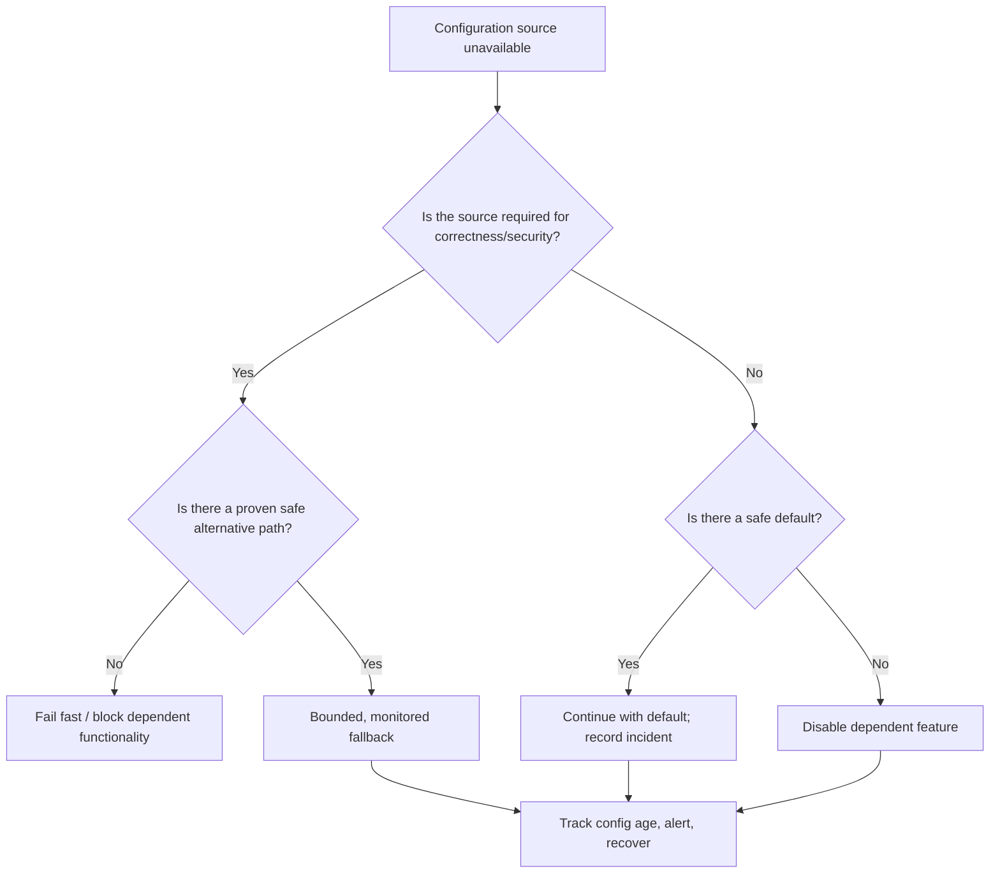

# Choosing Behavior When Required or Optional Configuration Sources Fail

In a Spring Boot application connecting to managed services on **AWS, Azure, and Google Cloud**, not every configuration source is equally critical. Missing a file that tunes telemetry sampling rates might simply cause the application to use a default value; conversely, failing to read a mandatory credential or not knowing which production bucket to write to can corrupt data processing or prevent the application from serving requests.

The decision to make before deployment is: **which sources are required, which are allowed to be absent, and what behavior is safe when a source fails**. This lesson covers designing *fail fast*, *fallback*, and *degraded mode* policies, then applying them with Config Data, `spring.config.import`, validation, testing, and monitoring in a Spring Cloud Provider Integration project.

## 1. Distinguishing "Required" and "Optional" Sources by Function

A configuration source is considered **required** when its absence prevents the application from guaranteeing correct, safe, or business-compliant behavior. An **optional** source is one that may be absent because the application already defines a **genuinely safe and tested** default value or degraded behavior.

The same configuration system can be required for one service yet optional for another. For example, an extra observability endpoint does not necessarily block an upload service, whereas a key for verifying webhook signatures must not be missing if the application continues accepting webhooks.

| Data / Source | Role | Typically Appropriate Policy | Reason |
| --- | --- | --- | --- |
| Bucket/container name for writing production documents | Target data-write identifier | **Required** | Avoid writing to the wrong environment or resource |
| Secret for authenticating a payment API | Transaction security credential | **Required** for payment flows | Without the secret, secure authentication is impossible |
| Mandatory policy configuration for handling sensitive data | Security and compliance control | **Required** | Must not silently downgrade protection levels |
| Out-of-band metrics exporter options | Supplementary observability | **Optional**, with clear defaults | Exporter failure need not block core business logic |
| UI banner or display message | Non-critical presentation | **Optional** | Can use a valid default value |
| Queue/topic name for guaranteed event publishing | Messaging target identifier | **Required** if event emission is a business invariant | Dropping events can lose data |
| Feature flag for a new capability | Feature toggle | **Optional if a safe default exists**, e.g., feature disabled | Avoid accidentally enabling unapproved logic |
| Mandatory audit log configuration | Operational evidence | **Required** or block operations requiring audit | Do not mask missing audit trails |

**Required vs. optional is a business and risk decision**, not a fixed trait of YAML, AWS Secrets Manager, Azure App Configuration, Google Cloud Secret Manager, or Spring Cloud Config Server. Do not mark every import as `optional:` just so the application "can always start."

### How to Determine the Policy for Each Source

Before choosing syntax, answer four questions:

1. **What is the consequence if the source is missing?** Will the application reject operations, use stale values, send data to the wrong place, or operate normally?
2. **Is there a safe, explicit, tested default?** Without one, the source must be required, even if it contains only a single key.
3. **Is using a stale value permissible?** If so, for how long and who decides expiration? For revoked permissions or policies, stale values can be unsafe.
4. **What is the blast radius of a failure?** The entire process, one cloud adapter, one endpoint, or a background job?

From there, design **startup** behavior and **runtime** behavior separately. A source read only at startup differs from a secret or feature flag refreshed periodically.

## 2. Failure Types to Distinguish Before Choosing a Fallback

"Unable to load configuration" has multiple causes. Optional configuration syntax does not necessarily handle all of them:

| Failure Type | Example | Appropriate Response to Consider |
| --- | --- | --- |
| **Location does not exist** | Missing `./runtime/telemetry.yml` | For optional sources: skip and use default; for required sources: halt |
| **Required key missing** | Secret directory exists but lacks `partner.api-key` | Halt via validation / required-bean check |
| **Invalid format / type** | Indentation error in YAML, timeout is `abc` | Halt and report config error; never silently "fix" data |
| **Cannot reach remote source** | Config Server timeout, DNS/TLS error | Bounded retry; then halt or degrade per policy |
| **Insufficient permissions** | IAM/RBAC denies reading secret | Halt dependent functionality; investigate permissions, never fabricate a dummy secret |
| **Business-invalid value** | Empty bucket, invalid region, negative retry | Halt or disable feature depending on criticality |
| **Stale configuration** | Remote holds an older policy version | Rely on version/TTL and last-known-good rules |
| **Refresh failure** | Token/secret rotated but client failed to update | Keep or discard old value per policy; report status |
| **Provider error during API call** | Storage returns `AccessDenied` after startup | Operational/permission error, not automatically an import error |

For example, if `optional:file:./runtime/telemetry.yml` is declared and the file is absent, the application can proceed. But if the file **is present with malformed YAML**, the parser can still fail startup. Likewise, the existence of a `configtree:` directory does not guarantee every required secret inside it exists; you must also validate **keys**.

It is essential to distinguish a **missing source**, a **missing required value**, and a **source that is present but untrusted or unusable**.

## 3. Three Behavioral Policies: Fail Fast, Fallback, Degraded Mode

### 3.1. Fail Fast — Stop Before Receiving Traffic

Choose *fail fast* when the application lacks sufficient information to ensure safety, consistency, or correctness.

Examples:

- Missing production bucket name with no safe target selection rule.
- Unable to read database password in a system requiring password authentication.
- Missing webhook signature-verification secret while the API intends to accept webhooks.
- Unable to load mandatory permission-limiting policies or encryption settings.

Expected behavior: **startup fails with a diagnosable error, before the instance is marked ready**. The orchestrator can keep older instances serving during a rollout while the new instance receives no traffic. Never fall back to an unapproved "spare" secret or bucket.

### 3.2. Fallback — Use a Safe Default Value

Choose *fallback* when the system has a predefined substitute value and substituting it **neither corrupts data nor lowers security**.

Examples:

- Missing metrics sampling configuration → sample at the defined default rate.
- Missing banner config file → use the built-in internal title.
- Remote feature flag temporarily unreadable → keep the new feature **disabled** if that is the safe, tested choice.

A fallback must have an **owner, rules, bounds, and observability**. Defaulting a security check to `true` is not a safe fallback if `true` means bypassing the check.

### 3.3. Degraded Mode — Disable Only the Dependent Feature

Not every configuration failure must stop **the entire application**. For an independent secondary module, you can keep core capabilities running and temporarily disable that module.

For instance, the application can continue serving stored documents while pausing an analytics dashboard whose remote config source is unavailable. However, if the system is required to **emit an event for every transaction**, losing SQS/Service Bus/Pub/Sub configuration does not mean silently dropping events; you must block the transaction or rely on a pre-designed durable mechanism such as a transactional outbox.



Do not equate **degraded mode** with **complete success**. Reflect the state clearly in metrics, appropriate health/readiness indicators, and operational runbooks.

## 4. Applying `optional:` in Spring Boot Config Data

Since Spring Boot 2.4, configuration can be loaded with `spring.config.import`. Example:

```yaml
spring:
  config:
    import:
      - "optional:file:./runtime/telemetry.yml"
      - "configtree:/run/secrets/provider-integration/"
```

These two entries have different intentions:

- `optional:file:./runtime/telemetry.yml`: if the location is absent, it can be skipped; the application continues using default telemetry settings.
- `configtree:/run/secrets/provider-integration/`: a **required** secret location in this example; if the directory is missing, Config Data fails during startup. If the directory is present but lacks an essential key, additional value validation is needed.

The `optional:` prefix may only be used with a location understood by Config Data. For container paths, pay attention to the current working directory, volume mounts, and file read permissions.

### Limitations of `optional:`

**`optional:` primarily handles the case where a Config Data location does not exist**, as supported by the importer. It is not a `try/catch` for every error:

- File exists but YAML is invalid → the application can still fail startup.
- File contains a wrong type, e.g., `timeout: "never"` → binding can still fail.
- Secret directory exists but a required key is empty → validation must reject it.
- Remote service returns authentication, policy, or data-corruption errors → behavior depends on the library; do not assume `optional:` always ignores them.
- Missing source leaves a property placeholder unresolved → dependent beans can still fail startup.

Spring Boot also offers the broad setting `spring.config.on-not-found=ignore` to ignore missing Config Data locations globally. Avoid using that global option to "hide" errors in production, as it can allow **every** missing import instead of only those deliberately marked optional.

### Difference Between an Optional Source and a Key with a Default

A file may be optional, yet a key inside that file can still be required for an enabled feature.

Example:

```yaml
spring:
  config:
    import: "optional:file:./runtime/partner.yml"

app:
  partner:
    enabled: false
```

If `app.partner.enabled=false`, the properties needed to call the third-party API may not be necessary. But when a deployment sets `app.partner.enabled=true`, the application must validate the required endpoint, identity, and credentials for that feature. Making `partner.yml` optional **does not authorize running an integration without credentials**.

Conversely, a required file only guarantees **the file location was found**. All needed keys must still be validated with appropriate constraints.

## 5. Complete Example: Optional Source for Telemetry, Required Source for Secrets

Suppose the application handles upload requests to S3, Azure Blob, or GCS while optionally emitting extra telemetry. A partner API integration also requires a key in production.

### 5.1. Shared Configuration File

```yaml
# src/main/resources/application.yml
spring:
  application:
    name: provider-integration
  config:
    import:
      - "optional:file:./runtime/telemetry.yml"
      - "configtree:/run/secrets/provider-integration/"

app:
  integration:
    storage-target: ${STORAGE_TARGET}
    telemetry-enabled: false
    max-concurrent-uploads: 4
```

Suppose the deployment mounts `/run/secrets/provider-integration/partner.api-key` containing a valid **secret value**. The `configtree:` import loads the `partner.api-key` key into `Environment`. Meanwhile, `runtime/telemetry.yml` may be absent without obstructing storage business logic.

An optional telemetry file, when present, looks like:

```yaml
# ./runtime/telemetry.yml
app:
  integration:
    telemetry-enabled: true
```

The `false` value in the base file is a **safe default** for supplementary telemetry. Editing the telemetry file later does not automatically update beans bound at startup unless a separate refresh mechanism or restart is used.

### 5.2. Validating Business Configuration with `@ConfigurationProperties`

Example using Spring Boot 3.x, Java 17+, and Bean Validation:

```java
package example.cloud.config;

import jakarta.validation.constraints.Max;
import jakarta.validation.constraints.Min;
import jakarta.validation.constraints.NotBlank;
import org.springframework.boot.context.properties.ConfigurationProperties;
import org.springframework.boot.context.properties.bind.DefaultValue;
import org.springframework.validation.annotation.Validated;

@Validated
@ConfigurationProperties(prefix = "app.integration")
public record IntegrationSettings(
        @NotBlank String storageTarget,
        @DefaultValue("false") boolean telemetryEnabled,
        @Min(1) @Max(32) @DefaultValue("4") int maxConcurrentUploads
) {}
```

Register the bean with `@ConfigurationPropertiesScan` on the main application class or `@EnableConfigurationProperties(IntegrationSettings.class)` in Java config, and include `spring-boot-starter-validation`.

In this example:

- No valid `STORAGE_TARGET`: the application cannot choose the right write target and must stop when required configuration is resolved/validated.
- Missing telemetry file: `telemetryEnabled=false` and the application continues working normally.
- `max-concurrent-uploads=0` or `100`: validation rejects it as outside the allowed range.

**Note:** `@DefaultValue("false")` is only a binding-layer default; it does not replace a mandatory business policy. If policy dictates enabling/disabling a security check, never pick a default just to avoid startup errors.

### 5.3. Validating Required Secrets

A required `configtree:` path **is not enough to prove the secret exists inside the directory**. You must bind and validate the `partner.api-key` key. Avoid placing secrets in a Java `record` where `toString()` could accidentally log plaintext.

A bean with setters that validates presence only:

```java
package example.cloud.config;

import jakarta.validation.constraints.NotBlank;
import org.springframework.boot.context.properties.ConfigurationProperties;
import org.springframework.validation.annotation.Validated;

@Validated
@ConfigurationProperties(prefix = "partner")
public class PartnerSecretProperties {
    @NotBlank
    private String apiKey;

    public String getApiKey() {
        return apiKey;
    }

    public void setApiKey(String apiKey) {
        this.apiKey = apiKey;
    }

    @Override
    public String toString() {
        return "PartnerSecretProperties[apiKey=<redacted>]";
    }
}
```

Register this class alongside other configuration-properties beans. If the mounted directory exists but lacks `partner.api-key`, `@NotBlank` causes bean creation to fail. If the value contains only whitespace, validation rejects it as well.

Do not log `getApiKey()`, return it in APIs, or include it in exceptions or telemetry. Masking `toString()` here is only one layer of defense; Actuator configuration, debuggers, memory dumps, and other data paths still need controls.

**In a real application:** if the partner integration is enabled only in certain deployments, register its config/adapter beans conditionally on the feature toggle and enforce secret validation whenever the feature is enabled. The design must ensure the feature **cannot operate** without required credentials.

## 6. Remote Sources: Config Server and AWS, Azure, GCP Services

Config Data can load remote sources **when the corresponding library provides a resolver/loader**. How "required" and "optional" are interpreted must be verified on the exact starter and version, especially for network or authentication failures.

### 6.1. Spring Cloud Config Server

With a compatible Spring Cloud Config Client and the `spring-cloud-starter-config` dependency, a common configuration is:

```yaml
spring:
  application:
    name: provider-integration
  config:
    import: "configserver:https://config.example.internal"
```

If remote configuration is supplementary and **allowed to be absent**, you can use:

```yaml
spring:
  config:
    import: "optional:configserver:https://config.example.internal"
```

In versions supporting Config Data import, the `optional:` prefix allows the client to tolerate certain cases where Config Server is unavailable according to its policy. Exact behavior on server connection errors, authentication failures, retries, and fail-fast also depends on the **Spring Cloud Config version, client options, and bootstrap mode**.

Do not assume every HTTP error is ignored. For mandatory production configuration, configure startup failure, timeouts, and finite retries; verify options such as `spring.cloud.config.fail-fast` and the retry mechanism of **the version in use**, especially if the system uses legacy bootstrap instead of Config Data.

### 6.2. Cloud Services

| Cloud | Common Remote Sources | Required Examples | Potentially Optional Examples |
| --- | --- | --- | --- |
| **AWS** | Secrets Manager, Systems Manager Parameter Store | Critical API secrets, security-sensitive connection settings | Telemetry flags or tuning parameters with valid defaults |
| **Azure** | Key Vault, App Configuration | Mandatory integration credentials, access policies | Secondary UI feature flags when safely disabled by default |
| **GCP** | Secret Manager, platform/runtime config sources | Secrets to authenticate third-party services | Metrics verbosity adjustments when defaults exist |

Notes:

- Some **Spring Cloud AWS** versions support Config Data schemes such as `aws-secretsmanager:` or `aws-parameterstore:`. Syntax, dependencies, and `optional:` handling depend on the version; do not copy examples from other versions without checking.
- With **Spring Cloud Azure**, Key Vault or App Configuration may be supplied via property sources or starter-specific mechanisms. Inspect available **fail-fast/connection timeout/refresh** options rather than assuming an AWS-style import scheme works.
- With **Spring Cloud GCP**, Secret Manager can be used via library integration or SDK calls. An on-demand SDK call produces a **runtime error**, distinct from a Config Data startup error.
- IAM Roles, Azure Managed Identity, and GCP Workload Identity/ADC let workloads authenticate to read remote sources; if the identity is not ready or permission is denied, never fall back to invented plaintext credentials.

### 6.3. Bounding Retries When Reading Remote Configuration

For truly required sources, brief retries can overcome transient network glitches during startup. Unbounded retries, however, hang deployments, obscure observability, and risk **retry storms** when many instances restart simultaneously.

An operational policy should define:

1. **Explicit connect and read timeouts**, including DNS/TLS.
2. **Bounded attempt counts and total wait budget**, with backoff and jitter where supported.
3. **Separation of transient vs. permanent errors:** permission or syntax errors should generally not be retried like network timeouts.
4. **Clear action once the retry budget is exhausted:** fail fast if the source is required; fall back or degrade if approved.
5. **Metrics and alerts** for error counts, load duration, and effective configuration status.

Do not force identical timeout/retry values across every provider: SDKs, starters, and service SLAs differ.

## 7. Differences Between Startup, Refresh, and Runtime Failures

Initial configuration loading and configuration refreshing are two distinct problems.

| Phase | Scenario | Appropriate Handling |
| --- | --- | --- |
| **Startup** | Missing authentication secret | Prevent instance from becoming ready |
| **Startup** | Missing optional telemetry | Use approved default and record fallback |
| **Runtime** | Remote flag source temporarily interrupted | Keep bounded last-known-good or switch to safe default |
| **Runtime** | Secret revoked or token expired | Stop using invalidated credential; refresh or block operations |
| **Runtime** | Required config unreadable after cache expires | Block dependent feature; never run indefinitely on stale config |
| **Runtime** | Storage SDK loses write permission | Report business/write-target failure and evaluate readiness by impact scope |

Editing a YAML file or rotating a secret in a secret manager **does not cause all Spring Boot beans to update immediately**. You must explicitly choose restart/rolling deployments, starter-supported refresh integration, or custom bean/client updates.

### When Can Last-Known-Good Be Used?

*Last-known-good* is a **previously validated** configuration snapshot cached for temporary use when a remote source stops responding. Use it only with an explicit policy covering:

- **Source and version:** know where the config originated, its version/etag, and how it was verified.
- **Validity window:** an agreed TTL or expiration timestamp.
- **Data sensitivity:** performance tuning can tolerate short staleness; revoked security policies or expired tokens **must not** be kept in stale use.
- **Alerting:** detect when the system enters fallback, track config age, and alert when thresholds are exceeded.
- **Recovery:** define when remote data is resumed and how invalid new values are handled.

Never treat a configuration cache as a way to bypass IAM, RBAC, or authorization checks. Cached data must also be protected, especially when it holds secrets.

### Readiness and Liveness in Orchestrated Environments

- **Readiness:** is the application fit to serve traffic for mandatory capabilities? With core storage configuration missing, it must not be marked ready.
- **Liveness:** is the process alive and able to recover? Do not tie liveness directly to every optional remote service; intermittent failures can trigger crash loops.
- **Secondary feature health:** can report a `DEGRADED` status or separate alert depending on architecture without necessarily declaring the entire process dead.

When deploying on Kubernetes, align readiness/liveness/startup probes with Spring Boot Actuator or health indicators; never use liveness to mask data errors or force continuous restarts because Config Server is unreachable.

## 8. Testing Failure Policies: Not Just Testing Successful Startup

Tests must verify **effective configuration values and permitted behavior** in each scenario.

| Scenario | Test Setup | Expected Result |
| --- | --- | --- |
| Missing optional file | Delete `runtime/telemetry.yml` | Startup succeeds; `telemetryEnabled=false` |
| Valid optional file | Set `telemetry-enabled=true` | Bean receives `true`; other features unchanged |
| Malformed optional file | Intentionally corrupt syntax | Startup reports parse error; do not assume it is ignored |
| Missing required `configtree` | Omit mounting `/run/secrets/provider-integration/` | Startup fails |
| `configtree` exists but secret missing | Mount empty directory or omit `partner.api-key` | Bean Validation fails |
| Blank secret | File `partner.api-key` contains only whitespace | Validation rejects it |
| Missing `STORAGE_TARGET` | Do not set environment variable | Placeholder/binding or validation error; no wrong target written |
| Out-of-bounds value | `max-concurrent-uploads=0` | Startup fails due to validation |
| Remote config returns 403 | Workload identity lacks read permission | Diagnoses AccessDenied/Forbidden; no dummy secret used |
| Remote does not respond | Simulate timeout | Bounded retries, then fail fast or fallback per policy |
| Optional flag lost at runtime | Cut off refresh source | Retains old value within TTL or safe default by design |
| Secret rotated/revoked | Change secret version | Client refreshes/restarts properly; stops using expired credential |
| Storage provider denies access | Config valid but IAM/RBAC wrong | API fails clearly; not confused with Config Data error |

**Two distinct test levels:**

1. **Binding/validation unit tests:** use `ApplicationContextRunner` with mock property values to verify `@ConfigurationProperties` types and constraints. These tests alone do not prove that `spring.config.import` importers ran.
2. **Config Data/remote integration tests:** boot Spring Boot through the real Config Data pipeline using mounted/temp directories or a controlled Config Server/secret service, then assert startup and failure behavior. Never run against production secrets.

Example unit test for required business settings:

```java
package example.cloud.config;

import org.junit.jupiter.api.Test;
import org.springframework.boot.context.properties.EnableConfigurationProperties;
import org.springframework.boot.test.context.runner.ApplicationContextRunner;
import org.springframework.context.annotation.Configuration;

import static org.assertj.core.api.Assertions.assertThat;

class IntegrationSettingsTest {
    private final ApplicationContextRunner runner =
            new ApplicationContextRunner()
                    .withUserConfiguration(TestConfig.class);

    @Test
    void acceptsValidTargetAndSafeDefaults() {
        runner.withPropertyValues("app.integration.storage-target=docs-test")
                .run(context -> {
                    assertThat(context).hasNotFailed();
                    IntegrationSettings settings =
                            context.getBean(IntegrationSettings.class);
                    assertThat(settings.storageTarget()).isEqualTo("docs-test");
                    assertThat(settings.telemetryEnabled()).isFalse();
                    assertThat(settings.maxConcurrentUploads()).isEqualTo(4);
                });
    }

    @Test
    void rejectsMissingTarget() {
        runner.run(context -> assertThat(context).hasFailed());
    }

    @Test
    void rejectsInvalidConcurrency() {
        runner.withPropertyValues(
                "app.integration.storage-target=docs-test",
                "app.integration.max-concurrent-uploads=0"
        ).run(context -> assertThat(context).hasFailed());
    }

    @Configuration(proxyBeanMethods = false)
    @EnableConfigurationProperties(IntegrationSettings.class)
    static class TestConfig {}
}
```

For secret unit tests, use dummy data. When running real integration tests, restrict test resources and never upload objects or publish messages to production.

## 9. Logging and Alerting Clearly Without Leaking Secrets

Information to include in error/fallback events:

- **Source:** system name or alias such as `aws-secrets-manager`, `azure-app-configuration`, `gcp-secret-manager`, `configserver`.
- **Error category:** `NOT_FOUND`, `UNAVAILABLE`, `ACCESS_DENIED`, `INVALID_CONTENT`, `EXPIRED`, `VALIDATION_FAILED`.
- **Applied policy:** `FAIL_FAST`, `SAFE_DEFAULT`, `DISABLED_FEATURE`, `LAST_KNOWN_GOOD`.
- **Impact scope:** startup, endpoint, worker, or cloud adapter.
- **Timing:** failure start time, attempt count, config age, and recovery time.

Never write tokens, private keys, passwords, SAS URLs, or full connection strings into logs, traces, or exceptions. For `/actuator/env` and `/actuator/configprops`, restrict access and keep sensitive-content masking active.

An example message:

```text
configuration_source_error
source=secret-manager
scope=partner-api
failure=ACCESS_DENIED
policy=FAIL_FAST
required=true
credential_value=<redacted>
```

Logs should include a **non-sensitive** correlation ID or request ID if available, enough to cross-reference cloud audit logs when investigating permissions. Entering fallback must be observable via metrics/alerts, since a system operating in degraded mode may need operator intervention even without HTTP 5xx errors.

## 10. Multi-Cloud Scenario Exercise

A Spring Boot application has three document-storage adapters: AWS S3, Azure Blob Storage, and GCS. Each deployment selects one adapter. In addition, the application emits events to SQS, Service Bus, or Pub/Sub and calls a partner API requiring a secret.

**Implementation requirements:**

1. **Classify sources.** Storage target names and critical event destinations are required; the telemetry file can be optional when a safe default exists; the partner secret is required whenever the partner feature is enabled.
2. **Declare Config Data.** Use `optional:file:` for telemetry and required imports for mounted secrets. If reading secrets directly from AWS/Azure/GCP, check how your starter/version configures fail-fast vs. optional.
3. **Validate at startup.** Use `@ConfigurationProperties` to reject blank targets, out-of-range retries, and missing required settings for enabled features. Ensure credential-holding beans never log plaintext.
4. **Bound remote retries.** Configure sensible timeouts, backoff, and retry budgets; test behavior when Config Server or the secret store is unavailable.
5. **Prevent message loss.** If mandatory messaging config fails, never silently drop events; use a designed durable mechanism or block the corresponding feature.
6. **Verify runtime behavior.** Rotate a secret and cut off refresh sources; determine whether restarts, last-known-good TTLs, and readiness adjustments are needed.
7. **Record evidence.** For each test, document the error type, source, policy, startup/ready outcome, and **non-sensitive** effective configuration values.

Sample decision table for the operations team:

| Incident | AWS | Azure | GCP | Chosen Behavior |
| --- | --- | --- | --- | --- |
| Missing bucket/container name | Missing S3 bucket | Missing Blob container | Missing GCS bucket | Fail fast |
| Cannot read partner API credential | Secrets Manager error or workload lacks permission | Key Vault error or Managed Identity lacks permission | Secret Manager error or service account lacks permission | Fail fast for mandatory integration |
| Telemetry file absent | All environments | All environments | All environments | Safe default; record fallback |
| Config unreachable for secondary dashboard | Remote config error | App Configuration error | Corresponding config service error | Disable secondary dashboard if tested |
| Unresolved messaging destination | SQS queue URL missing | Service Bus entity missing | Pub/Sub topic missing | Block dependent publish/transaction; do not lose messages |

These are **illustrative decisions**; in a real system, align on business rules, data criticality, and security requirements before going to production.

## 11. Key Takeaways

- **Required** means missing the source/value compromises correctness or safety; **optional** means an approved alternative exists.
- Config Data's `optional:` handles missing locations to the extent supported by the importer; it **does not replace** validation, IAM/RBAC, syntax checks, or remote error-handling policies.
- Use **fail fast** for secrets, policies, and essential resource identifiers; use **safe defaults** or **degraded mode** for secondary capabilities that can genuinely be absent without corrupting business logic.
- Distinguish **startup** failures, **refresh** failures, and **runtime API** failures; specify timeouts, retries, TTLs, restarts, and readiness criteria accordingly.
- Test missing sources, missing values, wrong types, denied permissions, unreachable networks, and secret rotation; observe fallbacks without leaking sensitive data.
