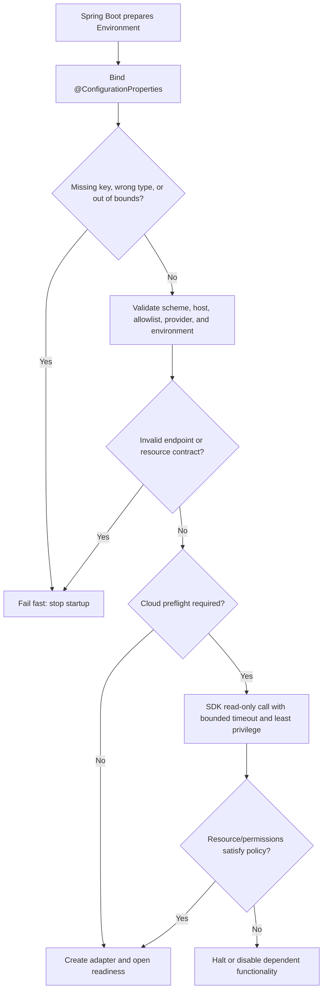

# Validating Configuration Values and Detecting Wrong Endpoints at Startup

A Spring Boot application can start up successfully yet point to a **test bucket**, an **Azure Storage account from another environment**, or the **wrong Pub/Sub project**. These mistakes are more dangerous than an obvious syntax error: HTTPS connections can still succeed and the SDK may still be authorized, yet data is read from or written to the wrong location.

In the `SPRING_CLOUD_PROVIDER_INTEGRATION` module, when integrating managed services from **AWS, Azure, and Google Cloud**, configuration must be validated **at startup** before storage, messaging, or data adapters receive traffic. This lesson focuses on validating **configuration values, endpoints, resource names, environments, and deployment identities**, while distinguishing static checks from live cloud connectivity probes.

## 1. A Syntactically Valid Endpoint Is Not Necessarily the Right Target

The same misconfiguration can surface across multiple layers:

| Check Layer | Question | Example Failure | Caught Early By |
| --- | --- | --- | --- |
| **Presence** | Is the required value supplied? | Missing `STORAGE_TARGET` | Required placeholders, `@NotBlank` |
| **Type / constraint** | Can it parse and stay within bounds? | `connect-timeout=forever` or `-2s` | Binder + Bean Validation |
| **Endpoint syntax** | Is it a valid URI? | `ht!tp://...`, missing host | `URI` binding and custom validation |
| **Security policy** | Are scheme, host, port, and path permitted? | `http://` in production, unknown host | HTTPS check, allowlist, port check |
| **Provider match** | Does the endpoint belong to the chosen service? | Azure selected but S3 endpoint configured | Provider-specific semantic validation |
| **Environment match** | Does it match the provisioned account/project/region/bucket/topic? | Prod app pointing to staging | Comparison against deployment contract/IaC |
| **Existence & permissions** | Does the resource exist and does the principal have permission? | Non-existent bucket, IAM returns 403 | Scoped SDK preflight check |
| **Business correctness** | Is writing to this resource the right intent? | Valid bucket belonging to a different system | Deployment contract, owner/label checks if applicable |

**Three outcomes must be distinguished:** (1) the URI is valid; (2) the endpoint is reachable; (3) the endpoint points to the exact authorized resource. Simply checking `https://...` or getting an HTTP 200 **does not prove the third point**.

Examples:

- `https://storage.googleapis.com` may be a valid Google Cloud Storage endpoint, yet the configured bucket name can still belong to the wrong project or environment.
- `https://myaccount.blob.core.windows.net` has the familiar shape of an Azure Blob Storage endpoint, yet `myaccount` might be a development account rather than production.
- `https://s3.ap-southeast-1.amazonaws.com` is a standard S3 endpoint format, yet a bucket might reside in another region or deny access to the current principal.

SDK libraries can **resolve endpoints automatically** from region, account, project, or metadata. In many production deployments, letting the SDK pick the official endpoint is simpler and less error-prone than writing `endpoint-override` manually. Endpoint overrides should be a justified exception, such as emulators, sovereign/private clouds, or specialized endpoints.

## 2. Ordering Verification Steps from Cheap to Expensive

Not every check needs a cloud API call. Prefer zero-network verifications first before considering live connectivity probes.



| Stage | When It Runs | Credentials / Network Needed? | What It Catches |
| --- | --- | --- | --- |
| Bind from Spring `Environment` | During configuration properties bean creation | No | Missing keys, wrong types, defaults |
| Bean Validation & cross-checks | Immediately after binding | No | Blanks, out-of-range values, invalid URI/host/provider |
| Deployment contract check | Startup, before ready | Usually no if contract is local | Wrong known environment/account/project/region/target |
| SDK preflight | Startup if enabled | Yes | DNS/TLS, resource existence, specific read permissions |
| Read/write integration tests | In test environment | Yes | Operational permissions and real mappings |
| Periodic monitoring / health | Runtime | Possibly | Post-startup changes to permissions, network, secrets/endpoints |

**Key policy:** for required endpoints or resources, validation failures must stop startup or block dependent functionality. For an optional secondary service, a clearly designed degraded mode may apply. Never force the whole application to become ready by defaulting to a different bucket/topic.

## 3. Designing an Endpoint Configuration Contract

Suppose an application has three storage adapters: AWS S3, Azure Blob, and GCS. Use an application-owned namespace `app.cloud.storage` to express **application intent**, separate from auto-configuration properties provided by each Spring Cloud starter.

### 3.1. Base Configuration File

```yaml
# src/main/resources/application.yml
app:
  cloud:
    storage:
      provider: ${CLOUD_PROVIDER}
      target: ${STORAGE_TARGET}
      connect-timeout: 3s
```

- `provider` selects the `AWS`, `AZURE`, or `GCP` adapter.
- `target` is the **bucket name** on AWS/GCP or **container name** on Azure. It is not an API credential.
- `connect-timeout` is an application policy value; the SDK **does not automatically adopt** this timeout unless the adapter passes it into client configuration.
- Do not set a fallback default like `bucket-dev` for `STORAGE_TARGET` in production; missing variables should surface as early errors.

For backends using the SDK's default endpoint, **do not declare an override**. If an endpoint override is needed for a clear reason, the deployment must also supply the permitted hostname:

```yaml
# Example in gcp-prod profile, only when override is genuinely needed
app:
  cloud:
    storage:
      endpoint-override: https://storage.googleapis.com
      approved-endpoint-host: storage.googleapis.com
```

`approved-endpoint-host` should come from an **approved deployment contract**, never derived from `endpoint-override` itself. If someone changes both the endpoint and approved host to the same wrong host simultaneously, a simple comparison cannot catch it; govern the allowlist source through IaC, review permissions, and deployment controls.

### 3.2. Typed Bean and Cross-Validation Constraints

The example below uses **Spring Boot 3.x, Java 17+, and Jakarta Bean Validation**:

```java
package example.cloud.config;

import jakarta.validation.constraints.AssertTrue;
import jakarta.validation.constraints.NotBlank;
import jakarta.validation.constraints.NotNull;
import org.springframework.boot.context.properties.ConfigurationProperties;
import org.springframework.boot.context.properties.bind.DefaultValue;
import org.springframework.validation.annotation.Validated;

import java.net.URI;
import java.time.Duration;

@Validated
@ConfigurationProperties(prefix = "app.cloud.storage")
public record StorageEndpointProperties(
        @NotNull Provider provider,
        @NotBlank String target,
        @DefaultValue("3s") Duration connectTimeout,
        URI endpointOverride,
        String approvedEndpointHost
) {
    public enum Provider { AWS, AZURE, GCP }

    @AssertTrue(message = "connect-timeout must be greater than 0 and at most 30s")
    public boolean isConnectTimeoutValid() {
        return connectTimeout != null
                && connectTimeout.compareTo(Duration.ZERO) > 0
                && connectTimeout.compareTo(Duration.ofSeconds(30)) <= 0;
    }

    @AssertTrue(message = "endpoint override does not satisfy HTTPS/host policy")
    public boolean isEndpointOverrideTrusted() {
        if (endpointOverride == null) {
            return true; // Let SDK use the default endpoint
        }

        String actualHost = endpointOverride.getHost();
        String expectedHost = approvedEndpointHost;

        return "https".equalsIgnoreCase(endpointOverride.getScheme())
                && actualHost != null
                && expectedHost != null
                && !expectedHost.isBlank()
                && actualHost.equalsIgnoreCase(expectedHost.trim())
                && endpointOverride.getRawUserInfo() == null
                && endpointOverride.getRawQuery() == null
                && endpointOverride.getRawFragment() == null
                && (endpointOverride.getRawPath() == null
                    || endpointOverride.getRawPath().isEmpty()
                    || "/".equals(endpointOverride.getRawPath()))
                && (endpointOverride.getPort() == -1
                    || endpointOverride.getPort() == 443);
    }
}
```

Registering the bean:

```java
package example.cloud;

import org.springframework.boot.SpringApplication;
import org.springframework.boot.autoconfigure.SpringBootApplication;
import org.springframework.boot.context.properties.ConfigurationPropertiesScan;

@SpringBootApplication
@ConfigurationPropertiesScan
public class ProviderIntegrationApplication {
    public static void main(String[] args) {
        SpringApplication.run(ProviderIntegrationApplication.class, args);
    }
}
```

Include `spring-boot-starter-validation`. `@ConfigurationPropertiesScan` lets Spring Boot register the configuration record; with a single-constructor record on Spring Boot 3, there is no need to add `@Component` or manual constructor binding.

**Meaning of the validations in the example:**

1. `@NotNull` disallows a missing `provider`; an invalid enum value such as `provider: alibabacloud` also fails conversion.
2. `@NotBlank` disallows an empty resource name.
3. `Duration` parses `3s`, `250ms`; `isConnectTimeoutValid` rejects negative values, zero, or values exceeding 30 seconds.
4. `URI` catches unparseable addresses. `isEndpointOverrideTrusted` rejects HTTP, hosts outside the allowlist, embedded user/password info in the URL, queries/fragments, and non-policy ports.
5. When `endpointOverride == null`, the adapter uses the endpoint selected by the cloud SDK for the configured provider; omitting an override is **not an error**.
6. **The `@AssertTrue` methods are property-level Bean Validation**; failures cause bean creation to fail. Checks do not wait until the first request.

Limitation: this is a **strict HTTPS policy for production endpoint overrides**, not a universal URL validator. It rejects `http://localhost:4566` used by emulators. If you need LocalStack/Azurite/fake GCS servers in development, use a profile or validator **explicitly scoped to tests**, ensuring HTTP-allowing rules can never be activated in production.

Furthermore, a hostname allowlist does not replace DNS verification, TLS certificate validation, IAM/RBAC checks, resource existence, or confirming that the host is indeed an approved cloud endpoint.

## 4. Cross-Checking Provider, Account, Project, Region, and Resource

Most "wrong endpoint" bugs are not URI syntax errors. They occur when a pair of values are **individually valid yet inconsistent with each other**.

| Provider | What to Check Before Ready | Why |
| --- | --- | --- |
| **AWS S3** | Region, bucket name, target IAM role/account, default or override endpoint, environment | Wrong region can cause redirects or request signing failures; bucket may still belong to another environment |
| **AWS SQS/SNS** | Region, queue URL / queue ARN / topic ARN, account ID, operational permissions | Queue URL is a resource-specific endpoint; the same queue name in another account is still valid |
| **Azure Blob** | Storage account name, container name, endpoint suffix per Azure cloud type, expected tenant/subscription/resource group | `https://<account>.blob.core.windows.net` can be valid yet belong to a different account |
| **Azure Service Bus** | Namespace, queue/topic/subscription, tenant/managed identity, and endpoint | Namespace or entity may belong to a different environment |
| **Google Cloud Storage** | Bucket name, expected deployment project, SDK endpoint, access permissions | The `storage.googleapis.com` endpoint does not encode project/bucket, so inspecting the URI alone cannot tell right from wrong |
| **Google Cloud Pub/Sub** | Project ID, topic/subscription resource name, and principal | Both `projects/dev/topics/orders` and `projects/prod/topics/orders` are syntactically valid |

### Distinguishing Endpoints and Resource Identifiers

- **AWS:** the S3 service endpoint and `bucket` are two distinct pieces of data. AWS SQS also has a **queue URL** bound to a specific queue; that URL must match the approved account/region.
- **Azure:** the `<account>.blob.core.windows.net` host contains the account, while the container sits in the operation path. Azure Private Link can cause public DNS for a resource to resolve to a private IP address; do not automatically conclude "private IP = wrong endpoint."
- **GCP:** a shared endpoint for GCS and Pub/Sub does not imply the right project; the project ID is typically in the resource identifier or client configuration.

Do not write a single hostname regex for all three clouds. Sovereign clouds, FIPS, dual-stack, Private Link, regional endpoints, and custom domains have different rules. Derive permitted endpoints and domains from an **approved infrastructure design** and consult the exact SDK/starter version documentation.

### Example: Catching Environment Mix-Ups

Suppose a production deployment has the contract:

```yaml
# Non-secret values provided by the deployment contract
deployment:
  environment: prod
  aws:
    account-id: "123456789012"   # Illustrative example
    region: ap-southeast-1
  storage:
    expected-target: documents-prod
```

Another profile file accidentally sets `app.cloud.storage.target=documents-staging`. Both bucket names are syntactically valid. To catch the mismatch, compare the effective target against **`expected-target`** supplied by a trusted configuration channel, or compare resource identifiers against an approved manifest/IaC output.

This is meaningful only if **the expected value is independent of the value under test**. Setting `expected-target: ${STORAGE_TARGET}` and comparing against `STORAGE_TARGET` is a circular check: both can be wrong together.

**Security note:** Account IDs, project IDs, and bucket names are usually identifiers, not secrets; however, they can still reveal topology. Follow organizational log and read-access restrictions.

## 5. Detecting Spoofed Endpoints and Dangerous URIs

Even when endpoints come from environment variables or internal config services, applications should still guard against input mistakes and accidental overrides.

Several deceptive strings:

| Supplied URI | Problem | Prevention Rule |
| --- | --- | --- |
| `http://storage.example.com` | No TLS in production | Accept only `https` except in isolated test profiles |
| `https://storage.googleapis.com.evil.example` | Contains real domain as a substring, but host is another domain | Exact host comparison or suffix match respecting domain boundaries |
| `https://good.example@evil.example` | `good.example` is in userinfo; actual host is `evil.example` | Use a URI parser; reject userinfo |
| `https://approved.example/path?token=...` | URL contains token/query or unexpected path beyond base endpoint | Reject query/fragment/path if the API does not need them |
| `https://127.0.0.1:9443` | Could route to an unintended service | Disallow loopback/IP literals unless explicitly part of test config |
| `https://account.blob.core.windows.net` | Matches Azure Blob pattern but may be the wrong account | Compare account against the deployment contract |
| `https://storage.googleapis.com` | Valid generic GCS endpoint, but may target the wrong bucket | Validate bucket name, project, and principal separately |

Never use expressions like `host.contains("amazonaws.com")` or `host.endsWith("amazonaws.com")` as an allowlist: `badamazonaws.com` bypasses naive suffix checks. If multiple subdomains must be supported, check `host.equals(base)` or `host.endsWith("." + base)` alongside strict scheme/port policies.

**Limitations:** URI/hostname validation does not prove DNS points to the right infrastructure, does not eliminate all network attacks, and does not replace TLS certificate validation. If custom endpoints can come from less trusted sources, add SSRF protections, redirect controls, egress restrictions, and proper resolution policies. Never disable TLS certificate verification to work around connection errors.

## 6. Network Preflight Checks via SDK: Benefits and Costs

Even after all values are valid, the system can still encounter missing resources, unreachable endpoints, or unauthorized principals. You can run a **non-mutating preflight check** before marking the instance ready, though this is an architectural choice rather than mandatory for every application.

| Provider | Typical Read-Only Probe | Caveats |
| --- | --- | --- |
| AWS S3 | `S3Client.headBucket(...)` on the configured bucket | May require `s3:ListBucket`; 403 and 404 are not always distinguishable in generic responses |
| Azure Blob | `BlobContainerClient.exists()` or reading container properties | Requires metadata read permissions; 403 must be treated as an authorization error |
| GCS | `Storage.get(bucketName)` or reading bucket metadata | Requires permissions like `storage.buckets.get`; missing permission does not prove the bucket doesn't exist |
| AWS SQS | Read queue attributes / inspect queue URL via the appropriate API | Requires permission to read queue attributes; do not use URLs from another environment |
| Azure Service Bus | Management client reading entity metadata | Management/metadata read permissions can differ from send/receive permissions |
| GCP Pub/Sub | Admin client reading topic/subscription metadata | Requires get permissions; does not imply publish/subscribe permissions |

**A preflight check only proves that the probed operation succeeded at that moment.** A successful HEAD bucket call does not prove the application has `PutObject` permission, does not prove the object prefix is right, and does not guarantee permissions won't be revoked later.

Trade-offs to decide on:

- **Startup latency:** network calls lengthen time-to-ready; timeouts must be finite.
- **IAM least privilege:** a read-only metadata probe may require extra permissions that normal write flows do not need. Never grant broad permissions just to make a health check pass.
- **Thundering herd:** hundreds of instances starting simultaneously can overload services. Bound retries and use backoff.
- **Cost and API limits:** metadata calls may incur charges or rate limits depending on the provider.
- **Dependency criticality:** if a required cloud is temporarily unavailable, startup may fail per policy; for optional integrations, avoid blocking the whole application from serving traffic.

If preflight really must run, place it in a startup component with bounded timeouts/exception handling and **clear scope**, such as an `ApplicationRunner` that can fail startup when a mandatory resource fails checks. For systems serving multiple traffic types, surface status through granular `HealthIndicator`/readiness rather than tying every secondary service to liveness.

### Startup Preflight Policy Pseudocode

```java
// Workflow sketch; adapter and policy methods are application-defined.
// Not a built-in Spring Cloud API.
void verifyBeforeAcceptingTraffic(StorageAdapter adapter,
                                  StorageEndpointProperties config,
                                  PreflightPolicy policy) {
    verifyLocalConfigurationAndDeploymentContract(config);

    if (!policy.isRemoteCheckRequired()) {
        return;
    }

    // Adapter uses SDK with bounded timeout to read metadata, without writing objects.
    CheckResult result = adapter.checkTargetMetadata();

    if (!result.isAcceptableFor(policy)) {
        throw new IllegalStateException(
                "Storage endpoint preflight failed: "
                + result.getSafeFailureCode()
        );
    }
}
```

Do not log credentials, connection strings with tokens, or full endpoints containing sensitive data in exceptions. Distinguish `NOT_FOUND`, `ACCESS_DENIED`, `TLS_ERROR`, `TIMEOUT`, and `WRONG_ENVIRONMENT` in safe failure codes so operations can diagnose issues.

## 7. Testing Binding and Endpoint Policy Without a Cloud Account

Most configuration mistakes can be caught using a minimal Spring context without initializing SDK clients. Example with JUnit 5, AssertJ, and `ApplicationContextRunner` (from `spring-boot-test`):

```java
package example.cloud.config;

import org.junit.jupiter.api.Test;
import org.springframework.boot.context.properties.EnableConfigurationProperties;
import org.springframework.boot.test.context.runner.ApplicationContextRunner;
import org.springframework.context.annotation.Configuration;

import static org.assertj.core.api.Assertions.assertThat;

class StorageEndpointPropertiesTest {
    private final ApplicationContextRunner runner =
            new ApplicationContextRunner()
                    .withUserConfiguration(TestConfig.class);

    @Test
    void acceptsSecureApprovedEndpoint() {
        runner.withPropertyValues(
                "app.cloud.storage.provider=gcp",
                "app.cloud.storage.target=documents-test",
                "app.cloud.storage.connect-timeout=4s",
                "app.cloud.storage.endpoint-override=https://storage.googleapis.com",
                "app.cloud.storage.approved-endpoint-host=storage.googleapis.com"
        ).run(context -> {
            assertThat(context).hasNotFailed();
            StorageEndpointProperties p =
                    context.getBean(StorageEndpointProperties.class);
            assertThat(p.provider())
                    .isEqualTo(StorageEndpointProperties.Provider.GCP);
            assertThat(p.connectTimeout().getSeconds()).isEqualTo(4);
        });
    }

    @Test
    void rejectsUnexpectedHostname() {
        runner.withPropertyValues(
                "app.cloud.storage.provider=gcp",
                "app.cloud.storage.target=documents-test",
                "app.cloud.storage.endpoint-override=https://storage.googleapis.com.evil.example",
                "app.cloud.storage.approved-endpoint-host=storage.googleapis.com"
        ).run(context -> assertThat(context).hasFailed());
    }

    @Test
    void rejectsHttpEndpointInProductionPolicy() {
        runner.withPropertyValues(
                "app.cloud.storage.provider=aws",
                "app.cloud.storage.target=documents-test",
                "app.cloud.storage.endpoint-override=http://localhost:4566",
                "app.cloud.storage.approved-endpoint-host=localhost"
        ).run(context -> assertThat(context).hasFailed());
    }

    @Test
    void rejectsMissingResourceName() {
        runner.withPropertyValues("app.cloud.storage.provider=azure")
                .run(context -> assertThat(context).hasFailed());
    }

    @Test
    void rejectsInvalidTimeout() {
        runner.withPropertyValues(
                "app.cloud.storage.provider=aws",
                "app.cloud.storage.target=documents-test",
                "app.cloud.storage.connect-timeout=0s"
        ).run(context -> assertThat(context).hasFailed());
    }

    @Configuration(proxyBeanMethods = false)
    @EnableConfigurationProperties(StorageEndpointProperties.class)
    static class TestConfig {}
}
```

These tests verify **binding and Bean Validation**; they do not prove the SDK connected to the right endpoint, confirm the bucket/container exists, or test IAM/RBAC permissions. To verify that Config Data profiles/`spring.config.import` actually load, run an integration test that boots through the corresponding Config Data pipeline rather than only supplying mock property values.

### Environment-Specific Endpoint Test Matrix

| Case | Where to Test | Expected Outcome |
| --- | --- | --- |
| Missing `STORAGE_TARGET` | Unit/context test | Valid bean not created; startup fails |
| `provider: unknown` | Unit/context test | Enum binding fails |
| Timeout equal to 0 or over 30s | Unit/context test | Bean Validation fails |
| Endpoint override uses HTTP in production | Unit/context test | Fails HTTPS policy |
| Endpoint host resembles allowlist yet differs | Unit/context test | Rejected |
| Endpoint contains `userinfo` or query token | Unit/context test | Rejected |
| AWS profile but resource contract belongs to Azure/GCP | Cross-field/deployment test | Not marked ready |
| Production target points to a valid staging bucket | Deployment contract test | Target mismatch detected despite valid URL |
| DNS/TLS endpoint unreachable | Networked integration test | Connectivity error classified |
| Bucket exists but principal lacks metadata read permission | Least-privilege integration test | `ACCESS_DENIED` reported, not misclassified as `NOT_FOUND` |
| Metadata preflight succeeds but write permission missing | Sandbox write integration test | Confirms metadata probe does not replace write permission tests |
| Endpoint changed after startup | Refresh/rollout test | Determines when beans/clients pick up the new endpoint |

Never use production resources to test writes or deletes. For real operation tests, provision dedicated test buckets/containers/topics in a test account or project, grant least-privilege permissions, enforce TTLs/cleanup, and isolate data from production systems.

## 8. Diagnosing Wrong Endpoints When Startup Fails

Suggested grouping of errors by phase:

| Symptom | Common Cause | Action |
| --- | --- | --- |
| `BindException` / property conversion error | Wrong key name, enum, URI, or `Duration` | Inspect property origin and syntax |
| Bean Validation reports `endpointOverrideTrusted=false` | Invalid scheme/host/port/path | Inspect actual hostname, allowlist, and active profile |
| Configured AWS region differs from bucket region | Wrong region or deployment contract | Compare approved region and SDK region resolver |
| Azure connects to valid host but wrong account | Storage account name from another environment | Compare account/name against IaC outputs |
| GCP uses `storage.googleapis.com` but wrong bucket | Target/project overridden | Check `STORAGE_TARGET`, project, and principal |
| DNS fails to resolve | Network, VPC/Private DNS, or wrong endpoint | Check DNS inside the runtime environment |
| TLS handshake fails | Wrong hostname/certificate/trust store | Check hostname and cert chain; never disable TLS verification |
| `403 AccessDenied/Forbidden` | Missing permissions or wrong principal | Verify workload identity and IAM/RBAC |
| `404 NotFound` | Wrong resource, region, or permissions masking existence | Verify against provider API semantics and permissions |
| Health/preflight slows down every instance startup | Timeout/retry too large or provider incident | Bound retry budgets and classify criticality |
| Config works on laptop, fails on cluster | External file/env/CLI/Config Server override | Inspect active profiles and property origins |

Use Spring Boot Actuator `/actuator/env` or `/actuator/configprops` in an **authenticated and authorized** environment to inspect property sources and origins when needed. Do not expose these endpoints publicly, do not turn on full unmasked secret display, and do not log raw configuration dumps. An `endpoint` containing an embedded token or signed URL must be treated as a secret when logging.

A better error message than dumping the whole configuration object:

```text
endpoint_preflight_failed
provider=azure
operation=BlobContainerMetadataCheck
resourceAlias=documents-archive
category=WRONG_ENVIRONMENT
expectedDeployment=prod
requestId=<safe-correlation-id>
```

If the endpoint or identifier itself is considered sensitive by your organization, log `resourceAlias` instead of the full name; for permission errors, keep the cloud request ID (when safe) to correlate with audit logs.

## 9. Three-Provider Integration Practice Exercise

Suppose the same document-publishing application runs on AWS S3, Azure Blob, and GCS. Each deployment uses its own profile and resources provisioned via IaC.

1. **Define the contract.** Choose `provider`, `storage.target`, expected region/account/project, timeout, and endpoint rules. Separate the service endpoint from the bucket/container identifier.
2. **Write `@ConfigurationProperties`.** Use a record as in section 3, adding required checks, data types, and endpoint-override policy; enable validation at startup.
3. **Test misconfigurations.** Test missing targets, incompatible region/account settings, wrong HTTPS hosts, HTTP emulators in the production profile, and URIs containing `userinfo`.
4. **Enforce environment binding.** Feed expected target/account/project from a deployment manifest or trusted IaC output; verify no staging settings override production.
5. **Implement per-provider adapters.** AWS adapter uses the S3 SDK, Azure adapter uses the Blob client, and GCP adapter uses the Storage client. Each adapter performs provider-specific semantic validation on the target and starter-supplied endpoint.
6. **Add a controlled preflight** if operations require it: read resource metadata using workload credentials, set finite timeouts/retries, and report errors safely; note that metadata read permission differs from write permission.
7. **Run sandbox integration tests.** Test wrong resources, missing permissions, unreachable endpoints, and DNS/profile changes; record startup/readiness outcomes, error codes, and recovery time.
8. **Evaluate cloud portability.** Identify constraints that are shared (syntax, TLS, allowlists, timeouts) versus checks that must adapt per provider (AWS region, Azure account/namespace, GCP project/topic).

**Completion criteria:** the application rejects missing or dangerous configuration values before serving requests; the deployment contract catches valid-looking targets belonging to the wrong environment; preflight checks, if enabled, only assert conclusions valid for the probed operation; logs and health indicators aid troubleshooting without exposing credentials.

## 10. Key Takeaways

- **A syntactically valid endpoint is not enough**: validate scheme, hostname, port, provider, and **target resource/environment**.
- `@ConfigurationProperties` combined with `@Validated` and Bean Validation catches wrong types, missing values, invalid timeouts, and disallowed endpoint overrides early.
- **An allowlist is an independent policy**; comparing two variables pulled from the same misconfigured source will not catch production/staging mix-ups.
- **SDK default endpoints should generally be preferred** when overrides are unnecessary. Endpoint, region, account, project, and bucket/topic/container name are related yet distinct concerns.
- **Cloud SDK preflight checks are optional and carry trade-offs**: they require network access, credentials, metadata permissions, timeouts, and cost; a successful read-only probe does not prove full business operation permissions.
- Combine **static validation, deployment contracts, integration tests, and runtime monitoring** to minimize the risk of connecting to the wrong cloud provider or writing data to the wrong resource.
