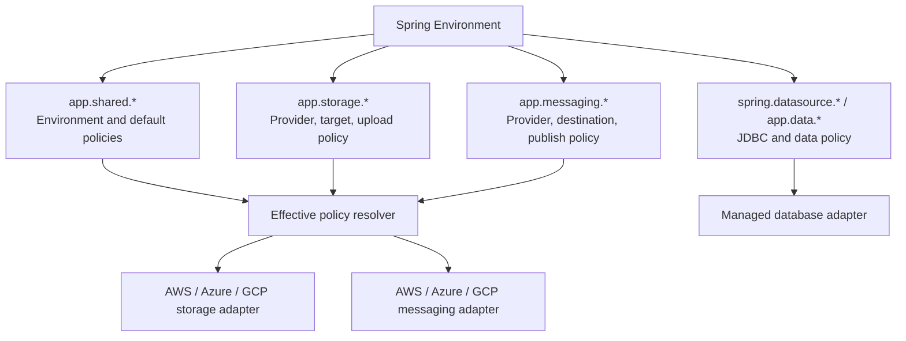

# Separating Global Configuration from Service-Specific Configuration

A Spring Boot application might simultaneously write documents to **Amazon S3**, publish events via **Google Cloud Pub/Sub**, and read data from a managed database on **Azure**. These integrations can share deployment environment metadata, default timeouts, or observability labels. However, each service needs its own **resource identifiers, access permissions, connection parameters, and failure policies**.

If everything is lumped into vague keys like `cloud.region`, `cloud.endpoint`, or `app.retry`, a small change for storage can make messaging behave unexpectedly. Conversely, duplicating all defaults into every adapter causes configurations to drift over time. The solution is to **separate the shared configuration contract from service-specific configuration contracts**, sharing only values that genuinely share the same meaning.

This lesson belongs to the **Application Configuration** section of the `SPRING_CLOUD_PROVIDER_INTEGRATION` module: practicing Spring Boot integration with AWS, Azure, and Google Cloud managed services, covering storage, messaging, data, identity, permissions, secret protection, and testing.

## 1. What Is Global Configuration vs. Service-Specific Configuration?

**Global configuration** (*shared/application-wide configuration*) acts as a common policy explicitly consumed by components. It can include the deployment environment name, application labels, approved default timeouts, or system-wide observability flags.

**Service-specific configuration** describes a particular integration, such as an S3 bucket, Azure Blob container, Pub/Sub topic, JDBC URL, credential source, and adapter retry behavior.

| Property | Appropriate Scope | Reason |
| --- | --- | --- |
| `app.shared.environment` | Application-wide | Every component in the instance needs to know if it belongs to dev/staging/prod |
| `app.shared.default-timeout` | Shared default, used intentionally | Allows services without overrides to inherit via application-written logic |
| `app.shared.default-max-attempts` | Shared suggested baseline | Applies only to adapters that explicitly opt into this policy |
| `app.storage.provider` | Storage-specific | Storage may use AWS while messaging uses GCP |
| `app.storage.target` | Storage-specific | S3/GCS bucket or Azure Blob container |
| `app.storage.operation-timeout` | Storage-specific | Upload/download characteristics differ from messaging operations |
| `app.messaging.provider` | Messaging-specific | Need not match storage |
| `app.messaging.destination` | Messaging-specific | Queue URL, entity name, or Pub/Sub resource name depending on adapter |
| `app.messaging.publish-timeout` | Messaging-specific | Publishing and message acknowledgments have distinct semantics |
| `spring.datasource.url` | Datasource/JDBC-specific | Belongs to Spring Boot datasource auto-configuration |
| `spring.cloud.aws.*`, `spring.cloud.azure.*`, `spring.cloud.gcp.*` | Starter/provider-specific | Defined by integration libraries, not the business namespace |

Three design rules:

1. **Share only when the definition is identical.** `environment=prod` means the same thing to every adapter. By contrast, `region=ap-southeast-1` may be an AWS region that does not accurately represent an Azure region or GCP location in all cases.
2. **Place ownership close to usage.** Bucket names belong to storage; topic names belong to messaging; connection pools belong to datasources. Never let a service's setting change meaning when another provider is chosen.
3. **Do not assume identical key names share identical semantics.** `retry.max-attempts=3` on S3 does not automatically equate to `max-attempts=3` on a Pub/Sub consumer: one may retry an idempotent request, while the other causes message redelivery.



The diagram represents **application-built logic**. Spring Boot does not automatically combine `app.shared.default-timeout` with `app.storage.operation-timeout` unless developers write the combination rule.

## 2. Clear Namespace Structure for Multiple Integrations

A simple structure that is easy to navigate and test:

```text
app
├── shared
│   ├── environment
│   ├── default-timeout
│   └── default-max-attempts
├── storage
│   ├── enabled
│   ├── provider
│   ├── target
│   ├── operation-timeout
│   └── max-attempts
├── messaging
│   ├── enabled
│   ├── provider
│   ├── destination
│   └── publish-timeout
└── data
    ├── enabled
    └── query-timeout
```

Where:

- **`app.shared.*`** holds application-wide values, never S3- or Pub/Sub-specific resources.
- **`app.storage.*`, `app.messaging.*`, `app.data.*`** are business contracts defined by the development team. Each adapter knows which keys it consumes.
- **`spring.datasource.*`** and **`spring.cloud.<provider>.*`** belong to Spring Boot/starters; exact names and support depend on compatible dependencies and versions.

Example `application.yml`:

```yaml
app:
  shared:
    environment: ${APP_ENVIRONMENT}
    default-timeout: 5s
    default-max-attempts: 3

  storage:
    enabled: true
    provider: aws
    target: ${STORAGE_TARGET}
    operation-timeout: 12s
    # max-attempts omitted: uses shared default if the adapter supports it.

  messaging:
    enabled: true
    provider: gcp
    destination: ${MESSAGING_DESTINATION}
    # publish-timeout omitted: application policy selects 5s.

  data:
    enabled: false
```

In this example, storage uses AWS S3 while messaging uses GCP Pub/Sub. There is no `app.shared.provider` field because **each service can choose a different cloud**. `APP_ENVIRONMENT` is a mandatory deployment variable to prevent starting in production with an unintended default environment label.

`app.data.*` illustrates an **application-owned** data policy namespace. When using Spring Boot JDBC auto-configuration, settings such as URL, username, and datasource construction still use `spring.datasource.*` or the corresponding datasource configuration APIs. Do not declare `app.data.query-timeout` and assume Spring automatically applies that timeout to every SQL statement.

### Ownership and Responsibility Table

| Configuration Area | Who Defines the Keys? | Who Reads the Keys? | Who Enforces Them? |
| --- | --- | --- | --- |
| `app.shared.*` | Application development team | `SharedProperties` | Services/adapters opting into shared policy |
| `app.storage.*` | Application development team | `StorageProperties` | Storage adapters and storage policy |
| `app.messaging.*` | Application development team | `MessagingProperties` | Messaging adapters and messaging policy |
| `spring.datasource.*` | Spring Boot / datasource libraries | Auto-configuration or datasource beans | Connection pool / driver |
| `spring.cloud.aws.*` | Spring Cloud AWS | AWS auto-configuration | AWS SDK clients and adapters |
| `spring.cloud.azure.*` | Spring Cloud Azure | Azure auto-configuration | Azure SDK clients and adapters |
| `spring.cloud.gcp.*` | Spring Cloud GCP | GCP auto-configuration | Google Cloud SDK clients and adapters |

The prefixes listed above are **typical groups**, not a guarantee that every sub-property exists in every version. During implementation, choose compatible BOMs/starters and verify the actual property metadata of your version.

## 3. No "Automatic Inheritance" Between Two Namespaces

In Spring Boot, `app.storage.operation-timeout` and `app.shared.default-timeout` are **two independent keys**. They have no parent/child relationship or inheritance derived from property names.

Therefore, define an explicit **effective value resolution rule**:

```text
effectiveStorageTimeout =
    storage.operationTimeout if declared
    otherwise shared.defaultTimeout

effectiveMessagingPublishTimeout =
    messaging.publishTimeout if declared
    otherwise shared.defaultTimeout
```

If a service needs a completely different policy (e.g., a 2-second maximum timeout to avoid queue backlogs), it can require an explicit override and **ignore the shared default**.

| Shared Default | Storage Override | Messaging Override | Effective Storage | Effective Messaging |
| --- | --- | --- | --- | --- |
| `5s` | `12s` | Not set | **`12s`** | **`5s`** |
| `5s` | Not set | `2s` | **`5s`** | **`2s`** |
| `8s` | `12s` | Not set | **`12s`** | **`8s`** |

A change to global configuration affects only services **actually using that fallback**. That dependency should be explicit in code, deployment documentation, and tests rather than assumed implicitly from YAML.

### Distinguishing Application Fallback from Property Source Precedence

When the same key `app.storage.operation-timeout` appears in YAML, environment variables, and the command line, Spring Boot first selects **the winning value by source precedence**. Only afterward does application code decide whether to use the resolved key or fall back to `app.shared.default-timeout`.

Example:

```text
app.shared.default-timeout=5s        (application.yml)
app.storage.operation-timeout=12s    (application.yml)
APP_STORAGE_OPERATIONTIMEOUT=7s      (OS environment)
--app.storage.operation-timeout=4s   (command line)
```

The resulting `app.storage.operation-timeout` is `4s` and storage uses `4s`; the global `5s` does not participate because storage has an explicit value. Only if every `app.storage.operation-timeout` declaration is removed does the service fall back to `5s`.

**Do not confuse "precedence among config sources" with "precedence between shared policy and service policy."** Those are two separate resolution steps.

## 4. Binding into Typed Beans with `@ConfigurationProperties`

The examples use **Spring Boot 3.x and Java 17+**, with `spring-boot-starter-validation` to validate configuration data. We define independent beans per namespace.

### 4.1. Shared Enum for Cloud Providers

If the same set of provider values is used across adapters, you can use an enum:

```java
package example.cloud.config;

public enum CloudProvider {
    AWS, AZURE, GCP
}
```

The enum here validates input values; it **does not force** every service to use the same provider. `StorageProperties` and `MessagingProperties` each keep their own `provider` field.

### 4.2. Global Configuration Bean

```java
package example.cloud.config;

import jakarta.validation.constraints.AssertTrue;
import jakarta.validation.constraints.Max;
import jakarta.validation.constraints.Min;
import jakarta.validation.constraints.NotBlank;
import org.springframework.boot.context.properties.ConfigurationProperties;
import org.springframework.boot.context.properties.bind.DefaultValue;
import org.springframework.validation.annotation.Validated;

import java.time.Duration;

@Validated
@ConfigurationProperties(prefix = "app.shared")
public record SharedProperties(
        @NotBlank String environment,
        @DefaultValue("5s") Duration defaultTimeout,
        @Min(1) @Max(10) @DefaultValue("3") int defaultMaxAttempts
) {
    @AssertTrue(message = "app.shared.default-timeout must be > 0")
    public boolean isDefaultTimeoutValid() {
        return defaultTimeout != null
                && defaultTimeout.compareTo(Duration.ZERO) > 0;
    }
}
```

Here, `Duration` accepts strings like `5s` or `500ms`. `@DefaultValue` on the record sets the default when a property is omitted. `@NotBlank` forces deployments to specify the environment, while `@Min`/`@Max` prevent unreasonable retry limits.

**Key distinction:** `defaultMaxAttempts` is application intent. It does not automatically configure retries in the AWS SDK, Azure SDK, Google Cloud SDK, or message consumers. SDKs typically have their own retry policies, so adapters must clarify how it is applied to avoid layered retries or unexpected message redelivery.

### 4.3. Storage-Specific Bean

```java
package example.cloud.config;

import jakarta.validation.constraints.AssertTrue;
import jakarta.validation.constraints.Max;
import jakarta.validation.constraints.Min;
import org.springframework.boot.context.properties.ConfigurationProperties;
import org.springframework.boot.context.properties.bind.DefaultValue;
import org.springframework.validation.annotation.Validated;

import java.time.Duration;

@Validated
@ConfigurationProperties(prefix = "app.storage")
public record StorageProperties(
        @DefaultValue("false") boolean enabled,
        CloudProvider provider,
        String target,
        Duration operationTimeout,
        @Min(1) @Max(10) Integer maxAttempts
) {
    @AssertTrue(message = "enabled storage must have provider and target")
    public boolean isRequiredWhenEnabled() {
        return !enabled
                || (provider != null && target != null && !target.isBlank());
    }

    @AssertTrue(message = "storage operation-timeout must be > 0")
    public boolean isOperationTimeoutValid() {
        return operationTimeout == null
                || operationTimeout.compareTo(Duration.ZERO) > 0;
    }
}
```

`Integer maxAttempts` is used instead of `int` to explicitly represent **no override set** (`null`). Using primitive `int` with a default of 0 makes distinguishing "user chose 0" from "key omitted" harder.

`enabled=false` allows disabling an integration when an environment does not use it. When enabled, the validator checks `provider` and `target`. **Note:** disabling validation does not automatically disable the cloud starter's auto-configuration; adapter/client creation must be controlled separately.

### 4.4. Messaging-Specific Bean

```java
package example.cloud.config;

import jakarta.validation.constraints.AssertTrue;
import org.springframework.boot.context.properties.ConfigurationProperties;
import org.springframework.boot.context.properties.bind.DefaultValue;
import org.springframework.validation.annotation.Validated;

import java.time.Duration;

@Validated
@ConfigurationProperties(prefix = "app.messaging")
public record MessagingProperties(
        @DefaultValue("false") boolean enabled,
        CloudProvider provider,
        String destination,
        Duration publishTimeout
) {
    @AssertTrue(message = "enabled messaging must have provider and destination")
    public boolean isRequiredWhenEnabled() {
        return !enabled
                || (provider != null
                    && destination != null
                    && !destination.isBlank());
    }

    @AssertTrue(message = "messaging publish-timeout must be > 0")
    public boolean isPublishTimeoutValid() {
        return publishTimeout == null
                || publishTimeout.compareTo(Duration.ZERO) > 0;
    }
}
```

Messaging policy can add **its own** fields such as batch size, publish timeout, or idempotency key. Do not reuse a storage `Retry` record for a messaging consumer if the two flows do not share the same redelivery semantics.

### 4.5. Registering the Configuration-Properties Beans

```java
package example.cloud;

import org.springframework.boot.SpringApplication;
import org.springframework.boot.autoconfigure.SpringBootApplication;
import org.springframework.boot.context.properties.ConfigurationPropertiesScan;

@SpringBootApplication
@ConfigurationPropertiesScan("example.cloud.config")
public class ProviderIntegrationApplication {
    public static void main(String[] args) {
        SpringApplication.run(ProviderIntegrationApplication.class, args);
    }
}
```

You can use `@EnableConfigurationProperties({SharedProperties.class, StorageProperties.class, MessagingProperties.class})` on a `@Configuration` class instead of scanning. With single-constructor records in Spring Boot 3, there is no need to annotate configuration-properties classes with `@Component`.

## 5. Resolving Shared Policy and Overrides in Explicit Code

An independent class resolves precedence between shared policy and storage policy:

```java
package example.cloud.storage;

import example.cloud.config.SharedProperties;
import example.cloud.config.StorageProperties;
import org.springframework.stereotype.Component;

import java.time.Duration;

@Component
public final class StoragePolicy {
    private final SharedProperties shared;
    private final StorageProperties storage;

    public StoragePolicy(SharedProperties shared, StorageProperties storage) {
        this.shared = shared;
        this.storage = storage;
    }

    public Duration effectiveTimeout() {
        return storage.operationTimeout() != null
                ? storage.operationTimeout()
                : shared.defaultTimeout();
    }

    public int effectiveMaxAttempts() {
        return storage.maxAttempts() != null
                ? storage.maxAttempts()
                : shared.defaultMaxAttempts();
    }
}
```

This is an **application rule**, not automatic `@ConfigurationProperties` behavior. When an adapter needs a timeout, it calls `StoragePolicy.effectiveTimeout()` and passes that value to client configuration or SDK calls **using the provider's specific API**.

For messaging, you can similarly define `MessagingPolicy.effectivePublishTimeout()`, while deciding separately whether the default timeout applies to publishing. If an adapter cannot enforce a timeout as designed, clearly document which policies are informational only and which are actually enforced.

In particular, `maxAttempts` may **not** be suitable to apply verbatim to an SQS consumer, Azure Service Bus processor, or Pub/Sub subscriber. Messaging systems also involve redelivery, dead-letter policies, ack deadlines, lock durations, and idempotency. Keeping configuration separate prevents accidentally carrying storage retry logic over to messaging.

## 6. Separating Configuration by Profile and Cloud Provider

Profiles can select adapters and resources per deployment, without **forcing every service to use the same cloud**.

Suppose the application supports three deployment flavors using `application-aws.yml`, `application-azure.yml`, and `application-gcp.yml`.

### AWS — S3 Storage and SQS Messaging

```yaml
# application-aws.yml
app:
  storage:
    enabled: true
    provider: aws
    target: ${S3_BUCKET}
  messaging:
    enabled: true
    provider: aws
    destination: ${SQS_QUEUE_URL}

spring:
  cloud:
    aws:
      region:
        static: ${AWS_REGION}
```

`S3_BUCKET` is a bucket name; `SQS_QUEUE_URL` is a queue URL. They are different kinds of identifiers despite sharing the same provider. Each adapter must verify that resources belong to the approved account/region.

### Azure — Blob Storage and Service Bus

```yaml
# application-azure.yml
app:
  storage:
    enabled: true
    provider: azure
    target: ${AZURE_BLOB_CONTAINER}
  messaging:
    enabled: true
    provider: azure
    destination: ${SERVICE_BUS_ENTITY}

spring:
  cloud:
    azure:
      storage:
        blob:
          account-name: ${AZURE_STORAGE_ACCOUNT}
```

`AZURE_BLOB_CONTAINER` is the **container** name, `AZURE_STORAGE_ACCOUNT` is the **storage account**, and `SERVICE_BUS_ENTITY` is the **queue or topic** name inside the Service Bus namespace configured by the adapter or starter. Some Azure starters require additional namespace, endpoint, or other properties; check the documentation for your exact version.

### Google Cloud — GCS and Pub/Sub

```yaml
# application-gcp.yml
app:
  storage:
    enabled: true
    provider: gcp
    target: ${GCS_BUCKET}
  messaging:
    enabled: true
    provider: gcp
    destination: projects/${GOOGLE_CLOUD_PROJECT}/topics/${PUBSUB_TOPIC_ID}

spring:
  cloud:
    gcp:
      project-id: ${GOOGLE_CLOUD_PROJECT}
```

`GCS_BUCKET` is the bucket, and `projects/{project}/topics/{topic}` is the Pub/Sub topic identifier. Example namespaces such as `spring.cloud.gcp.project-id` depend on the Spring Cloud GCP generation and installed starters.

**Important:** the examples above describe the application configuration contract and a few common starter keys; they **do not automatically install dependencies** or guarantee every client will be created. Select compatible Spring Boot/Spring Cloud/starter versions via BOMs, and configure identities, permissions, and clients per the active provider documentation.

### Mixing Providers in the Same Deployment

A single instance can run:

```yaml
app:
  storage:
    enabled: true
    provider: aws
    target: ${S3_BUCKET}
  messaging:
    enabled: true
    provider: gcp
    destination: projects/${GOOGLE_CLOUD_PROJECT}/topics/${PUBSUB_TOPIC_ID}
```

In this case:

- The AWS S3 client receives the **AWS region/credential chain and IAM permissions** appropriate for the bucket.
- The GCP Pub/Sub client receives the **GCP project/credential source**, such as Application Default Credentials or Workload Identity.
- There is no reason to use a single `app.shared.region` key or an "app-wide" access key for both.
- If both starters are packaged, verify which auto-configurations are enabled, which clients must be created, and which credentials are available in the environment.

Single-provider environments can use a unified profile for simplicity, while keeping the configuration structure ready to split services when architecture demands it.

## 7. Controlling Beans Based on Service Configuration

An AWS adapter should only be registered when storage is **enabled** and `provider=aws`. A clean way to check both properties simultaneously, independent of whether a version supports repeatable `@ConditionalOnProperty`, is a dedicated `Condition`:

```java
package example.cloud.storage;

import org.springframework.context.annotation.Condition;
import org.springframework.context.annotation.ConditionContext;
import org.springframework.core.type.AnnotatedTypeMetadata;

public final class AwsStorageEnabledCondition implements Condition {
    @Override
    public boolean matches(ConditionContext context,
                           AnnotatedTypeMetadata metadata) {
        var env = context.getEnvironment();
        return "true".equalsIgnoreCase(
                    env.getProperty("app.storage.enabled"))
                && "aws".equalsIgnoreCase(
                    env.getProperty("app.storage.provider"));
    }
}
```

Then use it:

```java
@Component
@org.springframework.context.annotation.Conditional(
    AwsStorageEnabledCondition.class
)
public class AwsStorageAdapter {
    // Constructor injection of S3Client, StorageProperties, StoragePolicy...
}
```

Choose a conditional mechanism suited to your version and test `enabled=false`, `enabled=true/provider=aws`, and other `provider` values. `matches` only controls registering **this adapter bean**, without guaranteeing the cloud starter won't create other beans; review each auto-configuration.

Never let an adapter bean try to inject a client from another cloud if the deployment does not provide dependencies/credentials for that provider. When a service is disabled, its beans should be excluded from active flows and corresponding endpoints/readiness checks should reflect that state accurately.

## 8. Database Configuration Should Not Be Forced into the Object Storage Structure

The managed data layer usually has JDBC- or driver-specific properties:

```yaml
spring:
  datasource:
    url: ${DB_JDBC_URL}
    username: ${DB_USERNAME}
    # If the DB requires a password, provide it from a secure secret store/mount.
    # password: ${DB_PASSWORD}

app:
  data:
    enabled: true
    query-timeout: 3s
```

`spring.datasource.url` belongs to Spring Boot's auto-configuration contract, whereas `app.data.query-timeout` is an **application-defined policy** that must be enforced by the repository/driver layer to take effect.

A managed database on AWS, Azure, or Google Cloud may support IAM/identity authentication or service-specific credential delivery depending on engine, driver, and service. Never assume a single `app.shared.api-key` can connect to every database.

If the application connects to two datasources, each datasource must have **its own contract for URL, credentials, pool, transaction manager, and migrations**. Never define a single `app.shared.database-url` and leave repositories guessing which database to use. Avoid sharing DB pools/accounts when permissions and access purposes differ.

## 9. Separating Configuration and Protecting Secrets/Identities

"Sharing configuration" does not mean "sharing credentials." In a multi-cloud system, separate clearly:

| Input | Scope | Management Approach |
| --- | --- | --- |
| Environment name, default timeout | Application-wide | Controlled non-sensitive configuration |
| S3 bucket, Azure container, GCS bucket | Per storage adapter | Per-deployment configuration |
| SQS queue URL, Service Bus entity, Pub/Sub topic | Per messaging adapter | Per-deployment configuration |
| AWS IAM Role/credential chain | Authorized AWS workloads/clients | AWS IAM and credential providers |
| Azure Managed Identity | Authorized Azure clients | Microsoft Entra ID and Azure Identity |
| GCP Workload Identity/ADC | Authorized GCP clients | Google IAM and ADC |
| Third-party passwords/tokens | Only integrations requiring authentication | Secret manager or secure secret delivery |

Never commit access keys, client secrets, private keys, or tokens into `application.yml` or profiles. A secret URI in AWS Secrets Manager, Azure Key Vault, or Google Secret Manager is a **reference**, not the credential value itself; loading that reference still depends on the starter/version, read permissions, and refresh mechanism.

If a secret is shared across multiple services, require clear governance justification and tightly scoped permissions. Whenever possible, separate principals/roles by business boundary so a credential leak in one adapter does not grant access across all cloud systems.

One Java note: configuration records auto-generate `toString()`. Never place plaintext secrets in a record and log the entire object. Actuator endpoints such as `/actuator/env` and `/actuator/configprops` must be secured with sensitive-value masking enabled.

## 10. Testing Shared and Service-Specific Configuration

To verify binding, validation, and fallback behavior, use `ApplicationContextRunner` from `spring-boot-test`. JUnit 5/AssertJ example without initializing cloud SDKs:

```java
package example.cloud.config;

import example.cloud.storage.StoragePolicy;
import org.junit.jupiter.api.Test;
import org.springframework.boot.context.properties.EnableConfigurationProperties;
import org.springframework.boot.test.context.runner.ApplicationContextRunner;
import org.springframework.context.annotation.Configuration;
import org.springframework.context.annotation.Import;

import static org.assertj.core.api.Assertions.assertThat;

class StoragePolicyTest {
    private final ApplicationContextRunner runner =
            new ApplicationContextRunner()
                    .withUserConfiguration(TestConfig.class);

    @Test
    void storageOverrideThangDefaultChung() {
        runner.withPropertyValues(
                "app.shared.environment=prod",
                "app.shared.default-timeout=5s",
                "app.storage.enabled=true",
                "app.storage.provider=aws",
                "app.storage.target=documents-prod",
                "app.storage.operation-timeout=12s"
        ).run(context -> {
            assertThat(context).hasNotFailed();
            assertThat(context.getBean(StoragePolicy.class)
                    .effectiveTimeout().getSeconds()).isEqualTo(12);
        });
    }

    @Test
    void khongOverrideThiDungDefaultChung() {
        runner.withPropertyValues(
                "app.shared.environment=test",
                "app.shared.default-timeout=5s",
                "app.storage.enabled=true",
                "app.storage.provider=gcp",
                "app.storage.target=documents-test"
        ).run(context -> {
            assertThat(context).hasNotFailed();
            assertThat(context.getBean(StoragePolicy.class)
                    .effectiveTimeout().getSeconds()).isEqualTo(5);
        });
    }

    @Test
    void storageBatNhungThieuTargetThiThatBai() {
        runner.withPropertyValues(
                "app.shared.environment=prod",
                "app.storage.enabled=true",
                "app.storage.provider=azure"
        ).run(context -> assertThat(context).hasFailed());
    }

    @Test
    void storageTatKhongCanTarget() {
        runner.withPropertyValues(
                "app.shared.environment=prod",
                "app.storage.enabled=false"
        ).run(context -> assertThat(context).hasNotFailed());
    }

    @Configuration(proxyBeanMethods = false)
    @EnableConfigurationProperties({
        SharedProperties.class, StorageProperties.class
    })
    @Import(StoragePolicy.class)
    static class TestConfig {}
}
```

This test suite verifies the **application contract**; it does not prove Spring Cloud AWS/Azure/GCP starters constructed clients properly, verify that the S3 bucket exists, or check IAM/RBAC permissions.

Additional cases to test:

| Case | Expectation |
| --- | --- |
| Missing `app.shared.environment` | Startup fails due to validation |
| `app.shared.default-timeout=0s` | Startup fails; invalid shared default |
| `app.storage.max-attempts=0` | Startup fails, even though it may only be an override |
| `app.storage.enabled=false` | Target/provider not required; adapter disabled |
| AWS storage, GCP messaging | Each service reads its own provider and resource |
| Messaging `publish-timeout` overridden | Only messaging changes |
| Change `app.shared.default-timeout` from 5s to 7s | Only services relying on fallback change timeout |
| Profile file sets wrong S3 bucket/Service Bus namespace | Caught by deployment contract / integration test |
| Missing credentials for a disabled provider | Adapter for that provider is not created; verify auto-configuration |
| Inaccessible secret | Integration test reports permission error without falling back to default credentials |
| SDK executes different retries than intended | Integration test / inspect client config for that specific service |

## 11. Environment-Specific Configuration and Avoiding "Cross-Contamination"

When the same key is declared in multiple places, Spring Boot selects the value according to **`PropertySource` precedence**. Among common sources, command-line arguments typically outrank JVM system properties, OS environment variables, and Config Data. Profile files and imports have their own rules inside Config Data; remote sources may have override policies depending on starter/version.

Regardless of which source supplies a key, preserve **responsibility boundaries**:

- `APP_SHARED_DEFAULT_TIMEOUT` will not automatically become `APP_STORAGE_OPERATIONTIMEOUT`. When using custom keys, application logic must resolve fallbacks.
- `APP_STORAGE_TARGET` must affect only storage; never reuse it to populate messaging destinations.
- Account/region/project keys must belong to the respective provider/client configuration; never use an AWS region value to fill a GCP location.
- Remote secrets should be accessed via the appropriate workload identity/secret provider; never define a single `cloud.secret` across all adapters and treat it as a universal password.

### Migrating from One Provider to Multiple Providers

Teams sometimes begin with generic keys:

```yaml
cloud:
  provider: aws
  endpoint: https://example.invalid
  timeout: 5s
```

When adding Azure/GCP, those names become ambiguous: is `endpoint` for storage or messaging? Does `timeout` apply to uploads or publishes? To migrate safely:

1. List all places reading `cloud.*` and identify the **owner** of each key.
2. Move genuinely shared values into `app.shared.*`; move per-service endpoints/targets/credentials into dedicated namespaces.
3. Implement per-service default/override resolution logic and unit tests before modifying deployment files.
4. Gradually update environment variables, Config Data imports, secret references, and deployment manifests.
5. If legacy keys must be supported during transition, create an **explicit** mapping favoring new keys, log warnings without secrets, and remove the legacy path after deprecation. Spring Boot does not treat `cloud.timeout` as an alias for `app.shared.default-timeout`.
6. Test combinations of AWS/Azure/GCP, including cases where storage and messaging run on different providers.

Never allow both legacy and new keys to coexist in configuration without clear precedence rules; deployments can behave inconsistently depending on how profiles and environments load.

## 12. Multi-Cloud Configuration Design Exercise

Build the "store invoice and emit event" demo application with two adapters:

- **Storage:** choose S3, Azure Blob, or GCS.
- **Messaging:** choose SQS, Azure Service Bus, or GCP Pub/Sub.
- **Data:** a managed datasource if the scenario needs metadata persistence, using its own configuration and appropriate identity.

Proceed as follows:

1. Create `SharedProperties`, `StorageProperties`, and `MessagingProperties`. Add necessary validations and a `CloudProvider` enum.
2. Write `application.yml` with `app.shared.default-timeout=5s`, a `12s` storage override, and no messaging override. Use `StoragePolicy` and the messaging policy to verify effective values.
3. Create three deployment profiles for AWS/Azure/GCP. For AWS, use an S3 bucket and SQS queue URL; for Azure, separate storage account, Blob container, and Service Bus entity; for GCP, use a GCS bucket and Pub/Sub resource name.
4. Test configuring **AWS storage + GCP messaging** in the same instance. Confirm no single global `region` or `credential` is misused across both.
5. Test `storage.enabled=false` and `messaging.enabled=true`. Verify the storage adapter is not instantiated; if a starter auto-creates clients, configure conditions/auto-configuration to match the deployment.
6. Run unit tests for fallback and validation; then run integration tests against an appropriate test cloud/emulator to verify endpoints, IAM/RBAC, and resource mappings. Never use production secrets or resources in tests.
7. Change the shared default from `5s` to `7s`. Document which components actually change policy. Verify logs, Actuator, and deployment manifests do not leak credentials.

**Completion criteria:** learners can explain **why a key belongs to global or service-specific scope**, identify which service owns and enforces that key, prove fallback behavior with tests, and deploy mixed AWS/Azure/GCP combinations without mixing up buckets, queues, databases, or credentials.

## 13. Key Takeaways

- Global configuration should contain only **values that truly share the same meaning** across consuming components; resource names, endpoints, and retry semantics generally belong to service-specific configuration.
- `@ConfigurationProperties` should have **one clear prefix per responsibility group**. Use validation to catch missing provider/target settings whenever a service is enabled.
- **There is no automatic inheritance** between `app.shared.default-timeout` and `app.storage.operation-timeout`; explicit effective-value resolution logic is required.
- Separate **application namespaces (`app.*`)** from **framework/starter namespaces (`spring.datasource.*`, `spring.cloud.*`)**; an application-defined key does not configure the SDK automatically.
- In multi-cloud systems, storage and messaging can choose **different providers, regions/projects/accounts, and workload identities**. Never share credentials or defaults out of habit.
- Test **shared values, overrides, disabled services, deployment profiles, and real adapters**, while keeping secrets out of Git/logs and granting least-privilege IAM/RBAC permissions.
