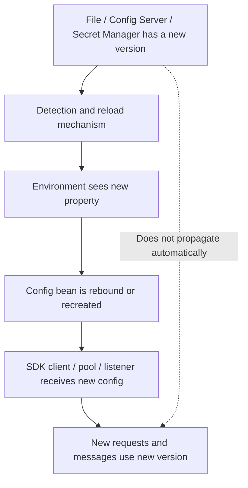
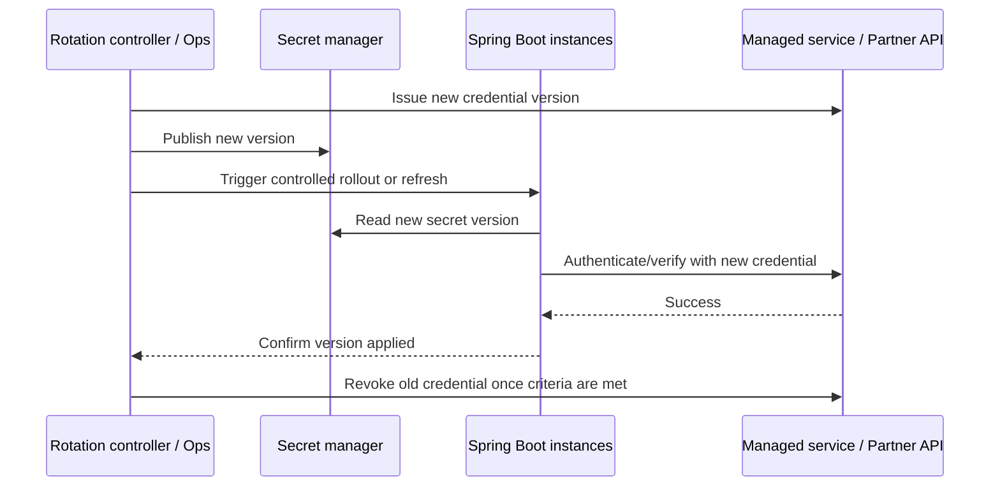

# Reloading Configuration, Rotating Secrets, and Limits of Updating Running Beans

A running Spring Boot application may need to change a bucket name, tune timeouts, update a messaging endpoint, or adopt a new credential after secret rotation. Values in AWS Secrets Manager, Azure Key Vault, Google Cloud Secret Manager, or Spring Cloud Config Server may have changed, yet **running beans and clients do not necessarily receive those changes**.

In the **`SPRING_CLOUD_PROVIDER_INTEGRATION`** module, we practice integrating Spring Boot with managed services on AWS, Azure, and Google Cloud via their corresponding Spring Cloud libraries. This lesson explains when configuration is loaded only at startup, when it can be *refreshed*, how to rotate secrets without disrupting business operations, and the limitations of updating beans that hold active storage, messaging, or database connections.

The goal is to build an **explicit configuration update contract**: which source changed, who detects it, which beans must be recreated, what happens to in-flight operations, and how to prove the new configuration has actually taken effect.

## 1. Never Equate "Source Changed" with "Application Applied"

Consider an application publishing events via Pub/Sub and writing files to S3:

```yaml
app:
  storage:
    target: ${STORAGE_TARGET}
  messaging:
    destination: ${MESSAGING_DESTINATION}
    publish-timeout: 3s
```

At startup, Spring Boot reads configuration sources, resolves values by precedence, and creates beans. If `MESSAGING_DESTINATION` in the secret/config store changes later, multiple layers are involved:

1. **Configuration source:** does the file, Config Server, or secret store hold the new version yet?
2. **Process `Environment`:** has the property source in the running instance been reloaded?
3. **Configuration-holding beans:** have objects using `@Value` or `@ConfigurationProperties` received the new value?
4. **Client / adapter:** have SDK clients, connection pools, producers, or listeners been reconfigured?
5. **In-flight operations:** which configuration version do currently executing requests and messages use?

Layer 1 may have changed while layers 2–5 still retain old values. A refresh might update `Environment`, yet an adapter that copied `destination` into a `final` field during initialization still will not change automatically.



**Principle:** *config reload* is the source and `Environment` reloading values; *bean refresh* is updating or recreating beans; *client rotation* is swapping underlying credentials/connections. The three are related but not automatically equivalent.

## 2. Three Common Update Strategies

| Strategy | How It Works | Best Suited When | Limitations |
| --- | --- | --- | --- |
| **Restart / rolling deployment** | Launch new instances, reload Config Data, rebuild beans/clients | Changing endpoints, resources, datasources, critical policies | Rollout duration and traffic coordination required |
| **Controlled refresh** | Spring Cloud or application mechanism detects changes and refreshes eligible beans | Dynamic values with a well-understood blast radius | Only refresh-capable components update; risk of partial updates |
| **Dynamic read on use** | Client queries config/secrets or TTL cache per operation | Certain feature flags, time-bounded credentials | Extra latency, remote unavailability risk, requires caching and fallback policy |

**Default recommendation for major structural changes:** choose a rolling restart. This creates a consistent set of beans and clients from a single configuration snapshot and is easier to test and roll back than mutating live singletons.

Dynamic refresh is appropriate only when you know exactly which beans must update, how connection lifecycles are managed, and how effective values are observed after cutover.

### Decision Table by Change Type

| Change | Preferred Approach to Consider | What to Verify |
| --- | --- | --- |
| Metrics sampling rate or secondary flag | Refresh or dynamic read | Safe defaults, thread safety |
| API client timeout | Recreate client/adapter or rollout | New timeout enforced by SDK, how in-flight requests behave |
| S3/GCS bucket or Azure container name | Rollout or controlled adapter switch | No split writes across two targets, permissions on new target |
| SQS queue, Service Bus entity, Pub/Sub subscription | Quiesce listener then recreate or rollout | Ack/lock/offset, unprocessed messages, avoiding unintended duplicates |
| Database URL or password | Create new pool then switch connections or rollout | Open transactions, connection lifetimes |
| Third-party API secret | Overlapping rotation window, swap client | New credential works before revoking old one |
| IAM Role / Managed Identity / Workload Identity | Typically handled by infrastructure identity provider and SDK | Provider chain obtains new tokens; IAM/RBAC permissions updated |

## 3. Spring Boot Config Data Is Normally Processed at Startup

Spring Boot (since 2.4) supports `spring.config.import` to import files, `configtree`, and remote sources with matching resolvers/loaders. Example:

```yaml
spring:
  application:
    name: provider-integration
  config:
    import:
      - "optional:file:./runtime/feature-flags.yml"
      - "configtree:/run/secrets/provider-integration/"
```

In a typical Spring Boot application:

- `application.yml` and `spring.config.import` resources are processed during startup.
- `@ConfigurationProperties` binds values from `Environment` into beans.
- Subsequent file edits **do not automatically trigger** reloading Config Data and all beans.
- `optional:` controls how missing locations are handled by the importer; it is **not** a "watch file for changes" option.

Kubernetes considerations:

- **Environment variables** of a running container do not update automatically when an external Secret/ConfigMap changes. A new Pod / rollout is usually required.
- **Volume-mounted Secrets/ConfigMaps** can be updated by Kubernetes after a propagation delay, depending on how they are mounted; however, Spring Boot does not automatically rebind properties as a result.
- Volume mounts using **`subPath`** typically do not receive automatic updates like regular volume mounts; understand how your deployment mounts data.
- **Config Data `configtree:`** reads files during configuration loading; swapping files under the mount does not guarantee beans receive new values.

A Spring Cloud library may offer its own refresh mechanism. Before relying on it, verify **dependencies, versions, trigger mechanisms, and supported bean types**. Never treat `spring.config.import` as a real-time configuration sync service.

## 4. Understanding `@Value`, `@ConfigurationProperties`, and `@RefreshScope` Accurately

These mechanisms play different roles:

| Mechanism | Initially | When Property Source Changes | To Update Effective Value |
| --- | --- | --- | --- |
| `@Value("${...}")` on a singleton | Injects value when bean is created | Existing field generally does not update automatically | Recreate bean or design dynamic lookup |
| `@ConfigurationProperties` | Binds typed property group | Spring Cloud Context can rebind on appropriate events, depending on bean type/version | Check rebind behavior, especially with immutable objects/records |
| `@RefreshScope` | Creates bean behind a proxy (usually lazily initialized) | Spring Cloud can clear cached target on refresh | Next access creates a new target, if scope and proxy support it |
| `Environment.getProperty(...)` on each use | Reads from current `Environment` | Sees new value only if `Environment` updated | Requires source reload mechanism; check consistency |
| Initialized SDK client / connection pool | Usually snapshots configuration when built | No guarantee of automatically changing endpoint/password | Reconfigure via supported API or create new client/pool |

### 4.1. Do Not Infer Refresh Behavior from `@ConfigurationProperties` Alone

An immutable configuration record:

```java
package example.cloud.config;

import jakarta.validation.constraints.NotBlank;
import org.springframework.boot.context.properties.ConfigurationProperties;
import org.springframework.validation.annotation.Validated;

@Validated
@ConfigurationProperties(prefix = "app.messaging")
public record MessagingProperties(
        @NotBlank String destination
) {}
```

This record is great for **validation and preventing arbitrary mutation**. However, once the bean has been injected into an adapter, **never assume the record magically becomes a new object when Config Server changes**. Spring Cloud rebinding and refresh scope have constraints, especially around constructor binding, immutable beans, and bean types outside supported refresh scopes.

Design tests on your exact Spring Boot/Spring Cloud versions, or use a restart when you must guarantee all beans receive a consistent configuration snapshot.

### 4.2. Illustrating a Bean Recreated via `@RefreshScope`

Suppose you only want to refresh **a lightweight route object** holding no sockets or subscriptions. With Spring Cloud Context and an appropriate refresh trigger, you could write:

```java
package example.cloud.messaging;

public class MessagingRoute {
    private final String destination;

    public MessagingRoute(String destination) {
        if (destination == null || destination.isBlank()) {
            throw new IllegalArgumentException("Missing messaging destination");
        }
        this.destination = destination;
    }

    public String destination() {
        return destination;
    }
}
```

Bean factory:

```java
package example.cloud.messaging;

import org.springframework.cloud.context.config.annotation.RefreshScope;
import org.springframework.context.annotation.Bean;
import org.springframework.context.annotation.Configuration;
import org.springframework.core.env.Environment;

@Configuration(proxyBeanMethods = false)
public class MessagingRouteConfiguration {
    @Bean
    @RefreshScope
    public MessagingRoute messagingRoute(Environment environment) {
        String destination =
                environment.getRequiredProperty("app.messaging.destination");
        return new MessagingRoute(destination);
    }
}
```

**Expected mechanism:** another bean injects `MessagingRoute` through a proxy managed by `@RefreshScope`. When the refresh scope is refreshed, the old target is evicted from cache; on the next call, a new target is instantiated using the value currently in `Environment`.

Important limitations to understand clearly:

1. There must be a **mechanism that updates `Environment`** and triggers refresh; adding the annotation alone does not cause remote data to update automatically.
2. Call sites injecting the bean must continue invoking through the **proxy**; code that copied `route.destination()` into its own field retains the old string.
3. A bean currently executing a method may finish against the old target; there is no guarantee that in-flight requests instantaneously switch to the new route.
4. If creating a bean holding connections or closeable resources, define an explicit **close/swap/drain** policy and test its real lifecycle; the annotation does not solve everything.
5. `final` classes, records, and proxy structures can impose constraints depending on proxy mode; the example uses a non-`final` class so scoped proxies apply cleanly.

**Note:** `MessagingRoute` is an application-defined class; it is not a built-in API for switching SQS, Service Bus, or Pub/Sub destinations. Changing a route string does not automatically migrate a listener already subscribed to an old queue/subscription.

### 4.3. The Refresh Endpoint Is Not a Safe Button by Default

When integrating compatible Spring Cloud Context and Actuator, the administrative endpoint `POST /actuator/refresh` can be used to trigger a refresh cycle. Whether the endpoint exists and what it does depend on dependencies, versions, and exposure settings.

If the application needs to expose this endpoint:

```yaml
management:
  endpoints:
    web:
      exposure:
        include: "health,info,refresh"
```

**This is only an exposure example**, not a complete security configuration. Block public access, require administrative authentication/authorization, restrict network access, audit invocations, and limit who can trigger refreshes. Never allow arbitrary Internet callers to invoke refresh and alter system endpoints or credentials.

In Spring Cloud Config, Config Server and other mechanisms can emit refresh signals or use a bus/event to synchronize multiple instances **if installed and configured**. Refreshing one instance does not mean every instance in the cluster has updated.

## 5. Secret Rotation Is a Lifecycle Credential Replacement Process

**Secret rotation** means issuing a new credential, migrating dependent components to it, verifying operation, and revoking the old credential according to policy. It is more than editing a string in a secret manager.

For secrets that support two active versions concurrently, you can deploy in sequence:



This sequence is a **two-phase** model: prepare the new credential, then migrate the application. It reduces the chance of dropping in-flight requests when the backend allows two valid credentials during a transition window.

If a system supports only one credential at a time, never assume an overlap window exists. Instead, design a service-supported procedure: coordinated replacement, bounded retries, maintenance windows, or an appropriate token-issuance mechanism.

### Distinguishing Static Secrets and Workload Identities

| Mechanism | Long-Lived Secret in Application? | Who Refreshes the Credential? | Tasks Development Teams Must Verify |
| --- | --- | --- | --- |
| AWS IAM Role + AWS SDK credential provider chain | Usually no | Provider chain fetches temporary credentials | Client uses the right provider and does not cache temporary credentials as a static string |
| Azure Managed Identity + Azure Identity | Usually no | Credential implementation acquires/refreshes access tokens | RBAC permissions and that clients do not retain expired tokens |
| GCP Workload Identity / ADC | Usually no | ADC/auth library refreshes credentials as supported | Workload identity bound to the right principal and IAM roles |
| Third-party API key/password | Usually has a managed value | Secret manager and application refresh mechanism | Rotation, cache invalidation, rollout, revocation |
| Traditional database password | Potentially | DB/secret rotation workflow | Pool must adopt new credential; existing connections handled properly |
| SAS token, signed URL granting access | Time-bounded authorization | Component generating/reissuing tokens | Never cache past expiry, never log or share beyond scope |

**Prefer workload identities** whenever supported by the service, because the SDK can fetch short-lived credentials and refresh them automatically via its own mechanism. Never export a temporary access token as a static property and force the application to restart every time the token expires.

### References, Versions, and Secret Values

AWS Secrets Manager, Azure Key Vault, and Google Cloud Secret Manager all support storing secrets and managing versions or lifecycles, yet **APIs for selecting versions and auto-reloading differ**.

Distinguish:

- **Secret reference:** name/URI/resource ID of the secret entry, typically an identifier.
- **Secret version:** the version currently used by the application or alias/version chosen by deployment.
- **Secret value:** password, token, private key, or privileged connection string; must stay confidential.
- **Client effective credential:** credential currently held by the SDK/connection pool, which may still be the previous version.

A secret manager having a new version **does not prove the client switched credentials**. To verify, use non-sensitive metadata such as version ID, timestamp, or a fingerprint generated by governance tooling; never write plaintext, full tokens, or private keys to logs.

## 6. Managing a Cutover Without Dropping In-Flight Operations

When a client or adapter adopts a new endpoint/credential, the swap strategy must fit the workload type.

### 6.1. HTTP Requests and Object Storage

For uploads/downloads, a request started under configuration **version A** should continue using the client and target chosen for that request. After initializing client **version B** and verifying connectivity, route new requests to version B, and close client A only after older requests finish or time out.

If changing the bucket from `documents-old` to `documents-new`, changing the route does not move existing objects. That is a **data target** change requiring a migration plan, read/write permissions, and rollback planning—not just a bean refresh.

An architectural option:

```text
new requests ---> [ClientHolder: version B] ---> new target
in-flight requests ---> [Client version A] ---> old target

After drain:
  close Client A
  record version B as effective
```

`ClientHolder` is an application-defined component; if needed, it can use atomic reference swapping or appropriate reference counting/draining. Never mutate multiple fields on a shared client across threads unless the SDK explicitly documents thread-safe reconfiguration.

### 6.2. Messaging and Consumers/Listeners

Renaming a queue/topic/subscription has broader consequences than changing a string:

- **Producers:** define when publishing switches to the new destination while handling messages still retrying on the old destination.
- **Consumers/listeners:** may hold active sessions, locks, ack deadlines, or callbacks bound to the old subscription.
- **Delivery guarantees:** manage duplicates, out-of-order messages, dead-letters, transaction/outbox state, and redelivery counts.
- **When switching destinations:** you may need to pause message intake, finish processing in-flight messages, record checkpoints/acks, and then start new listeners.
- **During multi-instance rollouts:** if producers switch first while new consumers are not ready, messages can pile up; plan rollout ordering carefully.

SQS, Azure Service Bus, and Pub/Sub have different retry/ack/lease semantics. Putting `@RefreshScope` on a property bean **does not automatically unregister old listeners or guarantee exactly-once delivery**. Enable dynamic refresh only after thoroughly testing adapter lifecycles.

### 6.3. Databases and Connection Pools

For managed databases, the `DataSource`/pool typically retains URL, username, and authentication details for opening connections. After a password changes in the secret store:

1. **Open connections** may continue using the old authenticated session for some time depending on the database.
2. **New connections** can fail if the pool still uses the old password.
3. Changing `spring.datasource.password` in `Environment` does not guarantee a running pool rebuilds itself.
4. You need a mechanism to **update pool credentials if supported** or build a new pool, verify it, and drain the old pool; rolling restarts are usually easier to control.
5. Open transactions should not be severed abruptly if avoidable; rotation procedures must account for transaction timeouts and connection lifespans.

When using IAM database authentication or cloud-specific identity mechanisms, check whether **the driver and integration** support issuing fresh tokens at connection-creation time. Never assume tokens auto-refresh simply because Spring Boot loaded credentials successfully once.

## 7. Policies When Refresh Fails: Preserving Safety and Consistency

A remote update may contain invalid values, lack permissions, or reach only a subset of instances.

| Scenario | Risk | Behavior to Design |
| --- | --- | --- |
| New secret version is wrong or revoked | New client cannot authenticate | Do not shift traffic to new client; report error and keep approved fallback |
| Old secret about to expire | Last-known-good becomes invalid | Complete migration before expiry or block dependent functionality |
| New value has invalid format | New bean fails binding/validation | Block rollout, report bad version; use rollback-capable deployment |
| One instance runs version A, another runs version B | Inconsistent behavior | Track per-instance versions, deploy in controlled sequence |
| New credential accepted but endpoint is wrong environment | Writes to wrong resource | Validate deployment contract and provider/resource before cutover |
| Remote temporarily disconnected | Cannot fetch new version | Bounded retries; TTL-bounded last-known-good if approved |
| Connection pool still uses old secret | New connections fail | Swap pool or restart safely; monitor connection errors |
| Listener switches subscription while messages remain | Lost or duplicated messages | Quiesce/drain and verify ack/checkpoint |

Never treat refresh as an **atomic transaction across the entire Spring context**. Some beans might read new config while others have not been recreated. For property groups that must stay consistent together (endpoint + region + credential + resource):

1. **Prepare the new configuration bundle** under a single version/generation.
2. **Validate types, policies, and cross-field constraints** before activating it.
3. **Construct and verify the new client** alongside the old client if the adapter supports it.
4. **Atomically swap the active client reference** for new requests.
5. **Drain and close old resources**, revoking the old credential only once nothing depends on it.
6. **Observe and roll back** if error rates or authentication failures exceed thresholds.

When those steps cannot be guaranteed, a rolling restart with proper readiness checks and deployment strategy is usually far easier to verify.

### Last-Known-Good Must Be Bounded

The last working secret/config snapshot is only a fallback if policy permits:

- How long may it be used? Is there a clear TTL or `notAfter` deadline?
- Was the secret actively revoked due to a leak? If so, stop using it immediately.
- Does the old credential still hold least-privilege access and remain unexpired?
- Can the old config be retained without writing to the wrong target or violating policy?
- Is entering fallback alerted and surfaced as `DEGRADED` status?

**Never rely on last-known-good indefinitely for mandatory secrets** to mask IAM/RBAC errors or missing secret-manager permissions.

## 8. Provider-Specific Scenarios Across AWS, Azure, and GCP

| Cloud / Integration | Source or Identity | What Usually Refreshes | What Must Be Verified Further |
| --- | --- | --- | --- |
| AWS S3 | IAM Role, AWS SDK provider chain | Temporary credentials managed by provider chain | Does `S3Client` retain old endpoint/region/bucket? |
| AWS SQS | IAM Role, SQS client/consumer | Credentials via provider chain | Queue URL, poller, and in-flight messages on destination change |
| AWS Secrets Manager | Secret value/version | New version fetched on SDK call or via supported integration | Cache TTL, rebind, client recreation, and revocation |
| Azure Blob | Managed Identity, Blob client | Access tokens managed by Azure Identity | Storage account/container and client instance |
| Azure Service Bus | Managed Identity or SAS credentials | New tokens via credential provider if supported | Processor, links/sessions, locks, and entity on namespace change |
| Azure Key Vault / App Configuration | Remote secrets/config | Polling/refresh mechanism of the matching starter | Versions, property sources, beans, and refreshable feature flags |
| GCP GCS | ADC/Workload Identity, Storage client | Access tokens managed by auth library | Whether bucket, project, and client/endpoint changed |
| GCP Pub/Sub | ADC/Workload Identity, publisher/subscriber | Access tokens via auth library | Publisher batches, subscriber streams, ack deadlines, and subscriptions |
| GCP Secret Manager | Secret version | Reading new version via SDK or integration | Caches, bindings, and clients holding old secrets |

These capabilities depend on **Spring Boot, Spring Cloud, and starter versions**. Some Spring Cloud integrations load secrets into `Environment`, while others only offer on-demand read APIs. Document explicitly in your architecture:

- Are secrets read **at startup** or **on API calls**?
- Does the client support **automatic credential refresh** or must it be recreated?
- Which values were **copied into beans/fields/clients**?
- Does the adapter have a **drain procedure**?
- When changing region/account/project/target, who validates the new permissions and resources?

An SDK automatically refreshing an **access token** does not mean the SDK automatically changes **region, bucket, topic, account, or project**.

## 9. Observing Effective Configuration State

A refresh-capable system must let operations verify which instance runs which version **without leaking secrets**.

Include metadata such as:

| Observable Field | Meaning |
| --- | --- |
| `config_generation` | Version ID or revision of the configuration bundle |
| `config_loaded_at` | Timestamp when the instance loaded the configuration |
| `secret_version_alias` | Non-sensitive version/alias currently used by the client, if permitted in logs |
| `refresh_result` | `APPLIED`, `REJECTED`, `PENDING`, or `ROLLBACK` |
| `refresh_failure_category` | `INVALID_CONFIG`, `ACCESS_DENIED`, `TIMEOUT`, `CLIENT_INIT_FAILED` |
| `active_adapter` | Active provider and adapter type |
| `inflight_operations` | Number of requests/messages still using the old client |
| `credential_expiry_remaining` | Remaining validity window if exposed by API, without revealing tokens |

Never log passwords, tokens, private keys, SAS URLs, credential-bearing connection strings, or entire `@ConfigurationProperties` objects that hold secrets.

Spring Boot Actuator `/actuator/env` and `/actuator/configprops` can help inspect property sources/values depending on version and permissions, but restrict exposure and keep sensitive-value masking enabled. Never rely solely on these endpoints to conclude that the **actual SDK client** has adopted the new configuration.

**Readiness and liveness:**

- **Readiness** can reflect whether mandatory adapters can serve traffic with a valid configuration version.
- **Liveness** reflects process health; never trigger continuous restarts just because an optional config source temporarily lost connectivity.
- A secondary module that fails to refresh can report `DEGRADED` without bringing down every endpoint, if business rules allow.

## 10. Testing Runtime Updates

To confirm new configuration truly takes effect, separate test layers:

| Level | Objective | Evidence to Collect |
| --- | --- | --- |
| Unit test | Version/fallback selection logic, timeout validation, secret metadata | Invalid config sets rejected; no values leaked |
| Spring context test | Bind/rebind/refresh scoped beans on your exact version | Bean/proxy observes new version after refresh trigger |
| Client integration test | New client uses the right credential and endpoint | Test request authenticates successfully |
| Messaging integration test | Changing destination/consumer drops no messages | Acks, duplicate policy, in-flight handling, and checkpoints |
| Database integration test | New pool uses new password/token | New connections succeed; existing transactions finish safely |
| Cluster rollout test | Multiple instances update in sequence | Version consistency, readiness, and rollback capability |
| Security test | Only authorized callers can refresh/read secrets | No secrets leaked in logs, metrics, or Actuator |

### Example Test for Refresh-Scoped Beans

The example below illustrates testing with a Spring context using `RefreshScope`. It applies only to a lightweight route; **it does not prove** an SDK producer/subscriber has actually switched destinations.

```java
package example.cloud.messaging;

import org.junit.jupiter.api.Test;
import org.springframework.cloud.context.scope.refresh.RefreshScope;
import org.springframework.context.annotation.AnnotationConfigApplicationContext;
import org.springframework.core.env.MapPropertySource;

import java.util.Map;

import static org.assertj.core.api.Assertions.assertThat;

class MessagingRouteRefreshTest {
    @Test
    void routeIsRecreatedAfterRefresh() {
        try (var context = new AnnotationConfigApplicationContext()) {
            var source = new MapPropertySource(
                "test-destination",
                new java.util.HashMap<String, Object>(
                    Map.of("app.messaging.destination", "orders-v1")
                )
            );
            context.getEnvironment()
                .getPropertySources()
                .addFirst(source);
            context.register(RefreshScope.class);
            context.register(MessagingRouteConfiguration.class);
            context.refresh();

            MessagingRoute route = context.getBean(MessagingRoute.class);
            assertThat(route.destination()).isEqualTo("orders-v1");

            source.getSource().put("app.messaging.destination", "orders-v2");
            context.getBean(RefreshScope.class).refreshAll();

            assertThat(route.destination()).isEqualTo("orders-v2");
        }
    }
}
```

This tests the scoped-proxy mechanism in Spring Cloud Context using a mock source already holding the new value. It **does not test Config Server or cloud secret importers**, because `MapPropertySource` was mutated directly. For production validation, add startup and refresh tests on **the exact versions and dependencies in use**.

### Secret Rotation Scenario Matrix

| Scenario | Outcome to Verify |
| --- | --- |
| New secret valid, old secret still valid | New client authenticates; in-flight requests complete |
| New secret has wrong content | Not silently applied; error version reported; rollback policy preserved |
| Old secret revoked immediately | No request continues using old credential once revocation is known |
| Secret manager returns `403` | Permission error reported; no dummy credential used |
| Secret manager unavailable | Bounded retries; fallback only if permitted and within TTL |
| Rotation occurs mid-DB transaction | Transactions/pool handled by policy, not severed arbitrarily |
| Switch Pub/Sub subscription or Service Bus queue | Old listener stops/drains cleanly; new listener receives messages |
| 10 instances total, only 7 refreshed | Version skew detected; prevents completing old-credential revocation |
| New config shifts staging bucket to prod | Caught by deployment contract before moving data |
| New secret loaded into `Environment` but SDK still uses old secret | Caught by client/authentication test, not assumed from `/actuator/env` alone |

### Three-Cloud Practice Exercise

1. Create a demo app with `app.messaging.destination` and a `@RefreshScope` `MessagingRoute` bean as in section 4. Record the target version before/after refresh in tests using dummy values only.
2. Use a controlled property source to test refresh when the route changes from `orders-v1` to `orders-v2`. Then check whether a singleton that copied the route string updates automatically.
3. Add an AWS S3, Azure Blob, or GCS storage adapter using the provider SDK client and an appropriate workload identity. Contrast **auto-refreshing credentials** with **non-auto-changing endpoints/buckets**.
4. Design rotation for a dummy API key stored in a test secret store. Publish version B, build client B, verify it, and only then revoke A. Also test the case where B fails.
5. For messaging, use a test queue/topic to switch destinations. Stop intake, drain in-flight work, and start the new listener; confirm messages are acknowledged per policy.
6. For a test managed database, change the password and observe the connection pool; design a rollout or new-pool swap to ensure new connections authenticate cleanly.
7. Emit metrics for config generation, refresh result, secret version metadata, and readiness. Confirm no secrets appear in logs, Actuator, or traces.
8. Compare dynamic refresh versus rolling restart in terms of recovery time, complexity, rollback capability, data risk, and permission requirements.

**Completion criteria:** learners can pinpoint which steps updated `Environment`, beans, and clients; describe how to transition credentials before revoking old ones; prove no messages or transactions are lost in appropriate tests; and explain why remote config changes do not automatically propagate to every running bean.

## 11. Common Mistakes

| Mistake | Why It Is Wrong | How to Fix |
| --- | --- | --- |
| "Change a secret in the cloud and Spring Boot picks it up immediately" | Beans may retain startup values | Choose refresh/rollout and verify effective credentials |
| "`spring.config.import` is auto-reload" | Import primarily serves Config Data at startup | Use supported refresh integration or restart |
| "With `@RefreshScope`, all SDK clients update" | Only beans in supported scopes/proxies are recreated | Design explicit client, pool, and listener lifecycles |
| "`@Value` fields auto-update" | Singletons already injected the old value | Recreate bean or read dynamically from refreshed source |
| "Rebind succeeded means the new credential is in use" | Already-built clients may still hold old credentials | Verify authentication using the active client |
| "Revoke the old credential right after writing the new version" | Older instances/requests may not have switched yet | Allow valid overlap and monitor rollout progress |
| "Old secrets are always a safe fallback" | They may be revoked or expired | Enforce TTL, policy, and usage cutoff conditions |
| "HTTP 200 from refresh endpoint means all instances updated" | Instances can hold different versions | Track generation and results per instance |
| "Switching topics only needs changing one property" | Listeners retain acks/checkpoints/sessions on the old target | Drain and initialize listeners per lifecycle |
| "Changing `spring.datasource.password` updates the pool automatically" | Pool keeps existing connection settings | Swap pools or roll out; verify new connections |

## 12. Key Takeaways

- **A changed source does not mean changed beans**: distinguish Config Data, `Environment`, binding, refresh-scoped proxies, and live clients/connections.
- `@RefreshScope` only supports appropriately managed beans; it is **not an automatic mechanism for updating all cloud resources**. Endpoints, messaging consumers, and datasources require their own lifecycles.
- **Secret rotation** involves issuing new credentials, verifying them, transitioning applications, and revoking old credentials by policy. Whenever possible, use **workload identities** so SDKs refresh short-lived tokens automatically.
- For complex changes or changes requiring multi-bean consistency, a **rolling restart with readiness and rollback** is usually easier to verify than in-place refresh.
- Track **config generation, secret version metadata, effective client state, refresh status, and in-flight operations** without logging secret values.
- Test **startup, refresh, failed rotation, denied permissions, DB connections, messaging acks, and multi-instance rollouts** before relying on dynamic updates in production.
