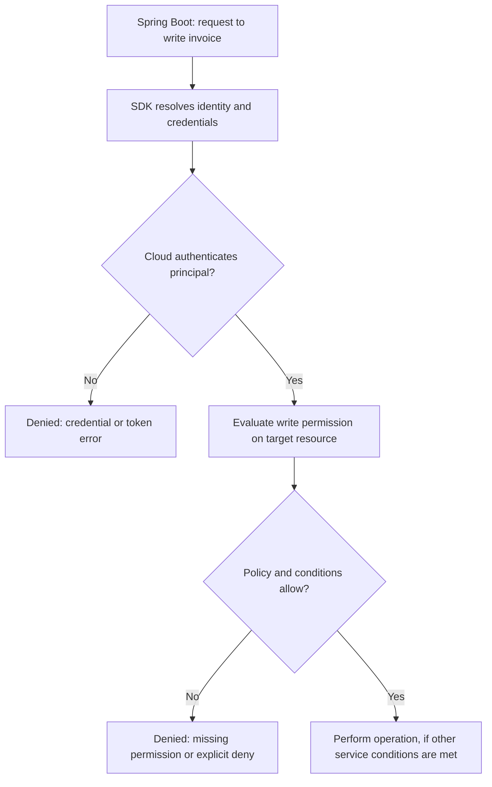

# Distinguishing Application Authentication and Resource Access Authorization

When a Spring Boot application calls Amazon S3, Azure Blob Storage, or Google Cloud Storage, two questions always arise: **how does the cloud service know which application is calling?** And **is that identity allowed to read, write, or delete the specific resource?** The first question belongs to **authentication**; the second belongs to **authorization**. An application can authenticate successfully yet still lack the permissions to perform an operation.

This is the foundation of the **Identity and Access** section when integrating Spring Boot with managed services from AWS, Azure, and Google Cloud. Spring Cloud libraries help locate credentials, create clients, and invoke APIs; they **do not automatically grant permissions** to the identity running the application.

## 1. Learning Outcomes

After this lesson, you will be able to:

- Distinguish between a Spring Boot workload's identity, the credentials used for authentication, and permissions on cloud resources.
- Explain the authentication flow and authorization decisions of AWS IAM, Microsoft Entra ID/Azure RBAC, and Google Cloud IAM.
- Recognize the difference between an end user logging into a Spring Boot API and the application's identity when calling cloud services.
- Read a least-privilege policy, identify the root cause of `AccessDenied`/`403` errors, and design tests for both allow and deny cases.
- Select an appropriate identity mechanism for local and production environments while avoiding long-lived secrets.

## 2. Two Independent Verification Layers

**Workload authentication** is the process by which the cloud determines the identity of the process or workload calling an API. The identity can be an AWS IAM role, a managed identity/service principal in Microsoft Entra ID, or a service account/workload identity in Google Cloud. The application proves its identity using the appropriate mechanism: signing requests, presenting an access token, or exchanging short-lived credentials.

**Resource authorization** is the cloud service evaluating whether the *authenticated identity* is allowed to perform a *specific action* on a *specific resource* in the *current context*. The decision depends on IAM policies, RBAC, conditions, organizational boundaries, resource policies, and sometimes additional controls such as encryption keys or network rules.

| Component | Authentication | Authorization |
| --- | --- | --- |
| Question | **Who** is calling the service? | **Who can do what, where, and under what conditions?** |
| Primary inputs | Identity and authentication proof: credentials, request signature, access token | Principal, action/permission, resource, policy, and conditions |
| Result | Principal is identified or not identified | Allows or denies a specific request |
| Example | The service identifies the `invoice-service-prod` workload | The workload can only create objects in the `invoices-prod` bucket |
| On failure | Unable to obtain credentials, invalid/expired credentials, wrong token audience | Valid credentials but missing `PutObject`/`objects.create` permission, wrong scope, or explicit deny |

> **Remember:** "Having credentials" does not mean "having permissions." Credentials identify who you are; policies define what that identity is allowed to do.

A request to create an invoice file can be visualized as follows:



This diagram separates the two decisions for clarity. In practice, some providers combine authentication, authorization, and service constraints within the same request-handling flow; you should not assume that every authentication error returns HTTP `401` and every authorization error returns `403`. For example, AWS S3 often returns `403 AccessDenied` for many different scenarios.

## 3. Three Identities That Are Easily Confused

In a system with a Spring Boot API, at least three subjects may be present:

1. **End user:** logs into the application carrying a JWT or session; Spring Security checks whether the user is allowed to call an endpoint such as `POST /invoices`.
2. **Application/workload:** the Spring Boot process deployed on EC2/EKS, Azure App Service/AKS, or GCE/GKE; the workload identity is used to access storage, queues, databases, and secret managers.
3. **Target resource:** a bucket, blob container, queue, topic, or secret; resource policies and the principal's permissions determine which operations are permitted.

Suppose Alice has permission to "create invoices" in the system. Spring Security accepting Alice's request **does not mean** Alice or the application automatically has `s3:PutObject` permission on the company's bucket. The cloud service typically sees the identity of the **Spring Boot workload**. Calling cloud resources under the end user's own identity requires a dedicated delegation mechanism (such as an *on-behalf-of* flow when supported by the platform); the SDK does not automatically turn a user's JWT into the workload's IAM permissions.

Both control layers should work together: **business API authorization** decides what users can do in the application, while **cloud authorization** limits what the application process can do if an endpoint has a bug or is exploited.

## 4. Comparing AWS, Azure, and Google Cloud

Cloud providers differ in terminology and how credentials are issued, but the core model is always **principal -> authentication -> policy/role -> resource permission**.

| Aspect | AWS | Azure | Google Cloud |
| --- | --- | --- | --- |
| Common workload identity | IAM role attached to the runtime environment; can assume roles via AWS STS | Managed identity or service principal in Microsoft Entra ID | Service account or federated/delegated workload identity |
| How the SDK obtains credentials | **Default credentials provider chain**, e.g., short-lived role credentials via metadata/STS | **DefaultAzureCredential**, e.g., token from managed identity or developer identity | **Application Default Credentials (ADC)**, e.g., service account via metadata or Workload Identity Federation |
| Proof when calling storage | AWS Signature Version 4 (SigV4) signs requests using AWS credentials; role credentials are usually temporary | OAuth 2.0 bearer access token scoped for the target resource | OAuth 2.0 access token/credentials retrieved by the client library from ADC |
| Primary permission mechanism | IAM identity policy; may include bucket policy, SCP, permission boundary, and explicit deny | Azure RBAC role assignment on a scope; other data/condition mechanisms depending on service | IAM role binding on a project, bucket, or supported resource; IAM Conditions where applicable |
| Example object write permission | `s3:PutObject` on the object ARN | `Storage Blob Data Contributor` at the appropriate scope, or custom role with the required data action | `storage.objects.create`, e.g., via `roles/storage.objectCreator` |
| Inspecting identity when debugging | Actual principal/role in caller info and CloudTrail | Managed identity/service principal, tenant, token audience, and Entra/Azure logs | Principal from ADC, service account, and Cloud Audit Logs |

### 4.1. AWS: IAM Role Credentials and IAM Permissions Are Separate

In AWS, an application running in an environment with an appropriate IAM role typically obtains **temporary credentials** through the SDK's provider chain. Requests to S3 are signed with SigV4. S3 authenticates the credentials/signature, then evaluates relevant policies to decide whether the principal is allowed to call `s3:PutObject` on that object.

Below is an example IAM policy that **only allows writing** objects whose keys start with `invoices/` in a bucket; this policy needs to be attached to the role used by the application:

```json
{
  "Version": "2012-10-17",
  "Statement": [
    {
      "Sid": "WriteInvoicesOnly",
      "Effect": "Allow",
      "Action": "s3:PutObject",
      "Resource": "arn:aws:s3:::invoices-prod/invoices/*"
    }
  ]
}
```

The policy above **does not** grant permissions to read, list, or delete objects; nor **does it** create credentials for the application. Effective permissions also depend on other policies, explicit denies, organization-level controls, bucket policies, and additional requirements (such as KMS when using customer-managed encryption keys). In production, attach an IAM role to the compute workload and avoid placing static access keys in `application.yml`.

### 4.2. Azure: Obtaining an Entra ID Token Differs from Assigning a Data-Plane Role

A Spring Boot service running on Azure App Service can use a **managed identity**. The Azure SDK requests an access token from Microsoft Entra ID for the target service. Obtaining a token proves identity with the right audience, but **does not guarantee** that the identity has permission to upload blobs.

For example, to write a blob using Microsoft Entra ID, you need an appropriate **data-plane** role such as `Storage Blob Data Contributor`, assigned at the relevant storage account or container scope. The Azure Resource Manager `Contributor` role **does not automatically** grant permission to read/write blob contents via Entra ID. Similarly, permissions to manage a Key Vault and permissions to read secret values are distinct and depend on the vault's authorization model.

Beyond the role assignment, the application must also point to the right storage account, the right tenant/identity, and satisfy network restrictions. Configuring a managed identity only solves **obtaining a token**; role assignments solve **what actions are permitted**.

### 4.3. Google Cloud: ADC Finds Credentials; IAM Decides Permissions

Google Cloud client libraries use **Application Default Credentials (ADC)** to locate credentials appropriate for the runtime environment. On Google Cloud, this is typically the identity attached to the workload (such as a VM service account or the identity configured for GKE); locally, ADC can pick up developer credentials configured on the machine.

To upload a new object to Cloud Storage, the principal needs the `storage.objects.create` permission on the target bucket. A `roles/storage.objectCreator` binding on the bucket is a straightforward example: this role allows creating objects, which **does not mean** the principal can list, read, or delete objects. If overwriting an existing object is required, additional permissions may be needed depending on the API behavior and active policies; verify the exact permissions required by the operation.

**Note:** `gcloud auth login` (the CLI identity) and **ADC** used by Java client libraries are two separate credential mechanisms. Being logged in with `gcloud` does not prove that the Spring Boot application is using the same principal.

## 5. Spring Boot Example: Same Problem, Two Independent Configurations

Suppose `invoice-service` needs to save an invoice payload under the key `invoices/2026/INV-001.json`. For each cloud, **both tasks** must be completed:

1. Provide a **workload identity** so the SDK can authenticate without embedding secrets in source code.
2. Assign the right **object creation permissions** on the bucket/container for the running environment.

The code snippets below use the respective Java SDKs; if you use Spring Cloud AWS, Spring Cloud Azure, or Spring Cloud GCP starters, client auto-configuration may be handled by the starter. You must declare the SDK/starter dependencies compatible with your project's Spring Boot version. These examples show separate integration options, not three clients required inside a single application.

**AWS — SDK locates credentials automatically; permissions live in IAM:**

```java
@Configuration
class AwsStorageConfig {
    @Bean
    S3Client s3Client() {
        return S3Client.builder()
                .region(Region.AP_SOUTHEAST_1)
                .credentialsProvider(DefaultCredentialsProvider.create())
                .build();
    }
}

@Service
class AwsInvoiceStorage {
    private final S3Client s3;

    AwsInvoiceStorage(S3Client s3) {
        this.s3 = s3;
    }

    void save(String bucket, byte[] data) {
        s3.putObject(
                PutObjectRequest.builder()
                        .bucket(bucket)
                        .key("invoices/2026/INV-001.json")
                        .build(),
                RequestBody.fromBytes(data)
        );
    }
}
```

On EC2/EKS, attach the appropriate IAM role to the workload and grant a policy with `s3:PutObject` on the required prefix. When running locally, `DefaultCredentialsProvider` may pick up a developer profile or environment variables; verify which principal is selected. The code snippet **does not** grant S3 write permissions by itself.

**Azure — Managed Identity/DefaultAzureCredential + data role:**

```java
@Configuration
class AzureStorageConfig {
    @Bean
    BlobServiceClient blobServiceClient() {
        return new BlobServiceClientBuilder()
                .endpoint("https://myaccount.blob.core.windows.net")
                .credential(new DefaultAzureCredentialBuilder().build())
                .buildClient();
    }
}

// Using the Spring-injected client:
BlobClient blob = blobServiceClient
        .getBlobContainerClient("invoices")
        .getBlobClient("2026/INV-001.json");
blob.upload(BinaryData.fromBytes(data), true);
```

In Azure, enable a managed identity for the workload and assign a data role on the appropriate storage scope. If the managed identity is **user-assigned**, you must explicitly specify the identity/client ID for the credential chain according to the SDK configuration. Passing `true` in `upload(..., true)` enables overwriting; under least-privilege practices, only use this when the use case truly requires overwriting.

**Google Cloud — ADC + bucket IAM:**

```java
@Configuration
class GcpStorageConfig {
    @Bean
    Storage cloudStorage() {
        return StorageOptions.getDefaultInstance().getService();
    }
}

// Using the Spring-injected client:
BlobInfo object = BlobInfo.newBuilder(
        BlobId.of("invoices-prod", "invoices/2026/INV-001.json"))
        .build();
cloudStorage.create(object, data);
```

Assign the role/permission to the principal actually used by ADC, on the appropriate bucket. Workloads running in Google Cloud should use the identity attached to the runtime environment or Workload Identity Federation, avoiding issued service account JSON key files. Across all three clouds, real applications should externalize account/bucket names, regions, and keys into environment-specific configuration rather than hardcoding them as in the examples.

## 6. Illustration: Authentication Succeeds, Yet Access Is Still Denied

Consider `invoice-service-prod` deployed with the proper identity and attempting to create an object in storage:

| Scenario | Authentication | Authorization | Expected Outcome |
| --- | --- | --- | --- |
| Valid AWS role; writing to `invoices/` prefix allowed by policy | Passed | `s3:PutObject` allowed | Write succeeds, provided no other conditions block it |
| Same role writing to `payroll/` prefix without permission | Passed | No matching allow | Denied, typically `AccessDenied` |
| Azure SDK acquires managed identity token; identity has no data role assigned | Passed | Missing data-plane permission | Typically `403`, even with a valid token |
| GCP ADC selects service account; another bucket lacks `storage.objects.create` | Passed | Missing permission on target bucket | Typically `403` |
| Credentials cannot be obtained or are invalid/expired | Failed | No valid principal to evaluate permissions | Credential acquisition error or authentication failure on API call |

Within a business workflow, both kinds of missing permissions can occur:

- **User is not allowed to create an invoice:** The Spring Boot API must reject the request at the Spring Security/business layer even though the workload has permission to write to storage.
- **User is allowed to create an invoice, but the workload lacks storage write permission:** The API may accept the valid request and then fail when calling the cloud service. You must fix the workload's permissions or resource configuration—not grant additional business permissions to the user.

## 7. Designing Least-Privilege Access

Define permissions by **workload – action – resource – environment**, rather than using a single shared administrative credential:

| Workload | Needed Action | Appropriate Scope | Should Not Be Granted by Default |
| --- | --- | --- | --- |
| `invoice-api` | Create invoices in storage | Production invoice bucket/container and required write permissions | Read/delete permissions across all organizational storage |
| `invoice-reader` | Read invoices for lookup | Allowed objects/buckets/containers for reading | Upload or delete permissions |
| `event-publisher` | Send messages | Target SQS queue / Service Bus sender / Pub/Sub topic | Administrative permissions over all messaging |
| `secret-consumer` | Read specific secrets needed by the application | Target secrets or vault with appropriate read-value permissions | Permissions to create/delete/administer secrets system-wide |

Implementation should follow this sequence:

1. **Identify the actual runtime principal:** the IAM role, managed identity, or service account selected by the SDK in each environment.
2. **List the exact operations:** for instance, creating, reading, listing, and deleting are distinct permissions. Check secondary permissions as well, such as KMS, publishing messages, or reading secrets if the workflow uses them.
3. **Restrict resources/scopes:** ARNs and prefixes on AWS where available; accounts/containers on Azure; buckets/supported resources on Google Cloud. Do not assume all three providers offer the same granularity.
4. **Assign the minimal role/policy that fits the task:** consider custom roles when built-in roles are broader than needed; separate identities for workloads with different responsibilities.
5. **Test both allow and deny cases:** verify write access succeeds on the intended target and fails outside scope; provision separate roles for dev, test, and production.

**Never store** access keys, client secrets, tokens, or service account key files in Git, Docker images, or `application.yml`. Developer login profiles can be used locally; in the cloud, prefer platform-managed roles/managed identities/workload identities with short-lived credentials. When an application needs to read from a secret manager, secret read permissions must also be granted independently; using a secret manager does not eliminate the need for identity access control.

## 8. Diagnosing Errors by Layer

A cloud API error alone is not enough to conclude that IAM is misconfigured. Use the following checklist to avoid granting overly broad permissions:

| Check Question | Signals and Troubleshooting Steps |
| --- | --- |
| **Which principal is the SDK using?** | Check the credential provider chain/ADC and workload configuration; distinguish local profiles from cloud runtime identities. In AWS, `aws sts get-caller-identity` is useful for inspecting the current CLI session's credentials, but does not by itself prove the Java process's principal if both use different credential sources. |
| **Are the credentials valid for this service?** | Verify that the credentials/token were obtained successfully, are not expired, and match the right tenant/audience/scope where applicable; check system clock synchronization if request signatures fail due to time skew. |
| **Are the action and resource correct?** | Verify bucket/container/topic, object key, region, project/subscription, and the permission for the specific operation. An IAM allow for one action does not imply allow for other actions. |
| **Is another policy denying access?** | On AWS, check explicit denies, bucket policies, SCPs, permission boundaries, and KMS; on Azure, check data roles, scopes, and denies/conditions; on Google Cloud, check IAM bindings, conditions, and permissions of the effective identity. |
| **Are there non-IAM constraints?** | Check endpoints, network/firewalls, private endpoints/VPCs, storage settings, encryption keys, or organizational policies. A `403` error can originate from multiple layers. |
| **What do the audit logs show?** | Inspect AWS CloudTrail, Azure Activity/resource diagnostic logs, and Google Cloud Audit Logs depending on the service and logging configuration; correlate principal, operation, resource, and denial reason. Never log tokens or secrets in application logs. |

Common symptoms:

- **Application fails to initialize the client or retrieve credentials:** check environment variables, local profiles, metadata endpoints, service account bindings, or managed identities before modifying IAM.
- **AWS `AccessDenied` after confirming the right role:** inspect IAM actions, object ARNs, prefixes, bucket policies, explicit denies, and KMS permissions if applicable.
- **Azure `403 AuthorizationPermissionMismatch` or similar permission error:** check whether the role is the correct *data plane* role and scope; role assignments may take time to propagate. Also check firewall/network rules.
- **Google Cloud `403 permission denied`:** verify ADC selected the expected principal, the bucket belongs to the right project, and the principal holds the right permission for the API operation.

Do not resolve errors by temporarily granting `AdministratorAccess`, `Owner`, or `*` permissions in production and leaving them in place. Broad permissions can mask identity misconfigurations or wrong resource targets.

## 9. Hands-On Two-Layer Verification

**Exercise:** Build a Spring Boot service with an endpoint that saves a JSON string as an object. Choose **one** provider as your primary environment, then compare the corresponding mechanisms across the other two providers using the table in Section 4.

Prepare an application identity, one bucket/container with write access, and a second bucket/container without granted permissions. Keep the Java code and identity configuration unchanged across test cases; only change the target resource or role assignment/policy per case.

| Test Case | Action | What to Prove |
| --- | --- | --- |
| A — Valid identity and permission | Upload a new object to the permitted target | Both valid credentials **and** appropriate permissions are required to succeed |
| B — Valid identity without permission | Upload to the unpermitted target | The same principal authenticates successfully yet is denied the operation |
| C — No valid credentials | Run in a test environment where credentials cannot be resolved | Authentication cannot be bypassed simply because a policy allows access |
| D — Least privilege | Try listing, reading, or deleting when the identity only has create permission | Effective permissions are no broader than required |

Be sure to use test resources, sample objects, and a non-privileged identity. For case C, you can use a test double or an isolated environment to simulate a credential failure; there is no need to revoke permissions from a production workload. Record the **selected principal**, **resource**, **operation**, **error type/HTTP status**, and **relevant policy** for each case. The results will clearly reveal whether a failure comes from authentication, authorization, or an additional service condition.

## 10. Self-Check Questions

1. Spring Boot successfully authenticates a user's JWT. Why can a call from the application to S3 still fail with `AccessDenied`?
2. When `DefaultAzureCredential` successfully acquires a token, why can a blob upload still fail? Can the `Contributor` role replace `Storage Blob Data Contributor`?
3. ADC selects the right service account, yet creating an object in another bucket still fails. In what order would you inspect the principal, permission, and resource?
4. Why does a policy granting `s3:PutObject` on `arn:aws:s3:::invoices-prod/invoices/*` not imply the application can read every object in the bucket?
5. If a service needs to read secrets, publish messages, and write to storage, should it be granted a single cloud-wide admin role to simplify integration? Propose the corresponding least-privilege permissions instead.

**Key takeaway:** Spring Cloud and the SDKs help the application **present the right identity when calling the cloud**; IAM/RBAC decides **which actions that identity is permitted to perform on which resources**. A secure design requires controlling and testing **both** layers in every deployment environment.
