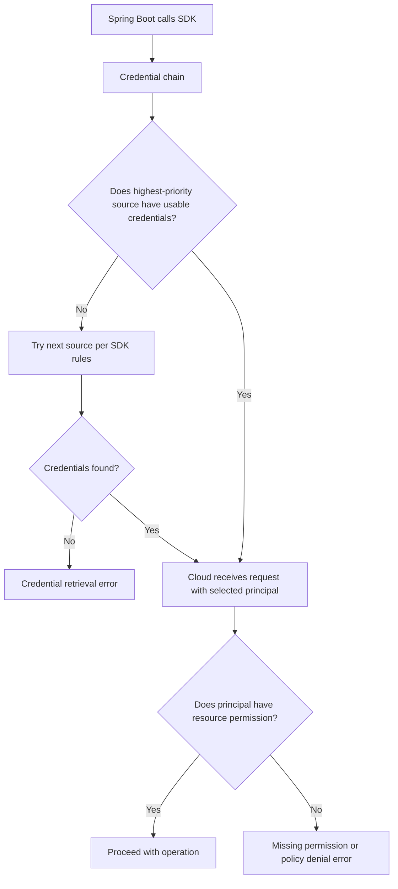
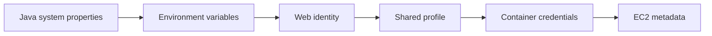
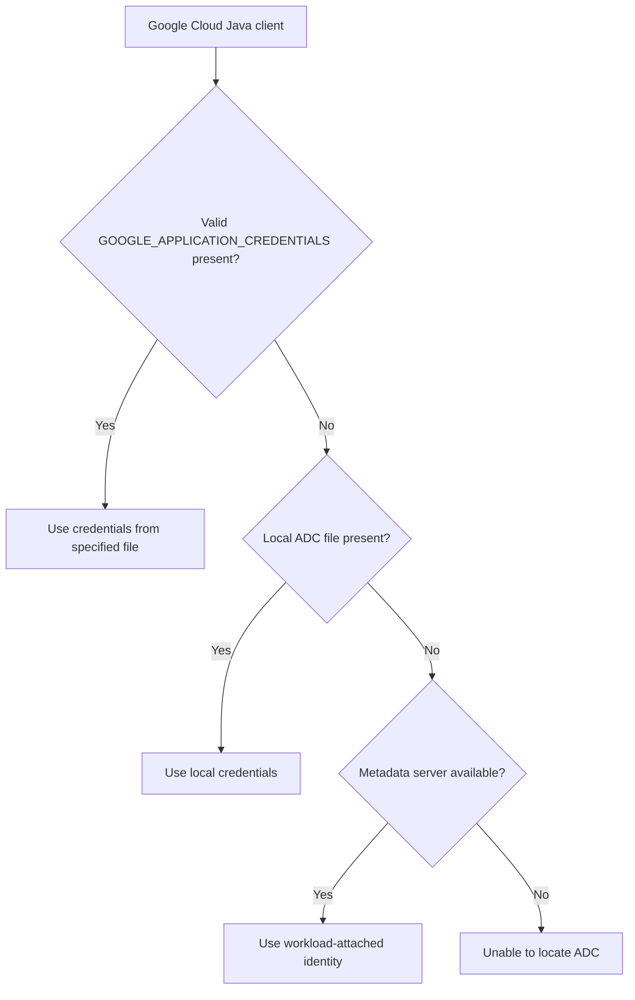

# Credential Chains and Identity Selection Order

When a Spring Boot application calls Amazon S3, Azure Blob Storage, or Google Cloud Storage, the client library must find **credentials** to represent the application. Developers often write a single line to instantiate a client and let the SDK locate credentials automatically. This approach is convenient, but it raises an important question: **if multiple identity sources coexist, which one will the SDK pick?**

In the **SPRING_CLOUD_PROVIDER_INTEGRATION** module, we practice integrating Spring Boot with managed services on AWS, Azure, and Google Cloud via the corresponding Spring Cloud libraries. Understanding the *credential chain* helps applications behave consistently from developer machines to CI/CD and production, protects secrets, supports testing storage/messaging/data integrations, and speeds up troubleshooting when an SDK unexpectedly uses the wrong identity.

## 1. Learning Objectives

After this lesson, you will be able to:

- Explain what a *credential provider*, *credential chain*, *principal*, and credential lookup precedence order are.
- Describe common credential sources in **AWS SDK for Java 2.x**, **Azure Identity for Java**, and **Google Cloud Application Default Credentials (ADC)**.
- Predict which identity gets selected when environment variables, local profiles, and workload identities are configured at the same time.
- Distinguish between **failing to find credentials** and **authenticating with valid credentials that lack permissions** on cloud resources.
- Configure and verify credential resolution in a Spring Boot application without placing access keys, client secrets, or access tokens in source code or logs.

## 2. What Problem Does a Credential Chain Solve?

A **credential provider** is a component that knows how to retrieve credentials from a specific source—for example, reading environment variables, reading a developer configuration file, receiving a workload token, or querying a cloud instance's metadata service.

A **credential provider chain** is an ordered list of providers. The SDK tries supported sources in sequence until it obtains usable credentials. This allows the same Java program to run across environments without embedding static secrets directly in the application.

A **principal** is the identity recognized by the cloud service from those credentials: an IAM role/session in AWS, a managed identity or service principal in Azure, or a service account/authorized user in Google Cloud. Credentials may be an access key and secret key, an expiring token, temporary session credentials, or a configuration used to exchange for a token; **not every source contains a static secret key**.



**Two rules to remember:**

1. **Credential selection order is separate from resource authorization.** A provider may return completely valid credentials for a *different* account or a principal that *lacks permissions*. SDKs generally **do not fall back to the next provider simply because the target service returned `403` or `AccessDenied`**.
2. **Ordering is a property of the library and its version.** Do not assume all three clouds use the exact same chain, or that one ordering diagram applies forever across all releases. Azure in particular may add or adjust developer-tool credential sources between versions.

For example, a developer is signed into the `team-dev` profile, but their terminal still has `AWS_ACCESS_KEY_ID` and `AWS_SECRET_ACCESS_KEY` from a sandbox account. By default, AWS SDK for Java 2.x checks environment variables before shared profiles. The application starts without errors, yet S3 calls run under an unexpected identity.

## 3. Overview of the Three Default Mechanisms

| Criterion | AWS | Azure | Google Cloud |
| --- | --- | --- | --- |
| Common mechanism in Java | `DefaultCredentialsProvider` in AWS SDK for Java 2.x | `DefaultAzureCredential` in the `azure-identity` library | **Application Default Credentials (ADC)**, e.g., `GoogleCredentials.getApplicationDefault()` |
| Developer sources | System properties, environment variables, shared profile, IAM Identity Center/SSO per profile | Credentials from environment, IDE/CLI tools supported by the SDK | Local ADC file created by `gcloud auth application-default login` |
| Workload sources | Web identity, container credentials, EC2 instance profile | Workload identity, managed identity | Compute metadata server or Workload Identity Federation configuration |
| Authentication artifact | Access key/secret and session token, or short-lived credentials via role/STS | OAuth 2.0 access token obtained from Microsoft Entra ID | OAuth 2.0 access token or credentials used by Google client libraries to fetch tokens |
| Settings prone to wrong identity selection | `AWS_ACCESS_KEY_ID`, `AWS_PROFILE`, `AWS_ROLE_ARN` | `AZURE_CLIENT_ID`, `AZURE_TENANT_ID`, `AZURE_CLIENT_SECRET` | `GOOGLE_APPLICATION_CREDENTIALS` |
| Preferred production mode | IAM role attached to the runtime environment | Managed identity or workload identity | Workload service identity or Workload Identity Federation |

Spring Cloud AWS, Spring Cloud Azure, and Spring Cloud GCP libraries typically integrate with or auto-configure clients on top of the underlying cloud credential mechanism. **Manually configuring credential or client beans in Spring** can alter how the SDK resolves identity. Therefore, you must inspect both your Spring configuration and the actual credential provider used by the client.

## 4. AWS: DefaultCredentialsProvider in SDK for Java 2.x

In **AWS SDK for Java 2.x**, `DefaultCredentialsProvider` checks sources in the general order shown below. Supported profiles can themselves trigger more advanced mechanisms (IAM Identity Center/SSO, assume role, credential process, etc.).

| Order | Provider/Source | Configuration Indicators | Common Scenarios |
| --- | --- | --- | --- |
| 1 | Java system properties | `aws.accessKeyId`, `aws.secretAccessKey`, optionally `aws.sessionToken` | Launching the JVM with `-D...` |
| 2 | Environment variables | `AWS_ACCESS_KEY_ID`, `AWS_SECRET_ACCESS_KEY`, optionally `AWS_SESSION_TOKEN` | Shell, container, or CI with environment variables set |
| 3 | Web identity token | `AWS_WEB_IDENTITY_TOKEN_FILE`, `AWS_ROLE_ARN`, optionally `AWS_ROLE_SESSION_NAME` | EKS with IAM Roles for Service Accounts (IRSA), compatible federation environments |
| 4 | Shared AWS profile | `AWS_PROFILE` or `aws.profile`, `~/.aws/credentials` and `~/.aws/config` files | Local development; profiles may use SSO or assume role |
| 5 | Container credentials | E.g., `AWS_CONTAINER_CREDENTIALS_RELATIVE_URI` or `AWS_CONTAINER_CREDENTIALS_FULL_URI` | ECS task role, EKS Pod Identity, and container environments supporting credential endpoints |
| 6 | EC2 instance profile | Temporary credentials from the **Instance Metadata Service (IMDS)** | EC2 with an IAM role attached to the instance |

### 4.1. Reasoning About the Order



This diagram illustrates the **lookup order**, not that data must pass through every step. Once a source supplies credentials, the SDK typically uses those credentials for requests. When a source cannot supply credentials, the chain may move on to the next source depending on the provider's error handling. Once selected, API calls can reuse the provider and automatically refresh temporary credentials when needed.

Local example:

```powershell
$env:AWS_PROFILE = "team-dev"
$env:AWS_ACCESS_KEY_ID = "..."
$env:AWS_SECRET_ACCESS_KEY = "..."
```

With the default AWS SDK for Java 2.x behavior, **environment credentials are evaluated before shared profiles**. Thus `AWS_PROFILE=team-dev` does not force the application to use the `team-dev` profile when valid access keys exist in environment variables. The `...` values are placeholders for illustration, not real credentials.

For workloads running on EKS, distinguish **IRSA** (web identity token) from **EKS Pod Identity** (credentials served via a container credential endpoint). Both issue temporary credentials for an IAM role, but they activate different stages in the default chain. ECS typically uses a task role; EC2 uses an instance profile. There is no need to bake long-lived IAM access keys into Docker images to use these mechanisms.

### 4.2. Creating a Spring Boot Client Using the Default Chain

Example using AWS SDK for Java 2.x in a Spring Boot application; you need the appropriate SDK dependencies and service region configuration:

```java
@Configuration
public class AwsClientConfiguration {

    @Bean
    S3Client s3Client() {
        return S3Client.builder()
                .region(Region.AP_SOUTHEAST_1)
                .credentialsProvider(DefaultCredentialsProvider.create())
                .build();
    }
}
```

There are no access keys in the code. The same bean can use a local AWS profile, an ECS/EKS IAM role, or an EC2 instance profile **depending on which sources are present and their precedence**. If Spring Cloud AWS already auto-configures `S3Client`, configure it manually only when you have a clear reason; a custom bean can override the starter's default configuration path.

To verify the AWS principal of the credentials **actually being used**, you can call STS `GetCallerIdentity` using the **same credential provider** as the client:

```java
AwsCredentialsProvider provider = DefaultCredentialsProvider.create();

try (StsClient sts = StsClient.builder()
        .region(Region.AP_SOUTHEAST_1)
        .credentialsProvider(provider)
        .build()) {
    GetCallerIdentityResponse who = sts.getCallerIdentity();
    System.out.println("AWS principal ARN: " + who.arn());
    System.out.println("AWS account ID: " + who.account());
}
```

In a real application, inject the **same provider bean** into the client being inspected rather than instantiating a separate provider on a debug path and assuming both clients pick the same source. The ARN/account ID may be written to controlled diagnostic logs; **never log `secretAccessKey`, session tokens, or authentication tokens**. Running `aws sts get-caller-identity` in the terminal is also helpful, but it only reflects the credentials of that CLI process and does not prove the identity used by a JVM running in another context.

## 5. Azure: DefaultAzureCredential and Workload Identity Sources

In Java, `DefaultAzureCredential` from the **Azure Identity** library combines multiple ways of obtaining an access token. The chain typically checks production-suited sources first, then falls back to developer-tool credentials. **The exact list of providers and error-continuation behavior depend on the `azure-identity` version**, so consult the documentation for your project's version when diagnosing exact ordering.

Key source groups:

| Source Group | Configuration or Context | Represented Identity |
| --- | --- | --- |
| `EnvironmentCredential` | E.g., `AZURE_TENANT_ID`, `AZURE_CLIENT_ID`, `AZURE_CLIENT_SECRET` are all set | Service principal in Microsoft Entra ID |
| `WorkloadIdentityCredential` | Workload has a federated token file, e.g., AKS Workload Identity with `AZURE_FEDERATED_TOKEN_FILE` and tenant/client details | Entra identity federated with the workload |
| `ManagedIdentityCredential` | Workload on an Azure service with managed identity such as App Service or VM | System-assigned or user-assigned managed identity |
| Developer credentials | Depending on version and environment: Azure CLI, Azure Developer CLI, Azure PowerShell, or IDE credentials | Developer identity signed into the corresponding tool |

Do not treat this table as a guarantee of every internal slot in the chain: some developer providers appear or are absent depending on the SDK, platform, and included dependencies. `DefaultAzureCredential` may also stop early when a workload credential source is configured but fails to authenticate, rather than always falling back to a developer account.

### 5.1. Two Common Precedence Pitfalls

**Scenario A — Azure App Service has managed identity enabled, but service principal environment variables remain.** If the environment supplies all variables for a service principal, `EnvironmentCredential` can obtain a token before the chain reaches managed identity. The application then runs as the environment's service principal, even though managed identity is enabled on App Service. Check the deployed `AZURE_*` variables and which source the SDK selected.

**Scenario B — AKS with Workload Identity.** The Pod is configured with a federated token projected by Kubernetes; Azure Identity exchanges that token for an access token of the federated Entra identity. Simply mounting a federated token file or setting `AZURE_CLIENT_ID` alone is **not enough** to conclude the entire chain is validly configured. You must verify the link between the Pod's service account, the federated identity credential, and the client ID/tenant ID.

### 5.2. Spring Boot with DefaultAzureCredential

Example extracting credentials into a bean so all Azure clients share the same configured source:

```java
@Configuration
public class AzureClientConfiguration {

    @Bean
    TokenCredential azureTokenCredential() {
        return new DefaultAzureCredentialBuilder().build();
    }

    @Bean
    BlobServiceClient blobServiceClient(TokenCredential azureTokenCredential) {
        return new BlobServiceClientBuilder()
                .endpoint("https://myaccount.blob.core.windows.net")
                .credential(azureTokenCredential)
                .buildClient();
    }
}
```

When running on Azure with a **user-assigned managed identity**, you must explicitly specify the client ID in the manner supported by your SDK version. When you need to strictly enforce that the application **only** uses managed identity, you can construct the credential explicitly:

```java
TokenCredential managedIdentity = new ManagedIdentityCredentialBuilder()
        .clientId("<user-assigned-managed-identity-client-id>")
        .build();
```

This code is meant for **Azure environments that support managed identity**; it does not replace how developers obtain credentials locally. The `<...>` value is a configuration placeholder supplied by the environment—do not hardcode client IDs in shared libraries. Managed identities still require appropriate **Azure RBAC/data-plane roles** for storage, messaging, or Key Vault. Having a valid token does not imply having access to the resource.

To see which source `DefaultAzureCredential` picked, enable **Azure Identity** diagnostic logging in a test environment and read the messages showing which provider was tried or rejected; redact sensitive details before storing logs. Running `az account show` reveals the Azure CLI login in your terminal, **not** whether the Java client used Azure CLI if the chain picked environment, workload identity, or managed identity first.

## 6. Google Cloud: Application Default Credentials (ADC)

Google Cloud client libraries for Java typically use **ADC** to locate credentials. Unlike the multi-provider chains in AWS and Azure, the standard ADC lookup order has three main groups, in exact order:

1. **`GOOGLE_APPLICATION_CREDENTIALS` environment variable:** path to a credential configuration file supported by the Google Auth Library. This file may be a Workload Identity Federation configuration or service account info; JSON private key files for service accounts should be avoided because they contain long-lived secrets.
2. **Local ADC file:** credentials created via `gcloud auth application-default login` (typically representing a developer account, or an impersonation configuration when properly configured).
3. **Google Cloud environment metadata server:** e.g., the service identity/service account attached to Compute Engine, Cloud Run, or GKE. On GKE, Workload Identity Federation can be configured so workloads obtain the appropriate identity.



Do not misread the diagram as "the SDK will fall back to metadata when credentials from the selected file get `PermissionDenied`." Once the selected credentials are valid enough to send a request, an IAM permission failure on that request **does not trigger** selecting another identity.

### 6.1. Two Different gcloud Logins

```bash
# Log in so gcloud CLI executes commands with the developer account:
gcloud auth login

# Create/update Application Default Credentials for apps using ADC:
gcloud auth application-default login
```

These two commands serve separate credential stores. `gcloud auth login` **does not guarantee** the Java library uses the same principal. When `GOOGLE_APPLICATION_CREDENTIALS` points to a credential file, that file is evaluated **before** local ADC. That explains why a developer can log into ADC with account A while the application accesses resources under service account B.

`GOOGLE_CLOUD_PROJECT`, the project ID configured on the client, and the **credential's principal** are also separate concepts: changing only the target project does not automatically change the service account or identity used to call the API.

### 6.2. Creating a Google Cloud Storage Client in Spring Boot

```java
@Configuration
public class GoogleStorageConfiguration {

    @Bean
    Storage storage(@Value("${app.gcp.project-id}") String projectId)
            throws IOException {
        GoogleCredentials credential = GoogleCredentials.getApplicationDefault();

        return StorageOptions.newBuilder()
                .setCredentials(credential)
                .setProjectId(projectId)
                .build()
                .getService();
    }
}
```

This example clearly separates the **credentials resolved by ADC** from the **target project declared by the application**. Spring Cloud GCP starters can auto-configure clients, credentials, and project IDs through their own mechanisms; when creating beans manually, ensure all clients share the intended configuration. `IOException` here reflects failing to load ADC; valid credentials can still be rejected by Google Cloud IAM when calling storage.

In production, prefer a workload-attached service identity or Workload Identity Federation. Avoid copying local service account key files into images or containers. If you must use a credential configuration file for federation, distinguish an **identity-exchange configuration file** from a **private key file**, and manage the path properly for the runtime environment.

## 7. Which Credentials Get Selected in Each Environment?

With the exact same Spring Boot code, the effective identity can differ across deployment targets:

| Environment | Typical AWS | Typical Azure | Typical Google Cloud |
| --- | --- | --- | --- |
| Developer's local machine | Shared profile, IAM Identity Center, or test credentials | Azure CLI/IDE credentials or corresponding developer source | Local ADC from `gcloud auth application-default login` |
| CI/CD | Federation/OIDC to obtain role credentials; sometimes dedicated config source | Federated service principal/workload identity | Workload Identity Federation from CI system |
| Production container/compute | ECS task role, EKS IRSA/Pod Identity, EC2 role | AKS Workload Identity, App Service/VM managed identity | Service account/Workload Identity Federation via metadata |

This table describes what **should be deployed**; it does not guarantee which identity gets picked if higher-priority system properties, environment variables, or credential files are already present.

### 7.1. Guidelines for Choosing Identities by Environment

- **Local:** developers should use narrowly scoped identities in the dev environment; never share access keys. Profiles or CLI/ADC logins may be used. Leftover environment variables from previous projects should be checked.
- **CI/CD:** prefer OIDC/workload federation to obtain short-lived tokens or credentials, restricted by allowed repository, branch, workflow, and environment; use deploy identities with only the required permissions.
- **Production:** attach roles/managed identities/service identities directly to the runtime. Avoid making long-lived secrets the default setup because they are easy to leak, hard to rotate, and can override the intended runtime identity.
- **All environments:** separate identities across dev, staging, and production. Permissions on buckets, topics, queues, databases, and secrets must be evaluated separately once the right principal is confirmed.

### 7.2. When to Use Explicit Credentials Instead of the Default Chain?

The default chain is helpful when one codebase must run across multiple environments and each environment is configured consistently. Conversely, the default chain can silently select an unwanted credential if a higher-priority source exists on the host.

You can choose a specific provider when **system requirements mandate a single source**. For example, Azure production must only use managed identity, local AWS testing must run against a specific profile, or an application needs controlled impersonation/service account delegation. When doing so, decide it cleanly in the client configuration layer and pair it with verification checks; **never** hardcode secret keys in the name of being "explicit."

## 8. Common Identity-Mismatch Scenarios

| Symptom | Possible Cause | How to Verify and Fix |
| --- | --- | --- |
| Local AWS still uses account A despite `AWS_PROFILE` being B | Java system properties or `AWS_ACCESS_KEY_ID`/`AWS_SECRET_ACCESS_KEY` are set and evaluated before profile | Check higher-precedence sources; call `GetCallerIdentity` with the same provider or use `ProfileCredentialsProvider` for controlled local runs |
| AWS ECS/EKS/EC2 uses the wrong role | Static credentials in env or system properties are selected before runtime role | Remove long-lived credentials from runtime, verify token/endpoint source matching the deployment mechanism |
| Azure App Service has managed identity but uses service principal | `EnvironmentCredential` has full config and is selected earlier | Check `AZURE_*` env vars, Azure Identity logs, and client config; remove unintended source |
| Local Azure cannot use CLI login | Workload source misconfigured, or developer credential unavailable/unsupported | Inspect which credential failed, actual SDK version chain, and tool login status |
| Google Cloud app uses an unfamiliar service account | `GOOGLE_APPLICATION_CREDENTIALS` points to a file with higher priority than local ADC/metadata | Inspect config file path and principal in audit logs, fix the environment variable |
| Local GCP CLI works but Java is denied | `gcloud auth login` and ADC use different stores, or Java runs under another identity | Inspect `gcloud auth application-default` and the Java client's actual source |
| SDK finds credentials but storage call returns `403` | Principal lacks permission, wrong bucket/account/project, or blocked by another policy | Cross-check actual principal against resource, operation, IAM/RBAC, and network/KMS if applicable; do not add new access keys just to "test" |

**Distinguishing four error types:**

1. **No credentials found:** the chain exhausted all sources with no usable credentials. Check the provider chain, local/runtime config, metadata endpoint, and workload binding.
2. **Source configured but cannot issue credentials:** expired token, invalid federated token, wrong tenant/client ID, corrupted credential file, or insufficient file read permissions. Some SDKs stop at a misconfigured source instead of switching to another account.
3. **Well-formed credentials, unexpected principal:** the SDK successfully authenticated as another account/role; requests may succeed against the wrong resource or be denied on the right resource. This is dangerous because it does not always throw an exception.
4. **Right principal, missing permissions:** fix the policy/role/scope on the workload or resource; changing chain precedence will not address the root cause.

## 9. Diagnosing Credential Precedence in a Spring Boot App

When an application returns `AccessDenied`, `Forbidden`, `permission denied`, or fails to initialize a client, trace the **credentials actually selected** before loosening permissions.

### Step 1 — Record the runtime environment and present sources

Identify whether the application is running locally, in a CI container, ECS/EKS/EC2, Azure App Service/AKS, or Cloud Run/GKE. Check for **the presence of variable names**, config paths, Java system properties, profiles, and metadata/workload bindings. Never print access keys, client secrets, tokens, or JSON credential contents to terminals or logs.

Groups easy to inspect:

```text
AWS:
  aws.accessKeyId (JVM system property)
  AWS_ACCESS_KEY_ID, AWS_SECRET_ACCESS_KEY, AWS_SESSION_TOKEN
  AWS_PROFILE, AWS_ROLE_ARN, AWS_WEB_IDENTITY_TOKEN_FILE
  AWS_CONTAINER_CREDENTIALS_RELATIVE_URI / FULL_URI

Azure:
  AZURE_TENANT_ID, AZURE_CLIENT_ID, AZURE_CLIENT_SECRET
  AZURE_FEDERATED_TOKEN_FILE
  Managed identity configuration and IDE/CLI login credentials

Google Cloud:
  GOOGLE_APPLICATION_CREDENTIALS
  Local ADC file, metadata server, runtime service account
  GOOGLE_CLOUD_PROJECT / project ID specified by client
```

Seeing **a variable name exist** does not prove the credentials are valid or that it is the final chosen provider; for example, an environment credential group may be missing a required field.

### Step 2 — Verify the provider/principal used inside the JVM

- **AWS:** using the exact same `AwsCredentialsProvider`, call STS `GetCallerIdentity` in a diagnostic environment or correlate request logs/CloudTrail. Avoid instantiating a separate STS client with a different provider and drawing conclusions for the S3 client.
- **Azure:** enable Azure Identity diagnostic logging at an appropriate level in a safe environment to see which credential sources were attempted and which succeeded in acquiring a token. Cross-check client ID/tenant ID and service/Entra logs as needed. Never log raw access tokens.
- **Google Cloud:** verify whether ADC came from an env file, local ADC, or metadata; correlate the service account/principal in Cloud Audit Logs. With external accounts/federation, distinguish the underlying principal from the delegated target identity.

### Step 3 — Check permissions and resources after confirming the right identity

Match **principal + operation + resource + scope/conditions**. For instance, uploading a new file requires different permissions than listing a bucket, reading an object, or deleting an object. On Azure, a token may be valid while lacking a *data plane* role on Blob Storage. On AWS and Google Cloud, a valid identity can still hit an explicit deny or miss permissions on the target bucket.

### Step 4 — Lock down the required configuration and re-test

Remove unintended higher-precedence credential sources; choose an explicit provider if explicitly required. Redeploy to a test workload, verify the chosen credentials, and test **one allowed action** alongside **one action that must be denied**. Only then roll out to production.

## 10. Hands-On Exercise: Tracing Why an Environment Picks the Wrong Identity

**Context:** `invoice-service` is a Spring Boot service that saves files to storage and publishes a message after writing succeeds. The dev team uses the same codebase for local and staging. Requirement: each environment must use its own separate principal granted least-privilege access to its respective storage/messaging resources.

Pick **one cloud** as your main lab; use the other two clouds to compare against the table below. Test on sandbox resources—never use production secrets or principals.

| Case | Setup | Prediction | What to Verify |
| --- | --- | --- | --- |
| A — Local AWS | Profile `dev` exists alongside valid `AWS_ACCESS_KEY_ID`/`AWS_SECRET_ACCESS_KEY` of another test identity | Environment is evaluated before profile | Does `GetCallerIdentity`'s principal match the expected credentials? |
| B — AWS runtime | Remove static credentials, provide IAM role via compute/workload | SDK uses the corresponding role credentials once earlier sources yield none | Principal ARN and permissions on test resources |
| C — Azure | Managed identity is enabled while complete service principal env vars are also present | Environment credential may be picked before managed identity | Selected Azure Identity provider, tenant/client ID, data-plane permissions |
| D — Local Google Cloud | `GOOGLE_APPLICATION_CREDENTIALS` points to a test credential config alongside developer's ADC file | File specified by env is evaluated before local ADC | Principal in audit logs, target bucket/project |
| E — Any cloud | Valid credentials exist, but call targets an unpermitted resource | Authentication can succeed; operation is rejected for permissions | SDK does not look up another credential merely because request returned `403` |

For each case, record: **predicted credential source**, **observed source**, **actual principal**, **resource**, **operation**, and **API result**. If you do not have a live cloud environment available, you can analyze simulated configurations and test client construction; however, only testing against real resources confirms server-side IAM/RBAC permissions.

### Analysis Questions

1. If `AWS_PROFILE` points to the `staging` profile, but `AWS_ACCESS_KEY_ID`/`AWS_SECRET_ACCESS_KEY` are set, which provider in AWS SDK for Java 2.x is evaluated first? Why?
2. Why is enabling managed identity on Azure App Service not sufficient proof that the application is actually using it?
3. How do `gcloud auth login` and `gcloud auth application-default login` differ during principal selection for a Java client?
4. An upload request returns `403` after the SDK already obtained a token: should you inspect the credential chain or the policy first, and why must you confirm the actual principal?
5. How do you design CI/CD and production setups to minimize the risk of developer or stale environment credentials overriding workload identities?

## 11. Takeaways for Integrating Managed Services

**The credential chain determines which credentials an application uses; IAM/RBAC determines what that principal can do on storage, queues, topics, databases, or secrets.** AWS, Azure, and Google Cloud all support automatic credential resolution, but their sources and lookup orders differ. Whenever you switch environments, add a Spring Cloud starter, or introduce configuration variables, verify the client's actual principal before troubleshooting resource permissions. Prefer temporary credentials and workload identities, isolate identities per environment, keep secrets out of source code, and grant only the permissions required.
