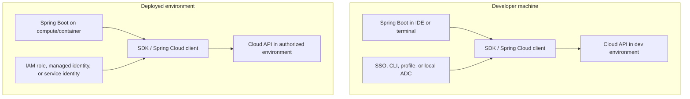
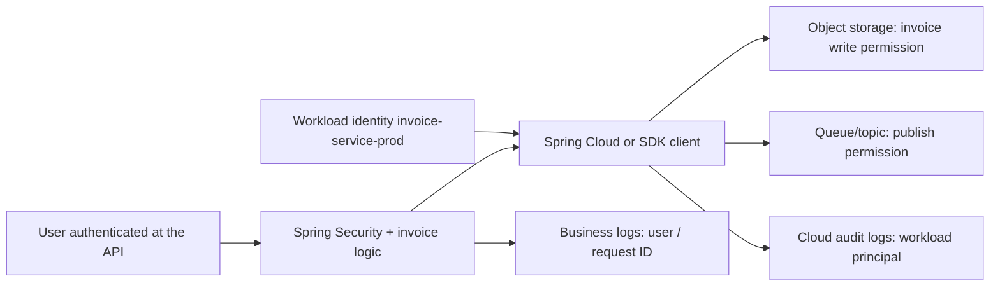

# Developer Identity on Local Machines vs. Application Identity at Deployment

A Spring Boot application might read objects from Amazon S3 on a developer's laptop, yet receive `AccessDenied` when running on Amazon ECS. The same application might upload files to Azure Blob Storage when using `az login`, yet fail after deploying to Azure App Service. On Google Cloud, `gcloud` commands may succeed while the Java client cannot find credentials. These symptoms usually stem from one key difference: **the developer's identity on a local machine is not the deployed application's identity**.

In the **SPRING_CLOUD_PROVIDER_INTEGRATION** module, the goal is to practice integrating Spring Boot with managed services from AWS, Azure, and Google Cloud via the corresponding Spring Cloud libraries: storage, messaging, data, and secret managers. This lesson in the **Identity and Access** chapter explains how to choose, authorize, and verify identities across local, CI/CD, and live runtime environments—helping avoid long-lived secrets or carrying personal account privileges into production.

## 1. Learning Outcomes

After this lesson, you will be able to:

- Distinguish between developer identity, workload identity, CI/CD pipeline identity, and end-user identity.
- Explain why the exact same Java code and SDK can resolve different principals locally versus in production.
- Establish an authentication setup for AWS, Azure, and Google Cloud without embedding access keys, client secrets, or private keys in repositories.
- Grant least-privilege permissions to applications by service, operation, and environment rather than copying developer privileges.
- Verify the **actual principal** when Spring Boot calls a cloud service and troubleshoot "works locally, fails when deployed" cases.
- Design integration tests to catch identity mismatches or overly broad scopes before release.

## 2. Four Identities Often Present in the Same System

Suppose `invoice-service` is a Spring Boot API that receives a request to create an invoice, saves JSON to object storage, and emits a message for downstream processing.

| Subject | Where Does It Appear? | Purpose | Appropriate Permissions |
| --- | --- | --- | --- |
| **Developer identity** | Laptop, IDE, terminal, local environment | Testing cloud APIs, debugging, and running integration tests in dev | Only required dev/test resources; typically authenticated via SSO/CLI/ADC |
| **Deployed application (workload identity)** | ECS/EKS/EC2, App Service/AKS, Cloud Run/GKE/Compute Engine | Allowing the Spring Boot process to access cloud resources while serving requests | Exact operations on storage, queues, databases, and secrets for its runtime environment |
| **Deployment pipeline (CI/CD identity)** | GitHub Actions, GitLab CI, Azure Pipelines, or other runners | Building, testing, pushing images, and deploying infrastructure/software | Deployment and test permissions separated from runtime permissions |
| **End-user identity** | Browser/mobile calling the API; Spring Security handles JWT/session | Controlling who can create/view invoices in business logic | Application permissions per user/role/tenant; does not automatically become workload IAM/RBAC |

A developer account may hold broad deploy and debug permissions in the dev environment. That **does not** mean `invoice-service` should receive the same permissions when running 24/7. A workload only needs the permissions it actually executes at machine speed: writing objects in a designated bucket, sending messages to a specific queue/topic, reading specific secrets, and connecting to designated data sources.

**Authentication** answers "Who is calling the cloud API?" **Authorization** answers "Which operations on which resources is that principal allowed to perform?" A valid identity does not guarantee sufficient permissions; developer credentials working locally also do not guarantee the runtime application holds the same permissions.

## 3. Why Does the Same Source Code Have Two Identities?

Most Java SDKs and Spring Cloud starters support a **default credential resolution chain**. When creating a cloud client, the library searches for credentials from its surroundings: environment variables, local profiles/credential files, developer tool logins, or a workload credential/token endpoint.



The code can remain identical, while the **credential source** differs. For example:

- Locally, the AWS SDK reads a profile the developer logged into via IAM Identity Center; on ECS, the SDK can obtain temporary credentials from a **task role**.
- Locally, the Azure SDK acquires a token from an `az login` account; on Azure App Service, the SDK can obtain a token from the **managed identity** enabled for the application.
- Locally, Google Cloud client libraries read **Application Default Credentials (ADC)** created by the developer; on Cloud Run, the library can obtain credentials for the **service account attached to the service** via the runtime environment.

What to watch for: "automatic SDK selection" is only reliable when the environment is properly configured. A leftover environment variable can be evaluated **before** the intended workload identity or profile. Moreover, a successful login does not prove the chosen identity has permission on the target bucket/container/queue.

## 4. Developer Identity on Local Machines

### 4.1. Role and Boundaries

On a local machine, developers must prove their identity to test connectivity, read sample data, or run integration tests. Prefer interactive sign-in mechanisms, organizational identity federation, and time-limited credentials. Avoid requiring each developer to store a multi-month access key, client secret, or service account JSON key.

Developer permissions should be separated by environment: appropriate dev or sandbox accounts/roles, restricting actions that could delete data or access production secrets. A developer who holds broad administrative rights in dev should not run the local app with those privileges if a test only needs to upload an object and publish a message.

### 4.2. AWS: Profiles and Developer Login Sessions

A common workflow is configuring an organizational profile using **AWS IAM Identity Center** (SSO), logging in, and running the application with that profile. The illustrative commands below assume a `team-dev` profile is configured:

```bash
# Log in using the profile for the development environment.
aws sso login --profile team-dev

# Verify the principal of this AWS CLI session.
aws sts get-caller-identity --profile team-dev
```

Run Spring Boot with `AWS_PROFILE=team-dev` when the runtime environment has no higher-priority credential sources. Example in PowerShell:

```powershell
$env:AWS_PROFILE = "team-dev"
.\mvnw.cmd spring-boot:run
```

**Important pitfall:** In AWS SDK for Java 2.x, Java system properties and variables such as `AWS_ACCESS_KEY_ID`/`AWS_SECRET_ACCESS_KEY` are evaluated before shared profiles in `DefaultCredentialsProvider`. Thus, merely setting `AWS_PROFILE` **does not guarantee** the JVM uses that profile if the terminal or IDE already has valid access keys set. `aws sts get-caller-identity --profile ...` also only verifies the principal of that CLI command; the Java client may pull credentials from another source. To verify the JVM's identity, inspect the provider actually in use and the application's own principal.

### 4.3. Azure: Credentials from a Developer Account

When running locally, a developer can sign into the Azure CLI with an organizational account:

```bash
az login
az account show --query "{name:name, id:id, tenantId:tenantId}" --output json
```

In supported environments, Azure Identity's `DefaultAzureCredential` can acquire a token from the Azure CLI session or another developer tool. However, **the exact order and available providers depend on the SDK version**; if a complete set of service principal environment variables is configured, the chain may pick that source before the developer account.

A successful CLI login only proves the developer has a working CLI session. To access Blob Storage with an Entra ID token, the principal selected by the Java client still needs an appropriate **data-plane** role such as `Storage Blob Data Contributor` on the target storage account/container. The resource-management `Contributor` role does not automatically grant Entra ID blob data access.

### 4.4. Google Cloud: ADC for Applications

With Google Cloud, the identity used by the `gcloud` CLI and the credentials used by Java client libraries **do not necessarily match**. When local ADC is needed:

```bash
# Login session for applications using Google Auth Library/ADC.
gcloud auth application-default login

# Different from the account login command for gcloud CLI:
gcloud auth login
```

ADC searches for credentials in the standard order: the file pointed to by `GOOGLE_APPLICATION_CREDENTIALS`, then the local ADC file, and finally workload metadata server credentials where supported. A leftover `GOOGLE_APPLICATION_CREDENTIALS` variable causes the Java client to prioritize that file over a freshly logged-in local ADC session. If that file is a service account private key, it also introduces a long-lived secret exposure risk; prefer local login or appropriate federation.

Developers should only hold permissions on development projects and buckets. `gcloud config set project` or configuring a client project ID changes the **target project**, not the ADC principal itself.

## 5. Deployed Application Identity

Production has no human sitting around signing in interactively every time a container restarts. Instead, the cloud platform issues short-lived credentials or tokens to the **workload identity** attached to the runtime environment; the SDK receives and refreshes them through supported mechanisms.

| Cloud / Runtime | Typical Workload Identity | How Java SDK Gets Credentials | What Must Be Configured Before Deployment |
| --- | --- | --- | --- |
| AWS ECS | **Task role** | ECS container credential endpoint | Attach task role and least-privilege policy; distinguish task role from execution role |
| AWS EC2 | **IAM role via instance profile** | EC2 Instance Metadata Service (IMDS) | Attach instance profile and appropriate IAM policy |
| AWS EKS | **IAM Roles for Service Accounts (IRSA)** or **EKS Pod Identity** | Web identity token/STS or container credential endpoint depending on mechanism | Link Kubernetes service account/Pod to IAM role, trust policy, and permissions |
| Azure App Service/VM | System-assigned or user-assigned **managed identity** | Azure Identity fetches access token from environment endpoint | Enable/assign identity and role assignment on target resources |
| Azure AKS | **Microsoft Entra Workload ID** | Workload identity federation with Kubernetes token | Configure service account, federated identity credential, and Entra identity permissions |
| Google Cloud Run / Compute Engine | **Workload-attached service account** | ADC via the environment's metadata service | Select service account and grant IAM role on the target resources |
| Google Kubernetes Engine | **Workload Identity Federation for GKE** | Credentials issued by the configured workload/metadata mechanism | Configure Pod/Kubernetes service account identity and required IAM bindings |

These columns describe **common identity mechanisms**; they do not guarantee the SDK will select them if a higher-precedence credential source is present. On AWS, an access key pair in env vars can override ECS/EKS/EC2 roles. On Azure, an environment service principal can override managed identity. On Google Cloud, `GOOGLE_APPLICATION_CREDENTIALS` can override metadata credentials.

### 5.1. Separating Application Runtime Permissions from Deployment Permissions

Example on ECS:

- **ECS task execution role** is for tasks involved in preparing and running the container, such as pulling images or shipping logs as configured.
- **ECS task role** is the principal typically used by the application inside the container when calling S3, SQS, or Secrets Manager.

Do not confuse these two roles: granting `s3:PutObject` to the execution role when the app needs permissions on the task role will not fix the Java SDK's lack of object-write permission. Likewise, a CI/CD identity authorized to update services or deploy images is not automatically the principal executing storage calls once the container is running.

### 5.2. Why Use Runtime-Attached Identities?

- **No static key distribution:** the SDK obtains credentials/tokens from the platform, reducing the risk of secrets being copied into configuration files or images.
- **Automatic credential refresh:** short-lived credentials/tokens are renewed via SDK and platform mechanisms, avoiding manual per-instance secret rotation.
- **Centralized, auditable permissions:** modify a workload's IAM/RBAC bindings without changing source code; audit logs identify the principal calling the resource.
- **Environment isolation:** production and staging use distinct identities, even when the Docker image contains the exact same Java code.

Short-lived credentials **do not by themselves guarantee** application security if the IAM policy is overly broad, the metadata endpoint can be abused, or the workload is compromised. Least privilege, environment isolation, network controls, and runtime hardening remain essential.

## 6. Comparing the Three Clouds Using the `invoice-service` Scenario

`invoice-service` needs to create `invoices/2026/INV-001.json` and publish an `invoice.created` event. Resources are provisioned separately for `dev`, `staging`, and `prod`.

| Environment and Purpose | AWS | Azure | Google Cloud |
| --- | --- | --- | --- |
| **Local dev** testing uploads | Developer logs into IAM Identity Center, using a profile with permissions only on the dev bucket | Developer uses Entra account via Azure CLI/IDE, with data role on the dev blob container | Developer uses ADC with Cloud Storage permissions on the dev bucket |
| **CI** running integration tests | Temporary pipeline role, via OIDC/federation where supported | Federated CI workload/service principal with test permissions | CI Workload Identity Federation on the test project |
| **Prod runtime** serving live requests | IAM task/Pod/instance role of `invoice-service-prod` | Managed identity/workload identity of `invoice-service-prod` | Service account/workload identity of `invoice-service-prod` |
| **Prod storage write permission** | `s3:PutObject` on target object ARN and prefix | Data role or custom blob data action at the appropriate scope | `storage.objects.create` on target bucket, e.g., appropriate creator role |
| **Prod event publish permission** | `sqs:SendMessage` to queue or SNS publish permission if using SNS | Azure Service Bus Data Sender or appropriate role for the service used | `pubsub.topics.publish` on topic, e.g., Pub/Sub Publisher |

Storage and messaging have distinct permission sets. Being able to write an invoice does not prove the application has permission to publish an event. Database and secret manager access are also separate permissions; verify the exact subject, action, and resource in each environment.



This flow illustrates **two independent identities**: Spring Security uses the user's identity to determine who may create an invoice; the cloud SDK uses the application's identity to access storage and messaging. Without a dedicated *delegation/on-behalf-of* design, a user's JWT **does not automatically** turn into workload IAM permissions.

## 7. Organizing Spring Boot Configuration for Safe Environment Switching

Prefer designing clients around **default credential providers** controlled by the environment. Resource paths, regions, and project IDs belong to business/deployment configuration; secrets must live in properly authorized credential mechanisms or secret managers.

Example configuration containing no credentials:

```yaml
app:
  invoice-storage:
    bucket: ${INVOICE_BUCKET}
    key-prefix: invoices/
  events:
    destination: ${INVOICE_EVENT_DESTINATION}
```

In production, the deployment system supplies `INVOICE_BUCKET` and `INVOICE_EVENT_DESTINATION` for that environment. **Bucket/topic names are not credentials**; changing resource names also does not change the SDK's principal. Never put `AWS_SECRET_ACCESS_KEY`, `AZURE_CLIENT_SECRET`, or JSON private keys in this YAML.

### 7.1. AWS SDK for Java 2.x

Example Spring Boot bean using the default credential chain instead of hardcoding access keys:

```java
@Configuration
public class AwsStorageConfiguration {

    @Bean
    S3Client s3Client(@Value("${app.aws.region}") String region) {
        return S3Client.builder()
                .region(Region.of(region))
                .credentialsProvider(DefaultCredentialsProvider.create())
                .build();
    }
}
```

Locally, the app can use a logged-in profile if higher-precedence sources are unset. On ECS, the exact same bean can retrieve task role credentials. Beyond the code above, the application needs `app.aws.region` configured, the corresponding AWS SDK dependencies added, and an IAM policy attached to the actual runtime role.

If you use a **Spring Cloud AWS starter** that auto-configures `S3Client`, follow the integration pattern provided by that starter version; creating a bean manually here is only to illustrate the credential source, and any custom bean must be checked for its impact on auto-configuration.

### 7.2. Azure Identity and Blob Storage

```java
@Configuration
public class AzureStorageConfiguration {

    @Bean
    TokenCredential azureCredential() {
        return new DefaultAzureCredentialBuilder().build();
    }

    @Bean
    BlobServiceClient blobServiceClient(
            TokenCredential azureCredential,
            @Value("${app.azure.storage-endpoint}") String endpoint) {
        return new BlobServiceClientBuilder()
                .endpoint(endpoint)
                .credential(azureCredential)
                .buildClient();
    }
}
```

Locally, the chain can use developer login. On App Service, if managed identity is enabled and no other credentials take precedence, it can receive a token from the workload's managed identity. With a **user-assigned managed identity**, specify the exact client ID and configure Azure Identity accordingly; do not assume the runtime will automatically choose the intended identity when multiple identities are attached to the same environment.

If using a **Spring Cloud Azure starter**, you can rely on the starter's client/credential auto-configuration for your version. What still must be verified is **which principal owns the token** and whether that principal holds a data role on the target storage.

### 7.3. Google Cloud ADC

```java
@Configuration
public class GoogleStorageConfiguration {

    @Bean
    Storage storage(@Value("${app.gcp.project-id}") String projectId)
            throws IOException {
        GoogleCredentials credentials = GoogleCredentials.getApplicationDefault();

        return StorageOptions.newBuilder()
                .setProjectId(projectId)
                .setCredentials(credentials)
                .build()
                .getService();
    }
}
```

Local ADC can represent a developer; when deployed to Cloud Run, the client can obtain credentials from the metadata service tied to the service account running the app. Never package `GOOGLE_APPLICATION_CREDENTIALS` pointing to a service account key inside a container image, as this can cause ADC to bypass the runtime identity and expose a private key.

If using a **Spring Cloud GCP starter**, consult the credential/project ID configuration rules for your starter version. The example here demonstrates the Java client ADC principle rather than requiring a bean that duplicates auto-configuration.

### 7.4. Environment-Specific Configuration Without Mixing Principals

Spring profiles such as `dev`, `staging`, and `prod` select distinct endpoints, projects, regions, and resources. However, **Spring profiles do not automatically switch the cloud SDK's principal**. The following variables can cause the credential chain to select a different identity:

| Cloud | Configuration That Can Override Expected Identity | Risk to Watch For |
| --- | --- | --- |
| AWS | `AWS_ACCESS_KEY_ID`, `AWS_SECRET_ACCESS_KEY`, JVM `aws.accessKeyId`; web identity/profile per provider order | ECS/EKS/EC2 app may use env keys instead of the runtime IAM role |
| Azure | Full set of `AZURE_TENANT_ID`, `AZURE_CLIENT_ID`, `AZURE_CLIENT_SECRET` or workload identity config | `DefaultAzureCredential` may pick a service principal instead of managed identity |
| Google Cloud | `GOOGLE_APPLICATION_CREDENTIALS` pointing to a credential file | Java may use that file instead of local ADC or Cloud Run/GCE service account |

Never use environment variables holding long-lived keys as a "quick fix" for IAM errors. First determine which credentials are being picked and which role/policy is missing on the target resource.

## 8. Managing Permissions by Environment and Responsibility

The goal is to grant exact required permissions to **the identity executing the task**, not base them on whatever permissions the developer happens to hold.

| Workload | Actual Action | Permissions to Evaluate | Permissions to Exclude If Unneeded |
| --- | --- | --- | --- |
| `invoice-service-dev` | Create sample objects in dev storage | AWS `s3:PutObject`; matching Azure blob data action/role; GCP `storage.objects.create` | Modify or delete permissions on production storage |
| `invoice-service-prod` | Write invoices to production target | Object creation on exact bucket/container and prefix/scope where supported | Account/project/subscription-wide storage admin permissions |
| `invoice-events-prod` | Publish events | `sqs:SendMessage` / Service Bus sender / `pubsub.topics.publish` per service | Consume, delete queue/topic, or full messaging admin permissions |
| `invoice-secrets-prod` | Read secrets needed by the app | Secrets Manager/Key Vault/Secret Manager read or access at appropriate scope | Create, delete, or modify all organizational secrets |

Depending on the provider, a built-in role may grant more permissions than necessary; in such cases, consider a custom role/policy and a narrower scope. Permissions can also be affected by **explicit denies, IAM/RBAC conditions, network/firewalls, KMS encryption, organizational policies, or service limits**. Holding a storage-write role does not guarantee success if other conditions are unmet.

Plan around three principles:

1. **Separate identities by environment:** `dev`, `staging`, and `prod` have distinct principals; never use personal developer accounts as runtime identities.
2. **Separate identities by responsibility where helpful:** a service that only publishes messages does not need permission to read every secret or entire database.
3. **Keep permission grants in managed infrastructure:** review IAM/RBAC alongside service changes, use auditable processes for granting and revoking access, and avoid untraceable manual edits.

## 9. Diagnosing "Works Locally, Fails When Deployed"

Do not start by granting broad administrative privileges in production. Verify each hypothesis at the proper layer.

| Symptom | Common Cause | How to Verify |
| --- | --- | --- |
| Local S3 read works; ECS gets `AccessDenied` | Developer profile has permission, but ECS **task role** lacks `s3:GetObject` on target object | Check JVM principal on ECS, task role policy, bucket policy, and resource ARN |
| App on EC2 unexpectedly uses old IAM user | Access key pair in environment takes precedence over instance profile | Inspect process credential source, remove unintended static credentials |
| Local Azure upload works; App Service gets `403` | Local uses developer with data role; runtime managed identity lacks role or has wrong scope | Verify actually selected managed identity, role assignment, and container/account |
| AKS cannot obtain a token | Workload identity service account/federation/client ID/tenant ID misconfigured | Check token issuance path and workload binding before inspecting blob/queue permissions |
| Local `gcloud` works; Java fails | CLI auth and **ADC** are distinct sources; ADC unset or using a different principal | Check local ADC and `GOOGLE_APPLICATION_CREDENTIALS`, cross-check bucket IAM |
| Cloud Run cannot access Cloud Storage | Runtime service account differs from local developer or lacks bucket IAM binding | Verify attached service account and permissions on target bucket/project |
| CI accesses secret but app cannot read it | Pipeline identity differs from runtime identity | Inspect both principals separately and runtime permissions on the secret |

### 9.1. Confirming the Principal Before Changing Policies

**AWS:** You can call STS `GetCallerIdentity` inside the JVM using the exact `AwsCredentialsProvider` used by the S3/SQS client:

```java
AwsCredentialsProvider provider = DefaultCredentialsProvider.create();

try (StsClient sts = StsClient.builder()
        .region(Region.AP_SOUTHEAST_1)
        .credentialsProvider(provider)
        .build()) {
    GetCallerIdentityResponse result = sts.getCallerIdentity();
    System.out.println("AWS principal ARN: " + result.arn());
    System.out.println("AWS account ID: " + result.account());
}
```

In a real application, pass the **same provider bean** into every client under test; creating a separate provider solely for debugging can skew results if configuration differs. Never print secret access keys or session tokens. `aws sts get-caller-identity` in a terminal is useful, but only confirms the CLI session's credentials unless you prove the JVM uses the same source.

**Azure:** Enable controlled diagnostic logging for Azure Identity in a test environment to identify which provider acquired the token. Cross-check tenant/client IDs with the configured managed identity or service principal; inspect service logs and Entra logs where accessible. `az account show` only reports the CLI account, not the Java client's identity. Never log raw access tokens.

**Google Cloud:** Inspect which ADC source is actually usable (env file, local ADC, metadata) and cross-check the principal in Cloud Audit Logs against the request's project/bucket. A service account attached to Cloud Run/GKE is not automatically the Java client's identity if `GOOGLE_APPLICATION_CREDENTIALS` takes higher precedence. Never log JSON credential file contents or access tokens.

### 9.2. Classifying Errors by Root Cause

1. **No credentials found:** the provider chain exhausted all sources or metadata/workload binding is unavailable; fix identity configuration.
2. **Failed to acquire credentials:** invalid federation token, expired credentials, local session not logged in, wrong client ID/tenant, or unreadable file; fix the authentication step.
3. **Wrong principal used:** requests may receive `403`, or worse, succeed on unintended resources if that principal is over-privileged. Compare the actual principal against the expected deployment identity.
4. **Right principal, missing permissions:** inspect permissions, resources, role assignments, conditions/denies, and secondary permissions (such as KMS encryption). Do not switch credentials simply because an API returned `403`.
5. **Blocked by other constraints:** network policies, private endpoints, project/tenant/region mismatches, service configuration, or transport errors can also cause operations to fail.

HTTP status codes and error messages vary across AWS, Azure, and Google Cloud; do not classify root causes based solely on a single `403` code.

## 10. Integration Testing with Environment-Appropriate Identities

Unit tests can mock cloud clients, but they **do not prove** that credentials, workload identities, or live IAM/RBAC configurations are right. For features relying on cloud permissions, add integration tests in an isolated test environment.

| Test Case | How to Execute | What to Verify |
| --- | --- | --- |
| **Valid local dev** | Developer signs in with dev identity, uploads test object | App uses expected local principal and writes to dev resource |
| **Valid runtime test** | Deploy the exact same artifact with the test environment's workload identity | App uses expected runtime principal without relying on local CLI credentials |
| **Least privilege** | Workload only has object-create permission; attempt read/list/delete without permission | Out-of-scope operations are denied |
| **Out-of-scope resource** | Same workload tries writing to another unpermitted bucket/container | Request is denied; no object is created out of scope |
| **Invalid credentials** | Run in an isolated test environment with no supported credential source | SDK reports credential/authentication error; does not fall back to production credentials |
| **Two distinct identities** | Compare local principal and runtime principal from appropriate logs/audits | Both principals differ by design while performing valid operations in their respective environments |

If using **LocalStack, Azurite, or emulators** for storage/messaging tests, you can verify serialization, retries, and basic API paths, but **do not treat emulators as proof that real cloud IAM/RBAC works properly**. Include at least one integration test against real cloud services using a test principal with restricted permissions when authorization matters.

In tests and logs, record only **principal identifiers**, target resources, operations, request/trace IDs, and sanitized error codes. Avoid logging access tokens, refresh tokens, client secrets, session tokens, or private keys; test payloads must never contain real customer data.

## 11. Hands-On Exercise: Same Application, Two Identities

**Task:** Build a simple Spring Boot endpoint `POST /demo/invoices` that accepts JSON and saves it as a new object in a test bucket/container. Choose **one primary provider** for end-to-end implementation; use the table in Section 6 to explain the equivalent configuration on the other two providers.

**Preparation:**

- One developer principal holding only required permissions on `invoice-dev` resources.
- One dedicated workload principal for `invoice-staging`; grant object-creation permissions on staging resources, without read/delete permissions yet.
- Two corresponding test buckets/containers and an application endpoint that logs request IDs for audit correlation.

**Execution:**

1. Run Spring Boot locally using the developer's profile/login tool. Call the endpoint, observe the created object, and verify the identity actually used by the client.
2. Deploy **that exact artifact** to a staging runtime (ECS/EKS, App Service/AKS, or Cloud Run/GKE). Attach the workload identity to the runtime and remove any long-lived keys from container configuration.
3. Call the same endpoint, verify the staging object is created, and confirm the principal in cloud audit logs is the **runtime identity**, not the developer account.
4. Try a forbidden operation such as deleting an object or writing to a different resource; verify the request is denied. Do not elevate the role to admin permissions just to make the test pass.
5. Compare configurations between the two environments: **Java code**, **credential source**, **principal**, **permission scope**, **target resource**, and **audit logs**.

Suggested results table:

| Field to Record | Local | Staging |
| --- | --- | --- |
| Application / artifact version | `invoice-service` / build X | Same build X |
| Expected credential source | Developer profile/CLI/ADC | Runtime workload identity |
| Verified principal | Dev developer identity | `invoice-service-staging` identity |
| Target resource | `invoice-dev` | `invoice-staging` |
| Permitted operation | Create new object | Create new object |
| Denied operation | Delete / write out of scope per policy | Delete / write out of scope per policy |

Achieving "same build, two distinct principals, both operating strictly within their granted scopes" demonstrates the target design.

## 12. Self-Check Questions

1. Why is a successful login in AWS CLI, Azure CLI, or `gcloud` insufficient to conclude Spring Boot is using the same principal?
2. Why should you avoid putting AWS access keys or Google service account JSON private key files inside a production Docker image?
3. How does an ECS **task role** differ in purpose from a **task execution role**, and which role typically needs `s3:PutObject` for the Java app?
4. Azure App Service has managed identity enabled yet calls Blob Storage using another service principal: which configurations would you check first?
5. `GOOGLE_APPLICATION_CREDENTIALS` still points to a local credential file. How can this affect a Cloud Run service's identity?
6. CI/CD deployment succeeds, yet the runtime cannot read a secret: why is checking the pipeline's permissions insufficient?
7. Propose an authorization strategy for two workloads: one only writes invoices, and the other only publishes events. How would you test denied permissions?

## 13. Principles to Keep When Moving from Local to Production

**Developer identities** exist for development, debugging, and testing within authorized boundaries. **Deployed application identities** exist for workload cloud calls in live runtime environments. These two identities should remain separate, governed by least privilege, and never share personal secret keys.

Spring Cloud and the Java SDKs can keep integration code identical between local and production because they discover credentials from environment-appropriate sources. Still, **runtime configuration and credential provider precedence determine the effective principal**, while IAM/RBAC determines what that principal can do. Always verify the calling identity, target resource, and permissions before modifying policies. For storage, messaging, databases, or secret managers, a trustworthy deployment is one that uses the proper workload identity, remains auditable, and performs only the operations the application truly needs.
