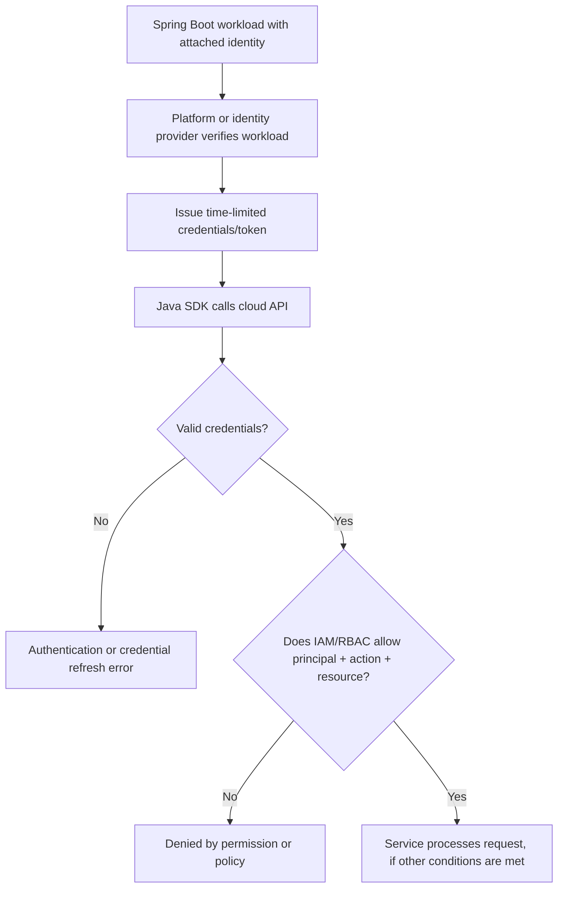
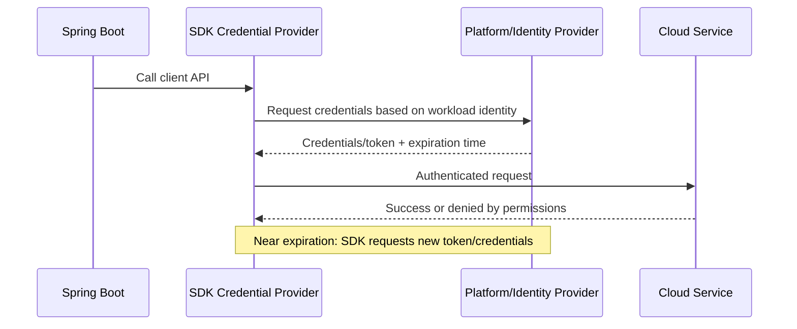
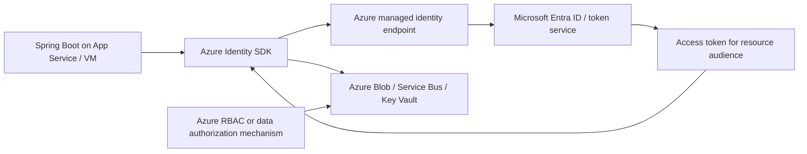
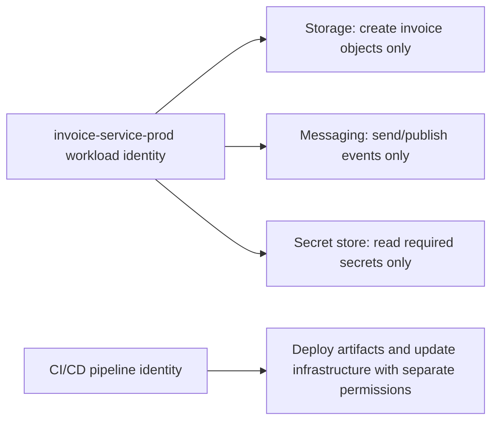

# Managed Identities, Roles, and Short-Lived Tokens

When a Spring Boot application runs on AWS, Azure, or Google Cloud, the simple yet risky shortcut is placing access keys, client secrets, or service account key files into environment variables and leaving them there forever. The proper approach for modern workloads is **attaching an identity to the runtime environment**, letting the platform issue **time-limited credentials**, and using IAM/RBAC to restrict what that identity can do. The application can then connect to Amazon S3, Azure Blob Storage, or Google Cloud Storage without holding long-lived secrets in source code.

This lesson, **Managed Identities, Roles, and Short-Lived Tokens**, belongs to the **Identity and Access** chapter of the **SPRING_CLOUD_PROVIDER_INTEGRATION** module. In the context of integrating Spring Boot with managed services across AWS, Azure, and Google Cloud via Spring Cloud and Java SDKs, we will examine how IAM roles, managed identities, and service accounts relate to tokens/temporary credentials, how to grant permissions on storage, messaging, data, and secrets, and how to verify and troubleshoot deployments.

## 1. Learning Outcomes

After this lesson, you will be able to:

- Distinguish **long-lived identities**, **roles/permission policies**, **identity sessions**, and **time-limited credentials/tokens**.
- Describe how workloads obtain temporary credentials on AWS, Microsoft Entra ID access tokens on Azure, and service account or workload identity tokens on Google Cloud.
- Explain the relationship between **trust/identity assumption** and **API execution permissions**; never confuse acquiring a token with having permission to write data.
- Configure Java SDKs/Spring Boot to use automatic, self-refreshing credentials without storing static keys.
- Design least-privilege permissions, separate identities across environments, handle token expiration, inspect audit logs, and test both allowed and denied actions.

## 2. Four Concepts That Must Be Kept Separate

| Concept | Role | Example |
| --- | --- | --- |
| **Identity / Principal** | Tells the cloud who is making the request | AWS IAM role session, Azure managed identity, Google service account, or federated workload principal |
| **Role and Permissions (role/policy/permission)** | Defines what the principal can do on which resources and under what conditions | `s3:PutObject`; Azure `Storage Blob Data Contributor`; GCP `storage.objects.create` |
| **Trust / Federation** | Specifies which workloads or identity issuers are allowed to assume or act as a cloud principal | AWS role trust policy, Entra federated identity credential, GCP Workload Identity Federation |
| **Short-Lived Credentials (temporary credential/access token)** | Proof the client presents to authenticate requests for a limited period | AWS STS credential bundle (access key, secret key, session token); Azure/GCP OAuth 2.0 access token |

A **managed identity** generally refers to an identity created/attached to a workload by the cloud platform, with credentials issued via platform mechanisms. Each cloud has its own terminology: AWS IAM roles, **Azure managed identities**, Google Cloud service accounts, and Workload Identity Federation. Do not assume they behave identically in credential type or policy evaluation.

A **role** is not a token. An IAM role can exist indefinitely, whereas a credential session obtained via AWS STS has an expiration time. An Azure managed identity can hold a role assignment on storage for months, whereas an access token used to call storage expires much sooner. A Google service account continues to exist after an access token expires.



This flow generalizes across all three platforms. In reality, AWS SigV4 request signing and Azure/GCP OAuth bearer tokens work differently. APIs may also enforce network, encryption, organizational policy, or service-specific checks beyond IAM/RBAC.

## 3. Why Use Short-Lived Credentials?

Long-lived credentials can leak through Git, Docker images, configuration files, CI logs, or developer machines. Unless revoked, anyone holding those credentials can continue calling services under that principal indefinitely. **Temporary credentials** and **expiring access tokens** narrow the exposure window if compromised; combined with least privilege, they limit the blast radius of affected resources.

Expected lifecycle:

1. **Attach identity:** infrastructure binds an IAM role, managed identity, or service account to the workload.
2. **Verify caller:** the platform ensures only the authorized workload can obtain credentials—via a metadata endpoint, workload token, or federated identity.
3. **Acquire credentials:** the SDK retrieves time-limited credentials from a token service or runtime metadata endpoint.
4. **Use credentials:** the SDK signs AWS requests or attaches an appropriate token for the target service.
5. **Refresh:** as credentials approach expiration, the provider/SDK handles refreshing and caching according to library rules.
6. **Revoke/restrict access:** when needed, update IAM/RBAC, trust policies, or attached identity permissions; note that already-issued tokens/sessions may remain valid until expiration or until invalidation mechanisms take effect.



**There is no single default lifetime** shared across all AWS, Azure, and GCP credentials: lifetimes depend on the issuing service, flow type, configuration, and provider limits. Never hardcode assumptions like "every token lives exactly one hour." Also avoid writing custom refresh logic when the SDK already manages this lifecycle properly.

### Short-Lived Alone Is Not Enough for Security

- A leaked token can still be abused **while it remains valid**; protecting logs, memory dumps, telemetry, and metadata endpoints remains vital.
- A compromised workload can continue requesting fresh tokens as long as it has access to the token source.
- A short-lived token attached to `Owner`, `AdministratorAccess`, or wildcard resource permissions still poses severe risk.
- Separating identities and restricting trust by workload, environment, and account/project/subscription contains the impact when one service is compromised.

## 4. AWS: IAM Roles, STS Sessions, and Temporary Credentials

### 4.1. An IAM Role vs. Role Session Credentials

In AWS, an **IAM role** has two key policy parts: a **trust policy** defining who or what mechanism may assume the role, and **permission policies** (along with related policies) defining which APIs a principal using that role may call. When a workload assumes a role, AWS typically issues **temporary security credentials** for a **role session** via STS or platform credential delivery.

An AWS session credential bundle typically contains three values:

```text
AccessKeyId        -> temporary access key identifier
SecretAccessKey    -> secret key to sign requests
SessionToken       -> session token accompanying temporary credentials
Expiration         -> expiration timestamp (metadata/response)
```

The AWS SDK uses these values to sign requests with **AWS Signature Version 4 (SigV4)**. This is **not** an OAuth bearer access token like in Azure or Google Cloud. When using an IAM role on a supported runtime, the application **does not need** to issue or store these values itself.

### 4.2. How Workloads Receive a Role

| Environment | Identity Used by App | Common Credential Delivery Path | What to Check |
| --- | --- | --- | --- |
| EC2 | IAM role via **instance profile** | EC2 Instance Metadata Service (IMDS), preferring IMDSv2 per deployment policy | Instance profile, policies, metadata reachability |
| ECS | **Task role** | Container credential endpoint provided by ECS | Task role vs. task execution role |
| EKS with IRSA | IAM role linked to Kubernetes service account | Web identity token -> STS `AssumeRoleWithWebIdentity` | OIDC provider, subject/audience, role trust policy |
| EKS with Pod Identity | IAM role associated with workload | Credential delivery via Pod Identity agent/container provider; platform handles STS appropriately | Association, IAM role trust, and permissions |
| CI/CD outside AWS | IAM role for federated CI system | OIDC token -> STS `AssumeRoleWithWebIdentity` once trust is configured | Issuer, audience, subject, repository/branch/environment |

On ECS, the **task execution role** is typically used for infrastructure tasks such as pulling images or shipping logs. The **task role** is the role the application inside the container receives when calling S3, SQS, and other AWS services. Granting S3 permissions to the execution role while the app relies on the task role will not resolve authorization errors.

### 4.3. Trust Policy and Permission Policy Do Two Different Jobs

Minimal trust policy example allowing **ECS tasks** to assume a role (specific to an ECS scenario; do not copy this verbatim for EC2/EKS):

```json
{
  "Version": "2012-10-17",
  "Statement": [
    {
      "Effect": "Allow",
      "Principal": { "Service": "ecs-tasks.amazonaws.com" },
      "Action": "sts:AssumeRole"
    }
  ]
}
```

In real deployments, constrain the trust scope appropriately—such as `aws:SourceAccount` or `aws:SourceArn` conditions per service guidance—to reduce confused-deputy risk. Allowing ECS to assume a role **does not automatically** give that role permission to write to S3.

Example permission policy attached to the role allowing object creation under one prefix of an invoice bucket:

```json
{
  "Version": "2012-10-17",
  "Statement": [
    {
      "Sid": "CreateInvoiceObjects",
      "Effect": "Allow",
      "Action": ["s3:PutObject"],
      "Resource": "arn:aws:s3:::invoice-prod/invoices/*"
    }
  ]
}
```

This example policy represents only one piece of the evaluation; effective access also depends on bucket policies, explicit denies, permission boundaries, SCPs, KMS permissions if using SSE-KMS, transport conditions, and related policies. Nor does the role gain read/delete access across all objects simply because it can create objects under one prefix.

### 4.4. Spring Boot Using Automatic Role Credentials

Example with **AWS SDK for Java 2.x** in Spring Boot (`import` statements omitted; add the appropriate SDK dependency):

```java
@Configuration
class AwsStorageConfiguration {
    @Bean
    S3Client s3Client(@Value("${app.aws.region}") String region) {
        return S3Client.builder()
                .region(Region.of(region))
                .credentialsProvider(DefaultCredentialsProvider.create())
                .build();
    }
}
```

`DefaultCredentialsProvider` searches credential sources according to AWS SDK rules. On ECS/EC2/EKS with a properly attached role, the SDK obtains temporary workload credentials and refreshes them automatically when needed. **Precedence note:** Java system properties, environment credentials, web identity, or valid profiles can be evaluated before metadata/container credentials depending on chain order. Never leave long-lived access keys in production environments and assume the SDK will automatically pick the runtime IAM role.

To verify the role session from the **exact provider used by the application**, you can call STS:

```java
AwsCredentialsProvider provider = DefaultCredentialsProvider.create();

try (StsClient sts = StsClient.builder()
        .region(Region.AP_SOUTHEAST_1)
        .credentialsProvider(provider)
        .build()) {
    GetCallerIdentityResponse who = sts.getCallerIdentity();
    System.out.println("AWS principal ARN: " + who.arn());
    System.out.println("AWS account: " + who.account());
}
```

In real applications, configure a **shared provider bean** for both production and diagnostic clients to avoid accidentally picking a different credential source. Never log access keys, secret keys, or session tokens. `GetCallerIdentity` may return an **assumed-role session** ARN, which is formatted differently from the IAM role's own ARN; match both role name and account ID when troubleshooting.

## 5. Azure: Managed Identity, Microsoft Entra ID, and OAuth Tokens

### 5.1. What Is a Managed Identity?

A **managed identity** gives an Azure resource/workload a platform-managed identity in **Microsoft Entra ID**. The application acquires access tokens through Azure Identity infrastructure without holding a separate client secret or certificate. There are two main types:

| Type | Lifecycle | When Is It Appropriate? |
| --- | --- | --- |
| **System-assigned managed identity** | Created bound to a single Azure resource; when the resource is deleted, the identity is deleted too | One app/resource needs its own identity in a one-to-one relationship with the runtime |
| **User-assigned managed identity** | Standalone Azure resource; can be attached to multiple supported workloads with an independent lifecycle | Controlled identity reuse is needed, or the identity must persist across runtime replacements |

Both identity types still require permissions on **target resources**. Simply enabling managed identity on an App Service/VM does not automatically grant `Storage Blob Data Contributor`, Service Bus permissions, Key Vault secret read access, or database connectivity.

A managed identity is an Azure-managed identity type; **Azure Workload Identity on AKS** is a federation mechanism between a Kubernetes service account/token and a configured Entra identity (which can be a user-assigned managed identity or an application identity). Do not treat mounting a service account token in a Pod as equivalent to having a data role assigned on storage.

### 5.2. Path from Workload to Access Token



An access token carries an **audience** (target resource) and an expiration time. Examples of scopes requested by SDKs for specific services include:

| Target Service | Common Scope When Requesting a Microsoft Entra Token |
| --- | --- |
| Azure Blob Storage | `https://storage.azure.com/.default` |
| Azure Service Bus | `https://servicebus.azure.net/.default` |
| Azure Key Vault | `https://vault.azure.net/.default` |

Never take an Azure Resource Manager access token (`https://management.azure.com/`) and assume it can call the Blob Storage data plane. Token audience, signatures, and resource roles must match the target service. Client libraries normally request tokens with the proper scope for the API being called.

### 5.3. Management Permissions and Data Permissions Are Different Scopes

For example, an identity holding the `Contributor` Azure RBAC role on a resource group can manage configuration across many Azure resources, yet that **does not automatically grant** blob data access via Microsoft Entra ID. To operate on Blob Storage using an Entra token, you need a data role such as `Storage Blob Data Contributor` or a custom role with the corresponding data actions at the proper scope. The built-in `Storage Blob Data Contributor` role covers broader actions than object creation alone; if the task demands strictly narrow creation rights, consider custom roles and supported conditions.

Key Vault permissions also depend on the vault's permission model; distinguish managing the vault resource from reading **secret values**. With Service Bus, a message-sending role like `Azure Service Bus Data Sender` differs from receiving or namespace administration roles.

### 5.4. Spring Boot Bean Using ManagedIdentityCredential

Example for an application **deployed on Azure App Service/VM** using a system-assigned managed identity:

```java
@Configuration
class AzureStorageConfiguration {
    @Bean
    TokenCredential tokenCredential() {
        return new ManagedIdentityCredentialBuilder().build();
    }

    @Bean
    BlobServiceClient blobServiceClient(
            TokenCredential tokenCredential,
            @Value("${app.azure.storage-endpoint}") String endpoint) {
        return new BlobServiceClientBuilder()
                .endpoint(endpoint)
                .credential(tokenCredential)
                .buildClient();
    }
}
```

For a user-assigned managed identity, specify the **client ID**:

```java
TokenCredential credential = new ManagedIdentityCredentialBuilder()
        .clientId(configuredClientId)
        .build();
```

`configuredClientId` is the identity ID supplied via environment configuration, **not a client secret**. If the same code must run locally and on Azure, `DefaultAzureCredential` can pick a developer identity locally and managed/workload identity at runtime; this requires verifying the exact credential source order of the `azure-identity` version in use. When using a Spring Cloud Azure starter, prefer the starter's auto-configuration rather than creating conflicting duplicate clients.

When the app returns `403`, verify which identity the credential selected, whether the token has the right tenant/audience, and whether that identity has a **data role assigned at the right scope**. Role assignments can experience propagation delay; never work around missing RBAC by issuing a long-lived client secret.

## 6. Google Cloud: Service Accounts, Workload Identity, and Access Tokens

### 6.1. A Service Account Is a Workload Identity

In Google Cloud, a **service account** is the identity commonly assigned to applications or workloads. For Cloud Run and Compute Engine, you can **attach a service account to the runtime**. Google Cloud client libraries use **Application Default Credentials (ADC)** to retrieve credentials from the environment and metadata server without needing a JSON private key file.

In GKE, **Workload Identity Federation for GKE** allows Kubernetes workloads to have their own identity when calling Google Cloud services. Depending on the setup, permissions can be granted directly to the federated principal or via controlled IAM service account impersonation. Federation from outside Google Cloud also exchanges identity proof from a trusted system for short-lived credentials, avoiding service account key creation.

### 6.2. Distinguishing Service Account, IAM Role, and Access Token

| Component | Example | Meaning |
| --- | --- | --- |
| Service account | `invoice-runtime@my-project.iam.gserviceaccount.com` | Application identity; the email address is an identifier, **not** a secret |
| IAM role/binding | `roles/storage.objectCreator` on bucket `invoice-prod` | Grants the corresponding permissions to the assigned principal |
| Access token | Expiring OAuth 2.0 token obtained by the client library via ADC/metadata | Credential used to authenticate requests for an API call session |
| Service account JSON key | File containing a private key if issued | Long-lived credential; avoid whenever runtime identity or federation can be used |

To write a new object to Cloud Storage, the permission typically required is `storage.objects.create`. The `roles/storage.objectCreator` role is an example of granting object creation on a bucket; it **does not automatically** grant read, list, or delete permissions. Overwriting an existing object may require additional permissions depending on the operation. When storing secrets in Secret Manager, the workload needs access to the secret version—for example via `roles/secretmanager.secretAccessor` at the appropriate scope.

### 6.3. Spring Boot and ADC at Runtime

```java
@Configuration
class GcpStorageConfiguration {
    @Bean
    Storage storage(@Value("${app.gcp.project-id}") String projectId)
            throws IOException {
        GoogleCredentials credentials = GoogleCredentials.getApplicationDefault();

        return StorageOptions.newBuilder()
                .setProjectId(projectId)
                .setCredentials(credentials)
                .build()
                .getService();
    }
}
```

This example uses the Google Auth Library / Google Cloud Storage Java client; include the required dependencies. With a service account attached to Cloud Run/GCE, ADC can retrieve tokens via runtime metadata. With GKE Workload Identity Federation, the credential path depends on the Pod's federation setup.

**ADC precedence note:** `GOOGLE_APPLICATION_CREDENTIALS` pointing to a credential file is evaluated before local ADC and metadata. A leftover service account key file inside an image or environment can cause the app to use an unexpected identity even when the runtime has the right service account attached. Locally, `gcloud auth application-default login` sets up ADC for client libraries; `gcloud auth login` is for the CLI and does not guarantee the Java client uses the same credentials.

Google Cloud tokens expire; the provider/client library refreshes tokens via ADC mechanisms. Never store access tokens in `application.yml`, never log tokens, and never assume the client's project ID determines which identity is calling the API.

## 7. Comparing Identity Lifecycle and Token Issuance

| Aspect | AWS | Azure | Google Cloud |
| --- | --- | --- | --- |
| Typical workload identity | IAM role assumed into a role session | Managed identity in Microsoft Entra ID, or federated workload identity | Runtime-attached service account or federated workload principal |
| Credential used for API calls | Temporary access key, secret key, and session token; SigV4 signing | Microsoft Entra ID OAuth bearer access token | OAuth access token/credentials provided by Google Auth Library |
| Runtime credential source | ECS task credentials, EC2 IMDS, EKS IRSA/Pod Identity | Managed identity endpoint or AKS token federation | ADC metadata server, GKE Workload Identity Federation, external WIF |
| Authorization decision | IAM identity/resource policies, conditions, and related limits | Azure RBAC/data-plane permissions plus service policies/conditions | Google Cloud IAM role bindings and resource permissions |
| Typical Java library | `DefaultCredentialsProvider` | `DefaultAzureCredential` or `ManagedIdentityCredential` | `GoogleCredentials.getApplicationDefault()` |
| What to verify | STS caller identity, role session, account ID, policies | Tenant, principal/client ID, token audience, data role, scope | Service account/federated principal, ADC source, IAM binding, project/resource |

**Attached roles** and **already-issued tokens** are separate things. Changing a role, removing a role binding, or editing a trust policy should not be assumed to instantly invalidate every cached token across every SDK. Factor in issued credential lifetimes, refresh policies, and permission propagation delays when designing incident response or access revocation procedures.

## 8. Attaching Identities and Least-Privilege Access for a Spring Boot Service

Suppose `invoice-service-prod` needs to:

1. Create invoice JSON files in object storage.
2. Send an `invoice.created` event to a queue/topic.
3. Read a secret holding connection configuration for another service.

Needing three services is not a reason to grant the workload administrative rights over the entire account/subscription/project. A proper permission layout:



| Requirement | AWS | Azure | Google Cloud |
| --- | --- | --- | --- |
| Create objects | `s3:PutObject` on object/prefix ARN | Blob data action or role with write permission on the right storage account/container | `storage.objects.create` on the appropriate bucket |
| Send messages | `sqs:SendMessage` on queue or `sns:Publish` on topic depending on service | `Azure Service Bus Data Sender` on the appropriate namespace/entity | `pubsub.topics.publish` on topic, e.g., Pub/Sub Publisher |
| Read secrets | `secretsmanager:GetSecretValue` on target secret; check KMS if applicable | Key Vault secret read per vault RBAC/access policy model | `secretmanager.versions.access` or `Secret Manager Secret Accessor` role on target secret |

On every provider, verify the **exact permission, resource scope, principal, and conditions**. Depending on the operation, the SDK may require secondary permissions or network/encryption constraints—for example, customer-managed KMS keys require key permissions in addition to storage IAM permissions. Built-in roles in Azure/GCP sometimes include more permissions than a single operation needs; evaluate custom roles when necessary.

### Separating Identities Across Local, CI, and Production

- **Local:** developers sign in with organizational accounts via AWS IAM Identity Center/profile, Azure CLI, or Google ADC; granted permissions only on dev/test resources.
- **CI/CD:** use OIDC federation or a dedicated pipeline identity to deploy/test, with permissions and conditions scoped to allowed repository, branch, environment, and runner system.
- **Production:** workloads obtain credentials directly from their runtime identity; avoid binding personal developer identities and avoid static keys inside containers.

CI having permission to deploy an application **does not mean** the runtime should be able to read storage/secrets via the CI identity. Conversely, a workload having permission to send messages **does not** allow the pipeline to arbitrarily create/delete messaging resources. Both principals should be controlled and audited independently.

## 9. Refresh Mechanisms and Common Failure Modes

### 9.1. What Happens When a Token Expires?

A properly used SDK/credential provider caches credentials, tracks expiration, and refreshes them before or when needed. If refreshing fails because the metadata service is unreachable, federation is misconfigured, or the identity is unlinked, subsequent requests may fail even though the application previously ran normally.

Example expected behavior:

```text
T0: Spring Boot starts with no keys/secrets in configuration.
T1: SDK retrieves expiring credentials from the runtime identity.
T2: Application sends requests within IAM/RBAC-allowed scope.
T3: Credentials near expiration; SDK/provider retrieves new credentials.
T4: Application continues sending requests with refreshed credentials.
```

Refresh timing, caching, and retry policies depend on the SDK. Never store an access token fetched at startup in a `static` field and reuse it indefinitely. If building a client with a custom token-supplying mechanism, ensure it refreshes safely; the easiest path is using standard providers maintained by the cloud libraries.

### 9.2. Diagnostic Table

| Symptom | Likely Failure Layer | Check First |
| --- | --- | --- |
| AWS SDK finds no credentials on ECS/EC2 | Role attachment or metadata/container endpoint misconfigured | Task role/instance profile, provider chain, metadata reachability |
| AWS returns `ExpiredToken` or signature error | Session credentials expired, improperly cached, or time/signature issue | Provider auto-refresh, clock skew, endpoint, credentials selected by JVM |
| AWS returns `AccessDenied` with right assumed role | Permission policy/bucket policy/deny/KMS | Actual role session, ARN, action, bucket, and relevant policies |
| Azure cannot acquire managed identity token | Identity not enabled, wrong client ID, endpoint, or federation config | Identity type, tenant/client ID, Azure Identity logs, runtime support |
| Azure acquires token but Blob returns `403` | Missing data role, wrong scope, token audience, or service condition | Selected principal, data-plane RBAC, endpoint/resource, firewall |
| Google ADC finds no credentials | Metadata unavailable or `GOOGLE_APPLICATION_CREDENTIALS`/ADC misconfigured | Credential source, GKE/Cloud Run service identity, and config file |
| Google Cloud returns `403` despite valid access token | Service account/federated principal lacks IAM permission or wrong resource | Actual identity, bucket/topic/secret, IAM binding, conditions |
| App works at first then fails after a while | Refresh fails, federation/metadata changed, or session credentials do not auto-refresh | Provider logs (without tokens), expiration lifetime, and refresh path |

**Key distinction:** `401`, `403`, `AccessDenied`, `PermissionDenied`, and credential retrieval errors do not mean the exact same thing across all services. Use exceptions, provider logs, principal details, and audit trails to identify the root cause—never infer it solely from an HTTP status code.

### 9.3. Observing Safely Without Leaking Credentials

Log to controlled telemetry: environment, service name, account/subscription/project, **principal identifier** (where appropriate and permitted), resource and operation, request/trace ID, error type, and retry/refresh timestamps. Never write to logs:

- Raw bearer access tokens, refresh tokens, AWS secret access keys, and session tokens.
- Contents of service account JSON key files or federated token files.
- Client secrets, private keys, Authorization headers, signed requests containing secrets, or URLs with sensitive tokens/signatures.

Inspect AWS CloudTrail, relevant Azure logs, and Google Cloud Audit Logs to see the principal of actual calls. On Azure, you can enable `azure-identity` diagnostic logging at an appropriate level to see which credential source was selected; sanitize sensitive details before collecting or sharing logs.

## 10. Hands-On Practice: Spring Boot Without Static Secrets

**Goal:** Deploy `invoice-service` to a cloud runtime, attach a workload identity, and allow creating objects in test storage. Do not store access keys, client secrets, or private keys in Git, Docker images, or `application.yml`.

Choose **one primary provider** for end-to-end practice; use the comparison table in Section 7 to explain the equivalent deployment on the other two providers. Prepare test resources and restricted permissions; do not modify live production configurations.

### Step 1. Create or Select a Runtime Identity

- **AWS:** prepare an IAM role suitable for ECS tasks, EC2 instance profiles, or EKS workloads; configure the trust policy for the right assumption source.
- **Azure:** enable a system-assigned managed identity or create a user-assigned identity attached to App Service/VM; on AKS, configure workload identity federation for the service account.
- **Google Cloud:** attach a service account to Cloud Run/Compute Engine or configure Workload Identity Federation for GKE; do not create a JSON key just for testing.

### Step 2. Grant Least-Privilege Access on Test Resources

Assign only **object creation** permissions on the lab's bucket/container. Do not preemptively grant read, list, delete, or admin rights if unneeded. If the provider's permissions can only be granted more broadly than the desired action, note that limitation and choose an appropriate role/condition where supported.

### Step 3. Deploy the Application with Standard Credential Providers

In Spring Boot, pass the bucket/container name and project/region/endpoint via environment variables or deploy configuration. The client uses IAM role/managed identity/ADC via the respective SDK or starter. Attach no static key files, and do not copy local developer credentials into containers.

### Step 4. Verify Four Scenarios

| Case | Action | Expected Observation |
| --- | --- | --- |
| **A — Valid identity, valid permission** | Create a new object in the permitted test bucket/container | Operation succeeds and audit logs record the runtime principal |
| **B — Valid identity, out of scope** | Try creating an object in an unpermitted resource | Operation is denied; does not fall back to developer identity |
| **C — Missing permission for another action** | Try deleting/reading an object while the workload is only allowed to create | Operation is denied per active policy |
| **D — Broken credential delivery path** | In an isolated test environment, misconfigure or remove the workload token or metadata endpoint | Provider throws a credential retrieval/refresh error, distinguishing it from IAM failures |

Perform Case D on an isolated test workload—never intentionally break the identity of an active production service. If an unassigned operation still succeeds, inspect the actual principal, permissions inherited from a broader scope, or overlapping policies; **never conclude a test passed simply because the feature worked**.

### Step 5. Document Evidence-Based Results

| Field | Example of What to Record |
| --- | --- |
| Runtime and identity | ECS task role / Azure managed identity / Google service account |
| Actual credential source | Container metadata, managed identity endpoint, ADC metadata, or federation |
| Target resource | Test bucket/container and region/project/subscription |
| Granted permissions | Specific role/policy/permission and scope |
| Allowed result | API operation, test object, request ID, and audit principal |
| Denied result | Out-of-scope operation, error type, related policy/binding |
| Refresh mechanism | Whether provider/SDK supports refresh; error observed when token source is interrupted in test environment |

If using an emulator like LocalStack or Azurite to test API paths, remember that emulators are **not sufficient** to verify real cloud IAM/RBAC, managed identities, and token lifecycles. Identity and permission verification requires at least one integration test against real cloud services using test resources.

## 11. Self-Check Questions

1. An IAM role exists indefinitely; why do the access key, secret key, and session token issued for a role session have an expiration time?
2. Why does a **trust policy allowing ECS to assume a role** not mean that role can call `s3:PutObject` on any bucket?
3. On Azure, what is the lifecycle difference between system-assigned and user-assigned managed identities? When do you choose each?
4. A Spring Boot service obtains a Microsoft Entra ID access token yet is denied when uploading to Azure Blob Storage. How do you check audience, principal, and data role?
5. A Google Cloud service account is attached to Cloud Run, yet the Java client uses another JSON file. Which configuration can cause ADC to pick that file before metadata?
6. Why should you test a denied operation alongside a permitted operation when evaluating least-privilege IAM/RBAC?
7. When a token expires and the SDK cannot refresh it, will granting broader storage permissions fix the error? Which components must be checked?
8. A CI/CD system has permission to deploy containers. Should that identity also serve as the runtime identity? Analyze the risks and propose how to separate permissions.

## 12. Key Takeaways

**Managed identities** tie cloud access to the workload rather than distributing static keys to every application. **Roles/policies/IAM bindings** control which operations are permitted; **temporary credentials or access tokens** are the time-limited authentication proof the SDK presents when calling APIs. AWS uses IAM role sessions and STS credentials to sign requests, Azure uses managed identities and Microsoft Entra access tokens, and Google Cloud uses service accounts or workload identities with ADC and appropriate access tokens.

With Spring Boot and Spring Cloud libraries, rely on standard environment credential providers, grant least-privilege access on the exact storage, queue/topic, database, and secrets needed, separate local/CI/production identities, verify the effective principal, and let the SDK handle refresh. **Short-lived tokens reduce credential exposure risk, but only when combined with strict authorization, runtime protection, and auditing do they form a trustworthy cloud access model.**
