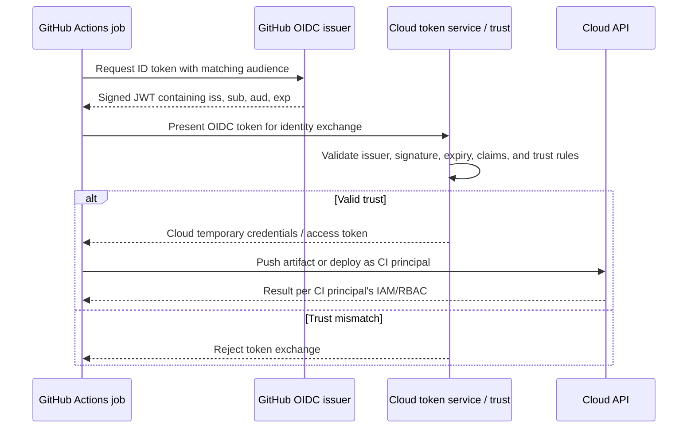

# OIDC Identity Federation for CI/CD and Workload Identity

A CI/CD pipeline needs to upload artifacts to the cloud or deploy a Spring Boot application. The legacy approach stores `AWS_ACCESS_KEY_ID`, Microsoft Entra client secrets, or Google service account private key JSON files inside the CI system's secret store. Those secrets can live for a long time, require manual rotation, and leak easily if a workflow or dependency is compromised. **OpenID Connect (OIDC) federation** lets a CI system or workload prove its identity to the cloud using a token issued for that specific run, and receive time-limited cloud credentials without copying static keys.

This lesson belongs to the **Identity and Access** chapter in the **SPRING_CLOUD_PROVIDER_INTEGRATION** module. When practicing Spring Boot integration with storage, messaging, managed databases, and secret managers across AWS, Azure, and Google Cloud, we must understand two separate identities: **the pipeline identity used for building/deploying/testing** and **the application identity used to call cloud APIs at runtime**. OIDC can help both obtain short-lived credentials, yet how identities and access permissions are bound differs between them.

## 1. Learning Outcomes

After this lesson, you will be able to:

- Explain **OIDC issuer**, **ID token**, **JWT claims**, **audience**, **subject**, **trust relationship**, and **token exchange**.
- Distinguish an OIDC identity token issued by CI/workload from the AWS temporary credentials or OAuth access tokens used by cloud SDKs.
- Design federation for a GitHub Actions pipeline on AWS, Azure, and Google Cloud with conditions scoped by repository, branch, or environment.
- Identify similarities and differences among AWS EKS IRSA, Azure Workload Identity for AKS, and Workload Identity Federation for GKE.
- Assign least-privilege permissions to the pipeline identity and the Spring Boot runtime identity, avoiding a single overly broad account across every stage.
- Diagnose **token exchange failures**, **successful token exchange followed by missing permissions**, and test workload permission boundaries.

## 2. How Does OIDC Federation Work?

OIDC is an identity layer built on top of OAuth 2.0. In federation, a trusted identity provider (**IdP**) issues an **ID token**, typically as a signed JWT. The cloud validates this token against a configured trust relationship and allows exchanging it for appropriate cloud credentials. An IdP can be a CI/CD system or a token issuer for Kubernetes workloads.

| Term | Meaning in Cloud Integration | Example |
| --- | --- | --- |
| **Issuer (`iss`)** | Who issued the token and publishes metadata to verify its signature | `https://token.actions.githubusercontent.com` for GitHub Actions |
| **Subject (`sub`)** | Specific identity of the job or workload declared inside the token | `repo:example-org/invoice-service:ref:refs/heads/main` |
| **Audience (`aud`)** | Which recipient/target this token was minted for | `sts.amazonaws.com` in the AWS example, `api://AzureADTokenExchange` in the Azure example |
| **Expiration (`exp`)**, issued-at (`iat`) | Time window during which the token can be accepted | Token is valid only within the interval advertised by the IdP |
| **JWKS / signature** | Lets the cloud verify the token was signed by the trusted IdP and not forged | Public keys published via the issuer's metadata |
| **Trust / condition** | Rule the cloud uses to decide which source tokens are accepted for an identity | Only the `main` branch of the exact repository may assume the deploy role |
| **Permission / IAM / RBAC** | Permissions held by the cloud identity after receiving credentials | Only allowed to upload artifacts to a dedicated bucket or deploy a specific service |

Example JWT identity token with illustrative claims:

```json
{
  "iss": "https://token.actions.githubusercontent.com",
  "sub": "repo:example-org/invoice-service:ref:refs/heads/main",
  "aud": "sts.amazonaws.com",
  "iat": 1764000000,
  "exp": 1764000300,
  "repository": "example-org/invoice-service",
  "ref": "refs/heads/main"
}
```

This is an **illustrative payload**, not a real usable token, and not every provider relies on the exact same set of claims. The recipient must **verify the signature, issuer, audience, expiration, and configured conditions**; merely base64-decoding a JWT string and reading `sub` does not authenticate a token.

### 2.1. Do Not Confuse Three Kinds of Artifacts

1. **GitHub/Kubernetes OIDC ID token** proves the origin and context of the run. It is typically presented to the cloud's identity service to exchange for appropriate credentials.
2. **AWS role session credentials** consist of a temporary access key, temporary secret key, and session token. The AWS SDK signs requests with SigV4; it does not pass the OIDC JWT directly as a bearer token to call general AWS APIs.
3. **Microsoft Entra or Google Cloud access tokens** are typically sent by the cloud SDK as OAuth bearer tokens to the target service. Each token carries its own audience/scope and expiration time.

Being able to exchange an identity token **does not mean** being granted unrestricted permissions in the cloud. A request must first clear the **trust/federation** layer to obtain a cloud identity; afterward, requests remain subject to **IAM/RBAC and resource policies**.

## 3. CI/CD Flow Using OIDC Instead of Long-Lived Secrets

Suppose a GitHub Actions workflow is allowed to deploy `invoice-service` to staging once code is merged into the `main` branch.



Step-by-step meaning of the flow:

1. The job runs in a specific repository, branch, workflow, or GitHub Environment.
2. Permission to request an OIDC token is enabled on the job—for example, `id-token: write` in GitHub Actions. This permission lets the workflow request a token; **it does not by itself grant AWS/Azure/GCP permissions**.
3. The job requests an ID token for an audience accepted by the cloud trust configuration.
4. The cloud verifies the token's origin and trust conditions, then maps or issues the configured cloud identity.
5. The pipeline uses short-lived credentials to perform **CI principal** actions such as uploading artifacts, pushing to a registry, or deploying.
6. Once deployed, the Spring Boot application runs under a **different runtime/workload principal**; the job's credentials must never be copied into the Docker image or application process.

In practice, jobs usually use the provider's official login action/SDK to handle token acquisition and exchange automatically. You must strictly control trust conditions: having permission to request an OIDC token does not mean arbitrary branches or pull requests should be able to assume a deploy role.

## 4. Designing Trust by Issuer, Audience, Subject, and Context

Secure federation depends on **what the cloud trusts**, not merely enabling OIDC. Compare three rules:

| Trust Rule | Consequence | Assessment |
| --- | --- | --- |
| Accept any subject from a valid CI issuer | Allows many repositories/jobs to access the same identity | Too broad for production deployment permissions |
| Trust only `repo:example-org/invoice-service:ref:refs/heads/main` | Scoped to a specific repository and branch | Appropriate when write access to `main` is controlled |
| Trust the `production` GitHub Environment subject and enforce environment approvals/protections | Ties credential issuance to a controlled release workflow | Useful for production when combined with branch restrictions and reviewer protection |

**The `sub` claim depends on job context.** For example, a GitHub job targeting an Environment may generate a subject like `repo:example-org/invoice-service:environment:production` instead of `ref:refs/heads/main`. Therefore, the trust configuration and workflow must align on branch, environment, and protection rules. Never copy a branch-based example into an environment-based workflow and then widen access with wildcards just to silence a `sub` mismatch error.

Key principles:

- **Exact issuer:** trust only the official OIDC issuer of the chosen CI system or Kubernetes cluster; never trust a JWT just because its `iss` field carries that name.
- **Specific audience:** prevent tokens from being replayed against unintended recipients. Each provider has its own audience conventions.
- **Constrained subject/attributes:** repository, branch, environment, namespace, or Kubernetes service account must fall within allowed bounds.
- **Least-privilege cloud permissions:** trust authorizes assuming an identity; policies/RBAC restrict actions after assuming that identity.
- **Environment separation:** a role or service principal used to deploy staging should not automatically be able to deploy production.
- **Protect the token source:** protect branches, review workflow changes, restrict runner privileges, and avoid handing deploy identities to untrusted pull request code.

## 5. AWS: GitHub Actions OIDC to IAM Role and STS

AWS typically uses an **IAM OIDC identity provider**, an **IAM role trust policy**, and **AWS STS `AssumeRoleWithWebIdentity`** so an external job receives temporary role credentials without storing long-lived AWS access keys.

### 5.1. Scoping Trust to the Exact Job

Suppose AWS account `123456789012` has registered an IAM OIDC provider for GitHub's issuer `https://token.actions.githubusercontent.com`, and the expected **audience** is `sts.amazonaws.com`. Example trust policy on the `invoice-staging-deployer` IAM role:

```json
{
  "Version": "2012-10-17",
  "Statement": [
    {
      "Effect": "Allow",
      "Principal": {
        "Federated": "arn:aws:iam::123456789012:oidc-provider/token.actions.githubusercontent.com"
      },
      "Action": "sts:AssumeRoleWithWebIdentity",
      "Condition": {
        "StringEquals": {
          "token.actions.githubusercontent.com:aud": "sts.amazonaws.com",
          "token.actions.githubusercontent.com:sub": "repo:example-org/invoice-service:ref:refs/heads/main"
        }
      }
    }
  ]
}
```

This is a learning example—replace the org/repository, account ID, role, and conditions with your actual values. `StringEquals` on a specific subject restricts access by branch; if the job uses a GitHub Environment, update the subject format accordingly and enforce branch/reviewer protections on the Environment. AWS also places limits on which claims work as IAM condition keys; use only AWS-supported condition keys rather than assuming any arbitrary JWT claim can be filtered.

The trust policy above **only permits assuming the role**; it grants no S3 access. The `invoice-staging-deployer` role must also have a permission policy tailored to the pipeline's actions. For example, allowing the job to write artifacts only under a staging prefix:

```json
{
  "Version": "2012-10-17",
  "Statement": [
    {
      "Effect": "Allow",
      "Action": "s3:PutObject",
      "Resource": "arn:aws:s3:::invoice-artifacts-staging/releases/*"
    }
  ]
}
```

If the job must also deploy to ECS/EKS/Lambda, add **only the required deployment actions** on appropriate resources, possibly including tightly scoped `iam:PassRole` when deployment APIs pass a role to a service. Never grant `iam:PassRole` on `*` just for convenience. Beyond identity policies, requests remain subject to bucket policies, SCPs, permission boundaries, resource policies, and related conditions.

### 5.2. Example GitHub Actions Job Acquiring Role Credentials

```yaml
name: Upload staging artifact
on:
  push:
    branches: [main]

permissions:
  id-token: write
  contents: read

jobs:
  upload:
    runs-on: ubuntu-latest
    steps:
      - uses: actions/checkout@v4
      - uses: aws-actions/configure-aws-credentials@v4
        with:
          role-to-assume: arn:aws:iam::123456789012:role/invoice-staging-deployer
          aws-region: ap-southeast-1
          role-session-name: invoice-staging-ci
      - name: Confirm assumed principal
        run: aws sts get-caller-identity
```

This example highlights the key configuration fields; in production, select and **pin actions to approved versions/commits**, harden repository/runner settings, and add build/upload steps appropriate for your pipeline. Running `get-caller-identity` verifies the CLI principal inside **that job** after the action obtains credentials. ID tokens and temporary secret access keys must never be printed to logs.

### 5.3. OIDC for EKS Workloads: IRSA and Pod Identity

With **EKS IRSA (IAM Roles for Service Accounts)**, the OIDC issuer is the issuer tied to the **EKS cluster**, not GitHub's issuer. A Kubernetes service account for the application typically has a subject of the form:

```text
system:serviceaccount:invoices:invoice-api
```

The IRSA role trust policy must accept the cluster's OIDC issuer, the `sts.amazonaws.com` audience, and the exact subject of that Kubernetes service account. When a Pod receives its projected service account token, the SDK/STS can call `AssumeRoleWithWebIdentity` to acquire temporary AWS role credentials. The IAM permission policies attached to the role then determine whether `s3:PutObject`, `sqs:SendMessage`, or `secretsmanager:GetSecretValue` is permitted.

**EKS Pod Identity is a distinct mechanism**: it uses an association between a Kubernetes service account and an IAM role alongside the Pod Identity agent/container credential endpoint. Never assume IRSA configuration and OIDC role trust policies apply unchanged to Pod Identity. Both mechanisms aim to supply temporary workload credentials, yet differ in credential delivery path and trust setup.

## 6. Azure: Federated Identity Credentials and Microsoft Entra ID

On Azure, a CI system or Kubernetes workload can be trusted by an **app registration/service principal** or a **user-assigned managed identity** where supported. Microsoft Entra ID stores a **federated identity credential** specifying the allowed issuer, subject, and audience for token exchange. After validating the OIDC proof, the client receives a **Microsoft Entra access token** for the target resource.

### 6.1. Linking GitHub Actions to an Entra Identity

Example federated identity credential for a GitHub job on the `main` branch:

```json
{
  "name": "github-invoice-staging",
  "issuer": "https://token.actions.githubusercontent.com",
  "subject": "repo:example-org/invoice-service:ref:refs/heads/main",
  "audiences": ["api://AzureADTokenExchange"]
}
```

The JSON above illustrates the core federation fields; it does not include attachment to the app registration/managed identity or tenant details. If using a GitHub Environment such as `staging`, the subject may differ (`repo:example-org/invoice-service:environment:staging`) and the trust must match exactly. Getting issuer, subject, and audience right enables token exchange; **Azure RBAC** must still be assigned to the chosen Entra principal at the resource scope.

Example job logging into Azure with OIDC and no client secret:

```yaml
name: Azure staging login
on:
  workflow_dispatch:

permissions:
  id-token: write
  contents: read

jobs:
  login:
    runs-on: ubuntu-latest
    steps:
      - uses: azure/login@v2
        with:
          client-id: ${{ secrets.AZURE_CLIENT_ID }}
          tenant-id: ${{ secrets.AZURE_TENANT_ID }}
          subscription-id: ${{ secrets.AZURE_SUBSCRIPTION_ID }}
      - run: az account show --query "{name:name, id:id, tenantId:tenantId}"
```

**Client ID**, **tenant ID**, and **subscription ID** are identifiers, not client secrets; in this example they are stored in GitHub Secrets for convenience, though they can also be managed as protected variables per organizational policy. Using `workflow_dispatch` should be guarded by repository permissions and matching trust conditions. **Note:** the JSON in Section 6.1 only trusts jobs whose subject comes from branch `main`; a `workflow_dispatch` run on another branch will be rejected. To protect staging/production, use GitHub Environments and align branch restrictions/approvals with the federated credential's subject.

After logging in, `az account show` displays the CLI context's subscription/tenant; to verify actual permissions, test the real operation against a test resource. For instance, uploading a blob via Entra ID requires an appropriate data role such as `Storage Blob Data Contributor` at the right storage scope; the ARM `Contributor` management role does not automatically grant blob data permissions.

### 6.2. Azure Workload Identity on AKS

With AKS, the OIDC issuer is the **cluster's issuer** when OIDC is enabled. The subject corresponds to the Kubernetes service account, such as:

```text
system:serviceaccount:invoices:invoice-api
```

The federated identity credential on the Entra identity must reference the **cluster issuer**, the **exact service account subject**, and the appropriate audience (typically `api://AzureADTokenExchange`). The Azure Workload Identity webhook/Pod setup injects the projected token path and metadata needed for `WorkloadIdentityCredential` or a properly configured `DefaultAzureCredential` to exchange the token. The Pod then acquires Entra access tokens for Azure services, while the principal receives separate data-plane permissions on Blob, Service Bus, or Key Vault.

If namespace, service account, client ID, tenant ID, issuer, or federated credential is misconfigured, token exchange fails **before** the request ever reaches storage. Assigning additional Blob Storage roles will not fix that mismatch.

## 7. Google Cloud: Workload Identity Federation and IAM Service Accounts

Google Cloud supports **Workload Identity Federation (WIF)** to trust OIDC tokens from external providers such as GitHub Actions. Organizations typically create a **workload identity pool**, an **OIDC provider**, configure **attribute mappings/conditions**, and choose one of two authorization approaches: grant IAM permissions directly to the federated principal where supported, or allow that principal to **impersonate an IAM service account**.

### 7.1. Configuring WIF for GitHub Actions

Example required settings:

| Component | Illustrative Value | Purpose |
| --- | --- | --- |
| Pool | `github-pool` | Groups external federated identities |
| Provider | `github-provider` | Trusts GitHub's issuer and declared conditions |
| Issuer URI | `https://token.actions.githubusercontent.com` | Verifies JWT origin |
| Mapping | `google.subject=assertion.sub` | Maps OIDC subject to Google WIF subject |
| Additional mapping | `attribute.repository=assertion.repository` | Lets IAM/policies distinguish repositories |
| Condition | `assertion.repository=='example-org/invoice-service' && assertion.ref=='refs/heads/main'` | Blocks tokens from outside the expected repo and branch |
| Target service account | `invoice-staging-ci@my-project.iam.gserviceaccount.com` | Google identity impersonated by CI if using impersonation |

**Never rely solely on the org/repository name string inside a token.** Verify tokens through a trusted issuer, narrow provider/attribute conditions, and carefully scoped IAM bindings for the federated principal. Where a source platform allows deleting and recreating organizations or repositories under the same name, also evaluate **immutable IDs** if provided by the IdP to mitigate identity takeover risks.

An IAM member representing pool identities matching a specific repository attribute may look like:

```text
principalSet://iam.googleapis.com/projects/PROJECT_NUMBER/locations/global/workloadIdentityPools/github-pool/attribute.repository/example-org/invoice-service
```

`PROJECT_NUMBER` is the **numeric project number** hosting the pool, not the string project ID. This member is placed on the **service account's IAM policy** when allowing that principal set to impersonate the service account—commonly requiring `roles/iam.workloadIdentityUser`. The IAM binding for impersonation and the service account's own permissions on buckets/topics/secrets are two separate steps.

Example job configuration using the Google Cloud auth action (replace placeholders and pin actions to approved versions/commits):

```yaml
name: Google Cloud staging auth
on:
  push:
    branches: [main]

permissions:
  contents: read
  id-token: write

jobs:
  auth:
    runs-on: ubuntu-latest
    steps:
      - uses: actions/checkout@v4
      - uses: google-github-actions/auth@v2
        with:
          workload_identity_provider: projects/123456789012/locations/global/workloadIdentityPools/github-pool/providers/github-provider
          service_account: invoice-staging-ci@my-project.iam.gserviceaccount.com
```

In the impersonation model, the provider accepts a valid GitHub token; the service account's IAM policy permits the federated principal to impersonate it; and finally the **target service account** must hold permissions for the cloud operations. For example, when only uploading new test artifacts, the service account needs only `roles/storage.objectCreator` on the test artifact bucket—or a narrower custom role if feasible.

GCP WIF does not require service account impersonation in every case. You can grant IAM permissions directly to the federated principal on supported resources; choose the model consistent with your target services and organizational IAM policies.

### 7.2. Workload Identity Federation for GKE

**GKE workload identity** lets Kubernetes Pods/service accounts access Google Cloud without issuing service account JSON keys to Pods. With Workload Identity Federation for GKE, Kubernetes identities map to principals in a GKE-managed workload identity pool; depending on requirements, you can grant IAM directly to that principal or configure impersonation of an IAM service account.

Origin, trust, and IAM bindings for **GKE workloads** must be managed per cluster, namespace, and Kubernetes service account. Never reuse the GitHub Actions OIDC issuer/subject from Section 7.1 for a GKE Pod. On GKE, verify the cluster/node pool identity mode, the Pod's Kubernetes service account, and the IAM bindings of the principal actually selected by the Google client library.

## 8. Comparing CI/CD Federation and Kubernetes Workload Identity

| Platform | CI/CD from GitHub OIDC | Kubernetes Application Identity | Cloud Credentials After Exchange | Authorization on Managed Services |
| --- | --- | --- | --- | --- |
| **AWS** | IAM OIDC provider + role trust for GitHub issuer/subject/audience; STS `AssumeRoleWithWebIdentity` | EKS IRSA via cluster OIDC; or EKS Pod Identity via association/agent | AWS temporary role credentials; SDK signs with SigV4 | IAM role policies, resource policies, denies/conditions |
| **Azure** | Entra federated credential on app/service principal or user-assigned managed identity | AKS OIDC issuer + Kubernetes service account + Azure Workload Identity | Microsoft Entra OAuth access token with target audience/scope | Azure RBAC/data-plane roles, scopes, service conditions |
| **Google Cloud** | WIF pool/provider, attribute mapping/condition; direct permissions or IAM service account impersonation | Workload Identity Federation for GKE; direct IAM principal or impersonation | Google OAuth access token / credentials managed by client library | Google Cloud IAM role bindings and principal permissions |

CI and runtime can follow the same pattern—**OIDC proof -> trust relationship -> cloud identity -> short-lived credentials**—yet **their issuers, subjects, resources, and policies differ**. A GitHub workflow allowed to assume a deploy role has no reason to automatically inherit permission to read the running workload's secrets.

## 9. Which Identity Should Spring Boot Use After Deployment?

Once CI finishes deploying `invoice-service`, the application's SDK must resolve credentials from the **runtime identity**—such as an ECS task role, Azure managed identity/AKS Workload Identity, or Cloud Run/GKE service identity. Never copy the pipeline's temporary credentials into `application.yml`, cluster Secrets, or Docker images and call them a "workload identity": those belong to a CI session, expire, and may carry deploy privileges exceeding runtime needs.

### 9.1. AWS — SDK Resolves Runtime Role Credentials

```java
@Configuration
class AwsStorageConfig {
    @Bean
    S3Client s3Client(@Value("${app.aws.region}") String region) {
        return S3Client.builder()
                .region(Region.of(region))
                .credentialsProvider(DefaultCredentialsProvider.create())
                .build();
    }
}
```

On properly configured ECS/EKS/EC2, the provider resolves IAM role credentials automatically. Credential precedence still needs attention: environment access keys or container profiles can cause the SDK to pick another source. When using Spring Cloud AWS, review your starter version's auto-configuration before defining a manual `S3Client` bean.

### 9.2. Azure — WorkloadIdentityCredential or DefaultAzureCredential

```java
@Configuration
class AzureStorageConfig {
    @Bean
    TokenCredential tokenCredential() {
        return new DefaultAzureCredentialBuilder().build();
    }

    @Bean
    BlobServiceClient blobServiceClient(TokenCredential tokenCredential,
            @Value("${app.azure.storage-endpoint}") String endpoint) {
        return new BlobServiceClientBuilder()
                .endpoint(endpoint)
                .credential(tokenCredential)
                .buildClient();
    }
}
```

On AKS with Azure Workload Identity, `DefaultAzureCredential` can use the federated token if the environment and SDK version support it. When you must enforce a specific identity source, use `WorkloadIdentityCredential` with the issuer/tenant/client/token-file parameters provided by the environment per SDK documentation. On App Service, managed identity is typically used rather than Kubernetes OIDC federation. Spring Cloud Azure starters can auto-configure credentials and clients; avoid configuring two independent chains without knowing which one the app uses.

### 9.3. Google Cloud — ADC Inside the Workload

```java
@Configuration
class GcpStorageConfig {
    @Bean
    Storage storage(@Value("${app.gcp.project-id}") String projectId)
            throws IOException {
        GoogleCredentials credentials = GoogleCredentials.getApplicationDefault();
        return StorageOptions.newBuilder()
                .setProjectId(projectId)
                .setCredentials(credentials)
                .build()
                .getService();
    }
}
```

On Cloud Run/GKE/Compute Engine, ADC can obtain credentials from the service identity/workload federation without a JSON private key. If `GOOGLE_APPLICATION_CREDENTIALS` points to a leftover static credential file, ADC may pick that file before metadata, causing an unexpected principal to be used. With Spring Cloud GCP starters, check the properties and client auto-configuration for your specific version.

**General rule:** bucket/container names, regions, projects, and queue/topic names are deployment configuration; **identity sources** and **authorization policies** are managed in IAM/workload infrastructure. Even when storage access works, the application still needs separate permissions to publish messages, access databases, or read secrets.

## 10. Separating CI, Runtime, and End-User Permissions

Consider three principals in the same system:

| Principal | Permitted Tasks | Should Not Have by Default |
| --- | --- | --- |
| `invoice-staging-deployer` (CI) | Upload artifacts, update staging services/infrastructure within approved scope | Permission to read all secrets or production customer data |
| `invoice-service-staging` (runtime) | Write invoice objects to staging bucket, publish staging events, read needed secrets | Permission to deploy infrastructure or assume arbitrary roles in the account |
| User calling `POST /invoices` | Business operations governed by Spring Security/JWT/tenant | Direct IAM role or bucket permissions without an explicit delegation design |

Example mapping of runtime permissions across the three clouds:

| Requirement | AWS | Azure | Google Cloud |
| --- | --- | --- | --- |
| Create invoice objects | `s3:PutObject` on object/prefix ARN | Blob data-plane write permission at appropriate storage/container scope | `storage.objects.create` on bucket |
| Send events | `sqs:SendMessage` or `sns:Publish` depending on service | `Azure Service Bus Data Sender` on appropriate namespace/entity | `pubsub.topics.publish` on topic |
| Read secrets | `secretsmanager:GetSecretValue` on secret, plus KMS permissions if needed | Secret read per Azure Key Vault RBAC/access-policy model | `secretmanager.versions.access` on target secret |

If CI obtains a cloud token yet receives `403` when uploading an artifact, the issue likely lies in the **CI principal's IAM**. If CI deploys successfully yet the Java app cannot read a secret, inspect the **runtime principal**. Granting more permissions to the pipeline will not help the runtime read secrets when both identities are properly separated.

## 11. Risks to Control When Enabling Federation

### 11.1. Overly Broad Trust Rules

Restricting only the issuer without restricting subject/audience opens the door to unintended workflows. For production, control which branches may deploy, which workflows have access, GitHub Environments/protected branches, approvals, and who can edit workflow files. If wildcards appear in trust rules, evaluate precisely which subjects those wildcards accept.

### 11.2. Runners Executing Untrusted Code

A pull request from a fork or a dependency with a malicious post-install script can attempt to steal tokens or cloud credentials if executed inside a privileged job. Limit `id-token: write` strictly to jobs that need federation, avoid issuing production credentials to jobs running untrusted PR code, audit third-party actions, and pin trusted dependencies/actions. **OIDC does not stop malicious code inside a job that cloud trust already accepted from using that job's credentials.**

### 11.3. Confusing CI Identity with Workload Identity

Never copy temporary AWS credentials or access tokens received by a CI job into a container image or service environment for Spring Boot to use long-term. They expire, obscure audit attribution, and usually carry the wrong permissions for runtime. At build completion, deploy the **runtime identity binding**, and let the running application obtain fresh credentials directly from the runtime.

### 11.4. Missing Environment Boundaries and Conditions

Production should have dedicated roles/identities and trust policies, conditions matching the right branch/environment, restricted IAM resources, and deployment review gates. Tokens issued by a trusted issuer for a dev branch or test namespace must never be exchangeable for production credentials.

### 11.5. Confusing Short Lifetimes with Instant Revocation

Short-lived OIDC tokens narrow the exposure window on compromise, yet issued cloud credentials have their own lifetimes and invalidation behavior. Deleting a trust rule blocks **new token exchanges**, but you should not assume every already-issued credential becomes invalid immediately. During incident response, coordinate IAM permission revocation, disabling the workload or runner, and reviewing audit logs.

## 12. Diagnosing OIDC and Cloud Permission Errors

Diagnose in sequence: **did the job get a token -> did the cloud trust the token -> was the right principal received -> does that principal have permission on the resource**.

| Symptom | Possible Cause | How to Verify |
| --- | --- | --- |
| GitHub job fails to get OIDC token | Missing `id-token: write`, job type does not support tokens, or misconfigured workflow | Check job permissions, context, and workflow configuration |
| AWS `AssumeRoleWithWebIdentity` denied | OIDC provider/trust policy has wrong issuer, audience, or `sub`; job ran on different branch/environment | Compare issuer and IAM role trust conditions against issued claims in a secure way |
| AWS assume role succeeds but S3 upload fails | Role session lacks `s3:PutObject`, wrong ARN/prefix, or blocked by bucket/SCP/KMS policy | Inspect `GetCallerIdentity`, identity policy, resource policy, API, and target key |
| Azure token exchange rejected | Federated credential has wrong issuer/subject/audience, wrong tenant/client ID, or propagation delay | Compare Entra config against actual OIDC token and sign-in/token service logs |
| Azure login succeeds but Blob returns `403` | Principal lacks Azure data-plane role or has wrong scope | Verify Entra principal, `Storage Blob Data Contributor`/custom data role, and storage account/container |
| GCP WIF receives no credentials | Provider issuer/attribute mapping/condition incorrect, or principal cannot impersonate SA | Check pool/provider, claim mapping, `roles/iam.workloadIdentityUser` for impersonation, and access conditions |
| GCP authenticates yet Cloud Storage returns `PermissionDenied` | Bucket IAM binding lacks `storage.objects.create`, or wrong target resource | Check actual federated principal or service account, operation, and bucket |
| Kubernetes Pod cannot obtain credentials | Wrong service account, namespace, OIDC issuer, workload annotation/binding, or agent | Inspect EKS IRSA/Pod Identity, AKS WIF, or GKE WIF configuration respectively |
| CI deploy succeeds but Spring Boot hits permission errors | CI principal differs from runtime principal; runtime lacks permissions | Verify the JVM's principal inside the workload and IAM/RBAC on target resources |

### 12.1. Correlating Evidence Without Logging Tokens

**Safe to log**: run ID, repository, branch/environment, controlled subject or principal identifier, cloud account/project/subscription, role/identity, resource, API operation, request ID, error type, and timestamp.

**Never log**: raw ID tokens, access tokens, refresh tokens, AWS secret access keys/session tokens, client secrets, private keys, Authorization headers, or URLs containing tokens/signatures. You can inspect claims in a controlled debug environment with safe tooling, but **never** paste full JWTs into issue trackers or public CI logs.

For AWS, `aws sts get-caller-identity` after assuming the role identifies the job's role session. For Azure and GCP, inspect identity/token-exchange logs and cloud service audit logs. Any CLI checks must run **in the same credential context** as the subject under investigation—never draw conclusions from a developer login session in another terminal.

## 13. Hands-On Exercise: Separate CI Role and Workload Role

**Context:** repository `example-org/invoice-service` has a staging pipeline; once deployed, the Spring Boot app must save an invoice JSON object in object storage and publish an event. The goal is to configure OIDC for the pipeline without storing long-lived cloud keys, while using a separate runtime identity for the application to call managed services.

Choose **one provider** to deploy for real on sandbox resources. For the other two providers, compare issuer, trust mapping, and roles using Section 8. Never use production environments or real customer data.

### Step 1 — Design Both Identities and Permission Scopes

| Identity | Trust Source | Operational Scope |
| --- | --- | --- |
| `invoice-staging-deployer` | CI OIDC issuer; repo `example-org/invoice-service`; `main` branch or protected staging Environment | Upload artifacts / deploy **staging** |
| `invoice-service-staging` | ECS/EKS runtime, Azure App Service/AKS, or Cloud Run/GKE | Create objects in staging storage and publish test messages only |

If the pipeline must read a deployment secret, grant the **CI identity** read access solely to that deployment secret. If the application needs runtime secrets, grant the **runtime identity** access to separate runtime secrets by design. Never share a single broad role between both.

### Step 2 — Configure OIDC Federation and Trust

- **AWS:** register the GitHub OIDC provider; create an IAM role trust policy constraining `iss`, `aud`, and `sub`; attach an IAM policy allowing only required staging operations.
- **Azure:** create a federated identity credential on an app registration or user-assigned managed identity; configure issuer/subject/audience; assign Azure RBAC on staging resources.
- **Google Cloud:** create a WIF pool/provider with attribute mappings/conditions for repo/branch; grant permissions directly to the federated principal or impersonation rights on an IAM service account; grant the service account needed staging permissions.

### Step 3 — Run the Workflow and Verify the CI Principal

Enable `id-token: write` on the job requesting the token, run provider login/exchange via the appropriate action/SDK, and confirm the selected cloud identity. Run an **allowed** operation on a staging artifact and check audit logs. Then use a test job or adjust a condition in an isolated test environment to verify an unauthorized branch/repo is rejected during token exchange.

### Step 4 — Deploy Spring Boot with the Runtime Identity

Deploy the application configured for staging storage and messaging, attaching the dedicated runtime identity. The SDK/Spring Cloud must resolve credentials automatically from the runtime. On Kubernetes, configure the right service account, namespace, and provider federation/association mechanism. Never pass CI credentials into containers or static-key Secrets.

### Step 5 — Execute Allow and Deny Tests

| Case | Action | Expected Result |
| --- | --- | --- |
| A — Valid CI | Workflow on trusted repo/branch acquires cloud credentials and uploads staging artifact | Succeeds as **CI principal** |
| B — Untrusted CI | Workflow from untrusted branch/repository requests cloud credentials | Token exchange is rejected |
| C — Valid runtime | Spring Boot creates staging object and publishes staging event | Succeeds as **runtime principal** |
| D — Over-scoped runtime | App tries writing to production storage or deleting objects without permission | Denied by IAM/RBAC |
| E — CI without runtime access | Job using CI principal attempts to read a secret meant only for the workload | Denied when roles are properly separated |
| F — Misconfigured federation | In sandbox, intentionally use wrong audience/subject/namespace | Fails at exchange stage, distinct from resource permission errors |

Record **token source**, **expected issuer/audience/subject**, **received principal**, **resource/operation**, **outcome**, **audit request ID**, and **effective permissions**. Avoid running negative tests in production; use controlled test resources and workflows. Emulators such as LocalStack/Azurite help test business API paths, but do not verify real OIDC trust and cloud IAM/RBAC.

## 14. Self-Check Questions

1. What does `id-token: write` grant in GitHub Actions? Why does having that permission alone not let the job access S3, Blob Storage, or Cloud Storage?
2. How does an AWS trust policy for the GitHub `main` branch differ from an IRSA trust policy for a Kubernetes service account?
3. Why can the `sub` claim of a GitHub job using an Environment differ from a branch-based `sub`? How should you adjust the trust config while keeping scope narrow?
4. An Azure pipeline logs in via a federated credential successfully yet Blob upload returns `403`. How do you distinguish a token exchange error from a data-plane RBAC error?
5. In GCP WIF using service account impersonation, why do you need both `roles/iam.workloadIdentityUser` on the service account and IAM permissions on the target bucket/topic?
6. Why should you not reuse the CI deploy role as Spring Boot's runtime role after deployment?
7. When an OIDC token expires, how should the system behave? Why does deleting a trust rule immediately after an incident not guarantee all old temporary credentials are revoked at once?
8. If a workflow triggered by an untrusted pull request could obtain production cloud credentials, how would you change claim conditions, branch/environment protections, and job permissions?

## 15. Takeaways

**OIDC federation establishes trust between CI/Kubernetes identity issuers and cloud identities.** ID tokens carry claims such as `iss`, `sub`, `aud`, and expiration; the cloud verifies them before issuing temporary credentials or access tokens. Afterward, **IAM/RBAC** still governs which actions that principal can perform on which resources.

When building Spring Boot integrations on AWS, Azure, and Google Cloud, separate **CI identity** from **workload runtime identity**, enforce trust rules bound to the exact repository/branch/environment or Kubernetes service account, prefer time-limited tokens, grant least-privilege access to storage/messaging/data/secrets, and verify effective principals via audit logs. OIDC federation removes the need to distribute many static keys, yet you must still protect workflows, software supply chains, identity trust rules, and per-environment permissions.
