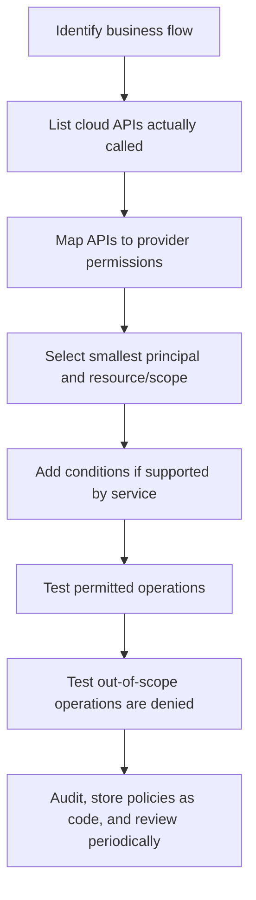
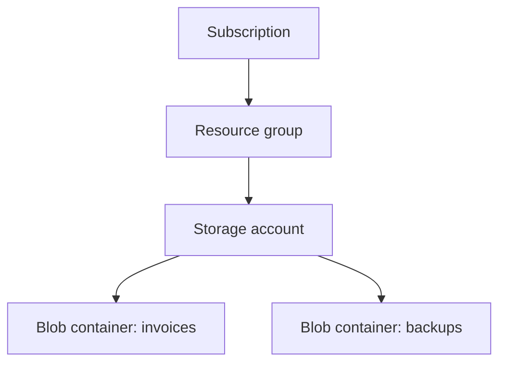

# Designing Least-Privilege Access by Action and Resource Scope

Suppose `invoice-service` is a Spring Boot application that needs to save invoices to object storage, send events to a downstream system, and read a configuration secret. Granting administrative permissions over an entire AWS account, Azure subscription, or Google Cloud project certainly avoids many `AccessDenied` errors during experimentation, yet it also allows a single application bug to impact a vast amount of data and services. The right design is determining **which identity needs to perform which actions on which resources, under what conditions**, and granting only that exact set of permissions.

Within the **Identity and Access** chapter of the **SPRING_CLOUD_PROVIDER_INTEGRATION** module, this lesson focuses on designing *least privilege* for Spring Boot integrations with managed services on AWS, Azure, and Google Cloud. The practical scope covers storage, messaging, data, secret managers, and integration testing. The goal is producing an explainable permission policy where both allowed and denied cases are verified, rather than stopping as soon as the SDK connects.

## 1. Learning Outcomes

After this lesson, you will be able to:

- Build a **principal – operation – permission – resource – scope – condition – environment** matrix from a business flow.
- Distinguish permissions at the Spring Boot API layer from workload permissions when calling cloud services.
- Author AWS IAM policies for the exact bucket/object/queue/secret ARNs; recognize when secondary permissions like KMS are required.
- Choose Azure RBAC scopes and data-plane roles; recognize when built-in roles are broader than needed and evaluate custom roles.
- Grant Google Cloud IAM roles at the bucket/topic/secret level; understand built-in role limits and prefix/object controls.
- Test both **allow** and **deny** permissions in live environments, catching inherited permissions or unintended policies.
- Review and update permissions over time without inserting access keys or client secrets into source code.

## 2. The Least-Privilege Model: Who – Does What – On Which Resource – Under What Conditions?

A cloud authorization decision can be represented conceptually as:

```text
Principal + Action/Permission + Resource + Context/Conditions
                         |
                         v
          IAM / RBAC / resource policy evaluation
                         |
                    Allow / Deny
```

| Component | Practical Question | Example with `invoice-service-prod` |
| --- | --- | --- |
| **Principal** | Which exact identity is calling the cloud API? | ECS task role, Azure managed identity, or Google service account of the production service |
| **Action/permission** | Which operation must the API execute? | Create object, send message, read a secret's value |
| **Resource** | Which target resource is allowed? | `invoices-prod` bucket/container, event queue/topic, connection secret |
| **Scope** | At which level is the permission attached? | Object ARN/prefix, Azure container, GCP bucket, or specific secret |
| **Condition** | Only when or matching what attributes? | Environment region, tags, request attributes, time, or supported service constraints |
| **Environment** | Is this dev, staging, or production? | Production identity and resources separated from test resources |

The **principle of least privilege** means granting each principal only the permissions and scope sufficient to complete its assigned task. Restrict not only **which operations**, but also **resources**, **environments**, **time**, and **conditions** where supported by the platform. A role limited solely to `PutObject` yet applied across every bucket in an account can still be overly broad.

At the same time, keep two layers distinct:

- **Business layer:** Spring Security and application logic decide which users can create, view, or cancel invoices based on user roles and tenant ownership.
- **Cloud layer:** IAM/RBAC determines which cloud resources the `invoice-service` process can read or write. Client SDKs generally use the workload identity and do not automatically translate a user's JWT into an equivalent cloud principal.

If User A is allowed to call `POST /invoices` but the workload lacks object-write permission, the API will still fail at the storage step. Conversely, if the workload holds object-write permission, the application must still prevent User B from creating unauthorized invoices. Both control layers complement each other.

## 3. Start from Business Operations, Not Role Names

An effective design method is listing **the cloud APIs actually called** in the business workflow, then mapping them to each provider's permissions.

Suppose `invoice-service` only needs to:

1. Create a new invoice under key `invoices/2026/INV-001.json`.
2. Send an `invoice.created` event to a queue or topic.
3. Read a secret holding connection details for an external service.

There is no requirement to delete buckets, list all objects, modify IAM permissions, administer queues, or read every secret in the system. Build a **least-privilege matrix** before configuring the cloud:

| Principal | Application Operation | Permissions to Evaluate | Scope | Unneeded Operations |
| --- | --- | --- | --- | --- |
| `invoice-api-prod` | Create invoice object | Object create/write permission for the storage service in use | Production invoice bucket/container, plus prefix if precisely supported by the cloud | Delete bucket, read all objects, modify IAM |
| `invoice-api-prod` | Send event | Send/publish permission | One production event queue/topic | Receive/delete messages, administer queue/topic |
| `invoice-api-prod` | Retrieve secret value | Secret value read permission | One or a few specific secrets | Create, delete, or list all secrets |
| `invoice-deployer-prod` | Deploy service | Artifact/service update permissions and pass-role only when truly required | Approved production deployment resources | Read invoice data and runtime secrets |
| `invoice-worker-prod` | Process events, update status | Message receive and task-specific data write permissions | Worker's own queue and table/DB | Deploy permissions and storage write permissions of every service |

**Verification rule:** never conclude "the app needs storage access" and assign a broad role. Ask **which API is called, on which object, and whether overwriting or listing is needed.** A single SDK operation may issue multiple underlying requests; verify the real API calls and any secondary permissions the service requires.



## 4. AWS: Actions, Resource ARNs, and IAM Conditions

AWS IAM expresses permissions via `Action`, `Resource`, `Effect`, and optional `Condition`. For an IAM role, the **trust policy** defines who may assume the role; **permission policies** define which APIs the role session may invoke. These two policy types solve separate problems.

### 4.1. Choosing the Right ARN for Each Action

| Purpose | IAM Action | Example Resource | Notes |
| --- | --- | --- | --- |
| Create/write S3 object | `s3:PutObject` | `arn:aws:s3:::invoices-prod/invoices/*` | **Object**-level ARN scope; not a bare bucket ARN |
| Read S3 object | `s3:GetObject` | `arn:aws:s3:::invoices-prod/invoices/*` | Independent of write permission |
| List objects in bucket | `s3:ListBucket` | `arn:aws:s3:::invoices-prod` | **Bucket**-level ARN scope; `s3:prefix` condition can be applied |
| Send SQS message | `sqs:SendMessage` | `arn:aws:sqs:ap-southeast-1:123456789012:invoice-events-prod` | Only the exact target queue |
| Publish to SNS | `sns:Publish` | `arn:aws:sns:ap-southeast-1:123456789012:invoice-created-prod` | Only the exact target topic |
| Retrieve secret value | `secretsmanager:GetSecretValue` | ARN of the authorized secret | Check KMS permissions if the secret uses a customer-managed key |

**Common mistake:** `s3:PutObject` on an object ARN does not imply `s3:ListBucket`. Listing a bucket uses a different resource ARN. When only writing to known keys, never add `ListBucket` out of habit thinking "the S3 SDK probably needs it." Measure actual requests before granting additional permissions.

For example, when listing is genuinely needed, you can constrain the prefix with a condition that applies specifically to `s3:ListBucket`:

```json
{
  "Effect": "Allow",
  "Action": "s3:ListBucket",
  "Resource": "arn:aws:s3:::invoices-prod",
  "Condition": {
    "StringLike": {
      "s3:prefix": ["invoices/", "invoices/*"]
    }
  }
}
```

This is an **illustrative statement**. `s3:prefix` constrains list requests by prefix; it **does not** replace using a prefix-scoped object ARN to control `PutObject` or `GetObject`.

### 4.2. Example Policy Granting Exactly the Three Needs of `invoice-service`

The following policy is for the **workload's IAM role**, scoped to a single S3 prefix, one queue, and one secret. ARNs, account, region, and resource names are illustrative values:

```json
{
  "Version": "2012-10-17",
  "Statement": [
    {
      "Sid": "WriteInvoiceObjects",
      "Effect": "Allow",
      "Action": "s3:PutObject",
      "Resource": "arn:aws:s3:::invoices-prod/invoices/*"
    },
    {
      "Sid": "SendInvoiceEvents",
      "Effect": "Allow",
      "Action": "sqs:SendMessage",
      "Resource": "arn:aws:sqs:ap-southeast-1:123456789012:invoice-events-prod"
    },
    {
      "Sid": "ReadOnlyInvoiceSecret",
      "Effect": "Allow",
      "Action": "secretsmanager:GetSecretValue",
      "Resource": "arn:aws:secretsmanager:ap-southeast-1:123456789012:secret:invoice/db-prod-AbCdEf"
    }
  ]
}
```

This policy **does not** grant `s3:DeleteObject`, `s3:GetObject`, `s3:ListBucket`, `sqs:ReceiveMessage`, `sqs:DeleteMessage`, `secretsmanager:DeleteSecret`, or IAM modification rights. If the workflow must read objects back after upload, add `GetObject` with the exact same scope—never open permissions across every bucket.

Additional checks required:

- **SSE-KMS or secrets encrypted with customer-managed KMS keys:** the role may need corresponding KMS key permissions, and the key policy must allow the principal. Never grant `kms:*` across all keys.
- **Bucket policies / queue policies:** an explicit deny in a resource policy can block the role even when the identity policy has `Allow`. Cross-account access may require policies on both sides.
- **SCPs and permission boundaries:** cap the maximum permissions a principal can exercise where applied; effective access depends on AWS's full evaluation chain.
- **Prefixes and object keys:** the policy restricts `invoices/*` on the S3 object ARN, but does not by itself ensure the application writes invoices only under valid tenant paths. Business logic must still validate keys constructed from user input.

### 4.3. Explicit Denies and Inherited Permissions

AWS follows a default rule of **denied unless an applicable `Allow` exists**; an **explicit `Deny`** in a relevant policy overrides an `Allow`. However, not all policy types combine via a simple intersection in every scenario. Resource-based policies, cross-account access, and IAM role sessions each have specific evaluation rules; always consult AWS policy evaluation documentation when analyzing concrete cases.

Do not assume removing `s3:DeleteObject` from **a single policy you just edited** proves the role cannot delete objects. The role might still have another inline/managed identity policy or a resource policy granting access. Always evaluate **effective permissions** and test the forbidden action against a test resource.

## 5. Azure: RBAC Scopes and Data-Plane Permissions

Azure Role-Based Access Control (Azure RBAC) assigns a **role definition** to a **principal** at a **scope**. The principal can be the Spring Boot application's managed identity or service principal. Management scopes inherit along subscription -> resource group -> resource; some services also support finer-grained scopes such as a **blob container**.

### 5.1. Broader Scope Means Larger Blast Radius



A role assignment at the **subscription** level applies to many child resources; assigning at the **`invoices` container** narrows the blast radius for an application handling only invoices. Verify that both the service and role type support the intended scope. Certain operations still require permissions at another scope or depend on network/key settings.

Azure separates two key permission categories:

| Category | Target | Examples |
| --- | --- | --- |
| **Management plane (`Actions`)** | Managing Azure resources via Azure Resource Manager | Creating/editing a storage account, modifying resource settings |
| **Data plane (`DataActions`)** | Accessing service data payloads | Reading, creating, or deleting blobs via Microsoft Entra ID |

The standard `Contributor` role grants rights to manage many ARM resources yet **does not automatically** grant data-plane permissions to read/write blobs with a Microsoft Entra token. For Blob Storage, use an appropriate data role such as `Storage Blob Data Contributor` or a custom role containing only the needed `DataActions`.

### 5.2. Assigning Roles at Container Scope Instead of the Whole Subscription

Example Azure CLI assigning a role to a managed identity on **one blob container**:

```bash
az role assignment create \
  --assignee-object-id "<MANAGED_IDENTITY_PRINCIPAL_OBJECT_ID>" \
  --assignee-principal-type ServicePrincipal \
  --role "Storage Blob Data Contributor" \
  --scope "/subscriptions/<SUBSCRIPTION_ID>/resourceGroups/rg-invoices-prod/providers/Microsoft.Storage/storageAccounts/stinvoiceprod/blobServices/default/containers/invoices"
```

This example uses placeholders; substitute values from your environment. `Storage Blob Data Contributor` permits multiple data actions, **including operations beyond object creation alone**. The command above illustrates **narrowing scope**, not yet the absolute minimal action set. If business rules only allow creating/writing blobs, evaluate a **custom role** with the required data action—such as `Microsoft.Storage/storageAccounts/blobServices/containers/blobs/write`—and verify any secondary permissions needed by the SDK/operation. Do not assume Azure RBAC controls every overwrite condition identically to S3.

On Azure, action-level control can be refined further using custom roles, **role assignment conditions** where supported by the service/scenario, and business API checks. Key Vault, Service Bus, and database permissions each have their own mechanisms; never infer permissions on other services from a Blob role.

### 5.3. Permissions for Other Azure Services

| Requirement | Commonly Used Role/Permission | Caveats to Remember |
| --- | --- | --- |
| Publish messages to Service Bus | `Azure Service Bus Data Sender` | Assign at namespace/queue/topic per supported scope; Data Receiver is not needed |
| Read secret values from Key Vault | E.g., `Key Vault Secrets User` when vault uses Azure RBAC | Depends on the vault's permission model; vault management rights do not grant secret reads |
| Cosmos DB for NoSQL data operations | Cosmos DB data-plane RBAC with an appropriate data role | Not automatically equivalent to Azure RBAC management roles on the Cosmos DB account |
| Connect to Azure SQL Database | Entra identity for connection plus database-level permissions | Connection token does not replace `GRANT`/database roles inside the DB |

**Managed identity only solves obtaining an identity and token.** Data-plane permissions, resource scope, networking/private endpoints, and database permissions are independent checks. If the app obtains a token yet blob upload returns `403`, verify the principal and role assignment scope first—never create a client secret to replace managed identity as a workaround.

## 6. Google Cloud: IAM Role Bindings on the Exact Resource

Google Cloud IAM grants access via a **role binding** pairing a principal with a role on a resource. Organizational hierarchy can include organization, folders, projects, and individual resources. A role bound at the project level is typically much broader than the same role bound on **a single bucket** when the service supports resource-level IAM.

### 6.1. Choosing Roles Based on Actually Required Permissions

| Requirement | Key Permission | Built-in Role to Consider | Scope to Evaluate |
| --- | --- | --- | --- |
| Create Cloud Storage objects | `storage.objects.create` | `roles/storage.objectCreator` | Dedicated invoice bucket or finer supported scope |
| Read Cloud Storage objects | `storage.objects.get` | `roles/storage.objectViewer` | Target bucket or supported readable resource |
| Publish Pub/Sub events | `pubsub.topics.publish` | `roles/pubsub.publisher` | One specific topic |
| Read Secret Manager secret version | `secretmanager.versions.access` | `roles/secretmanager.secretAccessor` | Specific secret |
| Write data to database | Varies across Cloud SQL/Firestore/Spanner and auth path | Service-specific roles and permissions | Project/instance/database, plus in-DB privileges where applicable |

Suppose service account `invoice-runtime@my-project.iam.gserviceaccount.com` only needs to create objects in bucket `invoice-prod`. Illustrative IAM binding command:

```bash
gcloud storage buckets add-iam-policy-binding gs://invoice-prod \
  --member="serviceAccount:invoice-runtime@my-project.iam.gserviceaccount.com" \
  --role="roles/storage.objectCreator"
```

This binding can suffice for **creating new objects** in the bucket when no other restrictions apply. `roles/storage.objectCreator` does not automatically grant reading, listing, or deleting objects; overwriting an existing object may require additional permissions depending on the API and object state. Never bind this role at the project level if the workload only needs one bucket.

### 6.2. Prefix Restrictions Differ Across Clouds

AWS S3 supports prefix-scoped object ARNs like `arn:aws:s3:::bucket/invoices/*`. **Never copy AWS syntax or assumptions into Google Cloud IAM.** In Cloud Storage, binding `roles/storage.objectCreator` on a bucket generally covers object creation across that bucket. When path-based isolation is needed, evaluate mechanisms actually supported by your bucket configuration—such as **managed folders** with folder-level permissions, IAM Conditions where the resource type and attributes are supported, or more simply **separate buckets by function/tenant**.

Never assume an IAM Condition like `resource.name.startsWith(...)` will uniformly enforce prefix-scoped object creation across every API and bucket configuration. The context and resource attributes evaluated by IAM Conditions may not match the object path constructed by the application. Always verify with real tests before treating a prefix as a security boundary.

### 6.3. Checking Inherited Permissions Too

Google Cloud IAM can grant permissions at organization, folder, project, and resource levels. Alongside allow bindings, environments may enforce IAM Deny policies, principal access boundaries (where applicable), organization policies, and other conditions. A narrow binding on a bucket does not cancel out a broader permission already granted at the project level. To prove least privilege, inspect **effective access** and test out-of-scope actions from the workload's exact principal.

## 7. Comparing the Three Providers: Same Need, Different Authorization Models

| Criterion | AWS | Azure | Google Cloud |
| --- | --- | --- | --- |
| Common runtime principal | IAM role session | Managed identity or workload identity/service principal | Service account or federated workload principal |
| Where actions are expressed | IAM `Action`, e.g., `s3:PutObject` | RBAC `Actions`/`DataActions` or service-specific data RBAC | IAM permissions bundled in a role, e.g., `storage.objects.create` |
| Where resources are constrained | `Resource` ARN; some actions support condition keys | Role assignment `scope`; role definition and conditions where supported | IAM binding on resource; IAM Conditions where applicable |
| Recommended starting storage boundary | Object ARN on bucket/prefix, separate bucket permissions when needed | Container scope and data role/custom role | Bucket scope or supported managed folder/granular resource |
| Explicit deny controls | IAM `Deny`, SCPs, bucket policies, and related policy types | Azure deny assignments and relevant data/permission mechanisms | IAM Deny and supported organization policies/constraints |
| Common pitfalls | Confusing bucket ARN with object ARN; granting `s3:*` | Assigning `Contributor` assuming it grants data access; assigning at overly broad subscription scope | Assigning `roles/editor`/`roles/owner` on the project just to write one object |

**No cloud-neutral policy translates one-to-one automatically** across AWS IAM, Azure RBAC, and Google Cloud IAM. A built-in role may bundle extra operations, and resource-restriction granularity varies. Always ground decisions in **actual APIs, provider-specific permissions, and service-supported scopes**.

## 8. Access Conditions and Environment Boundaries

After narrowing actions and resources, consider conditions aligned with application risk:

| Control | Purpose | How to Apply Properly |
| --- | --- | --- |
| **Separate dev/staging/prod** | Prevent test workloads from modifying production data | Separate principals, buckets/containers/topics/secrets, and policies |
| **Restrict identity assumption sources** | Only approved workloads receive roles/tokens | AWS trust conditions, Azure federated credentials, GCP workload identity provider conditions |
| **Request/resource conditions** | Constrain requests by supported attributes | AWS IAM condition keys, Azure RBAC conditions, GCP IAM Conditions after verifying applicability |
| **Tenant isolation** | Limit cross-customer access | Separate resources or identities when needed; enforce tenant checks in business and backend logic |
| **Network restrictions** | Limit permitted endpoints or networks | VPC endpoints/network policies, private endpoints/firewalls; independent of IAM |
| **Encryption and KMS** | Protect data and managed keys | Restrict permissions on the specific encryption key and check key policies/roles |

### 8.1. Do Not Confuse IAM Permissions with Application Tenant Boundaries

Suppose invoices from multiple tenants live inside the same `invoices-prod` bucket:

```text
invoices-prod/
  tenants/tenant-a/INV-001.json
  tenants/tenant-b/INV-002.json
```

If the application uses **a single workload identity** allowed to write anywhere under `tenants/*`, cloud IAM usually has no visibility into whether the user calling the API belongs to tenant A or tenant B. The backend must verify the tenant from the authenticated user session/claims and construct safe object keys itself—never concatenate a raw client-supplied path onto a bucket.

When stricter cloud-level isolation is needed, separate buckets/containers, separate workload identities, or use provider-supported and tested fine-grained IAM features. **A prefix convention in code is not an IAM boundary** when the principal holds bucket-wide write permission.

### 8.2. Distinguish Identity Trust from Permission Policies

For OIDC CI/CD, trust policies / federated identity credentials decide **which job or Pod can obtain the identity**, whereas IAM/RBAC decides **which APIs that identity can call after obtaining credentials**. Narrowing storage permissions while letting any workflow assume the role still leaves an under-controlled design.

Conversely, a tight trust rule restricted to `main` is still unsafe if the assumed role holds admin rights over every resource. Tighten both sides.

## 9. Spring Boot Example: Implementing the Workflow Under Designed Permissions

On AWS, the application can use `DefaultCredentialsProvider` to obtain temporary workload credentials. Bean configuration contains no access keys:

```java
@Configuration
public class InvoiceCloudClients {
    @Bean
    S3Client s3Client(@Value("${app.aws.region}") String region) {
        return S3Client.builder()
                .region(Region.of(region))
                .credentialsProvider(DefaultCredentialsProvider.create())
                .build();
    }

    @Bean
    SqsClient sqsClient(@Value("${app.aws.region}") String region) {
        return SqsClient.builder()
                .region(Region.of(region))
                .credentialsProvider(DefaultCredentialsProvider.create())
                .build();
    }
}
```

In a real application, create and inject **a single shared credential provider** across clients, especially when verifying which principal the SDK selects. The snippet above illustrates the default chain; when using a **Spring Cloud AWS starter**, rely on the starter's auto-configured clients rather than declaring duplicate beans. Declare SDK/starter dependencies compatible with your Spring Boot version and set the correct region.

The service layer operates strictly on backend-constructed paths:

```java
@Service
public class InvoiceStorage {
    private final S3Client s3;
    private final String bucket;

    public InvoiceStorage(S3Client s3,
                          @Value("${app.invoices.bucket}") String bucket) {
        this.s3 = s3;
        this.bucket = bucket;
    }

    public void saveNew(String invoiceId, byte[] json) {
        String safeId = requireValidInvoiceId(invoiceId);
        String key = "invoices/" + safeId + ".json";

        s3.putObject(
                PutObjectRequest.builder()
                        .bucket(bucket)
                        .key(key)
                        .ifNoneMatch("*")
                        .contentType("application/json")
                        .build(),
                RequestBody.fromBytes(json)
        );
    }

    private String requireValidInvoiceId(String id) {
        if (id == null || !id.matches("[A-Za-z0-9_-]{1,64}")) {
            throw new IllegalArgumentException("Invalid invoice ID");
        }
        return id;
    }
}
```

`If-None-Match: *` is a create-only precondition supported by S3 to prevent overwriting an existing key; `s3:PutObject` policy alone **does not** forbid overwrites. This is a **request/business-operation** safeguard, not an IAM replacement. Handle responses for existing objects or concurrent requests according to your business contract. The SQS service uses `sqs:SendMessage` to emit an event after saving the invoice; if saving to S3 succeeds while sending to SQS fails, apply an appropriate retry/idempotency or transactional outbox design—unrelated to widening IAM permissions.

Spring Boot configuration should hold only resource names, regions, and target URLs—never secrets:

```yaml
app:
  aws:
    region: ${AWS_REGION:ap-southeast-1}
  invoices:
    bucket: ${INVOICE_BUCKET}
  events:
    queue-url: ${INVOICE_QUEUE_URL}
```

Bucket names or queue URLs are **not** authentication proof. The same code locally may use a developer identity, while on ECS/EKS/EC2 it receives workload role credentials. Always verify the actual identity because AWS environment variables can override the runtime role in the credential chain. Never copy CI or developer credentials into containers.

### 9.1. Equivalents on Azure and Google Cloud

- **Azure Blob Storage:** clients use `DefaultAzureCredential` or `ManagedIdentityCredential` from Azure Identity; container and endpoint come from deployment config. The managed identity needs a data role / custom `DataActions` on the exact container, and data write permissions must be kept distinct from storage account management rights.
- **Google Cloud Storage:** clients use ADC via `GoogleCredentials.getApplicationDefault()` or the Spring Cloud GCP starter. The workload service account/federated principal needs `storage.objects.create` on the appropriate bucket; to create without overwriting, consider generation preconditions on the Storage API. Prefix scoping must be verified against bucket IAM, managed folders, or resource separation in use.

Across all three clouds, automatic credentials solve only **identity**. They do not grant permissions on buckets, topics, databases, or secrets.

## 10. Testing Least Privilege: Must Include Both Allow and Deny

An integration test that only checks a successful upload proves the application **has enough permissions for one task**, not that it **lacks dangerous extra permissions**. You must test forbidden actions using the exact runtime principal against test resources.

| Test Case | Operation | Expected Result |
| --- | --- | --- |
| A — Valid permission | Create a new invoice in the granted bucket/container | Succeeds; audit log records the workload principal |
| B — No read permission | Read an object when the role only grants creation | Denied when no permission is granted elsewhere |
| C — No delete permission | Delete a test object or container | Denied; resource remains intact |
| D — Out-of-scope resource | Write to another unpermitted bucket/container | Denied |
| E — Cross-environment boundary | Staging principal attempts an operation on a separately simulated production test resource | Denied |
| F — Messaging | Send to granted queue/topic; try receiving/deleting when ungranted | Send succeeds; receive/delete denied |
| G — Secrets | Read the assigned secret; try reading another secret | Assigned secret succeeds; out-of-scope secret denied |

In real cloud environments, provision **dedicated test resources** and restricted test principals. Never test deletes against important data or temporarily grant production permissions just to pass a test. If an operation expected to fail actually **succeeds**, hunt down inherited permissions, overlapping roles/policies, resource policies, or the selected credential source.

### 10.1. A Negative Permission Test in Java

Conceptual example with AWS SDK for Java 2.x; run only against a **test** bucket designed to deny delete operations:

```java
@Test
void workloadCannotDeleteInvoiceObject() {
    assertThrows(S3Exception.class, () ->
        s3.deleteObject(DeleteObjectRequest.builder()
            .bucket(testBucket)
            .key("invoices/cannot-delete.json")
            .build())
    );
}
```

**Merely asserting `assertThrows(S3Exception.class)` is not strict enough**: the exception could stem from networking, wrong region, or a missing bucket. A complete test verifies the specific error code such as `AccessDenied`, HTTP status where applicable, the **actual principal**, and proof that the object was not deleted. If delete permission were unexpectedly present, a `DELETE` on a non-existent key could still return success; always use a pre-created and verified test object in a safe test environment.

For Azure/GCP, substitute the equivalent client library exception and error code checks. Do not treat SDK emulators like LocalStack or Azurite as final proof that live cloud IAM/RBAC is right; emulators are useful for API and business-logic tests, but do not faithfully replicate live permission evaluation.

### 10.2. Verifying the Right Principal

Testing permissions with an admin account or developer account does not prove the workload's permissions:

- **AWS:** call STS `GetCallerIdentity` with the application's **same credential provider**; inspect the assumed-role ARN and account ID. `aws sts get-caller-identity` in the CLI reflects only that CLI session's credentials.
- **Azure:** verify the managed identity/service principal chosen by the Java client via Azure Identity logs and appropriate audit tools; inspect role assignments on the exact scope. `az account show` in a terminal does not prove the JVM's identity.
- **Google Cloud:** confirm ADC selected the expected service account/federated principal and cross-check Cloud Audit Logs; do not assume `gcloud auth login` or client project ID changes Java's principal.

Never print access tokens, session tokens, client secrets, signed requests, or private keys into logs. Record only principal identifiers, resources, operations, request IDs, and sanitized error details.

## 11. Why Requests Are Denied Even When a Policy Has Allow

A `403`, `AccessDenied`, `PermissionDenied`, or SDK exception is not always caused by a missing action. Troubleshooting should flow from **principal**, through **action/resource**, to other policies and constraints:

1. **Which credentials did the SDK pick?** The environment may retain developer/CI credential variables, causing Java to use a different principal.
2. **What is the actual operation?** Uploading differs from listing/reading/deleting; overwriting may require extra permissions or conditions; publishing to a topic differs from receiving messages.
3. **Do resource and scope match?** Bucket ARNs differ from object ARNs; Azure scope may be storage account instead of container; GCP project bindings differ from bucket bindings.
4. **Are other policies blocking?** AWS explicit denies/SCPs/bucket policies/KMS; Azure deny assignments, data-plane roles, and network rules; Google inherited/deny/organization policies.
5. **Are there service-specific constraints?** Region, tenant/project, endpoint, encryption keys, firewalls/private endpoints, and service settings.
6. **What do audit logs say?** Correlate principal, permission, resource, and request ID from CloudTrail, Azure diagnostics/Entra logs, or Google Cloud Audit Logs depending on logging coverage.

If the principal is **right** but lacks a permission, fix the policy only at the required scope. If the principal is **wrong**, fix the credential/workload identity configuration before granting permissions—giving extra permissions to the wrong principal increases risk and masks deployment bugs.

## 12. Maintaining Least Privilege as Systems Evolve

Least privilege is not a one-time task. Whenever a service adds features, an SDK updates, or services split apart, permissions must be re-evaluated.

### 12.1. Manage Policies as Infrastructure Code

Use your organization's approved IaC (such as CloudFormation/Terraform/Bicep or equivalent tooling) to store **role definitions, principals, scopes, conditions, and environments**. Review policy changes just like application code, especially changes that:

- Broaden `Resource` to `*` or widen scope from bucket/container to project/subscription.
- Add `s3:*`, `storage.*`, `Owner`, `Contributor`, or broad admin roles.
- Add IAM modification, role assumption, pass-role, access-key creation, or unnecessary secret-read permissions.
- Drop `sub`, `aud`, branch, environment, or namespace constraints in trust/federation rules.
- Share a single runtime principal between dev and production.

When a built-in role is broader than required, consider a custom role/policy. Keep in mind that custom roles also require versioning and review as service APIs evolve. Never assume all providers allow custom roles at every scope with identical granularity.

### 12.2. Use Evidence Instead of Guesswork

Policy simulators/analyzers, access analyzers, recommenders, audit logs, and live test results help detect missing or excess permissions. Each tool has its own scope and limits: no tool completely replaces checking the exact service, resource, and policies involved.

Be careful when pruning permissions in production: a permission absent from this month's logs may still be needed for rare tasks like recovery or end-of-period batch runs. Decisions to tighten permissions should rest on the **business contract**, usage observations, and proper regression tests.

### 12.3. Clear Ownership Across Roles

| Team Role | Responsibility |
| --- | --- |
| Developer | List cloud APIs actually invoked, business preconditions, and failure modes |
| Platform / IaC | Attach environment-specific workload principals, define policies/roles/scopes, and manage secrets/identities |
| Reviewer / Security | Catch wildcards, inherited access, overly broad trust rules, and cross-tenant/cross-environment risks |
| QA / Integration test | Prove allow and deny cases using the exact runtime principal against test resources |
| Operations | Monitor audit logs, apply controlled permission changes, and respond to credential/authorization incidents |

## 13. Hands-On Exercise: Designing and Testing Permissions for `invoice-service`

**Assignment:** Build a Spring Boot application with an endpoint that saves an invoice JSON payload and emits an event, deployed to **one** of the three clouds as your primary lab environment. Design least-privilege access for the workload and explain the equivalent setup on the other two providers.

### Requirements

- `invoice-api-staging` must **create new objects** under the `invoices/` prefix in staging storage.
- After successful creation, the service must **send an event** to a specific staging queue/topic.
- The service must **read one configuration secret** of its own.
- The service **must not** delete objects, read other customers' data, consume messages, or administer infrastructure.
- CI deploying the service and runtime handling requests are **two distinct principals**.

### Execution Steps

1. **Build the matrix:** document principal, action, resource, scope, condition, and environment for the three operations. Mark disallowed operations explicitly.
2. **Create the runtime identity:** AWS task/Pod/instance role, Azure managed identity/AKS workload identity, or Google service account/GKE workload identity per environment.
3. **Assign permissions:** only storage create, messaging send/publish, and secret read at the narrowest scope supported by the provider. If a built-in role is broader, document the excess permissions and how to narrow scope or use a custom role.
4. **Deploy the same artifact:** the app uses the runtime's Java SDK/Spring Cloud credential provider; keep region, bucket/container/topic/secret names in environment-specific config.
5. **Run allow and deny cases:** create a valid object, send an event, and read the authorized secret; attempt to delete an object, read another secret, and write to an out-of-scope resource.
6. **Correlate audit logs:** record the actual principal, operation, resource, API status, request ID, and applied policy/role. Adjust policies if any unexpected operation succeeds, then re-run tests.
7. **Review IaC:** justify why each permission exists; confirm no unintended wildcards or overly broad built-in roles remain outside approved exceptions.

### Completion Criteria

| Check | Pass Condition |
| --- | --- |
| Right identity | Audit/cloud logs show requests came from the **runtime principal**, not a developer or CI principal |
| Right operations | All three required operations work on staging resources |
| Right scope | Cannot create objects or read secrets outside assigned resources |
| No excess privileges | Delete/consume/admin operations are denied unless explicitly designed |
| No leaked secrets | Source code, Docker images, and application config contain no long-lived keys/tokens/client secrets |
| Reproducible | Policy/IaC, environment config, and integration test cases are documented well enough for a reviewer to verify |

**Note:** If a negative test unexpectedly succeeds, do not mark it complete. Trace where the permission came from (another identity policy, parent scope, resource policy, misassigned role) and fix effective permissions.

## 14. Self-Check Questions

1. Why does `s3:PutObject` on `arn:aws:s3:::invoices-prod/invoices/*` not automatically grant `s3:ListBucket`? How do the two actions require different ARNs?
2. A Spring Boot service only needs to create objects, yet it was assigned `Storage Blob Data Contributor` at the subscription level. How would you narrow both the **actions** and the **scope**?
3. How does binding `roles/storage.objectCreator` at the project level differ from binding it on a specific bucket? Does that role guarantee objects can only be created under a specific prefix?
4. An AWS role has an identity policy with `Allow`, yet the API still returns `AccessDenied`. Which policies and conditions would you check before adding more permissions?
5. Why does `invoice-service` holding cloud storage permissions not mean any arbitrary user may call `POST /invoices`?
6. A runtime role holds both `sqs:SendMessage` and permission to delete the entire queue. How do you prove delete permission is excessive and remove it safely?
7. Why does a successful object upload not prove a role adheres to least privilege? Propose two negative test cases.
8. A deployment pipeline succeeds yet the application cannot read a secret. Why should you not grant the secret permission to the CI principal instead of the runtime principal?
9. When a prefix-based IAM Condition does not behave as expected on a provider API, what resource or identity separation strategies establish a more reliable boundary?

## 15. Takeaways

**Least privilege starts from actual business operations and resources needed, then selects policies or roles.** On AWS, distinguish actions and bucket vs. object ARNs; on Azure, distinguish management-plane vs. data-plane roles and scopes; on Google Cloud, bind roles at the narrowest resource supported by the service. Never equate a built-in role on one cloud with a similarly named role on another.

In Spring Boot, bind workload identities to the runtime environment, verify which credentials the SDK actually selects, grant separate permissions for storage, messaging, databases, and secrets, and keep CI identities distinct from runtime identities. A design succeeds only when **needed operations succeed and out-of-scope operations are denied** on test resources under the right principal. Ongoing policy reviews, auditing, and testing keep those boundaries intact as applications evolve.
